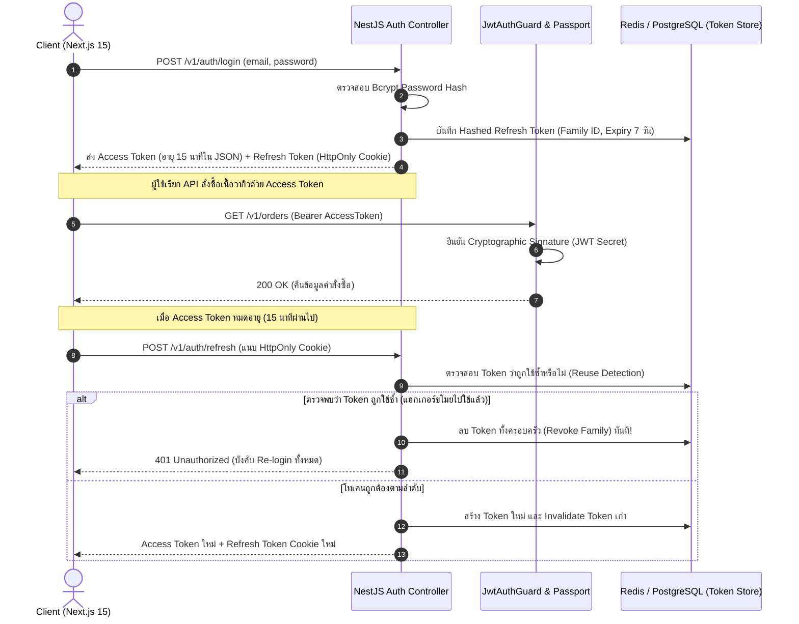

# Authentication & IAM: Enterprise Security Architecture Blueprint

ยินดีต้อนรับสู่พิมพ์เขียวสถาปัตยกรรมระบบบริหารจัดการตัวตนและการเข้าถึงข้อมูล (**Identity & Access Management - IAM**) ระดับ Enterprise สำหรับเฟรมเวิร์ก **NestJS 11** ที่ถูกนำมาปรับใช้จริงในระบบพาณิชย์อิเล็กทรอนิกส์ **Smart Butcher Marketplace** (แพลตฟอร์มตลาดประมูลและสั่งซื้อเนื้อวากิวเกรด A5 และเนื้อ Dry-Aged บ่มพิเศษ)

เอกสารฉบับนี้กำหนดมาตรฐานความมั่นคงปลอดภัยขั้นสูง ตั้งแต่การเข้ารหัสผ่านทางเดียวด้วย **Bcrypt (Adaptive Hashing)**, กลไกยืนยันตัวตนแบบ **Hybrid Dual-Token Architecture (Access Token + HttpOnly Refresh Token)**, การควบคุมสิทธิ์ตามบทบาทหน้าที่ (**Role-Based Access Control - RBAC**), ตลอดจนกลยุทธ์การตรวจจับและสกัดกั้นการโจรกรรมโทเคน (**Refresh Token Rotation & Reuse Detection**) ตามมาตรฐาน **NIST SP 800-63B**

---

## 1. แนวคิด (Concept)

ในระบบ Backend ระดับ Production การรักษาความปลอดภัยแบ่งออกเป็น 2 กระบวนการที่ต้องแยกขาดจากกัน:
1. **Authentication (AuthN - คุณคือใคร?)**: การพิสูจน์ยืนยันว่าผู้ที่ส่งคำขอเข้ามาคือเจ้าของบัญชีตัวจริง เช่น การตรวจสอบอีเมลและรหัสผ่าน การใช้ One-Time Password (OTP) ทาง SMS หรือการยืนยันตัวตนผ่านพาสคีย์ (Passkeys / WebAuthn)
2. **Authorization (AuthZ - คุณมีสิทธิ์ทำอะไร?)**: เมื่อระบบรู้แล้วว่าคุณคือใคร ระบบจะตรวจสอบต่อว่าคุณได้รับอนุญาตให้เข้าถึงทรัพยากรนั้นหรือไม่ เช่น ลูกค้าทั่วไป (`CUSTOMER`) มีสิทธิ์ดูรายการเนื้อและสั่งซื้อ แต่ไม่มีสิทธิ์ปรับแก้ราคาสินค้า หรือเข้าถึงแดชบอร์ดสรุปยอดขายของเชฟเขียงเนื้อ (`BUTCHER_CHEF`) หรือผู้ดูแลระบบ (`ADMIN`)

<Callout type="warning" title="กฎเหล็กด้านการจัดการรหัสผ่าน">
ห้ามจัดเก็บรหัสผ่านเป็นข้อความธรรมดา (Plaintext) หรือใช้การเข้ารหัสแบบย้อนกลับได้ (Symmetric Encryption) และห้ามใช้อัลกอริทึม Fast Hash ตระกูล MD5 หรือ SHA-256 เด็ดขาด เพราะสามารถถูกถอดรหัสด้วยตาราง Rainbow Table หรือการคำนวณผ่าน GPU ได้อย่างง่ายดาย ต้องใช้เฉพาะ Slow Adaptive Hashes เช่น Bcrypt หรือ Argon2id เท่านั้น
</Callout>

---

## 2. หลักการเบื้องหลัง (Under the Hood)

### 2.1 เปรียบเทียบ End-to-End Security Architecture

การเลือกสถาปัตยกรรมการจัดการ Session ส่งผลต่อทั้งความปลอดภัยและขีดความสามารถในการขยายระบบ (Scalability):

| มิติการประเมิน | Stateful Session (Redis Store) | Pure Stateless JWT (localStorage) | Hybrid HttpOnly Token Rotation (แนะนำ) |
| :--- | :--- | :--- | :--- |
| **การจัดเก็บในฝั่ง Client** | Cookie (`connect.sid`) | Web Storage (`localStorage`) | Memory (Access Token) + HttpOnly Cookie (Refresh Token) |
| **ความเสี่ยงต่อ XSS** | ต่ำ (ถ้าเปิด `HttpOnly`) | **สูงมาก** (JavaScript อ่านและขโมยโทเคนได้ทันที) | **ต่ำมาก** (XSS ขโมย Refresh Token ใน Cookie ไม่ได้) |
| **ความเสี่ยงต่อ CSRF** | สูง (ต้องมี Anti-CSRF Token) | ไม่มี (เพราะส่งผ่าน Authorization Header) | ต่ำถึงไม่มี (ใช้ `SameSite=Strict` หรือ `Lax`) |
| **Scalability ของระบบ** | ปานกลาง (ต้องพึ่งพา Redis Cluster) | สูงมาก (เซิร์ฟเวอร์ไม่ต้องเช็ก Database) | สูงมาก (เซิร์ฟเวอร์เช็ก DB เฉพาะตอนขอ Refresh Token) |
| **การเพิกถอนสิทธิ์ (Revocation)** | ทำได้ทันที (ลบคีย์ใน Redis) | ทำไม่ได้จนกว่า Token จะหมดอายุ | ทำได้รวดเร็ว (Access Token อายุสั้นเพียง 15 นาที) |

### 2.2 วงจรสถาปัตยกรรม Hybrid Token Rotation & Reuse Detection

ระบบ **Smart Butcher Marketplace** เลือกใช้สถาปัตยกรรม **Hybrid HttpOnly Token Rotation** เพื่อความปลอดภัยสูงสุด:



### 2.3 ตารางสารบัญเจาะลึก 6 หัวข้อย่อยในโมดูล Authentication

| ลำดับ | หัวข้อย่อย | ขอบเขตเนื้อหาและแกนสถาปัตยกรรม | ลิงก์เข้าสู่บทเรียน |
| :---: | :--- | :--- | :--- |
| 1 | **Auth Flow Bcrypt** | วงจรการสมัครสมาชิก การเข้าสู่ระบบ การคำนวณ Salt Rounds และการเข้ารหัสรหัสผ่าน | [เปิดอ่าน Auth Flow Bcrypt](/docs/backend/authentication/auth-flow-bcrypt) |
| 2 | **JWT HttpOnly** | การตั้งค่า Cookie Security Flags (`HttpOnly`, `Secure`, `SameSite=Strict`) ใน NestJS | [เปิดอ่าน JWT HttpOnly](/docs/backend/authentication/jwt-httponly) |
| 3 | **JWT vs Session** | การเปรียบเทียบเชิงลึกด้าน Performance, Memory, Horizontal Scaling และ Trade-offs | [เปิดอ่าน JWT vs Session](/docs/backend/authentication/jwt-vs-session) |
| 4 | **Passport Guard** | สถาปัตยกรรม Passport.js, `LocalStrategy`, `JwtStrategy`, และ NestJS CanActivate Guards | [เปิดอ่าน Passport Guard](/docs/backend/authentication/passport-guard) |
| 5 | **RBAC Decorator** | การควบคุมสิทธิ์ตามบทบาทด้วย `@Roles()`, Custom Decorators และ Reflection API | [เปิดอ่าน RBAC Decorator](/docs/backend/authentication/rbac-decorator) |
| 6 | **Token Rotation** | กลไก Refresh Token Rotation, Cryptographic Token Family และ Automatic Reuse Detection | [เปิดอ่าน Token Rotation](/docs/backend/authentication/token-rotation) |
| 7 | **Anti-patterns** | ข้อผิดพลาดร้ายแรงด้านความปลอดภัย (Anti-patterns), เช็กลิสต์ความพร้อมก่อนส่งมอบ | [เปิดอ่าน Anti-patterns](/docs/backend/authentication/pitfalls) |

---

## 3. ตัวอย่างโค้ด (Smart Butcher Marketplace)

### ตัวอย่างที่ 1: การสร้าง RolesGuard ร่วมกับ Reflector และ Custom Decorator สำหรับร้านค้าเนื้อ

โค้ดนี้แสดงการปกป้อง API สำหรับจัดการสต็อกเนื้อสัตว์พรีเมียม โดยเปิดให้เฉพาะผู้ใช้ที่มีบทบาท `ADMIN` หรือ `BUTCHER_CHEF` เข้าถึงได้:

```typescript filename="src/modules/auth/decorators/roles.decorator.ts"
import { SetMetadata, CustomDecorator } from '@nestjs/common';
import { Role } from '@prisma/client';

export const ROLES_KEY = 'roles';
export const Roles = (...roles: Role[]): CustomDecorator<string> =>
  SetMetadata(ROLES_KEY, roles);
```

```typescript filename="src/modules/auth/guards/roles.guard.ts"
import {
  Injectable,
  CanActivate,
  ExecutionContext,
  ForbiddenException,
} from '@nestjs/common';
import { Reflector } from '@nestjs/core';
import { Role } from '@prisma/client';
import { ROLES_KEY } from '../decorators/roles.decorator';
import { UserPayload } from '../interfaces/user-payload.interface';

@Injectable()
export class RolesGuard implements CanActivate {
  constructor(private readonly reflector: Reflector) {}

  canActivate(context: ExecutionContext): boolean {
    const requiredRoles = this.reflector.getAllAndOverride<Role[]>(ROLES_KEY, [
      context.getHandler(),
      context.getClass(),
    ]);

    // หาก Endpoint ไม่ได้กำหนด @Roles() แสดงว่าเป็น Public หรือต้องการแค่ Login
    if (!requiredRoles || requiredRoles.length === 0) {
      return true;
    }

    const request = context.switchToHttp().getRequest();
    const user: UserPayload = request.user;

    if (!user || !user.role) {
      throw new ForbiddenException('ไม่พบข้อมูลสิทธิ์ของผู้ใช้งานในระบบ');
    }

    const hasPermission = requiredRoles.some((role) => role === user.role);

    if (!hasPermission) {
      throw new ForbiddenException(
        `คุณไม่มีสิทธิ์ในการกระทำนี้ สิทธิ์ที่ต้องการ: [${requiredRoles.join(', ')}] สิทธิ์ของคุณ: ${user.role}`,
      );
    }

    return true;
  }
}
```

---

### ตัวอย่างที่ 2: สถาปัตยกรรม Refresh Token Rotation พร้อมระบบตรวจจับ Token Reuse Detection ใน AuthService

โค้ดนี้แสดงการหมุนเวียน Token เมื่อ Access Token หมดอายุ พร้อมระบบป้องกันการโจรกรรมโทเคน หากพบว่า Refresh Token เดิมถูกนำมาเรียกซ้ำ ระบบจะสั่งเพิกถอน Token ทั้งหมดของผู้ใช้ทันทีเพื่อความปลอดภัย:

```typescript filename="src/modules/auth/auth.service.ts"
import {
  Injectable,
  UnauthorizedException,
  Logger,
} from '@nestjs/common';
import { JwtService } from '@nestjs/jwt';
import { ConfigService } from '@nestjs/config';
import * as bcrypt from 'bcrypt';
import { PrismaService } from '../../database/prisma.service';
import { UserPayload } from './interfaces/user-payload.interface';

@Injectable()
export class AuthService {
  private readonly logger = new Logger(AuthService.name);

  constructor(
    private readonly prisma: PrismaService,
    private readonly jwtService: JwtService,
    private readonly configService: ConfigService,
  ) {}

  /**
   * สร้าง Access Token อายุสั้น (15 นาที) และ Refresh Token อายุยาว (7 วัน)
   */
  async generateTokens(payload: UserPayload): Promise<{ accessToken: string; refreshToken: string }> {
    const accessToken = await this.jwtService.signAsync(
      { sub: payload.id, email: payload.email, role: payload.role },
      {
        secret: this.configService.getOrThrow<string>('JWT_ACCESS_SECRET'),
        expiresIn: '15m',
      },
    );

    const refreshToken = await this.jwtService.signAsync(
      { sub: payload.id },
      {
        secret: this.configService.getOrThrow<string>('JWT_REFRESH_SECRET'),
        expiresIn: '7d',
      },
    );

    return { accessToken, refreshToken };
  }

  /**
   * ต่ออายุ Token พร้อมกลไกตรวจจับการขโมย Token (Token Reuse Detection)
   */
  async refreshAccessToken(
    userId: string,
    incomingRefreshToken: string,
  ): Promise<{ accessToken: string; newRefreshToken: string }> {
    const user = await this.prisma.user.findUnique({
      where: { id: userId },
      include: { refreshTokens: true },
    });

    if (!user || user.refreshTokens.length === 0) {
      throw new UnauthorizedException('สิทธิ์การเข้าถึงถูกเพิกถอน กรุณาเข้าสู่ระบบใหม่');
    }

    // ค้นหาว่า Refresh Token ที่ส่งมาตรงกับ Record ใดในฐานข้อมูล
    let matchedTokenRecord = null;
    for (const record of user.refreshTokens) {
      const isMatch = await bcrypt.compare(incomingRefreshToken, record.tokenHash);
      if (isMatch) {
        matchedTokenRecord = record;
        break;
      }
    }

    // 🚨 ตรวจจับกรณีโทเคนถูกขโมย (Replay / Reuse Attack)
    if (!matchedTokenRecord) {
      this.logger.warn(
        `[SECURITY ALERT] ตรวจพบการใช้ Refresh Token ซ้ำหรือผิดปกติในบัญชี User ID: ${userId} ระบบจะทำการเพิกถอนสิทธิ์ทุกอุปกรณ์ทันที!`,
      );
      // สั่งล้าง Session ทุกอุปกรณ์ทันที เพื่อปกป้องบัญชีผู้ใช้
      await this.prisma.refreshToken.deleteMany({
        where: { userId },
      });
      throw new UnauthorizedException('ตรวจพบภัยคุกคามความปลอดภัย กรุณาเข้าสู่ระบบใหม่');
    }

    // ตรวจสอบวันหมดอายุ
    if (new Date() > matchedTokenRecord.expiresAt) {
      await this.prisma.refreshToken.delete({ where: { id: matchedTokenRecord.id } });
      throw new UnauthorizedException('เซสชันหมดอายุ กรุณาเข้าสู่ระบบใหม่');
    }

    // 🔄 หมุนเวียน Token (สร้าง Token ชุดใหม่ และลบ Token เก่าทิ้ง)
    const payload: UserPayload = { id: user.id, email: user.email, role: user.role };
    const { accessToken, refreshToken: newRefreshToken } = await this.generateTokens(payload);

    // Hash Token ใหม่ก่อนบันทึก
    const saltRounds = 10;
    const newHash = await bcrypt.hash(newRefreshToken, saltRounds);

    await this.prisma.$transaction([
      this.prisma.refreshToken.delete({ where: { id: matchedTokenRecord.id } }),
      this.prisma.refreshToken.create({
        data: {
          userId: user.id,
          tokenHash: newHash,
          expiresAt: new Date(Date.now() + 7 * 24 * 60 * 60 * 1000), // 7 วัน
          userAgent: matchedTokenRecord.userAgent,
          ipAddress: matchedTokenRecord.ipAddress,
        },
      }),
    ]);

    return { accessToken, newRefreshToken };
  }
}
```

---

## 4. ข้อผิดพลาดที่พบบ่อย (Anti-pattern vs Best Practice)

### 4.1 Anti-pattern: การเก็บ JWT ไว้ใน LocalStorage ฝั่งไคลเอนต์

```typescript
// ❌ ผิดมหันต์: บันทึก Access/Refresh Token ลงใน localStorage
localStorage.setItem('access_token', token);
```

**ผลกระทบเชิงลบ**:
`localStorage` ไม่มีระบบป้องกันการเข้าถึงจาก JavaScript โค้ดของบุคคลที่สาม หรือ Third-party Library (เช่น Google Tag Manager, NPM Package ที่ฝังโค้ดอันตราย) สามารถรันคำสั่ง `localStorage.getItem('access_token')` และส่งโทเคนไปยังเซิร์ฟเวอร์ของแฮกเกอร์ได้ทันทีผ่านช่องโหว่ XSS (Cross-Site Scripting)

**แนวทางที่ถูกต้อง (Best Practice)**:
- เก็บ **Refresh Token** ไว้ใน Cookie ชนิด `HttpOnly; Secure; SameSite=Strict; Path=/v1/auth/refresh` ซึ่ง JavaScript ในเบราว์เซอร์ไม่สามารถเข้าถึงได้เลย
- เก็บ **Access Token** ไว้ในหน่วยความจำของ JavaScript (In-Memory State / React Query Cache) ที่จะหายไปเมื่อปิดแท็บเบราว์เซอร์

### 4.2 Anti-pattern: การตั้งอายุ Access Token ยาวนานข้ามวัน (Long-lived Access Token)

-  ตั้ง Access Token มีอายุ 30 วัน: หากผู้ใช้ถูกขโมยโทเคน แฮกเกอร์จะสามารถเข้าถึงบัญชี สั่งซื้อเนื้อวากิว และขโมยแต้มสะสมได้ตลอด 30 วันโดยที่ระบบไม่สามารถดักจับหรือสั่งเตะออกจากระบบได้เลย
-  ตั้ง Access Token สั้น 15 นาที + Refresh Token 7 วัน: แม้แฮกเกอร์จะดักจับ Access Token ได้ โทเคนนั้นจะมีอายุการใช้งานเหลือเพียงไม่กี่นาที และไม่สามารถใช้ต่ออายุใหม่ได้หากไม่มี Cookie

---

## 5. ควรใช้เมื่อไหร่ และ ไม่ควรใช้เมื่อไหร่

### ควรใช้ JWT + Passport.js เมื่อ:
1. **สถาปัตยกรรม Decoupled / Microservices**: บริการฝั่ง Backend ประกอบด้วยหลายโมดูล (เช่น Order Service, Product Service, Payment Service) ทุกบริการสามารถตรวจสอบความถูกต้องของ JWT Signature ได้ทันทีผ่าน Public Key หรือ Secret เดียวกัน โดยไม่ต้องยิงคำขอไปถาม Auth Database ซ้ำซ้อน
2. **ระบบรองรับทั้ง Web และ Mobile App**: Mobile App ไม่รองรับระบบ Cookie แบบดั้งเดิมได้ดีเท่ากับ HTTP Authorization Bearer Token
3. **ระบบต้องการลดภาระของฐานข้อมูล**: การตรวจสอบสิทธิ์ในทุก Endpoint สามารถจบได้ที่ระดับ CPU ผ่านอัลกอริทึมการคำนวณ Signature ของ JWT

### ไม่ควรใช้ Stateless JWT เมื่อ:
1. **ระบบแอปพลิเคชันที่ต้องการการเพิกถอนสิทธิ์แบบวินาทีต่อวินาที (Real-time Revocation)**: เช่น ระบบธนาคารพาณิชย์ หรือระบบเทรดหุ้น ที่เมื่อผู้ใช้กดบล็อกบัตร หรือเปลี่ยนสถานะ ต้องให้ผลลัพธ์ตัดการเชื่อมต่อทันทีทุกเครื่อง ในกรณีนี้การใช้ **Stateful Session บน Redis** จะควบคุมสถานะได้ง่ายและปลอดภัยกว่า
2. **ระบบ Monolith ขนาดเล็ก**: สำหรับเว็บแอปพลิเคชันที่รันบนเซิร์ฟเวอร์เครื่องเดียว การใช้ Session แบบคลาสสิกของ Express (`express-session`) ร่วมกับ PostgreSQL หรือ Redis มีความซับซ้อนน้อยกว่าการบริหารจัดการ JWT และ Refresh Token Rotation มาก

---

## 6. คำถามสัมภาษณ์งาน (Interview Q&A)

### Q1: อธิบายกลไก Refresh Token Rotation (RTR) พร้อม Automatic Reuse Detection อย่างละเอียด หากแฮกเกอร์ขโมย Refresh Token ไปได้ ระบบจะตรวจจับและปกป้องบัญชีผู้ใช้อย่างไร?
> **แนวคำตอบระดับ Principal Architect:**
> กลไก **Refresh Token Rotation (RTR)** เป็นไปตามมาตรฐาน **OAuth 2.0 Security Best Current Practice**:
> 1. ทุกครั้งที่ผู้ใช้ส่ง Refresh Token เก่า (`RT1`) มาขอโทเคนใหม่ เซิร์ฟเวอร์จะสร้าง Refresh Token ชุดใหม่ (`RT2`) ส่งกลับไป และทำลายหรือเปลี่ยนสถานะของ `RT1` ให้เป็นโมฆะทันที
> 2. โทเคนแต่ละตระกูลจะถูกผูกเข้ากับ `family_id` เดียวกัน
> 3. **กรณีเกิดการโจรกรรม**:
>    - สมมติแฮกเกอร์ขโมย `RT1` ไปได้ และผู้ใช้ตัวจริงนำ `RT1` ไปแลกเป็น `RT2` สำเร็จแล้ว
>    - ต่อมา แฮกเกอร์พยายามนำ `RT1` อันเดิมที่ขโมยมาได้มายื่นขอ Token ใหม่
>    - เซิร์ฟเวอร์ตรวจสอบฐานข้อมูลแล้วพบว่า `RT1` เป็นโทเคนที่ **ถูกใช้งานไปแล้ว (Invalidated/Consumed)**
>    - ระบบจะส่งสัญญาณเตือนภัยทันทีว่าเกิด **Token Reuse Incident** ซึ่งแปลว่ามีคนถือโทเคนซ้ำกันอย่างน้อย 2 คน
>    - เซิร์ฟเวอร์จะสั่งลบหรือเพิกถอนโทเคนทั้งหมดที่อยู่ใน `family_id` นั้นทันที ส่งผลให้ทั้งแฮกเกอร์และผู้ใช้ตัวจริงหลุดออกจากระบบ และบังคับให้ผู้ใช้เข้าสู่ระบบใหม่ด้วยรหัสผ่านพร้อมแจ้งเตือนทางอีเมล

### Q2: ในสถาปัตยกรรม Stateless JWT เราจะทำฟีเจอร์ "Logout from all devices" หรือ "Ban User ทันที" ได้อย่างไรโดยไม่ต้องเปลี่ยนกลับไปเป็น Stateful Session เต็มรูปแบบ?
> **แนวคำตอบระดับ Principal Architect:**
> เราสามารถใช้เทคนิคผสมผสานระหว่าง **Token Versioning** และ **Distributed Blacklist** ได้ 2 รูปแบบ:
> 1. **User Token Version (`tokenVersion`) ในฐานข้อมูล**:
>    - เพิ่มคอลัมน์ `tokenVersion Int @default(0)` ในตาราง `User`
>    - ในขั้นตอนสร้าง Access Token ให้ฝัง `tokenVersion` ลงใน Payload: `{ sub: user.id, version: user.tokenVersion }`
>    - เมื่อผู้ใช้กด "Logout from all devices" หรือแอดมินสั่งแบน ให้รันคำสั่ง `UPDATE "User" SET "tokenVersion" = "tokenVersion" + 1 WHERE id = userId`
>    - ใน `JwtStrategy` ฝั่งเซิร์ฟเวอร์ ให้ตรวจสอบว่า `payload.version === currentUser.tokenVersion` หรือไม่ หากไม่ตรงกันให้ปฏิเสธคำขอทันที
> 2. **Redis Revocation List (สำหรับ Access Token อายุสั้น)**:
>    - เมื่อผู้ใช้กดออกจากระบบ นำ `jti` (JWT Unique ID) ของ Access Token นั้นไปบันทึกไว้ใน Redis พร้อมกำหนด TTL เท่ากับเวลาที่เหลืออยู่ของโทเคน (เช่น ไม่เกิน 15 นาที)
>    - เมื่อมีคำขอเข้ามา ให้ตรวจสอบใน Redis คีย์สั้นๆ หากพบว่าอยู่ใน Blacklist ให้ส่ง 401 Unauthorized ทันที เมื่อครบ 15 นาที คีย์นั้นจะระเหยออกจาก Redis เองโดยอัตโนมัติ ไม่เปลืองหน่วยความจำ

---

## Production Checklist ก่อน Go-live ด้านระบบยืนยันตัวตน

- [ ] **1. High-Entropy Secrets**: ค่า `JWT_ACCESS_SECRET` และ `JWT_REFRESH_SECRET` ต้องสร้างจาก Cryptographically Secure Pseudo-Random Generator (ความยาวอย่างน้อย 64 ตัวอักษร) และเก็บใน Secret Manager
- [ ] **2. Short Expiry Windows**: ตั้งเวลา Access Token ไม่เกิน 15 นาที และ Refresh Token ไม่เกิน 7 วัน
- [ ] **3. Strict Cookie Attributes**: คอนฟิก Cookie สำหรับ Refresh Token ด้วยแฟล็ก `HttpOnly: true`, `Secure: true`, `SameSite: 'strict'`, และจำกัด `Path: '/v1/auth'`
- [ ] **4. Bcrypt Cost Factor**: ใช้ Salt Rounds อย่างน้อย 12 รอบในการ Hash รหัสผ่าน เพื่อชะลอการเจาะรหัสผ่านแบบ Brute-force
- [ ] **5. Token Reuse Detection**: มีการบันทึก Hash ของ Refresh Token ในฐานข้อมูล และล้าง Session ทันทีเมื่อตรวจพบการ Replay Token เดิม
- [ ] **6. Timing-Safe Comparison**: ใช้ `bcrypt.compare` หรือ `crypto.timingSafeEqual` ในการเปรียบเทียบรหัสผ่าน เพื่อป้องกันช่องโหว่ Timing Attacks
- [ ] **7. Brute-Force Rate Limiting**: ติดตั้ง Throttler จำกัดการเข้าสู่ระบบไม่เกิน 5 ครั้งต่อนาทีต่อ IP และมีระบบ Account Lockout ชั่วคราวเมื่อใส่รหัสผิดติดต่อกัน 5 ครั้ง
- [ ] **8. Granular RBAC Guards**: มีการประกาศใช้ `@UseGuards(JwtAuthGuard, RolesGuard)` บนทุก Controller และครอบคลุมทุก Method ที่ต้องการจำกัดสิทธิ์
- [ ] **9. Token Revocation Mechanism**: รองรับการสั่งเตะผู้ใช้รายบุคคลออกจากระบบผ่าน Redis Blacklist หรือ `tokenVersion`
- [ ] **10. Audit Logging**: บันทึก Log ทุกเหตุการณ์สำคัญ เช่น Login สำเร็จ, Login ล้มเหลว, การเปลี่ยนรหัสผ่าน, และการแจ้งเตือน Token Reuse โดยไม่บันทึก Plaintext Password ลง Log

---

## ลำดับการเรียนที่แนะนำ และ ดูเพิ่มเติมที่

เพื่อความเชี่ยวชาญในระบบความปลอดภัยและการจัดการสิทธิ์ ขอแนะนำให้ศึกษาหัวข้อต่างๆ ตามลำดับดังต่อไปนี้:

1. วงจรการเข้าสู่ระบบและการแฮชรหัสผ่าน: [Auth Flow Bcrypt](/docs/backend/authentication/auth-flow-bcrypt)
2. สถาปัตยกรรมการจัดเก็บโทเคนอย่างปลอดภัย: [JWT HttpOnly](/docs/backend/authentication/jwt-httponly)
3. ศึกษาวิเคราะห์เปรียบเทียบเชิงสถาปัตยกรรม: [JWT vs Session](/docs/backend/authentication/jwt-vs-session)
4. การสร้าง Guard และ Strategy ใน NestJS: [Passport Guard](/docs/backend/authentication/passport-guard)
5. การสร้างระบบควบคุมสิทธิ์ระดับ Enterprise: [RBAC Decorator](/docs/backend/authentication/rbac-decorator)
6. สถาปัตยกรรมขั้นสูงในการหมุนเวียนโทเคน: [Token Rotation](/docs/backend/authentication/token-rotation)
7. สถาปัตยกรรม Social Login (Google & LINE): [OAuth & Social](/docs/backend/authentication/oauth-social)
8. การยืนยันอีเมลด้วย Token แบบสุ่มและการป้องกันสแปม: [Email Verification](/docs/backend/authentication/email-verify)
9. การกู้คืนรหัสผ่านความปลอดภัยสูงและการเพิกถอนเซสชัน: [Reset Password](/docs/backend/authentication/reset-password)
10. ระบบยืนยันตัวตนสองชั้นด้วย TOTP RFC 6238: [2FA / MFA](/docs/backend/authentication/two-factor)
11. หลุมพรางด้านความปลอดภัยที่ต้องระวัง: [Authentication Anti-patterns](/docs/backend/authentication/pitfalls)
