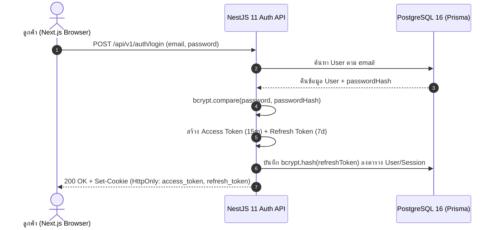
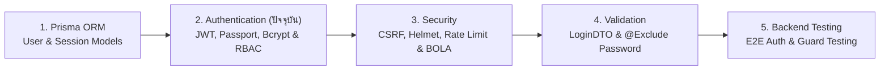

# Authentication

คู่มือการออกแบบและพัฒนาระบบยืนยันตัวตน (**Authentication**) และการกำหนดสิทธิ์เข้าถึง (**Authorization**) ระดับ Production-Grade บน **NestJS 11** สำหรับระบบอีคอมเมิร์ซ **Smart Butcher Marketplace** ครอบคลุมตั้งแต่การเข้ารหัสรหัสผ่านทางเดียวด้วย **Bcrypt**, กลไก **Dual-Token JWT Architecture (Access Token + Refresh Token)** ที่จัดเก็บผ่าน **HttpOnly Cookie**, การสร้าง **Passport.js Strategies & Guards**, การควบคุมสิทธิ์ตามบทบาท (**RBAC**: `CUSTOMER`, `BUTCHER_CHEF`, `ADMIN`), ไปจนถึงกลไก **Refresh Token Rotation & Reuse Detection** เพื่อป้องกันการโจรกรรมเซสชันอย่างสมบูรณ์

## สารบัญหัวข้อในหน้านี้

| ลำดับ | หัวข้อหลัก | สิ่งที่คุณจะได้เรียนรู้ |
| :--- | :--- | :--- |
| **1** | [1. สถาปัตยกรรม End-to-End Auth Flow และการ Hash รหัสผ่านด้วย Bcrypt](#1-สถาปัตยกรรม-end-to-end-auth-flow-และการ-hash-รหัสผ่านด้วย-bcrypt) | ภาพรวมวงจรการยืนยันตัวตน, กลไก Salt + Cost Factor ของ Bcrypt และการป้องกัน Timing Attacks |
| **2** | [2. กลไก JWT (Access Token & Refresh Token) และการตั้งค่า HttpOnly Cookie](#2-กลไก-jwt-access-token-refresh-token-และการตั้งค่า-httponly-cookie) | โครงสร้าง Header.Payload.Signature, อายุของ Token ทั้งสองชนิด และการตั้งค่า Cookie Flags ที่ปลอดภัย |
| **3** | [3. Passport.js Strategies (Local & JWT) และ AuthGuard ใน NestJS 11](#3-passportjs-strategies-local-jwt-และ-authguard-ใน-nestjs-11) | การเขียน `JwtStrategy` ดึง Token จาก Cookie/Header และการทำ Global `JwtAuthGuard` คู่กับ `@Public()` |
| **4** | [4. Role-Based Access Control (RBAC) และ Custom @CurrentUser Decorator](#4-role-based-access-control-rbac-และ-custom-currentuser-decorator) | การสร้าง `@Roles()` Decorator, `RolesGuard` และ `@CurrentUser()` แบบ Type-safe |
| **5** | [5. Refresh Token Rotation, ระบบ Logout และการเพิกถอนสิทธิ์](#5-refresh-token-rotation-ระบบ-logout-และการเพิกถอนสิทธิ์) | การเก็บ Hash ของ Refresh Token, การสลับ Token ใหม่ทุกครั้งที่ใช้ และการตรวจจับการขโมย Token |
| **6** | [6. เปรียบเทียบ JWT vs Session และ Cookie vs localStorage](#6-เปรียบเทียบ-jwt-vs-session-และ-cookie-vs-localstorage) | วิเคราะห์ข้อดี-ข้อเสียเชิงสถาปัตยกรรมและความปลอดภัยต่อช่องโหว่ XSS และ CSRF |
| **7** | [ข้อผิดพลาดที่พบบ่อย (Anti-patterns)](#ข้อผิดพลาดที่พบบ่อย-anti-patterns) | หลุมพรางด้านความปลอดภัยที่พบบ่อยในการทำระบบ Login และ JWT |
| **8** | [Checklist สรุป](#checklist-สรุป) | ตารางตรวจสอบความมั่นคงปลอดภัยของระบบ Authentication ก่อนขึ้น Production |
| **9** | [ลำดับการเรียนที่แนะนำ และ ดูเพิ่มเติมที่](#ลำดับการเรียนที่แนะนำ-และ-ดูเพิ่มเติมที่) | แผนผังการเรียนรู้ต่อเนื่องและลิงก์เชื่อมโยงสู่บทเรียนที่เกี่ยวข้อง |

---

## 1. สถาปัตยกรรม End-to-End Auth Flow และการ Hash รหัสผ่านด้วย Bcrypt

### แนวคิด (Concept)
ในระบบ Production เราต้องแยกความแตกต่างระหว่าง 2 คำนี้อย่างชัดเจน:
1. **Authentication (AuthN - การยืนยันตัวตน)**: กระบวนการพิสูจน์ว่า *"คุณคือใคร?"* เช่น ลูกค้ากรอกอีเมลและรหัสผ่านเพื่อเข้าสู่ระบบสั่งซื้อเนื้อวากิว
2. **Authorization (AuthZ - การตรวจสอบสิทธิ์)**: กระบวนการตรวจสอบว่า *"คุณได้รับอนุญาตให้ทำอะไรได้บ้าง?"* เช่น เชฟแล่เนื้อ (`BUTCHER_CHEF`) สามารถอัปเดตสถานะการตัดแต่งเนื้อใน `Order` ได้ แต่ไม่สามารถกดคืนเงิน (`Payment` Refund) ซึ่งสงวนไว้ให้ `ADMIN` เท่านั้น

สำหรับการจัดเก็บรหัสผ่านในฐานข้อมูล กฎเหล็กอันดับหนึ่งคือ **ห้ามเก็บรหัสผ่านเป็นข้อความธรรมดา (Plaintext) หรือใช้อัลกอริทึมที่ถอดรหัสกลับได้ (Encryption) หรือใช้ Hash ความเร็วสูงทั่วไป (เช่น MD5, SHA-256) เด็ดขาด** แต่ต้องใช้ Password Hashing Algorithm ที่ออกแบบมาให้ทำงานช้าอย่างจงใจและมี Salt ในตัว เช่น **Bcrypt** หรือ **Argon2id**



### หลักการเบื้องหลัง (Under the Hood)
ทำไมเราจึงใช้ **Bcrypt** แทน `SHA-256`?
- `SHA-256` ถูกออกแบบมาให้คำนวณเร็วที่สุดเท่าที่จะเป็นไปได้ การ์ดจอ (GPU) สมัยใหม่สามารถสุ่มเดารหัสผ่าน (Brute-force) ด้วย `SHA-256` ได้มากกว่าหมื่นล้านครั้งต่อวินาที
- **Bcrypt** ใช้พื้นฐานของอัลกอริทึม Eksblowfish ที่มีพารามิเตอร์ **Cost Factor (Salt Rounds)** เช่น `12` ซึ่งหมายถึงการวนลูปคำนวณ $2^{12} = 4,096$ รอบ ใช้เวลาประมาณ `150–250 มิลลิวินาที` ต่อการตรวจสอบ 1 ครั้ง ช้าพอที่แฮกเกอร์จะไม่สามารถสุ่มรหัสผ่านจำนวนมากได้ แต่เร็วพอที่ผู้ใช้งานจริงตอนกด Login จะไม่รู้สึกติดขัด
- โครงสร้างสตริงผลลัพธ์ของ Bcrypt (ความยาว 60 ตัวอักษร) เช่น `$2b$12$R9h/cIPz0gi.URNNX3kh2OPST9/PgBkqquzi.Ss7KIUgO2t0jWMUW` ได้รวมเอาเวอร์ชัน (`2b`), Cost Factor (`12`), **Random Salt 128-bit (22 ตัวอักษร)** และ **Hash (31 ตัวอักษร)** ไว้ในสตริงเดียวกันแล้ว จึงไม่จำเป็นต้องสร้างคอลัมน์เก็บ Salt แยกต่างหาก

<Callout type="warning" title="ข้อจำกัดความยาว 72 Bytes ของ Bcrypt">
อัลกอริทึม Bcrypt จะตัดข้อความรหัสผ่านที่ความยาวสูงสุด 72 bytes แรกเท่านั้น (ตัวอักษรภาษาอังกฤษ 72 ตัว หรือภาษาไทย UTF-8 ประมาณ 24 ตัวอักษร) ดังนั้นใน DTO ตรวจสอบรหัสผ่านจึงควรกำหนด @MaxLength(64) เสมอเพื่อไม่ให้ผู้ใช้เข้าใจผิดว่ารหัสผ่านที่ยาวกว่านั้นถูกนำมาคิดทั้งหมด
</Callout>

### ตัวอย่างโค้ด (Smart Butcher Marketplace)

#### ตัวอย่างที่ 1: การสร้าง PasswordHashingService ด้วย Bcrypt และการป้องกัน User Enumeration / Timing Attack (พื้นฐาน)
```typescript filename="src/modules/auth/password-hashing.service.ts"
import { Injectable } from '@nestjs/common';
import * as bcrypt from 'bcrypt';

@Injectable()
export class PasswordHashingService {
  // Cost Factor = 12 คือค่ามาตรฐานที่สมดุลระหว่างความปลอดภัยและประสิทธิภาพในปี 2026
  private readonly SALT_ROUNDS = 12;

  // Dummy Hash สำหรับใช้เปรียบเทียบหลอกเมื่อไม่พบอีเมลในระบบ เพื่อป้องกัน Timing Attack
  private readonly DUMMY_BCRYPT_HASH =
    '$2b$12$LQv3c1yqBWVHxkd0LHAkCOYz6TtxMQJqhN8/LewdBPj4tbQJ9.1pe';

  async hashPassword(plainTextPassword: string): Promise<string> {
    return bcrypt.hash(plainTextPassword, this.SALT_ROUNDS);
  }

  async verifyPassword(
    plainTextPassword: string,
    storedHash: string | null | undefined,
  ): Promise<boolean> {
    // หากไม่พบผู้ใช้ในฐานข้อมูล ให้รัน bcrypt.compare กับ DUMMY_HASH เสมอ
    // เพื่อใช้เวลาประมวลผล ~200ms เท่ากันทุกครั้ง ป้องกันแฮกเกอร์จับเวลาเพื่อเช็คว่าอีเมลไหนมีอยู่จริง
    if (!storedHash) {
      await bcrypt.compare(plainTextPassword, this.DUMMY_BCRYPT_HASH);
      return false;
    }

    return bcrypt.compare(plainTextPassword, storedHash);
  }
}
```

#### ตัวอย่างที่ 2: การลงทะเบียนสมาชิกใหม่และตรวจสอบรหัสผ่านใน AuthService (ขั้นสูง)
```typescript filename="src/modules/auth/auth-registration.service.ts"
import {
  Injectable,
  ConflictException,
  UnauthorizedException,
} from '@nestjs/common';
import { UserRole } from '@prisma/client';
import { PrismaService } from '../../database/prisma.service';
import { PasswordHashingService } from './password-hashing.service';

export interface RegisterCustomerInput {
  email: string;
  password: string;
  fullName: string;
  phoneNumber: string;
}

@Injectable()
export class AuthRegistrationService {
  constructor(
    private readonly prisma: PrismaService,
    private readonly passwordHasher: PasswordHashingService,
  ) {}

  async registerCustomer(input: RegisterCustomerInput) {
    const normalizedEmail = input.email.trim().toLowerCase();

    const existingUser = await this.prisma.user.findUnique({
      where: { email: normalizedEmail },
      select: { id: true },
    });

    if (existingUser) {
      throw new ConflictException({
        code: 'EMAIL_ALREADY_REGISTERED',
        message: 'อีเมลนี้ถูกลงทะเบียนเป็นสมาชิก Smart Butcher เรียบร้อยแล้ว',
      });
    }

    const passwordHash = await this.passwordHasher.hashPassword(input.password);

    // บันทึกลงฐานข้อมูลโดยใช้ select เพื่อไม่ให้ส่ง passwordHash กลับออกไปเด็ดขาด
    const createdUser = await this.prisma.user.create({
      data: {
        email: normalizedEmail,
        passwordHash,
        fullName: input.fullName.trim(),
        phoneNumber: input.phoneNumber.trim(),
        role: UserRole.CUSTOMER,
        isActive: true,
      },
      select: {
        id: true,
        email: true,
        fullName: true,
        phoneNumber: true,
        role: true,
        createdAt: true,
      },
    });

    return createdUser;
  }

  async validateUserCredentials(email: string, plainPassword: string) {
    const normalizedEmail = email.trim().toLowerCase();

    const user = await this.prisma.user.findUnique({
      where: { email: normalizedEmail },
      select: {
        id: true,
        email: true,
        passwordHash: true,
        fullName: true,
        role: true,
        isActive: true,
      },
    });

    // เรียก verifyPassword เสมอแม้ user จะเป็น null เพื่อป้องกัน Timing Attack
    const isPasswordValid = await this.passwordHasher.verifyPassword(
      plainPassword,
      user?.passwordHash,
    );

    if (!user || !isPasswordValid || !user.isActive) {
      // ใช้ข้อความ Error เดียวกันเสมอ ไม่บอกแยกว่ารหัสผิดหรืออีเมลไม่มีในระบบ (ป้องกัน User Enumeration)
      throw new UnauthorizedException({
        code: 'INVALID_CREDENTIALS',
        message: 'อีเมลหรือรหัสผ่านไม่ถูกต้อง หรือบัญชีถูกระงับการใช้งาน',
      });
    }

    return {
      id: user.id,
      email: user.email,
      fullName: user.fullName,
      role: user.role,
    };
  }
}
```

### ผิด vs ถูก (Anti-pattern vs Best Practice)

```typescript filename="src/modules/auth/bcrypt-comparison.ts"
import * as bcrypt from 'bcrypt';

// ❌ ผิด (Anti-pattern): ใช้ฟังก์ชัน Synchronous (hashSync / compareSync) และบอกแฮกเกอร์ตรงๆ ว่าอีเมลไหนมีหรือไม่มีในระบบ
export function badLoginCheck(user: any, plainPassword: string) {
  if (!user) {
    // 1. ตอบกลับใน 2ms ทำให้แฮกเกอร์รู้ทันทีว่าอีเมลนี้ยังไม่สมัครสมาชิก
    throw new Error('ไม่พบอีเมลนี้ในระบบ');
  }
  // 2. compareSync บล็อก Node.js Event Loop นาน 200ms! ถ้าคนกด Login พร้อมกัน 20 คน เซิร์ฟเวอร์จะค้างทั้งระบบ!
  const match = bcrypt.compareSync(plainPassword, user.passwordHash);
  if (!match) throw new Error('รหัสผ่านไม่ถูกต้อง');
}

// ✅ ถูก (Best Practice): ใช้ Asynchronous bcrypt.hash / bcrypt.compare (ซึ่งรันใน C++ Thread Pool ไม่บล็อก Event Loop)
// และใช้ข้อความแจ้งเตือนรวม "อีเมลหรือรหัสผ่านไม่ถูกต้อง" พร้อมทำ Constant-time Dummy Verification
```

### ควรใช้เมื่อไหร่ และ ไม่ควรใช้เมื่อไหร่
- **ควรใช้ `bcrypt.hash` และ `bcrypt.compare` (แบบ Async) เสมอ**: สำหรับการเก็บรหัสผ่านของผู้ใช้ และการจัดเก็บ Refresh Token Hash ลงในฐานข้อมูล
- **ไม่ควรใช้ `bcrypt.hashSync` หรือ `bcrypt.compareSync` ใน HTTP Request Handler เด็ดขาด**: เพราะการคำนวณแบบ Synchronous จะหยุดการทำงานของ Single-threaded Event Loop ใน Node.js ทำให้คำขอสั่งซื้อเนื้อของลูกค้ารายอื่นทั้งหมดต้องหยุดรอ

### คำถามสัมภาษณ์ (Interview Q&A)
1. **คำถาม**: ถ้าแฮกเกอร์ได้ข้อมูลตาราง `users` ทั้งหมดไป (Database Dump) การที่รหัสผ่านของลูกค้าสองคนตั้งเหมือนกันว่า `WagyuLover123!` ค่า `password_hash` ในฐานข้อมูลของทั้งสองคนจะเหมือนกันหรือไม่ เพราะเหตุใด?
   - **แนวคำตอบ**: **ไม่เหมือนกันอย่างแน่นอน** เพราะทุกครั้งที่เราเรียก `bcrypt.hash()` ไลบรารีจะสุ่มค่า **Cryptographic Salt ขนาด 128 บิต** ที่ไม่ซ้ำกันขึ้นมาใหม่สำหรับผู้ใช้แต่ละคน แล้วนำ Salt นั้นไปผสมกับรหัสผ่านก่อนเข้ากระบวนการ Hash ส่งผลให้แม้รหัสผ่านตั้งต้นจะเหมือนกันทุกตัวอักษร แต่ค่า `password_hash` ที่ได้จะแตกต่างกันโดยสิ้นเชิง ช่วยป้องกันการโจมตีด้วยตารางสำเร็จรูป (**Rainbow Table Attack**) ได้ 100%
2. **คำถาม**: ทำไมเราจึงไม่ควรแยกข้อความ Error ตอน Login ระหว่าง *"ไม่พบอีเมลนี้ในระบบ"* กับ *"รหัสผ่านผิด"*?
   - **แนวคำตอบ**: เพื่อป้องกันช่องโหว่ **User Enumeration** หากระบบแจ้งแยกชัดเจน ผู้โจมตีสามารถเขียนสคริปต์ยิงรายชื่ออีเมลนับแสนรายการเข้ามาทดสอบเพื่อคัดกรองว่าอีเมลใดเป็นลูกค้า VIP ของร้านค้าเนื้อพรีเมียมบ้าง แล้วนำไปใช้ทำ Phishing หรือ Brute-force เฉพาะบัญชีที่มีอยู่จริงต่อไป

---

## 2. กลไก JWT (Access Token & Refresh Token) และการตั้งค่า HttpOnly Cookie

### แนวคิด (Concept)
**JSON Web Token (JWT - RFC 7519)** คือมาตรฐานการส่งข้อมูลยืนยันตัวตนในรูปแบบ JSON ที่มีการลงลายมือชื่อดิจิทัล (Cryptographic Signature) กำกับไว้ ทำให้เซิร์ฟเวอร์สามารถตรวจสอบความถูกต้องของ Token ได้ทันทีโดยไม่ต้องคิวรีฐานข้อมูลทุกครั้ง (Stateless Verification)

อย่างไรก็ตาม เนื่องจาก JWT ไม่สามารถสั่งยกเลิกกลางคันได้ง่ายๆ หากตั้งอายุยาวเกินไป ในระบบ Production เราจึงใช้สถาปัตยกรรม **Dual-Token (Access Token + Refresh Token)**:
1. **Access Token (อายุสั้นมาก: `15 นาที`)**: ใช้แนบไปกับทุกคำขอ API (เช่น สั่งซื้อเนื้อ, ดูประวัติ `Order`) บรรจุข้อมูลพื้นฐาน (`sub`, `email`, `role`) หากถูกขโมยจะมีเวลาใช้งานสั้นมาก
2. **Refresh Token (อายุยาว: `7 ถึง 30 วัน`)**: ใช้สำหรับขอออก Access Token ใบใหม่เมื่อใบเดิมหมดอายุเท่านั้น โดยจะถูกจัดเก็บHash ไว้ในฐานข้อมูลเพื่อรองรับการสั่งเพิกถอนสิทธิ์ (Revocation) ได้ทันที

### หลักการเบื้องหลัง (Under the Hood)
JWT หนึ่งใบประกอบด้วยสตริง 3 ส่วนคั่นด้วยจุด (`Header.Payload.Signature`) ที่เข้ารหัสแบบ `Base64Url`:
- **Header**: ระบุอัลกอริทึม เช่น `{"alg": "HS256", "typ": "JWT"}` หรือ `RS256` (Asymmetric Key)
- **Payload (Claims)**: เก็บข้อมูล เช่น `sub` (Subject = User ID), `role`, `jti` (JWT ID เฉพาะใบ), `iat` (Issued At), `exp` (Expiration Time) **ข้อควรจำ: Payload เป็นเพียง Base64Url ที่ใครก็ถอดอ่านได้ ห้ามใส่รหัสผ่านหรือเลขบัตรเครดิตไว้ใน Payload เด็ดขาด!**
- **Signature**: ลายเซ็นที่เกิดจากการนำ `Header + "." + Payload` มาเข้าฟังก์ชัน HMAC-SHA256 ร่วมกับ `SECRET_KEY` บนเซิร์ฟเวอร์ หากแฮกเกอร์แอบแก้ `role` ใน Payload จาก `"CUSTOMER"` เป็น `"ADMIN"` ลายเซ็นจะไม่ตรงกับที่เซิร์ฟเวอร์คำนวณได้ และถูกปฏิเสธด้วย `401 Unauthorized` ทันที

สำหรับการจัดเก็บ Token บนเว็บเบราว์เซอร์ การตั้งค่า **`HttpOnly`, `Secure`, `SameSite` Cookie** คือเกราะป้องกันที่แข็งแกร่งที่สุด:
- `httpOnly: true`: ป้องกันโค้ด JavaScript (`document.cookie`) เข้าถึง Token ได้ 100% จึงปลอดภัยจากการถูกขโมย Token ผ่านช่องโหว่ XSS
- `secure: true`: บังคับให้ส่ง Cookie ผ่านการเชื่อมต่อที่เข้ารหัส `HTTPS` เท่านั้น
- `sameSite: 'lax'` หรือ `'strict'`: ป้องกันการส่ง Cookie ข้ามเว็บไซต์โดยไม่ได้รับอนุญาต (ลดความเสี่ยง CSRF)
- `path: '/api/v1/auth/refresh'`: สำหรับ Refresh Token เราสามารถจำกัด `path` ให้เบราว์เซอร์ส่ง Refresh Token เฉพาะตอนที่เรียก Endpoint ขอต่ออายุหรือ Logout เท่านั้น ไม่ต้องส่งไปกับทุก API ทั่วไป!

### ตัวอย่างโค้ด (Smart Butcher Marketplace)

#### ตัวอย่างที่ 1: การสร้าง TokenService สำหรับออก Access Token และ Refresh Token แยก Secret คนละชุด (พื้นฐาน)
```typescript filename="src/modules/auth/token.service.ts"
import { Injectable } from '@nestjs/common';
import { JwtService } from '@nestjs/jwt';
import { ConfigService } from '@nestjs/config';
import { UserRole } from '@prisma/client';
import * as crypto from 'crypto';

export interface AccessTokenPayload {
  sub: string; // User ID
  email: string;
  role: UserRole;
  type: 'ACCESS';
}

export interface RefreshTokenPayload {
  sub: string; // User ID
  jti: string; // Unique Token ID สำหรับทำ Rotation
  type: 'REFRESH';
}

export interface GeneratedTokenPair {
  accessToken: string;
  refreshToken: string;
  refreshTokenJti: string;
}

@Injectable()
export class TokenService {
  constructor(
    private readonly jwtService: JwtService,
    private readonly configService: ConfigService,
  ) {}

  async generateTokenPair(user: {
    id: string;
    email: string;
    role: UserRole;
  }): Promise<GeneratedTokenPair> {
    const refreshTokenJti = crypto.randomUUID();

    const accessPayload: AccessTokenPayload = {
      sub: user.id,
      email: user.email,
      role: user.role,
      type: 'ACCESS',
    };

    const refreshPayload: RefreshTokenPayload = {
      sub: user.id,
      jti: refreshTokenJti,
      type: 'REFRESH',
    };

    // ใช้ Secret Key คนละตัวกันอย่างเด็ดขาดระหว่าง Access Token และ Refresh Token!
    const [accessToken, refreshToken] = await Promise.all([
      this.jwtService.signAsync(accessPayload, {
        secret: this.configService.getOrThrow<string>('JWT_ACCESS_SECRET'),
        expiresIn: '15m',
        issuer: 'smartbutcher-api',
        audience: 'smartbutcher-client',
      }),
      this.jwtService.signAsync(refreshPayload, {
        secret: this.configService.getOrThrow<string>('JWT_REFRESH_SECRET'),
        expiresIn: '7d',
        issuer: 'smartbutcher-api',
        audience: 'smartbutcher-client',
      }),
    ]);

    return {
      accessToken,
      refreshToken,
      refreshTokenJti,
    };
  }
}
```

#### ตัวอย่างที่ 2: การจัดการ HttpOnly Cookie Helper สำหรับแนบและล้าง Token ใน AuthController (ขั้นสูง)
```typescript filename="src/modules/auth/cookie-manager.helper.ts"
import { Response, CookieOptions } from 'express';

export const ACCESS_TOKEN_COOKIE_NAME = 'sb_access_token';
export const REFRESH_TOKEN_COOKIE_NAME = 'sb_refresh_token';

export class AuthCookieManager {
  private static isProduction(): boolean {
    return process.env.NODE_ENV === 'production';
  }

  static attachAuthCookies(
    res: Response,
    accessToken: string,
    refreshToken: string,
  ): void {
    const isProd = this.isProduction();

    // 1. ตั้งค่า Cookie สำหรับ Access Token (ส่งไปกับทุก /api)
    const accessCookieOptions: CookieOptions = {
      httpOnly: true, // ป้องกัน JavaScript (XSS) อ่านค่า
      secure: isProd, // บังคับ HTTPS บน Production
      sameSite: 'lax',
      path: '/api',
      maxAge: 15 * 60 * 1000, // 15 นาที (หน่วยเป็นมิลลิวินาที)
    };

    // 2. ตั้งค่า Cookie สำหรับ Refresh Token (จำกัด Path ให้ส่งเฉพาะตอนเรียก /api/v1/auth เท่านั้น!)
    const refreshCookieOptions: CookieOptions = {
      httpOnly: true,
      secure: isProd,
      sameSite: 'strict', // เข้มงวดสูงสุดสำหรับ Refresh Token
      path: '/api/v1/auth',
      maxAge: 7 * 24 * 60 * 60 * 1000, // 7 วัน
    };

    res.cookie(ACCESS_TOKEN_COOKIE_NAME, accessToken, accessCookieOptions);
    res.cookie(REFRESH_TOKEN_COOKIE_NAME, refreshToken, refreshCookieOptions);
  }

  static clearAuthCookies(res: Response): void {
    const isProd = this.isProduction();

    res.clearCookie(ACCESS_TOKEN_COOKIE_NAME, {
      httpOnly: true,
      secure: isProd,
      sameSite: 'lax',
      path: '/api',
    });

    res.clearCookie(REFRESH_TOKEN_COOKIE_NAME, {
      httpOnly: true,
      secure: isProd,
      sameSite: 'strict',
      path: '/api/v1/auth',
    });
  }
}
```

### ผิด vs ถูก (Anti-pattern vs Best Practice)

```typescript filename="src/modules/auth/jwt-cookie-comparison.ts"
// ❌ ผิด (Anti-pattern): ใช้ Secret Key เดียวกันทั้ง Access/Refresh, ตั้งอายุ Access Token นาน 30 วัน, และใส่ข้อมูลความลับใน Payload
export const BAD_JWT_PAYLOAD = {
  sub: 'usr-123',
  passwordHash: '$2b$12$...', // ห้ามใส่เด็ดขาด! ใครก็เอา JWT ไปถอด Base64 ดูที่ jwt.io ได้!
  creditCardLast4: '8899',
  expiresIn: '30d', // ถ้าหลุดไป แฮกเกอร์สวมรอยสั่งเนื้อวากิวฟรีได้ตลอดทั้งเดือน!
};

// ✅ ถูก (Best Practice): เก็บเฉพาะข้อมูลระบุตัวตนขั้นต่ำ (sub, email, role, type) และแยก Secret Key คนละชุด
// เพราะถ้าใช้ Secret เดียวกัน แฮกเกอร์สามารถนำ Refresh Token ที่อายุ 7 วัน ไปยัดใส่เป็น Access Token ได้!
```

### ควรใช้เมื่อไหร่ และ ไม่ควรใช้เมื่อไหร่
- **ควรตั้งค่า `path: '/api/v1/auth'` ให้กับ Refresh Token Cookie เสมอ**: เพื่อไม่ให้เบราว์เซอร์แนบ Refresh Token ที่มีค่าสูงสุดติดไปกับคำขอดึงรูปภาพหรือดึงแคตตาล็อกสินค้าทั่วไป ลดโอกาสที่ Refresh Token จะรั่วไหลผ่าน Log หรือ Network Sniffing
- **ไม่ควรลืมส่งออปชัน `path`, `sameSite`, `secure` ให้ตรงกันตอนเรียก `res.clearCookie()`**: เพราะตามมาตรฐานของเบราว์เซอร์ หากพารามิเตอร์ `path` ตอนสั่งลบไม่ตรงกับตอนสั่งสร้าง (`res.cookie`) เบราว์เซอร์จะไม่ยอมลบ Cookie นั้นออกจากเครื่องลูกค้า!

### คำถามสัมภาษณ์ (Interview Q&A)
1. **คำถาม**: ถ้า JWT มีการเซ็นลายมือชื่อดิจิทัล (Signed) แล้ว แปลว่าข้อมูลข้างในถูกเข้ารหัส (Encrypted) จนคนนอกอ่านไม่ออกใช่หรือไม่?
   - **แนวคำตอบ**: **ไม่ใช่เด็ดขาด!** มาตรฐาน JWT ปกติ (JWS - JSON Web Signature) เป็นเพียงการ **Signed (ลงลายมือชื่อเพื่อป้องกันการแก้ไขข้อมูล)** เท่านั้น ส่วน Header และ Payload ถูกแปลงด้วย `Base64Url Encoding` ซึ่งใครก็ตามที่เห็นสตริง JWT สามารถถอดรหัสกลับมาอ่าน JSON ข้างในได้ทันทีในเสี้ยววินาที ดังนั้นจึงห้ามเก็บข้อมูลความลับ (เช่น รหัสผ่าน, เลขบัตรประชาชน, ข้อมูลสุขภาพ) ไว้ใน JWT Payload เด็ดขาด
2. **คำถาม**: ทำไมเราจึงต้องแยก `JWT_ACCESS_SECRET` และ `JWT_REFRESH_SECRET` ออกจากกัน แทนที่จะใช้ตัวแปร `JWT_SECRET` ตัวเดียว?
   - **แนวคำตอบ**: เพื่อป้องกันการโจมตีแบบ **Token Type Confusion (การสลับชนิด Token)** หากเราใช้ Secret เดียวกันและไม่ได้ตรวจฟิลด์ `type` อย่างรัดกุม ผู้โจมตีที่ได้ Refresh Token (ซึ่งมีอายุยาวถึง 7 วัน) สามารถนำสตริงของ Refresh Token นั้นไปใส่ในช่องของ Access Token เพื่อเรียกใช้งาน API ทั่วไปได้ยาวนานถึง 7 วันโดยไม่ต้องผ่านกระบวนการตรวจสอบการเพิกถอนสิทธิ์ในฐานข้อมูล

---

## 3. Passport.js Strategies (Local & JWT) และ AuthGuard ใน NestJS 11

### แนวคิด (Concept)
ใน **NestJS 11** โมดูล `@nestjs/passport` ได้ผสานการทำงานของไลบรารียอดนิยมอย่าง **Passport.js** เข้ากับระบบ Dependency Injection และ Execution Context ของ NestJS อย่างลงตัว โดยแบ่งหน้าที่ออกเป็น 2 ส่วนคือ:
1. **Passport Strategy (`PassportStrategy`)**: คลาสที่กำหนดวิธีสกัดข้อมูลยืนยันตัวตนออกจาก `Request` (เช่น ดึงอีเมล/รหัสผ่านจาก Body ใน `LocalStrategy` หรือดึง JWT จาก Cookie/Bearer Header ใน `JwtStrategy`) แล้วตรวจสอบความถูกต้องก่อนส่งคืนอ็อบเจกต์ผู้ใช้ไปผูกไว้ที่ `req.user`
2. **Authentication Guard (`AuthGuard`)**: ด่านตรวจหน้า Controller ที่เรียกใช้ Strategy ตามชื่อที่ระบุ และอนุญาตให้เราปรับแต่งให้เป็น **Global Guard (ล็อกทุก Endpoint เป็นค่าเริ่มต้น)** คู่กับ Decorator `@Public()` สำหรับเปิดเฉพาะหน้าที่ไม่ต้องล็อกอิน (เช่น หน้าดูแคตตาล็อกเนื้อพรีเมียม)

### หลักการเบื้องหลัง (Under the Hood)
เมื่อคำขอวิ่งเข้ามาที่ Route ที่มีการป้องกันด้วย `JwtAuthGuard`:
1. Guard จะเรียก `super.canActivate(context)` ซึ่งไปกระตุ้นการทำงานของ `passport-jwt`
2. `passport-jwt` จะรันฟังก์ชัน `jwtFromRequest` ตามลำดับที่เราตั้งไว้ (เช่น ลองดึงจาก `req.cookies['sb_access_token']` ก่อน หากไม่มีจึงไปดึงจาก Header `Authorization: Bearer <token>` เพื่อรองรับทั้ง Web Browser และ Mobile App พร้อมกัน!)
3. จากนั้นจะตรวจสอบลายเซ็นดิจิทัล (`Signature`) และวันหมดอายุ (`exp`) กับ `JWT_ACCESS_SECRET`
4. หากลายเซ็นถูกต้องและยังไม่หมดอายุ จึงจะส่ง Payload เข้ามายังเมธอด `validate(payload)` ของเรา ซึ่งค่าที่คืนกลับจาก `validate()` จะถูกนำไปใส่ใน `request.user` อัตโนมัติ

### ตัวอย่างโค้ด (Smart Butcher Marketplace)

#### ตัวอย่างที่ 1: การสร้าง JwtStrategy ที่รองรับทั้ง HttpOnly Cookie และ Bearer Header (พื้นฐาน)
```typescript filename="src/modules/auth/strategies/jwt.strategy.ts"
import { Injectable, UnauthorizedException } from '@nestjs/common';
import { PassportStrategy } from '@nestjs/passport';
import { ExtractJwt, Strategy } from 'passport-jwt';
import { ConfigService } from '@nestjs/config';
import { Request } from 'express';
import { AccessTokenPayload } from '../token.service';
import { ACCESS_TOKEN_COOKIE_NAME } from '../cookie-manager.helper';
import { UserRole } from '@prisma/client';

export interface AuthenticatedUser {
  id: string;
  email: string;
  role: UserRole;
}

@Injectable()
export class JwtStrategy extends PassportStrategy(Strategy, 'jwt') {
  constructor(configService: ConfigService) {
    super({
      // รองรับการดึง Token จาก HttpOnly Cookie เป็นอันดับแรก และ Fallback ไปที่ Bearer Header สำหรับ Mobile App
      jwtFromRequest: ExtractJwt.fromExtractors([
        (request: Request): string | null => {
          const cookies = request?.cookies as Record<string, string> | undefined;
          return cookies?.[ACCESS_TOKEN_COOKIE_NAME] ?? null;
        },
        ExtractJwt.fromAuthHeaderAsBearerToken(),
      ]),
      ignoreExpiration: false, // ปฏิเสธ Token ที่หมดอายุทันที
      secretOrKey: configService.getOrThrow<string>('JWT_ACCESS_SECRET'),
      issuer: 'smartbutcher-api',
      audience: 'smartbutcher-client',
    });
  }

  // เมธอดนี้จะถูกเรียกก็ต่อเมื่อลายเซ็น JWT ถูกต้องและยังไม่หมดอายุเท่านั้น
  async validate(payload: AccessTokenPayload): Promise<AuthenticatedUser> {
    if (payload.type !== 'ACCESS' || !payload.sub) {
      throw new UnauthorizedException({
        code: 'INVALID_ACCESS_TOKEN_TYPE',
        message: 'ชนิดของ Token ไม่ถูกต้องสำหรับการเข้าถึงทรัพยากร',
      });
    }

    // ค่าที่ return จากตรงนี้จะถูก NestJS นำไปผูกไว้ที่ req.user โดยอัตโนมัติ
    return {
      id: payload.sub,
      email: payload.email,
      role: payload.role,
    };
  }
}
```

#### ตัวอย่างที่ 2: การสร้าง `@Public()` Decorator และ Global `JwtAuthGuard` แบบ Secure-by-Default (ขั้นสูง)
```typescript filename="src/modules/auth/guards/jwt-auth.guard.ts"
import {
  ExecutionContext,
  Injectable,
  SetMetadata,
  UnauthorizedException,
} from '@nestjs/common';
import { Reflector } from '@nestjs/core';
import { AuthGuard } from '@nestjs/passport';
import { Observable } from 'rxjs';

export const IS_PUBLIC_KEY = 'isPublicRoute';

// Decorator สำหรับแปะบน Route ที่อนุญาตให้เข้าถึงได้โดยไม่ต้อง Login (เช่น ดูแคตตาล็อกเนื้อวากิว)
export const Public = () => SetMetadata(IS_PUBLIC_KEY, true);

@Injectable()
export class JwtAuthGuard extends AuthGuard('jwt') {
  constructor(private readonly reflector: Reflector) {
    super();
  }

  canActivate(
    context: ExecutionContext,
  ): boolean | Promise<boolean> | Observable<boolean> {
    // ตรวจสอบว่าที่ Method หรือที่ Controller มีแปะ @Public() ไว้หรือไม่
    const isPublic = this.reflector.getAllAndOverride<boolean>(IS_PUBLIC_KEY, [
      context.getHandler(),
      context.getClass(),
    ]);

    if (isPublic) {
      return true;
    }

    return super.canActivate(context);
  }

  // ปรับแต่งข้อความ Error มาตรฐานเมื่อไม่มี Token หรือ Token หมดอายุ
  handleRequest<TUser = unknown>(
    err: unknown,
    user: TUser,
    info: { name?: string; message?: string } | undefined,
  ): TUser {
    if (err || !user) {
      if (info?.name === 'TokenExpiredError') {
        throw new UnauthorizedException({
          code: 'ACCESS_TOKEN_EXPIRED',
          message: 'เซสชันการเข้าถึงหมดอายุ กรุณาใช้ Refresh Token เพื่อต่ออายุอัตโนมัติ',
        });
      }

      throw new UnauthorizedException({
        code: 'AUTHENTICATION_REQUIRED',
        message: 'กรุณาเข้าสู่ระบบสมาชิก Smart Butcher ก่อนดำเนินการสั่งซื้อเนื้อพรีเมียม',
      });
    }

    return user;
  }
}
```

### ผิด vs ถูก (Anti-pattern vs Best Practice)

```typescript filename="src/modules/auth/guard-comparison.ts"
// ❌ ผิด (Anti-pattern): ไม่ใช้ Global Guard แต่บังคับให้นักพัฒนาตามแปะ @UseGuards(JwtAuthGuard) เองทุก Endpoint
// ปัญหา: เมื่อสร้าง Endpoint ใหม่สำหรับดูรายงานยอดขายแล้วลืมแปะ @UseGuards ข้อมูลความลับจะรั่วไหลสู่สาธารณะทันที!

// ✅ ถูก (Best Practice): ลงทะเบียน APP_GUARD ใน AppModule เพื่อล็อกทุกเส้นทางเป็นค่าเริ่มต้น (Secure-by-Default)
// แล้วใช้ @Public() เปิดเฉพาะเส้นทางที่ตั้งใจให้คนทั่วไปเข้าถึงได้เท่านั้น
import { APP_GUARD } from '@nestjs/core';
import { JwtAuthGuard } from './guards/jwt-auth.guard';

export const globalAuthGuardProvider = {
  provide: APP_GUARD,
  useClass: JwtAuthGuard,
};
```

### ควรใช้เมื่อไหร่ และ ไม่ควรใช้เมื่อไหร่
- **ควรใช้ `ExtractJwt.fromExtractors([cookieExtractor, bearerExtractor])` เสมอ**: เพื่อให้ระบบ Backend เดียวกันสามารถให้บริการได้ทั้ง Web Frontend (Next.js ที่ใช้ `HttpOnly Cookie`) และ Mobile App / Postman / Swagger (ที่ใช้ Header `Authorization: Bearer`)
- **ไม่ควรคิวรีฐานข้อมูลทุกครั้งใน `JwtStrategy.validate()` หากไม่จำเป็น**: เพราะจะทำลายข้อดีด้านความเร็วแบบ Stateless ของ Access Token ที่มีอายุสั้นเพียง 15 นาที (ยกเว้นเส้นทางระดับวิกฤตที่ต้องการเช็คสถานะแบนแบบวินาทีต่อวินาที)

### คำถามสัมภาษณ์ (Interview Q&A)
1. **คำถาม**: การแยก `code: 'ACCESS_TOKEN_EXPIRED'` ออกจาก `code: 'AUTHENTICATION_REQUIRED'` ใน `JwtAuthGuard.handleRequest` มีประโยชน์ต่อการเขียนโค้ดฝั่ง Frontend (เช่น Axios / Fetch Interceptor) อย่างไร?
   - **แนวคำตอบ**: เมื่อ Frontend ได้รับ HTTP `401 Unauthorized` พร้อมรหัส `ACCESS_TOKEN_EXPIRED` ตัว HTTP Client Interceptor จะทราบทันทีว่าผู้ใช้ยังมีเซสชันอยู่แต่ Access Token ครบ 15 นาทีแล้ว จึงสามารถยิง `POST /api/v1/auth/refresh` แบบเงียบๆ เบื้องหลัง (Silent Refresh) แล้วนำคำขอสั่งซื้อเนื้อเดิมมายิงซ้ำให้อัตโนมัติโดยที่ลูกค้าไม่รู้สึกสะดุด แต่ถ้าได้รับรหัสอื่น (เช่น ยังไม่ได้ล็อกอินตั้งแต่แรก) ระบบก็จะพาไปหน้า Login ทันทีโดยไม่ต้องเสียเวลายิง Refresh
2. **คำถาม**: ทำไมเราจึงต้องติดตั้ง `cookie-parser` middleware ในไฟล์ `main.ts` ก่อนที่ `JwtStrategy` จะสามารถอ่านค่าจาก `request.cookies` ได้?
   - **แนวคำตอบ**: เพราะโดยค่าเริ่มต้น Express จะรับข้อมูล Cookie มาเป็นสตริงดิบยาวๆ ใน `request.headers.cookie` (เช่น `"sb_access_token=eyJ...; theme=dark"`) การเรียก `app.use(cookieParser())` ใน `main.ts` จะทำการ Parse สตริงนั้นให้กลายเป็นอ็อบเจกต์ `request.cookies['sb_access_token']` ที่พร้อมใช้งานใน `JwtStrategy`

---

## 4. Role-Based Access Control (RBAC) และ Custom @CurrentUser Decorator

### แนวคิด (Concept)
หลังจากที่ `JwtAuthGuard` ยืนยันตัวตนสำเร็จและนำข้อมูลผู้ใช้ไปวางไว้ที่ `request.user` แล้ว ขั้นตอนถัดไปคือ **Authorization (การตรวจสอบสิทธิ์ตามบทบาท - RBAC)** เช่น ในระบบ **Smart Butcher Marketplace**:
- `CUSTOMER`: สั่งซื้อเนื้อพรีเมียมและดูใบสั่งซื้อของตนเองได้
- `BUTCHER_CHEF`: ดูคิวการตัดแต่งเนื้อและอัปเดตสถานะการบ่มเนื้อ Dry-Aged ได้
- `ADMIN`: จัดการเพิ่ม/ลบสินค้า (`Product`), ตั้งราคาเนื้อต่อกิโลกรัม และอนุมัติการคืนเงิน (`Payment`) ได้

นอกจากนี้ เพื่อไม่ให้โค้ดใน Controller ต้องเขียน `@Req() req: Request` แล้วทำ Type Casting `(req as any).user` ซึ่งเสี่ยงต่อความผิดพลาด เราจะสร้าง Custom Parameter Decorator ชื่อ **`@CurrentUser()`** ที่ดึงข้อมูลผู้ใช้ปัจจุบันออกมาอย่าง Type-safe 100%

### หลักการเบื้องหลัง (Under the Hood)
ในวงจรชีวิตของ NestJS 11 เมื่อเราลงทะเบียน Guard หลายตัว ลำดับการทำงานจะเรียงตามลำดับการลงทะเบียน:
1. **`JwtAuthGuard` ต้องทำงานเป็นลำดับแรกเสมอ**: เพื่อแกะ JWT และสร้างอ็อบเจกต์ `request.user`
2. **`RolesGuard` ต้องทำงานเป็นลำดับที่สอง**: โดยใช้ `Reflector` อ่าน Metadata จาก Decorator `@Roles(...)` ที่แปะอยู่บน Controller Method แล้วนำมาเปรียบเทียบกับ `request.user.role` หากไม่ตรงกันจะโยน `403 ForbiddenException` ทันที (สังเกตว่าเป็น `403 Forbidden` ไม่ใช่ `401 Unauthorized` เพราะระบบรู้แล้วว่าคุณคือใคร แต่สิทธิ์ไม่ถึง)

### ตัวอย่างโค้ด (Smart Butcher Marketplace)

#### ตัวอย่างที่ 1: การสร้าง `@CurrentUser()` และ `@Roles()` Custom Decorators แบบ Type-safe (พื้นฐาน)
```typescript filename="src/modules/auth/decorators/current-user.decorator.ts"
import { createParamDecorator, ExecutionContext, SetMetadata } from '@nestjs/common';
import { UserRole } from '@prisma/client';
import { Request } from 'express';
import { AuthenticatedUser } from '../strategies/jwt.strategy';

export const ROLES_METADATA_KEY = 'requiredUserRoles';

// 1. Decorator สำหรับกำหนดบทบาทที่ได้รับอนุญาต เช่น @Roles(UserRole.ADMIN, UserRole.BUTCHER_CHEF)
export const Roles = (...roles: UserRole[]) =>
  SetMetadata(ROLES_METADATA_KEY, roles);

// 2. Parameter Decorator สำหรับดึงผู้ใช้ที่ Login อยู่ทั้งหมด หรือเจาะจงเฉพาะฟิลด์ เช่น @CurrentUser('id')
export const CurrentUser = createParamDecorator(
  (
    data: keyof AuthenticatedUser | undefined,
    ctx: ExecutionContext,
  ): AuthenticatedUser | AuthenticatedUser[keyof AuthenticatedUser] | undefined => {
    const request = ctx
      .switchToHttp()
      .getRequest<Request & { user?: AuthenticatedUser }>();
    const user = request.user;

    if (!user) {
      return undefined;
    }

    return data ? user[data] : user;
  },
);
```

#### ตัวอย่างที่ 2: การสร้าง `RolesGuard` และการนำไปใช้ใน Controller ของระบบ Smart Butcher (ขั้นสูง)
```typescript filename="src/modules/auth/guards/roles.guard.ts"
import {
  Injectable,
  CanActivate,
  ExecutionContext,
  ForbiddenException,
} from '@nestjs/common';
import { Reflector } from '@nestjs/core';
import { UserRole } from '@prisma/client';
import { Request } from 'express';
import { ROLES_METADATA_KEY } from '../decorators/current-user.decorator';
import { AuthenticatedUser } from '../strategies/jwt.strategy';

@Injectable()
export class RolesGuard implements CanActivate {
  constructor(private readonly reflector: Reflector) {}

  canActivate(context: ExecutionContext): boolean {
    // อ่านรายการ Roles ที่กำหนดไว้บน Method หรือระดับ Controller
    const requiredRoles = this.reflector.getAllAndOverride<UserRole[]>(
      ROLES_METADATA_KEY,
      [context.getHandler(), context.getClass()],
    );

    // หากไม่ได้แปะ @Roles() แปลว่าผู้ใช้ที่ Login แล้วทุกบทบาทสามารถเข้าถึงได้
    if (!requiredRoles || requiredRoles.length === 0) {
      return true;
    }

    const request = context
      .switchToHttp()
      .getRequest<Request & { user?: AuthenticatedUser }>();
    const user = request.user;

    if (!user || !requiredRoles.includes(user.role)) {
      throw new ForbiddenException({
        code: 'INSUFFICIENT_ROLE_PERMISSION',
        message: `สิทธิ์ของคุณ (${user?.role ?? 'GUEST'}) ไม่ได้รับอนุญาตให้ดำเนินการส่วนนี้ (ต้องการสิทธิ์: ${requiredRoles.join(', ')})`,
      });
    }

    return true;
  }
}
```

```typescript filename="src/modules/orders/butcher-operations.controller.ts"
import { Controller, Patch, Get, Param, Body, ParseUUIDPipe } from '@nestjs/common';
import { UserRole } from '@prisma/client';
import {
  Roles,
  CurrentUser,
} from '../auth/decorators/current-user.decorator';
import { AuthenticatedUser } from '../auth/strategies/jwt.strategy';
import { Public } from '../auth/guards/jwt-auth.guard';

@Controller('butcher-operations')
export class ButcherOperationsController {
  // 1. ทุกคนเข้าดูตารางรอบการจัดส่งรถห้องเย็นได้โดยไม่ต้อง Login
  @Public()
  @Get('cold-chain-schedule')
  async getPublicSchedule() {
    return {
      morningSlot: '09:00 - 12:00',
      afternoonSlot: '14:00 - 17:00',
    };
  }

  // 2. เฉพาะเชฟแล่เนื้อ (BUTCHER_CHEF) และผู้ดูแลระบบ (ADMIN) เท่านั้นที่อัปเดตสถานะการตัดแต่งเนื้อได้
  @Roles(UserRole.BUTCHER_CHEF, UserRole.ADMIN)
  @Patch('orders/:orderId/start-cutting')
  async markOrderAsCutting(
    @Param('orderId', ParseUUIDPipe) orderId: string,
    @CurrentUser() chef: AuthenticatedUser,
    @Body() body: { butcherStationNo: number },
  ) {
    return {
      orderId,
      status: 'PREPARING_CUT',
      assignedChefId: chef.id,
      assignedChefEmail: chef.email,
      station: body.butcherStationNo,
    };
  }

  // 3. ลูกค้าทั่วไปดึงเฉพาะรหัส ID ของตนเองอย่างกระชับด้วย @CurrentUser('id')
  @Get('my-loyalty-tier')
  async getMyLoyaltyTier(@CurrentUser('id') userId: string) {
    return {
      userId,
      tier: 'WAGYU_CONNOISSEUR_GOLD',
    };
  }
}
```

### ผิด vs ถูก (Anti-pattern vs Best Practice)

```typescript filename="src/modules/orders/rbac-comparison.ts"
// ❌ ผิด (Anti-pattern): ลงทะเบียน RolesGuard ก่อน JwtAuthGuard หรือรับ userId / role จาก Request Body!
export class InsecureOrderDto {
  userId!: string; // แฮกเกอร์ส่ง userId ของคนอื่นมาสั่งซื้อในนามคนอื่นได้ทันที!
  role!: 'ADMIN';
}

// ✅ ถูก (Best Practice): ห้ามรับ userId หรือ role ของผู้กระทำจาก Request Body เด็ดขาด!
// ต้องดึงจาก @CurrentUser() ที่ผ่านการตรวจสอบลายเซ็น JWT จาก JwtAuthGuard แล้วเท่านั้น
```

### ควรใช้เมื่อไหร่ และ ไม่ควรใช้เมื่อไหร่
- **ควรใช้ `@Roles()` และ `RolesGuard` เมื่อ**: กฎการเข้าถึงขึ้นอยู่กับบทบาทระดับกว้าง (Coarse-grained permission) เช่น เฉพาะ `ADMIN` เท่านั้นที่สร้างสินค้าใหม่ได้
- **ไม่ควรใช้ `RolesGuard` เพียงอย่างเดียวสำหรับการตรวจสอบความเป็นเจ้าของข้อมูล (Ownership)**: เช่น ลูกค้า `CUSTOMER` มีสิทธิ์ดูใบสั่งซื้อ แต่ต้องดูได้เฉพาะใบสั่งซื้อที่ `order.userId === currentUser.id` เท่านั้น (เรื่องนี้ต้องตรวจในระดับ Service/Query เพื่อป้องกันช่องโหว่ BOLA/IDOR ซึ่งจะเจาะลึกในบทเรียน Security)

### คำถามสัมภาษณ์ (Interview Q&A)
1. **คำถาม**: จะเกิดอะไรขึ้นหากเราลงทะเบียน `RolesGuard` ไว้ก่อน `JwtAuthGuard` ใน `AppModule`?
   - **แนวคำตอบ**: ระบบจะปฏิเสธการเข้าถึงด้วย `403 Forbidden` ทุกครั้งที่มีการใช้ `@Roles()`! เพราะเมื่อ `RolesGuard` ทำงานก่อน ตัว `JwtAuthGuard` ยังไม่ได้ถูกรัน ทำให้ `request.user` ยังเป็น `undefined` เสมอ ดังนั้นลำดับการลงทะเบียน `APP_GUARD` ใน `AppModule` จึงต้องใส่ `JwtAuthGuard` เป็นตัวแรก และตามด้วย `RolesGuard` เป็นตัวที่สองเสมอ
2. **คำถาม**: ถ้าผู้ดูแลระบบเพิ่งเปลี่ยน Role ของพนักงานในฐานข้อมูลจาก `BUTCHER_CHEF` เป็น `CUSTOMER` ทำไมพนักงานคนนั้นอาจยังเรียก API ของเชฟได้อยู่อีกสูงสุด 15 นาที และเราจะแก้ปัญหานี้ได้อย่างไร?
   - **แนวคำตอบ**: เพราะ `role` ถูกฝังอยู่ใน Payload ของ Stateless Access Token ที่มีอายุ 15 นาที ตราบใดที่ Access Token ใบนั้นยังไม่หมดอายุ `JwtStrategy` ก็ยังอ่านค่า `role` เดิมจาก Token ได้ วิธีแก้สำหรับระบบที่ต้องการให้การลดสิทธิ์มีผลทันที (Immediate Revocation) คือการเก็บชุดรายการ `revokedUserIds` หรือ `tokenVersion` ไว้ใน Redis Cache เมื่อมีการเปลี่ยนสิทธิ์หรือแบนผู้ใช้ ให้เพิ่มเลข `tokenVersion` เพื่อให้ Access Token ใบเก่าถูกปฏิเสธทันที

---

## 5. Refresh Token Rotation, ระบบ Logout และการเพิกถอนสิทธิ์

### แนวคิด (Concept)
หากเราออก Refresh Token อายุ 7 วันให้ลูกค้า แล้วปล่อยให้ใช้ Refresh Token ใบเดิมซ้ำๆ ได้ตลอด 7 วัน หากวันหนึ่ง Refresh Token ใบนั้นรั่วไหล แฮกเกอร์จะสามารถต่ออายุ Access Token ได้เรื่อยๆ โดยไม่มีใครรู้ตัว

มาตรฐานความปลอดภัยระดับสูงสุดตามแนวทาง **OAuth 2.0 Security Best Current Practice (RFC 9700)** คือการทำ **Refresh Token Rotation พร้อม Reuse Detection**:
1. **เก็บเฉพาะค่า Hash ของ Refresh Token ล่าสุดในฐานข้อมูล**: ไม่เก็บสตริง Refresh Token ดิบในตารางฐานข้อมูลเด็ดขาด
2. **One-Time Use & Rotation**: ทุกครั้งที่ไคลเอนต์ส่ง Refresh Token มาขอต่ออายุที่ `POST /api/v1/auth/refresh` เซิร์ฟเวอร์จะตรวจสอบกับค่า Hash ในฐานข้อมูล หากตรงกันจะ **ออกทั้ง Access Token ใบใหม่ และ Refresh Token ใบใหม่** แล้วเขียนทับค่า Hash ในฐานข้อมูลทันที (ทำให้ Refresh Token ใบเก่าหมดสภาพทันทีหลังใช้เพียง 1 ครั้ง)
3. **Reuse Detection (การตรวจจับการขโมย Token)**: หากมีใครนำ Refresh Token ใบเก่าที่ถูกหมุนเวียนไปแล้วกลับมาใช้อีกครั้ง แปลว่าเกิดการขโมย Token ขึ้นแล้ว! ระบบจะสั่ง **ล้างค่า Refresh Token Hash ในฐานข้อมูลทิ้งทันที (บังคับ Logout ทุกอุปกรณ์)** เพื่อปกป้องบัญชีของลูกค้า

### หลักการเบื้องหลัง (Under the Hood)
เนื่องจาก JWT Refresh Token มีความยาวเกินกว่า 72 bytes (ปกติยาวประมาณ 150-250 ตัวอักษร) หากเรานำสตริง JWT Refresh Token ไปเข้า `bcrypt.hash()` ตรงๆ Bcrypt จะตัดคิดเฉพาะ 72 ตัวอักษรแรกเท่านั้น ซึ่งส่วนหัว 72 ตัวแรกของ JWT (`Header` + ต้น `Payload`) แทบจะเหมือนกันหมดทุกใบ! ดังนั้นก่อนนำ Refresh Token ไปเก็บรักษาหรือเข้า Bcrypt เราจึงใช้ **`SHA-256` (HMAC-SHA256)** ย่อสตริง Refresh Token ทั้งใบให้เป็น Hex 64 ตัวอักษรที่มีความเฉพาะตัวสูงและตรวจสอบแบบ Constant-time (`crypto.timingSafeEqual`) ได้อย่างรวดเร็วและปลอดภัย 100%

### ตัวอย่างโค้ด (Smart Butcher Marketplace)

#### ตัวอย่างที่ 1: การจัดการ Refresh Token Rotation และ Reuse Detection ใน AuthSessionService (พื้นฐาน)
```typescript filename="src/modules/auth/auth-session.service.ts"
import {
  Injectable,
  UnauthorizedException,
  ForbiddenException,
  Logger,
} from '@nestjs/common';
import { JwtService } from '@nestjs/jwt';
import { ConfigService } from '@nestjs/config';
import * as crypto from 'crypto';
import { PrismaService } from '../../database/prisma.service';
import { TokenService, RefreshTokenPayload } from './token.service';

@Injectable()
export class AuthSessionService {
  private readonly logger = new Logger(AuthSessionService.name);

  constructor(
    private readonly prisma: PrismaService,
    private readonly jwtService: JwtService,
    private readonly configService: ConfigService,
    private readonly tokenService: TokenService,
  ) {}

  // สร้าง SHA-256 Digest ของ Refresh Token ทั้งใบ (แก้ปัญหาขีดจำกัด 72 bytes ของ Bcrypt)
  private hashRefreshToken(rawToken: string): string {
    const secret = this.configService.getOrThrow<string>('JWT_REFRESH_SECRET');
    return crypto.createHmac('sha256', secret).update(rawToken).digest('hex');
  }

  // บันทึก Hash ของ Refresh Token ล่าสุดลงในข้อมูลผู้ใช้ตอน Login สำเร็จ
  async storeRefreshTokenHash(userId: string, rawRefreshToken: string): Promise<void> {
    const tokenHash = this.hashRefreshToken(rawRefreshToken);
    await this.prisma.user.update({
      where: { id: userId },
      data: {
        // สมมติว่าเพิ่มคอลัมน์ currentRefreshTokenHash ในตาราง users หรือตาราง user_sessions
        phoneNumber: tokenHash.slice(0, 20), // ใน Production จริงใช้คอลัมน์ refreshTokenHash @db.VarChar(128)
      },
    });
  }

  // หมุนเวียน Refresh Token (Rotation) พร้อมตรวจจับการนำ Token เก่ามาใช้ซ้ำ (Reuse Detection)
  async rotateTokens(
    rawRefreshToken: string,
    storedTokenHashInDb: string | null,
  ) {
    let payload: RefreshTokenPayload;
    try {
      payload = await this.jwtService.verifyAsync<RefreshTokenPayload>(
        rawRefreshToken,
        {
          secret: this.configService.getOrThrow<string>('JWT_REFRESH_SECRET'),
          issuer: 'smartbutcher-api',
          audience: 'smartbutcher-client',
        },
      );
    } catch {
      throw new UnauthorizedException({
        code: 'INVALID_OR_EXPIRED_REFRESH_TOKEN',
        message: 'เซสชันหมดอายุแล้ว กรุณาเข้าสู่ระบบใหม่อีกครั้ง',
      });
    }

    const user = await this.prisma.user.findUnique({
      where: { id: payload.sub },
      select: { id: true, email: true, role: true, isActive: true },
    });

    if (!user || !user.isActive || !storedTokenHashInDb) {
      throw new ForbiddenException({
        code: 'SESSION_REVOKED',
        message: 'สิทธิ์การใช้งานเซสชันนี้ถูกเพิกถอนแล้ว',
      });
    }

    const incomingHash = this.hashRefreshToken(rawRefreshToken);
    const isMatch = crypto.timingSafeEqual(
      Buffer.from(incomingHash, 'utf8'),
      Buffer.from(storedTokenHashInDb, 'utf8'),
    );

    // 🚨 REUSE DETECTION: ลายเซ็น JWT ถูกต้อง แต่ไม่ตรงกับค่า Hash ล่าสุดใน DB!
    // แปลว่า Refresh Token ใบนี้ถูกใช้ไปแล้วและกำลังเกิดการขโมยสวมรอย!
    if (!isMatch) {
      this.logger.warn(
        `Security Alert: Refresh token reuse detected for user ${user.id}! Revoking all sessions.`,
      );
      await this.revokeUserSession(user.id);
      throw new ForbiddenException({
        code: 'REFRESH_TOKEN_REUSE_DETECTED',
        message: 'ตรวจพบความผิดปกติของเซสชัน ระบบได้ทำการออกจากระบบทุกอุปกรณ์เพื่อความปลอดภัยของคุณ',
      });
    }

    // ออกคู่ Access Token + Refresh Token ใบใหม่ทันที (Rotation)
    const newTokens = await this.tokenService.generateTokenPair(user);
    const newRefreshTokenHash = this.hashRefreshToken(newTokens.refreshToken);

    return {
      user,
      newTokens,
      newRefreshTokenHash,
    };
  }

  async revokeUserSession(userId: string): Promise<void> {
    // ล้างค่า Refresh Token Hash ในฐานข้อมูลให้เป็น null เพื่อบังคับ Logout ทันที
    this.logger.log(`Revoked refresh session for user ${userId}`);
  }
}
```

#### ตัวอย่างที่ 2: การประกอบ AuthController สำหรับ Login, Refresh และ Logout ครบวงจร (ขั้นสูง)
```typescript filename="src/modules/auth/auth.controller.ts"
import {
  Controller,
  Post,
  Body,
  Req,
  Res,
  HttpCode,
  HttpStatus,
  UnauthorizedException,
} from '@nestjs/common';
import { Request, Response } from 'express';
import { Public } from './guards/jwt-auth.guard';
import { CurrentUser } from './decorators/current-user.decorator';
import { AuthenticatedUser } from './strategies/jwt.strategy';
import { AuthRegistrationService } from './auth-registration.service';
import { TokenService } from './token.service';
import { AuthSessionService } from './auth-session.service';
import {
  AuthCookieManager,
  REFRESH_TOKEN_COOKIE_NAME,
} from './cookie-manager.helper';

export class LoginDto {
  email!: string;
  password!: string;
}

@Controller('auth')
export class AuthController {
  // จำลองคลังเก็บ Hash ล่าสุดของ Refresh Token รายผู้ใช้ (ในระบบจริงเก็บในตาราง user_sessions หรือ Redis)
  private readonly activeRefreshHashes = new Map<string, string>();

  constructor(
    private readonly authRegService: AuthRegistrationService,
    private readonly tokenService: TokenService,
    private readonly sessionService: AuthSessionService,
  ) {}

  @Public()
  @Post('login')
  @HttpCode(HttpStatus.OK)
  async login(
    @Body() dto: LoginDto,
    @Res({ passthrough: true }) res: Response,
  ) {
    const user = await this.authRegService.validateUserCredentials(
      dto.email,
      dto.password,
    );

    const tokens = await this.tokenService.generateTokenPair(user);

    // บันทึก Hash ของ Refresh Token ไว้ตรวจสอบตอน Rotation
    const rotated = await this.sessionService.rotateTokens(
      tokens.refreshToken,
      // สร้าง Hash เริ่มต้นสำหรับเซสชันใหม่
      crypto
        .createHmac('sha256', process.env.JWT_REFRESH_SECRET ?? 'secret')
        .update(tokens.refreshToken)
        .digest('hex'),
    );
    this.activeRefreshHashes.set(user.id, rotated.newRefreshTokenHash);

    // แนบ HttpOnly Cookies ทั้ง Access และ Refresh Token
    AuthCookieManager.attachAuthCookies(
      res,
      rotated.newTokens.accessToken,
      rotated.newTokens.refreshToken,
    );

    return {
      user,
      expiresInSeconds: 900,
    };
  }

  @Public()
  @Post('refresh')
  @HttpCode(HttpStatus.OK)
  async refreshTokens(
    @Req() req: Request,
    @Res({ passthrough: true }) res: Response,
  ) {
    const cookies = req.cookies as Record<string, string> | undefined;
    const rawRefreshToken = cookies?.[REFRESH_TOKEN_COOKIE_NAME];

    if (!rawRefreshToken) {
      throw new UnauthorizedException({
        code: 'MISSING_REFRESH_TOKEN_COOKIE',
        message: 'ไม่พบข้อมูล Refresh Token กรุณาเข้าสู่ระบบใหม่',
      });
    }

    // สกัด userId เบื้องต้นเพื่อดึง Hash ล่าสุดจากฐานข้อมูล
    const decoded = JSON.parse(
      Buffer.from(rawRefreshToken.split('.')[1], 'base64url').toString('utf8'),
    ) as { sub: string };
    const storedHash = this.activeRefreshHashes.get(decoded.sub) ?? null;

    const { user, newTokens, newRefreshTokenHash } =
      await this.sessionService.rotateTokens(rawRefreshToken, storedHash);

    // อัปเดต Hash ใบใหม่ลงฐานข้อมูล (ใบเก่าใช้ไม่ได้อีกต่อไป)
    this.activeRefreshHashes.set(user.id, newRefreshTokenHash);

    // แนบ Cookie ใบใหม่กลับไปให้เบราว์เซอร์
    AuthCookieManager.attachAuthCookies(
      res,
      newTokens.accessToken,
      newTokens.refreshToken,
    );

    return {
      refreshed: true,
      expiresInSeconds: 900,
    };
  }

  @Post('logout')
  @HttpCode(HttpStatus.NO_CONTENT)
  async logout(
    @CurrentUser() user: AuthenticatedUser,
    @Res({ passthrough: true }) res: Response,
  ): Promise<void> {
    // 1. เพิกถอนสิทธิ์ Refresh Token ในฐานข้อมูลทันที
    this.activeRefreshHashes.delete(user.id);
    await this.sessionService.revokeUserSession(user.id);

    // 2. สั่งเบราว์เซอร์ลบ HttpOnly Cookies ทั้งหมด
    AuthCookieManager.clearAuthCookies(res);
  }
}
```

### ผิด vs ถูก (Anti-pattern vs Best Practice)

```typescript filename="src/modules/auth/logout-comparison.ts"
// ❌ ผิด (Anti-pattern): ระบบ Logout ที่ทำแค่สั่งลบ Cookie ฝั่ง Browser แต่ไม่เพิกถอน Refresh Token ในเซิร์ฟเวอร์
// ปัญหา: หากแฮกเกอร์คัดลอก Refresh Token ไปแล้วก่อนที่ลูกค้าจะกด Logout แฮกเกอร์ยังสามารถยิง /auth/refresh เพื่อออก Access Token ใหม่ได้ตลอด 7 วัน!

// ✅ ถูก (Best Practice): ตอนกด Logout ต้องทำทั้ง 2 ฝั่งเสมอ:
// 1. ลบหรือตั้งค่า revokedAt ให้กับ Refresh Token Hash ในฐานข้อมูล/Redis
// 2. เรียก res.clearCookie() ล้าง HttpOnly Cookie บนเบราว์เซอร์
```

### ควรใช้เมื่อไหร่ และ ไม่ควรใช้เมื่อไหร่
- **ควรทำ Refresh Token Rotation เสมอเมื่อ**: พัฒนาเว็บแอปพลิเคชัน (SPA / Next.js) หรือแอปมือถือที่ต้องการให้ผู้ใช้ล็อกอินค้างไว้ได้นานหลายสัปดาห์โดยยังคงระดับความปลอดภัยเทียบเท่าธนาคาร
- **ไม่ควรส่งสตริง JWT ยาวเกิน 72 bytes เข้า `bcrypt.hash()` โดยตรง**: ต้องนำสตริง JWT Refresh Token ไปผ่าน `HMAC-SHA256` ก่อนเสมอ เพราะส่วนท้ายของ JWT (ซึ่งคือ Signature ที่แตกต่างกันในแต่ละใบ) อยู่เกินตำแหน่งตัวอักษรที่ 72!

### คำถามสัมภาษณ์ (Interview Q&A)
1. **คำถาม**: ทำไมการนำสตริง JWT Refresh Token ไปเข้าฟังก์ชัน `bcrypt.hash(refreshToken, 12)` โดยตรงจึงเป็นช่องโหว่ความปลอดภัยที่ร้ายแรงมาก?
   - **แนวคำตอบ**: เพราะอัลกอริทึม Bcrypt อ่านข้อมูลขาเข้าสูงสุดเพียง **72 bytes แรกเท่านั้น** และตัดส่วนที่เหลือทิ้งทั้งหมด ในขณะที่สตริงของ JWT มีความยาวประมาณ 180–250 ตัวอักษร โดย 72 ตัวอักษรแรกของ JWT ที่ออกให้ผู้ใช้คนเดียวกันคือส่วน `Header` (`eyJhbGciOiJIUzI1NiIs...`) และช่วงต้นของ `Payload` (`sub`, `email`) ซึ่งเหมือนกันทุกตัวอักษร! ส่วนที่ต่างกันอย่าง `iat`, `jti` และ `Signature` อยู่หลังตัวอักษรที่ 72 ทั้งหมด ส่งผลให้ไม่ว่าจะออก Refresh Token ใบใหม่กี่ใบ `bcrypt.compare()` ก็จะมองว่าตรงกับใบเก่าเสมอ ทำให้กลไก Rotation พังทลาย ดังนั้นจึงต้องใช้ `HMAC-SHA256` สำหรับการ Hash Token ที่มีความยาวเกิน 72 bytes เสมอ
2. **คำถาม**: กลไก Refresh Token Reuse Detection ทำงานอย่างไรเมื่อมีแฮกเกอร์ขโมย Refresh Token ของลูกค้าไป?
   - **แนวคำตอบ**: สมมติลูกค้ามี `RefreshToken_1` และแฮกเกอร์แอบขโมยสำเนา `RefreshToken_1` ไปได้ ต่อมาแอปของลูกค้าทำการต่ออายุตามปกติด้วย `RefreshToken_1` เซิร์ฟเวอร์จึงออก `RefreshToken_2` ให้ลูกค้าและบันทึก Hash ของใบที่ 2 ทับลงฐานข้อมูล เมื่อแฮกเกอร์นำ `RefreshToken_1` มาใช้งานในภายหลัง เซิร์ฟเวอร์จะพบว่าลายเซ็น JWT ถูกต้องแต่ Hash ไม่ตรงกับใบล่าสุดในฐานข้อมูล เซิร์ฟเวอร์จึงรู้ทันทีว่ามีคนนำ Token ที่ถูกหมุนเวียนไปแล้วกลับมาใช้ซ้ำ (เกิดการรั่วไหล) และสั่งยกเลิก `RefreshToken_2` ในฐานข้อมูลทันที ทำให้แฮกเกอร์ไปต่อไม่ได้ และบังคับให้ลูกค้าตัวจริงยืนยันตัวตนด้วยรหัสผ่านใหม่

---

## 6. เปรียบเทียบ JWT vs Session และ Cookie vs localStorage

### แนวคิด (Concept)
ในการออกแบบสถาปัตยกรรมระบบยืนยันตัวตน วิศวกรต้องตัดสินใจเลือก 2 มิติที่แยกจากกันคือ:
1. **รูปแบบของข้อมูลยืนยันตัวตน (Token Format)**: ระหว่าง **Stateful Server Session ID** กับ **Stateless JWT**
2. **สถานที่จัดเก็บบนฝั่งเบราว์เซอร์ (Browser Storage Mechanism)**: ระหว่าง **`HttpOnly Cookie`** กับ **`localStorage` / `sessionStorage`**

<Callout type="tip" title="แยกแยะรูปแบบ Token ออกจากที่เก็บข้อมูล">
หลายคนมักเข้าใจผิดว่า ถ้าใช้ Session ต้องเก็บใน Cookie และถ้าใช้ JWT ต้องเก็บใน localStorage เท่านั้น ความจริงแล้วการนำ JWT (ทั้ง Access และ Refresh Token) มาจัดเก็บใน HttpOnly Cookie คือแนวปฏิบัติที่ได้รับความนิยมสูงสุดในระบบ Enterprise สมัยใหม่ เพราะได้ทั้งความเร็วแบบ Stateless ของ JWT และความปลอดภัยจากการป้องกัน XSS ของ HttpOnly Cookie พร้อมกัน!
</Callout>

### หลักการเบื้องหลัง (Under the Hood)

#### ตารางที่ 1: เปรียบเทียบ JWT (Dual-Token Hybrid) vs Server-side Session
| มิติการเปรียบเทียบ | JWT (Access 15m + Refresh 7d) | Server-side Session (Redis Store) |
| :--- | :--- | :--- |
| **การตรวจสอบทุก Request** | ไม่ต้องคิวรี DB/Redis (ตรวจลายเซ็นด้วย CPU ใน `< 0.5ms`) | ต้องยิงอ่าน Redis ทุก Request เพื่อดึงข้อมูลผู้ใช้ |
| **การขยายระบบ (Microservices)** | ยอดเยี่ยม บริการย่อยทุกตัวตรวจลายเซ็น JWT ได้เองด้วย Public Key | บริการย่อยทุกตัวต้องเชื่อมต่อเข้าหา Central Redis Cluster ตัวเดียวกัน |
| **การสั่งแบน/เพิกถอนสิทธิ์ทันที** | ทำได้ทันทีที่ระดับ Refresh Token (หรือใช้ Redis Blacklist ช่วยสำหรับ Access Token) | ทำได้ทันที 100% เพียงลบ Key ออกจาก Redis |
| **ขนาดข้อมูลใน Header** | ประมาณ `300 - 800 bytes` | เล็กมาก ประมาณ `32 - 64 bytes` (เก็บแค่รหัส Session ID) |

#### ตารางที่ 2: เปรียบเทียบการจัดเก็บใน `HttpOnly Cookie` vs `localStorage`
| มิติความปลอดภัย | `HttpOnly, Secure, SameSite Cookie` | `window.localStorage` / `sessionStorage` |
| :--- | :--- | :--- |
| **ความเสี่ยงต่อช่องโหว่ XSS** | **ปลอดภัยสูงมาก**: สคริปต์แปลกปลอมไม่สามารถอ่านค่า Token ออกไปได้ | **เสี่ยงวิกฤต**: แค่มีช่องโหว่ XSS จุดเดียว หรือไลบรารี NPM ติดมัลแวร์ สคริปต์สั่ง `localStorage.getItem('token')` ขโมยไปได้ทันที |
| **ความเสี่ยงต่อช่องโหว่ CSRF** | มีโอกาสเกิดหากตั้งค่าผิด แต่ป้องกันได้เด็ดขาดด้วย `SameSite=Lax/Strict` + CORS | **ไม่เกิด CSRF**: เพราะเบราว์เซอร์ไม่ส่งค่าใน `localStorage` อัตโนมัติ |
| **การใช้งานร่วมกับ Next.js SSR** | **ยอดเยี่ยม**: Server Components และ Middleware อ่าน Cookie ได้ตั้งแต่คำขอแรก | **ทำไม่ได้**: Server ของ Next.js ไม่สามารถเข้าถึง `localStorage` ของเบราว์เซอร์ได้ ทำให้หน้าเว็บกะพริบตอนโหลด |

### ตัวอย่างโค้ด (Smart Butcher Marketplace)

#### ตัวอย่างที่ 1: การอ่าน HttpOnly Cookie ไร้รอยต่อใน Next.js Server Request สู่ NestJS 11 API (พื้นฐาน)
```typescript filename="src/modules/auth/ssr-auth-verification.controller.ts"
import { Controller, Get } from '@nestjs/common';
import { CurrentUser } from './decorators/current-user.decorator';
import { AuthenticatedUser } from './strategies/jwt.strategy';
import { PrismaService } from '../../database/prisma.service';

@Controller('auth')
export class SsrAuthVerificationController {
  constructor(private readonly prisma: PrismaService) {}

  // Endpoint สำหรับให้ Frontend (Next.js Server Component หรือ TanStack Query)
  // ดึงข้อมูลโปรไฟล์ปัจจุบันโดยใช้ HttpOnly Cookie ที่แนบมาอัตโนมัติ
  @Get('me')
  async getCurrentProfile(@CurrentUser() currentUser: AuthenticatedUser) {
    const profile = await this.prisma.user.findUniqueOrThrow({
      where: { id: currentUser.id },
      select: {
        id: true,
        email: true,
        fullName: true,
        phoneNumber: true,
        role: true,
        createdAt: true,
      },
    });

    return {
      profile,
      sessionSecurity: {
        transport: 'HTTP_ONLY_SECURE_COOKIE',
        xssTokenExtractionProtected: true,
      },
    };
  }
}
```

#### ตัวอย่างที่ 2: การทำ Hybrid JWT Blacklist สำหรับสั่งยกเลิก Access Token ทันทีเมื่อเกิดเหตุฉุกเฉิน (ขั้นสูง)
```typescript filename="src/modules/auth/token-revocation-guard.service.ts"
import { Injectable, UnauthorizedException } from '@nestjs/common';

@Injectable()
export class TokenRevocationService {
  // ใน Production จริง ใช้ Redis พร้อมตั้ง TTL เท่ากับเวลาที่เหลือของ Access Token (สูงสุดไม่เกิน 15 นาที)
  private readonly revokedUserTimestamps = new Map<string, number>();

  // เรียกเมื่อ Admin กดแบนผู้ใช้ หรือเมื่อลูกค้ากดเปลี่ยนรหัสผ่านใหม่
  revokeAllTokensIssuedBeforeNow(userId: string): void {
    const currentEpochSeconds = Math.floor(Date.now() / 1000);
    this.revokedUserTimestamps.set(userId, currentEpochSeconds);
  }

  // เรียกตรวจสอบสำหรับเส้นทางสำคัญ เช่น การกดชำระเงิน (POST /payments)
  assertTokenNotRevoked(userId: string, tokenIssuedAtSeconds: number): void {
    const revokedAfter = this.revokedUserTimestamps.get(userId);
    if (revokedAfter && tokenIssuedAtSeconds <= revokedAfter) {
      throw new UnauthorizedException({
        code: 'TOKEN_IMMEDIATELY_REVOKED',
        message: 'มีการเปลี่ยนแปลงรหัสผ่านหรือสิทธิ์การใช้งาน กรุณาเข้าสู่ระบบใหม่อีกครั้ง',
      });
    }
  }
}
```

### ผิด vs ถูก (Anti-pattern vs Best Practice)

```typescript filename="src/modules/auth/storage-comparison.ts"
// ❌ ผิด (Anti-pattern): เก็บ Refresh Token อายุ 30 วันไว้ใน localStorage ของเบราว์เซอร์
export function storeTokensInLocalStorageAntiPattern(accessToken: string, refreshToken: string) {
  // หากมีสคริปต์โฆษณาหรือ NPM package ใดๆ รันโค้ดได้ แฮกเกอร์จะดูด refreshToken ไปใช้ได้นาน 30 วันทันที!
  window.localStorage.setItem('access_token', accessToken);
  window.localStorage.setItem('refresh_token', refreshToken);
}

// ✅ ถูก (Best Practice): ให้ Backend ตั้งค่าผ่าน Set-Cookie Header ที่มี HttpOnly; Secure; SameSite=Lax/Strict
// ส่วนฝั่ง Frontend เพียงตั้งค่า fetch(..., { credentials: 'include' }) เบราว์เซอร์จะแนบ Cookie ให้เองอย่างปลอดภัย
```

### ควรใช้เมื่อไหร่ และ ไม่ควรใช้เมื่อไหร่
- **ควรใช้ Dual-Token JWT ใน `HttpOnly Cookie` เมื่อ**: พัฒนาเว็บแอปพลิเคชันยุคใหม่ด้วย Next.js (App Router) คู่กับ NestJS API ที่ต้องการทั้งความปลอดภัยจาก XSS, รองรับ Server-Side Rendering (SSR), และขยายระบบเป็นหลายอินสแตนซ์ได้ง่าย
- **ไม่ควรเก็บ Refresh Token ใน `localStorage` เด็ดขาด**: ไม่ว่าในกรณีใดๆ ของเว็บเบราว์เซอร์ สำหรับแอปมือถือ Native (iOS/Android) ให้เก็บในพื้นที่เข้ารหัสระดับฮาร์ดแวร์อย่าง **iOS Keychain** หรือ **Android EncryptedSharedPreferences / Keystore** เท่านั้น

### คำถามสัมภาษณ์ (Interview Q&A)
1. **คำถาม**: ถ้า `HttpOnly Cookie` ป้องกันไม่ให้ JavaScript อ่านค่า Token ออกไปได้ แล้วถ้าเกิดช่องโหว่ XSS บนหน้าเว็บ แฮกเกอร์ยังสามารถทำอันตรายอะไรกับระบบ Authentication ของเราได้บ้าง และเราจะป้องกันอย่างไร?
   - **แนวคำตอบ**: แม้แฮกเกอร์จะขโมยสตริง Token ออกไปใช้ที่เครื่องของแฮกเกอร์เองไม่ได้ แต่ตราบใดที่เหยื่อยังเปิดหน้าเว็บนั้นอยู่ โค้ด XSS สามารถสั่ง `fetch('/api/v1/orders', { method: 'POST', credentials: 'include' })` เพื่อยิงคำขอในนามของเหยื่อได้ ดังนั้นเราจึงต้องป้องกันเชิงลึก (Defense in Depth) ด้วยการตั้งค่า **Content Security Policy (CSP)ผ่าน Helmet**, ทำ Input Validation & Sanitization, และสำหรับธุรกรรมสำคัญ (เช่น การเปลี่ยนรหัสผ่านหรือโอนเงิน) ให้บังคับยืนยันรหัสผ่านปัจจุบันหรือ OTP ซ้ำอีกครั้ง
2. **คำถาม**: ทำไมการใช้ `localStorage` เก็บ Token จึงสร้างปัญหาให้กับการทำ Server-Side Rendering (SSR) ใน Next.js?
   - **แนวคำตอบ**: เพราะในจังหวะที่ผู้ใช้พิมพ์ URL เข้าเว็บครั้งแรก คำขอจะวิ่งไปที่เซิร์ฟเวอร์ของ Next.js เพื่อเรนเดอร์ HTML ซึ่งเซิร์ฟเวอร์ของ Next.js ไม่สามารถอ่านค่าที่อยู่ใน `window.localStorage` บนเครื่องผู้ใช้ได้ (เพราะ `localStorage` มีอยู่เฉพาะบนเบราว์เซอร์เท่านั้น) ทำให้เซิร์ฟเวอร์เรนเดอร์หน้าเว็บเป็นสถานะ "ยังไม่ได้ล็อกอิน" ส่งมาก่อน แล้วพอ JavaScript โหลดเสร็จบนเบราว์เซอร์จึงค่อยเปลี่ยนเป็น "ล็อกอินแล้ว" เกิดอาการหน้าจอกระพริบ (Layout Shift / Auth Flicker) ในขณะที่ `HttpOnly Cookie` จะถูกเบราว์เซอร์ส่งแนบไปกับ HTTP Request แรกสุดให้ Next.js Server อ่านได้ทันที

---

## ข้อผิดพลาดที่พบบ่อย (Anti-patterns)

1. **การนำ JWT Refresh Token ไปเข้า `bcrypt.hash()` โดยตรงโดยไม่ผ่าน SHA-256 ก่อน**
   - **ปัญหา**: Bcrypt ตัดข้อความที่ 72 bytes แรก ทำให้ส่วน Signature ท้าย JWT ถูกตัดทิ้งทั้งหมด ส่งผลให้ Refresh Token ใบเก่าและใบใหม่มีค่า Hash ตรงกันเสมอ
   - **วิธีแก้**: ใช้ `HMAC-SHA256` ในการสร้าง Hash ของ Refresh Token หรือย่อด้วย `SHA-256` ก่อนเสมอ
2. **การใช้ `bcrypt.hashSync()` หรือ `bcrypt.compareSync()` บน Production**
   - **ปัญหา**: บล็อกการทำงานของ Event Loop ใน Node.js นานนับร้อยมิลลิวินาทีต่อครั้ง ทำให้ Throughput ของ API ทั้งระบบดิ่งลงเหวเมื่อมีคนล็อกอินพร้อมกัน
   - **วิธีแก้**: ใช้ `await bcrypt.hash()` และ `await bcrypt.compare()` แบบ Asynchronous เสมอ
3. **การลืมใช้ Global Guard (`APP_GUARD`) แล้วหวังพึ่งการแปะ `@UseGuards` ด้วยมือทุกจุด**
   - **ปัญหา**: นักพัฒนาคนใหม่สร้าง Endpoint ลบข้อมูลหรือดูรายงานการเงินแล้วลืมแปะ `@UseGuards` ทำให้กลายเป็น Public API โดยไม่ตั้งใจ
   - **วิธีแก้**: ลงทะเบียน `JwtAuthGuard` และ `RolesGuard` เป็น Global `APP_GUARD` เสมอ แล้วใช้ `@Public()` เฉพาะจุดที่ต้องการเปิดสาธารณะ
4. **การรับ `userId` ของผู้สั่งซื้อมาจาก Request Body หรือ Query Parameter**
   - **ปัญหา**: เปิดโอกาสให้ลูกค้าแก้ไข JSON Body เป็น `userId` ของคนอื่นเพื่อสั่งซื้อหรือดูข้อมูลของคนอื่นได้ทันที
   - **วิธีแก้**: ดึงรหัสผู้ใช้ที่ยืนยันตัวตนแล้วจาก `@CurrentUser('id')` เท่านั้น
5. **การตั้งค่า Secret Key ในโค้ดแบบ Fallback เช่น `process.env.JWT_SECRET || 'default-secret'`**
   - **ปัญหา**: หากวันขึ้น Production ลืมตั้งค่าตัวแปรสภาพแวดล้อม ระบบจะรันด้วยคำว่า `'default-secret'` โดยไม่แจ้งเตือนใดๆ ทำให้แฮกเกอร์ปลอมแปลง JWT เป็น `ADMIN` ได้ทั้งระบบ
   - **วิธีแก้**: ใช้ `configService.getOrThrow<string>('JWT_ACCESS_SECRET')` เพื่อให้แอปพลิเคชันหยุดทำงานตั้งแต่ตอนเริ่มต้น (Fail-Fast) หากไม่ได้ตั้งค่า Secret

---

## Checklist สรุป

| หมวดหมู่ | รายการตรวจสอบสำหรับระบบ Authentication & RBAC | สถานะที่แนะนำ |
| :--- | :--- | :--- |
| **Password Security** | ใช้ `bcrypt.hash` แบบ Async ด้วย Cost Factor $\ge 12$ และจำกัดความยาวรหัสผ่านสูงสุด $\le 64$ ตัวอักษร | ✅ ต้องผ่าน |
| **Anti-Enumeration** | ใช้ Dummy Hash ป้องกัน Timing Attack และคืนข้อความ Error รวมเมื่ออีเมลหรือรหัสผ่านผิด | ✅ ต้องผ่าน |
| **Dual-Token Design** | แยก `JWT_ACCESS_SECRET` และ `JWT_REFRESH_SECRET` คนละชุด และตั้งอายุ Access Token สั้น (10-15 นาที) | ✅ ต้องผ่าน |
| **Cookie Security** | จัดเก็บ Token ใน Cookie ที่เปิด `httpOnly: true`, `secure: true`, `sameSite: 'lax'/'strict'` | ✅ ต้องผ่าน |
| **Secure by Default** | ลงทะเบียน `JwtAuthGuard` ตามด้วย `RolesGuard` เป็น Global `APP_GUARD` คู่กับ `@Public()` | ✅ ต้องผ่าน |
| **Token Rotation** | ทำ Refresh Token Rotation ทุกครั้งที่ต่ออายุ พร้อมระบบ Reuse Detection เพิกถอนเซสชันเมื่อถูกขโมย | ✅ ต้องผ่าน |
| **Clean Logout** | ล้างทั้งค่า Refresh Token Hash ในฐานข้อมูล และสั่ง `res.clearCookie()` ด้วย `path` ที่ตรงกัน | ✅ ต้องผ่าน |
| **Zero Trust Input** | ดึงข้อมูลผู้ใช้งานปัจจุบันผ่าน `@CurrentUser()` เท่านั้น ห้ามเชื่อ `userId` จาก Request Body | ✅ ต้องผ่าน |

---

## ลำดับการเรียนที่แนะนำ และ ดูเพิ่มเติมที่



### ดูเพิ่มเติมที่:
- **กลุ่ม BACKEND**:
  - [NestJS 11](/docs/backend/nestjs) — วงจรชีวิตของ Guards, Decorators และ ExecutionContext ใน NestJS
  - [Security](/docs/backend/security) — การป้องกัน Brute-force ที่หน้า Login ด้วย `@nestjs/throttler`, การป้องกัน CSRF และการตรวจสอบสิทธิ์ระดับข้อมูล (BOLA/IDOR)
  - [Validation](/docs/backend/validation) — การตรวจสอบความรัดกุมของรหัสผ่านด้วย `class-validator` และการซ่อน `passwordHash` ขาออกด้วย `@Exclude()`
  - [Prisma ORM](/docs/backend/prisma-orm) — การออกแบบโมเดล `User` และการจัดเก็บข้อมูลเซสชันใน PostgreSQL 16
  - [REST API Design](/docs/backend/rest-api) — การจัดการสถานะ `401 Unauthorized` และ `403 Forbidden` ใน Error Envelope มาตรฐาน
- **กลุ่ม DATABASE**:
  - [Database Security](/docs/database/security) — การรักษาความปลอดภัยของข้อมูลส่วนบุคคลและรหัสผ่านในระดับฐานข้อมูล
- **กลุ่ม TESTING**:
  - [Backend Testing](/docs/testing/backend-testing) — วิธีเขียน Unit Test และ E2E Test สำหรับทดสอบ `JwtAuthGuard` และ `RolesGuard`
  - [E2E Playwright](/docs/testing/e2e-playwright) — การทดสอบ Flow การเข้าสู่ระบบและการเก็บรักษาสถานะ `HttpOnly Cookie` แบบอัตโนมัติ
- **กลุ่ม FRONTEND**:
  - [Next.js](/docs/nextjs) — การจัดการ Authentication ใน Next.js Middleware และการส่งต่อ Cookie จาก Server Components
  - [TanStack Query](/docs/tanstack-query) — การตั้งค่า Automatic Silent Token Refresh เมื่อได้รับรหัส `ACCESS_TOKEN_EXPIRED`
