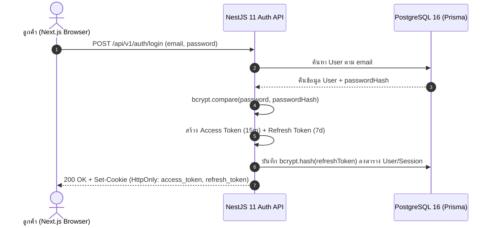

## 1. แนวคิด (Concept)
ในระบบ Production เราต้องแยกความแตกต่างระหว่าง 2 คำนี้อย่างชัดเจน:
1. **Authentication (AuthN - การยืนยันตัวตน)**: กระบวนการพิสูจน์ว่า *"คุณคือใคร?"* เช่น ลูกค้ากรอกอีเมลและรหัสผ่านเพื่อเข้าสู่ระบบสั่งซื้อเนื้อวากิว
2. **Authorization (AuthZ - การตรวจสอบสิทธิ์)**: กระบวนการตรวจสอบว่า *"คุณได้รับอนุญาตให้ทำอะไรได้บ้าง?"* เช่น เชฟแล่เนื้อ (`BUTCHER_CHEF`) สามารถอัปเดตสถานะการตัดแต่งเนื้อใน `Order` ได้ แต่ไม่สามารถกดคืนเงิน (`Payment` Refund) ซึ่งสงวนไว้ให้ `ADMIN` เท่านั้น

สำหรับการจัดเก็บรหัสผ่านในฐานข้อมูล กฎเหล็กอันดับหนึ่งคือ **ห้ามเก็บรหัสผ่านเป็นข้อความธรรมดา (Plaintext) หรือใช้อัลกอริทึมที่ถอดรหัสกลับได้ (Encryption) หรือใช้ Hash ความเร็วสูงทั่วไป (เช่น MD5, SHA-256) เด็ดขาด** แต่ต้องใช้ Password Hashing Algorithm ที่ออกแบบมาให้ทำงานช้าอย่างจงใจและมี Salt ในตัว เช่น **Bcrypt** หรือ **Argon2id**



## 2. หลักการเบื้องหลัง (Under the Hood)
ทำไมเราจึงใช้ **Bcrypt** แทน `SHA-256`?
- `SHA-256` ถูกออกแบบมาให้คำนวณเร็วที่สุดเท่าที่จะเป็นไปได้ การ์ดจอ (GPU) สมัยใหม่สามารถสุ่มเดารหัสผ่าน (Brute-force) ด้วย `SHA-256` ได้มากกว่าหมื่นล้านครั้งต่อวินาที
- **Bcrypt** ใช้พื้นฐานของอัลกอริทึม Eksblowfish ที่มีพารามิเตอร์ **Cost Factor (Salt Rounds)** เช่น `12` ซึ่งหมายถึงการวนลูปคำนวณ $2^{12} = 4,096$ รอบ ใช้เวลาประมาณ `150–250 มิลลิวินาที` ต่อการตรวจสอบ 1 ครั้ง ช้าพอที่แฮกเกอร์จะไม่สามารถสุ่มรหัสผ่านจำนวนมากได้ แต่เร็วพอที่ผู้ใช้งานจริงตอนกด Login จะไม่รู้สึกติดขัด
- โครงสร้างสตริงผลลัพธ์ของ Bcrypt (ความยาว 60 ตัวอักษร) เช่น `$2b$12$R9h/cIPz0gi.URNNX3kh2OPST9/PgBkqquzi.Ss7KIUgO2t0jWMUW` ได้รวมเอาเวอร์ชัน (`2b`), Cost Factor (`12`), **Random Salt 128-bit (22 ตัวอักษร)** และ **Hash (31 ตัวอักษร)** ไว้ในสตริงเดียวกันแล้ว จึงไม่จำเป็นต้องสร้างคอลัมน์เก็บ Salt แยกต่างหาก

<Callout type="warning" title="ข้อจำกัดความยาว 72 Bytes ของ Bcrypt">
อัลกอริทึม Bcrypt จะตัดข้อความรหัสผ่านที่ความยาวสูงสุด 72 bytes แรกเท่านั้น (ตัวอักษรภาษาอังกฤษ 72 ตัว หรือภาษาไทย UTF-8 ประมาณ 24 ตัวอักษร) ดังนั้นใน DTO ตรวจสอบรหัสผ่านจึงควรกำหนด @MaxLength(64) เสมอเพื่อไม่ให้ผู้ใช้เข้าใจผิดว่ารหัสผ่านที่ยาวกว่านั้นถูกนำมาคิดทั้งหมด
</Callout>

## 3. ตัวอย่างโค้ด (Smart Butcher Marketplace)

### ตัวอย่างที่ 1: การสร้าง PasswordHashingService ด้วย Bcrypt และการป้องกัน User Enumeration / Timing Attack (พื้นฐาน)
```typescript filename="src/modules/auth/password-hashing.service.ts"
import { Injectable } from '@nestjs/common';
import * as bcrypt from 'bcrypt';

@Injectable()
export class PasswordHashingService {
  // Cost Factor = 12 คือค่ามาตรฐานที่สมดุลระหว่างความปลอดภัยและประสิทธิภาพในปี 2026
  private readonly SALT_ROUNDS = 12;

  // Dummy Hash สำหรับใช้เปรียบเทียบหลอกเมื่อไม่พบอีเมลในระบบ เพื่อป้องกัน Timing Attack
  private readonly DUMMY_BCRYPT_HASH =
    '$2b$12$LQv3c1yqBWVHxkd0LHAkCOYz6TtxMQJqhN8/LewdBPj4tbQJ9.1pe';

  async hashPassword(plainTextPassword: string): Promise<string> {
    return bcrypt.hash(plainTextPassword, this.SALT_ROUNDS);
  }

  async verifyPassword(
    plainTextPassword: string,
    storedHash: string | null | undefined,
  ): Promise<boolean> {
    // หากไม่พบผู้ใช้ในฐานข้อมูล ให้รัน bcrypt.compare กับ DUMMY_HASH เสมอ
    // เพื่อใช้เวลาประมวลผล ~200ms เท่ากันทุกครั้ง ป้องกันแฮกเกอร์จับเวลาเพื่อเช็คว่าอีเมลไหนมีอยู่จริง
    if (!storedHash) {
      await bcrypt.compare(plainTextPassword, this.DUMMY_BCRYPT_HASH);
      return false;
    }

    return bcrypt.compare(plainTextPassword, storedHash);
  }
}
```

### ตัวอย่างที่ 2: การลงทะเบียนสมาชิกใหม่และตรวจสอบรหัสผ่านใน AuthService (ขั้นสูง)
```typescript filename="src/modules/auth/auth-registration.service.ts"
import {
  Injectable,
  ConflictException,
  UnauthorizedException,
} from '@nestjs/common';
import { UserRole } from '@prisma/client';
import { PrismaService } from '../../database/prisma.service';
import { PasswordHashingService } from './password-hashing.service';

export interface RegisterCustomerInput {
  email: string;
  password: string;
  fullName: string;
  phoneNumber: string;
}

@Injectable()
export class AuthRegistrationService {
  constructor(
    private readonly prisma: PrismaService,
    private readonly passwordHasher: PasswordHashingService,
  ) {}

  async registerCustomer(input: RegisterCustomerInput) {
    const normalizedEmail = input.email.trim().toLowerCase();

    const existingUser = await this.prisma.user.findUnique({
      where: { email: normalizedEmail },
      select: { id: true },
    });

    if (existingUser) {
      throw new ConflictException({
        code: 'EMAIL_ALREADY_REGISTERED',
        message: 'อีเมลนี้ถูกลงทะเบียนเป็นสมาชิก Smart Butcher เรียบร้อยแล้ว',
      });
    }

    const passwordHash = await this.passwordHasher.hashPassword(input.password);

    // บันทึกลงฐานข้อมูลโดยใช้ select เพื่อไม่ให้ส่ง passwordHash กลับออกไปเด็ดขาด
    const createdUser = await this.prisma.user.create({
      data: {
        email: normalizedEmail,
        passwordHash,
        fullName: input.fullName.trim(),
        phoneNumber: input.phoneNumber.trim(),
        role: UserRole.CUSTOMER,
        isActive: true,
      },
      select: {
        id: true,
        email: true,
        fullName: true,
        phoneNumber: true,
        role: true,
        createdAt: true,
      },
    });

    return createdUser;
  }

  async validateUserCredentials(email: string, plainPassword: string) {
    const normalizedEmail = email.trim().toLowerCase();

    const user = await this.prisma.user.findUnique({
      where: { email: normalizedEmail },
      select: {
        id: true,
        email: true,
        passwordHash: true,
        fullName: true,
        role: true,
        isActive: true,
      },
    });

    // เรียก verifyPassword เสมอแม้ user จะเป็น null เพื่อป้องกัน Timing Attack
    const isPasswordValid = await this.passwordHasher.verifyPassword(
      plainPassword,
      user?.passwordHash,
    );

    if (!user || !isPasswordValid || !user.isActive) {
      // ใช้ข้อความ Error เดียวกันเสมอ ไม่บอกแยกว่ารหัสผิดหรืออีเมลไม่มีในระบบ (ป้องกัน User Enumeration)
      throw new UnauthorizedException({
        code: 'INVALID_CREDENTIALS',
        message: 'อีเมลหรือรหัสผ่านไม่ถูกต้อง หรือบัญชีถูกระงับการใช้งาน',
      });
    }

    return {
      id: user.id,
      email: user.email,
      fullName: user.fullName,
      role: user.role,
    };
  }
}
```

## 4. ผิด vs ถูก (Anti-pattern vs Best Practice)

```typescript filename="src/modules/auth/bcrypt-comparison.ts"
import * as bcrypt from 'bcrypt';

// ❌ ผิด (Anti-pattern): ใช้ฟังก์ชัน Synchronous (hashSync / compareSync) และบอกแฮกเกอร์ตรงๆ ว่าอีเมลไหนมีหรือไม่มีในระบบ
export function badLoginCheck(user: any, plainPassword: string) {
  if (!user) {
    // 1. ตอบกลับใน 2ms ทำให้แฮกเกอร์รู้ทันทีว่าอีเมลนี้ยังไม่สมัครสมาชิก
    throw new Error('ไม่พบอีเมลนี้ในระบบ');
  }
  // 2. compareSync บล็อก Node.js Event Loop นาน 200ms! ถ้าคนกด Login พร้อมกัน 20 คน เซิร์ฟเวอร์จะค้างทั้งระบบ!
  const match = bcrypt.compareSync(plainPassword, user.passwordHash);
  if (!match) throw new Error('รหัสผ่านไม่ถูกต้อง');
}

// ✅ ถูก (Best Practice): ใช้ Asynchronous bcrypt.hash / bcrypt.compare (ซึ่งรันใน C++ Thread Pool ไม่บล็อก Event Loop)
// และใช้ข้อความแจ้งเตือนรวม "อีเมลหรือรหัสผ่านไม่ถูกต้อง" พร้อมทำ Constant-time Dummy Verification
```

## 5. ควรใช้เมื่อไหร่ และ ไม่ควรใช้เมื่อไหร่
- **ควรใช้ `bcrypt.hash` และ `bcrypt.compare` (แบบ Async) เสมอ**: สำหรับการเก็บรหัสผ่านของผู้ใช้ และการจัดเก็บ Refresh Token Hash ลงในฐานข้อมูล
- **ไม่ควรใช้ `bcrypt.hashSync` หรือ `bcrypt.compareSync` ใน HTTP Request Handler เด็ดขาด**: เพราะการคำนวณแบบ Synchronous จะหยุดการทำงานของ Single-threaded Event Loop ใน Node.js ทำให้คำขอสั่งซื้อเนื้อของลูกค้ารายอื่นทั้งหมดต้องหยุดรอ

## 6. คำถามสัมภาษณ์ (Interview Q&A)
1. **คำถาม**: ถ้าแฮกเกอร์ได้ข้อมูลตาราง `users` ทั้งหมดไป (Database Dump) การที่รหัสผ่านของลูกค้าสองคนตั้งเหมือนกันว่า `WagyuLover123!` ค่า `password_hash` ในฐานข้อมูลของทั้งสองคนจะเหมือนกันหรือไม่ เพราะเหตุใด?
   - **แนวคำตอบ**: **ไม่เหมือนกันอย่างแน่นอน** เพราะทุกครั้งที่เราเรียก `bcrypt.hash()` ไลบรารีจะสุ่มค่า **Cryptographic Salt ขนาด 128 บิต** ที่ไม่ซ้ำกันขึ้นมาใหม่สำหรับผู้ใช้แต่ละคน แล้วนำ Salt นั้นไปผสมกับรหัสผ่านก่อนเข้ากระบวนการ Hash ส่งผลให้แม้รหัสผ่านตั้งต้นจะเหมือนกันทุกตัวอักษร แต่ค่า `password_hash` ที่ได้จะแตกต่างกันโดยสิ้นเชิง ช่วยป้องกันการโจมตีด้วยตารางสำเร็จรูป (**Rainbow Table Attack**) ได้ 100%
2. **คำถาม**: ทำไมเราจึงไม่ควรแยกข้อความ Error ตอน Login ระหว่าง *"ไม่พบอีเมลนี้ในระบบ"* กับ *"รหัสผ่านผิด"*?
   - **แนวคำตอบ**: เพื่อป้องกันช่องโหว่ **User Enumeration** หากระบบแจ้งแยกชัดเจน ผู้โจมตีสามารถเขียนสคริปต์ยิงรายชื่ออีเมลนับแสนรายการเข้ามาทดสอบเพื่อคัดกรองว่าอีเมลใดเป็นลูกค้า VIP ของร้านค้าเนื้อพรีเมียมบ้าง แล้วนำไปใช้ทำ Phishing หรือ Brute-force เฉพาะบัญชีที่มีอยู่จริงต่อไป

---
