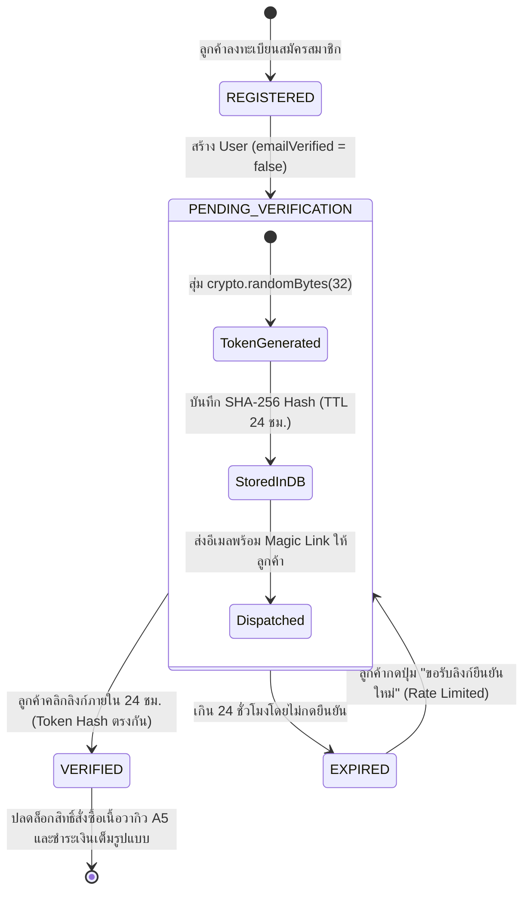

## 1. แนวคิด (Concept)

ในแพลตฟอร์มพรีเมียมอย่าง **Smart Butcher Marketplace** ที่มีการจัดส่งเนื้อสเต๊กแช่เย็น (Chilled Wagyu Beef) และเนื้อดรายเอจ (Dry-Aged Beef) มูลค่าสูง การมีข้อมูลการติดต่อของลูกค้าที่ถูกต้องเป็นสิ่งสำคัญอย่างยิ่ง หากผู้ใช้งานกรอกอีเมลผิดพลาด หรือมีสแปมบอต (Spam Bots) เข้ามาสร้างบัญชีปลอมจำนวนมาก จะส่งผลเสียต่อชื่อเสียงของระบบส่งอีเมล (Domain Sender Reputation), เกิดปัญหาการส่งใบเสร็จรับเงิน (Tax Invoice/Receipt), และเสี่ยงต่อการถูกปฏิเสธการชำระเงิน (Chargeback Fraud)

ระบบ **Email Verification** จึงถูกออกแบบมาเพื่อสร้างความมั่นใจว่า:
1. ลูกค้าเป็นเจ้าของกล่องจดหมาย (Mailbox) นั้นจริง
2. ป้องกันการสะกดอีเมลผิดพลาดก่อนที่จะมีการทำรายการสั่งซื้อเนื้อราคาสูง
3. แยกสถานะสิทธิ์ของผู้ใช้ในระบบอย่างชัดเจนระหว่าง **Pending Verification** (จำกัดวงเงินการสั่งซื้อ หรือไม่อนุญาตให้บันทึกบัตรเครดิต) กับ **Verified Customer** (ได้รับสิทธิ์สั่งซื้อเนื้อวากิวพรีเมียมแบบไม่จำกัดและสะสม Butcher Rewards ได้)



## 2. หลักการเบื้องหลัง (Under the Hood)

### 2.1 ทำไมต้องใช้ `crypto.randomBytes(32)` และเก็บเฉพาะ SHA-256 Hash ในฐานข้อมูล?
ความผิดพลาดที่พบบ่อยที่สุดของนักพัฒนาคือการบันทึกโทเคนยืนยันอีเมลเป็นข้อความธรรมดา (Plaintext Token) ลงในคอลัมน์ของฐานข้อมูล หากวันใดที่ฐานข้อมูลเกิดการรั่วไหล (Database Leakage / SQL Injection) แฮกเกอร์จะสามารถดึงโทเคนทั้งหมดไปกดกดยืนยันบัญชีปลอม หรือสวมรอยบัญชีที่รอการยืนยันได้ทันที

หลักการความปลอดภัยระดับ **Zero-Trust Token Architecture**:
1. **การสร้างความสุ่มสูง (High Entropy)**: ใช้ `crypto.randomBytes(32)` ซึ่งให้ Entropy สูงถึง 256 บิต (มีโอกาสสุ่มซ้ำ $1 \text{ ใน } 2^{256}$ ซึ่งเป็นไปไม่ได้ในทางปฏิบัติ)
2. **การแฮชก่อนบันทึก (One-Way Cryptographic Hashing)**:
   - นำสตริงสุ่มตัวจริง (Plaintext Raw Token) ส่งไปในอีเมลของลูกค้าเท่านั้น
   - เซิร์ฟเวอร์จะนำ Raw Token ไปผ่านฟังก์ชัน `SHA-256` ก่อนบันทึกลงฐานข้อมูล:
     $$\text{Stored Token Hash} = \text{SHA-256}(\text{Raw Token})$$
   - ต่อให้ฐานข้อมูลรั่วไหล แฮกเกอร์ก็จะได้ไปเพียงค่า Hash ซึ่งเป็นฟังก์ชันทางเดียว (One-Way) ไม่สามารถแปลงย้อนกลับมาเป็น Raw Token เพื่อคลิกลิงก์ได้

### 2.2 วงจรอายุโทเคน (Token Expiration: 24 Hours)
โทเคนยืนยันอีเมลควรมีอายุที่สมดุลระหว่างความสะดวกของลูกค้ากับความปลอดภัย โดยมาตรฐานอุตสาหกรรมกำหนดไว้ที่ **24 ชั่วโมง**:
- หากตั้งสั้นเกินไป (เช่น 15 นาที) ลูกค้าที่ลงทะเบียนผ่านมือถือแล้วรอเช็กอีเมลบนคอมพิวเตอร์ที่บ้านอาจพบว่าลิงก์หมดอายุ สร้างความหงุดหงิดและทำให้เสียลูกค้า
- หากตั้งยาวเกินไป (เช่น 7 วัน) จะเพิ่มความเสี่ยงที่ลิงก์ในกล่องจดหมายเก่าจะตกไปอยู่ในมือของผู้ไม่หวังดี
- ระบบควรมี Background Cron Job ทำหน้าที่ทำความสะอาด (Purge) โทเคนที่หมดอายุแล้วออกจากตารางอย่างสม่ำเสมอ

### 2.3 การควบคุมอัตราการขอรับอีเมลใหม่ (Resend Throttling & Rate Limiting)
ปุ่ม "ขอรับอีเมลยืนยันอีกครั้ง" (Resend Verification Email) เป็นจุดเสี่ยงสูงที่มักถูกผู้ไม่หวังดีนำไปใช้เป็นเครื่องมือทำลายล้าง:
- **Email Bombing / Spamming**: แฮกเกอร์เขียนสคริปต์ยิง API รัว 1,000 ครั้งต่อนาทีไปยังอีเมลของเหยื่อ ทำให้กล่องจดหมายของเหยื่อเต็ม
- **Mailgun / SendGrid Reputation Burn**: เซิร์ฟเวอร์ส่งอีเมลของเราจะถูกจัดให้เป็น Spammer ทันที และค่าบริการส่งอีเมลจะพุ่งสูงขึ้นอย่างมหาศาล

**กลไก Multi-Layer Throttling ในระดับ Senior Architecture**:
1. **Per-Email Cooldown**: บังคับให้ต้องรออย่างน้อย **60 วินาที** ก่อนที่จะสามารถกดขอรับอีเมลใหม่ไปยังอีเมลเดิมได้ (จัดเก็บสถานะ Cooldown ใน Redis)
2. **Hourly Window Limit**: จำกัดไม่เกิน **5 ครั้งต่อชั่วโมง** ต่อหนึ่งบัญชีอีเมล
3. **Per-IP Throttling**: จำกัดไม่เกิน **10 ครั้งต่อชั่วโมง** ต่อหนึ่งหมายเลข IP ป้องกันบอตที่สุ่มเปลี่ยนอีเมลแต่ยิงมาจากเครื่องเดียวกัน

<Callout type="note" title="การเปรียบเทียบโทเคนด้วย Timing-Safe Equal">
แม้ว่า SHA-256 Hash จะมีความปลอดภัยสูง แต่การเปรียบเทียบสตริงสองค่าในหน่วยความจำควรใช้ crypto.timingSafeEqual() หรือการค้นหาผ่าน Prisma B-Tree Index ที่แม่นยำ เพื่อป้องกันช่องโหว่ด้านเวลา (Side-Channel Timing Attack)
</Callout>

## 3. ตัวอย่างโค้ด (Smart Butcher Marketplace)

### ตัวอย่างที่ 1: Email Verification Token Generator & Storage Service (พื้นฐานถึงปานกลาง)

ในส่วนนี้เราจะสร้าง Service ที่ใช้ `node:crypto` ในการสร้างโทเคน 256 บิต คำนวณ SHA-256 Hash และบันทึกลงในฐานข้อมูล PostgreSQL ผ่าน Prisma พร้อมระบบตรวจสอบอายุการใช้งาน

```typescript filename="src/modules/auth/services/email-verification-token.service.ts"
import {
  Injectable,
  BadRequestException,
  NotFoundException,
  Logger,
} from '@nestjs/common';
import * as crypto from 'crypto';
import { PrismaService } from '../../../database/prisma.service';

export interface GeneratedVerificationToken {
  rawToken: string;
  expiresAt: Date;
}

@Injectable()
export class EmailVerificationTokenService {
  private readonly logger = new Logger(EmailVerificationTokenService.name);
  // อายุของโทเคนยืนยันอีเมลกำหนดไว้ที่ 24 ชั่วโมง
  private readonly TOKEN_EXPIRY_HOURS = 24;

  constructor(private readonly prisma: PrismaService) {}

  /**
   * สร้างโทเคนสุ่มความปลอดภัยสูง บันทึกเฉพาะค่า SHA-256 Hash ลงฐานข้อมูล
   * และคืนค่า rawToken เพื่อส่งออกไปทางอีเมล
   */
  async createVerificationToken(userId: string): Promise<GeneratedVerificationToken> {
    // 1. สร้างความสุ่มระดับ Cryptographic (32 bytes = 256 bits entropy)
    const rawToken = crypto.randomBytes(32).toString('hex');

    // 2. คำนวณ SHA-256 Hash เพื่อเก็บลง DB
    const tokenHash = crypto
      .createHash('sha256')
      .update(rawToken)
      .digest('hex');

    const expiresAt = new Date();
    expiresAt.setHours(expiresAt.getHours() + this.TOKEN_EXPIRY_HOURS);

    // 3. ลบหรือแทนที่โทเคนเก่าของผู้ใช้นี้ในฐานข้อมูล เพื่อให้มีโทเคนที่ Active ได้เพียงใบเดียว
    await this.prisma.$transaction(async (tx) => {
      await tx.emailVerificationToken.deleteMany({
        where: { userId },
      });

      await tx.emailVerificationToken.create({
        data: {
          userId,
          tokenHash,
          expiresAt,
        },
      });
    });

    this.logger.log(`สร้างโทเคนยืนยันอีเมลใหม่สำหรับ User ID: ${userId} (หมดอายุใน 24 ชม.)`);

    return {
      rawToken,
      expiresAt,
    };
  }

  /**
   * ตรวจสอบความถูกต้องของ rawToken ที่ลูกค้าคลิกมาจากอีเมล
   */
  async verifyAndConsumeToken(rawToken: string): Promise<{ userId: string; email: string }> {
    if (!rawToken || rawToken.length !== 64) {
      throw new BadRequestException({
        code: 'INVALID_TOKEN_FORMAT',
        message: 'รูปแบบรหัสยืนยันอีเมลไม่ถูกต้อง',
      });
    }

    // แปลง rawToken ที่ได้รับมาเป็น SHA-256 Hash เพื่อเทียบกับในฐานข้อมูล
    const incomingHash = crypto
      .createHash('sha256')
      .update(rawToken)
      .digest('hex');

    return await this.prisma.$transaction(async (tx) => {
      const record = await tx.emailVerificationToken.findUnique({
        where: { tokenHash: incomingHash },
        include: { user: true },
      });

      if (!record) {
        throw new NotFoundException({
          code: 'TOKEN_NOT_FOUND',
          message: 'ลิงก์ยืนยันอีเมลไม่ถูกต้อง หรือถูกใช้งานไปแล้ว',
        });
      }

      // ตรวจสอบวันหมดอายุ
      if (new Date() > record.expiresAt) {
        // ลบโทเคนที่หมดอายุทิ้งทันที
        await tx.emailVerificationToken.delete({
          where: { id: record.id },
        });

        throw new BadRequestException({
          code: 'TOKEN_EXPIRED',
          message: 'ลิงก์ยืนยันอีเมลหมดอายุแล้ว (เกิน 24 ชั่วโมง) กรุณากดขอรับลิงก์ใหม่',
        });
      }

      // อัปเดตสถานะของลูกค้าเป็น Verified
      const updatedUser = await tx.user.update({
        where: { id: record.userId },
        data: {
          emailVerified: true,
        },
        select: {
          id: true,
          email: true,
        },
      });

      // ลบโทเคนออกจากระบบเพื่อป้องกันการนำกลับมาใช้ซ้ำ (Single-use token)
      await tx.emailVerificationToken.delete({
        where: { id: record.id },
      });

      this.logger.log(`ยืนยันอีเมลสำเร็จสำหรับ: ${updatedUser.email}`);

      return {
        userId: updatedUser.id,
        email: updatedUser.email,
      };
    });
  }
}
```

### ตัวอย่างที่ 2: Resend Throttling Controller & การจำกัดสิทธิ์ผู้ใช้ในระบบ Smart Butcher (ขั้นสูง)

ในตัวอย่างนี้ เราจะสร้าง Controller ที่จัดการทั้ง Endpoint การคลิกลิงก์ยืนยันตัวตน และ Endpoint การขอรับอีเมลใหม่ โดยมี **Redis-backed Throttling Guard** ป้องกันการกดสแปมซ้ำ พร้อมทั้งแสดงตัวอย่าง Guard ที่ตรวจสอบว่าลูกค้าได้ยืนยันอีเมลแล้วหรือยังก่อนอนุญาตให้ทำการสั่งซื้อเนื้อวากิว A5

```typescript filename="src/modules/auth/guards/email-resend-throttle.guard.ts"
import {
  Injectable,
  CanActivate,
  ExecutionContext,
  HttpException,
  HttpStatus,
} from '@nestjs/common';
import { Request } from 'express';

// ในระบบ Production ควรใช้งานร่วมกับ Redis Client (ioredis)
@Injectable()
export class EmailResendThrottleGuard implements CanActivate {
  // จัดเก็บเวลาที่ยิงล่าสุดในหน่วยความจำ (หรือ Redis Key: `throttle:email-resend:${email}`)
  private static readonly lastRequestTimes = new Map<string, number>();
  private static readonly hourlyRequestCounts = new Map<string, { count: number; resetAt: number }>();

  private readonly COOLDOWN_SECONDS = 60; // 60 วินาทีต่อการขอกดส่งซ้ำ 1 ครั้ง
  private readonly MAX_PER_HOUR = 5;      // สูงสุดไม่เกิน 5 ครั้งต่อชั่วโมง

  canActivate(context: ExecutionContext): boolean {
    const req = context.switchToHttp().getRequest<Request>();
    const email = (req.body?.email as string)?.trim().toLowerCase();

    if (!email) {
      return true; // ปล่อยให้ ValidationPipe จัดการดักแจ้งเตือน Missing Email
    }

    const now = Date.now();
    const lastTime = EmailResendThrottleGuard.lastRequestTimes.get(email) ?? 0;
    const elapsedSeconds = Math.floor((now - lastTime) / 1000);

    // 1. ตรวจสอบ Cooldown 60 วินาที
    if (elapsedSeconds < this.COOLDOWN_SECONDS) {
      const waitRemaining = this.COOLDOWN_SECONDS - elapsedSeconds;
      throw new HttpException(
        {
          code: 'RESEND_COOLDOWN_ACTIVE',
          message: `กรุณารออีก ${waitRemaining} วินาทีก่อนกดขอรับอีเมลยืนยันใหม่อีกครั้ง`,
          retryAfterSeconds: waitRemaining,
        },
        HttpStatus.TOO_MANY_REQUESTS,
      );
    }

    // 2. ตรวจสอบโควตาต่อชั่วโมง
    const hourlyRecord = EmailResendThrottleGuard.hourlyRequestCounts.get(email) ?? {
      count: 0,
      resetAt: now + 3600 * 1000,
    };

    if (now > hourlyRecord.resetAt) {
      hourlyRecord.count = 0;
      hourlyRecord.resetAt = now + 3600 * 1000;
    }

    if (hourlyRecord.count >= this.MAX_PER_HOUR) {
      throw new HttpException(
        {
          code: 'HOURLY_RESEND_LIMIT_EXCEEDED',
          message: 'คุณได้ขอรับอีเมลยืนยันเกินจำนวนครั้งสูงสุดใน 1 ชั่วโมง (5 ครั้ง) กรุณาลองใหม่ในภายหลัง',
        },
        HttpStatus.TOO_MANY_REQUESTS,
      );
    }

    // บันทึกการใช้งานรอบปัจจุบัน
    EmailResendThrottleGuard.lastRequestTimes.set(email, now);
    hourlyRecord.count += 1;
    EmailResendThrottleGuard.hourlyRequestCounts.set(email, hourlyRecord);

    return true;
  }
}
```

```typescript filename="src/modules/auth/controllers/email-verification.controller.ts"
import {
  Controller,
  Get,
  Post,
  Body,
  Query,
  UseGuards,
  HttpCode,
  HttpStatus,
  BadRequestException,
} from '@nestjs/common';
import { EmailVerificationTokenService } from '../services/email-verification-token.service';
import { EmailResendThrottleGuard } from '../guards/email-resend-throttle.guard';
import { PrismaService } from '../../../database/prisma.service';

class ResendVerificationDto {
  email!: string;
}

@Controller('v1/auth/email')
export class EmailVerificationController {
  constructor(
    private readonly tokenService: EmailVerificationTokenService,
    private readonly prisma: PrismaService,
  ) {}

  /**
   * Endpoint สำหรับลิงก์ที่ลูกค้าคลิกจากอีเมล (Magic Link)
   * GET /api/v1/auth/email/verify?token=...
   */
  @Get('verify')
  async verifyEmail(@Query('token') token: string) {
    if (!token) {
      throw new BadRequestException('ไม่พบรหัส Token สำหรับยืนยันอีเมล');
    }

    const result = await this.tokenService.verifyAndConsumeToken(token);

    return {
      success: true,
      message: 'ยืนยันอีเมลสำเร็จ! บัญชี Smart Butcher ของคุณพร้อมสั่งซื้อเนื้อเกรดพรีเมียมแล้ว',
      data: {
        userId: result.userId,
        email: result.email,
        verifiedAt: new Date().toISOString(),
      },
    };
  }

  /**
   * Endpoint สำหรับกดขอรับอีเมลยืนยันใหม่ มี Throttling Guard ดักเสมอ
   * POST /api/v1/auth/email/resend
   */
  @Post('resend')
  @HttpCode(HttpStatus.OK)
  @UseGuards(EmailResendThrottleGuard)
  async resendVerificationEmail(@Body() dto: ResendVerificationDto) {
    const normalizedEmail = dto.email.trim().toLowerCase();

    const user = await this.prisma.user.findUnique({
      where: { email: normalizedEmail },
      select: { id: true, email: true, emailVerified: true, fullName: true },
    });

    // ใช้ Anti-Enumeration Principle: ตอบกลับว่าสำเร็จเสมอ ไม่ว่าจะพบอีเมลหรือไม่
    // เพื่อไม่ให้แฮกเกอร์ใช้เป็นช่องทางสุ่มเช็คอีเมลของลูกค้าในระบบ
    if (!user || user.emailVerified) {
      return {
        success: true,
        message: 'หากอีเมลนี้มีอยู่ในระบบและยังไม่ได้รับการยืนยัน เราได้ส่งลิงก์ยืนยันชุดใหม่ไปเรียบร้อยแล้ว',
      };
    }

    const { rawToken } = await this.tokenService.createVerificationToken(user.id);

    // ใน Production ควรส่งเข้า Queue (เช่น BullMQ / RabbitMQ) เพื่อส่งอีเมลแบบ Asynchronous
    const verificationUrl = `${process.env.FRONTEND_APP_URL}/verify-email?token=${rawToken}`;
    
    // จำลองการ Dispatch Job ไปยัง Mailer Service
    // await this.mailQueue.add('send-verification', { to: user.email, name: user.fullName, url: verificationUrl });

    return {
      success: true,
      message: 'หากอีเมลนี้มีอยู่ในระบบและยังไม่ได้รับการยืนยัน เราได้ส่งลิงก์ยืนยันชุดใหม่ไปเรียบร้อยแล้ว',
    };
  }
}
```

```typescript filename="src/modules/orders/guards/verified-buyer.guard.ts"
import {
  Injectable,
  CanActivate,
  ExecutionContext,
  ForbiddenException,
} from '@nestjs/common';
import { Request } from 'express';

@Injectable()
export class VerifiedBuyerGuard implements CanActivate {
  canActivate(context: ExecutionContext): boolean {
    const req = context.switchToHttp().getRequest<Request>();
    const user = req.user as { id: string; emailVerified: boolean } | undefined;

    // บังคับว่าลูกค้าต้องยืนยันอีเมลก่อน จึงจะได้รับอนุญาตให้ชำระเงินตัดบัตรเครดิต
    // สำหรับออเดอร์เนื้อสเต๊กพรีเมียม (Wagyu A5 / Dry-Aged Cuts)
    if (!user || !user.emailVerified) {
      throw new ForbiddenException({
        code: 'EMAIL_VERIFICATION_REQUIRED',
        message: 'กรุณายืนยันที่อยู่อีเมลของคุณก่อนดำเนินการสั่งซื้อและชำระเงินเพื่อความปลอดภัยของคำสั่งซื้อ',
      });
    }

    return true;
  }
}
```

## 4. ข้อผิดพลาดที่พบบ่อย (Anti-pattern vs Best Practice)

```typescript filename="src/modules/auth/email-verify-anti-patterns.ts"
// ❌ ผิด (Anti-pattern 1): เก็บ Plaintext Token ลงฐานข้อมูลตรงๆ
// ปัญหา: หากฐานข้อมูลรั่วไหล แฮกเกอร์สามารถนำโทเคนไปยืนยันสวมรอยบัญชีได้ทั้งหมด
export async function badCreateToken(userId: string, rawToken: string, db: any) {
  return db.emailToken.create({
    data: { userId, token: rawToken } // ❌ ผิดมหันต์! ห้ามเก็บ Plaintext
  });
}

// ❌ ผิด (Anti-pattern 2): บอกแฮกเกอร์ตรงๆ ในหน้า Resend ว่า "ไม่พบอีเมลนี้ในระบบ"
// ปัญหา: ทำให้เกิด User Enumeration Attack แฮกเกอร์นำรายชื่ออีเมลมาสแกนดูว่าใครเป็นลูกค้าของเราได้

// ❌ ผิด (Anti-pattern 3): ไม่กำหนด Rate Limit ที่ปุ่ม Resend
// ปัญหา: ถูกโจมตีด้วย Email Bombing ทำให้โดเมนถูกจัดเป็นสแปมและบัญชี SendGrid โดนแบน

// ✅ ถูก (Best Practice):
// 1. ใช้ crypto.randomBytes(32) สร้างความสุ่มสูง (256 bits)
// 2. บันทึกเฉพาะ SHA-256 Hash ลงฐานข้อมูล
// 3. ตั้งอายุชัดเจน 24 ชั่วโมง และลบทันทีเมื่อถูกใช้งาน (Single-use)
// 4. ติดตั้ง Rate Limiting (เช่น 1 ครั้งต่อ 60 วินาที และไม่เกิน 5 ครั้งต่อชั่วโมง)
// 5. ตอบข้อความ Generic สม่ำเสมอ ไม่บอกให้รู้ว่าอีเมลมีจริงหรือไม่
```

## 5. ควรใช้เมื่อไหร่ และ ไม่ควรใช้เมื่อไหร่

### ควรใช้ Email Verification เมื่อ:
- **เป็นระบบอีคอมเมิร์ซที่มีการส่งของจริง (Physical Delivery)**: เช่น สินค้าเนื้อสเต๊กพรีเมียมแช่เย็น ที่จำเป็นต้องแจ้งสถานะการแพ็กกิ้ง, อุณหภูมิการขนส่ง, และเลขติดตามพัสดุ (Tracking Number) ไปยังอีเมลของลูกค้า
- **ป้องกันการสร้างบัญชีสแปม (Anti-Bot & Fraud Mitigation)**: ช่วยคัดกรองไม่ให้บอตเข้ามาจองเนื้อวากิวลิมิเต็ดเอดิชันตัดหน้าลูกค้าจริง
- **ระบบที่มีธุรกรรมการเงินและใบกำกับภาษี**: จำเป็นต้องใช้อีเมลเป็นหลักฐานทางกฎหมายในการออก e-Tax Invoice

### ไม่ควรบังคับ (หรือควรใช้แนวทางอื่น) เมื่อ:
- **ผู้ใช้เข้าสู่ระบบผ่าน Social Login (Google / LINE) ที่ยืนยันอีเมลแล้ว**: ผู้ใช้กลุ่มนี้ผ่านการรับรองจาก Identity Provider มาแล้ว การบังคับให้กดยืนยันอีเมลซ้ำอีกรอบถือเป็น Bad UX ที่ไม่จำเป็น
- **หน้าสั่งซื้อแบบเร่งด่วน (Guest Checkout)**: สำหรับสินค้ามูลค่าต่ำที่ต้องการความรวดเร็ว อาจใช้วิธียืนยัน OTP ผ่าน SMS หรือให้กรอกอีเมลเพื่อรับใบเสร็จโดยไม่ต้องสร้างรหัสผ่านและรอคลิกลิงก์ยืนยัน

## 6. คำถามสัมภาษณ์งาน (Interview Q&A)

### ข้อที่ 1: ทำไมการเก็บโทเคนยืนยันอีเมลในฐานข้อมูลจึงควรเก็บเฉพาะค่า Hash (เช่น SHA-256) แทนที่จะเก็บค่า Plaintext Token หรือเก็บเป็น JWT?
**แนวคำตอบเชิงลึก**:
การเก็บเฉพาะค่า SHA-256 Hash ในฐานข้อมูลเป็นไปตามหลักการ **Defense in Depth** และ **Least Privilege Data Storage**:

1. **การป้องกัน Database Leakage**: หากฐานข้อมูลของระบบถูกโจมตีผ่านช่องโหว่ SQL Injection หรือข้อมูลสำรอง (Database Backup) รั่วไหล หากเราเก็บโทเคนเป็น Plaintext ผู้โจมตีจะสามารถนำโทเคนเหล่านั้นไปกดยืนยันบัญชี หรือนำไปเปลี่ยนอีเมลเป้าหมายได้ทันที แต่หากเก็บเฉพาะค่า SHA-256 Hash เนื่องจาก Hash เป็นฟังก์ชันทางเดียวที่ไม่สามารถย้อนกลับได้ (Pre-image Resistance) ผู้โจมตีจึงไม่สามารถสร้าง Raw Token ที่ถูกต้องเพื่อนำไปคลิกลิงก์ยืนยันได้เลย
2. **ข้อจำกัดของการใช้ JWT สำหรับ Email Verification**: หากเราใช้ JWT เพียงอย่างเดียวโดยไม่เก็บสถานะในฐานข้อมูล (Stateless JWT):
   - เราจะไม่สามารถ **เพิกถอน (Revoke)** โทเคนใบเก่าได้ทันทีเมื่อผู้ใช้กดปุ่ม "ขอรับอีเมลใหม่" ส่งผลให้หากมีอีเมล 3 ฉบับถูกส่งออกไป โทเคนทั้ง 3 ใบจะสามารถใช้คลิกได้ทั้งหมดจนกว่าจะหมดอายุ
   - การทำให้เป็น **Single-use Token** (ใช้งานได้ครั้งเดียว) ทำได้ยาก เพราะเมื่อมีคนคลิกยืนยันครั้งแรกแล้ว โทเคน JWT ใบเดิมจะยังคงมีลายเซ็นที่ถูกต้องอยู่ หากไม่มีฐานข้อมูลตรวจสอบสถานะการใช้งาน อาจเกิดสภาวะ Replay ได้
   - ดังนั้น การใช้โทเคนสุ่มจาก `crypto.randomBytes(32)` คู่กับตาราง `email_verification_tokens` ที่เก็บค่า SHA-256 Hash จึงเป็นสถาปัตยกรรมที่มีความปลอดภัย ยืดหยุ่น และเพิกถอนได้สมบูรณ์แบบที่สุด

---

### ข้อที่ 2: จะออกแบบระบบป้องกันการโจมตีแบบ Email Bombing บนปุ่ม Resend Verification Email อย่างไรให้ปลอดภัยทั้งระดับ Infrastructure, API Gateway และ Application Layer?
**แนวคำตอบเชิงลึก**:
การป้องกัน Email Bombing ต้องใช้การป้องกันแบบหลายชั้น (**Multi-Layer Defense Strategy**):

1. **Application & Business Logic Layer (Redis-backed Throttling)**:
   - **Cooldown Period**: บังคับให้ผู้ใช้ต้องรออย่างน้อย 60–120 วินาทีก่อนที่จะกดขอรับอีเมลใหม่ไปยังอีเมลเดิมได้ โดยเก็บ Key ใน Redis เช่น `ratelimit:email_resend_cooldown:${email}` พร้อมกำหนด `SET EX 60`
   - **Sliding Window Counter**: จำกัดจำนวนครั้งการขอรับอีเมลสูงสุดไม่เกิน 3–5 ครั้งต่อชั่วโมงต่ออีเมล เพื่อป้องกันไม่ให้มีใครกดปุ่มส่งซ้ำได้เรื่อยๆ ตลอดทั้งวัน
2. **Anti-Enumeration & Consistent Response**:
   - ไม่ว่าจะส่งอีเมลสำเร็จ, ไม่พบอีเมลในระบบ, หรืออีเมลนั้นยืนยันไปแล้ว ให้ส่งค่าสถานะ HTTP 200/202 พร้อมข้อความเดียวกันเสมอ: *"หากอีเมลนี้มีอยู่ในระบบ เราได้ส่งคำแนะนำไปเรียบร้อยแล้ว"* เพื่อไม่ให้ผู้โจมตีใช้ทดสอบรายชื่ออีเมล
3. **API Gateway & Network Layer (Cloudflare / WAF)**:
   - ตรวจจับอัตราการยิงคำขอต่อ IP Address (เช่น ห้ามเกิน 10 requests ต่อนาทีต่อ IP สำหรับ route `/api/v1/auth/email/*`)
   - ผสานรวม **Cloudflare Turnstile** หรือ **reCAPTCHA v3** บนหน้าเว็บ หากระบบตรวจพบพฤติกรรมน่าสงสัยว่าไม่ใช่การกระทำของมนุษย์
4. **Queue & Mail Service Quotas**:
   - ส่งคำขอสร้างอีเมลเข้าคิวเบื้องหลัง (Background Worker เช่น BullMQ) เพื่อไม่ให้กระทบประสิทธิภาพของ API หลัก
   - กำหนด Rate Limit บน Mail Delivery Agent (เช่น ไม่ส่งอีเมลเกินโควตาต่อโดเมน) เพื่อป้องกันไม่ให้โดเมนผู้ส่งของเราถูก Spamhaus หรือ Google/Microsoft ขึ้นบัญชีดำ (Blacklist)

---

## ลำดับการเรียนที่แนะนำ และ ดูเพิ่มเติมที่

เพื่อความเชี่ยวชาญในระบบความปลอดภัยและการจัดการสิทธิ์ ขอแนะนำให้ศึกษาหัวข้อต่างๆ ตามลำดับดังต่อไปนี้:

1. ศึกษาพื้นฐานการแฮชรหัสผ่านและการควบคุมความเร็ว: [Auth Flow Bcrypt](/docs/backend/authentication/auth-flow-bcrypt)
2. การจัดเก็บ Token ในคุกกี้เพื่อป้องกัน XSS: [JWT HttpOnly](/docs/backend/authentication/jwt-httponly)
3. สถาปัตยกรรมการล็อกอินผ่านบุคคลที่สาม: [OAuth & Social](/docs/backend/authentication/oauth-social)
4. สถาปัตยกรรมการกู้คืนรหัสผ่านความปลอดภัยสูง: [Reset Password](/docs/backend/authentication/reset-password)
5. ระบบยืนยันตัวตนสองชั้นด้วย TOTP: [2FA / MFA](/docs/backend/authentication/two-factor)
6. สถาปัตยกรรมขั้นสูงในการหมุนเวียนโทเคน: [Token Rotation](/docs/backend/authentication/token-rotation)
7. หลุมพรางด้านความปลอดภัยที่ต้องระวัง: [Authentication Anti-patterns](/docs/backend/authentication/pitfalls)
