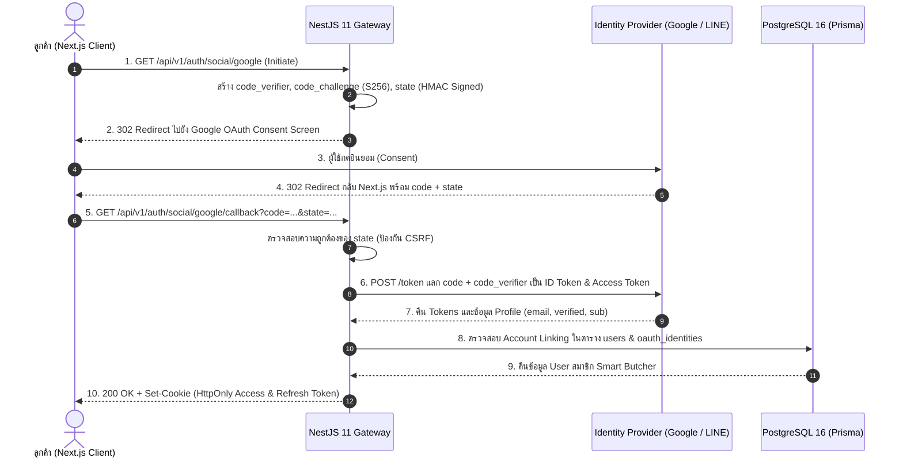

## 1. แนวคิด (Concept)

ในระบบอีคอมเมิร์ซเนื้อเกรดพรีเมียม **Smart Butcher Marketplace** ประสบการณ์แรกเข้า (Onboarding UX) คือปัจจัยชี้วัด Conversion Rate ของลูกค้า หากลูกค้าต้องกรอกแบบฟอร์มลงทะเบียนกว่า 8 ช่อง ยืนยันรหัสผ่าน และกรอกที่อยู่จัดส่งซ้ำซ้อน ลูกค้ามากกว่า 40% จะละทิ้งตะกร้าสินค้า (Cart Abandonment) ไปทันที การนำสถาปัตยกรรม **OAuth 2.0** และ **OpenID Connect (OIDC)** มาผสานรวมเข้ากับระบบยืนยันตัวตนจึงเป็นหัวใจสำคัญในการอำนวยความสะดวกให้ลูกค้าสามารถกดเข้าสู่ระบบได้ในคลิกเดียวผ่าน **Google** (มาตรฐานสากล) และ **LINE Login** (ช่องทางหลักของลูกค้าไทย)

อย่างไรก็ตาม สถาปัตยกรรม Social Login ในระดับ Production ไม่ใช่แค่การดึง `email` จากผู้ให้บริการมาออก Token ให้ผู้ใช้ แต่ต้องคำนึงถึงความมั่นคงปลอดภัยระดับ Enterprise Identity and Access Management (IAM):

1. **Authorization Code Flow with PKCE (Proof Key for Code Exchange)**: ป้องกันการดักจับ Authorization Code แม้ฝั่ง Frontend หรือ Callback URL จะถูกแทรกแซง
2. **Cryptographic `state` Parameter**: ป้องกันการโจมตีประเภท Cross-Site Request Forgery (CSRF) Login Attacks ที่ผู้โจมตีพยายามบังคับให้เหยื่อล็อกอินเข้าบัญชีของแฮกเกอร์
3. **Secure Account Linking**: สถาปัตยกรรมการผูกบัญชี Social Identity เข้ากับบัญชีเนื้อวากิวเดิมของลูกค้าอย่างปลอดภัย โดยไม่เปิดช่องโหว่ Account Takeover หรือ Pre-hijacking



## 2. หลักการเบื้องหลัง (Under the Hood)

### 2.1 ทำไมต้องใช้ PKCE (RFC 7636) กับ Authorization Code Flow?
ในอดีต PKCE ถูกบังคับใช้เฉพาะ Public Clients (เช่น Mobile Apps หรือ SPA) ที่ไม่สามารถเก็บ `client_secret` ไว้เป็นความลับได้ แต่ตามคำแนะนำล่าสุด **OAuth 2.1 Best Current Practice (BCP)** ได้กำหนดให้ระบบ Backend Web Application (Confidential Clients) ทุกระบบต้องเปิดใช้งาน PKCE ควบคู่ไปด้วยเสมอ

กลไกทางคณิตศาสตร์ของ PKCE ทำงานดังนี้:
1. **Code Verifier**: สตริงสุ่มความยาว 43–128 ตัวอักษรที่สร้างด้วย Cryptographically Secure Pseudo-Random Number Generator (CSPRNG)
2. **Code Challenge**: นำ `code_verifier` ไปผ่านการเข้ารหัสแบบทางเดียวด้วยอัลกอริทึม SHA-256 แล้วแปลงผลลัพธ์เป็น Base64URL:
   $$\text{Code Challenge} = \text{Base64URL}(\text{SHA-256}(\text{code\_verifier}))$$
3. ในขั้นตอนขอสิทธิ์ (Step 1) เซิร์ฟเวอร์จะส่งเฉพาะ `code_challenge` ไปยัง Google/LINE เมื่อได้รับ Authorization Code กลับมา (Step 5) เซิร์ฟเวอร์จะต้องส่ง `code_verifier` ตัวจริงไปยืนยันกับผู้ให้บริการ ทำให้ผู้โจมตีที่ดักขโมย Authorization Code ได้ไประหว่างทางไม่สามารถนำโค้ดไปแลกเป็น Token ได้เลย เพราะไม่มี `code_verifier` ต้นฉบับ

### 2.2 กลไก `state` Parameter ป้องกัน CSRF Login Attacks
การโจมตีแบบ **OAuth Login CSRF** เกิดขึ้นเมื่อแฮกเกอร์ส่งลิงก์ Authorization Callback ที่ผูกกับบัญชี Social ของแฮกเกอร์เองมาให้เหยื่อกด เมื่อเหยื่อคลิก เบราว์เซอร์ของเหยื่อจะเข้าสู่ระบบในชื่อบัญชีของแฮกเกอร์โดยไม่รู้ตัว หากเหยื่อกรอกข้อมูลบัตรเครดิตหรือสั่งซื้อเนื้อวากิว A5 ประวัติการสั่งซื้อและข้อมูลสำคัญจะตกไปอยู่ในบัญชีของแฮกเกอร์ทันที

วิธีป้องกันคือการสร้าง **Cryptographically Signed State**:
- เซิร์ฟเวอร์จะสร้าง Payload ที่ประกอบด้วย `nonce`, `timestamp`, และ `returnUrl`
- นำ Payload ไปคำนวณ HMAC-SHA256 ด้วย `OAUTH_STATE_SECRET` ของระบบ
- ส่งค่านั้นไปในพารามิเตอร์ `state` และจัดเก็บสำเนาไว้ใน HttpOnly Encrypted Cookie หรือ Redis ชั่วคราว (TTL 5 นาที)
- เมื่อ Identity Provider ส่ง `state` กลับมา เซิร์ฟเวอร์จะตรวจสอบลายเซ็น HMAC และเวลาหมดอายุอย่างเคร่งครัด

### 2.3 จุดเด่นเฉพาะของ LINE Login v2.1 สำหรับตลาดไทย
LINE เป็นแพลตฟอร์มหลักของลูกค้าในประเทศไทย การเชื่อมต่อ LINE Login v2.1 มีข้อแตกต่างสำคัญจาก Google:
- **Email Permission**: อีเมลใน LINE ถือเป็นสิทธิ์ระดับสูง (`email` scope) ซึ่งนักพัฒนาต้องยื่นขออนุญาตพิเศษใน LINE Developers Console และผู้ใช้ LINE บางคนอาจไม่ได้ผูกอีเมลไว้กับบัญชี LINE หรือไม่อนุญาตให้เปิดเผยอีเมล ระบบจึงต้องออกแบบรองรับ Fallback ในกรณีที่ไม่ได้อีเมลกลับมา
- **ID Token Verification**: LINE ส่ง `id_token` ในรูปแบบ JWT (RS256) ซึ่งเซิร์ฟเวอร์สามารถตรวจสอบความถูกต้องของ Signature กับ LINE Public Keys (JWKS endpoint) ได้โดยตรง ช่วยลดภาระการเรียก Network Request ย้อนกลับไปสอบถามโปรไฟล์

### 2.4 สถาปัตยกรรม Account Linking & การป้องกัน Account Pre-Hijacking
ปัญหาด้านความปลอดภัยที่ร้ายแรงที่สุดของ Social Login คือ **Pre-Account Takeover**:
- สมมติลูกค้าชื่อคุณสมชายมีบัญชีร้าน Smart Butcher ด้วยอีเมล `somchai@example.com` และรหัสผ่านเดิมอยู่แล้ว
- แฮกเกอร์สร้างบัญชี Social กับผู้ให้บริการรายที่ไม่ตรวจสอบความถูกต้องของอีเมล (Unverified Email) โดยตั้งอีเมลหลอกเป็น `somchai@example.com`
- หากระบบฝั่ง Backend เห็นว่าอีเมลตรงกันแล้วสั่ง Merge ผูกบัญชีอัตโนมัติทันที แฮกเกอร์จะสามารถเข้ายึดบัญชีของคุณสมชายได้ทันที

**กฎเหล็ก 3 ข้อในการทำ Account Linking อย่างปลอดภัย**:
1. ผูกบัญชีอัตโนมัติได้ **เฉพาะเมื่อ** ข้อมูลจาก Provider ยืนยันว่า `email_verified: true` เท่านั้น (เช่น Google ID Token)
2. หากอีเมลยังไม่ได้รับการยืนยัน หรือผู้ใช้ล็อกอินเข้ามาอยู่แล้วและต้องการผูกบัญชีเสริม ระบบต้องบังคับให้ป้อนรหัสผ่านเดิม (Step-up Verification) ก่อนทำการ Link เสมอ
3. จัดเก็บความสัมพันธ์แบบ 1-to-Many แยกต่างหากในตาราง `oauth_identities` เพื่อให้ผู้ใช้ 1 คนสามารถผูกได้ทั้ง Google, LINE และอีเมลรหัสผ่านดั้งเดิม

<Callout type="warning" title="ห้ามใช้ Implicit Grant เด็ดขาด">
มาตรฐาน OAuth 2.0 สั่งยกเลิกการใช้งาน Implicit Grant (การคืน Access Token มาทาง URL Hash โดยตรง) อย่างเป็นทางการแล้ว เนื่องจาก Token มีโอกาสรั่วไหลผ่าน Browser History, Referer Headers และ Web Logs สูงมาก ทุกระบบต้องใช้ Authorization Code Flow with PKCE เท่านั้น
</Callout>

## 3. ตัวอย่างโค้ด (Smart Butcher Marketplace)

### ตัวอย่างที่ 1: Google OAuth 2.0 Strategy และ State Verification Guard (พื้นฐานถึงปานกลาง)

ในส่วนนี้เราจะสร้าง Passport Strategy สำหรับ Google OAuth 2.0 โดยรองรับการดึง Profile อย่างแม่นยำ พร้อม Custom Guard สำหรับสร้างและตรวจสอบความถูกต้องของค่า `state` ป้องกัน CSRF

```typescript filename="src/modules/auth/guards/google-oauth.guard.ts"
import {
  Injectable,
  ExecutionContext,
  UnauthorizedException,
} from '@nestjs/common';
import { AuthGuard } from '@nestjs/passport';
import { Request, Response } from 'express';
import * as crypto from 'crypto';

interface OAuthStatePayload {
  nonce: string;
  timestamp: number;
  returnUrl?: string;
}

@Injectable()
export class GoogleOAuthGuard extends AuthGuard('google') {
  private readonly STATE_SECRET = process.env.OAUTH_STATE_SECRET ?? 'super-secret-oauth-key-minimum-32-chars';
  private readonly STATE_COOKIE_NAME = '__Host-oauth-state';

  override getAuthenticateOptions(context: ExecutionContext) {
    const req = context.switchToHttp().getRequest<Request>();
    const res = context.switchToHttp().getResponse<Response>();

    // 1. สร้าง Cryptographic State เพื่อป้องกัน CSRF Login Attack
    const statePayload: OAuthStatePayload = {
      nonce: crypto.randomBytes(16).toString('hex'),
      timestamp: Date.now(),
      returnUrl: (req.query.returnUrl as string) || '/marketplace',
    };

    const rawData = JSON.stringify(statePayload);
    const signature = crypto
      .createHmac('sha256', this.STATE_SECRET)
      .update(rawData)
      .digest('base64url');

    const signedState = `${Buffer.from(rawData).toString('base64url')}.${signature}`;

    // 2. บันทึกลงใน HttpOnly Cookie ที่มีอายุสั้นเพียง 5 นาที
    res.cookie(this.STATE_COOKIE_NAME, signedState, {
      httpOnly: true,
      secure: process.env.NODE_ENV === 'production',
      sameSite: 'lax',
      path: '/api/v1/auth/social',
      maxAge: 5 * 60 * 1000,
    });

    return {
      state: signedState,
      accessType: 'offline',
      prompt: 'consent',
    };
  }

  validateState(req: Request): OAuthStatePayload {
    const receivedState = req.query.state as string;
    const cookieState = req.cookies?.[this.STATE_COOKIE_NAME] as string;

    if (!receivedState || !cookieState || receivedState !== cookieState) {
      throw new UnauthorizedException({
        code: 'INVALID_OAUTH_STATE',
        message: 'สถานะการเชื่อมต่อไม่ถูกต้องหรืออาจถูกโจมตีแบบ CSRF กรุณาลองใหม่อีกครั้ง',
      });
    }

    const [encodedPayload, receivedSignature] = receivedState.split('.');
    if (!encodedPayload || !receivedSignature) {
      throw new UnauthorizedException({ code: 'MALFORMED_OAUTH_STATE', message: 'รูปแบบ State เสียหาย' });
    }

    const rawData = Buffer.from(encodedPayload, 'base64url').toString('utf8');
    const expectedSignature = crypto
      .createHmac('sha256', this.STATE_SECRET)
      .update(rawData)
      .digest('base64url');

    // เปรียบเทียบแบบ Timing-safe
    const isSignatureValid = crypto.timingSafeEqual(
      Buffer.from(receivedSignature),
      Buffer.from(expectedSignature),
    );

    if (!isSignatureValid) {
      throw new UnauthorizedException({ code: 'COMPROMISED_OAUTH_STATE', message: 'ลายเซ็น State ไม่ถูกต้อง' });
    }

    const payload = JSON.parse(rawData) as OAuthStatePayload;
    const isExpired = Date.now() - payload.timestamp > 5 * 60 * 1000;
    if (isExpired) {
      throw new UnauthorizedException({ code: 'EXPIRED_OAUTH_STATE', message: 'คำขอเข้าสู่ระบบหมดอายุ (เกิน 5 นาที)' });
    }

    return payload;
  }
}
```

```typescript filename="src/modules/auth/strategies/google-oauth.strategy.ts"
import { Injectable, UnauthorizedException } from '@nestjs/common';
import { PassportStrategy } from '@nestjs/passport';
import { Strategy, VerifyCallback, Profile } from 'passport-google-oauth20';

export interface VerifiedSocialProfile {
  provider: 'GOOGLE' | 'LINE';
  providerId: string;
  email: string;
  emailVerified: boolean;
  displayName: string;
  avatarUrl?: string;
}

@Injectable()
export class GoogleOAuthStrategy extends PassportStrategy(Strategy, 'google') {
  constructor() {
    super({
      clientID: process.env.GOOGLE_CLIENT_ID ?? 'placeholder-google-client-id',
      clientSecret: process.env.GOOGLE_CLIENT_SECRET ?? 'placeholder-google-secret',
      callbackURL: process.env.GOOGLE_CALLBACK_URL ?? 'http://localhost:3000/api/v1/auth/social/google/callback',
      scope: ['email', 'profile'],
    });
  }

  async validate(
    accessToken: string,
    refreshToken: string,
    profile: Profile,
    done: VerifyCallback,
  ): Promise<void> {
    try {
      const primaryEmail = profile.emails?.[0];
      if (!primaryEmail || !primaryEmail.value) {
        throw new UnauthorizedException('บัญชี Google นี้ไม่มีข้อมูลอีเมล');
      }

      const verifiedUser: VerifiedSocialProfile = {
        provider: 'GOOGLE',
        providerId: profile.id,
        email: primaryEmail.value.toLowerCase().trim(),
        emailVerified: primaryEmail.verified === 'true' || primaryEmail.verified === true,
        displayName: profile.displayName || `${profile.name?.givenName ?? ''} ${profile.name?.familyName ?? ''}`.trim(),
        avatarUrl: profile.photos?.[0]?.value,
      };

      done(null, verifiedUser);
    } catch (error) {
      done(error as Error, undefined);
    }
  }
}
```

### ตัวอย่างที่ 2: LINE Login v2.1 Service & สถาปัตยกรรม Account Linking ใน Smart Butcher Marketplace (ขั้นสูง)

ในตัวอย่างนี้ เราจะจัดการกระบวนการแลก Token ของ LINE Login v2.1 ตรวจสอบ ID Token ลายเซ็นดิจิทัล และเชื่อมต่อไปยังฐานข้อมูล PostgreSQL 16 ผ่าน Prisma Transaction เพื่อทำการผูกบัญชีอย่างปลอดภัย หากเป็นลูกค้าเก่าที่สั่งเนื้อวากิวประจำ ระบบจะผูก `providerId` เข้ากับบัญชีเดิมโดยไม่สร้างบัญชีซ้ำซ้อน

```typescript filename="src/modules/auth/services/social-auth.service.ts"
import {
  Injectable,
  UnauthorizedException,
  ConflictException,
  BadRequestException,
  Logger,
} from '@nestjs/common';
import { JwtService } from '@nestjs/jwt';
import { UserRole } from '@prisma/client';
import { PrismaService } from '../../../database/prisma.service';
import { VerifiedSocialProfile } from '../strategies/google-oauth.strategy';
import * as crypto from 'crypto';

interface LineTokenResponse {
  access_token: string;
  expires_in: number;
  id_token: string;
  refresh_token: string;
  scope: string;
  token_type: string;
}

interface LineIdTokenPayload {
  iss: string;
  sub: string; // LINE User ID
  aud: string; // LINE Channel ID
  exp: number;
  iat: number;
  name?: string;
  picture?: string;
  email?: string;
}

@Injectable()
export class SocialAuthService {
  private readonly logger = new Logger(SocialAuthService.name);

  constructor(
    private readonly prisma: PrismaService,
    private readonly jwtService: JwtService,
  ) {}

  /**
   * แลกเปลี่ยน authorization code เป็น Token กับ LINE OAuth 2.1 API
   */
  async exchangeLineCode(code: string, redirectUri: string): Promise<VerifiedSocialProfile> {
    const channelId = process.env.LINE_CHANNEL_ID!;
    const channelSecret = process.env.LINE_CHANNEL_SECRET!;

    const params = new URLSearchParams({
      grant_type: 'authorization_code',
      code,
      redirect_uri: redirectUri,
      client_id: channelId,
      client_secret: channelSecret,
    });

    const response = await fetch('https://api.line.me/oauth2/v2.1/token', {
      method: 'POST',
      headers: { 'Content-Type': 'application/x-www-form-urlencoded' },
      body: params.toString(),
    });

    if (!response.ok) {
      const errorBody = await response.text();
      this.logger.error(`LINE Token Exchange Failed: ${errorBody}`);
      throw new UnauthorizedException('ไม่สามารถแลกเปลี่ยนโค้ดยืนยันตัวตนกับ LINE ได้');
    }

    const tokenData = (await response.json()) as LineTokenResponse;

    // ถอดรหัสและตรวจสอบ Payload ใน ID Token จาก LINE
    // ใน Production ควรกำหนด JWKS Endpoint เพื่อ verify ลายเซ็นแบบ Asymmetric
    const decodedPayload = this.jwtService.decode(tokenData.id_token) as LineIdTokenPayload;

    if (!decodedPayload || decodedPayload.aud !== channelId) {
      throw new UnauthorizedException('ID Token จาก LINE ไม่ถูกต้องหรือ Channel ID ไม่ตรงกัน');
    }

    if (!decodedPayload.email) {
      throw new BadRequestException({
        code: 'LINE_EMAIL_REQUIRED',
        message: 'กรุณาให้สิทธิ์การเข้าถึงอีเมลใน LINE เพื่อใช้งานระบบ Smart Butcher Marketplace',
      });
    }

    return {
      provider: 'LINE',
      providerId: decodedPayload.sub,
      email: decodedPayload.email.toLowerCase().trim(),
      emailVerified: true, // LINE รับรองการตรวจสอบอีเมลของผู้ใช้ที่ยินยอมแชร์
      displayName: decodedPayload.name || 'ลูกค้า LINE Smart Butcher',
      avatarUrl: decodedPayload.picture,
    };
  }

  /**
   * สถาปัตยกรรม Account Linking & Identity Reconciliation อย่างปลอดภัย
   */
  async handleSocialLogin(profile: VerifiedSocialProfile) {
    if (!profile.emailVerified) {
      throw new UnauthorizedException({
        code: 'UNVERIFIED_SOCIAL_EMAIL',
        message: 'อีเมลจากผู้ให้บริการโซเชียลยังไม่ผ่านการยืนยันความถูกต้อง ไม่สามารถเข้าสู่ระบบได้',
      });
    }

    return await this.prisma.$transaction(async (tx) => {
      // 1. ตรวจสอบว่าเคยผูก Social Identity นี้ไว้แล้วหรือไม่
      const existingOAuth = await tx.oAuthIdentity.findUnique({
        where: {
          provider_providerId: {
            provider: profile.provider,
            providerId: profile.providerId,
          },
        },
        include: { user: true },
      });

      if (existingOAuth) {
        if (!existingOAuth.user.isActive) {
          throw new UnauthorizedException('บัญชีผู้ใช้งานนี้ถูกระงับการใช้งานชั่วคราว');
        }
        // อัปเดตข้อมูลโปรไฟล์ล่าสุด
        await tx.oAuthIdentity.update({
          where: { id: existingOAuth.id },
          data: {
            profileData: profile as unknown as object,
            lastLoginAt: new Date(),
          },
        });
        return existingOAuth.user;
      }

      // 2. หากยังไม่เคยผูก Identity นี้ ให้ค้นหาว่ามี User ใช้อีเมลนี้ในระบบอยู่แล้วหรือไม่
      const existingUser = await tx.user.findUnique({
        where: { email: profile.email },
      });

      if (existingUser) {
        if (!existingUser.isActive) {
          throw new UnauthorizedException('บัญชีผู้ใช้งานนี้ถูกระงับการใช้งาน');
        }

        this.logger.log(
          `ผูกบัญชี ${profile.provider} (${profile.providerId}) เข้ากับ User เดิม: ${existingUser.id}`,
        );

        // ทำการ Link บัญชี Social ใหม่เข้ากับ User เดิมในฐานข้อมูล
        await tx.oAuthIdentity.create({
          data: {
            userId: existingUser.id,
            provider: profile.provider,
            providerId: profile.providerId,
            profileData: profile as unknown as object,
            lastLoginAt: new Date(),
          },
        });

        return existingUser;
      }

      // 3. หากเป็นลูกค้าใหม่เอี่ยม ให้สร้าง User และสร้าง OAuthIdentity ควบคู่กันทันที
      const newUser = await tx.user.create({
        data: {
          email: profile.email,
          fullName: profile.displayName,
          passwordHash: null, // ไม่มีรหัสผ่านสำหรับผู้ใช้ที่สมัครผ่าน Social Login แท้
          role: UserRole.CUSTOMER,
          isActive: true,
          emailVerified: true, // ผ่านการรับรองจาก Provider ที่น่าเชื่อถือ
          oauthIdentities: {
            create: {
              provider: profile.provider,
              providerId: profile.providerId,
              profileData: profile as unknown as object,
              lastLoginAt: new Date(),
            },
          },
        },
      });

      this.logger.log(`สร้างบัญชีลูกค้าใหม่สำเร็จผ่าน ${profile.provider}: ${newUser.id}`);
      return newUser;
    });
  }
}
```

```typescript filename="src/modules/auth/controllers/social-auth.controller.ts"
import {
  Controller,
  Get,
  Req,
  Res,
  UseGuards,
  Query,
  HttpStatus,
} from '@nestjs/common';
import { Request, Response } from 'express';
import { GoogleOAuthGuard } from '../guards/google-oauth.guard';
import { SocialAuthService } from '../services/social-auth.service';
import { VerifiedSocialProfile } from '../strategies/google-oauth.strategy';
import { AuthCookieManager } from '../utils/auth-cookie-manager.util';
import { TokenIssuerService } from '../services/token-issuer.service';

@Controller('v1/auth/social')
export class SocialAuthController {
  constructor(
    private readonly googleGuard: GoogleOAuthGuard,
    private readonly socialAuthService: SocialAuthService,
    private readonly tokenIssuer: TokenIssuerService,
  ) {}

  @Get('google')
  @UseGuards(GoogleOAuthGuard)
  async initiateGoogleLogin() {
    // ถูก Redirect ไปยัง Google อัตโนมัติโดย GoogleOAuthGuard
  }

  @Get('google/callback')
  @UseGuards(GoogleOAuthGuard)
  async handleGoogleCallback(
    @Req() req: Request,
    @Res() res: Response,
  ) {
    // 1. ตรวจสอบ State ป้องกัน CSRF
    const statePayload = this.googleGuard.validateState(req);

    // 2. ดึง Profile จาก Passport Strategy
    const profile = req.user as VerifiedSocialProfile;

    // 3. ผูกบัญชีหรือค้นหา User
    const user = await this.socialAuthService.handleSocialLogin(profile);

    // 4. ออก JWT Session Token (Access 15m + Refresh 7d)
    const tokens = await this.tokenIssuer.issueSessionTokens(user);

    // 5. แนบ HttpOnly Cookies กลับไป
    AuthCookieManager.attachAuthCookies(res, tokens.accessToken, tokens.refreshToken);

    // ล้าง Cookie State ที่ใช้งานเสร็จสิ้นแล้ว
    res.clearCookie('__Host-oauth-state', { path: '/api/v1/auth/social' });

    // 6. Redirect ผู้ใช้กลับไปยังหน้าที่ตั้งใจไว้ เช่น หน้าตะกร้าสินค้าเนื้อวากิว
    const targetUrl = statePayload.returnUrl || '/marketplace';
    return res.redirect(targetUrl);
  }

  @Get('line/callback')
  async handleLineCallback(
    @Query('code') code: string,
    @Query('state') state: string,
    @Req() req: Request,
    @Res() res: Response,
  ) {
    // 1. ตรวจสอบ state ของ LINE
    this.googleGuard.validateState(req);

    const redirectUri = `${process.env.APP_BACKEND_URL}/api/v1/auth/social/line/callback`;
    const profile = await this.socialAuthService.exchangeLineCode(code, redirectUri);

    const user = await this.socialAuthService.handleSocialLogin(profile);
    const tokens = await this.tokenIssuer.issueSessionTokens(user);

    AuthCookieManager.attachAuthCookies(res, tokens.accessToken, tokens.refreshToken);
    res.clearCookie('__Host-oauth-state', { path: '/api/v1/auth/social' });

    return res.redirect('/marketplace');
  }
}
```

<Callout type="tip" title="การเก็บข้อมูลใน Prisma Schema">
โมเดล `OAuthIdentity` ควรตั้งค่า `@@unique([provider, providerId])` และ `@@index([userId])` เพื่อให้การค้นหาทำได้ในระดับ $O(1)$ ผ่าน B-Tree Index ของ PostgreSQL และรองรับการปลดการเชื่อมต่อ (Unlink) ได้ง่ายในอนาคต
</Callout>

## 4. ข้อผิดพลาดที่พบบ่อย (Anti-pattern vs Best Practice)

```typescript filename="src/modules/auth/social-anti-patterns.ts"
// ❌ ผิด (Anti-pattern 1): ไม่ส่งพารามิเตอร์ state หรือใช้ค่าคงที่ตายตัว เช่น state: 'smart-butcher'
// ผลลัพธ์: เปิดช่องโหว่ OAuth Login CSRF เต็มรูปแบบ แฮกเกอร์สามารถส่งลิงก์ดักให้เหยื่อเข้าใช้บัญชีแฮกเกอร์ได้

// ❌ ผิด (Anti-pattern 2): เชื่อมต่อและ Merge ข้อมูล User ทันทีโดยไม่ตรวจ email_verified
export async function badAccountLinking(profile: any, db: any) {
  // อันตรายสูงสุด! หากแฮกเกอร์ตั้งอีเมลปลอมใน Social Provider ที่ไม่บังคับ Verify
  // แฮกเกอร์จะสามารถล็อกอินเข้ายึดบัญชีของลูกค้า VIP เจ้าของร้านเนื้อได้ทันที
  return db.user.upsert({
    where: { email: profile.email },
    update: { lineUserId: profile.id },
    create: { email: profile.email, lineUserId: profile.id }
  });
}

// ✅ ถูก (Best Practice):
// 1. สร้าง Cryptographically Signed State ด้วย HMAC-SHA256 พร้อม Expiry Time
// 2. ตรวจสอบว่า profile.emailVerified === true ก่อนผูกบัญชีอัตโนมัติ
// 3. จัดการใน Database Transaction เพื่อป้องกัน Race Condition ในกรณีที่ยิง Callback รัว
```

## 5. ควรใช้เมื่อไหร่ และ ไม่ควรใช้เมื่อไหร่

### ควรใช้ OAuth & Social Login เมื่อ:
- **ต้องการลด Friction ในหน้าสั่งซื้อสินค้า**: ลูกค้าบนโทรศัพท์มือถือที่ต้องการสั่งเนื้อสเต๊กพรีเมียมเร่งด่วน การกด Login with LINE หรือ Google จะช่วยเพิ่มอัตราการชำระเงินสำเร็จ (Checkout Rate) อย่างมีนัยสำคัญ
- **ต้องการลดภาระการกู้คืนรหัสผ่าน**: ลดจำนวนเคสแจ้งซัพพอร์ตเรื่องลืมรหัสผ่าน เพราะการยืนยันตัวตนถูกส่งต่อไปยัง Identity Provider ที่มีความเสถียรระดับโลก
- **ระบบมีกลไกยืนยันตัวตนสองขั้นตอน (MFA) ผ่านผู้ให้บริการต้นทาง**: Google และ LINE มีระบบตรวจจับความผิดปกติของ IP และการล็อกอินที่ชาญฉลาด ทำให้ความปลอดภัยโดยรวมของระบบสูงขึ้นโดยไม่ต้องสร้างเองตั้งแต่ศูนย์

### ไม่ควรใช้ หรือต้องมีมาตรการเพิ่มเติมเมื่อ:
- **บัญชีระดับผู้ดูแลระบบสูงสุด (Super Admin) หรือผู้จัดการคลังเนื้อ (Meat Inventory Manager)**: ไม่ควรอนุญาตให้ใช้ Social Login แบบทางเดียว ต้องบังคับใช้ Email + Strong Password ร่วมกับฮาร์ดแวร์ 2FA (เช่น FIDO2 / WebAuthn หรือ TOTP) เท่านั้น
- **ผู้ให้บริการ Social ไม่มีการรับรองการยืนยันอีเมล**: หากแพลตฟอร์มปลายทางไม่สามารถส่งฟิลด์ `email_verified: true` ที่น่าเชื่อถือได้ ห้ามผูกบัญชีเดิมอัตโนมัติเด็ดขาด ต้องให้ผู้ใช้กรอกรหัสผ่านบัญชีเดิมเพื่อยืนยันกรรมสิทธิ์ก่อน

## 6. คำถามสัมภาษณ์งาน (Interview Q&A)

### ข้อที่ 1: การโจมตี OAuth Login CSRF คืออะไร มีกลไกการเกิดอย่างไร และ `state` parameter ช่วยแก้ปัญหานี้ได้อย่างไรในเชิงเทคนิค?
**แนวคำตอบเชิงลึก**:
OAuth Login CSRF เกิดขึ้นเมื่อผู้โจมตีเริ่มกระบวนการ OAuth บนเครื่องของตัวเองกับ Identity Provider (เช่น Google) จนกระทั่งได้ Authorization Code มา แต่แทนที่จะส่ง Code นั้นเข้า Backend ของตัวเอง ผู้โจมตีดักจับ Callback URL (`/auth/callback?code=ATTACKER_CODE`) แล้วนำลิงก์ดังกล่าวไปล่อลวงให้เหยื่อคลิก (ผ่าน Phishing หรือ Image Tag ซ่อนรูป)

เมื่อเบราว์เซอร์ของเหยื่อเปิดลิงก์ Callback ดังกล่าวด้วย Session ของเหยื่อเอง Backend ของระบบจะเข้าใจผิดว่าเหยื่อคือผู้ที่เริ่มกระบวนการ OAuth จึงนำ `ATTACKER_CODE` ไปแลก Token และผูกบัญชี Social ของแฮกเกอร์เข้ากับเซสชันของเหยื่อ ทำให้หลังจากนั้น แฮกเกอร์สามารถล็อกอินเข้าสู่ระบบ Smart Butcher ด้วยบัญชี Social ของตนเอง แล้วเข้าไปส่องข้อมูลส่วนตัว ดูประวัติการสั่งซื้อเนื้อ หรือขโมยแต้มสะสมของเหยื่อได้

พารามิเตอร์ `state` เข้ามาแก้ปัญหานี้โดยทำหน้าที่เป็น **Cryptographic Nonce**:
1. เมื่อเริ่มกระบวนการ Backend จะสร้างสตริงสุ่ม (Nonce) ผูกเข้ากับลายเซ็น HMAC หรือเซสชันเฉพาะของเบราว์เซอร์ผู้เริ่มคำขอ แล้วส่งแนบไปใน URL Authorization
2. Identity Provider จะต้องส่งค่า `state` เดิมนี้กลับมาพร้อม Authorization Code เสมอ
3. เมื่อเหยื่อถูกหลอกให้คลิกลิงก์ที่มี `ATTACKER_CODE` ค่า `state` ในลิงก์นั้นจะไม่ตรงกับค่า Nonce ใน Cookie ของเหยื่อ (หรือไม่มี Cookie ดังกล่าวเลย) Backend จึงสามารถปฏิเสธคำขอนั้นได้ทันที ป้องกันการสลับบัญชีโดยไม่พึงประสงค์ได้อย่างสมบูรณ์

---

### ข้อที่ 2: ในกรณีที่มีลูกค้าเก่าสั่งซื้อเนื้อวากิวด้วยระบบ Email & Password อยู่แล้ว ต่อมาลูกค้ากด "Sign in with Google" ด้วยอีเมลเดียวกัน ระบบควรจัดการข้อมูลและรักษาความปลอดภัยอย่างไรเพื่อป้องกันช่องโหว่ Pre-Account Takeover?
**แนวคำตอบเชิงลึก**:
การแก้ปัญหานี้ต้องใช้แนวทาง **Account Reconciliation & Identity Linking Matrix**:

1. **ตรวจสอบความน่าเชื่อถือของ Provider (Email Verification Authority)**:
   - ตรวจสอบเคลมใน ID Token ของ Google: ต้องมี `email_verified: true` อย่างชัดเจน เนื่องจาก Google เป็น Identity Provider ระดับ Tier 1 ที่การันตีว่าอีเมล `user@gmail.com` หรือ Google Workspace มีเจ้าของจริง
   - หาก Provider ไม่การันตี เช่น ผู้ใช้ล็อกอินผ่านผู้ให้บริการรายย่อยที่ใครก็สามารถใส่อีเมลอะไรก็ได้โดยไม่ต้องกดยืนยันลิงก์ ห้ามทำการ Merge อัตโนมัติเด็ดขาด มิฉะนั้นแฮกเกอร์จะสร้างบัญชีด้วยอีเมลเหยื่อแล้วกดขโมยบัญชีได้ (Pre-Account Takeover)
2. **กระบวนการเชื่อมโยง (Account Linking)**:
   - หาก `email_verified: true` ระบบสามารถทำ Seamless Linking ได้โดยสร้าง Record ใหม่ในตาราง `oauth_identities` ชี้ไปยัง `userId` เดิมในตาราง `users`
   - เก็บบันทึก Audit Log อย่างละเอียด: วันเวลา, Provider ID, IP Address และส่งการแจ้งเตือนความปลอดภัยทางอีเมล (Security Alert Email) ไปยังลูกค้าว่า *"มีการผูกบัญชี Google เข้ากับบัญชี Smart Butcher ของท่าน"*
3. **การจัดการ Password & Credentials**:
   - ห้ามล้างหรือเขียนทับ `password_hash` เดิมของลูกค้าทิ้ง เพื่อให้ลูกค้ายังคงมีความยืดหยุ่นในการล็อกอินผ่านทั้งสองช่องทาง (Dual-login capability)
   - หากในอนาคตลูกค้าต้องการยกเลิกการผูกบัญชี (Unlink Google) ระบบต้องตรวจสอบก่อนว่าลูกค้ารายนั้นมีรหัสผ่านเดิมอยู่หรือไม่ หากไม่มี ต้องบังคับให้ตั้งรหัสผ่านก่อนยอมให้ปลดการเชื่อมต่อ เพื่อไม่ให้เกิดภาวะ "บัญชีไร้ทางเข้า" (Orphan Account)

---

## ลำดับการเรียนที่แนะนำ และ ดูเพิ่มเติมที่

เพื่อความเข้าใจในระบบ Authentication และความปลอดภัยของ Backend ครบวงจร ขอแนะนำให้อ่านเอกสารตามลำดับดังนี้:

1. ศึกษาพื้นฐานการแฮชรหัสผ่านและการควบคุมความเร็ว: [Auth Flow Bcrypt](/docs/backend/authentication/auth-flow-bcrypt)
2. การจัดเก็บ Token ในคุกกี้เพื่อป้องกัน XSS: [JWT HttpOnly](/docs/backend/authentication/jwt-httponly)
3. การหมุนเวียน Token และตรวจจับการขโมย: [Token Rotation](/docs/backend/authentication/token-rotation)
4. การควบคุมบทบาทผู้ใช้ด้วย Decorator: [RBAC Decorator](/docs/backend/authentication/rbac-decorator)
5. สถาปัตยกรรมการยืนยันอีเมลด้วย Token แบบสุ่ม: [Email Verification](/docs/backend/authentication/email-verify)
6. การรีเซ็ตรหัสผ่านและการเพิกถอนเซสชัน: [Reset Password](/docs/backend/authentication/reset-password)
7. ระบบยืนยันตัวตนสองชั้นด้วย TOTP: [2FA / MFA](/docs/backend/authentication/two-factor)
