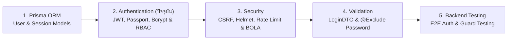

## 1. ข้อผิดพลาดที่พบบ่อย (Anti-patterns)

1. **การนำ JWT Refresh Token ไปเข้า `bcrypt.hash()` โดยตรงโดยไม่ผ่าน SHA-256 ก่อน**
   - **ปัญหา**: Bcrypt ตัดข้อความที่ 72 bytes แรก ทำให้ส่วน Signature ท้าย JWT ถูกตัดทิ้งทั้งหมด ส่งผลให้ Refresh Token ใบเก่าและใบใหม่มีค่า Hash ตรงกันเสมอ
   - **วิธีแก้**: ใช้ `HMAC-SHA256` ในการสร้าง Hash ของ Refresh Token หรือย่อด้วย `SHA-256` ก่อนเสมอ
2. **การใช้ `bcrypt.hashSync()` หรือ `bcrypt.compareSync()` บน Production**
   - **ปัญหา**: บล็อกการทำงานของ Event Loop ใน Node.js นานนับร้อยมิลลิวินาทีต่อครั้ง ทำให้ Throughput ของ API ทั้งระบบดิ่งลงเหวเมื่อมีคนล็อกอินพร้อมกัน
   - **วิธีแก้**: ใช้ `await bcrypt.hash()` และ `await bcrypt.compare()` แบบ Asynchronous เสมอ
3. **การลืมใช้ Global Guard (`APP_GUARD`) แล้วหวังพึ่งการแปะ `@UseGuards` ด้วยมือทุกจุด**
   - **ปัญหา**: นักพัฒนาคนใหม่สร้าง Endpoint ลบข้อมูลหรือดูรายงานการเงินแล้วลืมแปะ `@UseGuards` ทำให้กลายเป็น Public API โดยไม่ตั้งใจ
   - **วิธีแก้**: ลงทะเบียน `JwtAuthGuard` และ `RolesGuard` เป็น Global `APP_GUARD` เสมอ แล้วใช้ `@Public()` เฉพาะจุดที่ต้องการเปิดสาธารณะ
4. **การรับ `userId` ของผู้สั่งซื้อมาจาก Request Body หรือ Query Parameter**
   - **ปัญหา**: เปิดโอกาสให้ลูกค้าแก้ไข JSON Body เป็น `userId` ของคนอื่นเพื่อสั่งซื้อหรือดูข้อมูลของคนอื่นได้ทันที
   - **วิธีแก้**: ดึงรหัสผู้ใช้ที่ยืนยันตัวตนแล้วจาก `@CurrentUser('id')` เท่านั้น
5. **การตั้งค่า Secret Key ในโค้ดแบบ Fallback เช่น `process.env.JWT_SECRET || 'default-secret'`**
   - **ปัญหา**: หากวันขึ้น Production ลืมตั้งค่าตัวแปรสภาพแวดล้อม ระบบจะรันด้วยคำว่า `'default-secret'` โดยไม่แจ้งเตือนใดๆ ทำให้แฮกเกอร์ปลอมแปลง JWT เป็น `ADMIN` ได้ทั้งระบบ
   - **วิธีแก้**: ใช้ `configService.getOrThrow<string>('JWT_ACCESS_SECRET')` เพื่อให้แอปพลิเคชันหยุดทำงานตั้งแต่ตอนเริ่มต้น (Fail-Fast) หากไม่ได้ตั้งค่า Secret

---

---

## 2. Checklist สรุป

| หมวดหมู่ | รายการตรวจสอบสำหรับระบบ Authentication & RBAC | สถานะที่แนะนำ |
| :--- | :--- | :--- |
| **Password Security** | ใช้ `bcrypt.hash` แบบ Async ด้วย Cost Factor $\ge 12$ และจำกัดความยาวรหัสผ่านสูงสุด $\le 64$ ตัวอักษร | ✅ ต้องผ่าน |
| **Anti-Enumeration** | ใช้ Dummy Hash ป้องกัน Timing Attack และคืนข้อความ Error รวมเมื่ออีเมลหรือรหัสผ่านผิด | ✅ ต้องผ่าน |
| **Dual-Token Design** | แยก `JWT_ACCESS_SECRET` และ `JWT_REFRESH_SECRET` คนละชุด และตั้งอายุ Access Token สั้น (10-15 นาที) | ✅ ต้องผ่าน |
| **Cookie Security** | จัดเก็บ Token ใน Cookie ที่เปิด `httpOnly: true`, `secure: true`, `sameSite: 'lax'/'strict'` | ✅ ต้องผ่าน |
| **Secure by Default** | ลงทะเบียน `JwtAuthGuard` ตามด้วย `RolesGuard` เป็น Global `APP_GUARD` คู่กับ `@Public()` | ✅ ต้องผ่าน |
| **Token Rotation** | ทำ Refresh Token Rotation ทุกครั้งที่ต่ออายุ พร้อมระบบ Reuse Detection เพิกถอนเซสชันเมื่อถูกขโมย | ✅ ต้องผ่าน |
| **Clean Logout** | ล้างทั้งค่า Refresh Token Hash ในฐานข้อมูล และสั่ง `res.clearCookie()` ด้วย `path` ที่ตรงกัน | ✅ ต้องผ่าน |
| **Zero Trust Input** | ดึงข้อมูลผู้ใช้งานปัจจุบันผ่าน `@CurrentUser()` เท่านั้น ห้ามเชื่อ `userId` จาก Request Body | ✅ ต้องผ่าน |

---

---

## 3. ลำดับการเรียนที่แนะนำ และ ดูเพิ่มเติมที่

### ดูเพิ่มเติมที่:
- **กลุ่ม BACKEND**:
  - [NestJS 11](/docs/backend/nestjs) — วงจรชีวิตของ Guards, Decorators และ ExecutionContext ใน NestJS
  - [Security](/docs/backend/security) — การป้องกัน Brute-force ที่หน้า Login ด้วย `@nestjs/throttler`, การป้องกัน CSRF และการตรวจสอบสิทธิ์ระดับข้อมูล (BOLA/IDOR)
  - [Validation](/docs/backend/validation) — การตรวจสอบความรัดกุมของรหัสผ่านด้วย `class-validator` และการซ่อน `passwordHash` ขาออกด้วย `@Exclude()`
  - [Prisma ORM](/docs/backend/prisma-orm) — การออกแบบโมเดล `User` และการจัดเก็บข้อมูลเซสชันใน PostgreSQL 16
  - [REST API Design](/docs/backend/rest-api) — การจัดการสถานะ `401 Unauthorized` และ `403 Forbidden` ใน Error Envelope มาตรฐาน
- **กลุ่ม DATABASE**:
  - [Database Security](/docs/database/security) — การรักษาความปลอดภัยของข้อมูลส่วนบุคคลและรหัสผ่านในระดับฐานข้อมูล
- **กลุ่ม TESTING**:
  - [Backend Testing](/docs/testing/backend-testing) — วิธีเขียน Unit Test และ E2E Test สำหรับทดสอบ `JwtAuthGuard` และ `RolesGuard`
  - [E2E Playwright](/docs/testing/playwright) — การทดสอบ Flow การเข้าสู่ระบบและการเก็บรักษาสถานะ `HttpOnly Cookie` แบบอัตโนมัติ
- **กลุ่ม FRONTEND**:
  - [Next.js](/docs/nextjs) — การจัดการ Authentication ใน Next.js Middleware และการส่งต่อ Cookie จาก Server Components
  - [TanStack Query](/docs/tanstack-query) — การตั้งค่า Automatic Silent Token Refresh เมื่อได้รับรหัส `ACCESS_TOKEN_EXPIRED`
