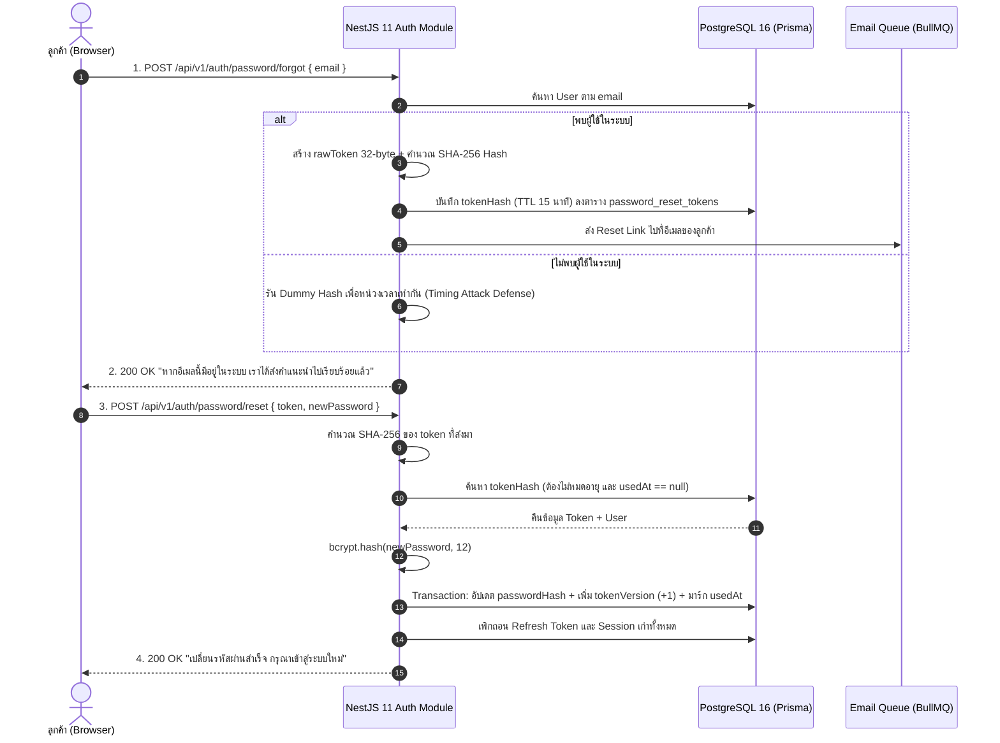

## 1. แนวคิด (Concept)

กระบวนการกู้คืนรหัสผ่าน (Password Reset Flow) ถือเป็น **เส้นทางวิกฤตที่มีความเสี่ยงด้านความปลอดภัยสูงสุด (Highest Security Risk Vector)** ในระบบพิสูจน์ตัวตนของเว็บแอปพลิเคชัน หากสถาปัตยกรรมส่วนนี้มีช่องโหว่เพียงจุดเดียว ผู้โจมตีจะสามารถข้ามผ่านการตรวจสอบรหัสผ่านเดิมทั้งหมด และเข้ายึดครองบัญชี (Account Takeover) ของลูกค้าหรือแม้กระทั่งผู้ดูแลระบบร้านค้าเนื้อ **Smart Butcher Marketplace** ได้ทันที

สถาปัตยกรรมการรีเซ็ตรหัสผ่านระดับ Enterprise Production ต้องยึดมั่นใน 4 เสาหลัก:
1. **การป้องกัน User Enumeration Attack**: ระบบต้องตอบกลับด้วยข้อความและ HTTP Status Code เดียวกันเสมอ ไม่ว่าอีเมลนั้นจะมีตัวตนอยู่ในระบบหรือไม่ก็ตาม
2. **การป้องกัน Side-Channel Timing Attack**: การประมวลผลทั้งในกรณีที่มีอีเมลและไม่มีอีเมลในระบบ ต้องใช้เวลาใกล้เคียงกันที่สุด เพื่อไม่ให้ผู้โจมตีจับเวลาความต่างของ Network Latency
3. **อายุของโทเคนสั้นและใช้ได้ครั้งเดียว (Short-lived 15m & Single-use Token)**: โทเคนสำหรับตั้งรหัสผ่านใหม่ต้องหมดอายุภายใน 15 นาที และถูกเผาทำลาย (Invalidate) ทันทีที่มีการนำไปใช้งานครั้งแรก
4. **การเพิกถอนเซสชันทั้งหมดทันที (Global Session Revocation)**: เมื่อมีการเปลี่ยนรหัสผ่านสำเร็จ ทุก Access Token และ Refresh Token ที่กำลังทำงานอยู่ในโทรศัพท์มือถือ แท็บเล็ต หรือคอมพิวเตอร์เครื่องอื่นต้องถูกตัดสิทธิ์และบังคับให้ออกจากระบบทันที



## 2. หลักการเบื้องหลัง (Under the Hood)

### 2.1 การป้องกัน User Enumeration และ Side-Channel Timing Attack
การโจมตีแบบ **User Enumeration** คือการที่แฮกเกอร์ใช้เครื่องมืออัตโนมัติส่งอีเมลนับล้านรายการมาที่ Endpoint `/forgot-password` เพื่อดูว่า:
- หากระบบตอบ `404 Not Found: ไม่พบอีเมลนี้ในระบบ` แฮกเกอร์จะรู้ทันทีว่าอีเมลนี้ไม่ได้เป็นลูกค้า
- หากระบบตอบ `200 OK: ส่งลิงก์ไปยังอีเมลเรียบร้อย` แฮกเกอร์จะบันทึกว่าอีเมลนี้มีอยู่จริงในระบบ Smart Butcher

นอกจากข้อความแจ้งเตือนแล้ว ยังมีช่องโหว่ที่แนบเนียนกว่านั้นคือ **Timing Attack**:
- กรณี **พบผู้ใช้**: ระบบต้องทำการบันทึกข้อมูลลงฐานข้อมูล, สุ่ม Token, และเรียกฟังก์ชัน Hash ซึ่งกินเวลาประมาณ 80–120ms
- กรณี **ไม่พบผู้ใช้**: หากโค้ดเขียน `if (!user) return ok;` เซิร์ฟเวอร์จะตอบกลับในเวลาเพียง 2–5ms!
- แฮกเกอร์สามารถวัดความแตกต่างของเวลา (Time Delta) นี้เพื่อแยกแยะได้ว่าอีเมลไหนมีอยู่ในระบบจริง

**วิธีแก้ไขในเชิงสถาปัตยกรรม**:
เมื่อค้นหาแล้วไม่พบผู้ใช้ในระบบ ให้รันกระบวนการ **Dummy Cryptographic Calculation** (เช่น การแฮชสตริงสุ่มหลอก) เพื่อถ่วงเวลาให้ Response Time ของทั้งสองกรณีมีค่าเฉลี่ยทางสถิติที่ใกล้เคียงกัน

### 2.2 ทำไมโทเคนรีเซ็ตรหัสผ่านต้องมีอายุเพียง 15 นาที?
ต่างจากโทเคนยืนยันอีเมลที่มีอายุได้ถึง 24 ชั่วโมง ลิงก์รีเซ็ตรหัสผ่านมีความอ่อนไหวสูงมาก (High-Privilege Vector):
- ความเสี่ยงจากการลืมเปิดอีเมลทิ้งไว้ในที่สาธารณะ (Shared Computer)
- หากอีเมลถูกเจาะ การจำกัดเวลาเหลือ 15 นาทีช่วยลดหน้าต่างแห่งโอกาส (Window of Vulnerability) ของผู้โจมตีลงอย่างมหาศาล
- เมื่อผู้ใช้กดขอรีเซ็ตรหัสผ่านใหม่ โทเคนใบก่อนหน้าทั้งหมดของผู้ใช้นั้นต้องถูกตั้งค่า `usedAt` หรือลบทำลายทันที (Strict Single-Active Token Policy)

### 2.3 กลไกการเพิกถอน Active Sessions ทั้งหมด (Global Session Revocation)
สมมติว่าลูกค้าถูกขโมยอุปกรณ์มือถือ หรือบัญชีถูกแอบเข้าใช้งานจากต่างประเทศ เมื่อลูกค้าเข้ามาที่คอมพิวเตอร์เพื่อรีเซ็ตรหัสผ่าน การเปลี่ยนรหัสผ่านสำเร็จ **จะต้องตัดการเชื่อมต่อของทุกอุปกรณ์ที่ล็อกอินค้างอยู่ทันที**

การเพิกถอนในระบบที่ใช้ Stateless JWT ทำได้โดย:
1. **คอลัมน์ `tokenVersion` (หรือ `token_version` Int)** ในตาราง `users`:
   - ใน Payload ของ Access Token และ Refresh Token จะมีเคลม `tokenVersion` ฝังอยู่ด้วยเสมอ เช่น `{ sub: "user-uuid", tokenVersion: 3 }`
   - เมื่อมีการรีเซ็ตรหัสผ่าน ให้สั่งรันคำสั่ง SQL: `UPDATE users SET token_version = token_version + 1 WHERE id = $1`
   - เมื่ออุปกรณ์เครื่องอื่นนำ Access Token หรือ Refresh Token เดิม (`tokenVersion: 3`) มาใช้งาน จะถูก JwtAuthGuard หรือ Refresh Strategy ปฏิเสธทันที เพราะค่าในฐานข้อมูลกลายเป็น `4` แล้ว
2. **การล้าง Session ใน Redis หรือตาราง Session**: สั่งลบ Refresh Token Hash และ Active Session Keys ของผู้ใช้นั้นทิ้งทั้งหมด

<Callout type="warning" title="อย่าใช้ HTTP GET ในการรีเซ็ตรหัสผ่าน">
ลิงก์ในอีเมลควรพาผู้ใช้ไปยังหน้าเว็บฟอร์มของ Frontend (เช่น /auth/reset-password?token=...) และให้ฟอร์มนั้นส่งคำขอแบบ HTTP POST เท่านั้น ห้ามสร้าง Endpoint GET /api/v1/auth/reset?token=... เด็ดขาด เพราะ Email Client, แอนติไวรัส หรือ Web Crawler มักแอบเปิดลิงก์ GET อัตโนมัติล่วงหน้าเพื่อตรวจจับไวรัส ซึ่งจะทำให้โทเคนถูกใช้งานไปก่อนที่ลูกค้าตัวจริงจะได้กด!
</Callout>

## 3. ตัวอย่างโค้ด (Smart Butcher Marketplace)

### ตัวอย่างที่ 1: Password Reset Request Service & Anti-Enumeration / Timing Attack Defense (พื้นฐานถึงปานกลาง)

ในส่วนนี้เราจะสร้าง Service สำหรับรับเรื่องการขอกู้คืนรหัสผ่าน โดยรับประกันว่าระบบจะตอบกลับในเวลาที่สม่ำเสมอ และบันทึกเฉพาะค่า SHA-256 Hash ของโทเคนลงในฐานข้อมูล

```typescript filename="src/modules/auth/services/password-reset-request.service.ts"
import { Injectable, Logger } from '@nestjs/common';
import * as crypto from 'crypto';
import { PrismaService } from '../../../database/prisma.service';

export interface ForgotPasswordResult {
  message: string;
}

@Injectable()
export class PasswordResetRequestService {
  private readonly logger = new Logger(PasswordResetRequestService.name);
  // ลิงก์กู้คืนรหัสผ่านมีอายุเพียง 15 นาทีเท่านั้น
  private readonly TOKEN_EXPIRY_MINUTES = 15;

  constructor(private readonly prisma: PrismaService) {}

  /**
   * รองรับคำขอลืมรหัสผ่าน พร้อมป้องกัน User Enumeration และ Timing Attack
   */
  async requestPasswordReset(email: string): Promise<ForgotPasswordResult> {
    const normalizedEmail = email.trim().toLowerCase();

    // 1. ค้นหาผู้ใช้ในฐานข้อมูล
    const user = await this.prisma.user.findUnique({
      where: { email: normalizedEmail },
      select: { id: true, email: true, fullName: true, isActive: true },
    });

    if (!user || !user.isActive) {
      // 🛡️ ป้องกัน Side-Channel Timing Attack:
      // รันการคำนวณหลอก (Dummy Computation) เพื่อให้ใช้เวลาใกล้เคียงกับตอนที่มี User จริง
      this.executeDummyTimingCompensation();

      // ตอบกลับข้อความมาตรฐานเดียวกันเสมอ (Anti-Enumeration)
      return {
        message: 'หากอีเมลนี้ลงทะเบียนไว้ในระบบ Smart Butcher เราได้ส่งลิงก์ตั้งรหัสผ่านใหม่ไปให้เรียบร้อยแล้ว',
      };
    }

    // 2. สร้าง Cryptographic Token ความยาว 32 bytes (256 bits)
    const rawToken = crypto.randomBytes(32).toString('hex');

    // 3. คำนวณ SHA-256 Hash เพื่อจัดเก็บลงในฐานข้อมูล
    const tokenHash = crypto
      .createHash('sha256')
      .update(rawToken)
      .digest('hex');

    const expiresAt = new Date();
    expiresAt.setMinutes(expiresAt.getMinutes() + this.TOKEN_EXPIRY_MINUTES);

    // 4. บันทึกลงตาราง password_reset_tokens และเคลียร์โทเคนเก่าทิ้ง
    await this.prisma.$transaction(async (tx) => {
      // เพิกถอนโทเคนรีเซ็ตรหัสผ่านเดิมที่ยังไม่หมดอายุของผู้ใช้นี้
      await tx.passwordResetToken.updateMany({
        where: {
          userId: user.id,
          usedAt: null,
        },
        data: {
          usedAt: new Date(), // มาร์กว่าถูกยกเลิกแล้ว
        },
      });

      // สร้างโทเคนใหม่ใบเดียวที่ Active
      await tx.passwordResetToken.create({
        data: {
          userId: user.id,
          tokenHash,
          expiresAt,
        },
      });
    });

    // 5. ส่งลิงก์ไปยังอีเมล (ในระบบจริงควร Dispatch ผ่าน Queue เช่น BullMQ)
    const resetUrl = `${process.env.FRONTEND_APP_URL}/auth/reset-password?token=${rawToken}`;
    this.logger.log(`สร้างลิงก์รีเซ็ตรหัสผ่านสำหรับ User: ${user.id} (หมดอายุใน 15 นาที)`);
    
    // ตัวอย่าง: await this.mailQueue.add('send-password-reset', { to: user.email, name: user.fullName, resetUrl });

    return {
      message: 'หากอีเมลนี้ลงทะเบียนไว้ในระบบ Smart Butcher เราได้ส่งลิงก์ตั้งรหัสผ่านใหม่ไปให้เรียบร้อยแล้ว',
    };
  }

  /**
   * ถ่วงเวลาให้การประมวลผลกรณีไม่พบผู้ใช้ ใช้ CPU Time ใกล้เคียงกับการบันทึกโทเคนจริง
   */
  private executeDummyTimingCompensation(): void {
    const dummyBytes = crypto.randomBytes(32).toString('hex');
    crypto.createHash('sha256').update(dummyBytes).digest('hex');
  }
}
```

### ตัวอย่างที่ 2: Password Reset Execution Service & Global Session Revocation ใน Smart Butcher Marketplace (ขั้นสูง)

ในตัวอย่างนี้ เราจะจัดการกระบวนการรับ `rawToken` และ `newPassword` มาจากผู้ใช้ ตรวจสอบความถูกต้อง บันทึกรหัสผ่านใหม่ด้วย **Bcrypt (Cost Factor = 12)** พร้อมทั้งทำการ **เพิกถอน Active Sessions ทั้งหมดผ่าน `tokenVersion`** และลบ Refresh Token เก่าออกจากระบบทันทีในระดับ Database Transaction

```typescript filename="src/modules/auth/dto/reset-password.dto.ts"
import { IsString, MinLength, MaxLength, Matches } from 'class-validator';

export class ResetPasswordDto {
  @IsString({ message: 'Token ต้องเป็นสตริงที่ถูกต้อง' })
  token!: string;

  @IsString()
  @MinLength(8, { message: 'รหัสผ่านใหม่ต้องมีความยาวอย่างน้อย 8 ตัวอักษร' })
  @MaxLength(64, { message: 'รหัสผ่านใหม่ต้องมีความยาวไม่เกิน 64 ตัวอักษร (ตามมาตรฐานความปลอดภัย Bcrypt)' })
  @Matches(/((?=.*\d)|(?=.*\W+))(?![.\n])(?=.*[A-Z])(?=.*[a-z]).*$/, {
    message: 'รหัสผ่านต้องประกอบด้วยตัวพิมพ์ใหญ่ ตัวพิมพ์เล็ก ตัวเลข หรืออักขระพิเศษอย่างน้อย 1 ตัว',
  })
  newPassword!: string;
}
```

```typescript filename="src/modules/auth/services/password-reset-execution.service.ts"
import {
  Injectable,
  BadRequestException,
  UnauthorizedException,
  Logger,
} from '@nestjs/common';
import * as crypto from 'crypto';
import * as bcrypt from 'bcrypt';
import { PrismaService } from '../../../database/prisma.service';
import { ResetPasswordDto } from '../dto/reset-password.dto';

@Injectable()
export class PasswordResetExecutionService {
  private readonly logger = new Logger(PasswordResetExecutionService.name);
  private readonly BCRYPT_SALT_ROUNDS = 12;

  constructor(private readonly prisma: PrismaService) {}

  /**
   * ทำการตรวจสอบโทเคน เปลี่ยนรหัสผ่านใหม่ และเพิกถอน Active Sessions ทั้งหมด
   */
  async executePasswordReset(dto: ResetPasswordDto): Promise<{ success: boolean; message: string }> {
    const { token, newPassword } = dto;

    if (!token || token.length !== 64) {
      throw new BadRequestException({
        code: 'INVALID_RESET_TOKEN_FORMAT',
        message: 'รูปแบบรหัสรีเซ็ตรหัสผ่านไม่ถูกต้อง',
      });
    }

    // คำนวณ SHA-256 Hash ของโทเคนเพื่อนำไปค้นหาในฐานข้อมูล
    const tokenHash = crypto
      .createHash('sha256')
      .update(token)
      .digest('hex');

    return await this.prisma.$transaction(async (tx) => {
      // 1. ค้นหาโทเคนในตาราง password_reset_tokens
      const resetRecord = await tx.passwordResetToken.findUnique({
        where: { tokenHash },
        include: { user: true },
      });

      // 2. ตรวจสอบว่าพบโทเคน และยังไม่เคยถูกนำไปใช้งานมาก่อน
      if (!resetRecord || resetRecord.usedAt !== null) {
        throw new UnauthorizedException({
          code: 'RESET_TOKEN_INVALID_OR_CONSUMED',
          message: 'ลิงก์ตั้งรหัสผ่านใหม่นี้ไม่ถูกต้องหรือถูกใช้งานไปแล้ว กรุณาทำรายการใหม่อีกครั้ง',
        });
      }

      // 3. ตรวจสอบอายุของโทเคน (ไม่เกิน 15 นาที)
      if (new Date() > resetRecord.expiresAt) {
        // อัปเดตเพื่อป้องกันการนำมาวนซ้ำ
        await tx.passwordResetToken.update({
          where: { id: resetRecord.id },
          data: { usedAt: new Date() },
        });

        throw new UnauthorizedException({
          code: 'RESET_TOKEN_EXPIRED',
          message: 'ลิงก์ตั้งรหัสผ่านใหม่หมดอายุแล้ว (เกิน 15 นาที) กรุณากดขอลิงก์ใหม่อีกครั้ง',
        });
      }

      const user = resetRecord.user;
      if (!user.isActive) {
        throw new UnauthorizedException('บัญชีผู้ใช้งานนี้ถูกระงับ ไม่สามารถเปลี่ยนรหัสผ่านได้');
      }

      // 4. เข้ารหัสรหัสผ่านใหม่ด้วย Bcrypt Cost Factor 12
      const newPasswordHash = await bcrypt.hash(newPassword, this.BCRYPT_SALT_ROUNDS);

      // 5. ปรับปรุงฐานข้อมูลแบบ Atomic:
      // - เปลี่ยน passwordHash
      // - เพิ่ม tokenVersion (+1) เพื่อทำให้ Access Token และ Refresh Token ของทุกอุปกรณ์หมดสภาพทันที
      // - ทำเครื่องหมาย usedAt บนโทเคนรีเซ็ตเพื่อปิดสิทธิ์ถาวร (Single-use)
      await tx.user.update({
        where: { id: user.id },
        data: {
          passwordHash: newPasswordHash,
          tokenVersion: { increment: 1 }, // Global Session Invalidation
        },
      });

      await tx.passwordResetToken.update({
        where: { id: resetRecord.id },
        data: {
          usedAt: new Date(),
        },
      });

      // 6. ลบ Refresh Token Hashes ทั้งหมดของผู้ใช้นี้ออกจากตาราง Active Sessions หรือ Redis
      await tx.userSession.deleteMany({
        where: { userId: user.id },
      });

      this.logger.warn(
        `เปลี่ยนรหัสผ่านสำเร็จสำหรับ User: ${user.email} (ตัดสิทธิ์เซสชันเดิมทั้งหมดเรียบร้อย)`,
      );

      // 7. ส่งอีเมลแจ้งเตือนความปลอดภัยว่ารหัสผ่านถูกเปลี่ยนแปลงแล้ว
      // await this.mailQueue.add('send-password-changed-alert', { to: user.email, time: new Date() });

      return {
        success: true,
        message: 'ตั้งรหัสผ่านใหม่สำเร็จเรียบร้อยแล้ว ทุกอุปกรณ์เดิมถูกออกจากระบบ กรุณาเข้าสู่ระบบด้วยรหัสผ่านใหม่',
      };
    });
  }
}
```

```typescript filename="src/modules/auth/controllers/password-reset.controller.ts"
import {
  Controller,
  Post,
  Body,
  HttpCode,
  HttpStatus,
  UsePipes,
  ValidationPipe,
} from '@nestjs/common';
import { PasswordResetRequestService } from '../services/password-reset-request.service';
import { PasswordResetExecutionService } from '../services/password-reset-execution.service';
import { ResetPasswordDto } from '../dto/reset-password.dto';

class ForgotPasswordDto {
  email!: string;
}

@Controller('v1/auth/password')
@UsePipes(new ValidationPipe({ whitelist: true, transform: true }))
export class PasswordResetController {
  constructor(
    private readonly requestService: PasswordResetRequestService,
    private readonly executionService: PasswordResetExecutionService,
  ) {}

  /**
   * Endpoint ขอรับลิงก์รีเซ็ตรหัสผ่าน
   * POST /api/v1/auth/password/forgot
   */
  @Post('forgot')
  @HttpCode(HttpStatus.OK)
  async forgotPassword(@Body() dto: ForgotPasswordDto) {
    return this.requestService.requestPasswordReset(dto.email);
  }

  /**
   * Endpoint ดำเนินการตั้งรหัสผ่านใหม่ผ่านโทเคน
   * POST /api/v1/auth/password/reset
   */
  @Post('reset')
  @HttpCode(HttpStatus.OK)
  async resetPassword(@Body() dto: ResetPasswordDto) {
    return this.executionService.executePasswordReset(dto);
  }
}
```

## 4. ข้อผิดพลาดที่พบบ่อย (Anti-pattern vs Best Practice)

```typescript filename="src/modules/auth/password-reset-anti-patterns.ts"
// ❌ ผิด (Anti-pattern 1): แจ้งเตือนแยกชัดเจนว่าอีเมลไม่มีในระบบ
export async function badForgotCheck(email: string, db: any) {
  const user = await db.user.findUnique({ where: { email } });
  if (!user) {
    // ❌ เปิดช่องโหว่ User Enumeration เต็มรูปแบบ แฮกเกอร์ใช้เจาะหารายชื่อลูกค้าได้
    throw new Error('ไม่พบบัญชีผู้ใช้นี้ในระบบ');
  }
}

// ❌ ผิด (Anti-pattern 2): โทเคนสามารถนำกลับมาใช้ซ้ำได้จนกว่าจะหมดเวลา 24 ชม.
// ปัญหา: หากโทเคนรั่วไหล แฮกเกอร์สามารถนำมารีเซ็ตรหัสผ่านซ้ำๆ ได้เรื่อยๆ

// ❌ ผิด (Anti-pattern 3): เปลี่ยนรหัสผ่านใหม่แล้ว แต่ปล่อยให้ Session เก่าในมือถือของแฮกเกอร์ยังใช้งานต่อได้!
// ปัญหา: แฮกเกอร์ที่ล็อกอินค้างอยู่ยังสามารถสั่งซื้อเนื้อวากิวและดูข้อมูลบัตรเครดิตต่อได้จนกว่าโทเคนจะหมดอายุเอง

// ✅ ถูก (Best Practice):
// 1. ตอบข้อความ Generic สม่ำเสมอ ไม่ว่าอีเมลจะมีหรือไม่มีในระบบ
// 2. ใช้ Single-use Token (มาร์ก usedAt ทันทีที่ใช้เสร็จใน Database Transaction)
// 3. กำหนดอายุสั้นเพียง 15 นาที
// 4. บันทึกเฉพาะค่า SHA-256 Hash ลงตารางฐานข้อมูล
// 5. บังคับ Global Session Invalidation ด้วยการเพิ่ม tokenVersion (+1) และล้าง Session ทันที
```

## 5. ควรใช้เมื่อไหร่ และ ไม่ควรใช้เมื่อไหร่

### ควรใช้ Password Reset Flow เมื่อ:
- **ผู้ใช้งานลงทะเบียนด้วย Email & Password**: เป็นกระบวนการมาตรฐานที่จำเป็นต้องมีสำหรับระบบที่มี Local Credentials
- **มีกลไกยืนยันตัวตนผ่านช่องทางที่ควบคุมได้โดยตรง**: ผู้ใช้ต้องมีสิทธิ์เข้าถึงกล่องจดหมายอีเมลที่ใช้ลงทะเบียนไว้กับ Smart Butcher

### ไม่ควรใช้ (หรือปรับเปลี่ยนแนวทาง) เมื่อ:
- **บัญชีสมัครผ่าน Social Login แท้ (Google / LINE)**: บัญชีกลุ่มนี้ไม่มีรหัสผ่านในระบบ (`passwordHash: null`) หากผู้ใช้กลุ่มนี้มากรอกขอลืมรหัสผ่าน ระบบควรส่งอีเมลแจ้งเตือนว่า *"บัญชีของคุณเข้าสู่ระบบผ่าน Google หรือ LINE กรุณาใช้ปุ่ม Social Login"* แทนที่จะอนุญาตให้ตั้งรหัสผ่านใหม่โดยตรง
- **ไม่ควรส่งรหัสผ่านใหม่แบบ Plaintext หรือสร้าง Temporary Password สุ่มกลับไปในอีเมล**: การสร้างรหัสผ่านชั่วคราวส่งทางอีเมลมีความเสี่ยงที่จะถูกดักจับผ่าน Mail Transfer Protocols ที่ไม่ได้เข้ารหัส ต้องส่งเป็น Magic Reset Link ที่มีอายุสั้นเท่านั้น

## 6. คำถามสัมภาษณ์งาน (Interview Q&A)

### ข้อที่ 1: การออกแบบระบบกู้คืนรหัสผ่านให้ปลอดภัยจาก User Enumeration Attack ต้องคำนึงถึงมิติใดบ้างนอกเหนือจากข้อความแจ้งเตือน (Error Message)?
**แนวคำตอบเชิงลึก**:
การป้องกัน User Enumeration Attack ต้องครอบคลุมถึง 3 มิติหลัก:

1. **HTTP Status Code & Response Payload Uniformity**:
   - ทุกคำขอที่ส่งมายัง Endpoint ลืมรหัสผ่าน ไม่ว่าอีเมลนั้นจะมีอยู่จริง, บัญชีถูกระงับ, หรือไม่มีอีเมลในระบบเลย จะต้องได้รับ HTTP Status Code เดียวกัน (เช่น `200 OK` หรือ `202 Accepted`)
   - เนื้อหา JSON Response ต้องเหมือนกันทุกตัวอักษร เช่น `{"success": true, "message": "หากอีเมลนี้มีอยู่ในระบบ..."}`
2. **Side-Channel Timing Analysis Defense (Constant-time Processing)**:
   - ผู้โจมตีขั้นสูงไม่ได้ดูแค่ข้อความ แต่ใช้สคริปต์วัดความเร็วในการตอบสนอง (Response Latency) ในระดับมิลลิวินาที
   - หากกรณีมีอีเมล ระบบต้องทำ Database Write และคำนวณ Hashing ซึ่งกินเวลา 80ms แต่กรณีไม่มีอีเมลระบบตอบกลับใน 3ms แฮกเกอร์จะวิเคราะห์ความต่างทางสถิติได้
   - วิธีแก้คือการใส่ Dummy Computation หรือส่งงานเข้า Asynchronous Queue (BullMQ) ทั้งหมด แล้วตอบกลับทันที เพื่อให้ทุกกรณีใช้เวลาในระดับ HTTP Layer ไม่ต่างกัน
3. **Multi-Channel Enumeration Consistency**:
   - ต้องตรวจสอบ Endpoint อื่นๆ ที่เกี่ยวข้องด้วย เช่น หน้า Register, Login, และ Change Email เพราะหากหน้า Reset Password ปิดมิดชิด แต่หน้า Register ดันแจ้งเตือนว่า *"อีเมลนี้ถูกใช้งานแล้ว"* แฮกเกอร์ก็ยังสามารถรวบรวมรายชื่อผู้ใช้จากหน้า Register ได้อยู่ดี

---

### ข้อที่ 2: เมื่อผู้ใช้ทำการรีเซ็ตรหัสผ่านสำเร็จ ในเชิงสถาปัตยกรรม NestJS ร่วมกับ JWT เราจะทำให้โทเคนทั้งหมด (Access Tokens & Refresh Tokens) ที่แฮกเกอร์หรืออุปกรณ์อื่นถืออยู่ใช้งานไม่ได้ทันทีได้อย่างไร?
**แนวคำตอบเชิงลึก**:
เราสามารถใช้แนวทาง **Token Versioning & Distributed Session Blacklisting**:

1. **กลไก Token Versioning (`tokenVersion`) ในฐานข้อมูล**:
   - เพิ่มคอลัมน์ `tokenVersion Int @default(0)` ในโมเดล `User`
   - เมื่อออก JWT (ทั้ง Access Token อายุ 15 นาที และ Refresh Token อายุ 7 วัน) ให้ฝังเคลม `tokenVersion` ลงใน Payload เสมอ
   - เมื่อผู้ใช้เปลี่ยนรหัสผ่านสำเร็จ ให้รันคำสั่ง Atomic: `UPDATE users SET token_version = token_version + 1 WHERE id = $user_id`
   - ใน `JwtAuthGuard` หรือ `PassportStrategy` ตอนตรวจสอบ Token ขาเข้า ให้ดึงข้อมูลผู้ใช้จากฐานข้อมูลหรือ Redis แคช หากพบว่า `payload.tokenVersion !== user.tokenVersion` ให้ปฏิเสธคำขอทันที (`401 Unauthorized`)
2. **การล้าง Refresh Token ในหน่วยความจำหรือฐานข้อมูล (Immediate Session Purge)**:
   - Refresh Token ซึ่งเป็นกุญแจสำคัญในการขอ Access Token ใบใหม่ จะต้องถูกเพิกถอนทันที โดยการลบ Hash ออกจากตาราง `user_sessions` หรือสั่งล้าง Redis Key Pattern `session:${userId}:*`
3. **การจัดการสิทธิ์ Access Token อายุสั้น**:
   - หากต้องการตัดสิทธิ์ Access Token ทันทีในระดับวินาทีโดยไม่รอหมดอายุ 15 นาที สามารถใช้ **Redis Token Blacklist**: นำ `jti` (JWT ID) หรือค่า Token ที่ยังไม่หมดอายุไปบันทึกลง Redis พร้อมตั้ง TTL เท่ากับอายุคงเหลือของ Access Token นั้น เมื่อ Guard เช็คเจอว่า `jti` อยู่ใน Blacklist จะบล็อกการทำงานทันที

---

## ลำดับการเรียนที่แนะนำ และ ดูเพิ่มเติมที่

เพื่อความเชี่ยวชาญในระบบความปลอดภัยและการจัดการสิทธิ์ ขอแนะนำให้ศึกษาหัวข้อต่างๆ ตามลำดับดังต่อไปนี้:

1. ศึกษาพื้นฐานการแฮชรหัสผ่านและการควบคุมความเร็ว: [Auth Flow Bcrypt](/docs/backend/authentication/auth-flow-bcrypt)
2. การจัดเก็บ Token ในคุกกี้เพื่อป้องกัน XSS: [JWT HttpOnly](/docs/backend/authentication/jwt-httponly)
3. สถาปัตยกรรมการยืนยันอีเมลด้วย Token แบบสุ่ม: [Email Verification](/docs/backend/authentication/email-verify)
4. ระบบยืนยันตัวตนสองชั้นด้วย TOTP: [2FA / MFA](/docs/backend/authentication/two-factor)
5. สถาปัตยกรรมการล็อกอินผ่านบุคคลที่สาม: [OAuth & Social](/docs/backend/authentication/oauth-social)
6. สถาปัตยกรรมขั้นสูงในการหมุนเวียนโทเคน: [Token Rotation](/docs/backend/authentication/token-rotation)
7. หลุมพรางด้านความปลอดภัยที่ต้องระวัง: [Authentication Anti-patterns](/docs/backend/authentication/pitfalls)
