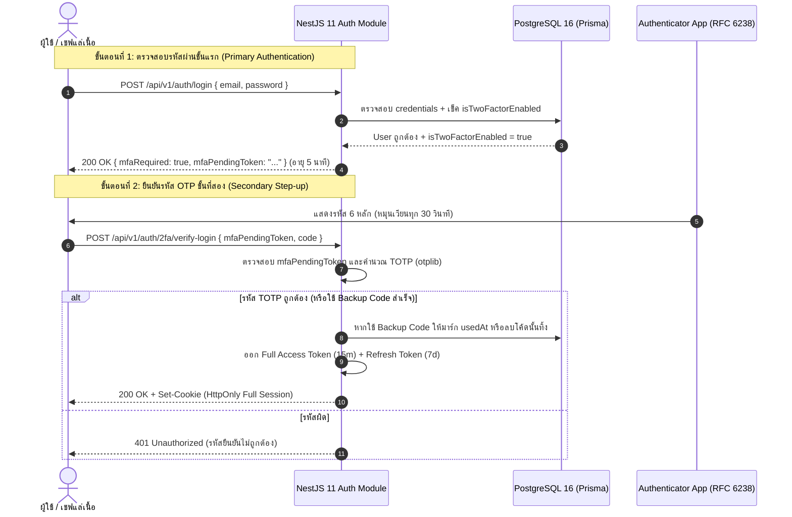

## 1. แนวคิด (Concept)

ในระบบ **Smart Butcher Marketplace** บัญชีผู้ใช้ไม่ได้มีเพียงลูกค้าทั่วไปที่สั่งซื้อเนื้อสเต๊ก แต่ยังมีบัญชีเชฟผู้เชี่ยวชาญการตัดแต่งเนื้อ (`BUTCHER_CHEF`) ที่ควบคุมออเดอร์เนื้อดรายเอจมูลค่าสูง และบัญชีผู้ดูแลระบบ (`ADMIN`) ที่มีสิทธิ์อนุมัติการคืนเงิน (`Payment` Refund) มูลค่าหลักแสนบาท หากบัญชีกลุ่มนี้ถูกขโมยรหัสผ่าน (Credential Stuffing หรือ Phishing) ความเสียหายที่เกิดขึ้นจะร้ายแรงเกินกว่าที่การมีรหัสผ่านเพียงชั้นเดียวจะรับมือได้

การติดตั้งระบบ **Two-Factor Authentication (2FA / MFA)** ด้วยมาตรฐาน **TOTP (Time-based One-Time Password - RFC 6238)** จึงเป็นเกราะป้องกันชั้นที่สองที่ช่วยหยุดยั้งการโจมตีได้มากกว่า 99.9% แม้แฮกเกอร์จะได้รหัสผ่านหลักไปแล้วก็ตาม

สถาปัตยกรรม 2FA ในระดับ Production ต้องมีองค์ประกอบครบวงจร:
1. **การลงทะเบียนและเปิดใช้งาน (Enrollment & Verification Flow)**: ผู้ใช้ต้องสแกน QR Code เข้าแอปพลิเคชัน (เช่น Google Authenticator หรือ Microsoft Authenticator) และกรอกรหัส 6 หลักทดสอบความถูกต้องสำเร็จก่อน จึงจะเปิดใช้งาน 2FA บนบัญชี
2. **รหัสสำรองฉุกเฉิน (Hashed Backup Recovery Codes)**: สร้างชุดรหัสกู้คืน 10 ชุดสำหรับกรณีที่ลูกค้าทำโทรศัพท์มือถือสูญหาย โดยรหัสเหล่านี้ต้องถูกแฮชด้วย Bcrypt ก่อนเก็บลงฐานข้อมูลเสมอ
3. **การจัดการสถานะการล็อกอินสองขั้นตอน (2FA Pending Token vs Full Session Token)**: เมื่อผู้ใช้กรอกรหัสผ่านหลักถูกต้อง ระบบจะไม่ออก Full Session Cookie ให้ทันที แต่จะออก **Pre-Auth Pending Token** อายุสั้น 5 นาที ที่มีสิทธิ์เรียกได้เฉพาะ Endpoint ตรวจสอบ 2FA เท่านั้น



## 2. หลักการเบื้องหลัง (Under the Hood)

### 2.1 กลไกคณิตศาสตร์ของ TOTP (RFC 6238)
TOTP เป็นส่วนต่อขยายของอัลกอริทึม HOTP (HMAC-based One-Time Password - RFC 4226) โดยเปลี่ยนตัวนับ (Counter $C$) ที่ต้องส่งซิงก์กัน มาเป็น **ช่วงเวลาปัจจุบัน (Time-step)** แทน ทำให้ทั้งโทรศัพท์มือถือของผู้ใช้และเซิร์ฟเวอร์สามารถสร้างรหัสที่ตรงกันได้โดยไม่ต้องสื่อสารทางอินเทอร์เน็ต

สูตรการคำนวณ TOTP:
$$T = \left\lfloor \frac{\text{Current Unix Timestamp} - T_0}{T_X} \right\rfloor$$
โดยที่:
- $T_0 = 0$ (จุดเริ่มต้นเวลา Unix Epoch: 1 มกราคม 1970)
- $T_X = 30$ วินาที (ค่า Time-step มาตรฐาน)
- $T$ คือจำนวนรอบเวลา 30 วินาทีที่นับมาตั้งแต่ปี 1970 จนถึงปัจจุบัน

จากนั้นนำค่า $T$ ไปคำนวณ HMAC-SHA1 ร่วมกับ **Secret Key (Base32)** ของผู้ใช้:
$$\text{HS} = \text{HMAC-SHA-1}(\text{Secret}, T)$$
แล้วนำผลลัพธ์ 20 bytes ที่ได้มาผ่านกระบวนการ **Dynamic Truncation** เพื่อดึงตัวเลข 4 bytes สุดท้าย แปลงเป็นจำนวนเต็มฐานสิบ และหารเอาเศษ ($\text{mod } 10^6$) เพื่อให้ได้ตัวเลข **6 หลัก** ที่แสดงบนหน้าจอแอป Authenticator

### 2.2 การยอมรับความคลาดเคลื่อนของเวลา (Time Drift Tolerance: Window = 1)
นาฬิกาของโทรศัพท์มือถือลูกค้าและเซิร์ฟเวอร์อาจไม่ตรงกันเป๊ะในระดับวินาที หรือลูกค้าอาจกดกรอกรหัสในวินาทีที่ 29 ซึ่งเมื่อข้อมูลวิ่งมาถึงเซิร์ฟเวอร์ เวลาอาจข้ามเข้าสู่รอบ 30 วินาทีถัดไปแล้ว

ไลบรารี `otplib` จึงอนุญาตให้กำหนดค่า `window: 1` หมายความว่าเซิร์ฟเวอร์จะยอมรับรหัสที่ถูกต้องของ:
- รอบเวลาปัจจุบัน ($T$)
- รอบเวลาก่อนหน้า 30 วินาที ($T - 1$)
- รอบเวลาถัดไป 30 วินาที ($T + 1$)
รวมหน้าต่างยอมรับเวลาเท่ากับ 90 วินาที เพื่อสร้างประสบการณ์การใช้งานที่ดีเยี่ยมโดยไม่สูญเสียความปลอดภัย

### 2.3 การเข้ารหัสและจัดเก็บรหัสกู้คืนฉุกเฉิน (Hashed Backup Recovery Codes)
หากลูกค้าทำโทรศัพท์มือถือตกน้ำ หรือเปลี่ยนเครื่องใหม่โดยไม่ได้ย้ายแอป Authenticator ลูกค้าจะสูญเสียการเข้าถึงบัญชีอย่างถาวร ระบบจึงต้องสร้าง **Backup Recovery Codes** (มักให้ 10 ชุด เช่น `a1b2-c3d4`)

**กฎเหล็กด้านความปลอดภัยของ Backup Codes**:
- ห้ามเก็บเป็น Plaintext ในฐานข้อมูลเด็ดขาด! เพราะหากฐานข้อมูลรั่วไหล แฮกเกอร์สามารถใช้รหัสกู้คืนนี้ข้ามขั้นตอน 2FA ได้ทันที
- ต้องนำรหัสสำรองแต่ละชุดไปผ่าน **Bcrypt (Cost Factor = 10)** ก่อนบันทึก
- แต่ละรหัสต้องเป็นแบบ **Single-use** (ใช้ได้ครั้งเดียว) เมื่อใช้แล้วต้องลบทิ้งหรือมาร์ก `usedAt` ทันที

### 2.4 สถาปัตยกรรม 2FA Pending Token (Step-up Authentication)
ข้อผิดพลาดร้ายแรงที่สุดคือการออก Full JWT Session Token ให้ผู้ใช้ทันทีหลังกรอกรหัสผ่านหลัก แล้วใช้โค้ดหน้าบ้าน (Frontend) บล็อกหน้าจอไว้รอให้กรอก 2FA เพราะแฮกเกอร์สามารถคัดลอก Cookie หรือ Token นั้นไปยิง API หลังบ้านสั่งซื้อเนื้อวากิวได้โดยตรง

**วิธีที่ถูกต้อง**:
1. หน้า Login ขั้นแรกจะออกเพียง `mfaPendingToken` ซึ่งมี Payload พิพาะ:
   ```json
   {
     "sub": "user-uuid-1234",
     "type": "2FA_PENDING",
     "exp": 1700000300
   }
   ```
2. Token นี้มีอายุสั้นเพียง 3–5 นาที และถูกเซ็นด้วย Secret แยกเฉพาะ (`JWT_MFA_PENDING_SECRET`)
3. `JwtAuthGuard` ของ API ทั่วไปจะปฏิเสธ Token นี้ทันที มีเพียง Endpoint `/api/v1/auth/2fa/verify-login` เท่านั้นที่อนุญาตให้ Token นี้ผ่านเข้ามาได้

<Callout type="warning" title="ห้ามเปิดใช้งาน 2FA ทันทีที่กดปุ่ม Generate">
ในขั้นตอนการเปิดใช้งาน (Enrollment) ระบบต้องบันทึก Secret Key ไว้ในสถานะรอการยืนยัน (Pending Verification) เท่านั้น และจะเปิดใช้งาน (isTwoFactorEnabled = true) ได้ก็ต่อเมื่อผู้ใช้กรอกรหัส 6 หลักทดสอบครั้งแรกผ่านแล้วเท่านั้น เพื่อป้องกันกรณีผู้ใช้สแกน QR Code ไม่ติดหรือปิดหน้าจอทิ้งไปจนถูกล็อกออกจากบัญชีตัวเองถาวร
</Callout>

## 3. ตัวอย่างโค้ด (Smart Butcher Marketplace)

### ตัวอย่างที่ 1: TOTP MFA Service ร่วมกับ `otplib`, `qrcode` และการแฮช Backup Codes (พื้นฐานถึงปานกลาง)

ในส่วนนี้เราจะสร้าง Service ที่รับผิดชอบการสร้าง Secret Key, การแปลง URI เป็น QR Code Data URL และการสร้างรหัสสำรองฉุกเฉิน 10 ชุดที่แฮชด้วย Bcrypt

```typescript filename="src/modules/auth/services/totp-mfa.service.ts"
import { Injectable, BadRequestException, Logger } from '@nestjs/common';
import { authenticator } from 'otplib';
import * as QRCode from 'qrcode';
import * as crypto from 'crypto';
import * as bcrypt from 'bcrypt';
import { PrismaService } from '../../../database/prisma.service';

export interface GeneratedMfaSetup {
  secret: string;
  qrCodeDataUrl: string;
  recoveryCodes: string[];
}

@Injectable()
export class TotpMfaService {
  private readonly logger = new Logger(TotpMfaService.name);
  private readonly ISSUER = 'Smart Butcher Marketplace';

  constructor(private readonly prisma: PrismaService) {
    // กำหนดค่าความทนทานต่อเวลาที่คลาดเคลื่อน (1 window = ±30 วินาที)
    authenticator.options = {
      window: 1,
    };
  }

  /**
   * สร้าง Secret ใหม่, QR Code Data URL และ Recovery Codes 10 ชุด
   */
  async generateMfaSecret(userId: string, email: string): Promise<GeneratedMfaSetup> {
    // 1. สร้าง Base32 Secret Key ความสุ่มสูง
    const secret = authenticator.generateSecret();

    // 2. สร้าง otpauth:// URI ตามมาตรฐาน RFC 6238
    const otpAuthUrl = authenticator.keyuri(email, this.ISSUER, secret);

    // 3. แปลงเป็น QR Code แบบ Base64 Data URL ให้ Frontend นำไปแสดงในแท็ก 
    const qrCodeDataUrl = await QRCode.toDataURL(otpAuthUrl, {
      errorCorrectionLevel: 'M',
      margin: 2,
      width: 280,
    });

    // 4. สร้าง Backup Recovery Codes แบบสุ่ม 10 ชุด (รูปแบบ: xxxx-xxxx)
    const plainRecoveryCodes: string[] = [];
    const hashedCodesData: { codeHash: string }[] = [];

    for (let i = 0; i < 10; i++) {
      const part1 = crypto.randomBytes(2).toString('hex');
      const part2 = crypto.randomBytes(2).toString('hex');
      const plainCode = `${part1}-${part2}`;
      plainRecoveryCodes.push(plainCode);

      // แฮชด้วย Bcrypt Cost Factor 10 ก่อนจัดเก็บ
      const codeHash = await bcrypt.hash(plainCode, 10);
      hashedCodesData.push({ codeHash });
    }

    // 5. บันทึก Secret ชั่วคราว (ยังไม่เปิดใช้งานจริง) ลงในตาราง mfa_pending_setups
    await this.prisma.user.update({
      where: { id: userId },
      data: {
        tempTwoFactorSecret: secret, // เก็บไว้ตรวจสอบรอบแรกก่อนตั้งเป็นทางการ
      },
    });

    // บันทึก hashed recovery codes สำรองไว้
    await this.prisma.twoFactorRecoveryCode.deleteMany({ where: { userId } });
    await this.prisma.twoFactorRecoveryCode.createMany({
      data: hashedCodesData.map((item) => ({
        userId,
        codeHash: item.codeHash,
      })),
    });

    return {
      secret,
      qrCodeDataUrl,
      recoveryCodes: plainRecoveryCodes, // ส่ง plain codes ให้ผู้ใช้จดบันทึกเก็บไว้เพียงครั้งเดียวนี้เท่านั้น
    };
  }

  /**
   * ยืนยันรหัส OTP ครั้งแรกเพื่อเปิดใช้งาน 2FA อย่างเป็นทางการ (Enrollment Confirmation)
   */
  async confirmAndEnableMfa(userId: string, code: string): Promise<boolean> {
    const user = await this.prisma.user.findUnique({
      where: { id: userId },
      select: { id: true, tempTwoFactorSecret: true },
    });

    if (!user || !user.tempTwoFactorSecret) {
      throw new BadRequestException('ไม่พบคำขอตั้งค่า 2FA ที่รอการยืนยัน กรุณากดเริ่มใหม่');
    }

    // ตรวจสอบรหัส 6 หลักกับ Secret ชั่วคราว
    const isValid = authenticator.check(code, user.tempTwoFactorSecret);

    if (!isValid) {
      throw new BadRequestException('รหัสยืนยัน 6 หลักไม่ถูกต้อง กรุณาตรวจสอบเวลาในโทรศัพท์มือถือ');
    }

    // เมื่อถูกต้อง จึงทำการเปิดใช้งานอย่างเป็นทางการใน Transaction
    await this.prisma.user.update({
      where: { id: userId },
      data: {
        twoFactorSecret: user.tempTwoFactorSecret,
        tempTwoFactorSecret: null,
        isTwoFactorEnabled: true,
      },
    });

    this.logger.log(`เปิดใช้งาน 2FA สำเร็จสำหรับ User ID: ${userId}`);
    return true;
  }

  /**
   * ตรวจสอบความถูกต้องของรหัส TOTP กับ Secret ในฐานข้อมูล
   */
  verifyTotpCode(secret: string, code: string): boolean {
    return authenticator.check(code, secret);
  }

  /**
   * ตรวจสอบและใช้งาน Backup Recovery Code (Single-use)
   */
  async verifyAndConsumeRecoveryCode(userId: string, plainCode: string): Promise<boolean> {
    const storedCodes = await this.prisma.twoFactorRecoveryCode.findMany({
      where: { userId, usedAt: null },
    });

    for (const record of storedCodes) {
      const isMatch = await bcrypt.compare(plainCode, record.codeHash);
      if (isMatch) {
        // เมื่อรหัสตรงกัน ให้มาร์กว่าใช้งานแล้วทันที
        await this.prisma.twoFactorRecoveryCode.update({
          where: { id: record.id },
          data: { usedAt: new Date() },
        });

        this.logger.warn(`User ID: ${userId} เข้าสู่ระบบด้วย Backup Recovery Code สำเร็จ`);
        return true;
      }
    }

    return false;
  }
}
```

### ตัวอย่างที่ 2: Two-Factor Login Controller, Step-up Auth Guard และ Token Issuer (ขั้นสูง)

ในตัวอย่างนี้ เราจะจัดการกระบวนการเข้าสู่ระบบแบบ 2 ขั้นตอน:
1. การตรวจสอบรหัสผ่านขั้นแรก หากบัญชีเปิด 2FA จะตอบกลับเป็น `mfaPendingToken` (5 นาที)
2. การยืนยัน 2FA ในขั้นตอนที่สองเพื่อแลกเป็น Full Session Tokens (Access & Refresh HttpOnly Cookies)

```typescript filename="src/modules/auth/guards/mfa-pending.guard.ts"
import {
  Injectable,
  CanActivate,
  ExecutionContext,
  UnauthorizedException,
} from '@nestjs/common';
import { JwtService } from '@nestjs/jwt';
import { Request } from 'express';

export interface MfaPendingPayload {
  sub: string;
  email: string;
  purpose: 'MFA_PENDING';
}

@Injectable()
export class MfaPendingGuard implements CanActivate {
  private readonly MFA_SECRET = process.env.JWT_MFA_PENDING_SECRET ?? 'mfa-pending-secret-key-64-characters';

  constructor(private readonly jwtService: JwtService) {}

  canActivate(context: ExecutionContext): boolean {
    const req = context.switchToHttp().getRequest<Request>();
    const authHeader = req.headers.authorization;

    if (!authHeader || !authHeader.startsWith('Bearer ')) {
      throw new UnauthorizedException('ไม่พบ MFA Pending Token ใน Authorization Header');
    }

    const token = authHeader.split(' ')[1];

    try {
      const payload = this.jwtService.verify<MfaPendingPayload>(token, {
        secret: this.MFA_SECRET,
      });

      if (payload.purpose !== 'MFA_PENDING') {
        throw new UnauthorizedException('ประเภทของ Token ไม่ถูกต้องสำหรับการยืนยัน 2FA');
      }

      // แนบข้อมูลผู้ใช้ที่อยู่ระหว่างรอการยืนยันเข้า Request
      (req as any).mfaUser = payload;
      return true;
    } catch {
      throw new UnauthorizedException('MFA Pending Token หมดอายุ (เกิน 5 นาที) หรือไม่ถูกต้อง กรุณาเข้าสู่ระบบใหม่');
    }
  }
}
```

```typescript filename="src/modules/auth/controllers/two-factor-auth.controller.ts"
import {
  Controller,
  Post,
  Body,
  UseGuards,
  Req,
  Res,
  HttpCode,
  HttpStatus,
  UnauthorizedException,
  BadRequestException,
} from '@nestjs/common';
import { Request, Response } from 'express';
import { TotpMfaService } from '../services/totp-mfa.service';
import { MfaPendingGuard, MfaPendingPayload } from '../guards/mfa-pending.guard';
import { PrismaService } from '../../../database/prisma.service';
import { TokenIssuerService } from '../services/token-issuer.service';
import { AuthCookieManager } from '../utils/auth-cookie-manager.util';
import { JwtAuthGuard } from '../guards/jwt-auth.guard';
import { CurrentUser } from '../decorators/current-user.decorator';

class VerifyMfaDto {
  code?: string;
  recoveryCode?: string;
}

class ConfirmMfaDto {
  code!: string;
}

@Controller('v1/auth/2fa')
export class TwoFactorAuthController {
  constructor(
    private readonly mfaService: TotpMfaService,
    private readonly prisma: PrismaService,
    private readonly tokenIssuer: TokenIssuerService,
  ) {}

  /**
   * เริ่มต้นการติดตั้ง 2FA (ผู้ใช้ต้องล็อกอินปกติอยู่แล้ว)
   * POST /api/v1/auth/2fa/setup
   */
  @Post('setup')
  @UseGuards(JwtAuthGuard)
  async initiateMfaSetup(@CurrentUser() user: { id: string; email: string }) {
    return this.mfaService.generateMfaSecret(user.id, user.email);
  }

  /**
   * ยืนยันรหัส 6 หลักเพื่อเปิดใช้งาน 2FA ถาวร
   * POST /api/v1/auth/2fa/enable
   */
  @Post('enable')
  @HttpCode(HttpStatus.OK)
  @UseGuards(JwtAuthGuard)
  async enableMfa(
    @CurrentUser() user: { id: string },
    @Body() dto: ConfirmMfaDto,
  ) {
    if (!dto.code || dto.code.length !== 6) {
      throw new BadRequestException('รหัสยืนยัน 6 หลักต้องเป็นตัวเลขความยาว 6 ตัว');
    }

    await this.mfaService.confirmAndEnableMfa(user.id, dto.code);

    return {
      success: true,
      message: 'เปิดใช้งานการยืนยันตัวตนสองชั้น (2FA) สำหรับบัญชี Smart Butcher เรียบร้อยแล้ว',
    };
  }

  /**
   * ขั้นตอนที่ 2 ของการเข้าสู่ระบบ: ยืนยันรหัส TOTP หรือ Recovery Code เพื่อรับ Full Session
   * POST /api/v1/auth/2fa/verify-login
   */
  @Post('verify-login')
  @HttpCode(HttpStatus.OK)
  @UseGuards(MfaPendingGuard)
  async verifyMfaLogin(
    @Req() req: Request,
    @Res({ passthrough: true }) res: Response,
    @Body() dto: VerifyMfaDto,
  ) {
    const mfaUser = (req as any).mfaUser as MfaPendingPayload;

    const user = await this.prisma.user.findUnique({
      where: { id: mfaUser.sub },
      select: {
        id: true,
        email: true,
        fullName: true,
        role: true,
        isActive: true,
        isTwoFactorEnabled: true,
        twoFactorSecret: true,
      },
    });

    if (!user || !user.isActive || !user.isTwoFactorEnabled || !user.twoFactorSecret) {
      throw new UnauthorizedException('สถานะบัญชีไม่พร้อมสำหรับการยืนยัน 2FA');
    }

    let isVerified = false;

    // 1. ตรวจสอบกรณีลูกค้ากรอกรหัส 6 หลักจาก Authenticator App
    if (dto.code) {
      isVerified = this.mfaService.verifyTotpCode(user.twoFactorSecret, dto.code);
    }
    // 2. ตรวจสอบกรณีลูกค้าทำมือถือหาย และใช้รหัสสำรองฉุกเฉิน (Backup Recovery Code)
    else if (dto.recoveryCode) {
      isVerified = await this.mfaService.verifyAndConsumeRecoveryCode(user.id, dto.recoveryCode.trim());
    } else {
      throw new BadRequestException('กรุณาระบุรหัสยืนยัน 6 หลัก (code) หรือรหัสสำรองฉุกเฉิน (recoveryCode)');
    }

    if (!isVerified) {
      throw new UnauthorizedException({
        code: 'INVALID_2FA_CODE',
        message: 'รหัสยืนยันตัวตนไม่ถูกต้องหรือหมดอายุแล้ว กรุณาลองใหม่อีกครั้ง',
      });
    }

    // 3. ออก Full Session Tokens (Access Token 15 นาที + Refresh Token 7 วัน)
    const tokens = await this.tokenIssuer.issueSessionTokens(user);

    // 4. แนบ HttpOnly Cookies กลับไปที่เบราว์เซอร์
    AuthCookieManager.attachAuthCookies(res, tokens.accessToken, tokens.refreshToken);

    return {
      success: true,
      message: 'ยืนยันตัวตนสองชั้นสำเร็จ เข้าสู่ระบบเรียบร้อย',
      user: {
        id: user.id,
        email: user.email,
        fullName: user.fullName,
        role: user.role,
      },
    };
  }
}
```

## 4. ข้อผิดพลาดที่พบบ่อย (Anti-pattern vs Best Practice)

```typescript filename="src/modules/auth/two-factor-anti-patterns.ts"
// ❌ ผิด (Anti-pattern 1): เก็บ Backup Recovery Codes เป็น Plaintext ในฐานข้อมูล
// ปัญหา: หากแฮกเกอร์เจาะอ่านฐานข้อมูลได้ จะได้ทั้งรหัสผ่านและรหัสกู้คืน 2FA ไปพร้อมกัน ข้ามระบบ MFA ได้ทันที!

// ❌ ผิด (Anti-pattern 2): ออก Full JWT Token ให้ทันทีในหน้า Login แรก แล้วฝากให้ Frontend ปิดกั้นหน้าเว็บ
export function badLoginCheck(user: any) {
  const token = jwt.sign({ sub: user.id, role: user.role }, 'secret');
  if (user.isTwoFactorEnabled) {
    // ❌ อันตรายมหันต์! ส่ง Full Token ออกไปแล้ว แฮกเกอร์นำไปเรียก API หลังบ้านได้ทันที
    return { token, mfaRequired: true };
  }
}

// ❌ ผิด (Anti-pattern 3): เปิดใช้งาน isTwoFactorEnabled ทันทีที่ผู้ใช้กดปุ่มขอ QR Code
// ปัญหา: หากโทรศัพท์ลูกค้าสแกนไม่ติด หรือหน้าจอดับ ลูกค้าจะถูกล็อกออกจากระบบถาวร

// ✅ ถูก (Best Practice):
// 1. นำ Backup Recovery Codes ไปผ่าน Bcrypt (Cost 10) ก่อนจัดเก็บเสมอ
// 2. ออกเฉพาะ MFA Pending Token อายุ 5 นาทีในขั้นตอนแรก
// 3. บันทึก Secret ชั่วคราว (tempTwoFactorSecret) และเปิดใช้งานจริงเมื่อ Verify รหัสครั้งแรกผ่านเท่านั้น
// 4. ตั้งค่า window: 1 ใน otplib เพื่อรองรับ Time Drift เล็กน้อย
```

## 5. ควรใช้เมื่อไหร่ และ ไม่ควรใช้เมื่อไหร่

### ควรบังคับใช้ (Enforced 2FA) เมื่อ:
- **บัญชีกลุ่มสิทธิ์สูงใน Smart Butcher**:
  - `ADMIN`: ผู้จัดการร้านค้าที่สามารถดูรายงานยอดขาย, ข้อมูลส่วนบุคคลลูกค้า, และสั่งโอนเงินคืน (`Payment` Refund)
  - `BUTCHER_CHEF`: เชฟผู้มีสิทธิ์เปลี่ยนสถานะออเดอร์เนื้อและอัปเดตสต็อกเนื้อวากิวพรีเมียมในคลัง
- **การทำธุรกรรมที่มีความอ่อนไหวสูง (Step-up Verification)**: เช่น ลูกค้าต้องการเปลี่ยนหมายเลขบัญชีธนาคารสำหรับรับเงินคืน หรือสั่งซื้อเนื้อแบทช์พิเศษมูลค่าเกิน 50,000 บาท

### ควรเปิดให้เป็นทางเลือก (Optional 2FA) เมื่อ:
- **ลูกค้าทั่วไป (Customer Tier)**: ไม่ควรบังคับ 2FA ตั้งแต่วันแรกที่สมัคร เพราะจะสร้าง Friction สูงมากจนลูกค้าเลิกใช้งาน แต่ควรมีเมนูในหน้าตั้งค่าความปลอดภัย พร้อมให้สิทธิประโยชน์พิเศษ (เช่น รับคะแนนสะสม Butcher Points ฟรี 100 แต้มเมื่อเปิดใช้งาน 2FA)

### ไม่ควรใช้ SMS OTP เป็นช่องทางหลักเมื่อ:
- **สามารถเลือกใช้ App Authenticator (TOTP) ได้**: เนื่องจาก SMS มีความเสี่ยงสูงต่อการโจมตีแบบ **SIM Swapping** และ **SS7 Redirection** อีกทั้งยังมีค่าใช้จ่ายต่อข้อความสูงมาก การใช้ TOTP ผ่านแอปจึงปลอดภัยกว่าและไม่มีต้นทุนค่าส่ง SMS

## 6. คำถามสัมภาษณ์งาน (Interview Q&A)

### ข้อที่ 1: อธิบายการทำงานของ TOTP ตามมาตรฐาน RFC 6238 และเหตุใดแอป Authenticator ในโทรศัพท์จึงสามารถสร้างตัวเลข 6 หลักที่ตรงกับเซิร์ฟเวอร์ได้แม้จะอยู่ในโหมดเครื่องบิน (Offline Airplane Mode)?
**แนวคำตอบเชิงลึก**:
TOTP สามารถทำงานได้แบบ Offline 100% เพราะอาศัย **สมการคณิตศาสตร์ที่มีตัวแปรนำเข้าเหมือนกัน 2 ตัว** ระหว่างเครื่องผู้ใช้กับเซิร์ฟเวอร์:

1. **Shared Secret Key (กุญแจความลับร่วม)**:
   - ตอนที่ผู้ใช้สแกน QR Code แอป Authenticator จะได้ Secret Key (เข้ารหัสแบบ Base32) ซึ่งเป็นค่าเดียวกันกับที่เซิร์ฟเวอร์จัดเก็บไว้ในฐานข้อมูล
2. **Current Time Window (ตัวนับรอบเวลา)**:
   - ทั้งโทรศัพท์และเซิร์ฟเวอร์ต่างมีนาฬิกาภายในตัวที่อิงตาม **Unix Epoch Time** (วินาทีที่ผ่านไปนับจาก 1 ม.ค. 1970 UTC)
   - เมื่อนำ Unix Timestamp มาหารด้วยช่วงเวลา 30 วินาทีและปัดเศษลง ($T = \lfloor \text{timestamp} / 30 \rfloor$) ผลลัพธ์ $T$ จะเป็นเลขจำนวนเต็มตัวเดียวกันเสมอในทุกอุปกรณ์ทั่วโลก ณ วินาทีนั้นๆ
3. **การประมวลผล (HMAC Computation)**:
   - ทั้งสองฝั่งนำ Secret Key และค่า $T$ ไปผ่าน `HMAC-SHA1(Secret, T)` แล้วทำการ Truncate ให้เหลือตัวเลข 6 หลัก
   - เนื่องจากทั้ง Secret Key และเวลา $T$ ตรงกัน รหัส 6 หลักที่ได้จึงเหมือนกันทุกประการ โดยที่โทรศัพท์มือถือไม่จำเป็นต้องต่ออินเทอร์เน็ตเพื่อติดต่อกับเซิร์ฟเวอร์เลย

---

### ข้อที่ 2: ในเชิงสถาปัตยกรรมความปลอดภัย ทำไมเราจึงห้ามออก Full JWT Session Token ให้ผู้ใช้ก่อนที่จะผ่านขั้นตอนตรวจสอบ 2FA และระบบควรจัดการ State ระหว่างสองขั้นตอนนี้อย่างไร?
**แนวคำตอบเชิงลึก**:
หากระบบออก Full JWT Session Token ให้ผู้ใช้ทันทีหลังตรวจสอบรหัสผ่านชั้นแรกผ่าน ระบบนั้นจะสูญเสียคุณสมบัติของ **MFA (Multi-Factor Authentication)** ไปอย่างสิ้นเชิง:

1. **ความล้มเหลวของ Authorization Guard**:
   - หาก Token นั้นมีสิทธิ์เทียบเท่า Session ปกติ แม้ฝั่ง Frontend จะแสดงหน้าบังคับกรอก OTP บล็อกไว้ แต่แฮกเกอร์ที่ดักจับ Token ได้ (ผ่าน Network Inspection, XSS หรือ Script) สามารถนำ Token ไปยิงคำขอตรงไปยัง `/api/v1/orders` เพื่อสั่งซื้อเนื้อวากิวหรือเปลี่ยนที่อยู่จัดส่งได้ทันทีโดยไม่ต้องผ่านหน้าจอ 2FA
2. **การออกแบบ State ด้วย MFA Pending Token (Step-up Pre-Auth Token)**:
   - หลังผ่านรหัสผ่านชั้นแรก ระบบจะออก Token ชนิดพิเศษ เช่น `mfaPendingToken`
   - Token นี้มีข้อจำกัดเคร่งครัด 3 ประการ:
     - **สิทธิ์จำกัด (Constrained Scope)**: มีเคลม `purpose: 'MFA_PENDING'` ซึ่ง Guard ปกติ (`JwtAuthGuard`) จะตรวจพบและปฏิเสธทันที อนุญาตให้เรียกได้เพียง `POST /api/v1/auth/2fa/verify-login` เท่านั้น
     - **อายุสั้นมาก (Short Lifetime)**: กำหนดอายุไม่เกิน 3–5 นาที หากผู้ใช้ไม่กรอก OTP ภายในเวลานี้ Token จะหมดอายุและต้องเริ่มล็อกอินใหม่
     - **แยกคีย์ลายเซ็น (Separate Signing Key)**: ใช้ Secret คนละตัวกับ Access Token หลัก (`JWT_MFA_SECRET`) เพื่อป้องกันการสลับชนิดของ Token (Token Type Confusion)
   - เมื่อ Endpoint 2FA ตรวจสอบ OTP สำเร็จ จึงจะทำการเผาทำลาย Pending Token นั้นและออก Full Access & Refresh Token ในรูปแบบ HttpOnly Cookies กลับไป

---

## ลำดับการเรียนที่แนะนำ และ ดูเพิ่มเติมที่

เพื่อความเชี่ยวชาญในระบบความปลอดภัยและการจัดการสิทธิ์ ขอแนะนำให้ศึกษาหัวข้อต่างๆ ตามลำดับดังต่อไปนี้:

1. ศึกษาพื้นฐานการแฮชรหัสผ่านและการควบคุมความเร็ว: [Auth Flow Bcrypt](/docs/backend/authentication/auth-flow-bcrypt)
2. การจัดเก็บ Token ในคุกกี้เพื่อป้องกัน XSS: [JWT HttpOnly](/docs/backend/authentication/jwt-httponly)
3. สถาปัตยกรรมการยืนยันอีเมลด้วย Token แบบสุ่ม: [Email Verification](/docs/backend/authentication/email-verify)
4. การรีเซ็ตรหัสผ่านและการเพิกถอนเซสชัน: [Reset Password](/docs/backend/authentication/reset-password)
5. สถาปัตยกรรมการล็อกอินผ่านบุคคลที่สาม: [OAuth & Social](/docs/backend/authentication/oauth-social)
6. การสร้างระบบควบคุมสิทธิ์ระดับ Enterprise: [RBAC Decorator](/docs/backend/authentication/rbac-decorator)
7. สถาปัตยกรรมขั้นสูงในการหมุนเวียนโทเคน: [Token Rotation](/docs/backend/authentication/token-rotation)
8. หลุมพรางด้านความปลอดภัยที่ต้องระวัง: [Authentication Anti-patterns](/docs/backend/authentication/pitfalls)
