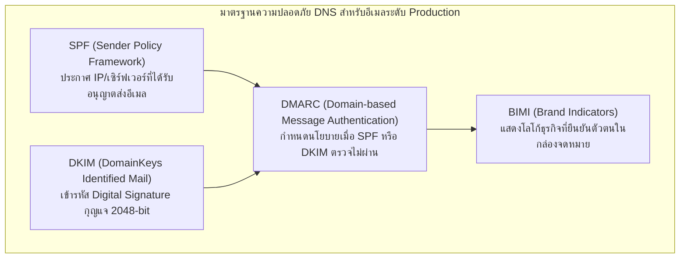
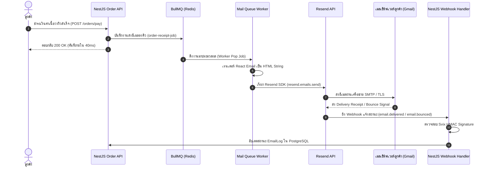

# Email Service

ในสถาปัตยกรรมระบบอีคอมเมิร์ซระดับองค์กรอย่าง **Smart Butcher Marketplace** (แพลตฟอร์มจำหน่ายเนื้อวากิวญี่ปุ่น A5 นำเข้า, เนื้อดรายเอจบ่มพิเศษ 45 วัน, และเนื้อเกรดพรีเมียมควบคุมอุณหภูมิความเย็น) ระบบการส่งอีเมลธุรกรรม (**Transactional Email Service**) ถือเป็นกลไกสื่อสารสำคัญที่มีผลต่อความน่าเชื่อถือทางธุรกิจและความปลอดภัยของสินค้าอย่างยิ่งยวด ลูกค้าจำเป็นต้องได้รับใบเสร็จรับเงินยืนยันคำสั่งซื้อ ข้อมูลการควบคุมความเย็นระหว่างขนส่ง (Cold Chain Express 0°C – 4°C) รวมถึงรายงานการตรวจวัดอุณหภูมิย้อนหลังแบบเรียลไทม์

การส่งอีเมลธุรกรรมในระดับ Production บน **NestJS 11** ไม่สามารถใช้เพียงฟังก์ชันส่งอีเมลธรรมดาแบบ Synchronous ได้ แต่ต้องอาศัยสถาปัตยกรรมที่แยกการประมวลผลออกเป็นแบบ Asynchronous ผ่านคิวงาน (**BullMQ / Redis**), การออกแบบเทมเพลตที่เรนเดอร์สวยงามและตรงตามมาตรฐานการแสดงผลบนทุกอุปกรณ์ด้วย **React Email**, การเชื่อมต่อกับผู้ให้บริการระดับโลกอย่าง **Resend SDK**, ตลอดจนการจัดการ Webhook สถานะการนำส่ง และการตั้งค่ามาตรฐานความปลอดภัย DNS (**SPF, DKIM, DMARC**) เพื่อป้องกันอีเมลตกโฟลเดอร์สแปมอย่างสมบูรณ์แบบ

---

## 1. แนวคิด (Concept)

### 1.1 Transactional Email vs Marketing Email
อีเมลในระบบธุรกิจแบ่งออกเป็น 2 ประเภทหลักที่มีความต้องการและข้อกำหนดทางสถาปัตยกรรมต่างกันอย่างสิ้นเชิง:

1. **Transactional Email (อีเมลธุรกรรม)**:
   - **หน้าที่**: ส่งข้อมูลเฉพาะบุคคลที่มีผลผูกพันทางกฎหมายและธุรกรรม เช่น ใบเสร็จคำสั่งซื้อเนื้อวากิว (`OrderReceipt`), ลิงก์รีเซ็ตรหัสผ่าน, แจ้งเตือนสถานะการจัดส่งเนื้อแช่เย็นพร้อมเลขอุณหภูมิ, และการแจ้งเตือนยอดชำระเงิน
   - **ความต้องการ**: ต้องส่งถึงผู้รับทันที (Latency ต่ำกว่า 5 วินาที), อัตราการส่งถึง (Deliverability) ต้องสูงเกิน 99.5%, ห้ามมีปุ่ม Unsubscribe ที่ทำให้ลูกค้าพลาดข้อมูลสำคัญ
   - **ผู้ให้บริการแนะนำ**: Resend, Postmark, AWS SES

2. **Marketing Email (อีเมลการตลาด)**:
   - **หน้าที่**: การส่งจดหมายข่าว โปรโมชันส่วนลดประจำสัปดาห์ แนะนำเนื้อคัตใหม่ เช่น Wagyu Tomahawk Special Batch
   - **ความต้องการ**: ส่งแบบกลุ่มใหญ่ (Batch Sending) มีระบบ Unsubscribe และจัดการความถี่เพื่อไม่ให้ถูกรายงานสแปม
   - **ข้อควรระวัง**: ต้องแยก Domain และ IP Pool ออกจาก Transactional Email อย่างเด็ดขาด เพื่อไม่ให้คะแนนชื่อเสียงโดเมน (Domain Reputation) ของอีเมลธุรกรรมได้รับผลกระทบ

<Callout type="warning" title="อันตรายจากการส่งอีเมลแบบ Synchronous ใน Request Lifecycle">
ห้ามสั่งให้ API รันคำสั่งส่งอีเมลโดยตรงในจังหวะที่ลูกค้ากดสั่งซื้อหรือชำระเงินเด็ดขาด เพราะการคุยกับ External SMTP หรือ Mail API ภายนอกอาจใช้เวลา 1.5 – 4 วินาที หรือเกิด Network Timeout ซึ่งจะส่งผลให้ HTTP Request ของลูกค้าค้าง และหาก API ล่ม ลูกค้าจะได้รับข้อผิดพลาด 504 Gateway Timeout ทั้งที่ระบบตัดเงินสำเร็จแล้ว!
</Callout>

### 1.2 โครงสร้างความปลอดภัย DNS ของระบบส่งอีเมล (Email Authentication)

เพื่อให้ระบบปลายทางอย่าง Google Workspace, Gmail, Microsoft 365, และ Apple Mail เชื่อถือว่าอีเมลที่ส่งมาจากระบบ **Smart Butcher Marketplace** เป็นของแท้ ไม่ใช่เมลฟิชชิ่งปลอมแปลง จะต้องตั้งค่าบันทึก DNS (DNS Records) ให้ครบทั้ง 4 เสาหลัก:



- **SPF (TXT Record)**: กำหนดว่าเซิร์ฟเวอร์หรือบริการใด (เช่น `include:resend.com`) มีสิทธิ์ส่งอีเมลในนามโดเมน `@smartbutcher.com`
- **DKIM (CNAME / TXT Record)**: แนบ Cryptographic Signature ใน Header ของอีเมล โดยใช้ Private Key ฝั่งเซิร์ฟเวอร์ และเปิดให้เมลเซิร์ฟเวอร์ผู้รับตรวจสอบผ่าน Public Key บน DNS เพื่อพิสูจน์ว่าเนื้อหาไม่ถูกดัดแปลงระหว่างทาง
- **DMARC (TXT Record)**: นโยบายบังคับใช้เมื่อ SPF หรือ DKIM ไม่ผ่าน กำหนดให้เซิร์ฟเวอร์ปลายทางกักกัน (`p=quarantine`) หรือปฏิเสธทันที (`p=reject`) พร้อมรายงานกลับมายังอีเมลความปลอดภัยขององค์กร

---

## 2. หลักการเบื้องหลัง (Under the Hood)

### 2.1 สถาปัตยกรรม Asynchronous Queue และ Webhook Lifecycle

เมื่อเกิดเหตุการณ์คำสั่งซื้อสำเร็จ สถาปัตยกรรมจะส่งต่องานผ่าน Message Queue เพื่อไม่ให้ขัดขวางกระบวนการทางธุรกิจหลัก:



### 2.2 การเรนเดอร์ React Email และ CSS Inlining
เมลไคลเอนต์รุ่นเก่า (โดยเฉพาะ Microsoft Outlook บนเดสก์ท็อป) ไม่รองรับ CSS สมัยใหม่ เช่น Flexbox, Grid หรือ CSS Variables การเขียนเทมเพลตอีเมลด้วย **React Email (`@react-email/components`)** จะช่วยคอมไพล์คอมโพเนนต์ JSX ให้ออกมาเป็น HTML Table แบบดั้งเดิม พร้อมทั้งทำ Inline Styles ทุกบรรทัดโดยอัตโนมัติผ่าน `@react-email/render` ทำให้อีเมลแสดงผลถูกต้องตรงกัน 100% บนทุกไคลเอนต์

### 2.3 การรับรองความถูกต้องของ Webhook ด้วย Svix HMAC Verification
Resend ส่งข้อมูลสถานะการส่งอีเมลผ่าน Webhook โดยใช้เทคโนโลยีของ **Svix** ในการสร้าง Signature บน HTTP Headers 3 ตัว:
- `svix-id`: รหัสประจำคำขอ Webhook ป้องกันการส่งคำขอซ้ำ
- `svix-timestamp`: เวลาสากลระดับวินาที ป้องกัน Replay Attack (หากเวลาต่างเกิน 5 นาทีให้ปฏิเสธทันที)
- `svix-signature`: ค่า HMAC-SHA256 ที่คำนวณจาก Raw Request Body ร่วมกับ Secret Key

---

## 3. ตัวอย่างโค้ด (Smart Butcher Marketplace)

### ตัวอย่างที่ 1: การออกแบบเทมเพลตใบเสร็จและแจ้งการจัดส่งเนื้อแช่เย็นด้วย React Email

ไฟล์นี้เป็นคอมโพเนนต์ React Email ที่ออกแบบมาสำหรับธุรกิจเนื้อสัตว์พรีเมียมโดยเฉพาะ แสดงรายการเนื้อ รายละเอียดการควบคุมอุณหภูมิความเย็น และข้อมูลใบกำกับภาษี:

```tsx filename="src/mail/templates/chilled-order-receipt.tsx"
import * as React from 'react';
import {
  Html,
  Head,
  Preview,
  Body,
  Container,
  Section,
  Row,
  Column,
  Heading,
  Text,
  Hr,
  Link,
} from '@react-email/components';

export interface MeatOrderItem {
  name: string;
  cutType: string;
  weightGrams: number;
  temperatureRequirement: string;
  unitPriceThb: number;
  quantity: number;
  totalPriceThb: number;
}

export interface ChilledOrderReceiptEmailProps {
  customerName: string;
  orderNumber: string;
  orderDate: string;
  shippingAddress: string;
  trackingNumber: string;
  estimatedDeliveryTime: string;
  items: MeatOrderItem[];
  subtotalThb: number;
  coldChainFeeThb: number;
  totalAmountThb: number;
}

export const ChilledOrderReceiptEmail = ({
  customerName = 'คุณลูกค้าผู้ทรงเกียรติ',
  orderNumber = 'SB-20261023-0891',
  orderDate = '23 ตุลาคม 2026',
  shippingAddress = '88/1 ถนนสุขุมวิท แขวงคลองเตยเหนือ เขตวัฒนา กรุงเทพฯ 10110',
  trackingNumber = 'CCX-TH-994821',
  estimatedDeliveryTime = 'ภายใน 14:00 น. วันนี้ (ส่งด่วนรักษาความเย็น)',
  items = [
    {
      name: 'Miyazaki Wagyu A5 Ribeye Steak',
      cutType: 'Ribeye (สเต๊กหนา 1.5 นิ้ว)',
      weightGrams: 450,
      temperatureRequirement: '0°C - 2°C (Chilled)',
      unitPriceThb: 3850,
      quantity: 2,
      totalPriceThb: 7700,
    },
    {
      name: 'Dry-Aged 45 Days Black Angus Striploin',
      cutType: 'Striploin บ่มพิเศษ',
      weightGrams: 500,
      temperatureRequirement: '0°C - 4°C (Chilled)',
      unitPriceThb: 2200,
      quantity: 1,
      totalPriceThb: 2200,
    },
  ],
  subtotalThb = 9900,
  coldChainFeeThb = 350,
  totalAmountThb = 10250,
}: ChilledOrderReceiptEmailProps) => {
  return (
    <Html lang="th">
      <Head />
      <Preview>ใบเสร็จคำสั่งซื้อ #{orderNumber} - ยืนยันการจัดส่งเนื้อพรีเมียมแช่เย็น Smart Butcher</Preview>
      <Body style={mainStyle}>
        <Container style={containerStyle}>
          {/* Header Section */}
          <Section style={headerStyle}>
            <Heading style={brandTitle}>🥩 SMART BUTCHER MARKETPLACE</Heading>
            <Text style={brandSubtitle}>Artisan Meat Purveyors & Cold-Chain Logistics</Text>
          </Section>

          {/* Greeting */}
          <Section style={contentSection}>
            <Heading as="h2" style={greetingTitle}>
              เรียน คุณ{customerName}
            </Heading>
            <Text style={paragraph}>
              ขอขอบพระคุณที่ไว้วางใจเลือกสรรเนื้อคุณภาพเยี่ยมจากเรา คำสั่งซื้อหมายเลข{' '}
              <strong>#{orderNumber}</strong> ได้รับการชำระเงินเรียบร้อยแล้ว ขณะนี้ทีมช่างตัดแต่งเนื้อ (Master Butcher)
              ได้เตรียมชิ้นเนื้อและบรรจุในกล่องควบคุมอุณหภูมิพร้อมเจลควบคุมความเย็นมาตรฐานสากลเรียบร้อยแล้ว
            </Text>
          </Section>

          {/* Cold Chain Warning Alert */}
          <Section style={coldChainAlertBox}>
            <Text style={coldChainAlertTitle}>❄️ มาตรการรักษาอุณหภูมิความเย็น (Cold Chain Guarantee)</Text>
            <Text style={coldChainAlertText}>
              พัสดุชิ้นนี้ถูกจัดส่งผ่านระบบ <strong>Cold Chain Express</strong> ควบคุมอุณหภูมิระหว่าง 0°C ถึง 4°C ตลอดเส้นทาง
              โปรดนำชิ้นเนื้อเข้าตู้เย็นช่องแช่เย็นจัดทันทีที่ได้รับสินค้า หรือแช่แข็งหากยังไม่ปรุงภายใน 3 วัน
            </Text>
            <Text style={coldChainAlertText}>
              หมายเลขติดตามการจัดส่ง: <strong>{trackingNumber}</strong> | กำหนดส่งมอบ:{' '}
              <strong>{estimatedDeliveryTime}</strong>
            </Text>
          </Section>

          {/* Items Table */}
          <Section style={tableSection}>
            <Text style={tableHeader}>รายการเนื้อพรีเมียมที่สั่งซื้อ</Text>
            {items.map((item, index) => (
              <Row key={index} style={itemRowStyle}>
                <Column style={{ width: '65%' }}>
                  <Text style={itemName}>{item.name}</Text>
                  <Text style={itemMeta}>
                    ส่วนตัดแต่ง: {item.cutType} | น้ำหนัก: {item.weightGrams}g | อุณหภูมิ: {item.temperatureRequirement}
                  </Text>
                </Column>
                <Column style={{ width: '15%', textAlign: 'center' }}>
                  <Text style={itemQty}>x{item.quantity}</Text>
                </Column>
                <Column style={{ width: '20%', textAlign: 'right' }}>
                  <Text style={itemPrice}>{item.totalPriceThb.toLocaleString()} ฿</Text>
                </Column>
              </Row>
            ))}
          </Section>

          <Hr style={dividerStyle} />

          {/* Financial Breakdown */}
          <Section style={summarySection}>
            <Row style={summaryRow}>
              <Column style={{ width: '70%' }}>
                <Text style={summaryLabel}>มูลค่าสินค้ารวม (Subtotal):</Text>
              </Column>
              <Column style={{ width: '30%', textAlign: 'right' }}>
                <Text style={summaryValue}>{subtotalThb.toLocaleString()} ฿</Text>
              </Column>
            </Row>
            <Row style={summaryRow}>
              <Column style={{ width: '70%' }}>
                <Text style={summaryLabel}>ค่าจัดส่งควบคุมอุณหภูมิพิเศษ (Cold Chain Express):</Text>
              </Column>
              <Column style={{ width: '30%', textAlign: 'right' }}>
                <Text style={summaryValue}>{coldChainFeeThb.toLocaleString()} ฿</Text>
              </Column>
            </Row>
            <Row style={summaryRowTotal}>
              <Column style={{ width: '70%' }}>
                <Text style={totalLabel}>ยอดรวมชำระสุทธิ (Total Paid):</Text>
              </Column>
              <Column style={{ width: '30%', textAlign: 'right' }}>
                <Text style={totalValue}>{totalAmountThb.toLocaleString()} ฿</Text>
              </Column>
            </Row>
          </Section>

          {/* Shipping Address */}
          <Section style={addressSection}>
            <Text style={addressTitle}>📍 สถานที่จัดส่งสินค้า:</Text>
            <Text style={addressText}>{shippingAddress}</Text>
          </Section>

          {/* Footer */}
          <Section style={footerStyle}>
            <Text style={footerText}>
              ต้องการสอบถามเพิ่มเติมหรือแจ้งปัญหาอุณหภูมิสินค้า ติดต่อฝ่ายบริการลูกค้าได้ที่{' '}
              <Link href="mailto:support@smartbutcher.com" style={footerLink}>
                support@smartbutcher.com
              </Link>{' '}
              หรือโทร 02-999-8888
            </Text>
            <Text style={footerCopyright}>
              © 2026 Smart Butcher Marketplace Co., Ltd. สงวนลิขสิทธิ์ตามกฎหมาย
            </Text>
          </Section>
        </Container>
      </Body>
    </Html>
  );
};

export default ChilledOrderReceiptEmail;

// --- CSS-in-JS Styles สำหรับ React Email ---
const mainStyle: React.CSSProperties = {
  backgroundColor: '#f8fafc',
  fontFamily: '-apple-system, BlinkMacSystemFont, "Segoe UI", Roboto, sans-serif',
  padding: '24px 0',
  margin: '0',
};

const containerStyle: React.CSSProperties = {
  backgroundColor: '#ffffff',
  margin: '0 auto',
  maxWidth: '600px',
  borderRadius: '8px',
  overflow: 'hidden',
  boxShadow: '0 4px 6px -1px rgba(0, 0, 0, 0.1)',
};

const headerStyle: React.CSSProperties = {
  backgroundColor: '#881337',
  padding: '28px 24px',
  textAlign: 'center',
};

const brandTitle: React.CSSProperties = {
  color: '#ffffff',
  fontSize: '22px',
  fontWeight: '800',
  letterSpacing: '1px',
  margin: '0',
};

const brandSubtitle: React.CSSProperties = {
  color: '#fecdd3',
  fontSize: '12px',
  textTransform: 'uppercase',
  marginTop: '4px',
};

const contentSection: React.CSSProperties = {
  padding: '24px 24px 12px 24px',
};

const greetingTitle: React.CSSProperties = {
  fontSize: '18px',
  fontWeight: '700',
  color: '#1e293b',
  margin: '0 0 12px 0',
};

const paragraph: React.CSSProperties = {
  fontSize: '14px',
  lineHeight: '1.6',
  color: '#475569',
  margin: '0',
};

const coldChainAlertBox: React.CSSProperties = {
  backgroundColor: '#eff6ff',
  borderLeft: '4px solid #2563eb',
  padding: '16px',
  margin: '16px 24px',
  borderRadius: '4px',
};

const coldChainAlertTitle: React.CSSProperties = {
  fontSize: '14px',
  fontWeight: '700',
  color: '#1e40af',
  margin: '0 0 6px 0',
};

const coldChainAlertText: React.CSSProperties = {
  fontSize: '13px',
  lineHeight: '1.5',
  color: '#1e3a8a',
  margin: '4px 0',
};

const tableSection: React.CSSProperties = {
  padding: '12px 24px',
};

const tableHeader: React.CSSProperties = {
  fontSize: '15px',
  fontWeight: '700',
  color: '#0f172a',
  borderBottom: '2px solid #e2e8f0',
  paddingBottom: '8px',
  margin: '0 0 12px 0',
};

const itemRowStyle: React.CSSProperties = {
  padding: '10px 0',
  borderBottom: '1px solid #f1f5f9',
};

const itemName: React.CSSProperties = {
  fontSize: '14px',
  fontWeight: '600',
  color: '#0f172a',
  margin: '0',
};

const itemMeta: React.CSSProperties = {
  fontSize: '12px',
  color: '#64748b',
  margin: '2px 0 0 0',
};

const itemQty: React.CSSProperties = {
  fontSize: '13px',
  fontWeight: '600',
  color: '#334155',
  margin: '0',
};

const itemPrice: React.CSSProperties = {
  fontSize: '14px',
  fontWeight: '700',
  color: '#0f172a',
  margin: '0',
};

const dividerStyle: React.CSSProperties = {
  borderColor: '#e2e8f0',
  margin: '16px 24px',
};

const summarySection: React.CSSProperties = {
  padding: '0 24px',
};

const summaryRow: React.CSSProperties = {
  padding: '4px 0',
};

const summaryLabel: React.CSSProperties = {
  fontSize: '13px',
  color: '#64748b',
  margin: '0',
};

const summaryValue: React.CSSProperties = {
  fontSize: '13px',
  color: '#1e293b',
  margin: '0',
};

const summaryRowTotal: React.CSSProperties = {
  padding: '12px 0',
  borderTop: '2px solid #cbd5e1',
  marginTop: '8px',
};

const totalLabel: React.CSSProperties = {
  fontSize: '16px',
  fontWeight: '800',
  color: '#881337',
  margin: '0',
};

const totalValue: React.CSSProperties = {
  fontSize: '18px',
  fontWeight: '800',
  color: '#881337',
  margin: '0',
};

const addressSection: React.CSSProperties = {
  backgroundColor: '#f8fafc',
  padding: '16px',
  margin: '16px 24px',
  borderRadius: '6px',
};

const addressTitle: React.CSSProperties = {
  fontSize: '13px',
  fontWeight: '700',
  color: '#334155',
  margin: '0 0 4px 0',
};

const addressText: React.CSSProperties = {
  fontSize: '13px',
  lineHeight: '1.5',
  color: '#475569',
  margin: '0',
};

const footerStyle: React.CSSProperties = {
  backgroundColor: '#f1f5f9',
  padding: '20px 24px',
  textAlign: 'center',
};

const footerText: React.CSSProperties = {
  fontSize: '12px',
  color: '#64748b',
  margin: '0 0 6px 0',
};

const footerLink: React.CSSProperties = {
  color: '#2563eb',
  textDecoration: 'underline',
};

const footerCopyright: React.CSSProperties = {
  fontSize: '11px',
  color: '#94a3b8',
  margin: '0',
};
```

---

### ตัวอย่างที่ 2: สถาปัตยกรรม Asynchronous Mail Producer & BullMQ Processor ร่วมกับ Resend SDK

ในตัวอย่างนี้ เราสร้าง Service สำหรับหย่อนคำสั่งส่งอีเมลลงคิว และ Background Consumer (BullMQ Processor) ที่รับหน้าที่เรนเดอร์และยิงคำขอไปยัง Resend API พร้อมกลยุทธ์ Exponential Backoff Retry เมื่อเกิดความล้มเหลวชั่วคราว:

```typescript filename="src/mail/mail.service.ts"
import { Injectable, Logger } from '@nestjs/common';
import { InjectQueue } from '@nestjs/bullmq';
import { Queue } from 'bullmq';
import { ChilledOrderReceiptEmailProps } from './templates/chilled-order-receipt';

export const MAIL_QUEUE = 'mail-queue';

export enum MailJobType {
  CHILLED_RECEIPT = 'SEND_CHILLED_RECEIPT',
  COLD_CHAIN_ALERT = 'SEND_COLD_CHAIN_ALERT',
}

export interface SendReceiptPayload {
  to: string;
  orderId: string;
  props: ChilledOrderReceiptEmailProps;
}

@Injectable()
export class MailService {
  private readonly logger = new Logger(MailService.name);

  constructor(@InjectQueue(MAIL_QUEUE) private readonly mailQueue: Queue) {}

  /**
   * หย่อนคำสั่งส่งใบเสร็จลงคิวงานแบบ Non-blocking
   * โดยกำหนด Idempotency ผ่าน jobId (ป้องกันการส่งอีเมลซ้ำสำหรับบิลเดิม)
   */
  async enqueueOrderReceipt(to: string, orderId: string, props: ChilledOrderReceiptEmailProps): Promise<void> {
    const jobId = `receipt-${orderId}`;
    this.logger.log(`Enqueuing email receipt for Order #${orderId} to ${to}`);

    await this.mailQueue.add(
      MailJobType.CHILLED_RECEIPT,
      { to, orderId, props } as SendReceiptPayload,
      {
        jobId, // Unique Job ID ป้องกันคิวซ้ำซ้อน
        attempts: 5, // อนุญาตให้ลองซ้ำสูงสุด 5 ครั้งหาก Resend API มีปัญหา
        backoff: {
          type: 'exponential',
          delay: 2000, // เริ่มต้นรอ 2 วินาที (2s, 4s, 8s, 16s...)
        },
        removeOnComplete: true, // ล้างงานที่เสร็จแล้วเพื่อประหยัด RAM ใน Redis
        removeOnFail: false, // เก็บประวัติงานที่ล้มเหลวไว้ตรวจสอบใน Dead-Letter Queue
      },
    );
  }
}
```

ถัดมาคือโค้ดประมวลผลงานเบื้องหลัง (Worker Processor):

```typescript filename="src/mail/mail.processor.ts"
import { Processor, WorkerHost } from '@nestjs/bullmq';
import { Logger } from '@nestjs/common';
import { Job } from 'bullmq';
import { ConfigService } from '@nestjs/config';
import { Resend } from 'resend';
import { render } from '@react-email/render';
import { MAIL_QUEUE, MailJobType, SendReceiptPayload } from './mail.service';
import { ChilledOrderReceiptEmail } from './templates/chilled-order-receipt';

@Processor(MAIL_QUEUE, { concurrency: 10 }) // รองรับการส่งพร้อมกัน 10 Concurrency Workers
export class MailProcessor extends WorkerHost {
  private readonly logger = new Logger(MailProcessor.name);
  private readonly resend: Resend;
  private readonly senderDomain: string;

  constructor(private readonly configService: ConfigService) {
    super();
    const apiKey = this.configService.getOrThrow<string>('RESEND_API_KEY');
    this.resend = new Resend(apiKey);
    this.senderDomain = this.configService.get<string>('MAIL_FROM_ADDRESS', 'Smart Butcher <orders@smartbutcher.com>');
  }

  async process(job: Job<SendReceiptPayload, any, string>): Promise<{ messageId: string }> {
    this.logger.log(`Processing Job ID: ${job.id} | Type: ${job.name} | Attempt: ${job.attemptsMade + 1}`);

    switch (job.name) {
      case MailJobType.CHILLED_RECEIPT:
        return this.handleSendChilledReceipt(job.data);
      default:
        throw new Error(`Unsupported Mail Job Type: ${job.name}`);
    }
  }

  private async handleSendChilledReceipt(data: SendReceiptPayload): Promise<{ messageId: string }> {
    const { to, orderId, props } = data;

    // 1. เรนเดอร์ React Email JSX ให้กลายเป็น HTML String ที่ Inline CSS เรียบร้อยแล้ว
    const htmlContent = await render(ChilledOrderReceiptEmail(props));

    // 2. ส่งอีเมลผ่าน Resend SDK
    const response = await this.resend.emails.send({
      from: this.senderDomain,
      to: [to],
      subject: `ใบเสร็จและยืนยันการจัดส่งเนื้อแช่เย็น คำสั่งซื้อ #${props.orderNumber}`,
      html: htmlContent,
      headers: {
        'X-Entity-Ref-ID': orderId,
        'X-Cold-Chain-Monitored': 'true',
      },
      tags: [
        { name: 'category', value: 'order_receipt' },
        { name: 'order_id', value: orderId },
      ],
    });

    if (response.error) {
      this.logger.error(`Failed to send email via Resend API: ${response.error.message}`, response.error);
      throw new Error(`Resend API Error: ${response.error.message}`);
    }

    const messageId = response.data?.id ?? 'UNKNOWN_ID';
    this.logger.log(`Email successfully dispatched for Order #${orderId} with Resend ID: ${messageId}`);

    return { messageId };
  }
}
```

---

### ตัวอย่างที่ 3: Webhook Controller รับสถานะ Delivery / Bounce ด้วย Svix Cryptographic Verification

ไฟล์นี้ใช้รับ Event จาก Resend Webhook โดยตรวจสอบลายเซ็นดิจิทัลเพื่อความปลอดภัยสูงสุด ป้องกัน Hacker ยิง Payload ปลอมเข้ามาอัปเดตระบบ:

```typescript filename="src/mail/mail-webhook.controller.ts"
import {
  Controller,
  Post,
  Headers,
  Req,
  HttpCode,
  HttpStatus,
  BadRequestException,
  UnauthorizedException,
  Logger,
} from '@nestjs/common';
import { Request } from 'express';
import { ConfigService } from '@nestjs/config';
import { Webhook } from 'svix';
import { PrismaService } from '../prisma/prisma.service';

interface ResendWebhookEvent {
  type: 'email.sent' | 'email.delivered' | 'email.bounced' | 'email.complained';
  created_at: string;
  data: {
    created_at: string;
    email_id: string;
    from: string;
    to: string[];
    subject: string;
    tags?: { category?: string; order_id?: string }[];
    bounce?: {
      message: string;
      sub_type: string;
      type: string;
    };
  };
}

@Controller('webhooks/email')
export class MailWebhookController {
  private readonly logger = new Logger(MailWebhookController.name);
  private readonly webhookSecret: string;

  constructor(
    private readonly configService: ConfigService,
    private readonly prisma: PrismaService,
  ) {
    this.webhookSecret = this.configService.getOrThrow<string>('RESEND_WEBHOOK_SECRET');
  }

  @Post()
  @HttpCode(HttpStatus.OK)
  async handleResendWebhook(
    @Req() req: Request & { rawBody?: Buffer },
    @Headers('svix-id') svixId?: string,
    @Headers('svix-timestamp') svixTimestamp?: string,
    @Headers('svix-signature') svixSignature?: string,
  ): Promise<{ status: string }> {
    if (!svixId || !svixTimestamp || !svixSignature) {
      throw new BadRequestException('Missing mandatory Svix cryptographic verification headers');
    }

    // 1. ตรวจสอบว่า Raw Request Body ยังคงสภาพไบต์เดิม ไม่ผ่านการ JSON.stringify ซ้ำ
    const rawPayload = req.rawBody ? req.rawBody.toString('utf8') : JSON.stringify(req.body);

    const wh = new Webhook(this.webhookSecret);
    let event: ResendWebhookEvent;

    try {
      // 2. ยืนยันความถูกต้องของ HMAC-SHA256 Signature และ Timestamp ป้องกัน Replay Attack
      event = wh.verify(rawPayload, {
        'svix-id': svixId,
        'svix-timestamp': svixTimestamp,
        'svix-signature': svixSignature,
      }) as ResendWebhookEvent;
    } catch (err: any) {
      this.logger.error(`Webhook signature verification failed: ${err.message}`);
      throw new UnauthorizedException('Invalid Cryptographic Signature');
    }

    this.logger.log(`Received verified email webhook event: ${event.type} for Email ID: ${event.data.email_id}`);

    // 3. จัดการสถานะตาม Event Type
    const orderTag = event.data.tags?.find((t) => t.name === 'order_id');
    const orderId = orderTag?.value;

    switch (event.type) {
      case 'email.delivered':
        this.logger.log(`Email successfully delivered to recipient: ${event.data.to.join(', ')}`);
        if (orderId) {
          await this.prisma.order.updateMany({
            where: { id: orderId },
            data: { isReceiptEmailDelivered: true },
          });
        }
        break;

      case 'email.bounced':
        this.logger.warn(`CRITICAL: Email bounced for order #${orderId}. Reason: ${event.data.bounce?.message}`);
        // แจ้งเตือนฝ่าย Operation หากอีเมลจัดส่งเนื้อสดกระเด้งกลับ เพื่อให้ทีมงานติดต่อลูกค้าผ่าน SMS หรือโทรศัพท์ทันที
        await this.handleEmailBounce(event.data.to[0], event.data.bounce?.message ?? 'General Bounce', orderId);
        break;

      case 'email.complained':
        this.logger.error(`Spam complaint received from: ${event.data.to.join(', ')}`);
        // เพิ่มเข้า Blacklist ชั่วคราวเพื่อป้องกันคะแนนชื่อเสียง Domain ตกต่ำ
        break;
    }

    return { status: 'acknowledged' };
  }

  private async handleEmailBounce(email: string, reason: string, orderId?: string): Promise<void> {
    await this.prisma.auditLog.create({
      data: {
        action: 'EMAIL_BOUNCE_DETECTED',
        entityId: orderId ?? 'N/A',
        details: { email, reason, timestamp: new Date().toISOString() },
      },
    });
  }
}
```

---

## 4. ข้อผิดพลาดที่พบบ่อย (Anti-pattern vs Best Practice)

### 4.1 Anti-pattern: การส่งอีเมลแบบ Synchronous ใน Controller
```typescript
// ❌ ผิดมหันต์: Controller รอส่งอีเมลเสร็จก่อนตอบกลับลูกค้า
@Post('checkout')
async checkout(@Body() dto: CheckoutDto) {
  const order = await this.orderService.create(dto);
  await this.emailService.sendDirectly(order); // รอนาน 2-4 วินาที หากเน็ตเวิร์กหน่วงจะเกิด 504 Gateway Timeout ทันที
  return order;
}
```

**แนวทางที่ถูกต้อง (Best Practice)**:
ส่งต่องานเข้า Message Queue (`BullMQ`) แล้วคืนผลลัพธ์คำสั่งซื้อกลับไปยังลูกค้าทันทีภายในระดับ Milliseconds:

```typescript
//  ถูกต้อง: หย่อนงานเข้าคิวแล้วตอบกลับทันที (Asynchronous Non-blocking)
@Post('checkout')
async checkout(@Body() dto: CheckoutDto) {
  const order = await this.orderService.create(dto);
  await this.mailService.enqueueOrderReceipt(order.customerEmail, order.id, order.receiptProps);
  return order; // ตอบกลับทันทีภายใน 30ms
}
```

### 4.2 Anti-pattern: การต่อสตริง HTML ด้วย Template Literals ดิบๆ
```typescript
// ❌ ผิดมหันต์: ต่อ String HTML เอง เสี่ยงต่อ XSS และการแสดงผลเพี้ยนใน Outlook
const html = `<div><h1>ขอบคุณ ${customer.name}</h1><p>เนื้อ: ${order.item}</p></div>`;
```

**แนวทางที่ถูกต้อง (Best Practice)**:
ใช้ React Email ร่วมกับ Type-safe Components ที่ผ่านการทดสอบและทำ CSS Inlining อัตโนมัติ:

```tsx
//  ถูกต้อง: มี Type Checking และรองรับ Client เก่าๆ ทุกค่ายผ่าน HTML Tables อัตโนมัติ
const html = await render(<ChilledOrderReceiptEmail {...validatedProps} />);
```

### 4.3 Anti-pattern: การขาดนโยบาย DMARC และไม่เปิดใช้ DKIM
ส่งอีเมลโดยไม่มีการยืนยันตัวตน DNS โดเมน ทำให้เมลเซิร์ฟเวอร์ปลายทาง (เช่น Google/Yahoo) สั่งย้ายอีเมลใบเสร็จลงใน Junk/Spam หรือปฏิเสธการรับ (Bounce) ทันทีตามข้อกำหนดความปลอดภัยใหม่ของ Gmail & Yahoo 2024

**แนวทางที่ถูกต้อง (Best Practice)**:
ตั้งค่า DMARC ระดับองค์กรบน Cloudflare / Route53:
`v=DMARC1; p=reject; rua=mailto:dmarc-reports@smartbutcher.com; pct=100; aspf=r; adkim=r;`

---

## 5. ควรใช้เมื่อไหร่ และ ไม่ควรใช้เมื่อไหร่

### ควรใช้สถาปัตยกรรมนี้เมื่อ:
1. **ระบบมีธุรกรรมทางธุรกิจและมีภาระผูกพันทางการเงิน**: เช่น ใบเสร็จคำสั่งซื้อเนื้อวากิว, ใบกำกับภาษีเต็มรูปแบบ, ลิงก์ยืนยันอีเมลยืนยันตัวตนสองชั้น (2FA / OTP)
2. **ต้องการความมั่นใจในการจัดส่ง 100% (High Deliverability)**: ต้องการกลไก Retry แบบ Exponential Backoff อัตโนมัติเมื่อบริการปลายทางล่มชั่วคราว
3. **ต้องการเทมเพลตที่ Responsive สวยงามและบำรุงรักษาง่าย**: ต้องการแชร์ UI Design System ระหว่าง Frontend และ Email Template โดยใช้ React และ TypeScript

### สิ่งที่ไม่ควรทำ (ข้อยกเว้นที่ต้องระวัง):
1. **ห้ามใช้ส่ง Bulk Marketing Emails ผ่าน Transactional Credentials**: การส่งโปรโมชันหาลูกค้า 500,000 คนพร้อมกันผ่าน Resend Transactional Domain จะทำให้ IP Reputation ตกทันทีหากมีคนกด Report Spam ส่งผลให้อีเมลใบเสร็จของลูกค้ารายอื่นตกสแปมไปด้วย (สำหรับ Marketing ให้แยกใช้ Subdomain เช่น `promo.smartbutcher.com` ผ่าน Mailchimp หรือ Loops)
2. **ห้ามส่งรหัสผ่าน Plaintext หรือ Secret Keys ผ่านอีเมล**: ให้ส่งเป็น Temporary One-Time Token ที่มีอายุไม่เกิน 15 นาทีเท่านั้น

---

## 6. คำถามสัมภาษณ์งาน (Interview Q&A)

### Q1: หากระบบจำเป็นต้องส่งอีเมลใบเสร็จให้ลูกค้า 5,000 คนพร้อมกันในวันแคมเปญ Flash Sale สเต๊กเนื้อวากิว A5 เราจะออกแบบสถาปัตยกรรมอย่างไรไม่ให้ API ล่ม ไม่ให้ติด Rate Limit ของผู้ให้บริการส่งเมล และรับประกันว่าไม่มีอีเมลสูญหาย?
> **แนวคำตอบระดับ Principal Architect:**
> 1. **Decoupled Architecture with Message Queue**: ตัดการเชื่อมต่อแบบ Synchronous ออกทันที โดยนำ **BullMQ บน Redis Cluster** มารับงานส่งอีเมล การยิงสั่งซื้อจากลูกค้าจะถูกแปลงเป็น Job ในหน่วยมิลลิวินาที ทำให้ API ตอบสนองได้รวดเร็วและไม่กระทบ Connection Pool
> 2. **Rate Limiting & Concurrency Control**: กำหนด Rate Limiter ที่ระดับ BullMQ Worker เช่น `{ limiter: { max: 100, duration: 1000 } }` เพื่อไม่ให้เกินโควตา Rate Limit ของผู้ให้บริการ (เช่น Resend อนุญาตที่ 100 requests/sec ในระดับ Enterprise)
> 3. **Idempotency via Unique Job IDs**: กำหนด `jobId` ในรูปแบบ `receipt-${orderId}` ป้องกันการสร้าง Job ซ้ำซ้อนกรณีที่ระบบทำ Retry คำสั่งซื้อ
> 4. **Fault Tolerance & Dead-Letter Queue (DLQ)**: กำหนด Exponential Backoff และหากพยายามครบ 5 ครั้งแล้วยังส่งไม่ผ่าน ให้ย้าย Job เข้าสู่ Dead-Letter Queue พร้อมแจ้งเตือนทีม SRE ผ่าน Slack เพื่อตรวจสอบย้อนหลัง

### Q2: อธิบายความสัมพันธ์ระหว่าง SPF, DKIM และ DMARC ในกระบวนการ Email Verification และอธิบายว่าหาก SPF ตรวจสอบผ่าน แต่ DKIM ไม่ผ่าน (Fail) อีเมลจะถูกจัดส่งอย่างไรภายใต้นโยบาย `p=reject`?
> **แนวคำตอบระดับ Principal Architect:**
> - **SPF** ตรวจสอบว่า IP Address ที่ส่งคำขอเชื่อมต่อ SMTP ได้รับการอนุญาตใน DNS TXT ของโดเมนผู้ส่งหรือไม่
> - **DKIM** ตรวจสอบลายเซ็นดิจิทัลที่เข้ารหัสด้วย RSA 2048-bit ใน Header ของอีเมลเทียบกับ Public Key บน DNS เพื่อรับรองว่าเนื้อหาอีเมลไม่ถูกดัดแปลง (Tamper-proof)
> - **DMARC Alignment Mechanism**: DMARC ตรวจสอบการสอดคล้อง (Alignment) ของโดเมนใน Header `From:` เทียบกับ SPF Domain และ DKIM Signing Domain โดยเงื่อนไขของ DMARC กำหนดว่า **ขอเพียงอย่างใดอย่างหนึ่งผ่าน (SPF Pass AND Aligned หรือ DKIM Pass AND Aligned) DMARC จะถือว่าผ่าน (DMARC Pass)**
> - ดังนั้น หาก SPF ผ่านและ Domain Aligned แม้ว่า DKIM จะ Fail (เช่น เกิดจากการที่อีเมลถูกส่งต่อผ่าน Forwarder Mail Gateway แล้ว Signature หลุด) อีเมลจะ **ยังคงถูกจัดส่งไปยัง Inbox ตามปกติ** แม้ว่าโดเมนจะมีนโยบาย `p=reject` ก็ตาม แต่หากทั้งคู่ Fail หรือไม่ Aligned เซิร์ฟเวอร์ผู้รับจะ Drop อีเมลทิ้งทันทีตามคำสั่ง `reject`

---

## ลำดับการเรียนที่แนะนำ และ ดูเพิ่มเติมที่

เพื่อเสริมความเชี่ยวชาญด้านการออกแบบระบบเบื้องหลังในระบบองค์กร ขอแนะนำให้ศึกษาหัวข้อต่อไปนี้เพิ่มเติม:

1. สถาปัตยกรรมคิวงานระดับ Enterprise: [BullMQ Queue ใน NestJS 11](/docs/backend/nestjs/bullmq-queue)
2. การบริหารจัดการแคชและประสิทธิภาพสูง: [Redis Cache](/docs/backend/nestjs/redis-cache)
3. มาตรฐานความปลอดภัยของ API ระดับองค์กร: [Enterprise Security](/docs/backend/security)
4. การออกแบบ RESTful API มาตรฐานสากล: [REST API Best Practices](/docs/backend/rest-api)
5. สถาปัตยกรรมฐานข้อมูลและ Data Integrity: [Prisma ORM Architecture](/docs/backend/prisma-orm)
