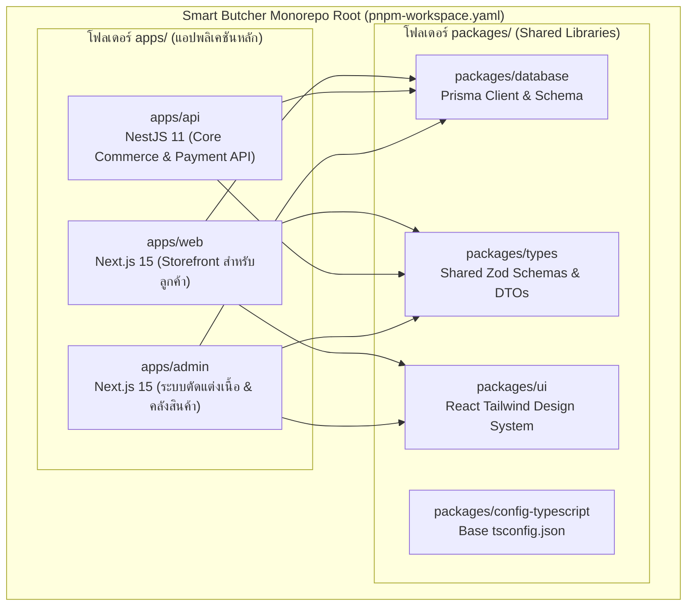
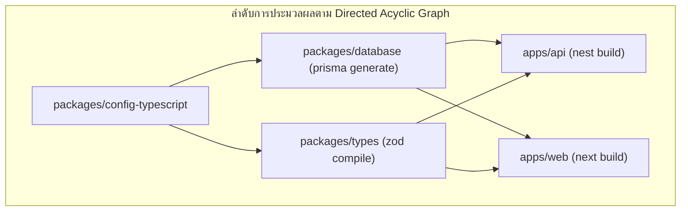

# Monorepo

ในระบบอีคอมเมิร์ซระดับองค์กรอย่าง **Smart Butcher Marketplace** ที่ประกอบด้วยแอปพลิเคชันฝั่งหน้าบ้าน **Next.js 15 (App Router)** สำหรับลูกค้าเลือกซื้อเนื้อวากิวและติดตามการจัดส่งเนื้อแช่เย็น, ระบบหลังบ้าน **NestJS 11** สำหรับประมวลผลคำสั่งซื้อและเชื่อมต่อ Payment Gateway, ตลอดจนแผงควบคุมระบบตัดแต่งเนื้อของ **Admin & Butcher Portal** การแยกโค้ดออกเป็นหลายๆ Repository (Polyrepo) มักสร้างปัญหาใหญ่: ชนิดข้อมูล (TypeScript Types) หลุดไม่ตรงกัน, การแก้ไขโครงสร้างฐานข้อมูล (Database Schema) ต้องเปิด Pull Request ข้ามหลายโปรเจกต์, และการซ้ำซ้อนของโค้ดตรวจสอบความถูกต้อง (Validation Logic)

การรวบรวมระบบทั้งหมดเข้ามาอยู่ภายใต้สถาปัตยกรรม **Fullstack Monorepo** ด้วยเครื่องมือมาตรฐานอุตสาหกรรมอย่าง **pnpm Workspaces** ร่วมกับ **Turborepo** ช่วยสร้าง **Single Source of Truth** ที่แท้จริง: สามารถแชร์ **Prisma Client** เดียวกันระหว่าง Next.js และ NestJS, ใช้ **Zod Schemas** ชุดเดียวกันตรวจสอบข้อมูลตั้งแต่ฟอร์มหน้าเว็บไปจนถึง NestJS Validation Pipe และเร่งความเร็วในการทดสอบและ Build บนไปป์ไลน์ CI/CD ด้วยระบบ **Remote Caching**

---

## 1. แนวคิด (Concept)

### 1.1 สถาปัตยกรรม Monorepo vs Polyrepo
การเปรียบเทียบเชิงสถาปัตยกรรมสำหรับระบบระดับองค์กร:

- **Polyrepo (แยก Repository ตามโปรเจกต์)**: แต่ละทีมสร้าง Git Repo ของตนเอง (เช่น `butcher-frontend-repo`, `butcher-backend-repo`) นำไปสู่ปัญหา Dependency Drift การอัปเดต API Contract ต้องทำผ่านการ Publish Private npm Packages ซึ่งช้าและเกิดปัญหาเวอร์ชันไม่ตรงกันบ่อยครั้ง
- **Monorepo (รวมทุกบริการไว้ใน Repository เดียว)**: โค้ดทั้งหมดอยู่ใน Git Repo เดียวกัน สามารถทำการเปลี่ยนแปลงแบบ **Atomic Commits** (เช่น เพิ่มฟิลด์ `coldStorageTemp` ใน Prisma Schema พร้อมอัปเดตทั้งใน NestJS API และแสดงผลบน Next.js ใน PR เดียวกัน)



### 1.2 เหตุใดจึงต้องจับคู่ pnpm Workspaces กับ Turborepo?
1. **pnpm Workspaces**:
   - จัดการแพ็กเกจด้วยระบบ **Content-addressable Storage** และ **Hard Links / Symlinks** ประหยัดพื้นที่ดิสก์และติดตั้งเร็วกว่า npm/yarn หลายเท่าตัว
   - มีโครงสร้าง `node_modules` แบบไม่แบน (Strict Isolation) ป้องกันปัญหา **Phantom Dependencies** (การแอบเรียกใช้ไลบรารีที่ไม่ได้ประกาศไว้ใน `package.json` ของตัวเอง)
2. **Turborepo**:
   - เป็น Build System ประสิทธิภาพสูงเขียนด้วยภาษา Rust
   - วิเคราะห์กราฟความสัมพันธ์ของงาน (Directed Acyclic Graph - DAG) และรันงาน Build, Test, Lint แบบคู่ขนาน (Parallel Execution) เต็มประสิทธิภาพของ CPU Cores
   - มีระบบ **Computation Caching & Remote Caching** จดจำผลลัพธ์ของไฟล์ที่ไม่มีการเปลี่ยนแปลง ทำให้ไม่ต้องเสียเวลาคอมไพล์ซ้ำ

<Callout type="tip" title="การป้องกันปัญหา Phantom Dependencies ด้วย pnpm">
ใน npm หรือ Yarn v1 แบบดั้งเดิม โครงสร้างโฟลเดอร์ `node_modules` จะถูกทำให้แบนราบ (Hoisting) ส่งผลให้โปรเจกต์สามารถ `import` โมดูลที่ตนเองไม่ได้ระบุไว้ใน `package.json` ได้หากโมดูลอื่นติดตั้งมา แต่เมื่อนำขึ้น Docker หรือเซิร์ฟเวอร์จริง โค้ดอาจพังทันที pnpm แก้ปัญหานี้โดยสร้าง Symlinks เฉพาะแพ็กเกจที่ประกาศไว้เท่านั้น จึงรับประกันความปลอดภัยของ Dependencies 100%
</Callout>

---

## 2. หลักการเบื้องหลัง (Under the Hood)

### 2.1 วงจรชีวิตการทำงานของ Turborepo Task Pipeline (DAG)
ในไฟล์ `turbo.json` เรากำหนดความสัมพันธ์ระหว่าง Tasks โดยใช้สัญลักษณ์ `^` (Topological Dependency):
- เมื่อสั่งรัน `turbo build`: Turborepo จะตรวจสอบว่า `apps/api` และ `apps/web` มีความต้องการแพ็กเกจ `packages/database` หรือไม่
- Turborepo จะรันคำสั่ง `build` ใน `packages/database` ให้เสร็จสิ้นก่อน เมื่อได้ Prisma Client ออกมาแล้ว จึงจะเริ่ม Build `apps/api` และ `apps/web` พร้อมกันแบบคู่ขนาน



### 2.2 สถาปัตยกรรม Remote Caching บน CI/CD Pipeline
โดยปกติ การรัน `next build` และ `nest build` บน CI/CD อาจใช้เวลา 4–8 นาทีทุกครั้งที่มี Pull Request ใหม่

**การทำงานของ Remote Caching**:
1. Turborepo คำนวณค่า Hash จาก 4 ปัจจัย: รหัส Git Commit ล่าสุด, Hash ของไฟล์ต้นทางในโฟลเดอร์, Environment Variables ที่กำหนดไว้, และ Lockfile
2. หากค่า Hash ตรงกับงานที่เคยรันแล้วบนเครื่องของเพื่อนร่วมทีมหรือใน CI ครั้งก่อนหน้า Turborepo จะ **ข้ามการคอมไพล์ทั้งหมด (Cache Hit)**
3. ดาวน์โหลดเฉพาะไฟล์ผลลัพธ์ (Artifacts เช่น โฟลเดอร์ `dist/` หรือ `.next/`) จาก Remote Cache Storage (เช่น Vercel Remote Cache หรือ Self-hosted S3 Cache) ลงมาในเสี้ยววินาที ลดระยะเวลา CI จาก 6 นาทีเหลือเพียง 30 วินาที!

---

## 3. ตัวอย่างโค้ด (Smart Butcher Marketplace)

### ตัวอย่างที่ 1: การกำหนดโครงสร้าง Root Workspace และ Turborepo Pipeline

ไฟล์แรกกำหนดการเชื่อมต่อของ Workspace ภายในระบบ Monorepo:

```yaml filename="pnpm-workspace.yaml"
packages:
  # โฟลเดอร์แอปพลิเคชันที่พร้อมนำไป Deploy
  - 'apps/*'
  # โฟลเดอร์แพ็กเกจไลบรารีที่แชร์ร่วมกันภายในระบบ
  - 'packages/*'
```

และไฟล์คอนฟิก Pipeline การรันงานของ Turborepo:

```json filename="turbo.json"
{
  "$schema": "https://turbo.build/schema.json",
  "ui": "tui",
  "tasks": {
    "build": {
      "dependsOn": ["^build"],
      "inputs": ["src/**", "prisma/**", "tsconfig.json", "package.json"],
      "outputs": ["dist/**", ".next/**", "!.next/cache/**"]
    },
    "test": {
      "dependsOn": ["^build"],
      "inputs": ["src/**", "test/**", "**/*.spec.ts", "**/*.test.ts"],
      "outputs": ["coverage/**"]
    },
    "lint": {
      "inputs": ["src/**", ".eslintrc*", "package.json"]
    },
    "dev": {
      "cache": false,
      "persistent": true
    },
    "db:generate": {
      "cache": true,
      "inputs": ["prisma/schema.prisma"],
      "outputs": ["node_modules/.prisma/**", "src/generated/**"]
    }
  }
}
```

---

### ตัวอย่างที่ 2: แพ็กเกจแชร์ฐานข้อมูล `packages/database` สำหรับ Next.js และ NestJS

แพ็กเกจนี้ทำหน้าที่ดูแลไฟล์ `schema.prisma` รัน Migration และส่งออก Prisma Client อินสแตนซ์ที่พร้อมใช้งานทั้งบนเซิร์ฟเวอร์แบบ Stateful (NestJS) และ Serverless / Edge (Next.js):

```json filename="packages/database/package.json"
{
  "name": "@smart-butcher/database",
  "version": "1.0.0",
  "private": true,
  "main": "./dist/index.js",
  "types": "./dist/index.d.ts",
  "scripts": {
    "build": "prisma generate && tsup src/index.ts --format cjs,esm --dts",
    "dev": "prisma generate",
    "db:generate": "prisma generate",
    "db:push": "prisma db push",
    "db:migrate": "prisma migrate dev"
  },
  "dependencies": {
    "@prisma/client": "^6.0.0"
  },
  "devDependencies": {
    "prisma": "^6.0.0",
    "tsup": "^8.3.0",
    "typescript": "^5.6.0"
  }
}
```

ไฟล์ Schema ของฐานข้อมูล:

```prisma filename="packages/database/prisma/schema.prisma"
datasource db {
  provider = "postgresql"
  url      = env("DATABASE_URL")
}

generator client {
  provider = "prisma-client-js"
}

enum MeatCutType {
  RIBEYE
  STRIPLOIN
  TENDERLOIN
  TOMAHAWK
  FLAT_IRON
}

enum OrderStatus {
  PENDING_PAYMENT
  PAID
  PREPARING_CHILLED_MEAT
  SHIPPED_COLD_CHAIN
  DELIVERED
  EXPIRED
  CANCELLED
}

model Product {
  id              String      @id @default(uuid())
  sku             String      @unique
  name            String
  cutType         MeatCutType
  grade           String      // เช่น 'A5 Miyazaki Wagyu', 'Dry-Aged 45 Days'
  originCountry   String      // เช่น 'Japan', 'Australia'
  weightGrams     Int
  priceSatang     Int         // ยอดเงินในหน่วยสตางค์ (Integer ป้องกันปัญหา Floating-point)
  stockQuantity   Int
  temperatureReq  String      @default("0°C - 4°C")
  createdAt       DateTime    @default(now())
  updatedAt       DateTime    @updatedAt
  orderItems      OrderItem[]
}

model Order {
  id              String      @id @default(uuid())
  orderNumber     String      @unique
  userId          String
  status          OrderStatus @default(PENDING_PAYMENT)
  subtotalSatang  Int
  coldShippingSatang Int
  totalSatang     Int
  shippingAddress String
  trackingNumber  String?
  paidAt          DateTime?
  createdAt       DateTime    @default(now())
  updatedAt       DateTime    @updatedAt
  items           OrderItem[]
}

model OrderItem {
  id              String   @id @default(uuid())
  orderId         String
  productId       String
  quantity        Int
  unitPriceSatang Int
  order           Order    @relation(fields: [orderId], references: [id], onDelete: Cascade)
  product         Product  @relation(fields: [productId], references: [id])
}
```

และโค้ด TypeScript สำหรับ Export Prisma Client อินสแตนซ์พร้อมจัดการ Connection Pool:

```typescript filename="packages/database/src/index.ts"
import { PrismaClient } from '@prisma/client';

// ขยาย Global Object ใน Node.js ป้องกัน Next.js Fast Refresh สร้าง Connections ทับซ้อนกันในโหมด Dev
const globalForPrisma = globalThis as unknown as {
  prisma: PrismaClient | undefined;
};

export const prisma =
  globalForPrisma.prisma ??
  new PrismaClient({
    log: process.env.NODE_ENV === 'development' ? ['query', 'error', 'warn'] : ['error'],
  });

if (process.env.NODE_ENV !== 'production') {
  globalForPrisma.prisma = prisma;
}

export * from '@prisma/client';
```

---

### ตัวอย่างที่ 3: แพ็กเกจแชร์โมเดลและ Schemas `packages/types` สำหรับ End-to-End Type Safety

แพ็กเกจนี้รวบรวม **Zod Validation Schemas** ที่แชร์ร่วมกันระหว่าง Form ฝั่ง React และ Validation Pipe ฝั่ง NestJS:

```typescript filename="packages/types/src/order.ts"
import { z } from 'zod';

export const MeatCutTypeEnum = z.enum([
  'RIBEYE',
  'STRIPLOIN',
  'TENDERLOIN',
  'TOMAHAWK',
  'FLAT_IRON',
]);

export const OrderItemInputSchema = z.object({
  productId: z.string().uuid({ message: 'รหัสสินค้าต้องเป็น UUID ที่ถูกต้อง' }),
  quantity: z
    .number()
    .int()
    .positive({ message: 'จำนวนชิ้นเนื้อต้องมากกว่า 0' })
    .max(20, { message: 'สั่งซื้อได้สูงสุดไม่เกิน 20 ชิ้นต่อคำสั่งซื้อ' }),
});

export const CreateMeatOrderSchema = z.object({
  items: z
    .array(OrderItemInputSchema)
    .min(1, { message: 'ต้องมีเนื้อสัตว์อย่างน้อย 1 รายการในตะกร้า' }),
  shippingAddress: z
    .string()
    .min(15, { message: 'ที่อยู่จัดส่งต้องมีความยาวอย่างน้อย 15 ตัวอักษรสำหรับบริการขนส่งควบคุมความเย็น' })
    .max(500),
  recipientPhone: z
    .string()
    .regex(/^0[0-9]{9}$/, { message: 'เบอร์โทรศัพท์ผู้รับต้องขึ้นต้นด้วย 0 และมีความยาว 10 หลัก' }),
  specialButcherNotes: z.string().max(250).optional(),
});

// ส่งออก TypeScript Type อัตโนมัติจาก Zod Schema
export type CreateMeatOrderDto = z.infer<typeof CreateMeatOrderSchema>;
export type OrderItemInput = z.infer<typeof OrderItemInputSchema>;
```

การนำมาใช้งานจริงใน **NestJS Controller (Backend)**:

```typescript filename="apps/api/src/order/order.controller.ts"
import { Controller, Post, Body, UsePipes } from '@nestjs/common';
import { CreateMeatOrderSchema, CreateMeatOrderDto } from '@smart-butcher/types';
import { ZodValidationPipe } from '../common/pipes/zod-validation.pipe';
import { OrderService } from './order.service';

@Controller('orders')
export class OrderController {
  constructor(private readonly orderService: OrderService) {}

  @Post()
  @UsePipes(new ZodValidationPipe(CreateMeatOrderSchema))
  async createOrder(@Body() dto: CreateMeatOrderDto) {
    // dto จะมี Type ปลอดภัย 100% สอดคล้องกับฟอร์มที่กรอกมาจากฝั่ง Frontend
    return this.orderService.createChilledOrder(dto);
  }
}
```

และการนำมาใช้งานจริงใน **Next.js Form Component (Frontend)**:

```tsx filename="apps/web/src/components/checkout-form.tsx"
'use client';

import React from 'react';
import { useForm } from 'react-hook-form';
import { zodResolver } from '@hookform/resolvers/zod';
import { CreateMeatOrderSchema, CreateMeatOrderDto } from '@smart-butcher/types';

export function CheckoutForm({ onSubmitOrder }: { onSubmitOrder: (data: CreateMeatOrderDto) => Promise<void> }) {
  const {
    register,
    handleSubmit,
    formState: { errors, isSubmitting },
  } = useForm<CreateMeatOrderDto>({
    resolver: zodResolver(CreateMeatOrderSchema),
  });

  return (
    <form onSubmit={handleSubmit(onSubmitOrder)} className="space-y-4">
      <div>
        <label className="block text-sm font-semibold text-slate-700">ที่อยู่จัดส่งเนื้อแช่เย็น (0-4°C):</label>
        <textarea
          {...register('shippingAddress')}
          rows={3}
          className="w-full border rounded p-2 text-sm focus:ring-2 focus:ring-rose-500"
          placeholder="ระบุบ้านเลขที่ ซอย ถนน แขวง/ตำบล เพื่อให้รถห้องเย็นส่งมอบได้แม่นยำ"
        />
        {errors.shippingAddress && (
          <p className="text-red-500 text-xs mt-1">{errors.shippingAddress.message}</p>
        )}
      </div>

      <div>
        <label className="block text-sm font-semibold text-slate-700">เบอร์โทรศัพท์ผู้รับ:</label>
        <input
          {...register('recipientPhone')}
          type="tel"
          className="w-full border rounded p-2 text-sm focus:ring-2 focus:ring-rose-500"
          placeholder="0812345678"
        />
        {errors.recipientPhone && (
          <p className="text-red-500 text-xs mt-1">{errors.recipientPhone.message}</p>
        )}
      </div>

      <button
        type="submit"
        disabled={isSubmitting}
        className="w-full bg-rose-800 text-white font-bold py-3 rounded-lg hover:bg-rose-900 transition"
      >
        {isSubmitting ? 'กำลังส่งคำสั่งซื้อ...' : 'ยืนยันการสั่งซื้อเนื้อพรีเมียม'}
      </button>
    </form>
  );
}
```

---

## 4. ข้อผิดพลาดที่พบบ่อย (Anti-pattern vs Best Practice)

### 4.1 Anti-pattern: การสร้าง Circular Dependencies ระหว่างแพ็กเกจ
```json
// ❌ ผิดมหันต์: apps/api อ้างอิง packages/types และ packages/types แอบไปอ้างอิง apps/api
// ใน apps/api/package.json
"dependencies": { "@smart-butcher/types": "workspace:*" }

// ใน packages/types/package.json
"dependencies": { "apps-api": "workspace:*" } // เกิดวงจรอุบาทว์ที่ทำให้ Turborepo สร้าง DAG ไม่ได้และคอมไพล์ค้าง!
```

**แนวทางที่ถูกต้อง (Best Practice)**:
โครงสร้าง Dependency ต้องไหลในทิศทางเดียว (Unidirectional Flow) เสมอ: `apps/` ขึ้นกับ `packages/` เท่านั้น ห้ามให้ `packages/` หันหลังกลับไปพึ่งพา `apps/` โดยเด็ดขาด

### 4.2 Anti-pattern: ลืมระบุ Inputs และ Outputs ใน `turbo.json`
หากกำหนดคำสั่ง `build` โดยไม่ระบุ `outputs` ตัว Turborepo จะไม่รู้ว่าไฟล์ที่คอมไพล์เสร็จแล้วเก็บอยู่ที่โฟลเดอร์ใด (เช่น `dist/**`) ส่งผลให้เมื่อเกิด Cache Hit ระบบจะข้ามการรัน แต่ไม่มีไฟล์ `dist/` ถูกสร้างออกมา ทำให้แอปพลิเคชันพังเมื่อสตาร์ท!

**แนวทางที่ถูกต้อง (Best Practice)**:
ระบุฟิลด์ `outputs` ให้ครอบคลุมโฟลเดอร์ผลลัพธ์ของแต่ละแพ็กเกจอย่างชัดเจนเสมอ

### 4.3 Anti-pattern: การใช้คำสั่ง npm install หรือ yarn ภายในโฟลเดอร์ย่อย
การเผลอรันคำสั่ง `npm install` แทนที่จะเป็น `pnpm install` ที่รากของโปรเจกต์ จะสร้างไฟล์ `package-lock.json` แปลกปลอมและทำลายโครงสร้าง Symlinks ของ pnpm Workspaces ทั้งหมด

**แนวทางที่ถูกต้อง (Best Practice)**:
ใช้คำสั่ง `only-allow` ใน `package.json` ราก เพื่อบล็อกการใช้ Package Manager อื่น:
```json
"scripts": {
  "preinstall": "npx only-allow pnpm"
}
```

---

## 5. ควรใช้เมื่อไหร่ และ ไม่ควรใช้เมื่อไหร่

### ควรใช้สถาปัตยกรรม Monorepo (pnpm + Turborepo) เมื่อ:
1. **ระบบ Fullstack มีการใช้ TypeScript ทั้งฝั่ง Frontend และ Backend**: ต้องการความแม่นยำของ Type ความปลอดภัย (End-to-end Type Safety) ตั้งแต่ระดับฐานข้อมูลจนถึง UI Component
2. **มีทีมพัฒนาที่ต้องประสานงานกันอย่างใกล้ชิด**: การเปลี่ยน API Schema ใน NestJS สามารถส่งต่อให้ทีม Next.js ตรวจสอบและเห็นการเปลี่ยนแปลงใน Pull Request เดียวกันได้ทันที
3. **ต้องการลดต้นทุนการดูแลโครงสร้างพื้นฐานและการทดสอบ**: สามารถรันคำสั่ง `turbo test` เพื่อทดสอบเฉพาะแอปพลิเคชันที่ได้รับผลกระทบจากไฟล์ที่เปลี่ยนแปลง (Affected Tasks) ได้อย่างรวดเร็ว

### สิ่งที่ไม่ควรทำ (เมื่อใดที่ไม่ควรใช้ Monorepo):
1. **เมื่อทีมพัฒนาและองค์กรแยกอิสระจากกันอย่างสิ้นเชิง**: หากทีม Backend และ Frontend อยู่คนละบริษัทหรือมีนโยบายความปลอดภัยที่ห้ามเข้าถึงโค้ดของกันและกัน การใช้ Polyrepo ที่แยกสิทธิ์ Git Repository จะตอบโจทย์ด้านการควบคุมสิทธิ์มากกว่า
2. **ระบบมีขนาดเล็กมากจนมีเพียง Script ไฟล์เดียว**: การติดตั้ง Monorepo Tooling กับโปรเจกต์ขนาดเล็กเกินไปจะเพิ่มความซับซ้อน (Overengineering) โดยไม่จำเป็น

---

## 6. คำถามสัมภาษณ์งาน (Interview Q&A)

### Q1: Turborepo คำนวณ Cache Key สำหรับแต่ละ Task อย่างไร และกลไก Remote Caching ช่วยลดเวลาในการ Build บน CI/CD สำหรับ Monorepo ขนาดใหญ่ได้อย่างไรในเชิงลึก?
> **แนวคำตอบระดับ Principal Architect:**
> 1. **การคำนวณ Hash Signature (Cache Key Calculation)**:
>    - Turborepo นำ Hash ของเนื้อหาไฟล์ทั้งหมดในโฟลเดอร์ของแพ็กเกจนั้นๆ (Inputs ตามที่ระบุใน `turbo.json`)
>    - นำมารวมกับ Git Commit SHA, Hash ของ Dependency Packages ที่อยู่ใน DAG, Environment Variables ที่มีผลต่อการ Build, และโครงสร้าง Lockfile (`pnpm-lock.yaml`)
>    - ประมวลผลออกมาเป็นสตริงก์ Hash เอกลักษณ์ เช่น `7f9b8c2d1e...`
> 2. **กลไก Remote Caching บน CI/CD**:
>    - เมื่อรันงานบน GitHub Actions ก่อนจะเริ่มคำนวณ Turborepo จะส่งค่า Hash ไปถาม Remote Cache Server (เช่น Vercel หรือ Self-hosted S3 Cache) ว่ามี Artifact ของ Hash นี้อยู่แล้วหรือไม่
>    - หากมี (**Cache Hit**): แทนที่จะต้องรัน `npm run build` ที่กินเวลา 4 นาที Turborepo จะดาวน์โหลดไฟล์ `.tar.gz` ของโฟลเดอร์ `dist/` หรือ `.next/` มาแตกไฟล์ลงเครื่องทันทีในเวลาเพียง 2–3 วินาที
>    - หากมีการเปลี่ยนแปลงเฉพาะไฟล์ใน `apps/web` ตัว `apps/api` จะได้ Cache Hit 100% ทำให้ CI Build เฉพาะส่วนของ Frontend เท่านั้น ช่วยประหยัดเวลาและค่าใช้จ่ายของเซิร์ฟเวอร์ CI ลงได้ถึง 80–90%

### Q2: ในการแชร์ Prisma Client และ Zod Schemas ข้ามระหว่าง Next.js (ซึ่งรันได้ทั้งใน Node.js, Edge Runtime และคอมไพล์ลง Browser) กับ NestJS (ซึ่งเป็น CommonJS/Node.js บริสุทธิ์) เราจะออกแบบแพ็กเกจ Shared อย่างไรเพื่อป้องกันปัญหา Module Resolution และ Build Errors?
> **แนวคำตอบระดับ Principal Architect:**
> 1. **Dual Package Export (CJS + ESM) ด้วย tsup**:
>    - ใน `packages/types` และ `packages/database` เราใช้ **tsup** บิลด์โค้ดออกเป็น 2 ฟอร์แมตพร้อมกัน: CommonJS (`.js`) สำหรับ NestJS และ ECMAScript Modules (`.mjs`) สำหรับ Next.js
>    - กำหนดฟิลด์ `exports` ใน `package.json` อย่างถูกต้อง:
>      ```json
>      "exports": {
>        ".": {
>          "types": "./dist/index.d.ts",
>          "import": "./dist/index.mjs",
>          "require": "./dist/index.js"
>        }
>      }
>      ```
> 2. **Isolating Prisma from Client Bundle**:
>    - ใน `packages/database` ห้ามให้ Frontend นำไปเรียกใช้งานใน Client Component เด็ดขาด เพราะ Prisma ต้องการ Node.js Engine
>    - ให้ใช้เฉพาะใน Server Components หรือ Server Actions ของ Next.js
>    - สำหรับ Zod Validation ให้แยกไว้ใน `packages/types` ที่ไม่มีการพึ่งพาโมดูล Node.js ภายใน (`fs`, `crypto`) เพื่อให้สามารถรันบนเบราว์เซอร์ของลูกค้าได้ 100% โดยไม่มี Error เรื่อง Module Not Found

---

## ลำดับการเรียนที่แนะนำ และ ดูเพิ่มเติมที่

เพื่อความเข้าใจอย่างถ่องแท้ในระบบสถาปัตยกรรม Fullstack ระดับ Enterprise ขอแนะนำให้อ่านต่อในหัวข้อเหล่านี้:

1. สถาปัตยกรรมฐานข้อมูลระดับลึก: [Prisma ORM Architecture](/docs/backend/prisma-orm)
2. การตรวจสอบความถูกต้องของข้อมูลระดับองค์กร: [Validation Pipeline Architecture](/docs/backend/validation)
3. สถาปัตยกรรมเฟรมเวิร์ก NestJS 11: [NestJS Architecture Overview](/docs/backend/nestjs)
4. การสร้างคอนเทนเนอร์ระดับ Production: [Docker Architecture](/docs/backend/docker)
5. สถาปัตยกรรมการออกแบบ REST API มาตรฐานสากล: [REST API Best Practices](/docs/backend/rest-api)
