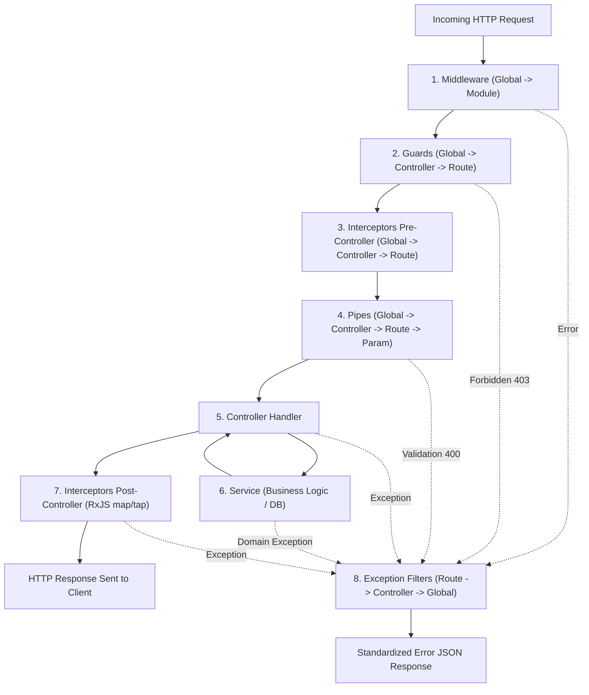
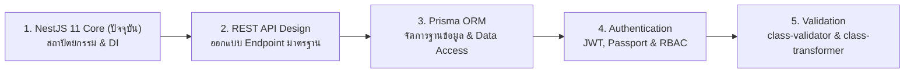

# NestJS 11

ยินดีต้อนรับสู่คู่มือแม่บทเชิงลึกระดับ Enterprise ของ **NestJS 11** ซึ่งเป็นหัวใจและแกนหลักในการพัฒนาเว็บแอปพลิเคชันฝั่งเซิร์ฟเวอร์ (Backend Architecture) บนระบบนิเวศของ Node.js และ TypeScript คู่มือนี้ถูกออกแบบมาเพื่อให้นักพัฒนาเข้าใจตั้งแต่รากฐานของปรัชญาการออกแบบ, การบริหารจัดการ Dependency Injection, วงจร Request Lifecycle แบบผ่าละเอียด, ไปจนถึงการจัดโครงสร้างโค้ดระดับล้านบรรทัดสำหรับระบบพาณิชย์อิเล็กทรอนิกส์ **Smart Butcher Marketplace** (แพลตฟอร์มตลาดซื้อขายเนื้อสัตว์พรีเมียมและเนื้อดรายเอจออนไลน์)

<InteractiveFlowDiagram variant="request" title="วงจรการทำงานของ NestJS 11 (Middleware ➔ Guard ➔ Pipe ➔ Controller ➔ Service ➔ Prisma)" subtitle="แสดงลำดับ Request Lifecycle ของ NestJS 11 ตั้งแต่รับ HTTP Request จนถึงการประมวลผลที่ฐานข้อมูล" />

| หัวข้อในบทเรียนนี้ | ขอบเขตเนื้อหาสำคัญ | ลิงก์ข้ามไปยังหัวข้อ |
| :--- | :--- | :--- |
| **1. Architecture** | สถาปัตยกรรม NestJS 11 เทียบกับ Express.js, Modular & IoC | [อ่านหัวข้อที่ 1](#1-สถาปัตยกรรมและเหตุผลที่ออกแบบแบบนี้-เทียบกับ-express) |
| **2. Modules** | `@Module`, Imports/Exports, Global Modules และ Encapsulation | [อ่านหัวข้อที่ 2](#2-modules-กล่องประกอบระบบและ-encapsulation) |
| **3. Controllers** | `@Controller`, Routing, `@Get/@Post/@Param/@Body/@Query` | [อ่านหัวข้อที่ 3](#3-controllers-จัดการ-http-request-และ-routing) |
| **4. Providers** | `@Injectable`, Business Logic Layer และการแยกความรับผิดชอบ | [อ่านหัวข้อที่ 4](#4-providers-และ-services-business-logic-layer) |
| **5. Dependency Injection** | IoC Container, Scopes (Singleton/Request/Transient), Custom Providers | [อ่านหัวข้อที่ 5](#5-dependency-injection-di-และ-inversion-of-control-ioc) |
| **6. Request Lifecycle** | ลำดับการทำงานตั้งแต่ Middleware, Guard, Interceptor, Pipe ถึง Filter | [อ่านหัวข้อที่ 6](#6-ลำดับการทำงานของ-request-lifecycle-request-pipeline) |
| **7–11. Pipeline Building Blocks** | เจาะลึก Middleware, Guards, Pipes, Interceptors และ Exception Filters | [อ่านหัวข้อที่ 7](#7-middleware-ประตูด่านแรกของ-request) |
| **12–14. Config & Structure** | `ConfigModule`, Feature Module Structure และ Enterprise Logging | [อ่านหัวข้อที่ 12](#12-configmodule-และ-environment-configuration) |

---

## 1. สถาปัตยกรรมและเหตุผลที่ออกแบบแบบนี้ (เทียบกับ Express)

### แนวคิด
ในยุคแรกเริ่มของ Node.js ไลบรารียอดนิยมอย่าง **Express.js** ชนะใจนักพัฒนาด้วยความเรียบง่าย (Minimalist) และไร้กรอบบังคับ (Unopinionated) คุณสามารถเริ่มสร้างเซิร์ฟเวอร์ได้ด้วยโค้ดเพียง 5 บรรทัด อย่างไรก็ตาม เมื่อระบบขยายตัวสู่ระดับ Enterprise ที่มีนักพัฒนาหลายสิบคน โค้ดเบสหลายแสนบรรทัด ความไร้กรอบของ Express มักกลายเป็นดาบสองคมที่ก่อให้เกิด "Spaghetti Code" โค้ดแต่ละโฟลเดอร์จัดวางไม่เหมือนกัน แต่ละคนเขียนตามความเคยชิน ขาดโครงสร้างเลเยอร์ที่รัดกุม การทดสอบอัตโนมัติ (Automated Testing) ทำได้ยากยิ่ง และเกิดปัญหา Tight Coupling ที่การแก้ไขส่วนหนึ่งส่งผลกระทบพังทลายเป็นลูกโซ่

**NestJS** ถูกสร้างขึ้นมาเพื่อแก้ปัญหานี้อย่างสิ้นเชิง โดยนำแนวคิดและสถาปัตยกรรมที่พิสูจน์แล้วจากโลกของ Enterprise (เช่น Spring Boot ใน Java และ Angular ใน Frontend) มาสู่ Node.js โดยยึดหลัก:
1. **Architectural Rigidity & Structure**: มีรูปแบบที่ชัดเจนในการจัดระเบียบโค้ด ไม่ต้องเสียเวลาเถียงกันในทีมเรื่องการวางไฟล์
2. **Modular Design**: แบ่งระบบออกเป็นโมดูลอิสระที่มีขอบเขตชัดเจน (Encapsulated Modules)
3. **Inversion of Control (IoC) & Dependency Injection (DI)**: ถอดแยกการสร้างอ็อบเจกต์ออกจากคลาสที่เรียกใช้ ทำให้เขียน Unit Test และ Mock ข้อมูลได้อย่างง่ายดาย
4. **Platform-Agnostic Abstraction**: ทำงานเป็นชั้น Abstraction ครอบ HTTP Server ดั้งเดิมไว้ ทำให้สามารถสลับเครื่องยนต์พื้นฐานระหว่าง **Express** (ค่าเริ่มต้น รองรับระบบนิเวศกว้างขวาง) และ **Fastify** (เน้นประสิทธิภาพและความเร็วระดับสูงสุด) ได้โดยแทบไม่ต้องแตะต้อง Business Logic

### หลักการเบื้องหลัง
เบื้องหลังของ NestJS คือการประยุกต์ใช้ **3-Tier Layered Architecture** ผสานเข้ากับ **Adapter Pattern**:
- **Presentation Layer (Controllers)**: รับผิดชอบการติดต่อกับโลกภายนอก (HTTP Routing, Request Parsing, Status Codes)
- **Business Logic Layer (Services / Providers)**: หัวใจของระบบ เก็บกฎเกณฑ์ทางธุรกิจ การคำนวณราคาเนื้อสเต็กตามน้ำหนัก โปรโมชั่น และสิทธิ์ผู้ใช้งาน
- **Data Access Layer (Repositories / ORM)**: ติดต่อกับฐานข้อมูล เช่น Prisma หรือ TypeORM
- **HTTP Platform Adapters**: NestJS กำหนดอินเทอร์เฟซ `HttpServer` ขึ้นมาเป็นตัวกลาง เมื่อรันบน Express จะใช้ `@nestjs/platform-express` และเมื่อเปลี่ยนเป็น Fastify จะใช้ `@nestjs/platform-fastify` โดย Fastify สามารถทำ Throughput (Request/วินาที) ได้สูงกว่า Express ราว 2-3 เท่าด้วยสถาปัตยกรรม Schema-based JSON Serialization

### ตัวอย่างโค้ด

#### ตัวอย่างที่ 1: การ Bootstrap แอปพลิเคชันด้วย Express vs Fastify Adapter
```typescript filename="src/main.ts"
// ตัวอย่างที่ 1.1: เริ่มต้นระบบด้วย Express Adapter (Default)
import { NestFactory } from '@nestjs/core';
import { AppModule } from './app.module';

async function bootstrapExpress() {
  const app = await NestFactory.create(AppModule);
  app.setGlobalPrefix('api/v1');
  await app.listen(process.env.PORT ?? 3000);
  console.log('Smart Butcher API (Express) is running on port 3000');
}
bootstrapExpress();
```

```typescript filename="src/main-fastify.ts"
// ตัวอย่างที่ 1.2: สลับเป็น Fastify Adapter สำหรับระบบ High-Throughput Flash Sale
import { NestFactory } from '@nestjs/core';
import {
  FastifyAdapter,
  NestFastifyApplication,
} from '@nestjs/platform-fastify';
import { AppModule } from './app.module';

async function bootstrapFastify() {
  // สลับเป็น Fastify Adapter โดยโค้ดใน Controller และ Service ยังคงเดิม 100%
  const app = await NestFactory.create<NestFastifyApplication>(
    AppModule,
    new FastifyAdapter({ logger: true })
  );
  app.setGlobalPrefix('api/v1');
  // Fastify จำเป็นต้องผูกกับ 0.0.0.0 เพื่อให้ Docker และภายนอกเข้าถึงได้
  await app.listen(process.env.PORT ?? 3000, '0.0.0.0');
  console.log('Smart Butcher API (Fastify Engine) running at max throughput');
}
bootstrapFastify();
```

#### ตัวอย่างที่ 2: สถาปัตยกรรมแบ่งชั้นความรับผิดชอบ (Clean 3-Layer)
```typescript filename="src/modules/products/products.service.ts"
import { Injectable, NotFoundException } from '@nestjs/common';

export interface MeatCut {
  id: string;
  name: string;
  grade: 'A5' | 'A4' | 'Wagyu_Cross' | 'Prime';
  weightGrams: number;
  pricePerKg: number;
  inStock: boolean;
}

@Injectable()
export class ProductsService {
  // จำลองการดึงข้อมูลจาก Database Layer
  private readonly inventory: MeatCut[] = [
    {
      id: 'meat-001',
      name: 'Miyazaki Wagyu Ribeye',
      grade: 'A5',
      weightGrams: 350,
      pricePerKg: 7800,
      inStock: true,
    },
    {
      id: 'meat-002',
      name: 'Dry-Aged T-Bone 45 Days',
      grade: 'Prime',
      weightGrams: 500,
      pricePerKg: 3200,
      inStock: true,
    },
  ];

  // Business Logic: คำนวณราคาเนื้อตัดชิ้นตามน้ำหนักจริง (กรัม)
  calculateCutPrice(cut: MeatCut): number {
    const rawPrice = (cut.pricePerKg / 1000) * cut.weightGrams;
    // คิดภาษีมูลค่าเพิ่ม 7% สำหรับสินค้าแปรรูป
    return Math.round(rawPrice * 1.07);
  }

  findProductById(id: string): MeatCut & { finalPriceThb: number } {
    const cut = this.inventory.find((item) => item.id === id);
    if (!cut) {
      throw new NotFoundException(`ไม่พบชิ้นเนื้อรหัส ${id} ในตู้เย็นจัดเก็บ`);
    }
    return {
      ...cut,
      finalPriceThb: this.calculateCutPrice(cut),
    };
  }
}
```

```typescript filename="src/modules/products/products.controller.ts"
import { Controller, Get, Param } from '@nestjs/common';
import { ProductsService } from './products.service';

@Controller('products')
export class ProductsController {
  // Inject Service เข้ามาผ่าน Constructor Injection
  constructor(private readonly productsService: ProductsService) {}

  @Get(':id')
  getMeatDetails(@Param('id') id: string) {
    // Controller ทำหน้าที่เพียงแค่รับ Route Param แล้ว Delegate ให้ Service คำนวณ
    return this.productsService.findProductById(id);
  }
}
```

### ผิด vs ถูก

```typescript filename="src/nestjs.ts"
// ❌ ผิด: เขียนแบบ Express บน NestJS (นำตรรกะ Database + Calculation + HTTP Response รวมกันใน Controller)
@Controller('products')
export class BadProductsController {
  @Get(':id')
  async getMeat(@Param('id') id: string, @Res() res: Response) {
    // ยึดติดกับ Express Response Object (@Res) และยิง Query คำนวณในนี้
    const meat = await db.query('SELECT * FROM meats WHERE id = $1', [id]);
    if (!meat) {
      return res.status(404).json({ error: 'Not found' });
    }
    const price = (meat.pricePerKg / 1000) * meat.weightGrams * 1.07;
    return res.status(200).json({ ...meat, price });
  }
}
// ผลกระทบ: เขียน Unit Test ไม่ได้, เปลี่ยนไปใช้ Fastify ไม่ได้, โค้ดนำกลับมาใช้ซ้ำไม่ได้
```

```typescript filename="src/nestjs.ts"
// ✅ ถูก: แยก Layer หน้าที่ชัดเจน Controller รับ Input และคืนค่า Object ให้ NestJS Serialize อัตโนมัติ
@Controller('products')
export class GoodProductsController {
  constructor(private readonly productsService: ProductsService) {}

  @Get(':id')
  getMeat(@Param('id') id: string) {
    // คืนค่า Plain Object ทันที ไม่ใช้ @Res() ทำให้รองรับทั้ง Express และ Fastify
    return this.productsService.findProductById(id);
  }
}
```

### ควรใช้เมื่อไหร่ / ไม่ควรใช้เมื่อไหร่
- **ควรใช้ NestJS เมื่อ**:
  - พัฒนาระบบ Enterprise หรือผลิตภัณฑ์ขนาดกลางถึงใหญ่ที่ต้องดูแลรักษาต่อเนื่องหลายปี
  - ทำงานร่วมกันเป็นทีมหลายคนและต้องการความสม่ำเสมอของโครงสร้างโปรเจกต์
  - ต้องการระบบ Dependency Injection ที่ทรงพลัง และเน้นการทำ Automated Testing (Unit / Integration / E2E)
  - กำลังพัฒนา Microservices สถาปัตยกรรม Event-driven หรือ WebSockets ร่วมด้วย
- **ไม่ควรใช้ NestJS เมื่อ**:
  - สร้างสคริปต์อัตโนมัติขนาดเล็ก (One-off Scripts) หรืองาน Micro-Utility สั้นๆ
  - ต้องการ Serverless Functions ที่เบาและเริ่มทำงานเร็วระดับเสี้ยววินาที (Cold Start ต่ำมาก) ในกรณีนี้ Hono หรือ Fastify เดี่ยวๆ อาจเหมาะสมกว่า

### คำถามสัมภาษณ์
**ถาม**: ทำไม NestJS จึงแนะนำให้หลีกเลี่ยงการใช้ `@Res()` หรือ `@Response()` จาก Express โดยตรง หากไม่จำเป็นจริงๆ?
**ตอบ**: การใช้ `@Res()` จะทำให้ NestJS ปิดการทำงานของ Standard Response Handling แบบอัตโนมัติ (เช่น Interceptors, Response Serializers) และทำให้โค้ดของเราผูกติดกับ Express Engine อย่างถาวร ไม่สามารถสลับไปใช้งาน Fastify เพื่อเพิ่มสมรรถนะของระบบได้ในอนาคต

---

## 2. Modules: กล่องประกอบระบบและ Encapsulation

### แนวคิด
จินตนาการว่าแอปพลิเคชันของคุณคือ "ห้างสรรพสินค้าจำหน่ายเนื้อสัตว์อัจฉริยะ" แต่ละแผนก เช่น แผนกจัดหาเนื้อ (Products), แผนกแคชเชียร์และคำสั่งซื้อ (Orders), แผนกชำระเงิน (Payments) และแผนกสมาชิก (Users) ต่างก็ทำงานเป็นเอกเทศ มีผู้จัดการและเครื่องมือของตนเอง โดยไม่ต้องเปิดเผยอุปกรณ์ภายในให้แผนกอื่นรับรู้ เว้นแต่จะได้รับอนุญาตอย่างเป็นทางการ

ใน NestJS **Module** คือกล่องประกอบระดับสูง (Lego Brick) ที่ใช้ Decorator `@Module()` เพื่อกำหนดขอบเขตความปลอดภัย (Encapsulation Boundary) ของฟีเจอร์ ป้องกันไม่ให้ Service หรือ Helper ภายในรั่วไหลออกไปสู่ภายนอกโดยไม่ตั้งใจ

### หลักการเบื้องหลัง
เมื่อ NestJS บูตระบบผ่าน `NestFactory.create(AppModule)` ตัว Framework จะทำการสร้าง **Dependency Injection Graph** ขึ้นมาจาก Root Module (`AppModule`) แล้วไล่ตรวจสอบความเชื่อมโยงของ Metadata ผ่าน Properties ทั้ง 4 ตัวของ `@Module()`:
1. `imports`: รายชื่อโมดูลอื่นที่โมดูลนี้จำเป็นต้องดึง Service ที่ถูก Export มาใช้งาน
2. `controllers`: รายชื่อ Controller ประจำโมดูลนี้ที่พร้อมรับ HTTP Request
3. `providers`: รายชื่อ Services, Repositories, หรือ Helpers ที่ถูกสร้างและบริหารโดย Nest IoC Container ภายในขอบเขตโมดูลนี้
4. `exports`: รายชื่อ Providers ภายในโมดูลนี้ ที่อนุญาตให้โมดูลอื่นที่ Import โมดูลนี้ไป สามารถนำไป Inject ใช้งานต่อได้

```text filename="docs/backend/nestjs.txt"
┌────────────────────────────────────────────────────────┐
│                   AppModule (Root)                     │
│               imports: [Products, Orders]              │
└───────────┬────────────────────────────────┬───────────┘
            │                                │
            ▼                                ▼
┌───────────────────────┐        ┌───────────────────────┐
│     OrdersModule      │        │    ProductsModule     │
│ imports: [Products]   │───────►│ exports: [ProductSvc] │
│ controllers: [OrderCtrl]       │ providers: [ProductSvc│
│ providers: [OrderSvc] │        │             StockCalc]│
└───────────────────────┘        └───────────────────────┘
```

### ตัวอย่างโค้ด

#### ตัวอย่างที่ 1: การเชื่อมโยง Feature Modules และการทำ Encapsulation
```typescript filename="src/modules/products/products.module.ts"
import { Module } from '@nestjs/common';
import { ProductsController } from './products.controller';
import { ProductsService } from './products.service';
import { MeatStockAuditorService } from './meat-stock-auditor.service';

@Module({
  controllers: [ProductsController],
  providers: [
    ProductsService,
    MeatStockAuditorService, // เป็น Private Service ใช้เฉพาะภายใน ProductsModule เท่านั้น
  ],
  // ส่งออกเฉพาะ ProductsService ให้โมดูลภายนอก ส่วน MeatStockAuditorService ถูก Encapsulate ไว้
  exports: [ProductsService],
})
export class ProductsModule {}
```

```typescript filename="src/modules/orders/orders.module.ts"
import { Module } from '@nestjs/common';
import { OrdersController } from './orders.controller';
import { OrdersService } from './orders.service';
import { ProductsModule } from '../products/products.module';

@Module({
  // Import ProductsModule เข้ามา ทำให้ OrdersService สามารถเรียกใช้งาน ProductsService ได้
  imports: [ProductsModule],
  controllers: [OrdersController],
  providers: [OrdersService],
})
export class OrdersModule {}
```

#### ตัวอย่างที่ 2: Dynamic Module สำหรับระบบ Payment Gateway ด้วย `forRoot` / `forFeature`
```typescript filename="src/modules/payment/payment.module.ts"
import { DynamicModule, Module } from '@nestjs/common';
import { PaymentService } from './payment.service';

export interface PaymentModuleOptions {
  apiKey: string;
  merchantId: string;
  sandboxMode: boolean;
}

export const PAYMENT_OPTIONS = 'PAYMENT_OPTIONS';

@Module({})
export class PaymentModule {
  // สร้าง Dynamic Module สำหรับตั้งค่าระดับแอปพลิเคชัน (forRoot)
  static forRoot(options: PaymentModuleOptions): DynamicModule {
    return {
      module: PaymentModule,
      providers: [
        {
          provide: PAYMENT_OPTIONS,
          useValue: options,
        },
        PaymentService,
      ],
      exports: [PaymentService],
      global: false, // ป้องกันการรั่วไหล แนะนำให้ import ทีละโมดูล
    };
  }
}
```

```typescript filename="src/app.module.ts"
import { Module } from '@nestjs/common';
import { ProductsModule } from './modules/products/products.module';
import { OrdersModule } from './modules/orders/orders.module';
import { PaymentModule } from './modules/payment/payment.module';

@Module({
  imports: [
    ProductsModule,
    OrdersModule,
    // กำหนดค่าคอนฟิกให้กับระบบตัดเงินค่าสเต็ก
    PaymentModule.forRoot({
      apiKey: process.env.PAYMENT_SECRET_KEY ?? 'mock_key_sec_999',
      merchantId: 'SMART_BUTCHER_BANGKOK',
      sandboxMode: process.env.NODE_ENV !== 'production',
    }),
  ],
})
export class AppModule {}
```

### ผิด vs ถูก

```typescript filename="src/nestjs.ts"
// ❌ ผิด: ใส่ Service ใน providers ของ Module ปลายทางตรงๆ โดยไม่ import ผ่าน Module ต้นทาง
@Module({
  imports: [], // ไม่ได้ import ProductsModule
  controllers: [OrdersController],
  providers: [
    OrdersService,
    ProductsService, // ❌ ผิดมหันต์: การใส่แบบนี้จะทำให้ Nest สร้าง Instance ใหม่ของ ProductsService
                     // ที่แยกขาดจาก ProductsModule ไม่แชร์ State หรือ Cache และอาจขาด Dependency อื่น
  ],
})
export class BadOrdersModule {}
```

```typescript filename="src/nestjs.ts"
// ✅ ถูก: Import ผ่าน ProductsModule และดึง Instance จาก Module เจ้าของ
@Module({
  imports: [ProductsModule], // ✅ ถูก: นำเข้าผ่าน Module เจ้าของที่ export ไว้อย่างถูกต้อง
  controllers: [OrdersController],
  providers: [OrdersService],
})
export class GoodOrdersModule {}
```

### ควรใช้เมื่อไหร่ / ไม่ควรใช้เมื่อไหร่
- **ควรใช้ Feature Module**: กับทุก Business Domain (Products, Orders, Users, Categories)
- **ควรใช้ Dynamic Module (`forRoot`/`register`)**: เมื่อสร้างโมดูลที่ต้องรับพารามิเตอร์คอนฟิก เช่น ระบบชำระเงิน, ไคลเอนต์ Redis หรือ Mailer
- **ไม่ควรใช้ `@Global()` พร่ำเพรื่อ**: แม้ว่าการแปะ `@Global()` จะทำให้โมดูลนั้นถูกเรียกใช้ได้ทุกที่โดยไม่ต้องเขียน `imports` แต่มันจะทำลายแนวคิด Encapsulation ทำให้สถาปัตยกรรมโปรเจกต์ตรวจสอบที่มาที่ไปของ Dependency ได้ยาก ให้สงวนไว้เฉพาะโมดูลโครงสร้างพื้นฐานจริงๆ เช่น `DatabaseModule` หรือ `ConfigModule`

### คำถามสัมภาษณ์
**ถาม**: หากใน `OrdersService` พยายาม Inject `ProductsService` แล้วระบบพ่นข้อผิดพลาด `Nest can't resolve dependencies of the OrdersService (?)` เกิดจากสาเหตุใดได้บ้าง และมีขั้นตอนการแก้ปัญหาอย่างไร?
**ตอบ**: เกิดจาก 2 สาเหตุหลัก:
1. `ProductsModule` ลืมระบุ `ProductsService` ในอาร์เรย์ `exports`
2. `OrdersModule` ลืมระบุ `ProductsModule` ในอาร์เรย์ `imports`
วิธีแก้คือไปเพิ่ม `exports: [ProductsService]` ใน `ProductsModule` และเพิ่ม `imports: [ProductsModule]` ใน `OrdersModule`

---

## 3. Controllers: จัดการ HTTP Request และ Routing

### แนวคิด
ถ้า Service คือพ่อครัวและเจ้าหน้าที่ดูแลสต็อกเนื้อในห้องเย็น **Controller** ก็คือ "พนักงานต้อนรับหน้าร้าน" ที่คอยรับออเดอร์จากลูกค้าทางหน้าร้านหรือช่องทางออนไลน์ ตรวจสอบว่าลูกค้าสั่งอะไร ต้องการให้ส่งไปที่ไหน หรือต้องการสอบถามราคาเนื้อส่วนใด แล้วส่งต่อข้อมูลที่เรียบร้อยแล้วไปให้พ่อครัวในห้องครัว โดย Controller จะไม่ลงมือแล่เนื้อเองเด็ดขาด

ใน NestJS หน้าที่ของ Controller มีเพียง:
1. รับฟัง HTTP Request ตาม Path และ Method ที่กำหนด (`@Controller`, `@Get`, `@Post`, `@Put`, `@Patch`, `@Delete`)
2. ดึงข้อมูลจากส่วนประกอบของคำขอ เช่น URL Parameters (`@Param`), Query Strings (`@Query`), Request Body (`@Body`), หรือ Headers (`@Headers`)
3. ส่งข้อมูลต่อไปยัง Service Layer
4. ส่งผลลัพธ์พร้อม HTTP Status Code (`@HttpCode`) กลับไปยังผู้เรียก

### หลักการเบื้องหลัง
NestJS แปลง Decorator เมธอดต่างๆ ให้เป็น Routing Table ภายใน Express หรือ Fastify Router เมื่อมี Request เข้ามา ตัว Route Matcher จะทำการจับคู่ URL และแตกตัวแปรออกมาเป็น Parameter ผ่าน Decorators โดยอัตโนมัติ นอกจากนี้ NestJS ยังจัดการเรื่อง Header `Content-Type: application/json` และการแปลง Object เป็น JSON String ให้เสร็จสรรพ

### ตัวอย่างโค้ด

#### ตัวอย่างที่ 1: CRUD พื้นฐานสำหรับสินค้าเนื้อพรีเมียม
```typescript filename="src/modules/products/products.controller.ts"
import {
  Controller,
  Get,
  Post,
  Put,
  Delete,
  Body,
  Param,
  HttpCode,
  HttpStatus,
} from '@nestjs/common';
import { ProductsService, MeatCut } from './products.service';

export class CreateMeatDto {
  name: string;
  grade: 'A5' | 'A4' | 'Wagyu_Cross' | 'Prime';
  weightGrams: number;
  pricePerKg: number;
}

@Controller('products/meats')
export class ProductsController {
  constructor(private readonly productsService: ProductsService) {}

  // 1. ดึงรายการเนื้อทั้งหมด: GET /api/v1/products/meats
  @Get()
  getAllMeats(): MeatCut[] {
    return this.productsService.findAll();
  }

  // 2. ดึงเนื้อชิ้นเดียวตาม ID: GET /api/v1/products/meats/:id
  @Get(':id')
  getMeatById(@Param('id') id: string) {
    return this.productsService.findProductById(id);
  }

  // 3. สร้างรายการเนื้อชิ้นใหม่: POST /api/v1/products/meats (201 Created)
  @Post()
  @HttpCode(HttpStatus.CREATED)
  createMeatCut(@Body() dto: CreateMeatDto) {
    return this.productsService.createCut(dto);
  }

  // 4. แก้ไขข้อมูลเนื้อทั้งก้อน: PUT /api/v1/products/meats/:id
  @Put(':id')
  replaceMeatCut(
    @Param('id') id: string,
    @Body() dto: CreateMeatDto
  ) {
    return this.productsService.updateCut(id, dto);
  }

  // 5. ลบชิ้นเนื้อออกจากสต็อก: DELETE /api/v1/products/meats/:id (204 No Content)
  @Delete(':id')
  @HttpCode(HttpStatus.NO_CONTENT)
  deleteMeatCut(@Param('id') id: string): void {
    this.productsService.deleteCut(id);
  }
}
```

#### ตัวอย่างที่ 2: Advanced Search Controller รับ Query Params และ Headers
```typescript filename="src/modules/products/meat-search.controller.ts"
import { Controller, Get, Query, Headers } from '@nestjs/common';
import { ProductsService } from './products.service';

export interface MeatSearchFilter {
  minPrice?: number;
  maxPrice?: number;
  grade?: string;
  isDryAged?: boolean;
}

@Controller('products/search')
export class MeatSearchController {
  constructor(private readonly productsService: ProductsService) {}

  // ตัวอย่าง: GET /products/search?grade=A5&minPrice=2000&maxPrice=8000
  @Get()
  searchMeat(
    @Query('grade') grade?: string,
    @Query('minPrice') minPrice?: string,
    @Query('maxPrice') maxPrice?: string,
    @Query('dryAged') dryAged?: string,
    @Headers('x-client-platform') platform?: string
  ) {
    const filter: MeatSearchFilter = {
      grade,
      minPrice: minPrice ? Number(minPrice) : undefined,
      maxPrice: maxPrice ? Number(maxPrice) : undefined,
      isDryAged: dryAged === 'true',
    };

    console.log(`คำค้นหาเนื้อจากแพลตฟอร์ม: ${platform ?? 'Unknown Web Client'}`);
    return this.productsService.search(filter);
  }
}
```

### ผิด vs ถูก

```typescript filename="src/nestjs.ts"
// ❌ ผิด: ใส่ Business Logic และคำนวณบิลใน Controller
@Controller('orders')
export class BadOrdersController {
  @Post('checkout')
  async checkout(@Body() body: any) {
    let total = 0;
    for (const item of body.items) {
      // ❌ คำนวณราคาและตัดสต็อกใน Controller
      const meat = await db.meat.find(item.id);
      if (meat.stock < item.qty) throw new Error('Out of stock');
      total += (meat.pricePerKg / 1000) * meat.weight * item.qty;
      await db.meat.updateStock(item.id, meat.stock - item.qty);
    }
    return { orderId: 'ORD-999', total };
  }
}
```

```typescript filename="src/nestjs.ts"
// ✅ ถูก: Controller ทำหน้าที่เพียงเป็นทางผ่านข้อมูลไปยัง OrdersService
@Controller('orders')
export class GoodOrdersController {
  constructor(private readonly ordersService: OrdersService) {}

  @Post('checkout')
  async checkout(@Body() checkoutDto: CheckoutOrderDto) {
    // ✅ มอบหมายงานให้ Service รับผิดชอบกระบวนการ Transaction และคำนวณราคา
    return await this.ordersService.processCheckout(checkoutDto);
  }
}
```

### ควรใช้เมื่อไหร่ / ไม่ควรใช้เมื่อไหร่
- **ควรใช้ Controller**: สำหรับเป็นตัวรับส่งคำขอทาง HTTP REST เท่านั้น
- **ไม่ควรใช้ Controller**: เก็บตัวแปรสถานะ (Stateful variables) หรือใส่ Business Logic ที่ซับซ้อน หากเป็นงานประเภท WebSocket ให้ใช้ `@WebSocketGateway()`, งาน Microservice ให้ใช้ `@MessagePattern()`, หรืองานคิวงานพื้นหลังให้ใช้ BullMQ Processor

### คำถามสัมภาษณ์
**ถาม**: ตามหลักสถาปัตยกรรม RESTful API การใช้ `@Put()` กับ `@Patch()` ใน NestJS Controller มีความแตกต่างในเชิงเจตนารมณ์ (Semantics) อย่างไร และส่งผลต่อการออกแบบ DTO อย่างไร?
**ตอบ**:
- `@Put()` ใช้สำหรับการแทนที่ทรัพยากรนั้น "ทั้งชิ้น" (Full Replacement) DTO จะต้องบังคับให้ส่งข้อมูลทุกฟิลด์ที่จำเป็น
- `@Patch()` ใช้สำหรับการอัปเดตข้อมูล "เฉพาะบางฟิลด์" (Partial Update) ฟิลด์ใน DTO มักจะถูกครอบด้วย `@PartialType(CreateDto)` ทำให้ทุกฟิลด์กลายเป็น Optional

---

## 4. Providers และ Services: Business Logic Layer

### แนวคิด
ถ้าเปรียบเทียบแอปพลิเคชันเป็นร้านขายเนื้อสเต็ก **Provider** ก็คือบุคลากรเฉพาะทางทั้งหมดในร้าน ตั้งแต่พ่อครัวใหญ่ผู้เชี่ยวชาญการแล่เนื้อ (Meat Service), ผู้เชี่ยวชาญการดรายเอจเนื้อ (DryAging Specialist), ไปจนถึงพนักงานคุมบัญชีและเครื่องรูดบัตร (Payment Gateway)

ใน NestJS แนวคิดของ **Provider** คือหัวใจหลักของ Inversion of Control สิ่งใดก็ตามที่มีการตกแต่งด้วย `@Injectable()` สามารถถือว่าเป็น Provider ได้ทั้งสิ้น ไม่ว่าจะเป็น Services, Repositories, Factories, หรือ Helpers โดยหน้าที่สำคัญที่สุดคือการแยก **Separation of Concerns (SoC)** ให้ตรรกะทางธุรกิจทำงานอย่างเป็นอิสระจาก HTTP Request

### หลักการเบื้องหลัง
เมื่อคลาสถูกตกแต่งด้วย `@Injectable()` ตัวคอมไพเลอร์ TypeScript (ภายใต้ `emitDecoratorMetadata: true` ใน `tsconfig.json`) จะบันทึก Type ของ Constructor Parameters ไว้ในรูปของ Metadata ด้วยไลบรารี `reflect-metadata`

เมื่อ NestJS ทำการเริ่มระบบ ตัว IoC Container จะสแกนหา Provider ทั้งหมด ตรวจสอบว่าคลาสนี้ต้องการ Dependency ตัวใด แล้วทำการสร้าง Instance (Instantiation) และจัดส่ง (Inject) ไปให้แบบอัตโนมัติ โดยค่าเริ่มต้นจะเป็น **Singleton** (สร้างเพียง 1 Instance ตลอดอายุของ Process)

### ตัวอย่างโค้ด

#### ตัวอย่างที่ 1: Service ตรรกะจัดการเนื้อ Wagyu และการคำนวณราคาตาม Marbling Score
```typescript filename="src/modules/products/wagyu-pricing.service.ts"
import { Injectable, BadRequestException } from '@nestjs/common';

export interface WagyuCut {
  name: string;
  marblingScore: 3 | 4 | 5 | 8 | 9 | 12; // BMS (Beef Marbling Standard)
  basePricePerKg: number;
  weightGrams: number;
}

@Injectable()
export class WagyuPricingService {
  /**
   * คำนวณราคาเนื้อวากิวพรีเมียมโดยเพิ่มตัวคูณความพรีเมียมตามระดับไขมันลายหินอ่อน (BMS)
   */
  calculatePremiumCutPrice(cut: WagyuCut): {
    weightGrams: number;
    basePrice: number;
    bmsMultiplier: number;
    finalPriceThb: number;
  } {
    if (cut.weightGrams <= 0) {
      throw new BadRequestException('น้ำหนักชิ้นเนื้อต้องมากกว่า 0 กรัม');
    }

    // ตัวคูณมูลค่าความนุ่มตามคะแนน BMS
    let multiplier = 1.0;
    if (cut.marblingScore >= 12) multiplier = 1.5; // ระดับยอดมงกุฎ A5 BMS 12
    else if (cut.marblingScore >= 9) multiplier = 1.3;
    else if (cut.marblingScore >= 5) multiplier = 1.15;

    const basePrice = (cut.basePricePerKg / 1000) * cut.weightGrams;
    const finalPriceThb = Math.round(basePrice * multiplier);

    return {
      weightGrams: cut.weightGrams,
      basePrice,
      bmsMultiplier: multiplier,
      finalPriceThb,
    };
  }
}
```

#### ตัวอย่างที่ 2: การทำงานร่วมกันระหว่างหลาย Services (Service-to-Service Collaboration)
```typescript filename="src/modules/orders/orders.service.ts"
import {
  Injectable,
  NotFoundException,
  ConflictException,
} from '@nestjs/common';
import { ProductsService } from '../products/products.service';
import { WagyuPricingService } from '../products/wagyu-pricing.service';

export interface CheckoutRequest {
  productId: string;
  customerEmail: string;
}

@Injectable()
export class OrdersService {
  // Inject หลาย Services พร้อมกันผ่าน Constructor
  constructor(
    private readonly productsService: ProductsService,
    private readonly wagyuPricingService: WagyuPricingService
  ) {}

  async createSteakOrder(dto: CheckoutRequest) {
    // 1. ตรวจสอบว่าสินค้ามีอยู่จริงและสต็อกพร้อมจำหน่ายหรือไม่
    const meat = this.productsService.findProductById(dto.productId);
    if (!meat.inStock) {
      throw new ConflictException(`เนื้อชิ้น ${meat.name} ถูกลูกค้าท่านอื่นจองตัดไปแล้ว`);
    }

    // 2. ส่งต่อให้ WagyuPricingService ช่วยประเมินราคาตามเกรด
    const pricing = this.wagyuPricingService.calculatePremiumCutPrice({
      name: meat.name,
      marblingScore: 9,
      basePricePerKg: meat.pricePerKg,
      weightGrams: meat.weightGrams,
    });

    // 3. ประกอบเป็นคำสั่งซื้อที่สมบูรณ์
    const order = {
      orderId: `ORD-${Date.now()}`,
      customer: dto.customerEmail,
      item: meat.name,
      weightGrams: pricing.weightGrams,
      totalAmount: pricing.finalPriceThb,
      status: 'PENDING_PAYMENT',
      createdAt: new Date().toISOString(),
    };

    return order;
  }
}
```

### ผิด vs ถูก

```typescript filename="src/nestjs.ts"
// ❌ ผิด: Service เข้าไปดึง HTTP Context (@Req) หรือพยายามอ่าน Headers ใน Service Layer
@Injectable()
export class BadOrdersService {
  // นำ Request จาก Express เข้ามาใน Service
  constructor(@Inject(REQUEST) private readonly request: Request) {}

  processOrder() {
    // ❌ เข้าถึง Header ตรงๆ ใน Service
    const authHeader = this.request.headers['authorization'];
    // ผลกระทบ: Service นี้ไม่สามารถถูกเรียกจาก Cron Job, Message Queue หรือ CLI ได้อีกต่อไป
  }
}
```

```typescript filename="src/nestjs.ts"
// ✅ ถูก: Service รับเฉพาะ Pure Data ผ่าน Arguments และคืนค่า Domain Entity
@Injectable()
export class GoodOrdersService {
  // Service รับเฉพาะ user context และข้อมูลที่ถูก parse มาแล้ว
  processOrder(userId: string, orderData: CreateOrderDto) {
    // ✅ สะอาด, เขียน Unit Test ง่าย, รันใน CronJob หรือ Kafka Consumer ได้อย่างไร้ปัญหา
    return this.saveOrderToDatabase(userId, orderData);
  }
}
```

### ควรใช้เมื่อไหร่ / ไม่ควรใช้เมื่อไหร่
- **ควรใช้ Service**: จัดเก็บตรรกะทางธุรกิจ (Business Rules) ทุกรูปแบบ, การทำ Data Transformation, การเชื่อมต่อ Third-Party API, และการจัดการ Transaction
- **ไม่ควรใช้ Service เป็นตัวเก็บ State แบบ Mutable ของผู้ใช้คนใดคนหนึ่ง**: เนื่องจาก Service เป็น Singleton โดยค่าเริ่มต้น หากคุณประกาศ `private currentUser: User` ใน Service ข้อมูลของผู้ใช้คนนั้นจะรั่วไหลไปสู่คำขอของผู้ใช้คนอื่นทันที (Race Condition & Security Breach)

### คำถามสัมภาษณ์
**ถาม**: ทำไม NestJS ถึงออกแบบให้ Service เป็น Singleton Scope โดยค่าเริ่มต้น (Default Scope) แทนที่จะเป็น Transient หรือ Request Scope?
**ตอบ**: เพราะการใช้ Singleton มีประสิทธิภาพสูงที่สุด (High Performance & Low Memory Footprint) ตัว Node.js Engine จะสร้าง Instance เพียงครั้งเดียวตอนเริ่มระบบ ไม่ต้องเสียเวลาสร้างอ็อบเจกต์ใหม่ทุกครั้งที่มี HTTP Request เข้ามา ช่วยลดภาระของระบบจัดการหน่วยความจำ (V8 Garbage Collector) ได้อย่างมหาศาล

---

## 5. Dependency Injection (DI) และ Inversion of Control (IoC)

### แนวคิด
ในระบบแบบดั้งเดิม หาก `OrdersService` ต้องการใช้งาน `PaymentGateway` ตัว `OrdersService` จะต้องสั่ง `new StripePaymentGateway()` ด้วยตนเอง การทำเช่นนี้เรียกว่า **Tight Coupling** เพราะหากวันหนึ่งเราต้องการเปลี่ยนไปใช้ `OmisePaymentGateway` หรือต้องการส่ง `MockPaymentGateway` เข้าไปตอนเขียน Unit Test เราจะต้องเข้าไปรื้อแก้โค้ดใน `OrdersService` ทั้งหมด

**Inversion of Control (IoC)** ทำการสลับขั้วอำนาจนี้ โดย `OrdersService` จะไม่เป็นผู้สร้าง Dependency เอง แต่จะทำเพียงแค่ "ประกาศความต้องการ" ผ่าน Constructor ว่าต้องการอ็อบเจกต์ที่มีหน้าตาตามอินเทอร์เฟซที่กำหนด แล้วมอบหน้าที่ให้ **DI Container** ของ NestJS เป็นผู้สร้างและหยิบส่ง (Inject) อ็อบเจกต์ตัวจริงเข้ามาให้ในตอนรัน

### หลักการเบื้องหลัง

#### 1. Provider Scopes
NestJS รองรับ 3 Scopes:
- `Scope.DEFAULT` (Singleton): ใช้ร่วมกันทั้งแอปพลิเคชัน สร้างครั้งเดียวตอนบูต (แนะนำสูงสุด)
- `Scope.REQUEST`: สร้าง Instance ใหม่แยกตามแต่ละคำขอ HTTP เหมาะกับงานที่ต้องการ Multi-tenancy แยกตาม Subdomain
- `Scope.TRANSIENT`: สร้าง Instance ใหม่ทุกครั้งที่มีการ Inject ไปยัง Provider อื่น

#### 2. Custom Providers
นอกจากการใส่ชื่อ Class ใน `providers: [OrdersService]` ซึ่งเป็นรูปย่อของ `useClass` แล้ว NestJS ยังรองรับ:
- `useClass`: เลือกระบุคลาสที่จะใช้งานจริง เช่น สลับระหว่าง Production กับ Mock
- `useValue`: กำหนดค่าคงที่, Configuration Object หรือ External Library ที่ไม่ได้เขียนด้วย Class
- `useFactory`: ใช้ฟังก์ชันคำนวณหรือรอการเชื่อมต่อแบบ Asynchronous ก่อนคืนค่า Instance
- `useExisting`: กำหนด Alias ให้ชี้ไปยัง Provider ตัวอื่นที่มีอยู่แล้ว

#### 3. Circular Dependency (การพึ่งพาซึ่งกันและกันแบบงูกินหาง)
หาก `OrdersService` ต้องเรียก `ProductsService` และในขณะเดียวกัน `ProductsService` ก็ต้องเรียก `OrdersService` เพื่อดูสถิติยอดขาย NestJS จะพบปัญหา Dependency Cycle ทำให้ระบบบูตไม่ขึ้น เราแก้ไขปัญหานี้ด้วยฟังก์ชัน `forwardRef()`

### ตัวอย่างโค้ด

#### ตัวอย่างที่ 1: การใช้ `useFactory` เชื่อมต่อ Payment Gateway แบบ Async
```typescript filename="src/modules/payment/payment-client.provider.ts"
import { Provider } from '@nestjs/common';
import { ConfigService } from '@nestjs/config';

export const SMART_BUTCHER_PAYMENT_CLIENT = 'SMART_BUTCHER_PAYMENT_CLIENT';

export interface PaymentClient {
  charge(amountThb: number, description: string): Promise<{ transactionId: string }>;
}

export const PaymentClientProvider: Provider = {
  provide: SMART_BUTCHER_PAYMENT_CLIENT,
  // ฉีด ConfigService เข้ามาใน Factory เพื่ออ่านค่า ENV
  inject: [ConfigService],
  useFactory: async (configService: ConfigService): Promise<PaymentClient> => {
    const isMock = configService.get<boolean>('MOCK_PAYMENT', true);
    const secretKey = configService.get<string>('PAYMENT_GATEWAY_SECRET', 'test_key');

    if (isMock) {
      console.log('⚡ ติดตั้ง FakeButcherPaymentClient สำหรับโหมดทดสอบ');
      return {
        async charge(amount, desc) {
          return { transactionId: `MOCK-TX-${Date.now()}` };
        },
      };
    }

    // จำลองการเชื่อมต่อ SDK ภายนอกแบบ Async
    console.log('🔒 เชื่อมต่อ Live Omise/Stripe Gateway สำหรับระบบจริง');
    return {
      async charge(amount, desc) {
        // โค้ดยิง API จริงไปยัง Payment Gateway
        return { transactionId: `LIVE-OMISE-TX-${Date.now()}` };
      },
    };
  },
};
```

```typescript filename="src/modules/orders/orders.service.ts"
import { Injectable, Inject } from '@nestjs/common';
import {
  SMART_BUTCHER_PAYMENT_CLIENT,
  PaymentClient,
} from '../payment/payment-client.provider';

@Injectable()
export class OrdersService {
  constructor(
    // ใช้งาน @Inject ร่วมกับ Token String/Symbol ที่ตั้งขึ้น
    @Inject(SMART_BUTCHER_PAYMENT_CLIENT)
    private readonly paymentClient: PaymentClient
  ) {}

  async payOrder(orderId: string, amount: number) {
    const result = await this.paymentClient.charge(
      amount,
      `ชำระค่าเนื้อสเต็กคำสั่งซื้อ ${orderId}`
    );
    return { orderId, success: true, txn: result.transactionId };
  }
}
```

#### ตัวอย่างที่ 2: การแก้ไข Circular Dependency ด้วย `forwardRef()`
```typescript filename="src/modules/orders/orders.service.ts"
import { Injectable, Inject, forwardRef } from '@nestjs/common';
import { ProductsService } from '../products/products.service';

@Injectable()
export class OrdersService {
  constructor(
    // ใช้ forwardRef เพื่อเลื่อนการค้นหา ProductsService ไปตอนที่ Graph ถูก resolve เสร็จแล้ว
    @Inject(forwardRef(() => ProductsService))
    private readonly productsService: ProductsService
  ) {}

  getRecentBuyerCount(productId: string): number {
    return 42; // มีลูกค้าซื้อเนื้อชิ้นนี้ไปแล้ว 42 คน
  }
}
```

```typescript filename="src/modules/products/products.service.ts"
import { Injectable, Inject, forwardRef } from '@nestjs/common';
import { OrdersService } from '../orders/orders.service';

@Injectable()
export class ProductsService {
  constructor(
    // ฝั่ง ProductsService ก็ต้องครอบ forwardRef เช่นเดียวกัน
    @Inject(forwardRef(() => OrdersService))
    private readonly ordersService: OrdersService
  ) {}

  getProductPopularity(productId: string) {
    const buyers = this.ordersService.getRecentBuyerCount(productId);
    return { productId, buyersCount: buyers, isHotItem: buyers > 30 };
  }
}
```

### ผิด vs ถูก

```typescript filename="src/nestjs.ts"
// ❌ ผิด: กำหนด Provider เป็น Request Scope โดยไม่จำเป็น
@Injectable({ scope: Scope.REQUEST }) // ❌ อันตราย
export class MeatTaxCalculatorService {
  // การทำแบบนี้จะทำให้ทุก Service และ Controller ที่ Inject ตัวนี้กลายเป็น Request Scope ไปด้วย
  // เกิด Cascading Scope Effect ส่งผลให้ระบบช้าลง 3-5 เท่า และกิน RAM มหาศาล
}
```

```typescript filename="src/nestjs.ts"
// ✅ ถูก: ใช้ Default Singleton Scope เสมอ และส่ง Request Context ผ่านพารามิเตอร์ของเมธอด
@Injectable() // ✅ Default Singleton
export class MeatTaxCalculatorService {
  calculateTax(amount: number, customerVatId?: string): number {
    // คำนวณแบบ Pure Function ปลอดภัยและรวดเร็วที่สุด
    return customerVatId ? amount * 0.07 : 0;
  }
}
```

### ควรใช้เมื่อไหร่ / ไม่ควรใช้เมื่อไหร่
- **ควรใช้ `useFactory`**: เมื่อ Dependency ต้องพึ่งพาค่า Configuration จาก Environment หรือต้องต่อ Database Pool ก่อนสร้างอ็อบเจกต์
- **ควรใช้ `useValue`**: เมื่อต้องการ Mock Service ในไฟล์ทดสอบ `*.spec.ts`
- **ไม่ควรใช้ `forwardRef()` พร่ำเพรื่อ**: การเกิด Circular Dependency มักเป็นสัญญาณเตือน (Code Smell) ว่าสถาปัตยกรรมกำลังสับสน ควรพิจารณาแยก Business Logic ส่วนกลางออกเป็น Service ที่สาม (เช่น `OrderStatsService`) ให้ทั้งสองฝ่ายเรียกใช้งาน

### คำถามสัมภาษณ์
**ถาม**: อธิบายปรากฏการณ์ "Scope Bubbling" หรือ "Cascading Effect" ของ `Scope.REQUEST` ใน NestJS ว่าส่งผลต่อสถาปัตยกรรมอย่างไร?
**ตอบ**: เมื่อ Provider ตัวใดตัวหนึ่งถูกประกาศเป็น `Scope.REQUEST` คลาสอื่นใดก็ตามใน Dependency Graph ที่ทำการ Inject Provider ตัวนั้น (รวมถึง Controller ที่เรียกใช้มัน) จะถูกยกระดับกลายเป็น Request Scope ตามไปด้วยโดยอัตโนมัติ ส่งผลให้ NestJS ต้องสร้าง Instance ใหม่ของห่วงโซ่นั้นทั้งหมดในทุกๆ HTTP Request ทำให้ประสิทธิภาพการประมวลผลลดลงอย่างรุนแรง

---

## 6. ลำดับการทำงานของ Request Lifecycle (Request Pipeline)

### แนวคิด
ลองจินตนาการถึงเส้นทางของลูกค้าที่เดินเข้ามาซื้อเนื้อในซูเปอร์มาร์เก็ตพรีเมียม:
1. ลูกค้าเดินผ่านประตูทางเข้าและหยิบคูปอง (Middleware: บันทึก Log และแจกแจง Header)
2. เจ้าหน้าที่ รปภ. ตรวจบัตรสมาชิก VIP (Guard: ตรวจสอบสิทธิ์การเข้าถึงโซนเนื้อดรายเอจ)
3. พนักงานขายเริ่มจับเวลาและเตรียมเครื่องบันทึกเสียง (Interceptor - Pre: เตรียมประมวลผลก่อนเข้าสู่เคาน์เตอร์)
4. พนักงานตรวจสอบว่าใบรายการสั่งเนื้อระบุน้ำหนักเป็นตัวเลขและเลือกสายพันธุ์เนื้อถูกต้องหรือไม่ (Pipe: ตรวจสอบและแปลงชนิดข้อมูล DTO)
5. พนักงานเคาน์เตอร์รับออเดอร์และกดสั่งงาน (Controller: นำข้อมูลส่งต่อไปหลังร้าน)
6. เชฟแล่เนื้อชั่งน้ำหนัก ปรุงรส และแพ็กสุญญากาศ (Service: ดำเนินงาน Business Logic)
7. พนักงานนำเนื้อมาห่อกล่องของขวัญสวยงามพร้อมแนบใบเสร็จพิมพ์ลายน้ำ (Interceptor - Post: แปลงผลลัพธ์ Response ให้เป็นมาตรฐาน)
8. หากระหว่างทางเนื้อหมดหรือเครื่องรูดบัตรเสีย จะมีแผนกลูกค้าสัมพันธ์เข้ามารับเรื่องและออกใบแจ้งข้อผิดพลาดอย่างสุภาพ (Exception Filter)

นี่คือ **Request Lifecycle Pipeline** ของ NestJS 11 ซึ่งเป็นการเรียงร้อยการทำงานแบบเป็นท่อส่งน้ำ (Pipeline) ที่เคร่งครัดและคาดเดาได้อย่างแม่นยำ

### หลักการเบื้องหลัง
กระบวนการทำงานถูกควบคุมโดยรอบการประมวลผลดังแผนผัง Mermaid ด้านล่างนี้:



#### ลำดับความสำคัญที่ต้องจดจำขึ้นใจ:
1. **Middlewares**: ทำงานเป็นลำดับแรกเสมอตามลำดับที่ประกาศใน Module
2. **Guards**: ทำงานจากระดับ Global ➔ Controller ➔ Route Handler
3. **Interceptors (Pre-handler)**: ทำงานจากระดับ Global ➔ Controller ➔ Route Handler
4. **Pipes**: ทำงานจากระดับ Global ➔ Controller ➔ Route Handler ➔ Route Params
5. **Controller**: ดำเนินการ Method Handler
6. **Services**: ประมวลผล Logic
7. **Interceptors (Post-handler)**: ทำงานย้อนกลับจาก Route Handler ➔ Controller ➔ Global ผ่าน RxJS Observables
8. **Exception Filters**: ดักจับ Error จากทุกขั้นตอน เริ่มตรวจสอบจาก Route ➔ Controller ➔ Global

### ตัวอย่างโค้ด

#### ตัวอย่างที่ 1: การลงทะเบียน Lifecycle แบบครบวงจรใน `main.ts`
```typescript filename="src/main.ts"
import { NestFactory } from '@nestjs/core';
import { ValidationPipe } from '@nestjs/common';
import { AppModule } from './app.module';
import { GlobalLoggingInterceptor } from './common/interceptors/global-logging.interceptor';
import { AllExceptionsFilter } from './common/filters/all-exceptions.filter';
import { GlobalAuditMiddleware } from './common/middlewares/global-audit.middleware';

async function bootstrap() {
  const app = await NestFactory.create(AppModule);

  // 1. ลงทะเบียน Global Middleware
  app.use(new GlobalAuditMiddleware().use);

  // 2. ลงทะเบียน Global Validation Pipe สำหรับตรวจสอบ DTO ทั้งระบบ
  app.useGlobalPipes(
    new ValidationPipe({
      whitelist: true,
      forbidNonWhitelisted: true,
      transform: true,
    })
  );

  // 3. ลงทะเบียน Global Interceptor สำหรับจับเวลาและจัดฟอร์แมต Response
  app.useGlobalInterceptors(new GlobalLoggingInterceptor());

  // 4. ลงทะเบียน Global Exception Filter สำหรับดักจับ Error ทั่วทั้งระบบ
  app.useGlobalFilters(new AllExceptionsFilter());

  await app.listen(3000);
}
bootstrap();
```

#### ตัวอย่างที่ 2: Controller ที่ประกอบด้วย Guards, Interceptors, และ Pipes
```typescript filename="src/modules/orders/orders.controller.ts"
import {
  Controller,
  Post,
  Body,
  UseGuards,
  UseInterceptors,
  UsePipes,
  ParseUUIDPipe,
  Param,
} from '@nestjs/common';
import { JwtAuthGuard } from '../../common/guards/jwt-auth.guard';
import { RolesGuard } from '../../common/guards/roles.guard';
import { Roles } from '../../common/decorators/roles.decorator';
import { BenchmarkInterceptor } from '../../common/interceptors/benchmark.interceptor';
import { OrdersService } from './orders.service';
import { CreateOrderDto } from './dto/create-order.dto';

@Controller('orders')
@UseGuards(JwtAuthGuard, RolesGuard) // ลำดับที่ 2: รัน Guards ระดับ Controller
@UseInterceptors(BenchmarkInterceptor) // ลำดับที่ 3: รัน Interceptors Pre
export class OrdersController {
  constructor(private readonly ordersService: OrdersService) {}

  @Post(':meatCutId/reserve')
  @Roles('BUTCHER_CHEF', 'MARKET_ADMIN') // กำหนดสิทธิ์เฉพาะระดับ Route
  reserveSpecialMeatCut(
    // ลำดับที่ 4: ParseUUIDPipe ทำงานตรวจสอบ Parameter เฉพาะจุด
    @Param('meatCutId', ParseUUIDPipe) meatCutId: string,
    @Body() dto: CreateOrderDto
  ) {
    // ลำดับที่ 5 & 6: เข้าสู่ Controller และ Service
    return this.ordersService.reserveCut(meatCutId, dto);
  }
}
```

### ผิด vs ถูก

```typescript filename="src/nestjs.ts"
// ❌ ผิด: พยายามใช้ Middleware ตรวจสอบ JWT Token และคืนค่า 403 Forbidden
export class BadJwtMiddleware implements NestMiddleware {
  use(req: any, res: any, next: () => void) {
    const token = req.headers['authorization'];
    if (!token) {
      // ❌ ผิด: Middleware ไม่มี ExecutionContext ไม่รู้ว่า Route Handler นี้อนุญาตแบบ Public หรือไม่
      return res.status(403).json({ message: 'Forbidden' });
    }
    next();
  }
}
```

```typescript filename="src/nestjs.ts"
// ✅ ถูก: ใช้ Guard สำหรับการตรวจสอบสิทธิ์ เพราะสามารถอ่าน Metadata (@Public()) ผ่าน Reflector ได้
@Injectable()
export class GoodJwtGuard implements CanActivate {
  constructor(private reflector: Reflector) {}

  canActivate(context: ExecutionContext): boolean {
    const isPublic = this.reflector.getAllAndOverride<boolean>(IS_PUBLIC_KEY, [
      context.getHandler(),
      context.getClass(),
    ]);
    if (isPublic) return true; // ✅ ข้ามการตรวจสิทธิ์หากติดแท็ก @Public() ไว้ที่ Controller/Action
    
    const request = context.switchToHttp().getRequest();
    return validateJwt(request);
  }
}
```

### ควรใช้เมื่อไหร่ / ไม่ควรใช้เมื่อไหร่
- **Middleware**: ใช้กับงานระดับ Low-level HTTP Protocol (เช่น CORS, Helmet, Compression, Request ID Injection, Cookie Parsing)
- **Guards**: ใช้กับ Authentication, Role Authorization, Permissions
- **Interceptors**: ใช้กับการจับเวลา (Metrics), การแปลงโครงสร้าง Response (Response Envelope), Caching, Timeout
- **Pipes**: ใช้กับการแปลง Type (Type Coercion) และการ Validate โครงสร้าง Body/Query/Param ตาม DTO
- **Exception Filters**: ใช้กับการดักจับและจัดระเบียบ Error Responses ส่งกลับ Client

### คำถามสัมภาษณ์
**ถาม**: หากใน Route Handler มีทั้ง Guard, Pipe และ Interceptor หาก Guard คืนค่าเป็น `false` จะมีส่วนประกอบใดใน Pipeline ถูกเรียกทำงานต่อหรือไม่?
**ตอบ**: จะไม่มี Pipe หรือ Controller Method Handler ใดๆ ถูกเรียกทำงานต่อเลย เพราะ Guard จะโยน `ForbiddenException` (403) ออกมาทันที และ Request จะถูกส่งข้ามไปยัง **Exception Filter** เพื่อส่ง Response ข้อผิดพลาดกลับไปยังผู้ใช้งานทันที

---

## 7. Middleware: ประตูด่านแรกของ Request

### แนวคิด
จินตนาการว่าก่อนที่ลูกค้าจะก้าวขาเข้าสู่ประตูร้าน Smart Butcher จะมีเจ้าหน้าที่คอยติดตั้งป้ายชื่อระบุตัวตน (Correlation ID) ให้กับลูกค้าแต่ละคน และจดบันทึกลงสมุดว่ามีใครเดินผ่านเข้าประตูมาเวลาใดบ้าง

ใน NestJS **Middleware** คือฟังก์ชันที่ทำงานเทียบเท่ากับ Express Middleware แบบ 100% มันถูกเรียกใช้งานก่อนที่ NestJS จะจับคู่ Request เข้ากับ Routing Tree เสียอีก จึงเหมาะอย่างยิ่งสำหรับงานประเภท Network Transport, Security Headers, การทำ Body Parsing, และการฉีด Correlation ID สำหรับระบบ Distributed Tracing

### หลักการเบื้องหลัง
คลาสที่เป็น Middleware จะต้องอิมพลีเมนต์อินเทอร์เฟซ `NestMiddleware` ซึ่งมีเมธอด `use(req: Request, res: Response, next: NextFunction)`
- สามารถดัดแปลงตัวแปร `req` และ `res` ได้อย่างอิสระ
- ต้องเรียกคำสั่ง `next()` เพื่อส่งการทำงานต่อไปยัง Middleware ถัดไปหรือเข้าสู่ Nest Routing Pipeline หากไม่เรียก `next()` การทำงานจะค้างและ Client จะพบปัญหา Timeout
- ไม่สามารถเข้าถึง NestJS `ExecutionContext` ได้ เพราะยังไม่ผ่านการค้นหา Route Handler

### ตัวอย่างโค้ด

#### ตัวอย่างที่ 1: Correlation ID Middleware สำหรับระบบ Distributed Tracing
```typescript filename="src/common/middlewares/correlation-id.middleware.ts"
import { Injectable, NestMiddleware } from '@nestjs/common';
import { Request, Response, NextFunction } from 'express';
import { randomUUID } from 'crypto';

export const CORRELATION_ID_HEADER = 'x-correlation-id';

@Injectable()
export class CorrelationIdMiddleware implements NestMiddleware {
  use(req: Request, res: Response, next: NextFunction) {
    // 1. ตรวจสอบว่า Client แนบ Correlation ID มาหรือไม่ ถ้าไม่มีให้สร้างใหม่ด้วย UUID v4
    const correlationId =
      (req.headers[CORRELATION_ID_HEADER] as string) || `butcher-trace-${randomUUID()}`;

    // 2. แปะค่าลงใน Request Header เพื่อส่งต่อให้ Service ภายใน
    req.headers[CORRELATION_ID_HEADER] = correlationId;

    // 3. แนบค่าลงใน Response Header กลับไปให้ Frontend รับรู้เพื่อใช้อ้างอิงตอนแจ้งปัญหา
    res.setHeader(CORRELATION_ID_HEADER, correlationId);

    next();
  }
}
```

#### ตัวอย่างที่ 2: การลงทะเบียน Middleware ด้วย `MiddlewareConsumer` ใน `AppModule`
```typescript filename="src/app.module.ts"
import {
  Module,
  NestModule,
  MiddlewareConsumer,
  RequestMethod,
} from '@nestjs/common';
import { CorrelationIdMiddleware } from './common/middlewares/correlation-id.middleware';
import { OrdersModule } from './modules/orders/orders.module';
import { ProductsModule } from './modules/products/products.module';
import { OrdersController } from './modules/orders/orders.controller';

@Module({
  imports: [OrdersModule, ProductsModule],
})
export class AppModule implements NestModule {
  configure(consumer: MiddlewareConsumer) {
    // บังคับใช้ CorrelationIdMiddleware กับทุกๆ เส้นทางในแอปพลิเคชัน
    consumer.apply(CorrelationIdMiddleware).forRoutes({ path: '*', method: RequestMethod.ALL });

    // ตัวอย่างการจำกัดให้ Middleware ทำงานเฉพาะ OrdersController เท่านั้น
    // consumer.apply(SpecialAuditMiddleware).forRoutes(OrdersController);
  }
}
```

### ผิด vs ถูก

```typescript filename="src/nestjs.ts"
// ❌ ผิด: ลืมเรียกฟังก์ชัน next() ใน Middleware
@Injectable()
export class BadMiddleware implements NestMiddleware {
  use(req: Request, res: Response, next: NextFunction) {
    console.log(`Request เข้ามาที่: ${req.url}`);
    // ❌ ลืมเรียก next()
    // ผลกระทบ: คำขอของลูกค้าจะค้างเติ่ง (Hanging Request) จนเกิด Gateway Timeout 504
  }
}
```

```typescript filename="src/nestjs.ts"
// ✅ ถูก: เรียก next() เสมอในทุกเงื่อนไข
@Injectable()
export class GoodMiddleware implements NestMiddleware {
  use(req: Request, res: Response, next: NextFunction) {
    console.log(`[${new Date().toISOString()}] ${req.method} ${req.url}`);
    next(); // ✅ ส่งต่องานไปยังด่านถัดไปอย่างถูกต้อง
  }
}
```

### ควรใช้เมื่อไหร่ / ไม่ควรใช้เมื่อไหร่
- **ควรใช้ Middleware**: ติดตั้ง Third-party Express/Fastify Plugins เช่น `helmet()`, `compression()`, `cors()`, หรือสร้าง Request Tracing ID
- **ไม่ควรใช้ Middleware**: ตรวจสอบสิทธิ์ผู้ใช้ตาม Roles หรือสิทธิ์การเข้าถึงข้อมูลเฉพาะโมดูล (ควรย้ายไปทำที่ **Guards** ซึ่งมี `ExecutionContext` ให้ใช้งาน)

### คำถามสัมภาษณ์
**ถาม**: ข้อจำกัดที่สำคัญที่สุดของ Middleware ใน NestJS เมื่อเทียบกับ Interceptors คืออะไร?
**ตอบ**: Middleware ไม่สามารถรับรู้ได้ว่า Request นั้นกำลังจะถูกส่งต่อไปยัง Controller ตัวใด หรือ Method ใด (ไม่มี `ExecutionContext`) และไม่สามารถดักจับหรือแปลงค่าผลลัพธ์ (Response Data) ที่ Controller ส่งกลับออกมาผ่าน Paradigm แบบ Functional Reactive (RxJS) ได้เหมือนกับ Interceptors

---

## 8. Guards: การตรวจสอบสิทธิ์และความปลอดภัย

### แนวคิด
ลองนึกภาพโซน "ห้องเย็นเก็บเนื้อ Wagyu A5 ลิมิเต็ด" ในร้าน Smart Butcher ที่เปิดให้เฉพาะเชฟระดับสูงและลูกค้าสมาชิกระดับ VIP เท่านั้นที่จะเปิดประตูเข้าไปได้ พนักงานต้อนรับหน้าร้านจะตรวจสอบบัตรหรือลายนิ้วมือก่อนเสมอ หากไม่มีสิทธิ์ จะถูกปฏิเสธตั้งแต่หน้าประตูทันที

ใน NestJS **Guard** คือปราการด่านความปลอดภัย ทำหน้าที่ตรวจสอบว่าคำขอนี้สมควรได้รับอนุญาตให้เข้าสู่ Route Handler หรือไม่ โดยจะทำงานหลังจาก Middleware แต่ทำงานก่อน Interceptors และ Pipes ทั้งหมด

### หลักการเบื้องหลัง
คลาสที่เป็น Guard จะต้องอิมพลีเมนต์อินเทอร์เฟซ `CanActivate` ซึ่งมีเมธอดเดียวคือ:
```typescript filename="src/common/guards/auth.guard.ts"
import { Injectable, CanActivate, ExecutionContext } from '@nestjs/common';
import { Observable } from 'rxjs';

@Injectable()
export class CustomGuard implements CanActivate {
  canActivate(context: ExecutionContext): boolean | Promise<boolean> | Observable<boolean> {
    return true;
  }
}
```
- หากคืนค่า `true`: Request จะได้รับอนุญาตให้ไปต่อ
- หากคืนค่า `false`: NestJS จะตัดบทและโยน `ForbiddenException` (HTTP 403 Forbidden) ให้ทันที
- **ExecutionContext**: ขยายขีดความสามารถมาจาก `ArgumentsHost` ทำให้ Guard สามารถดึงข้อมูลได้ทั้งระดับคลาส (`context.getClass()`) และระดับเมธอด (`context.getHandler()`)
- **Reflector**: เครื่องมือสำหรับอ่านค่า Metadata ที่เราสร้างขึ้นผ่าน Custom Decorators (เช่น `@Roles('ADMIN')`)

### ตัวอย่างโค้ด

#### ตัวอย่างที่ 1: การสร้าง Custom Decorator สำหรับกำหนดสิทธิ์
```typescript filename="src/common/decorators/roles.decorator.ts"
import { SetMetadata } from '@nestjs/common';

export type UserRole = 'CUSTOMER' | 'VIP_MEMBER' | 'BUTCHER_CHEF' | 'ADMIN';

export const ROLES_KEY = 'roles';
// Decorator สำหรับแนบรายชื่อบทบาทที่อนุญาตลงใน Metadata ของ Route
export const Roles = (...roles: UserRole[]) => SetMetadata(ROLES_KEY, roles);
```

#### ตัวอย่างที่ 2: Role-Based Guard ควบคุมการเข้าถึงเนื้อสเต็กเกรดหายาก
```typescript filename="src/common/guards/roles.guard.ts"
import { Injectable, CanActivate, ExecutionContext, ForbiddenException } from '@nestjs/common';
import { Reflector } from '@nestjs/core';
import { ROLES_KEY, UserRole } from '../decorators/roles.decorator';

@Injectable()
export class RolesGuard implements CanActivate {
  constructor(private readonly reflector: Reflector) {}

  canActivate(context: ExecutionContext): boolean {
    // 1. อ่านบทบาทที่จำเป็นจาก Decorator @Roles() ทั้งระดับ Method และ Class
    const requiredRoles = this.reflector.getAllAndOverride<UserRole[]>(ROLES_KEY, [
      context.getHandler(),
      context.getClass(),
    ]);

    // หากไม่มีการระบุ @Roles แสดงว่าเส้นทางนี้เปิดเป็น Public สำหรับผู้ใช้ที่ผ่าน Auth ทุกคน
    if (!requiredRoles || requiredRoles.length === 0) {
      return true;
    }

    // 2. ดึงข้อมูล User จาก Request Object (ซึ่งถูกถอดรหัสมาโดย JwtAuthGuard ก่อนหน้า)
    const request = context.switchToHttp().getRequest();
    const user = request.user as { id: string; role: UserRole } | undefined;

    if (!user) {
      throw new ForbiddenException('ไม่พบข้อมูลการยืนยันตัวตนของผู้ใช้งาน');
    }

    // 3. ตรวจสอบว่า Role ของ User ตรงกับสิทธิ์ที่ต้องการหรือไม่
    const hasPermission = requiredRoles.includes(user.role);
    if (!hasPermission) {
      throw new ForbiddenException(
        `สิทธิ์ของคุณ (${user.role}) ไม่เพียงพอสำหรับการจัดการเนื้อเกรดพรีเมียมนี้`
      );
    }

    return true;
  }
}
```

```typescript filename="src/modules/products/exclusive-meat.controller.ts"
import { Controller, Post, Body, UseGuards } from '@nestjs/common';
import { Roles } from '../../common/decorators/roles.decorator';
import { RolesGuard } from '../../common/guards/roles.guard';

@Controller('exclusive-meats')
@UseGuards(RolesGuard) // ผูก Guard ใช้งานใน Controller
export class ExclusiveMeatController {
  @Post('add-auction-wagyu')
  @Roles('BUTCHER_CHEF', 'ADMIN') // เฉพาะเชฟและแอดมินเท่านั้นที่มีสิทธิ์เพิ่มเนื้อประมูล
  addAuctionMeat(@Body() meatData: any) {
    return { message: 'เพิ่มเนื้อเข้าสู่ระบบประมูลสำเร็จ' };
  }
}
```

### ผิด vs ถูก

```typescript filename="src/nestjs.ts"
// ❌ ผิด: ตรวจสอบ Role ภายใน Controller Handler
@Controller('meats')
export class BadMeatController {
  @Post('delete')
  deleteMeat(@Body() body: any, @Req() req: any) {
    // ❌ ผิด: โค้ดเลอะเทอะ เช็คสิทธิ์ปะปนกับ Business Logic
    if (req.user.role !== 'ADMIN') {
      throw new ForbiddenException('คุณไม่มีสิทธิ์ลบเนื้อ');
    }
    return this.service.delete(body.id);
  }
}
```

```typescript filename="src/nestjs.ts"
// ✅ ถูก: แยกสิทธิ์การเข้าถึงออกจาก Controller Handler อย่างเด็ดขาดด้วย Guard
@Controller('meats')
@UseGuards(RolesGuard)
export class GoodMeatController {
  @Post('delete')
  @Roles('ADMIN') // ✅ ประกาศ Declarative และตรวจสอบผ่าน Guard ก่อนที่โค้ดในฟังก์ชันจะทำงาน
  deleteMeat(@Body() body: DeleteMeatDto) {
    return this.service.delete(body.id);
  }
}
```

### ควรใช้เมื่อไหร่ / ไม่ควรใช้เมื่อไหร่
- **ควรใช้ Guard**: เมื่อต้องการตรวจสอบสิทธิ์ Authentication (เช่น เช็คความถูกต้องของ JWT Token) และ Authorization (เช่น เช็คสิทธิ์ตาม Role หรือ Permission matrix)
- **ไม่ควรใช้ Guard**: สำหรับการแปลงชนิดข้อมูลหรือดักจับ Body เพื่อ Validate ฟิลด์ (นั่นคือหน้าที่ของ **Pipes**)

<Callout type="note" title="ดูเพิ่มเติม">
ศึกษาวิธีการยืนยันตัวตนแบบสมบูรณ์และระบบ Token ได้ที่: [Authentication](/docs/backend/authentication) และ [Security](/docs/backend/security)
</Callout>

### คำถามสัมภาษณ์
**ถาม**: ในกรณีที่เราติดตั้ง `@UseGuards(AuthGuard, RolesGuard)` ลำดับการทำงานของ Guard จะเป็นอย่างไร และหาก `AuthGuard` โยน Exception ขึ้นมา `RolesGuard` จะยังทำงานหรือไม่?
**ตอบ**: Guards จะทำงานตามลำดับจากซ้ายไปขวา โดย `AuthGuard` จะทำงานก่อนเพื่อถอดรหัส Token และแนบ `req.user` หาก `AuthGuard` ไม่ผ่าน (คืนค่า `false` หรือโยน `UnauthorizedException`) ตัว `RolesGuard` จะไม่ถูกเรียกทำงานเลยแม้แต่น้อย

---

## 9. Pipes: การตรวจสอบและแปลงข้อมูล (Validation & Transformation)

### แนวคิด
ก่อนที่เนื้อสเต็กจะถูกนำไปปรุง ต้องผ่านการตรวจสอบคุณภาพว่าไม่มีสิ่งปลอมปน และต้องถูกตัดแบ่งชั่งน้ำหนักให้ได้ขนาดตามมาตรฐานสากล เช่น ถ้าลูกค้าส่งน้ำหนักเนื้อมาเป็นตัวอักษร `"500"` ตัว Pipe จะแปลงค่าให้กลายเป็นตัวเลข `500` (Number) และตรวจสอบว่าไม่มีการส่งค่าน้ำหนักติดลบเข้ามา

ใน NestJS **Pipe** มีหน้าที่หลัก 2 อย่าง:
1. **Transformation**: แปลง Input ให้เป็น Type หรือ Format ที่ต้องการ (เช่น แปลง String เป็น Number, แปลง ID เป็น UUID)
2. **Validation**: ตรวจสอบความสมบูรณ์ของข้อมูลตามเงื่อนไขที่กำหนด หากข้อมูลผิดพลาด จะโยน `BadRequestException` (HTTP 400) ทันที ก่อนที่ข้อมูลจะหลุดเข้าไปถึง Controller หรือ Service

### หลักการเบื้องหลัง
คลาส Pipe จะต้องอิมพลีเมนต์อินเทอร์เฟซ `PipeTransform<T, R>` ซึ่งมีเมธอด `transform(value: any, metadata: ArgumentMetadata)`
- `value`: ข้อมูลดิบที่ Client ส่งเข้ามา
- `metadata`: รายละเอียดว่าข้อมูลนี้มาจากที่ใด (`body`, `query`, หรือ `param`) และมี Data Type เป็นอะไรตาม Type Definition
- NestJS มี Built-in Pipes เตรียมไว้ให้ใช้งานมากมาย เช่น `ParseIntPipe`, `ParseFloatPipe`, `ParseBoolPipe`, `ParseArrayPipe`, `ParseUUIDPipe`, และ `ValidationPipe`

### ตัวอย่างโค้ด

#### ตัวอย่างที่ 1: การใช้งาน Built-in Pipes สำหรับแปลง Route Parameters
```typescript filename="src/modules/products/products.controller.ts"
import { Controller, Get, Param, ParseUUIDPipe, Query, ParseIntPipe, DefaultValuePipe } from '@nestjs/common';
import { ProductsService } from './products.service';

@Controller('products')
export class ProductsController {
  constructor(private readonly productsService: ProductsService) {}

  // 1. ตรวจสอบว่า id ใน URL ต้องเป็นรูปแบบ UUID v4 เท่านั้น
  // ตัวอย่าง URL: GET /products/d3b07384-d113-49a6-bb8a-d9961f1816e8
  @Get(':id')
  getProductById(
    @Param('id', new ParseUUIDPipe({ version: '4' })) id: string
  ) {
    return this.productsService.findProductById(id);
  }

  // 2. แปลง Query limit & page เป็นตัวเลข พร้อมกำหนดค่าเริ่มต้น (DefaultValuePipe)
  // ตัวอย่าง URL: GET /products?page=2&limit=20
  @Get()
  getProductsWithPagination(
    @Query('page', new DefaultValuePipe(1), ParseIntPipe) page: number,
    @Query('limit', new DefaultValuePipe(10), ParseIntPipe) limit: number
  ) {
    return this.productsService.paginate({ page, limit });
  }
}
```

#### ตัวอย่างที่ 2: Custom Pipe สำหรับการปัดเศษน้ำหนักเนื้อสเต็กตามมาตรฐานการแล่
```typescript filename="src/common/pipes/meat-weight-rounding.pipe.ts"
import { PipeTransform, Injectable, ArgumentMetadata, BadRequestException } from '@nestjs/common';

@Injectable()
export class MeatWeightRoundingPipe implements PipeTransform<number, number> {
  /**
   * กฎการตัดแต่งเนื้อสเต็ก Smart Butcher:
   * 1. น้ำหนักขั้นต่ำต้องไม่น้อยกว่า 150 กรัม
   * 2. ต้องปัดเศษให้ลงตัวที่ 50 กรัมเสมอ (เช่น 230g -> 250g, 310g -> 350g)
   */
  transform(value: any, metadata: ArgumentMetadata): number {
    const numericWeight = Number(value);

    if (isNaN(numericWeight)) {
      throw new BadRequestException('ค่าน้ำหนักชิ้นเนื้อต้องเป็นตัวเลขเท่านั้น');
    }

    if (numericWeight < 150) {
      throw new BadRequestException('น้ำหนักชิ้นเนื้อสั่งตัดขั้นต่ำต้องไม่น้อยกว่า 150 กรัม');
    }

    // ปัดเศษขึ้นให้ลงตัวที่ละ 50 กรัม
    const roundedWeight = Math.ceil(numericWeight / 50) * 50;
    return roundedWeight;
  }
}
```

```typescript filename="src/modules/orders/orders.controller.ts"
import { Controller, Post, Body } from '@nestjs/common';
import { MeatWeightRoundingPipe } from '../../common/pipes/meat-weight-rounding.pipe';

@Controller('orders')
export class OrdersController {
  @Post('custom-cut')
  orderCustomCut(
    @Body('targetWeightGrams', MeatWeightRoundingPipe) finalWeight: number
  ) {
    return {
      message: 'รับออเดอร์ตัดเนื้อสำเร็จ',
      cutWeightGrams: finalWeight, // จะได้ค่าที่ปัดเศษลงตัวที่ 50g เสมอ
    };
  }
}
```

### ผิด vs ถูก

```typescript filename="src/nestjs.ts"
// ❌ ผิด: ไม่เปิด whitelist ใน ValidationPipe ทำให้เกิดช่องโหว่ความปลอดภัย (Parameter Pollution / Over-posting)
app.useGlobalPipes(new ValidationPipe()); // ส่งฟิลด์ isAdmin: true แอบแฝงเข้ามาใน Body ได้
```

```typescript filename="src/nestjs.ts"
// ✅ ถูก: เปิดการตั้งค่า Security Whitelist และ Auto-transform ระดับ Global
app.useGlobalPipes(
  new ValidationPipe({
    whitelist: true, // ✅ ตัดฟิลด์แปลกปลอมที่ไม่ได้ประกาศไว้ใน DTO ทิ้งทันที ป้องกันแฮกเกอร์ฉีดฟิลด์
    forbidNonWhitelisted: true, // ✅ โยน 400 Bad Request หากตรวจพบฟิลด์ที่ไม่ได้รับอนุญาต
    transform: true, // ✅ แปลง Payload ให้อยู่ในรูปคลาส DTO ตัวจริง (ไม่ใช่ Plain JavaScript Object)
  })
);
```

### ควรใช้เมื่อไหร่ / ไม่ควรใช้เมื่อไหร่
- **ควรใช้ Pipe**: กับทุกๆ Input ขาเข้าของ Controller ทั้ง Body, Query Parameters, และ Route Params
- **ไม่ควรใช้ Pipe**: ในการตรวจสอบสิทธิ์หรือเชื่อมต่อฐานข้อมูลภายนอกเพื่อตรวจสอบสิทธิ์การเข้าถึง (ควรทำใน Guard หรือ Service)

> [!NOTE]
> ศึกษารายละเอียดการเขียน DTO เชิงลึกและการใช้งาน Decorator อย่างละเอียดได้ที่: **[Validation (class-validator + class-transformer)](/docs/backend/validation)**

### คำถามสัมภาษณ์
**ถาม**: ทำไมการเปิดออปชัน `transform: true` ใน `ValidationPipe` ถึงมีความสำคัญอย่างยิ่งต่อการทำงานกับ TypeScript?
**ตอบ**: เพราะข้อมูล JSON ที่เดินทางผ่าน HTTP เครือข่ายจะเป็นเพียง Plain JavaScript Object ธรรมดา แม้ว่าเราจะประกาศ Type Hint ใน Controller เป็น `dto: CreateOrderDto` แต่ Type นั้นจะหายไปเมื่อ Compile เป็น JavaScript การเปิด `transform: true` จะทำให้ `class-transformer` นำ Prototype ของคลาส DTO มาครอบ ทำให้เราสามารถเรียกใช้งานเมธอดหรือฟิลด์ที่กำหนดค่าเริ่มต้นในคลาสนั้นได้อย่างสมบูรณ์

---

## 10. Interceptors: ดักจับและดัดแปลง Request / Response

### แนวคิด
ลองนึกภาพ "ผู้ตรวจสอบคุณภาพและบรรจุภัณฑ์" ของร้าน Smart Butcher ก่อนที่เนื้อจะถูกส่งมอบให้ลูกค้าในถุงกระดาษแบรนด์เนมหรูหรา:
- ขาไป (ก่อนทำอาหาร): ผู้ตรวจสอบกดจับเวลาว่าเชฟเริ่มทำเมนูนี้ตั้งแต่กี่โมง
- ขากลับ (หลังทำอาหารเสร็จ): ผู้ตรวจสอบนำจานสเต็กที่เชฟทำเสร็จ มาจัดเรียงลงในกล่องแพ็กเกจจิ้งมาตรฐานเดียวกันของร้าน พร้อมพิมพ์ตราประทับเวลาและระบุสถานะความสำเร็จแนบไปด้วย

ใน NestJS **Interceptor** คือการประยุกต์ใช้แนวคิด **Aspect-Oriented Programming (AOP)** โดยใช้พลังของ **RxJS (Reactive Extensions for JavaScript)** ทำให้เราสามารถดักฟังและแปลงข้อมูลได้ทั้ง "ก่อนเข้าสู่ Handler" และ "หลังออกจาก Handler"

### หลักการเบื้องหลัง
คลาส Interceptor จะต้องอิมพลีเมนต์อินเทอร์เฟซ `NestInterceptor` ซึ่งมีเมธอด:
```typescript filename="src/common/interceptors/logging.interceptor.ts"
import { Injectable, NestInterceptor, ExecutionContext, CallHandler } from '@nestjs/common';
import { Observable } from 'rxjs';

@Injectable()
export class LoggingInterceptor implements NestInterceptor {
  intercept(context: ExecutionContext, next: CallHandler): Observable<unknown> {
    return next.handle();
  }
}
```
- โค้ดที่เขียนก่อนคำสั่ง `next.handle()` จะถูกรันในฝั่ง **Pre-controller**
- คำสั่ง `next.handle()` จะทำการส่งต่อการประมวลผลไปยัง Route Handler และคืนค่าออกมาเป็น **RxJS Observable**
- เราสามารถใช้ RxJS Operators เช่น `map()`, `tap()`, `catchError()`, `timeout()` เพื่อดัดแปลงผลลัพธ์ในฝั่ง **Post-controller**

### ตัวอย่างโค้ด

#### ตัวอย่างที่ 1: Response Transform Interceptor ห่อหุ้มโครงสร้างข้อมูลแบบ Enterprise
```typescript filename="src/common/interceptors/transform-response.interceptor.ts"
import {
  Injectable,
  NestInterceptor,
  ExecutionContext,
  CallHandler,
} from '@nestjs/common';
import { Observable } from 'rxjs';
import { map } from 'rxjs/operators';

export interface StandardResponse<T> {
  success: boolean;
  statusCode: number;
  timestamp: string;
  data: T;
}

@Injectable()
export class TransformResponseInterceptor<T>
  implements NestInterceptor<T, StandardResponse<T>> {
  intercept(
    context: ExecutionContext,
    next: CallHandler
  ): Observable<StandardResponse<T>> {
    const ctx = context.switchToHttp();
    const response = ctx.getResponse();

    // ดักจับข้อมูลที่ส่งออกจาก Controller แล้วนำมาห่อหุ้มใน Standard Envelope
    return next.handle().pipe(
      map((data) => ({
        success: true,
        statusCode: response.statusCode,
        timestamp: new Date().toISOString(),
        data: data ?? null,
      }))
    );
  }
}
```

#### ตัวอย่างที่ 2: Performance Benchmark & Global Timeout Interceptor
```typescript filename="src/common/interceptors/timeout-benchmark.interceptor.ts"
import {
  Injectable,
  NestInterceptor,
  ExecutionContext,
  CallHandler,
  RequestTimeoutException,
} from '@nestjs/common';
import { Observable, throwError, TimeoutError } from 'rxjs';
import { catchError, timeout, tap } from 'rxjs/operators';

@Injectable()
export class TimeoutBenchmarkInterceptor implements NestInterceptor {
  intercept(context: ExecutionContext, next: CallHandler): Observable<any> {
    const now = Date.now();
    const req = context.switchToHttp().getRequest();
    const method = req.method;
    const url = req.url;

    return next.handle().pipe(
      // 1. ตัดการเชื่อมต่อทันทีหากระบบคิดเงินหรือค้นหาเนื้อใช้เวลานานเกิน 5 วินาที
      timeout(5000),
      // 2. ดักจับกรณีเกิด TimeoutError แล้วแปลงเป็น HTTP 408 Request Timeout
      catchError((err) => {
        if (err instanceof TimeoutError) {
          return throwError(
            () =>
              new RequestTimeoutException(
                `การประมวลผลคำสั่งซื้อล่าช้าเกินกำหนด (เกิน 5000ms)`
              )
          );
        }
        return throwError(() => err);
      }),
      // 3. บันทึกระยะเวลาการประมวลผลจริงลงใน Console
      tap(() => {
        const duration = Date.now() - now;
        console.log(`[SmartButcher Performance] ${method} ${url} - ใช้เวลา ${duration}ms`);
      })
    );
  }
}
```

### ผิด vs ถูก

```typescript filename="src/nestjs.ts"
// ❌ ผิด: Format โครงสร้าง JSON แยกในแต่ละ Controller เอง
@Controller('products')
export class BadProductController {
  @Get()
  getProducts() {
    const items = this.service.findAll();
    // ❌ ผิด: ต้องมาคอยเขียน { success: true, data: items } ซ้ำๆ ทุก Method หากมี 100 endpoints ก็ต้องเขียน 100 รอบ
    return {
      status: 'ok',
      payload: items,
      time: Date.now(),
    };
  }
}
```

```typescript filename="src/nestjs.ts"
// ✅ ถูก: ให้ Controller คืนค่า Pure Domain Data แล้วใช้ Interceptor ห่อหุ้มที่ Global Layer
@Controller('products')
export class GoodProductController {
  @Get()
  getProducts() {
    // ✅ ส่งคืน Raw Array ได้ทันที Interceptor จะห่อ { success: true, data: ... } ให้เองโดยอัตโนมัติ
    return this.service.findAll();
  }
}
```

### ควรใช้เมื่อไหร่ / ไม่ควรใช้เมื่อไหร่
- **ควรใช้ Interceptor**: ทำ Standard Response Wrapping, การจับเวลา Execution Time, การตัด Timeout, การแคชข้อมูล (In-memory / Redis Cache), การทำ Audit Log หลังการทำงานสำเร็จ
- **ไม่ควรใช้ Interceptor**: สำหรับการตรวจสอบสิทธิ์หรือความปลอดภัย (ควรใช้ Guard) หรือตรวจสอบความถูกต้องของฟิลด์ใน Request Body (ควรใช้ Pipe)

### คำถามสัมภาษณ์
**ถาม**: RxJS เข้ามามีบทบาทอย่างไรในสถาปัตยกรรมของ NestJS Interceptors และอะไรคือข้อดีเมื่อเทียบกับการใช้ Middleware ธรรมดา?
**ตอบ**: RxJS ช่วยให้ Interceptor สามารถจัดการกับ Asynchronous Stream และ Event-driven Response ได้อย่างยืดหยุ่น การใช้ Operators เช่น `map()`, `catchError()`, `retry()` หรือ `timeout()` ทำให้เราสามารถดัดแปลงข้อมูลขากลับ (Outgoing Response) หรือสั่งยกเลิกงานที่ค้างนานได้อย่างง่ายดาย ซึ่ง Middleware ดั้งเดิมไม่สามารถทำสิ่งนี้ได้อย่างสะดวก

---

## 11. Exception Filters: การจัดการ Error แบบรวมศูนย์

### แนวคิด
ในระบบร้านค้าออนไลน์ หากระบบค้นหาเนื้อสเต็กเกิดขัดข้อง ฐานข้อมูลดับ หรือสต็อกเนื้อหมดเกลี้ยง สิ่งที่แย่ที่สุดคือการปล่อยให้แอปพัง (Server Crash) หรือพ่น Stack Trace ของระบบและรหัสผ่านฐานข้อมูลออกไปให้ลูกค้าเห็นบนหน้าจอ

ใน NestJS **Exception Filter** คือ "ตาข่ายดักจับข้อผิดพลาดชั้นสุดท้าย" ทำหน้าที่จับทุก Exception ที่หลุดรอดออกมาจาก Controller, Service, Guard หรือ Pipe แล้วแปลงให้กลายเป็น JSON Error Response ที่ได้มาตรฐาน สวยงาม ปลอดภัย และเข้าใจง่าย พร้อมบันทึกรายละเอียดข้อผิดพลาดลงในระบบ Log หลังบ้าน

### หลักการเบื้องหลัง
เมื่อเกิด Exception ใดๆ ขึ้นในระบบ ตัว NestJS Layered Architecture จะส่ง Error นั้นไหลผ่านขึ้นมาตาม Request Pipeline
- หากไม่มี Exception Filter ดักจับ NestJS จะใช้ Built-in `BaseExceptionFilter` ซึ่งจะส่งคืน JSON รูปแบบ `{ statusCode: 500, message: 'Internal server error' }`
- การสร้าง Custom Exception Filter ต้องตกแต่งคลาสด้วย `@Catch()` และอิมพลีเมนต์ `ExceptionFilter`
- ผ่านทาง `ArgumentsHost` เราสามารถเข้าถึง Native Response Object (`res`) ของ Express หรือ Fastify เพื่อกำหนด HTTP Status Code และสั่ง Render JSON ได้โดยตรง

### ตัวอย่างโค้ด

#### ตัวอย่างที่ 1: Custom Business Domain Exceptions
```typescript filename="src/common/exceptions/butcher-business.exception.ts"
import { HttpException, HttpStatus } from '@nestjs/common';

// 1. Exception กรณีเนื้อส่วนที่ต้องการสั่งตัดหมดสต็อก
export class MeatOutOfStockException extends HttpException {
  constructor(meatName: string, requestedGrams: number) {
    super(
      {
        errorCode: 'MEAT_OUT_OF_STOCK',
        message: `ขออภัย เนื้อชิ้นพิเศษ ${meatName} มีปริมาณไม่เพียงพอสำหรับตัด ${requestedGrams} กรัม`,
        timestamp: new Date().toISOString(),
      },
      HttpStatus.CONFLICT // 409 Conflict
    );
  }
}

// 2. Exception กรณีพยายามสั่งตัดเนื้อที่มีขนาดไม่ได้มาตรฐาน
export class InvalidMeatCutException extends HttpException {
  constructor(reason: string) {
    super(
      {
        errorCode: 'INVALID_MEAT_CUT_SPECIFICATION',
        message: `ข้อกำหนดการตัดแต่งเนื้อไม่ถูกต้อง: ${reason}`,
      },
      HttpStatus.UNPROCESSABLE_ENTITY // 422 Unprocessable Entity
    );
  }
}
```

#### ตัวอย่างที่ 2: Global All-Exceptions Filter ระดับ Enterprise
```typescript filename="src/common/filters/all-exceptions.filter.ts"
import {
  ExceptionFilter,
  Catch,
  ArgumentsHost,
  HttpException,
  HttpStatus,
  Logger,
} from '@nestjs/common';
import { Request, Response } from 'express';
import { CORRELATION_ID_HEADER } from '../middlewares/correlation-id.middleware';

@Catch() // ว่างไว้เพื่อดักจับข้อผิดพลาด "ทุกประเภท" (ทั้ง HttpException และ Unhandled Error)
export class AllExceptionsFilter implements ExceptionFilter {
  private readonly logger = new Logger(AllExceptionsFilter.name);

  catch(exception: unknown, host: ArgumentsHost) {
    const ctx = host.switchToHttp();
    const response = ctx.getResponse<Response>();
    const request = ctx.getRequest<Request>();

    const correlationId = request.headers[CORRELATION_ID_HEADER] as string || 'no-trace';

    let status = HttpStatus.INTERNAL_SERVER_ERROR;
    let errorResponse: any = {
      message: 'เกิดข้อผิดพลาดไม่คาดคิดภายในระบบ กรุณาติดต่อผู้ดูแล',
    };

    if (exception instanceof HttpException) {
      status = exception.getStatus();
      const res = exception.getResponse();
      errorResponse = typeof res === 'object' ? res : { message: res };
    } else if (exception instanceof Error) {
      // บันทึก Critical Error ลง Log แต่ไม่พ่น Stack Trace กลับไปหาผู้ใช้
      this.logger.error(
        `[CRITICAL UNHANDLED ERROR] [${correlationId}] ${exception.message}`,
        exception.stack
      );
    }

    const standardizedPayload = {
      success: false,
      statusCode: status,
      path: request.url,
      correlationId: correlationId,
      timestamp: new Date().toISOString(),
      error: errorResponse,
    };

    response.status(status).json(standardizedPayload);
  }
}
```

### ผิด vs ถูก

```typescript filename="src/nestjs.ts"
// ❌ ผิด: ใช้ try/catch ใน Controller แล้วส่ง 500 กลับไปเองแบบลูกทุ่ง
@Controller('orders')
export class BadOrderController {
  @Post()
  async create(@Body() body: any, @Res() res: any) {
    try {
      return await this.service.create(body);
    } catch (err: any) {
      // ❌ ผิดมหันต์: นำ stack trace ส่งกลับไปให้ Client เผยช่องโหว่ความปลอดภัย
      return res.status(500).json({ error: err.message, stack: err.stack });
    }
  }
}
```

```typescript filename="src/nestjs.ts"
// ✅ ถูก: โยน Exception ออกจาก Service แล้วปล่อยให้ Global Exception Filter จัดการ
@Injectable()
export class GoodOrderService {
  async create(body: CreateOrderDto) {
    const inStock = await this.checkStock(body.productId);
    if (!inStock) {
      // ✅ โยน Business Exception ที่มีความหมายชัดเจน ระบบ Filter จะจับและแปลงเป็น JSON สวยงามให้เอง
      throw new MeatOutOfStockException(body.productName, body.weightGrams);
    }
    return this.save(body);
  }
}
```

### ควรใช้เมื่อไหร่ / ไม่ควรใช้เมื่อไหร่
- **ควรใช้ Exception Filter**: ดักจับ Error ทั้งระบบที่ระดับ Global หรือระดับ Controller เพื่อจัดระเบียบโครงสร้าง JSON Error ให้มีรูปแบบเดียวกัน และซ่อนความลับของเซิร์ฟเวอร์
- **ไม่ควรใช้ Exception Filter แทน Business Logic**: ห้ามใช้ Exception ในการควบคุม Flow การทำงานปกติของโปรแกรม (Control Flow via Exceptions เป็น Anti-pattern) ควรใช้เฉพาะเมื่อเกิดข้อผิดพลาดจริงๆ

### คำถามสัมภาษณ์
**ถาม**: ทำไมในระบบระดับ Production จึงห้ามส่ง `err.stack` (Stack Trace) หรือข้อความดิบจาก Database Driver กลับไปให้ Client ใน Exception Filter โดยเด็ดขาด?
**ตอบ**: เพราะ Stack Trace และ Raw Database Errors มักเปิดเผยข้อมูลโครงสร้างภายในของระบบ เช่น ชื่อตารางในฐานข้อมูล, ชื่อโฟลเดอร์ไฟล์บนเซิร์ฟเวอร์, หรือเวอร์ชันของไลบรารี ซึ่งเป็นข้อมูลสำคัญที่ผู้ไม่หวังดี (Attacker) สามารถนำไปใช้วิเคราะห์เพื่อโจมตีระบบผ่านช่องโหว่แบบ Targeted Attack (เช่น SQL Injection หรือ Path Traversal)

---

## 12. ConfigModule และ Environment Configuration

### แนวคิด
ตามหลักการของ **Twelve-Factor App** ซอฟต์แวร์ที่ดีจะต้องแยกส่วนการตั้งค่า (Configuration) ออกจากโค้ดของแอปพลิเคชันอย่างเด็ดขาด ค่าความลับต่างๆ เช่น รหัสผ่านฐานข้อมูล, API Key สำหรับตัดบัตรเครดิต, หรือพอร์ตของเซิร์ฟเวอร์ จะต้องถูกโหลดเข้ามาผ่าน **Environment Variables (`.env`)**

ใน NestJS โมดูล `@nestjs/config` ถูกสร้างขึ้นมาเพื่อจัดการเรื่องนี้โดยเฉพาะ และในระดับ Enterprise เราจำเป็นต้องมีกระบวนการ **Fail-Fast** คือหากค่าคอนฟิกสำคัญขาดหายไป หรือมีรูปแบบผิดพลาด (เช่น พอร์ตไม่ใช่ตัวเลข) เซิร์ฟเวอร์จะต้องหยุดทำงานทันทีตั้งแต่ขั้นตอนเริ่มระบบ (Booting) ไม่ใช่ปล่อยให้รันไปแล้วไปพังตอนลูกค้ากำลังจะกดจ่ายเงินค่าเนื้อสเต็ก

### หลักการเบื้องหลัง
`ConfigModule` ทำงานเป็น Dynamic Module ที่ใช้แพ็กเกจ `dotenv` ในการอ่านไฟล์ `.env` เข้าสู่ `process.env` ของ Node.js
- สามารถกำหนด Schema Validation ด้วยไลบรารียอดนิยมอย่าง **Joi** หรือ **Zod**
- มี `ConfigService` ให้เรา Inject เข้าไปอ่านค่าใน Service ใดๆ ได้อย่างปลอดภัย
- รองรับการทำ Custom Configuration Files ที่รวมค่าคอนฟิกเป็นหมวดหมู่ (Namespacing)

### ตัวอย่างโค้ด

#### ตัวอย่างที่ 1: การใช้ Zod เพื่อทำ Environment Schema Validation (Fail-Fast)
```typescript filename="src/config/env.validation.ts"
import { z } from 'zod';

export const envSchema = z.object({
  NODE_ENV: z.enum(['development', 'production', 'test']).default('development'),
  PORT: z.coerce.number().default(3000),
  DATABASE_URL: z.string().url({ message: 'DATABASE_URL ต้องเป็น Connection String ที่ถูกต้อง' }),
  JWT_SECRET: z.string().min(32, { message: 'JWT_SECRET ต้องมีความยาวอย่างน้อย 32 ตัวอักษรเพื่อความปลอดภัย' }),
  BUTCHER_TAX_RATE: z.coerce.number().min(0).max(1).default(0.07),
  ENABLE_FLASH_SALE: z.enum(['true', 'false']).transform((v) => v === 'true'),
});

export type EnvConfig = z.infer<typeof envSchema>;

export function validateEnv(config: Record<string, unknown>): EnvConfig {
  const result = envSchema.safeParse(config);

  if (!result.success) {
    console.error('❌ ตรวจพบความผิดพลาดในการตั้งค่า Environment Variables:');
    console.error(JSON.stringify(result.error.format(), null, 2));
    throw new Error('การตั้งค่าระบบไม่สมบูรณ์ เซิร์ฟเวอร์ปฏิเสธการเริ่มทำงาน');
  }

  return result.data;
}
```

```typescript filename="src/app.module.ts"
import { Module } from '@nestjs/common';
import { ConfigModule } from '@nestjs/config';
import { validateEnv } from './config/env.validation';

@Module({
  imports: [
    ConfigModule.forRoot({
      isGlobal: true, // ทำให้ ConfigService ใช้งานได้ทั่วทั้งแอปพลิเคชันโดยไม่ต้อง import ซ้ำ
      validate: validateEnv, // ทำงานแบบ Fail-Fast ตั้งแต่วินาทีแรกที่เริ่มระบบ
      envFilePath: [`.env.${process.env.NODE_ENV || 'development'}`, '.env'],
    }),
  ],
})
export class AppModule {}
```

#### ตัวอย่างที่ 2: การอ่านค่าผ่าน `ConfigService` อย่างปลอดภัยใน Service
```typescript filename="src/modules/payment/payment-gateway.service.ts"
import { Injectable } from '@nestjs/common';
import { ConfigService } from '@nestjs/config';

@Injectable()
export class PaymentGatewayService {
  private readonly jwtSecret: string;
  private readonly taxRate: number;

  constructor(private readonly configService: ConfigService) {
    // ดึงค่าคอนฟิกพร้อม Type Hint ที่แม่นยำ
    this.jwtSecret = this.configService.getOrThrow<string>('JWT_SECRET');
    this.taxRate = this.configService.get<number>('BUTCHER_TAX_RATE', 0.07);
  }

  calculateTax(amount: number): number {
    return Math.round(amount * this.taxRate);
  }
}
```

### ผิด vs ถูก

```typescript filename="src/nestjs.ts"
// ❌ ผิด: เรียกใช้ process.env กระจัดกระจายอยู่ทั่วโค้ดเบสโดยไม่มีการตรวจสอบ
@Injectable()
export class BadOrderService {
  charge() {
    // ❌ หากลืมใส่ตัวแปรนี้ใน .env เซิร์ฟเวอร์จะคืนค่า undefined และคำนวณบิลพังเงียบๆ (Silent Bug)
    const secret = process.env.PAYMENT_GATEWAY_KEY;
    const port = Number(process.env.PORT); 
  }
}
```

```typescript filename="src/nestjs.ts"
// ✅ ถูก: โหลดค่าผ่าน ConfigService ที่ผ่านกระบวนการ Validation มาเรียบร้อยแล้ว
@Injectable()
export class GoodOrderService {
  constructor(private readonly configService: ConfigService) {}

  charge() {
    // ✅ getOrThrow จะหยุดการทำงานทันทีหากตัวแปรนี้หายไป พร้อมทั้งมี Type ปลอดภัย
    const secret = this.configService.getOrThrow<string>('PAYMENT_GATEWAY_KEY');
  }
}
```

### ควรใช้เมื่อไหร่ / ไม่ควรใช้เมื่อไหร่
- **ควรใช้ ConfigModule**: ตั้งแต่วันแรกที่สร้างโปรเจกต์ และต้องเปิดใช้งาน Schema Validation (Zod หรือ Joi) เสมอ
- **ไม่ควร Hardcode ความลับ**: ห้ามเขียน API Key, Secret Token, หรือ Database Credentials ลงในโค้ด TypeScript เด็ดขาด

### คำถามสัมภาษณ์
**ถาม**: แนวคิด "Fail-Fast Configuration Validation" มีประโยชน์อย่างไรต่อกระบวนการทำ CI/CD Deployment ของระบบ Enterprise?
**ตอบ**: ช่วยป้องกันไม่ให้ Container ที่ขาด Environment Variables ที่สำคัญ ถูก Deploy ขึ้นสู่ Production ระบบจะหยุดการทำงานตั้งแต่ขั้นตอน Booting ทำให้ระบบ Orchestrator (เช่น Kubernetes หรือ Docker Swarm) ตรวจพบว่า Health Check ไม่ผ่าน และยกเลิกการ Rollout ทันที ทำให้ระบบเดิมยังคงให้บริการลูกค้าได้อย่างต่อเนื่องโดยไม่เกิด Downtime

---

## 13. การจัดโครงสร้างโฟลเดอร์แบบ Feature Module

### แนวคิด
ในโปรเจกต์ขนาดเล็ก นักพัฒนามักนิยมจัดโฟลเดอร์ตามชนิดของไฟล์ (Technical Layering) เช่น มีโฟลเดอร์ `controllers/`, `services/`, `models/` ขนาดใหญ่ที่รวมทุกอย่างไว้ด้วยกัน เมื่อโปรเจกต์มีขนาดเกิน 50 ฟีเจอร์ นักพัฒนาจะต้องกระโดดข้ามโฟลเดอร์ไปมาเพื่อแก้ไขไฟล์ของฟีเจอร์เดียว

ในระดับ Enterprise ของ NestJS เรายึดหลัก **Domain-Driven Design (DDD)** และ **Screaming Architecture** โดยจัดโฟลเดอร์แบบ **Feature Module Slices** เมื่อเปิดดูโครงสร้างโฟลเดอร์ โครงสร้างจะต้อง "ตะโกนบอก" ทันทีว่าระบบนี้ทำธุรกิจเกี่ยวกับอะไร (เช่น มีแผนกเนื้อ Products, มีแผนกคำสั่งซื้อ Orders, มีแผนกชำระเงิน Payments)

### หลักการเบื้องหลัง
โครงสร้างโฟลเดอร์ระดับ Enterprise สำหรับ Smart Butcher Marketplace ถูกจัดระเบียบดังนี้:

```text filename="docs/backend/nestjs.txt"
src/
├── common/                  # 1. ศูนย์รวม Cross-Cutting Concerns ที่ใช้ร่วมกันทั้งแอป
│   ├── decorators/          #    Custom Decorators เช่น @Roles(), @Public(), @CurrentUser()
│   ├── filters/             #    Exception Filters เช่น AllExceptionsFilter
│   ├── guards/              #    Guards เช่น JwtAuthGuard, RolesGuard
│   ├── interceptors/        #    Interceptors เช่น Logging, TransformResponse
│   ├── middlewares/         #    Middlewares เช่น CorrelationId
│   └── pipes/               #    Pipes เช่น MeatWeightRoundingPipe
│
├── config/                  # 2. การตั้งค่าระบบ
│   ├── env.validation.ts    #    Zod Schema สำหรับตรวจสอบ .env
│   └── configuration.ts     #    Custom Namespaced Config Factories
│
├── database/                # 3. ชั้นติดต่อฐานข้อมูล (Prisma / Database Module)
│   ├── prisma.service.ts
│   └── database.module.ts
│
├── modules/                 # 4. รวม Feature Modules ตามโดเมนธุรกิจ (Business Slices)
│   ├── products/            #    โดเมนสินค้าเนื้อพรีเมียม
│   │   ├── dto/             #    Data Transfer Objects (CreateMeatDto, UpdateMeatDto)
│   │   ├── entities/        #    Domain Entities / Interfaces
│   │   ├── products.controller.ts
│   │   ├── products.service.ts
│   │   └── products.module.ts
│   │
│   ├── orders/              #    โดเมนคำสั่งซื้อ
│   │   ├── dto/
│   │   ├── orders.controller.ts
│   │   ├── orders.service.ts
│   │   └── orders.module.ts
│   │
│   ├── payments/            #    โดเมนชำระเงิน
│   │   ├── payments.service.ts
│   │   └── payments.module.ts
│   │
│   └── categories/          #    โดเมนหมวดหมู่เนื้อ (Beef, Pork, Dry-Aged)
│       ├── categories.controller.ts
│       ├── categories.service.ts
│       └── categories.module.ts
│
├── app.module.ts            # Root Module ประกอบชิ้นส่วนทุกอย่างเข้าด้วยกัน
└── main.ts                  # จุดเริ่มต้น Entry Point ของแอปพลิเคชัน
```

### ตัวอย่างโค้ด

#### ตัวอย่างที่ 1: โครงสร้างไฟล์ภายใน Feature Module `products`
```typescript filename="src/modules/products/dto/create-meat.dto.ts"
import { IsString, IsNotEmpty, IsEnum, IsNumber, Min, IsPositive } from 'class-validator';

export enum MeatGrade {
  WAGYU_A5 = 'WAGYU_A5',
  WAGYU_A4 = 'WAGYU_A4',
  BLACK_ANGUS = 'BLACK_ANGUS',
  KUROBUTA = 'KUROBUTA',
}

export class CreateMeatDto {
  @IsString()
  @IsNotEmpty({ message: 'ชื่อชิ้นเนื้อห้ามเว้นว่าง' })
  name: string;

  @IsEnum(MeatGrade, { message: 'เกรดเนื้อไม่ถูกต้องตามมาตรฐาน' })
  grade: MeatGrade;

  @IsNumber()
  @IsPositive({ message: 'ราคาต่อกิโลกรัมต้องมากกว่า 0' })
  pricePerKg: number;

  @IsNumber()
  @Min(100, { message: 'น้ำหนักชิ้นเนื้อต้องมีอย่างน้อย 100 กรัม' })
  weightGrams: number;
}
```

#### ตัวอย่างที่ 2: รวมโมดูลใน `products.module.ts` เพื่อพร้อมเสียบเข้ากับระบบ
```typescript filename="src/modules/products/products.module.ts"
import { Module } from '@nestjs/common';
import { ProductsController } from './products.controller';
import { ProductsService } from './products.service';
import { WagyuPricingService } from './wagyu-pricing.service';
import { DatabaseModule } from '../../database/database.module';

@Module({
  imports: [DatabaseModule],
  controllers: [ProductsController],
  providers: [ProductsService, WagyuPricingService],
  exports: [ProductsService], // ส่งออกเฉพาะ Service ที่โมดูล Orders ต้องการเรียกใช้
})
export class ProductsModule {}
```

### ผิด vs ถูก

```typescript filename="src/nestjs.ts"
// ❌ ผิด: โครงสร้างแบบปนเป (Technical Grouping) เมื่อโปรเจกต์ใหญ่ขึ้นจะกลายเป็นฝันร้าย
src/
  controllers/
    products.controller.ts
    orders.controller.ts
    payments.controller.ts
    users.controller.ts
  services/
    products.service.ts
    orders.service.ts
    payments.service.ts
// ผลกระทบ: หากต้องการตัดแยกคำสั่งซื้อเป็น Microservice ต้องมานั่งแกะไฟล์ทีละโฟลเดอร์
```

```text filename="project-structure.txt"
// ✅ ถูก: โครงสร้างแบบ Feature Module ชัดเจน (Domain-driven Cohesion)
src/
  modules/
    products/   # รวมทุกอย่างเกี่ยวกับ Products อยู่ในโฟลเดอร์เดียว
    orders/     # รวมทุกอย่างเกี่ยวกับ Orders อยู่ในโฟลเดอร์เดียว
// ผลประโยชน์: แต่ละทีมสามารถเป็นเจ้าของ (Feature Ownership) แต่ละโฟลเดอร์ได้ และแยกเป็น Microservice ได้ทันที
```

### ควรใช้เมื่อไหร่ / ไม่ควรใช้เมื่อไหร่
- **ควรใช้ Feature Module Structure**: กับทุกโปรเจกต์ระดับ Production
- **ไม่ควรสร้างไฟล์ขยะย่อยเกินความจำเป็น**: หากโมดูลนั้นมีเพียง 1 Service และไม่มีตรรกะซับซ้อน ไม่จำเป็นต้องสร้างโฟลเดอร์ `repositories/` แยกย่อยเพิ่มจนเกิดการ Over-engineering

### คำถามสัมภาษณ์
**ถาม**: การจัดโครงสร้างโปรเจกต์แบบ Feature Module มีความได้เปรียบอย่างไรเมื่อองค์กรตัดสินใจที่จะย้ายจากสถาปัตยกรรม Monolith ไปสู่ Microservices ในอนาคต?
**ตอบ**: สถาปัตยกรรม Feature Module มีระดับ **High Cohesion** และ **Low Coupling** อยู่แล้ว โค้ดที่เกี่ยวข้องกับ Domain ทั้งหมด (DTO, Controller, Service, Entity) ถูกรวมศูนย์อยู่ในโฟลเดอร์เดียว ทำให้เราสามารถ "ยกทั้งโฟลเดอร์" เช่น `src/modules/orders/` ออกไปสร้างเป็นโปรเจกต์ Microservice ใหม่ได้ทันทีโดยแทบไม่ต้องจัดระเบียบโค้ดใหม่

---

## 14. การจัดการ Logging ในระบบ Enterprise

### แนวคิด
การใช้ `console.log()` ในระบบ Production ถือเป็นข้อห้ามร้ายแรงของวิศวกรซอฟต์แวร์ระดับอาวุโส เพราะ `console.log()` ใน Node.js ทำงานแบบ Synchronous I/O ในบางสภาวะ (บล็อก Event Loop), ไม่มีระดับความสำคัญ (Log Levels), ขาด Timestamp ที่ได้มาตรฐาน, และที่สำคัญที่สุดคือไม่รองรับการส่งออกเป็น **Structured JSON Logging** สำหรับนำเข้าสู่ระบบรวมศูนย์อย่าง ELK Stack, Datadog หรือ Grafana Loki

ใน NestJS เรามีคลาส Built-in `Logger` ที่รองรับ Context อย่างเป็นระเบียบ และสามารถปรับแต่งไปใช้ High-Performance Logger ระดับโลกอย่าง **Pino (`nestjs-pino`)** ซึ่งมีความเร็วในการประมวลผลสูงกว่า Winston และ Logger ทั่วไปถึง 5-10 เท่า

### หลักการเบื้องหลัง
ระดับความสำคัญของ Log (Log Levels):
1. `fatal`: ข้อผิดพลาดขั้นวิกฤตที่ทำให้ระบบต้องหยุดทำงาน
2. `error`: ข้อผิดพลาดที่ต้องได้รับการตรวจสอบทันที (เช่น เชื่อมต่อ Payment Gateway ไม่สำเร็จ)
3. `warn`: คำเตือนเกี่ยวกับพฤติกรรมผิดปกติแต่ระบบยังทำงานได้ (เช่น สต็อกเนื้อเหลือน้อยกว่า 3 ชิ้น)
4. `log`: บันทึกข้อมูลการทำงานปกติทั่วไป (Info)
5. `debug`: ข้อมูลเชิงลึกสำหรับนักพัฒนาใช้ตรวจสอบขณะแก้บั๊ก
6. `verbose`: ข้อมูลละเอียดยิบย่อยที่สุด

### ตัวอย่างโค้ด

#### ตัวอย่างที่ 1: การใช้งาน Built-in Logger พร้อมกำหนด Context ใน Service
```typescript filename="src/modules/orders/orders.service.ts"
import { Injectable, Logger } from '@nestjs/common';

@Injectable()
export class OrdersService {
  // สร้าง Logger ประจำคลาส โดยระบุ Context เป็นชื่อคลาสเพื่อความชัดเจนในบันทึก
  private readonly logger = new Logger(OrdersService.name);

  async reserveCut(cutId: string, customerId: string) {
    this.logger.log(`เริ่มต้นกระบวนการจองชิ้นเนื้อรหัส ${cutId} สำหรับลูกค้า ${customerId}`);

    try {
      // จำลองการตัดสต็อก
      this.logger.debug(`ตรวจสอบสถานะล็อกในตู้จัดเก็บชิ้นเนื้อ: ${cutId}`);
      // ... การตัดสต็อกสำเร็จ
      this.logger.log(`จองเนื้อรหัส ${cutId} สำเร็จ`);
    } catch (err: any) {
      this.logger.error(
        `เกิดข้อผิดพลาดในการตัดชิ้นเนื้อ ${cutId}: ${err.message}`,
        err.stack
      );
      throw err;
    }
  }
}
```

#### ตัวอย่างที่ 2: การใช้ `nestjs-pino` สร้าง Structured JSON Logs สำหรับระบบ Enterprise
```typescript filename="src/app.module.ts"
import { Module } from '@nestjs/common';
import { LoggerModule } from 'nestjs-pino';
import { CORRELATION_ID_HEADER } from './common/middlewares/correlation-id.middleware';

@Module({
  imports: [
    LoggerModule.forRoot({
      pinoHttp: {
        // ใน Production ให้พ่นเป็น Pure JSON เพื่อส่งเข้า ElasticSearch/Loki
        // ใน Development ให้ใช้ pino-pretty เพื่อให้อ่านง่าย
        transport:
          process.env.NODE_ENV !== 'production'
            ? { target: 'pino-pretty', options: { colorize: true } }
            : undefined,
        level: process.env.NODE_ENV !== 'production' ? 'debug' : 'info',
        // บันทึก Correlation ID ลงในทุกบรรทัดของ Log แบบอัตโนมัติ
        customProps: (req: any) => ({
          correlationId: req.headers[CORRELATION_ID_HEADER] || 'unknown-trace',
        }),
        // ปิดบังข้อมูลสำคัญ (Sensitive Data Redaction) เพื่อความปลอดภัยตามมาตรฐาน PDPA
        redact: [
          'req.headers.authorization',
          'req.headers.cookie',
          'req.body.creditCardNumber',
          'req.body.cvv',
        ],
      },
    }),
  ],
})
export class AppModule {}
```

### ผิด vs ถูก

```typescript filename="src/nestjs.ts"
// ❌ ผิด: ใช้ console.log พ่นข้อมูลดิบติดเลขบัตรเครดิตลูกค้าลงในเซิร์ฟเวอร์
console.log('ลูกค้าสั่งซื้อเนื้อ:', req.body); 
// ผลกระทบ: ละเมิดกฎหมายความปลอดภัยข้อมูล (PDPA / PCI-DSS) และบล็อก I/O ของ Node.js
```

```typescript filename="src/nestjs.ts"
// ✅ ถูก: ใช้ Structured Logger พร้อม Redaction ซ่อนข้อมูลอ่อนไหวอัตโนมัติ
this.logger.log({
  message: 'บันทึกคำสั่งซื้อเนื้อสำเร็จ',
  orderId: order.id,
  totalAmountThb: order.amount,
  // ข้อมูลบัตรเครดิตจะถูก Redact เป็น [REDACTED] โดย Pino โดยอัตโนมัติ
});
```

### ควรใช้เมื่อไหร่ / ไม่ควรใช้เมื่อไหร่
- **ควรใช้ Structured Logger**: ในทุกระบบที่รันบน Production, Kubernetes หรือ Microservices
- **ไม่ควรบันทึก Sensitive Data**: ห้ามพิมพ์รหัสผ่าน, PIN, ข้อมูลบัตรเครดิต หรือข้อมูลสุขภาพลงใน Log โดยเด็ดขาด

### คำถามสัมภาษณ์
**ถาม**: ทำไมในระบบ High-Throughput Microservices จึงนิยมเลือกใช้งาน Pino มากกว่า Winston หรือ `console.log`?
**ตอบ**: เพราะ Pino ถูกออกแบบมาโดยคำนึงถึงประสิทธิภาพเป็นอันดับหนึ่ง (Extreme Performance) มี Overhead ต่ำมาก โดยประมวลผลการจัดรูปแบบ JSON เป็น Asynchronous Stream และใช้เทคนิค String Allocation ขั้นสูง ทำให้ไม่บล็อก Event Loop ของ Node.js ส่งผลให้ Throughput ของ API ไม่ตกแม้จะเปิดบันทึก Log ในปริมาณมหาศาล

---

## ข้อผิดพลาดที่พบบ่อย (Anti-patterns)

ในการพัฒนาระบบด้วย NestJS ทีมพัฒนามักตกหลุมพรางทางสถาปัตยกรรม 6 ประการนี้บ่อยที่สุด:

### 1. God Service / Fat Controller
- **ปัญหา**: เขียน Controller หรือ Service เดียวที่มีขนาดยาวหลายพันบรรทัด ทำหน้าที่ทุกอย่างตั้งแต่เช็คสต็อกเนื้อ, คำนวณภาษี, จัดการไฟล์รูปภาพ, ยันส่งอีเมล
- **วิธีแก้**: ยึดหลัก **Single Responsibility Principle (SRP)** แตก Service ออกเป็นส่วนย่อย เช่น `MeatInventoryService`, `TaxService`, `NotificationService`

### 2. การใช้ Request Scope พร่ำเพรื่อ (Scope Abuse)
- **ปัญหา**: ประกาศ Provider เป็น `Scope.REQUEST` เพียงเพื่อต้องการอ่าน IP ของลูกค้าใน Service ส่งผลให้เกิด Cascading Effect จนระบบช้าลงทั้งยวง
- **วิธีแก้**: คง Provider ไว้เป็น Singleton ตามปกติ และส่งข้อมูล IP หรือ User Context ผ่านทางพารามิเตอร์ของฟังก์ชันแทน

### 3. การใช้งาน `@Global()` มากเกินไป
- **ปัญหา**: ขี้เกียจเขียน `imports: [Module]` ใน Feature Module เลยใส่ `@Global()` ให้กับทุกโมดูล
- **วิธีแก้**: ยกเลิก `@Global()` และบังคับให้ทำ Module Encapsulation นำเข้าเฉพาะสิ่งที่จำเป็น เพื่อให้โค้ดตรวจสอบความเชื่อมโยงของ Dependency ได้ง่าย

### 4. Stateful Singleton (การเก็บสถานะใน Service)
- **ปัญหา**: ประกาศตัวแปร `private currentCustomerId: string` ใน Service ที่เป็น Singleton ทำให้ข้อมูลของลูกค้าคนที่หนึ่งรั่วไปหาลูกค้าคนที่สอง
- **วิธีแก้**: Service ต้องเป็น Stateless เสมอ สถานะของคำขอจะต้องเดินทางผ่านพารามิเตอร์เท่านั้น

### 5. ลืมเปิดใช้งาน Whitelist ใน `ValidationPipe`
- **ปัญหา**: สร้าง DTO ไว้แต่ไม่ได้เปิด `whitelist: true` ทำให้แฮกเกอร์สามารถส่งฟิลด์แปลกปลอม เช่น `isVip: true` หรือ `role: 'ADMIN'` เข้ามาใน Request Body
- **วิธีแก้**: ติดตั้ง `ValidationPipe({ whitelist: true, forbidNonWhitelisted: true })` ระดับ Global เสมอ

### 6. Controller เรียกใช้งาน Database ORM โดยตรง
- **ปัญหา**: Inject `PrismaService` เข้าไปใน Controller แล้วสั่ง `prisma.order.findMany()` ตรงๆ ใน Controller Handler
- **วิธีแก้**: Controller ต้องเรียกใช้งานผ่าน Service Layer เท่านั้น เพื่อให้สามารถใส่กฎเกณฑ์ทางธุรกิจ และเขียน Unit Test จำลองได้โดยไม่ต้องต่อฐานข้อมูลจริง

---

## Checklist สรุป

ใช้รายการตรวจสอบนี้ในการประเมินความพร้อมของโปรเจกต์ NestJS 11 ก่อนนำขึ้นใช้งานบน Production:

| หมวดหมู่ | รายการตรวจสอบ | สถานะที่แนะนำ |
| :--- | :--- | :--- |
| **Architecture** | แยกหน้าที่ระหว่าง Controller, Service และ Repository ชัดเจน | ✅ ต้องผ่าน |
| **Architecture** | มีการทำ Module Encapsulation และไม่ใช้ `@Global()` พร่ำเพรื่อ | ✅ ต้องผ่าน |
| **DI & Lifecycle** | Service ทั้งหมดเป็น Stateless และทำงานบน Default Singleton Scope | ✅ ต้องผ่าน |
| **DI & Lifecycle** | เข้าใจและจัดวางลำดับ Middleware -> Guard -> Interceptor -> Pipe ถูกต้อง | ✅ ต้องผ่าน |
| **Security** | ติดตั้ง `ValidationPipe` ระดับ Global พร้อม `whitelist: true` | ✅ ต้องผ่าน |
| **Security** | ติดตั้ง Route Protection ด้วย `Guards` และหลีกเลี่ยงการเช็คสิทธิ์ใน Controller | ✅ ต้องผ่าน |
| **Error Handling** | ติดตั้ง Global Exception Filter เพื่อจัดการรูปแบบ JSON Error และซ่อน Stack Trace | ✅ ต้องผ่าน |
| **Configuration** | ตั้งค่า `ConfigModule` พร้อม Schema Validation แบบ Fail-Fast (Zod/Joi) | ✅ ต้องผ่าน |
| **Logging** | ใช้ Structured Logger (Pino/Nest Logger) แทน `console.log()` และซ่อนข้อมูลสำคัญ | ✅ ต้องผ่าน |
| **Performance** | หลีกเลี่ยงการใช้ `@Res()` โดยตรงเพื่อรักษาความสามารถในการสลับเป็น Fastify | ✅ ต้องผ่าน |

---

## ลำดับการเรียนที่แนะนำ และ ดูเพิ่มเติมที่

เพื่อก้าวสู่ความเป็นเลิศในสายงาน Fullstack & Backend Developer แนะนำให้ศึกษาเนื้อหาตามลำดับความเชื่อมโยงดังนี้:



### บทเรียนถัดไปที่ต้องศึกษาทันที:
- 📖 **[REST API Design](/docs/backend/rest-api)**: เรียนรู้หลักการตั้งชื่อ Endpoint, การออกแบบ HTTP Status Codes, Pagination, Filtering, และ Idempotency
- 📖 **[Prisma ORM](/docs/backend/prisma-orm)**: การเชื่อมต่อ Data Access Layer เข้ากับ PostgreSQL อย่างมีประสิทธิภาพและ Type-Safe (ดูเพิ่มเติมที่ กลุ่ม DATABASE: [PostgreSQL 16](/docs/database/postgresql))
- 📖 **[Authentication](/docs/backend/authentication)**: การออกแบบระบบรักษาความปลอดภัยและการยืนยันตัวตนสำหรับสถาปัตยกรรม NestJS (ดูเพิ่มเติมที่: [Security](/docs/backend/security))
- 📖 **[Validation](/docs/backend/validation)**: การสร้าง DTO เชิงลึกและการเขียน Custom Validators ด้วย class-validator และ class-transformer
