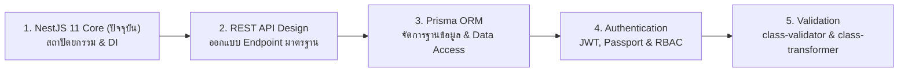

## 1. ข้อผิดพลาดที่พบบ่อย (Anti-patterns)

ในการพัฒนาระบบด้วย NestJS ทีมพัฒนามักตกหลุมพรางทางสถาปัตยกรรม 6 ประการนี้บ่อยที่สุด:

### 1. God Service / Fat Controller
- **ปัญหา**: เขียน Controller หรือ Service เดียวที่มีขนาดยาวหลายพันบรรทัด ทำหน้าที่ทุกอย่างตั้งแต่เช็คสต็อกเนื้อ, คำนวณภาษี, จัดการไฟล์รูปภาพ, ยันส่งอีเมล
- **วิธีแก้**: ยึดหลัก **Single Responsibility Principle (SRP)** แตก Service ออกเป็นส่วนย่อย เช่น `MeatInventoryService`, `TaxService`, `NotificationService`

### 2. การใช้ Request Scope พร่ำเพรื่อ (Scope Abuse)
- **ปัญหา**: ประกาศ Provider เป็น `Scope.REQUEST` เพียงเพื่อต้องการอ่าน IP ของลูกค้าใน Service ส่งผลให้เกิด Cascading Effect จนระบบช้าลงทั้งยวง
- **วิธีแก้**: คง Provider ไว้เป็น Singleton ตามปกติ และส่งข้อมูล IP หรือ User Context ผ่านทางพารามิเตอร์ของฟังก์ชันแทน

### 3. การใช้งาน `@Global()` มากเกินไป
- **ปัญหา**: ขี้เกียจเขียน `imports: [Module]` ใน Feature Module เลยใส่ `@Global()` ให้กับทุกโมดูล
- **วิธีแก้**: ยกเลิก `@Global()` และบังคับให้ทำ Module Encapsulation นำเข้าเฉพาะสิ่งที่จำเป็น เพื่อให้โค้ดตรวจสอบความเชื่อมโยงของ Dependency ได้ง่าย

### 4. Stateful Singleton (การเก็บสถานะใน Service)
- **ปัญหา**: ประกาศตัวแปร `private currentCustomerId: string` ใน Service ที่เป็น Singleton ทำให้ข้อมูลของลูกค้าคนที่หนึ่งรั่วไปหาลูกค้าคนที่สอง
- **วิธีแก้**: Service ต้องเป็น Stateless เสมอ สถานะของคำขอจะต้องเดินทางผ่านพารามิเตอร์เท่านั้น

### 5. ลืมเปิดใช้งาน Whitelist ใน `ValidationPipe`
- **ปัญหา**: สร้าง DTO ไว้แต่ไม่ได้เปิด `whitelist: true` ทำให้แฮกเกอร์สามารถส่งฟิลด์แปลกปลอม เช่น `isVip: true` หรือ `role: 'ADMIN'` เข้ามาใน Request Body
- **วิธีแก้**: ติดตั้ง `ValidationPipe({ whitelist: true, forbidNonWhitelisted: true })` ระดับ Global เสมอ

### 6. Controller เรียกใช้งาน Database ORM โดยตรง
- **ปัญหา**: Inject `PrismaService` เข้าไปใน Controller แล้วสั่ง `prisma.order.findMany()` ตรงๆ ใน Controller Handler
- **วิธีแก้**: Controller ต้องเรียกใช้งานผ่าน Service Layer เท่านั้น เพื่อให้สามารถใส่กฎเกณฑ์ทางธุรกิจ และเขียน Unit Test จำลองได้โดยไม่ต้องต่อฐานข้อมูลจริง

---

---

## 2. Checklist สรุป

ใช้รายการตรวจสอบนี้ในการประเมินความพร้อมของโปรเจกต์ NestJS 11 ก่อนนำขึ้นใช้งานบน Production:

| หมวดหมู่ | รายการตรวจสอบ | สถานะที่แนะนำ |
| :--- | :--- | :--- |
| **Architecture** | แยกหน้าที่ระหว่าง Controller, Service และ Repository ชัดเจน | ✅ ต้องผ่าน |
| **Architecture** | มีการทำ Module Encapsulation และไม่ใช้ `@Global()` พร่ำเพรื่อ | ✅ ต้องผ่าน |
| **DI & Lifecycle** | Service ทั้งหมดเป็น Stateless และทำงานบน Default Singleton Scope | ✅ ต้องผ่าน |
| **DI & Lifecycle** | เข้าใจและจัดวางลำดับ Middleware -> Guard -> Interceptor -> Pipe ถูกต้อง | ✅ ต้องผ่าน |
| **Security** | ติดตั้ง `ValidationPipe` ระดับ Global พร้อม `whitelist: true` | ✅ ต้องผ่าน |
| **Security** | ติดตั้ง Route Protection ด้วย `Guards` และหลีกเลี่ยงการเช็คสิทธิ์ใน Controller | ✅ ต้องผ่าน |
| **Error Handling** | ติดตั้ง Global Exception Filter เพื่อจัดการรูปแบบ JSON Error และซ่อน Stack Trace | ✅ ต้องผ่าน |
| **Configuration** | ตั้งค่า `ConfigModule` พร้อม Schema Validation แบบ Fail-Fast (Zod/Joi) | ✅ ต้องผ่าน |
| **Logging** | ใช้ Structured Logger (Pino/Nest Logger) แทน `console.log()` และซ่อนข้อมูลสำคัญ | ✅ ต้องผ่าน |
| **Performance** | หลีกเลี่ยงการใช้ `@Res()` โดยตรงเพื่อรักษาความสามารถในการสลับเป็น Fastify | ✅ ต้องผ่าน |

---

---

## 3. ลำดับการเรียนที่แนะนำ และ ดูเพิ่มเติมที่

เพื่อก้าวสู่ความเป็นเลิศในสายงาน Fullstack & Backend Developer แนะนำให้ศึกษาเนื้อหาตามลำดับความเชื่อมโยงดังนี้:

### บทเรียนถัดไปที่ต้องศึกษาทันที:
- 📖 **[REST API Design](/docs/backend/rest-api)**: เรียนรู้หลักการตั้งชื่อ Endpoint, การออกแบบ HTTP Status Codes, Pagination, Filtering, และ Idempotency
- 📖 **[Prisma ORM](/docs/backend/prisma-orm)**: การเชื่อมต่อ Data Access Layer เข้ากับ PostgreSQL อย่างมีประสิทธิภาพและ Type-Safe (ดูเพิ่มเติมที่ กลุ่ม DATABASE: [PostgreSQL 16](/docs/database/postgresql))
- 📖 **[Authentication](/docs/backend/authentication)**: การออกแบบระบบรักษาความปลอดภัยและการยืนยันตัวตนสำหรับสถาปัตยกรรม NestJS (ดูเพิ่มเติมที่: [Security](/docs/backend/security))
- 📖 **[Validation](/docs/backend/validation)**: การสร้าง DTO เชิงลึกและการเขียน Custom Validators ด้วย class-validator และ class-transformer
