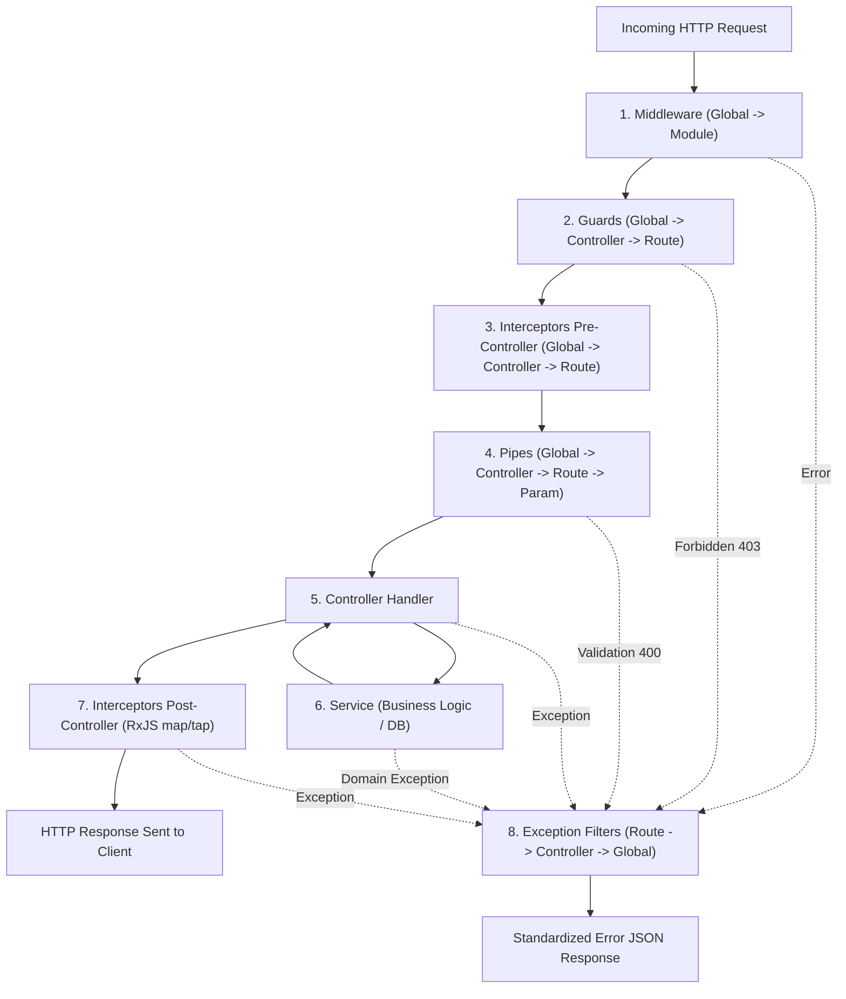

## 1. แนวคิด
ลองจินตนาการถึงเส้นทางของลูกค้าที่เดินเข้ามาซื้อเนื้อในซูเปอร์มาร์เก็ตพรีเมียม:
1. ลูกค้าเดินผ่านประตูทางเข้าและหยิบคูปอง (Middleware: บันทึก Log และแจกแจง Header)
2. เจ้าหน้าที่ รปภ. ตรวจบัตรสมาชิก VIP (Guard: ตรวจสอบสิทธิ์การเข้าถึงโซนเนื้อดรายเอจ)
3. พนักงานขายเริ่มจับเวลาและเตรียมเครื่องบันทึกเสียง (Interceptor - Pre: เตรียมประมวลผลก่อนเข้าสู่เคาน์เตอร์)
4. พนักงานตรวจสอบว่าใบรายการสั่งเนื้อระบุน้ำหนักเป็นตัวเลขและเลือกสายพันธุ์เนื้อถูกต้องหรือไม่ (Pipe: ตรวจสอบและแปลงชนิดข้อมูล DTO)
5. พนักงานเคาน์เตอร์รับออเดอร์และกดสั่งงาน (Controller: นำข้อมูลส่งต่อไปหลังร้าน)
6. เชฟแล่เนื้อชั่งน้ำหนัก ปรุงรส และแพ็กสุญญากาศ (Service: ดำเนินงาน Business Logic)
7. พนักงานนำเนื้อมาห่อกล่องของขวัญสวยงามพร้อมแนบใบเสร็จพิมพ์ลายน้ำ (Interceptor - Post: แปลงผลลัพธ์ Response ให้เป็นมาตรฐาน)
8. หากระหว่างทางเนื้อหมดหรือเครื่องรูดบัตรเสีย จะมีแผนกลูกค้าสัมพันธ์เข้ามารับเรื่องและออกใบแจ้งข้อผิดพลาดอย่างสุภาพ (Exception Filter)

นี่คือ **Request Lifecycle Pipeline** ของ NestJS 11 ซึ่งเป็นการเรียงร้อยการทำงานแบบเป็นท่อส่งน้ำ (Pipeline) ที่เคร่งครัดและคาดเดาได้อย่างแม่นยำ

## 2. หลักการเบื้องหลัง
กระบวนการทำงานถูกควบคุมโดยรอบการประมวลผลดังแผนผัง Mermaid ด้านล่างนี้:



### ลำดับความสำคัญที่ต้องจดจำขึ้นใจ:
1. **Middlewares**: ทำงานเป็นลำดับแรกเสมอตามลำดับที่ประกาศใน Module
2. **Guards**: ทำงานจากระดับ Global ➔ Controller ➔ Route Handler
3. **Interceptors (Pre-handler)**: ทำงานจากระดับ Global ➔ Controller ➔ Route Handler
4. **Pipes**: ทำงานจากระดับ Global ➔ Controller ➔ Route Handler ➔ Route Params
5. **Controller**: ดำเนินการ Method Handler
6. **Services**: ประมวลผล Logic
7. **Interceptors (Post-handler)**: ทำงานย้อนกลับจาก Route Handler ➔ Controller ➔ Global ผ่าน RxJS Observables
8. **Exception Filters**: ดักจับ Error จากทุกขั้นตอน เริ่มตรวจสอบจาก Route ➔ Controller ➔ Global

## 3. ตัวอย่างโค้ด

### ตัวอย่างที่ 1: การลงทะเบียน Lifecycle แบบครบวงจรใน `main.ts`
```typescript filename="src/main.ts"
import { NestFactory } from '@nestjs/core';
import { ValidationPipe } from '@nestjs/common';
import { AppModule } from './app.module';
import { GlobalLoggingInterceptor } from './common/interceptors/global-logging.interceptor';
import { AllExceptionsFilter } from './common/filters/all-exceptions.filter';
import { GlobalAuditMiddleware } from './common/middlewares/global-audit.middleware';

async function bootstrap() {
  const app = await NestFactory.create(AppModule);

  // 1. ลงทะเบียน Global Middleware
  app.use(new GlobalAuditMiddleware().use);

  // 2. ลงทะเบียน Global Validation Pipe สำหรับตรวจสอบ DTO ทั้งระบบ
  app.useGlobalPipes(
    new ValidationPipe({
      whitelist: true,
      forbidNonWhitelisted: true,
      transform: true,
    })
  );

  // 3. ลงทะเบียน Global Interceptor สำหรับจับเวลาและจัดฟอร์แมต Response
  app.useGlobalInterceptors(new GlobalLoggingInterceptor());

  // 4. ลงทะเบียน Global Exception Filter สำหรับดักจับ Error ทั่วทั้งระบบ
  app.useGlobalFilters(new AllExceptionsFilter());

  await app.listen(3000);
}
bootstrap();
```

### ตัวอย่างที่ 2: Controller ที่ประกอบด้วย Guards, Interceptors, และ Pipes
```typescript filename="src/modules/orders/orders.controller.ts"
import {
  Controller,
  Post,
  Body,
  UseGuards,
  UseInterceptors,
  UsePipes,
  ParseUUIDPipe,
  Param,
} from '@nestjs/common';
import { JwtAuthGuard } from '../../common/guards/jwt-auth.guard';
import { RolesGuard } from '../../common/guards/roles.guard';
import { Roles } from '../../common/decorators/roles.decorator';
import { BenchmarkInterceptor } from '../../common/interceptors/benchmark.interceptor';
import { OrdersService } from './orders.service';
import { CreateOrderDto } from './dto/create-order.dto';

@Controller('orders')
@UseGuards(JwtAuthGuard, RolesGuard) // ลำดับที่ 2: รัน Guards ระดับ Controller
@UseInterceptors(BenchmarkInterceptor) // ลำดับที่ 3: รัน Interceptors Pre
export class OrdersController {
  constructor(private readonly ordersService: OrdersService) {}

  @Post(':meatCutId/reserve')
  @Roles('BUTCHER_CHEF', 'MARKET_ADMIN') // กำหนดสิทธิ์เฉพาะระดับ Route
  reserveSpecialMeatCut(
    // ลำดับที่ 4: ParseUUIDPipe ทำงานตรวจสอบ Parameter เฉพาะจุด
    @Param('meatCutId', ParseUUIDPipe) meatCutId: string,
    @Body() dto: CreateOrderDto
  ) {
    // ลำดับที่ 5 & 6: เข้าสู่ Controller และ Service
    return this.ordersService.reserveCut(meatCutId, dto);
  }
}
```

## 4. ผิด vs ถูก

```typescript filename="src/nestjs.ts"
// ❌ ผิด: พยายามใช้ Middleware ตรวจสอบ JWT Token และคืนค่า 403 Forbidden
export class BadJwtMiddleware implements NestMiddleware {
  use(req: any, res: any, next: () => void) {
    const token = req.headers['authorization'];
    if (!token) {
      // ❌ ผิด: Middleware ไม่มี ExecutionContext ไม่รู้ว่า Route Handler นี้อนุญาตแบบ Public หรือไม่
      return res.status(403).json({ message: 'Forbidden' });
    }
    next();
  }
}
```

```typescript filename="src/nestjs.ts"
// ✅ ถูก: ใช้ Guard สำหรับการตรวจสอบสิทธิ์ เพราะสามารถอ่าน Metadata (@Public()) ผ่าน Reflector ได้
@Injectable()
export class GoodJwtGuard implements CanActivate {
  constructor(private reflector: Reflector) {}

  canActivate(context: ExecutionContext): boolean {
    const isPublic = this.reflector.getAllAndOverride<boolean>(IS_PUBLIC_KEY, [
      context.getHandler(),
      context.getClass(),
    ]);
    if (isPublic) return true; // ✅ ข้ามการตรวจสิทธิ์หากติดแท็ก @Public() ไว้ที่ Controller/Action
    
    const request = context.switchToHttp().getRequest();
    return validateJwt(request);
  }
}
```

## 5. ควรใช้เมื่อไหร่ / ไม่ควรใช้เมื่อไหร่
- **Middleware**: ใช้กับงานระดับ Low-level HTTP Protocol (เช่น CORS, Helmet, Compression, Request ID Injection, Cookie Parsing)
- **Guards**: ใช้กับ Authentication, Role Authorization, Permissions
- **Interceptors**: ใช้กับการจับเวลา (Metrics), การแปลงโครงสร้าง Response (Response Envelope), Caching, Timeout
- **Pipes**: ใช้กับการแปลง Type (Type Coercion) และการ Validate โครงสร้าง Body/Query/Param ตาม DTO
- **Exception Filters**: ใช้กับการดักจับและจัดระเบียบ Error Responses ส่งกลับ Client

## 6. คำถามสัมภาษณ์
**ถาม**: หากใน Route Handler มีทั้ง Guard, Pipe และ Interceptor หาก Guard คืนค่าเป็น `false` จะมีส่วนประกอบใดใน Pipeline ถูกเรียกทำงานต่อหรือไม่?
**ตอบ**: จะไม่มี Pipe หรือ Controller Method Handler ใดๆ ถูกเรียกทำงานต่อเลย เพราะ Guard จะโยน `ForbiddenException` (403) ออกมาทันที และ Request จะถูกส่งข้ามไปยัง **Exception Filter** เพื่อส่ง Response ข้อผิดพลาดกลับไปยังผู้ใช้งานทันที

---
