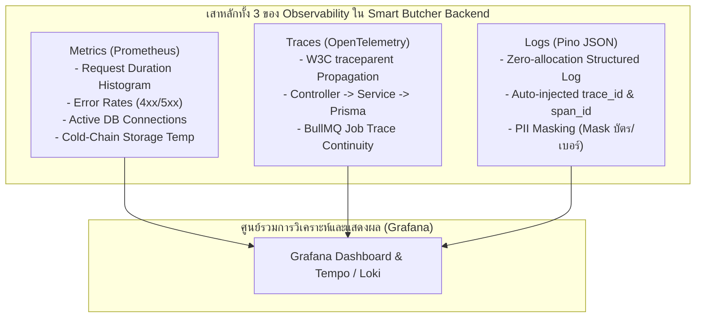
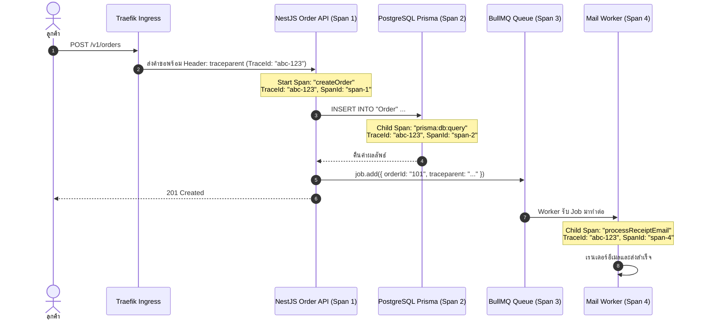

# Observability

ในระบบกระจายตัว (Distributed Systems) ระดับองค์กรของ **Smart Butcher Marketplace** ที่มีการประมวลผลคำสั่งซื้อเนื้อวากิวพรีเมียม การตัดสต็อกแบบเรียลไทม์ การเชื่อมต่อ Payment Gateway และการติดตามอุณหภูมิตู้แช่เนื้อ Cold Chain (0°C – 4°C) ตลอด 24 ชั่วโมง การรู้เพียงแค่ว่าระบบ "ยังเปิดอยู่ (Up/Down)" ไม่เพียงพออีกต่อไปเมื่อเกิดปัญหาช้าหรือคำสั่งซื้อค้าง

วิศวกรระดับ Senior Principal Architect ต้องวางโครงสร้าง **การสังเกตการณ์ระบบเชิงลึก (Observability)** ที่สมบูรณ์แบบ เพื่อให้สามารถตอบคำถามที่ไม่เคยคาดคิดมาก่อน (Unknown-Unknowns) ได้อย่างรวดเร็ว โดยอาศัย **เสาหลักทั้ง 3 ของ Observability (The Three Pillars)**:
1. **Metrics**: ตัวเลขทางสถิติที่รวมรวมได้ด้วย **Prometheus (`prom-client`)** เพื่อตอบว่า *"ระบบมีอาการผิดปกติเกิดขึ้นตรงไหน เมื่อไหร่?"*
2. **Traces**: เส้นทางการเดินทางของคำขอผ่าน **OpenTelemetry (OTel)** ข้าม Services และ Background Workers เพื่อตอบว่า *"คอขวดของความช้า (Latency Bottleneck) หรือจุดที่พังอยู่ลึกในฟังก์ชันใด?"*
3. **Logs**: บันทึกเหตุการณ์แบบมีโครงสร้าง JSON ผ่าน **Pino (`pino-http`)** ที่ผูกโยงเข้ากับ `trace_id` เดียวกัน เพื่อตอบว่า *"เกิดบริบทและรายละเอียดข้อผิดพลาดอะไรขึ้นในระดับบรรทัดโค้ด?"*

---

## 1. แนวคิด (Concept)

### 1.1 Monitoring vs Observability
ความแตกต่างเชิงสถาปัตยกรรมระหว่าง Monitoring ทั่วไปกับการสังเกตการณ์ระบบเชิงลึก (Observability):

- **Traditional Monitoring (การตรวจติดตามแบบดั้งเดิม)**: ตรวจสอบสิ่งที่เรา "คาดการณ์ได้ล่วงหน้า (Known-Knowns)" เช่น เช็กว่า CPU เกิน 80% หรือไม่ หรือ RAM เต็มหรือยัง ซึ่งบอกได้แค่ว่าระบบป่วย แต่ไม่สามารถบอกสาเหตุที่แท้จริงได้
- **Observability (ความสามารถในการสังเกตการณ์เชิงลึก)**: การวัดสถานะภายในของระบบ (Internal State) ผ่านข้อมูล Telemetry ภายนอก ทำให้เราสามารถวินิจฉัยปัญหาที่ไม่เคยพบมาก่อน (Unknown-Unknowns) เช่น *"ทำไมคำสั่งซื้อเนื้อ Dry-Aged ในจังหวัดเชียงใหม่ช่วง 12:00 ถึง 12:05 น. จึงใช้เวลาชำระเงินนานกว่าปกติ 6 วินาที?"*



### 1.2 วิธีการวัดผลระดับสากล: RED Method และ Golden Signals
การเก็บ Metrics ของระบบ Backend ใน NestJS 11 ถูกออกแบบตามมาตรฐาน **RED Method** ซึ่งเป็นแนวปฏิบัติที่ดีที่สุดสำหรับบริการที่ใช้สถาปัตยกรรม Microservices และ REST API:
- **Rate (อัตราการเรียกใช้)**: จำนวนคำขอต่อวินาที (Requests Per Second - RPS) ที่เข้ามายัง API คำสั่งซื้อเนื้อ
- **Errors (อัตราข้อผิดพลาด)**: จำนวนคำขอที่ส่งผลลัพธ์ล้มเหลว (โดยเฉพาะ HTTP 5xx Server Errors)
- **Duration (ระยะเวลาประมวลผล)**: เวลาที่ใช้ในการประมวลผลคำขอ โดยวัดในรูปของ **Percentiles (p50, p95, p99)** ผ่าน Histogram เพื่อตรวจจับอาการช้าเฉพาะกลุ่มผู้ใช้ (Tail Latency)

<Callout type="warning" title="ภัยเงียบจาก High Cardinality ใน Prometheus Metrics">
ห้ามใส่ข้อมูลที่มีค่าแปรผันไม่จำกัด (High Cardinality) เข้าไปใน Label ของ Prometheus เด็ดขาด เช่น `order_id`, `user_uuid`, `credit_card_token` หรือ `timestamp` เพราะ Prometheus จัดเก็บ Metric แต่ละชุดของ Label เป็น Time-series แยกต่างหากในหน่วยความจำ RAM หากมี Label ที่มีค่านับล้านค่า จะทำให้ Prometheus TSDB เกิดภาวะ Out of Memory (OOM) และล่มสลายทั้งระบบทันที!
</Callout>

---

## 2. หลักการเบื้องหลัง (Under the Hood)

### 2.1 กลไกการส่งผ่านบริบทการติดตาม (Context Propagation) ข้ามระบบ
เมื่อผู้ใช้ส่งคำขอสั่งซื้อเนื้อวากิว คำขอนั้นจะเดินทางผ่านหลายระบบ (HTTP Request → NestJS API → Prisma PostgreSQL → BullMQ Queue → External Omise API)

**OpenTelemetry** ทำงานโดยการส่งผ่าน Header มาตรฐานขององค์กร **W3C Trace Context**:
- `traceparent`: เช่น `00-4bf92f3577b34da6a3ce929d0e0e4736-00f067aa0ba902b7-01`
  - `00`: Version ของมาตรฐาน W3C
  - `4bf92f3577b34da6a3ce929d0e0e4736`: **Trace ID** ประจำคำขอนี้ (มีค่าเดียวกันตลอดทั้งเส้นทาง)
  - `00f067aa0ba902b7`: **Parent Span ID** ของส่วนงานก่อนหน้า
  - `01`: Trace Flags (กำหนดว่าให้ทำการสุ่มเก็บข้อมูล / Sampled หรือไม่)

เมื่อ Background Worker ใน BullMQ หย่อนงานลง Redis และหยิบงานขึ้นมาทำ OpenTelemetry จะทำการสกัด (Extract) และฉีด (Inject) ค่า `traceparent` นี้ข้ามผ่าน Redis Job Metadata ทำให้กราฟ Distributed Tracing บน Grafana Tempo แสดงผลเชื่อมโยงกันอย่างไร้รอยต่อ



### 2.2 โครงสร้าง Logging ประสิทธิภาพสูงด้วย Pino
การใช้ `console.log()` ใน Node.js มีข้อเสียร้ายแรง 2 ประการ:
1. การทำงานเป็นแบบ Synchronous ซึ่งจะหยุดการทำงานของ Event Loop ชั่วขณะเมื่อมี Log ปริมาณมหาศาล
2. ข้อความเป็นแบบ Plaintext Unstructured ทำให้การ Query ค้นหาข้อผิดพลาดในระบบจัดเก็บ Log (เช่น Grafana Loki หรือ ElasticSearch) เป็นไปได้ยากและช้า

**Pino** เป็น JSON Logger ความเร็วสูงที่ใช้เทคนิค Fast String Serialization และ Zero-allocation ช่วยให้เซิร์ฟเวอร์สามารถสร้าง Log รูปแบบ JSON ได้นับแสนบรรทัดต่อวินาทีโดยไม่กระทบต่อประสิทธิภาพของ API

---

## 3. ตัวอย่างโค้ด (Smart Butcher Marketplace)

### ตัวอย่างที่ 1: การตั้งค่า OpenTelemetry SDK Auto-Instrumentation ก่อน Bootstrap Application

ไฟล์นี้ต้องถูกโหลดขึ้นมาทำงานก่อนทุกโมดูลในระบบ (Node.js Preload) เพื่อให้ SDK สามารถ Hook และดักจับ Instrumentation ข้ามโมดูล HTTP, Express, Prisma, และ Redis ได้อย่างสมบูรณ์:

```typescript filename="src/instrumentation.ts"
import { NodeSDK } from '@opentelemetry/sdk-node';
import { getNodeAutoInstrumentations } from '@opentelemetry/auto-instrumentations-node';
import { OTLPTraceExporter } from '@opentelemetry/exporter-trace-otlp-http';
import { Resource } from '@opentelemetry/resources';
import { SemanticResourceAttributes } from '@opentelemetry/semantic-conventions';
import { PrismaInstrumentation } from '@prisma/instrumentation';
import { diag, DiagConsoleLogger, DiagLogLevel } from '@opentelemetry/api';

// เปิด Debug Log ของ OpenTelemetry เฉพาะเมื่อพัฒนาในเครื่อง
if (process.env.NODE_ENV !== 'production') {
  diag.setLogger(new DiagConsoleLogger(), DiagLogLevel.INFO);
}

// กำหนด Exporter ส่งข้อมูล Traces ผ่านโปรโตคอล OTLP ไปยัง Grafana Tempo / OpenTelemetry Collector
const traceExporter = new OTLPTraceExporter({
  url: process.env.OTEL_EXPORTER_OTLP_ENDPOINT || 'http://localhost:4318/v1/traces',
  headers: {},
});

export const otelSDK = new NodeSDK({
  resource: new Resource({
    [SemanticResourceAttributes.SERVICE_NAME]: 'smart-butcher-backend',
    [SemanticResourceAttributes.SERVICE_VERSION]: '1.0.0',
    [SemanticResourceAttributes.DEPLOYMENT_ENVIRONMENT]: process.env.NODE_ENV || 'production',
  }),
  traceExporter,
  instrumentations: [
    // Auto-instrumentation พื้นฐานสำหรับ HTTP, Express, DNS, FS
    getNodeAutoInstrumentations({
      '@opentelemetry/instrumentation-fs': {
        enabled: false, // ปิด File System Tracing เพื่อลด Overhead
      },
      '@opentelemetry/instrumentation-http': {
        ignoreIncomingRequestHook: (req) => {
          // ไม่ต้องสร้าง Span สำหรับ Health Check และ Metrics Scrape
          return req.url === '/health' || req.url === '/metrics';
        },
      },
    }),
    // Prisma ORM Tracing สำหรับดูความเร็วและ Query ของ PostgreSQL แต่ละคำสั่ง
    new PrismaInstrumentation(),
  ],
});

// เริ่มต้นการทำงานของ OpenTelemetry SDK
otelSDK.start();

// จัดการ Graceful Shutdown เมื่อ Container ถูกสั่งปิดการทำงาน
process.on('SIGTERM', () => {
  otelSDK
    .shutdown()
    .then(() => console.log('OpenTelemetry SDK terminated gracefully'))
    .catch((err) => console.error('Error terminating OpenTelemetry SDK', err))
    .finally(() => process.exit(0));
});
```

---

### ตัวอย่างที่ 2: การสร้าง Business & Technical Metrics Service ด้วย `prom-client`

Service นี้ทำหน้าที่เก็บตัวเลขชี้วัดทางเทคนิคและทางธุรกิจ เช่น ระยะเวลาของคำขอ (Histogram), จำนวนการสั่งซื้อเนื้อแยกตามประเภทชิ้นเนื้อ (Counter), และอุณหภูมิตู้แช่เย็นเนื้อวากิว (Gauge):

```typescript filename="src/observability/metrics.service.ts"
import { Injectable } from '@nestjs/common';
import { Registry, Counter, Histogram, Gauge, collectDefaultMetrics } from 'prom-client';

@Injectable()
export class MetricsService {
  private readonly registry: Registry;

  // 1. Technical Metric: HTTP Request Duration Histogram (RED Method)
  public readonly httpRequestDurationSeconds: Histogram<string>;

  // 2. Business Metric: จำนวนคำสั่งซื้อเนื้อสำเร็จ แยกตามเกรดและชนิดเนื้อ
  public readonly meatOrdersTotal: Counter<string>;

  // 3. IoT & Logistics Metric: อุณหภูมิตู้แช่เนื้อ Cold-Chain ปัจจุบัน (องศาเซลเซียส)
  public readonly meatColdStorageTemperatureCelsius: Gauge<string>;

  // 4. Financial Metric: ยอดขายรวม (บาท)
  public readonly revenueTotalThb: Counter<string>;

  constructor() {
    this.registry = new Registry();

    // รวบรวม System Metrics พื้นฐานอัตโนมัติ (CPU, Memory Heap, Event Loop Lag, GC)
    collectDefaultMetrics({ register: this.registry, prefix: 'node_' });

    // กำหนด HTTP Duration Histogram พร้อม Bucket วินาทีที่ปรับจูนสำหรับระบบ API
    this.httpRequestDurationSeconds = new Histogram({
      name: 'http_request_duration_seconds',
      help: 'Duration of HTTP requests in seconds across API endpoints',
      labelNames: ['method', 'route', 'status_code'],
      buckets: [0.01, 0.05, 0.1, 0.25, 0.5, 1, 2, 5], // 10ms จนถึง 5s
      registers: [this.registry],
    });

    // กำหนด Counter สำหรับการสั่งซื้อเนื้อ
    this.meatOrdersTotal = new Counter({
      name: 'smart_butcher_meat_orders_total',
      help: 'Total count of premium meat orders processed',
      labelNames: ['cut_type', 'meat_grade', 'payment_method', 'status'],
      registers: [this.registry],
    });

    // กำหนด Gauge สำหรับวัดอุณหภูมิห้องบ่มเนื้อและตู้แช่แข็ง
    this.meatColdStorageTemperatureCelsius = new Gauge({
      name: 'smart_butcher_cold_storage_temp_celsius',
      help: 'Real-time temperature telemetry for cold chain meat storage units',
      labelNames: ['facility_id', 'room_type'],
      registers: [this.registry],
    });

    // กำหนด Counter รายได้รวม
    this.revenueTotalThb = new Counter({
      name: 'smart_butcher_revenue_total_thb',
      help: 'Total revenue generated from meat sales in THB',
      labelNames: ['currency'],
      registers: [this.registry],
    });
  }

  /**
   * คืนค่า Metrics ทั้งหมดในฟอร์แมต Plaintext สำหรับให้ Prometheus มาขูดข้อมูล (Scrape)
   */
  async getMetrics(): Promise<string> {
    return this.registry.metrics();
  }

  /**
   * คืนค่า Content-Type สำหรับ Prometheus Scraper
   */
  getContentType(): string {
    return this.registry.contentType;
  }

  /**
   * Helper บันทึกคำสั่งซื้อเนื้อวากิวสำเร็จ
   */
  recordOrderSuccess(cutType: string, grade: string, paymentMethod: string, amountThb: number): void {
    this.meatOrdersTotal.inc({
      cut_type: cutType,
      meat_grade: grade,
      payment_method: paymentMethod,
      status: 'SUCCESS',
    });
    this.revenueTotalThb.inc({ currency: 'THB' }, amountThb);
  }

  /**
   * Helper อัปเดตอุณหภูมิตู้แช่เย็นเนื้อ
   */
  updateStorageTemperature(facilityId: string, roomType: 'DRY_AGING_CHAMBER' | 'WAGYU_FREEZER', temperature: number): void {
    this.meatColdStorageTemperatureCelsius.set({ facility_id: facilityId, room_type: roomType }, temperature);
  }
}
```

และ Controller สำหรับเปิด Endpoint `/metrics` ให้เซิร์ฟเวอร์ Prometheus เข้ามาดึงข้อมูล:

```typescript filename="src/observability/metrics.controller.ts"
import { Controller, Get, Res } from '@nestjs/common';
import { Response } from 'express';
import { MetricsService } from './metrics.service';

@Controller('metrics')
export class MetricsController {
  constructor(private readonly metricsService: MetricsService) {}

  @Get()
  async getMetrics(@Res() res: Response): Promise<void> {
    res.setHeader('Content-Type', this.metricsService.getContentType());
    const metricsData = await this.metricsService.getMetrics();
    res.send(metricsData);
  }
}
```

---

### ตัวอย่างที่ 3: Structured Logging ด้วย Pino ร่วมกับ OpenTelemetry Trace Correlation

การคอนฟิก `nestjs-pino` เพื่อให้ทุกบรรทัดของ Log ดึงค่า `trace_id` และ `span_id` จาก Context ของ OpenTelemetry โดยอัตโนมัติ พร้อมทั้งซ่อนข้อมูลบัตรเครดิตและรหัสผ่านของลูกค้า:

```typescript filename="src/observability/logger.config.ts"
import { Params } from 'nestjs-pino';
import { trace, context } from '@opentelemetry/api';
import { IncomingMessage } from 'http';

export const pinoLoggerOptions: Params = {
  pinoHttp: {
    level: process.env.LOG_LEVEL || 'info',
    // ปิด Pretty Print ใน Production เพื่อให้ Log ออกมาเป็น JSON บรรทัดเดียว เหมาะสำหรับ Grafana Loki
    transport:
      process.env.NODE_ENV !== 'production'
        ? {
            target: 'pino-pretty',
            options: {
              colorize: true,
              singleLine: true,
              translateTime: 'SYS:yyyy-mm-dd HH:MM:ss',
            },
          }
        : undefined,
    // สกัดค่า Trace ID และ Span ID จาก Active Span ของ OpenTelemetry ใส่ลงในทุก Log
    customProps: (req: IncomingMessage) => {
      const activeSpan = trace.getSpan(context.active());
      if (!activeSpan) {
        return {};
      }
      const spanContext = activeSpan.spanContext();
      return {
        trace_id: spanContext.traceId,
        span_id: spanContext.spanId,
        trace_flags: spanContext.traceFlags,
      };
    },
    // ซ่อนข้อมูลสำคัญของลูกค้า (Data Redaction / PII Masking)
    redact: {
      paths: [
        'req.headers.authorization',
        'req.headers.cookie',
        'req.body.password',
        'req.body.cardToken',
        'req.body.cvv',
        'req.body.customerPhone',
      ],
      censor: '***[CONFIDENTIAL_PII]***',
    },
    // กำหนด Custom Serializer ให้แสดงเฉพาะข้อมูลที่จำเป็น
    serializers: {
      req: (req) => ({
        id: req.id,
        method: req.method,
        url: req.url,
      }),
      res: (res) => ({
        statusCode: res.statusCode,
      }),
    },
  },
};
```

---

## 4. ข้อผิดพลาดที่พบบ่อย (Anti-pattern vs Best Practice)

### 4.1 Anti-pattern: การใช้ `console.log` ข้อความดิบๆ ในระบบ Production
```typescript
// ❌ ผิดมหันต์: ข้อความไม่มีโครงสร้าง ไม่รู้ว่าคำขอมาจาก Trace ไหน และทำให้ Event Loop ช้า
console.log(`Order processed for customer: ${user.email} with total: ${order.amount}`);
```

**แนวทางที่ถูกต้อง (Best Practice)**:
ใช้ Structured JSON Logger ที่ผูก `trace_id` และพิมพ์ข้อมูลในรูปของ Object:

```typescript
//  ถูกต้อง: ค้นหาใน Loki ได้ทันทีด้วย `{app="smart-butcher"} | json | trace_id="abc-123"`
this.logger.log({
  msg: 'Order processed successfully',
  orderId: order.id,
  cutType: 'Miyazaki Wagyu A5 Ribeye',
  totalAmountThb: order.amount,
});
```

### 4.2 Anti-pattern: การใช้ Metric Histogram Buckets ไม่สอดคล้องกับพฤติกรรมของ API
การใช้ค่า Bucket เริ่มต้นของ Prometheus ทั่วไป (เช่น `[0.005, 0.01, 0.025, 0.05, 0.1, 0.25, 0.5, 1, 2.5, 5, 10]`) กับระบบที่คาดหวังความเร็วระดับ Milliseconds จะทำให้ไม่สามารถแยกแยะความแตกต่างระหว่างคำขอที่ใช้เวลา 200ms กับ 500ms ได้อย่างละเอียด

**แนวทางที่ถูกต้อง (Best Practice)**:
ปรับแต่ง Buckets ให้สอดคล้องกับข้อกำหนด Service Level Objective (SLO) ขององค์กร เช่น หาก SLO กำหนดว่า API สั่งซื้อเนื้อต้องตอบกลับภายใน 250ms ให้ตั้ง Buckets ที่ละเอียดรอบจุด 250ms

### 4.3 Anti-pattern: การเปิด Tracing สุ่มเก็บ 100% (Sampling Rate 100%) ในระบบ High Traffic
การส่ง Trace ข้อมูลทุกคำขอของระบบที่มีผู้ใช้งานหลายแสนคนจะทำให้สิ้นเปลืองแบนด์วิดท์เครือข่ายและค่าพื้นที่จัดเก็บข้อมูลบน Grafana Tempo หรือ Cloud Storage อย่างมหาศาล

**แนวทางที่ถูกต้อง (Best Practice)**:
ใช้ **Probabilistic Sampling** หรือ **Tail-based Sampling** โดยสุ่มเก็บคำขอปกติเพียง 5% แต่หากคำขอนั้นมีข้อผิดพลาด (HTTP 5xx) หรือใช้เวลานานเกินกว่า 1 วินาที ให้บังคับเก็บ Trace นั้นไว้ 100% เต็ม

---

## 5. ควรใช้เมื่อไหร่ และ ไม่ควรใช้เมื่อไหร่

### ควรใช้สถาปัตยกรรมนี้เมื่อ:
1. **ระบบเป็น Microservices หรือแยก Service กับ Background Worker**: เมื่อคำขอต้องกระโดดข้ามระหว่าง NestJS API, PostgreSQL, Redis, BullMQ และ External APIs การมี Distributed Tracing เป็นทางเดียวที่จะระบุจุดช้าได้
2. **ระบบมีข้อตกลงระดับการให้บริการ (SLA / SLO)**: ธุรกิจเนื้อพรีเมียมต้องการรับประกันว่าระบบสั่งซื้อต้องเปิดให้บริการ 99.9% ของเวลาทั้งหมด และคำขอ 95% ต้องใช้เวลาต่ำกว่า 300ms
3. **ระบบต้องการความสามารถในการแกะรอยข้อผิดพลาดแบบ Real-time**: สามารถคลิกจากจุด Error Spikes บนกราฟ Grafana เข้าไปยัง Trace ID และกระโดดข้ามไปยังบรรทัด Log ที่เกิด Exception ได้ทันทีในคลิกเดียว

### สิ่งที่ไม่ควรทำ (ข้อยกเว้นที่ต้องระวัง):
1. **อย่าส่ง Log ข้อมูลความลับทางการเงินหรือรหัสผ่าน**: ข้อมูลหมายเลขบัตรเครดิต รหัส CVV หรือ Token ความลับ ห้ามหลุดเข้าไปในระบบ Log โดยเด็ดขาด มิฉะนั้นจะผิดกฎหมายคุ้มครองข้อมูลส่วนบุคคล (PDPA) และมาตรฐาน PCI-DSS
2. **อย่าเก็บ Metric ในระดับ Per-User หรือ Per-Order**: Metric มีไว้ดูภาพรวมเชิงสถิติ (Aggregate Data) ไม่ใช่ที่สำหรับเก็บประวัติคำสั่งซื้อรายคน

---

## 6. คำถามสัมภาษณ์งาน (Interview Q&A)

### Q1: OpenTelemetry ทำการส่งผ่านบริบทการติดตาม (Context Propagation) ข้ามระบบระหว่าง HTTP Request แบบ Synchronous ไปยัง Background Worker ใน BullMQ (Asynchronous Job บน Redis) ได้อย่างไร?
> **แนวคำตอบระดับ Principal Architect:**
> 1. **Context Extraction & Injection API**: OpenTelemetry มีมาตรฐาน `propagation.inject()` และ `propagation.extract()` ที่เป็นกลาง
> 2. **Producer Side (HTTP Controller)**: เมื่อคำขอสร้าง Order เข้ามาใน NestJS Controller ตัว OpenTelemetry จะมี Active Context อยู่ในหน่วยความจำ ก่อนที่ Producer จะหย่อน Job ลงคิว BullMQ เราจะดึงค่าจาก Active Context ผ่าน `propagation.inject(context.active(), jobPayload.headers)` ซึ่งจะแปลง `traceparent` (Trace ID + Span ID ปัจจุบัน) เป็น Object เล็กๆ แนบไปกับข้อมูล Job ใน Redis
> 3. **Consumer Side (BullMQ Worker)**: เมื่อ Worker หยิบ Job ขึ้นมาประมวลผล ตัว Worker จะเรียก `propagation.extract(ROOT_CONTEXT, job.data.headers)` เพื่อกู้คืน Context เดิมขึ้นมา และเริ่มต้น Span ใหม่ภายใต้ Parent Context นั้น
> 4. **ผลลัพธ์**: บน Grafana Tempo เราจะเห็น Gantt Chart ที่เริ่มต้นจากจังหวะที่ลูกค้ากดสั่งซื้อผ่าน HTTP ไปจนถึงแท่งเวลาที่ Worker หยิบ Job ไปส่งอีเมล แม้ว่าทั้งสองกระบวนการจะเกิดขึ้นต่างเวลากันหลายวินาทีและรันอยู่คนละโปรเซสก็ตาม

### Q2: อธิบายความแตกต่างระหว่าง Prometheus Histogram กับ Summary ในเชิงสถาปัตยกรรม และเหตุใดในระบบ Production ขนาดใหญ่ที่มีหลาย Pods จึงนิยมใช้ Histogram ในการคำนวณ Percentiles (p95, p99) มากกว่า Summary?
> **แนวคำตอบระดับ Principal Architect:**
> - **Summary**: คำนวณค่า Quantiles (เช่น φ=0.95, 0.99) **ที่ฝั่ง Client (ภายในโปรเซส Node.js)** โดยตรง ข้อดีคือให้ค่าที่แม่นยำมากสำหรับโปรเซสนั้นๆ แต่ข้อเสียร้ายแรงคือ **ไม่สามารถนำข้อมูลมารวมกันข้าม Pods (Aggregatable) ได้** ทางคณิตศาสตร์เราไม่สามารถนำค่าเฉลี่ยของ p99 จาก 10 เซิร์ฟเวอร์มาหาค่าเฉลี่ยรวมกันเป็น p99 ของทั้งคลัสเตอร์ได้
> - **Histogram**: บันทึกข้อมูลเป็นจำนวนนับในช่องช่วงเวลา (Buckets) เช่น นับว่ามีกี่คำขอที่เร็วกว่า 100ms, 250ms, 500ms ข้อมูลที่ส่งออกไปคือ Counter ดิบๆ
> - **เหตุผลที่สถาปัตยกรรมระดับองค์กรเลือก Histogram**:
>   1. **Server-side Aggregation**: บน Grafana เราสามารถใช้ฟังก์ชัน `histogram_quantile(0.99, sum(rate(http_request_duration_seconds_bucket[5m])) by (le))` รวม Buckets จากทุก Pods ในระบบเข้าด้วยกัน แล้วให้เซิร์ฟเวอร์ Prometheus เป็นผู้คำนวณ p99 รวมของทั้งระบบได้อย่างถูกต้องสมบูรณ์
>   2. **CPU Overhead ต่ำกว่าที่ Node.js**: ตัวแอปพลิเคชันเพียงแค่เพิ่มค่า Counter ใน Array ของ Buckets ซึ่งกิน CPU ต่ำมาก ต่างจาก Summary ที่ต้องรันอัลกอริทึมคำนวณการกระจายตัว (Streaming Quantiles) ในหน่วยความจำของ Node.js

---

## ลำดับการเรียนที่แนะนำ และ ดูเพิ่มเติมที่

เพื่อความเชี่ยวชาญด้านการดูแลความเสถียรของระบบระดับ Production ขอแนะนำให้ศึกษาหัวข้อต่อไปนี้:

1. การทำ Structured Logging ขั้นสูงใน NestJS: [Enterprise Logging Guide](/docs/backend/nestjs/enterprise-logging)
2. การสร้าง Endpoint ตรวจสุขภาพระบบ: [Health Checks & Readiness Probes](/docs/backend/nestjs/health-check)
3. มาตรฐานความปลอดภัยและป้องกันช่องโหว่: [Enterprise Security Architecture](/docs/backend/security)
4. การรันระบบบนคอนเทนเนอร์ระดับ Production: [Docker Architecture](/docs/backend/docker)
5. สถาปัตยกรรม RESTful API มาตรฐานสากล: [REST API Best Practices](/docs/backend/rest-api)
