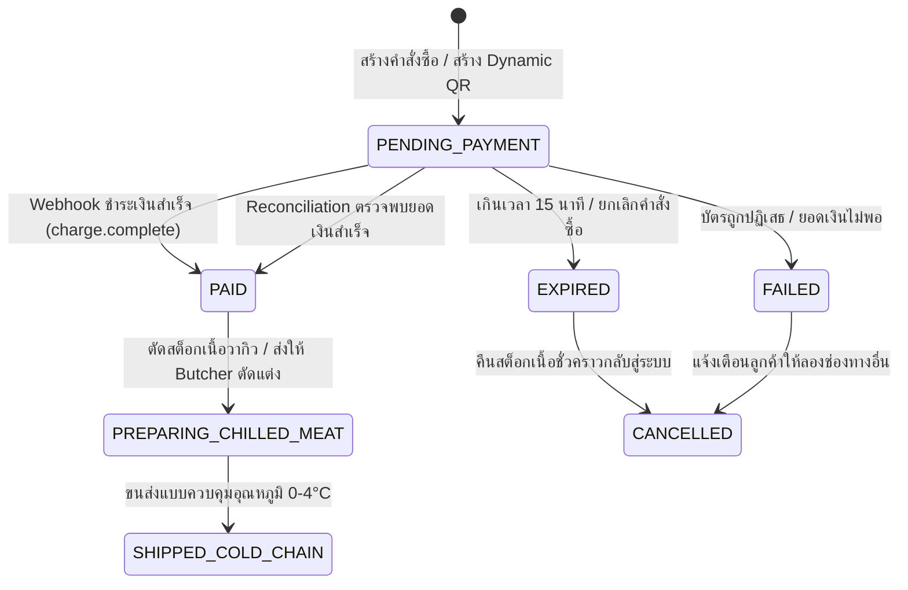
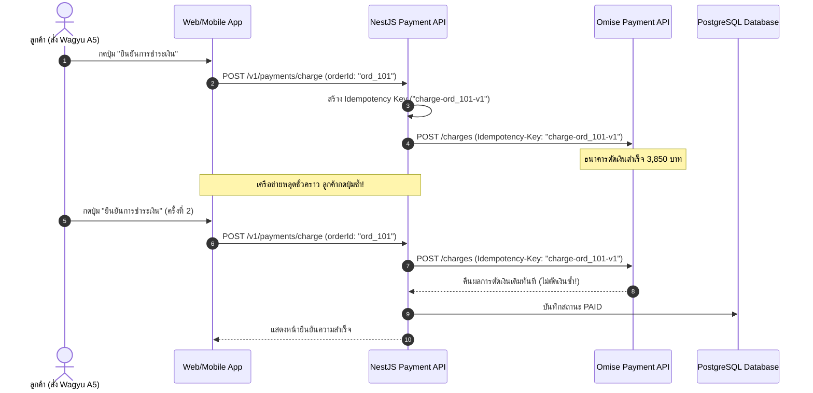

# Payment Gateway

ในระบบการค้าอีคอมเมิร์ซเนื้อเกรดพรีเมียมอย่าง **Smart Butcher Marketplace** ความถูกต้อง รวดเร็ว และความน่าเชื่อถือของการประมวลผลธุรกรรมทางการเงินเป็นหัวใจสำคัญสูงสุด ลูกค้าที่สั่งซื้อเนื้อวากิวญี่ปุ่น Miyazaki A5 หรือเนื้อบ่มพิเศษ Dry-Aged 45 Days มักมีมูลค่าต่อบิลสูง (High-ticket transactions ตั้งแต่หลักพันถึงหลักหมื่นบาท) ระบบจึงต้องรองรับทั้งการชำระเงินผ่าน **PromptPay Dynamic QR Code** ที่ระบุยอดเงินตรงตามสตางค์และมีเวลาหมดอายุแม่นยำ รวมถึงการตัดบัตรเครดิต/เดบิตผ่านระบบ **Tokenization** ตามมาตรฐานความปลอดภัย **PCI-DSS Level 1**

การออกแบบระบบ Payment ในระดับ Senior Principal Architect ต้องคำนึงถึงความทนทานต่อสภาวะเครือข่ายขัดข้อง ป้องกันการตัดเงินซ้ำซ้อนด้วย **Idempotency Keys**, ตรวจสอบความถูกต้องของ **Webhooks** ด้วยลายเซ็นดิจิทัล, การออกแบบ **State Machine** ของคำสั่งซื้อที่รัดกุม (`PENDING_PAYMENT` → `PAID` / `FAILED` / `EXPIRED`), ตลอดจนการทำ **Reconciliation (การปรับปรุงยอดเงินตกหล่นทางบัญชี)** อัตโนมัติ เพื่อให้ยอดเงินในสมุดบัญชีธนาคารตรงกับสถานะคำสั่งซื้อในฐานข้อมูลเสมอ

---

## 1. แนวคิด (Concept)

### 1.1 สถาปัตยกรรมระบบชำระเงินแบบ Zero-Cardholder-Data
มาตรฐานความปลอดภัยของอุตสาหกรรมบัตรชำระเงิน (**PCI-DSS**) กำหนดข้อบังคับที่เข้มงวดมากสำหรับเซิร์ฟเวอร์ที่สัมผัสกับหมายเลขบัตรเครดิต 16 หลัก (PAN) หรือรหัส CVV หากเซิร์ฟเวอร์ Backend เก็บหรือส่งผ่านข้อมูลเหล่านี้โดยตรง ระบบจะต้องผ่านการตรวจสอบ Audit ที่มีค่าใช้จ่ายมหาศาล

ในระบบ **Smart Butcher Marketplace** เราจึงเลือกใช้สถาปัตยกรรมแบบ **Tokenization ผ่าน Omise (Opn Payments)**:
1. ผู้ใช้กรอกข้อมูลบัตรบนหน้าเว็บ Frontend ซึ่งโหลดสคริปต์ความปลอดภัยตรงจาก `vault.omise.co`
2. บราวเซอร์ส่งข้อมูลบัตรไปยัง Omise Vault โดยตรง และได้รับ Token กลับมา (เช่น `tokn_test_60a9b8c7...`)
3. Frontend ส่งเฉพาะ Token ดังกล่าวมายัง NestJS Backend
4. Backend บันทึกเฉพาะ Token และเรียกสร้าง Charge โดยที่เซิร์ฟเวอร์ Backend ของเรา **ไม่เคยเห็น ไม่เคยส่งผ่าน และไม่เคยบันทึกเลขบัตรเครดิตจริงลงในฐานข้อมูลเลยแม้แต่ไบต์เดียว**

<Callout type="warning" title="ข้อควรระวังเรื่องการใช้หน่วยเงินในระบบ Financial API">
ในระบบ API การเงินของ Omise และ Payment Gateways สากล ยอดเงิน (`amount`) จะต้องส่งเป็น **จำนวนเต็มในหน่วยที่เล็กที่สุดของสกุลเงินนั้นๆ (Smallest Currency Subunit)** สำหรับเงินบาทไทย (THB) คือหน่วย **สตางค์ (Satang)** โดย 1 บาท = 100 สตางค์ หากคำสั่งซื้อมีราคา 3,850.00 บาท จะต้องส่งค่า `amount: 385000` การคำนวณเงินต้องหลีกเลี่ยงชนิดข้อมูล Floating-Point ของ JavaScript และใช้ Integer หรือ Decimal เสมอ
</Callout>

### 1.2 วงจรชีวิตของสถานะคำสั่งซื้อ (Order State Machine)
เพื่อป้องกัน Race Condition ระหว่างการจ่ายเงินของลูกค้ากับการส่งสัญญาณ Webhook จากธนาคาร สถานะคำสั่งซื้อจะต้องเปลี่ยนผ่านตามกฎที่กำหนดไว้ล่วงหน้าอย่างเคร่งครัด:



---

## 2. หลักการเบื้องหลัง (Under the Hood)

### 2.1 กลไกป้องกันการตัดเงินซ้ำด้วย Idempotency Key
เมื่อลูกค้ากดปุ่ม "ชำระเงิน" สัญญาณเครือข่ายอาจขาดหายระหว่างทาง ทำให้ลูกค้าไม่ได้รับหน้าตอบกลับและกดปุ่มซ้ำ หากไม่มีกลไก Idempotency บัตรของลูกค้าอาจถูกตัดเงินสองครั้งสำหรับเนื้อชิ้นเดียวกัน!

**หลักการทำงานของ Idempotency Key**:
1. ก่อนส่งคำขอตัดเงินไปยัง Omise API เซิร์ฟเวอร์ NestJS จะสร้างกุญแจเอกลักษณ์ประจำธุรกรรมขึ้นมา เช่น `idempotencyKey = "charge-order-${orderId}-${paymentAttemptId}"`
2. แนบกุญแจนี้ไปใน HTTP Header หรือ Parameter ของคำขอ
3. หาก Omise ได้รับคำขอซ้ำที่มี Idempotency Key เดียวกันภายใน 24 ชั่วโมง Omise จะไม่ทำการตัดเงินซ้ำ แต่จะคืนค่าผลลัพธ์เดิมที่เคยประมวลผลไว้แล้วกลับมาทันที



### 2.2 การตรวจสอบความปลอดภัยของ Webhook (HMAC Signature & Timing Attack)
Webhook เป็นช่องทางที่ Payment Gateway ส่งสัญญาณแจ้งผลการจ่ายเงินมายังระบบ Backend ของเรา เพื่อป้องกันไม่ให้ผู้ไม่หวังดีแอบยิงข้อมูลปลอมมาหลอกว่า "ชำระเงินสำเร็จแล้ว":
1. ระบบต้องเปิดใช้ Webhook Secret ที่ได้จาก Dashboard ของ Gateway
2. Gateway จะทำการคำนวณ HMAC-SHA256 จาก Raw Body ของ Payload เทียบกับ Secret Key แล้วส่งมาใน Header
3. Backend ต้องนำ Raw Body มาคำนวณค่า Hash เปรียบเทียบ และใช้ฟังก์ชัน `crypto.timingSafeEqual()` เพื่อป้องกันช่องโหว่แบบ Timing Attack

### 2.3 กระบวนการทำ Reconciliation อัตโนมัติ (Discrepancy Resolver)
ในความเป็นจริง สัญญาณ Webhook อาจส่งมาไม่ถึงเนื่องจากเซิร์ฟเวอร์ล่มชั่วคราว หรือปัญหา DNS ขัดข้อง หากปล่อยทิ้งไว้ คำสั่งซื้อที่จ่ายเงินแล้วจะค้างอยู่ที่สถานะ `PENDING_PAYMENT` ส่งผลให้ช่างตัดเนื้อไม่ได้รับออเดอร์

ระบบจึงต้องมี **Reconciliation Cron Job** คอยดึงคำสั่งซื้อที่ค้างสถานะรอนานเกิน 10 นาที ไปตรวจสอบสถานะจริงกับ Omise API หากพบว่าสถานะที่ Gateway เปลี่ยนเป็น `successful` แล้ว ระบบจะทำการปรับยอด (Reconcile) ให้ออเดอร์กลายเป็น `PAID` อัตโนมัติ

---

## 3. ตัวอย่างโค้ด (Smart Butcher Marketplace)

### ตัวอย่างที่ 1: การสร้าง Dynamic PromptPay QR Code และการตัดบัตรด้วย Token ผ่าน Omise Service

คลาสนี้รับผิดชอบการสร้างคำสั่งจ่ายเงินทั้งแบบสแกนจ่าย PromptPay (สร้าง QR Code ที่ระบุยอดเงินตรง พร้อมเวลาหมดอายุ 15 นาที) และแบบตัดบัตรเครดิตด้วย Token:

```typescript filename="src/payment/omise.service.ts"
import { Injectable, Logger, InternalServerErrorException, BadRequestException } from '@nestjs/common';
import { ConfigService } from '@nestjs/config';
import omise from 'omise';

export interface CreatePromptPayResult {
  chargeId: string;
  sourceId: string;
  qrCodeUrl: string;
  expiresAt: Date;
  amountSatang: number;
}

export interface ChargeCardParams {
  orderId: string;
  cardToken: string;
  amountSatang: number;
  customerEmail: string;
  description: string;
}

@Injectable()
export class OmiseService {
  private readonly logger = new Logger(OmiseService.name);
  private readonly omiseClient: omise.IOmise;

  constructor(private readonly configService: ConfigService) {
    const publicKey = this.configService.getOrThrow<string>('OMISE_PUBLIC_KEY');
    const secretKey = this.configService.getOrThrow<string>('OMISE_SECRET_KEY');

    this.omiseClient = omise({
      publicKey,
      secretKey,
    });
  }

  /**
   * สร้าง Dynamic PromptPay Source และ Charge พร้อม QR Code สำหรับคำสั่งซื้อเนื้อวากิว
   * @param orderId รหัสคำสั่งซื้อ
   * @param amountSatang ยอดเงินในหน่วยสตางค์ (เช่น 7,700 บาท = 770000 สตางค์)
   */
  async createDynamicPromptPay(orderId: string, amountSatang: number): Promise<CreatePromptPayResult> {
    try {
      this.logger.log(`Initiating Dynamic PromptPay for Order #${orderId} with amount: ${amountSatang} satang`);

      // 1. สร้าง Source ประเภท PromptPay
      const source = await this.omiseClient.sources.create({
        type: 'promptpay',
        amount: amountSatang,
        currency: 'thb',
      });

      // 2. สร้าง Charge ผูกกับ Source และกำหนด Idempotency Key
      const idempotencyKey = `promptpay-${orderId}-${Date.now()}`;
      const charge = await this.omiseClient.charges.create({
        amount: amountSatang,
        currency: 'thb',
        source: source.id,
        return_uri: `${this.configService.get('APP_FRONTEND_URL')}/checkout/complete?order_id=${orderId}`,
        metadata: {
          order_id: orderId,
          business: 'Smart Butcher Marketplace',
        },
      }, {
        'Idempotency-Key': idempotencyKey,
      } as any);

      // ดึง URL ของภาพ QR Code จาก Scannable Code ของ Omise
      const qrCodeUrl = charge.source?.scannable_code?.image?.download_uri;
      if (!qrCodeUrl) {
        throw new InternalServerErrorException('Failed to retrieve PromptPay QR code image from gateway');
      }

      // คำนวณเวลาหมดอายุ (15 นาทีหลังจากสร้าง)
      const expiresAt = new Date(Date.now() + 15 * 60 * 1000);

      return {
        chargeId: charge.id,
        sourceId: source.id,
        qrCodeUrl,
        expiresAt,
        amountSatang,
      };
    } catch (error: any) {
      this.logger.error(`Failed to create PromptPay QR code: ${error.message}`, error.stack);
      throw new BadRequestException(`Payment gateway error: ${error.message}`);
    }
  }

  /**
   * ตัดเงินผ่านบัตรเครดิตด้วย Token ที่ส่งมาจาก Omise.js ฝั่ง Frontend
   */
  async chargeCreditCard(params: ChargeCardParams): Promise<{ chargeId: string; isSuccessful: boolean }> {
    const { orderId, cardToken, amountSatang, customerEmail, description } = params;

    try {
      this.logger.log(`Charging credit card for Order #${orderId} using token: ${cardToken.slice(0, 10)}...`);

      const idempotencyKey = `card-${orderId}-${cardToken}`;
      const charge = await this.omiseClient.charges.create({
        amount: amountSatang,
        currency: 'thb',
        card: cardToken,
        description,
        metadata: {
          order_id: orderId,
          customer_email: customerEmail,
        },
      }, {
        'Idempotency-Key': idempotencyKey,
      } as any);

      const isSuccessful = charge.status === 'successful' && charge.paid === true;

      return {
        chargeId: charge.id,
        isSuccessful,
      };
    } catch (error: any) {
      this.logger.error(`Card payment failed for Order #${orderId}: ${error.message}`, error.stack);
      throw new BadRequestException(`Card transaction declined: ${error.message}`);
    }
  }

  /**
   * เรียกตรวจสอบสถานะธุรกรรมตรงจาก Gateway เพื่อใช้ในกระบวนการ Reconciliation
   */
  async retrieveCharge(chargeId: string): Promise<omise.Charges.ICharge> {
    return this.omiseClient.charges.retrieve(chargeId);
  }
}
```

---

### ตัวอย่างที่ 2: การรับ Webhooks อย่างปลอดภัย พร้อม Transaction และ State Machine Transition

ไฟล์นี้เป็น Controller และ Service สำหรับรับ Webhook จาก Omise โดยใช้ Database Transaction ของ Prisma และล็อกแถวข้อมูลเพื่อป้องกันสถานะเพี้ยน:

```typescript filename="src/payment/payment-webhook.controller.ts"
import {
  Controller,
  Post,
  Req,
  HttpCode,
  HttpStatus,
  BadRequestException,
  Logger,
} from '@nestjs/common';
import { Request } from 'express';
import { PrismaService } from '../prisma/prisma.service';
import { MailService } from '../mail/mail.service';

interface OmiseWebhookPayload {
  object: 'event';
  id: string;
  key: string; // เช่น 'charge.complete' หรือ 'charge.create'
  data: {
    object: 'charge';
    id: string;
    amount: number;
    currency: string;
    status: 'successful' | 'failed' | 'pending';
    paid: boolean;
    failure_code?: string;
    failure_message?: string;
    metadata?: {
      order_id?: string;
      customer_email?: string;
    };
  };
}

@Controller('webhooks/payment')
export class PaymentWebhookController {
  private readonly logger = new Logger(PaymentWebhookController.name);

  constructor(
    private readonly prisma: PrismaService,
    private readonly mailService: MailService,
  ) {}

  @Post('omise')
  @HttpCode(HttpStatus.OK)
  async handleOmiseWebhook(@Req() req: Request): Promise<{ received: boolean }> {
    const payload = req.body as OmiseWebhookPayload;

    if (!payload || payload.object !== 'event') {
      throw new BadRequestException('Malformed webhook payload');
    }

    this.logger.log(`Processing Omise Webhook Event: ${payload.key} | Event ID: ${payload.id}`);

    // กรองเฉพาะ Event ที่ผลการชำระเงินเสร็จสิ้น
    if (payload.key !== 'charge.complete') {
      return { received: true };
    }

    const charge = payload.data;
    const orderId = charge.metadata?.order_id;

    if (!orderId) {
      this.logger.warn(`Webhook charge ${charge.id} does not contain order_id metadata. Skipping.`);
      return { received: true };
    }

    // ประมวลผลสถานะทางการเงินใน Database Transaction
    await this.processPaymentSuccess(orderId, charge);

    return { received: true };
  }

  private async processPaymentSuccess(orderId: string, charge: OmiseWebhookPayload['data']): Promise<void> {
    await this.prisma.$transaction(async (tx) => {
      // 1. ค้นหา Order และตรวจสอบสถานะปัจจุบัน
      const order = await tx.order.findUnique({
        where: { id: orderId },
        include: {
          items: {
            include: { product: true },
          },
          user: true,
        },
      });

      if (!order) {
        this.logger.error(`Order #${orderId} referenced in payment charge not found!`);
        return;
      }

      // 2. ป้องกัน Idempotency ซ้ำ: หากคำสั่งซื้อถูกเปลี่ยนเป็น PAID ไปแล้ว ให้ข้ามทันที
      if (order.status === 'PAID') {
        this.logger.log(`Order #${orderId} is already marked as PAID. Ignoring duplicate webhook.`);
        return;
      }

      if (charge.status === 'successful' && charge.paid) {
        this.logger.log(`Payment confirmed for Order #${orderId}. Transitioning state to PAID.`);

        // 3. เปลี่ยนสถานะคำสั่งซื้อเป็น PAID
        await tx.order.update({
          where: { id: orderId },
          data: {
            status: 'PAID',
            paidAt: new Date(),
          },
        });

        // 4. บันทึกข้อมูลการชำระเงินลงตาราง Payment
        await tx.payment.create({
          data: {
            orderId: order.id,
            amount: charge.amount / 100, // แปลงสตางค์เป็นบาท
            currency: charge.currency.toUpperCase(),
            provider: 'OMISE',
            transactionId: charge.id,
            status: 'SUCCESS',
            rawResponse: JSON.stringify(charge),
          },
        });

        // 5. ตัดสต็อกเนื้อพรีเมียมจริงออกจากระบบ
        for (const item of order.items) {
          await tx.product.update({
            where: { id: item.productId },
            data: {
              stockQuantity: {
                decrement: item.quantity,
              },
            },
          });
        }

        // 6. ส่งอีเมลใบเสร็จและแจ้งเตือนการจัดส่งเนื้อแช่เย็น (Asynchronous Queue)
        await this.mailService.enqueueOrderReceipt(order.user.email, order.id, {
          customerName: order.user.name ?? 'ลูกค้าผู้มีอุปการคุณ',
          orderNumber: order.orderNumber,
          orderDate: order.createdAt.toLocaleDateString('th-TH'),
          shippingAddress: order.shippingAddress,
          trackingNumber: `CCX-${order.orderNumber}`,
          estimatedDeliveryTime: 'ภายในวันนี้ (จัดส่งด่วนรักษาความเย็น 0-4°C)',
          items: order.items.map((i) => ({
            name: i.product.name,
            cutType: i.product.cutType,
            weightGrams: i.product.weightGrams,
            temperatureRequirement: '0°C - 4°C (Chilled)',
            unitPriceThb: Number(i.unitPrice),
            quantity: i.quantity,
            totalPriceThb: Number(i.unitPrice) * i.quantity,
          })),
          subtotalThb: Number(order.subtotal),
          coldChainFeeThb: Number(order.shippingFee),
          totalAmountThb: Number(order.totalAmount),
        });
      } else {
        // กรณีการตัดเงินล้มเหลว
        this.logger.warn(`Payment failed for Order #${orderId}. Reason: ${charge.failure_message}`);
        await tx.order.update({
          where: { id: orderId },
          data: { status: 'FAILED' },
        });
      }
    });
  }
}
```

---

### ตัวอย่างที่ 3: ระบบ Reconciliation อัตโนมัติ ปรับยอดเงินตกหล่นด้วย NestJS Scheduled Cron

Service นี้จะรันทุก 10 นาที เพื่อสแกนหาคำสั่งซื้อที่ค้างสถานะ `PENDING_PAYMENT` เกิน 15 นาที แล้วยิงสอบถามสถานะจริงกับ Omise API เพื่อแก้ปัญหากรณี Webhook ตกหล่น:

```typescript filename="src/payment/reconciliation.service.ts"
import { Injectable, Logger } from '@nestjs/common';
import { Cron, CronExpression } from '@nestjs/schedule';
import { PrismaService } from '../prisma/prisma.service';
import { OmiseService } from './omise.service';

@Injectable()
export class ReconciliationService {
  private readonly logger = new Logger(ReconciliationService.name);

  constructor(
    private readonly prisma: PrismaService,
    private readonly omiseService: OmiseService,
  ) {}

  /**
   * รันทุก 10 นาที เพื่อตรวจสอบออเดอร์ที่ค้างชำระเงิน
   */
  @Cron(CronExpression.EVERY_10_MINUTES)
  async reconcilePendingOrders(): Promise<void> {
    this.logger.log('Starting automated payment reconciliation job...');

    const fifteenMinutesAgo = new Date(Date.now() - 15 * 60 * 1000);
    const twoHoursAgo = new Date(Date.now() - 2 * 60 * 60 * 1000);

    // ดึงออเดอร์ที่อยู่ในสถานะ PENDING_PAYMENT ที่สร้างขึ้นระหว่าง 15 นาที ถึง 2 ชั่วโมงที่แล้ว
    const pendingOrders = await this.prisma.order.findMany({
      where: {
        status: 'PENDING_PAYMENT',
        createdAt: {
          lte: fifteenMinutesAgo,
          gte: twoHoursAgo,
        },
      },
      include: {
        payments: true,
      },
    });

    this.logger.log(`Found ${pendingOrders.length} pending orders to reconcile.`);

    for (const order of pendingOrders) {
      const paymentRecord = order.payments[0];

      if (!paymentRecord || !paymentRecord.transactionId) {
        // หากไม่มี Transaction ID แสดงว่าลูกค้าปิดหน้าต่างไปก่อนสร้าง QR ให้ปรับเป็น EXPIRED
        await this.prisma.order.update({
          where: { id: order.id },
          data: { status: 'EXPIRED' },
        });
        continue;
      }

      try {
        // Query ตรวจสอบสถานะจริงจาก Omise API
        const charge = await this.omiseService.retrieveCharge(paymentRecord.transactionId);

        if (charge.status === 'successful' && charge.paid) {
          this.logger.warn(`RECONCILIATION FIX: Order #${order.id} was PAID at Omise but PENDING in DB! Correcting...`);

          await this.prisma.order.update({
            where: { id: order.id },
            data: {
              status: 'PAID',
              paidAt: new Date(charge.paid_at || Date.now()),
            },
          });

          await this.prisma.payment.update({
            where: { id: paymentRecord.id },
            data: { status: 'SUCCESS' },
          });
        } else if (charge.status === 'expired' || charge.status === 'failed') {
          this.logger.log(`Order #${order.id} confirmed expired at gateway. Marking as EXPIRED.`);
          await this.prisma.order.update({
            where: { id: order.id },
            data: { status: 'EXPIRED' },
          });
        }
      } catch (err: any) {
        this.logger.error(`Error reconciling order #${order.id}: ${err.message}`);
      }
    }

    this.logger.log('Payment reconciliation job finished successfully.');
  }
}
```

---

## 4. ข้อผิดพลาดที่พบบ่อย (Anti-pattern vs Best Practice)

### 4.1 Anti-pattern: การยอมรับข้อมูลบัตรเครดิตตรงมายังเซิร์ฟเวอร์ Backend
```typescript
// ❌ ผิดมหันต์: Controller รับหมายเลขบัตร 16 หลักและ CVV เข้ามาตรงๆ
@Post('charge')
async chargeCard(@Body() body: { cardNumber: string; cvv: string; expMonth: number; expYear: number }) {
  // ละเมิดมาตรฐาน PCI-DSS หากเซิร์ฟเวอร์ถูกแฮกหรือมี Memory Leak ข้อมูลบัตรของลูกค้าจะรั่วไหลทั้งหมด!
}
```

**แนวทางที่ถูกต้อง (Best Practice)**:
บังคับให้ Frontend คุยกับ Omise Vault ด้วย `Omise.js` และส่งมาเฉพาะ Token (`tokn_...`):

```typescript
//  ถูกต้อง: รับเฉพาะ Card Token ที่ไม่มีข้อมูลอ่อนไหว (Zero Cardholder Data)
@Post('charge')
async chargeCard(@Body() body: { cardToken: string; orderId: string }) {
  return this.omiseService.chargeCreditCard({ ... });
}
```

### 4.2 Anti-pattern: เชื่อถือผลการชำระเงินจาก Frontend Redirect URL
```typescript
// ❌ ผิดมหันต์: ลูกค้าถูก Redirect กลับมาที่หน้า /success แล้วส่งคำขอมาบอกเซิร์ฟเวอร์ว่า "จ่ายแล้วนะ"
@Get('payment-callback')
async handleCallback(@Query('orderId') orderId: string) {
  await this.orderService.markAsPaid(orderId); // แฮกเกอร์สามารถยิง URL นี้เองโดยไม่ต้องจ่ายเงินแม้แต่บาทเดียว!
}
```

**แนวทางที่ถูกต้อง (Best Practice)**:
การปรับสถานะเป็น `PAID` ต้องทำผ่าน Server-to-Server Webhook ที่ยืนยันลายเซ็นแล้ว หรือผ่านการ Query ตรวจสอบสถานะจริงตรงกับ Gateway API เท่านั้น

### 4.3 Anti-pattern: การใช้ Float คำนวณเงินใน JavaScript
```typescript
// ❌ ผิดมหันต์: ใช้ Float บวกเลขเงิน ทำให้เกิดปัญหาปัดเศษไม่ตรง
const total = 0.1 + 0.2; // ได้ค่า 0.30000000000000004
```

**แนวทางที่ถูกต้อง (Best Practice)**:
แปลงเป็นหน่วยสตางค์ (Integer) ทั้งหมดก่อนส่งเข้า Gateway:
`const totalSatang = Math.round(order.totalAmount * 100);`

---

## 5. ควรใช้เมื่อไหร่ และ ไม่ควรใช้เมื่อไหร่

### ควรใช้สถาปัตยกรรมนี้เมื่อ:
1. **ระบบมีการชำระเงินสำหรับสินค้าที่มีมูลค่าสูงและมีสินค้าจำกัด (Limited Stock)**: เนื้อวากิวพรีเมียมและเนื้อดรายเอจต้องมีการจองสต็อกและตัดยอดทันทีที่ยืนยันการจ่ายเงิน
2. **ต้องการรองรับการจ่ายเงินที่คนไทยนิยมสูงสุด**: PromptPay Dynamic QR Code ช่วยให้ลูกค้าสแกนจ่ายผ่าน Mobile Banking ได้ทันทีโดยไม่ต้องจำเลขบัญชี
3. **ต้องการลดภาระการตรวจสอบความปลอดภัย PCI-DSS**: การใช้ Omise Tokenization ช่วยให้บริษัทลดขอบเขตการตรวจประเมิน PCI-DSS เหลือเพียงแบบสอบถาม SAQ-A เท่านั้น

### สิ่งที่ไม่ควรทำ (ข้อยกเว้นที่ต้องระวัง):
1. **ห้ามใช้ Static PromptPay QR Code กับระบบ Marketplace ขนาดใหญ่**: การแปะ QR Code บัญชีธนาคารธรรมดาที่ไม่มีเลขอ้างอิงและยอดย่อย จะทำให้ระบบไม่สามารถตรวจสอบยอดเงินอัตโนมัติได้ ต้องใช้คนมานั่งเพ่งสลิปโอนเงิน ซึ่งเสี่ยงต่อสลิปปลอม
2. **ห้ามปิดการใช้งาน Idempotency Keys ในการตัดเงิน**: หากตัดเงินโดยไม่มีกุญแจเอกลักษณ์ เมื่อเครือข่ายหลุดและระบบสั่ง Retry อาจทำให้เงินในบัญชีลูกค้าถูกตัดซ้ำซ้อน

---

## 6. คำถามสัมภาษณ์งาน (Interview Q&A)

### Q1: สมมติว่าลูกค้ากำลังจ่ายเงินค่าเนื้อสเต๊กโทมาฮอว์กผ่าน 3-D Secure ของธนาคาร เกิดเหตุการณ์ที่ Webhook จาก Omise แจ้งเตือนว่าจ่ายสำเร็จเดินทางมาถึงเซิร์ฟเวอร์ก่อนที่ลูกค้าจะถูก Redirect กลับมายังหน้าเว็บ เราจะจัดการ Race Condition นี้อย่างไรให้ระบบทำงานได้อย่างสมบูรณ์แบบ?
> **แนวคำตอบระดับ Principal Architect:**
> นี่คือพฤติกรรมปกติของระบบ Distributed Payments เราต้องออกแบบให้ **Webhook เป็น Source of Truth หลัก**:
> 1. **Idempotent Webhook Processing**: เมื่อ Webhook `charge.complete` มาถึง ให้เปิด Database Transaction พร้อมทำ Conditional Update (`WHERE status = 'PENDING_PAYMENT'`) เพื่อเปลี่ยนสถานะเป็น `PAID` บันทึก Transaction ID และตัดสต็อกเนื้อ
> 2. **Client-side Polling / SSE**: หน้า Checkout Frontend หลังจากลูกค้าทำ 3-D Secure เสร็จและถูก Redirect กลับมา ไม่ควรสั่งอัปเดตสถานะตรงๆ แต่ควรทำ Polling หรือรับสัญญาณผ่าน Server-Sent Events (SSE) / WebSocket เพื่อถามสถานะออเดอร์จากฐานข้อมูลของ Backend
> 3. **Fallback Active Query**: หากลูกค้ากลับมาถึงหน้าเว็บแล้วพบว่าสถานะยังคงเป็น `PENDING_PAYMENT` (Webhook อาจมาช้า) Backend สามารถยิง API ตรงไปถาม Omise ทันที (`charges.retrieve`) หากพบว่าจ่ายแล้ว ก็ให้ปรับสถานะเป็น `PAID` ทันทีและคืนผลลัพธ์ให้ Frontend โดยไม่ต้องรอ Webhook

### Q2: ในระบบอีคอมเมิร์ซขนาดใหญ่ เราจะออกแบบระบบ Reconciliation ทางการเงินอย่างไร เพื่อตรวจสอบยอดเงินระหว่างฐานข้อมูลภายใน, บันทึกของ Payment Gateway และรายการเดินบัญชีของธนาคาร (Bank Statement)?
> **แนวคำตอบระดับ Principal Architect:**
> สถาปัตยกรรม Financial Reconciliation ระดับ Enterprise ต้องแบ่งออกเป็น 3 ระดับ (Three-way Matching):
> 1. **Near-Realtime Reconciliation (T+15m)**: ใช้ Background Cron Job สแกนหาคำสั่งซื้อที่ค้างสถานะรอนานเกินกำหนด แล้วซิงค์สถานะกับ Gateway API เพื่อเก็บกวาดออเดอร์ที่สัญญาณ Webhook หล่นหาย
> 2. **Daily End-of-Day Batch Reconciliation (T+1)**: ทุกเที่ยงคืน ระบบจะดาวน์โหลด Settlement Report (ไฟล์ CSV / SFTP) จาก Gateway และนำมาเทียบกับรายการในตาราง `payments` ของระบบ:
>    - ตรวจสอบยอดเงินสุทธิ (Net Amount) หลังหักค่าธรรมเนียม MDR (เช่น 2.9% + 10 บาท)
>    - ค้นหา Discrepancy 2 รูปแบบ: *Missing in Gateway* (ระบบเราบอกจ่ายแล้วแต่ Gateway ไม่มีเงิน) และ *Missing in Internal DB* (Gateway ตัดเงินแล้วแต่ระบบเราไม่มีประวัติออเดอร์)
> 3. **Automated Alerting & Ledger Posting**: หากผลลัพธ์ตรงกัน 100% ให้ทำการ Post ข้อมูลเข้าสู่ระบบ General Ledger (ERP ทางบัญชี) แต่หากพบผลต่าง ให้สร้าง Ticket เตือนฝ่ายการเงินเข้าสู่ Slack ทันที

---

## ลำดับการเรียนที่แนะนำ และ ดูเพิ่มเติมที่

เพื่อยกระดับความเชี่ยวชาญด้านระบบการเงินและการประมวลผลเบื้องหลัง ขอแนะนำให้ศึกษาหัวข้อต่อไปนี้:

1. มาตรการรักษาความปลอดภัยของระบบ API: [Enterprise Security Architecture](/docs/backend/security)
2. การบริหารจัดการฐานข้อมูลและ Transactions: [Prisma ORM Architecture](/docs/backend/prisma-orm)
3. การตั้งเวลารันงานเบื้องหลังอัตโนมัติ: [NestJS Cron Schedule](/docs/backend/nestjs/cron-schedule)
4. การจัดการคิวงานระดับ Enterprise: [BullMQ Queue ใน NestJS 11](/docs/backend/nestjs/bullmq-queue)
5. การออกแบบสถาปัตยกรรม RESTful API: [REST API Best Practices](/docs/backend/rest-api)
