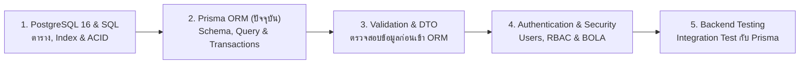

# Prisma ORM

คู่มือเชิงลึกสำหรับการจัดการชั้นข้อมูล (Data Access Layer) ด้วย **Prisma ORM 6.x** ร่วมกับฐานข้อมูล **PostgreSQL 16** และ **NestJS 11** สำหรับระบบอีคอมเมิร์ซ **Smart Butcher Marketplace** เนื้อหาครอบคลุมตั้งแต่การออกแบบ `schema.prisma` ที่มีความแม่นยำระดับระบบการเงิน, การเชื่อมความสัมพันธ์ของตาราง, การคิวรีแบบ Type-safe 100%, การทำ Interactive Transactions พร้อม Row-Level Locking ป้องกันการตัดสต็อกเนื้อวากิวติดลบ (Race Condition), การป้องกันปัญหา N+1 Query, ไปจนถึงสถาปัตยกรรม `PrismaService` และการเชื่อมต่อผ่าน Driver Adapter `pg` (`@prisma/adapter-pg`)

## สารบัญหัวข้อในหน้านี้

| ลำดับ | หัวข้อหลัก | สิ่งที่คุณจะได้เรียนรู้ |
| :--- | :--- | :--- |
| **1** | [1. โครงสร้าง Prisma Schema, Models, Field Types และ Enums](#1-โครงสร้าง-prisma-schema-models-field-types-และ-enums) | การตั้งค่า Generator, Datasource, การจับคู่ชนิดข้อมูล PostgreSQL (`Decimal`, `Timestamptz`, `UUID`) และ `@map`/`@@map` |
| **2** | [2. การออกแบบความสัมพันธ์ (Relations: 1-1, 1-N, M-N)](#2-การออกแบบความสัมพันธ์-relations-1-1-1-n-m-n) | การผูกความสัมพันธ์ระหว่าง `User`, `Category`, `Product`, `Order`, `OrderItem`, `Payment` และ `Referential Actions` |
| **3** | [3. การใช้งาน Prisma Client (CRUD, Filter, Select, Include, Aggregation)](#3-การใช้งาน-prisma-client-crud-filter-select-include-aggregation) | การเขียนคิวรีระดับ Production, การใช้ `Prisma.ProductGetPayload` และการคำนวณยอดขายด้วย `aggregate`/`groupBy` |
| **4** | [4. การจัดการ Transactions ด้วย $transaction และการป้องกัน Race Condition](#4-การจัดการ-transactions-ด้วย-transaction-และการป้องกัน-race-condition) | การใช้ Interactive Transactions, `Serializable` Isolation, Optimistic Concurrency และ `SELECT ... FOR UPDATE` |
| **5** | [5. ปัญหา N+1 Query ใน ORM, Raw Queries อย่างปลอดภัย และ Seeding](#5-ปัญหา-n1-query-ใน-orm-raw-queries-อย่างปลอดภัย-และ-seeding) | กลไก Dataloader ของ Prisma, การเขียน `$queryRaw` ป้องกัน SQL Injection และการทำ Idempotent Database Seeding |
| **6** | [6. สถาปัตยกรรม PrismaService ใน NestJS 11 และการเชื่อมต่อผ่าน Driver pg](#6-สถาปัตยกรรม-prismaservice-ใน-nestjs-11-และการเชื่อมต่อผ่าน-driver-pg) | การจัดการ Connection Lifecycle, การใช้ `@prisma/adapter-pg` ร่วมกับ `pg.Pool` และการแปลง Prisma Error Codes |
| **7** | [ข้อผิดพลาดที่พบบ่อย (Anti-patterns)](#ข้อผิดพลาดที่พบบ่อย-anti-patterns) | หลุมพรางด้านประสิทธิภาพและความปลอดภัยเมื่อใช้งาน Prisma ORM บน Production |
| **8** | [Checklist สรุป](#checklist-สรุป) | ตารางตรวจสอบความพร้อมของ Prisma Schema และ Data Access Layer |
| **9** | [ลำดับการเรียนที่แนะนำ และ ดูเพิ่มเติมที่](#ลำดับการเรียนที่แนะนำ-และ-ดูเพิ่มเติมที่) | แผนผังการเรียนรู้ต่อเนื่องและลิงก์เชื่อมโยงสู่บทเรียนที่เกี่ยวข้อง |

---

## 1. โครงสร้าง Prisma Schema, Models, Field Types และ Enums

### แนวคิด (Concept)
หัวใจสำคัญของ Prisma ORM คือแนวคิด **Schema-First Declarative Data Modeling** โดยใช้ไฟล์ `prisma/schema.prisma` เป็นแหล่งอ้างอิงความจริงเพียงหนึ่งเดียว (Single Source of Truth) ของโครงสร้างฐานข้อมูลและ TypeScript Types ภายในไฟล์นี้ประกอบด้วย 3 ส่วนหลักคือ:
1. **`datasource`**: กำหนดชนิดฐานข้อมูล (`postgresql`) และ URL การเชื่อมต่อ
2. **`generator`**: กำหนดวิธีสร้างโค้ด `PrismaClient` (เช่น `prisma-client-js` พร้อม Preview Features สำหรับ Driver Adapters หรือ TypedSQL)
3. **`model` และ `enum`**: นิยามตาราง, คอลัมน์, ชนิดข้อมูลระดับ Native PostgreSQL (`@db.*`), ค่าเริ่มต้น (`@default`), และการตั้งชื่อแบบ `camelCase` ในโค้ด TypeScript คู่กับ `snake_case` ในตาราง PostgreSQL จริงด้วย `@map` และ `@@map`

<Callout type="note" title="การเลือกใช้ Decimal สำหรับราคาและน้ำหนักเนื้อพรีเมียม">
ห้ามใช้ชนิดข้อมูล Float สำหรับเก็บราคาเนื้อวากิวหรือยอดชำระเงินเด็ดขาด เพราะเลขทศนิยมฐานสอง (IEEE 754) มีความคลาดเคลื่อนในการปัดเศษ ต้องใช้ Decimal คู่กับ Native Type @db.Decimal(12, 2) เสมอเพื่อความแม่นยำระดับระบบบัญชีการเงิน
</Callout>

### หลักการเบื้องหลัง (Under the Hood)
เมื่อเราสั่งรันคำสั่ง `npx prisma generate` เครื่องมือ CLI ของ Prisma จะอ่านไฟล์ `schema.prisma` แล้วใช้ AST Parser สร้างไฟล์ TypeScript Definitions (`index.d.ts`) และ Query Engine Runtime เฉพาะสำหรับโปรเจกต์ของเราโดยตรง ทำให้ทุกๆ โมเดลและฟิลด์กลายเป็น Type-safe ตั้งแต่ตอนเขียนโค้ด (Compile-time) ไม่ใช่เพิ่งมารู้ว่าพิมพ์ชื่อคอลัมน์ผิดตอนรันโปรแกรม (Runtime) นอกจากนี้ การระบุ `@db.Uuid`, `@db.Timestamptz(3)`, และ `@@index` ใน Schema ยังช่วยให้ `prisma migrate` สร้างคำสั่ง DDL ของ PostgreSQL 16 ที่มีประสิทธิภาพสูงสุดโดยไม่สูญเสียขนาดหน่วยความจำโดยเปล่าประโยชน์

### ตัวอย่างโค้ด (Smart Butcher Marketplace)

#### ตัวอย่างที่ 1: การประกาศ Generator, Datasource, Enums และโมเดลพื้นฐาน User & Category (พื้นฐาน)
```prisma filename="prisma/schema.prisma"
// ส่วนที่ 1: กำหนดการสร้าง Prisma Client
generator client {
  provider        = "prisma-client-js"
  // เปิดใช้งาน driverAdapters เพื่อรองรับการเชื่อมต่อผ่าน @prisma/adapter-pg (Node-postgres Pool)
  previewFeatures = ["driverAdapters"]
}

// ส่วนที่ 2: กำหนดการเชื่อมต่อฐานข้อมูล PostgreSQL 16
datasource db {
  provider = "postgresql"
  url      = env("DATABASE_URL")
}

// ส่วนที่ 3: กำหนด Enums สำหรับโดเมน Smart Butcher Marketplace
enum UserRole {
  CUSTOMER
  BUTCHER_CHEF
  ADMIN

  @@map("user_role")
}

enum MeatGrade {
  JAPANESE_A5
  JAPANESE_A4
  AUSTRALIAN_MB9
  USDA_PRIME
  DRY_AGED_SPECIAL

  @@map("meat_grade")
}

model User {
  id           String    @id @default(dbgenerated("gen_random_uuid()")) @db.Uuid
  email        String    @unique @db.VarChar(255)
  passwordHash String    @map("password_hash") @db.VarChar(255)
  fullName     String    @map("full_name") @db.VarChar(150)
  phoneNumber  String?   @map("phone_number") @db.VarChar(20)
  role         UserRole  @default(CUSTOMER)
  isActive     Boolean   @default(true) @map("is_active")
  createdAt    DateTime  @default(now()) @map("created_at") @db.Timestamptz(3)
  updatedAt    DateTime  @updatedAt @map("updated_at") @db.Timestamptz(3)

  orders       Order[]

  @@index([email])
  @@map("users")
}

model Category {
  id          String    @id @default(dbgenerated("gen_random_uuid()")) @db.Uuid
  name        String    @db.VarChar(100)
  slug        String    @unique @db.VarChar(120)
  description String?   @db.Text
  displaySort Int       @default(0) @map("display_sort")
  createdAt   DateTime  @default(now()) @map("created_at") @db.Timestamptz(3)
  updatedAt   DateTime  @updatedAt @map("updated_at") @db.Timestamptz(3)

  products    Product[]

  @@index([displaySort])
  @@map("categories")
}
```

#### ตัวอย่างที่ 2: การออกแบบโมเดล Product ที่ใช้ Native PostgreSQL Types และ Composite Index (ขั้นสูง)
```prisma filename="prisma/schema.prisma"
model Product {
  id                 String    @id @default(dbgenerated("gen_random_uuid()")) @db.Uuid
  sku                String    @unique @db.VarChar(64)
  name               String    @db.VarChar(200)
  categoryId         String    @map("category_id") @db.Uuid
  grade              MeatGrade
  marblingScore      Int       @default(1) @map("marbling_score") @db.SmallInt
  dryAgedDays        Int?      @map("dry_aged_days") @db.SmallInt
  // ใช้ Decimal(12, 2) เก็บราคาต่อกิโลกรัมอย่างแม่นยำ
  pricePerKgThb      Decimal   @map("price_per_kg_thb") @db.Decimal(12, 2)
  // เก็บสต็อกเนื้อเป็นหน่วยกรัม (Integer) และมี version สำหรับทำ Optimistic Concurrency Control
  stockWeightGrams   Int       @default(0) @map("stock_weight_grams")
  version            Int       @default(1)
  isAvailable        Boolean   @default(true) @map("is_available")
  storageTempCelsius Decimal   @default(1.5) @map("storage_temp_celsius") @db.Decimal(4, 1)
  metadata           Json?     @db.JsonB
  createdAt          DateTime  @default(now()) @map("created_at") @db.Timestamptz(3)
  updatedAt          DateTime  @updatedAt @map("updated_at") @db.Timestamptz(3)
  deletedAt          DateTime? @map("deleted_at") @db.Timestamptz(3)

  category           Category    @relation(fields: [categoryId], references: [id], onDelete: Restrict)
  orderItems         OrderItem[]

  // Composite Indexes สำหรับเพิ่มความเร็วในการ Filter และทำ Cursor Pagination
  @@index([categoryId, isAvailable, pricePerKgThb])
  @@index([createdAt(sort: Desc), id(sort: Desc)])
  @@map("products")
}
```

### ผิด vs ถูก (Anti-pattern vs Best Practice)

```prisma filename="prisma/schema-comparison.prisma"
// ❌ ผิด (Anti-pattern): ใช้ Float เก็บราคาเงิน, ไม่ตั้งชื่อตารางเป็น snake_case, และไม่สร้าง Index ให้ Foreign Key
model BadProduct {
  id         Int     @id @default(autoincrement())
  categoryId Int     // ไม่มี @@index([categoryId]) ใน PostgreSQL จะทำให้การ JOIN และ ON DELETE ช้ามาก!
  price      Float   // เกิดปัญหา 0.1 + 0.2 = 0.30000000000000004
}

// ✅ ถูก (Best Practice): ใช้ UUID, Decimal(12,2), @map/@@map และระบุ @@index อย่างชัดเจน
model GoodProduct {
  id            String   @id @default(dbgenerated("gen_random_uuid()")) @db.Uuid
  categoryId    String   @map("category_id") @db.Uuid
  pricePerKgThb Decimal  @map("price_per_kg_thb") @db.Decimal(12, 2)

  @@index([categoryId])
  @@map("good_products")
}
```

### ควรใช้เมื่อไหร่ และ ไม่ควรใช้เมื่อไหร่
- **ควรใช้ `@map` และ `@@map` เสมอเมื่อ**: ใช้ฐานข้อมูล PostgreSQL เพื่อรักษามาตรฐานการตั้งชื่อตารางและคอลัมน์แบบ `snake_case` ในระดับ SQL (ไม่ต้องใส่เครื่องหมายคำพูด `"pricePerKgThb"` เวลาเขียน SQL) ขณะที่ในโค้ด TypeScript ยังคงใช้ `camelCase` (`product.pricePerKgThb`) ได้อย่างเป็นธรรมชาติ
- **ไม่ควรใช้ `Json` (`@db.JsonB`) แทนคอลัมน์หลักที่ต้องใช้ค้นหาและเชื่อมตาราง**: ควรใช้ `JsonB` เฉพาะข้อมูลเสริมที่โครงสร้างยืดหยุ่น เช่น ใบรับรองสายพันธุ์วัวจากฟาร์มญี่ปุ่น (`metadata`) เท่านั้น

### คำถามสัมภาษณ์ (Interview Q&A)
1. **คำถาม**: ใน PostgreSQL ถ้าเราประกาศ Foreign Key ใน Prisma Schema แล้ว ทำไมเราจึงยังต้องเขียน `@@index([categoryId])` เพิ่มด้วยตัวเอง?
   - **แนวคำตอบ**: เพราะต่างจาก MySQL (InnoDB) ที่สร้าง Index ให้กับคอลัมน์ Foreign Key โดยอัตโนมัติ **PostgreSQL จะสร้าง Index อัตโนมัติเฉพาะคอลัมน์ที่เป็น Primary Key และ Unique Constraint เท่านั้น** แต่จะไม่สร้าง Index ให้กับคอลัมน์ฝั่ง Foreign Key (`categoryId`) หากเราไม่ใส่ `@@index([categoryId])` ใน Prisma Schema เวลาที่เราคิวรี `WHERE category_id = ...` หรือมีการลบหมวดหมู่ในตารางแม่ PostgreSQL จะต้องทำ Sequential Scan กวาดอ่านตาราง `products` ทั้งตาราง
2. **คำถาม**: `@default(uuid())` ของ Prisma กับ `@default(dbgenerated("gen_random_uuid()"))` ของ PostgreSQL 16 ต่างกันอย่างไร?
   - **แนวคำตอบ**: `@default(uuid())` จะถูกสร้างขึ้นที่ฝั่ง Prisma Client Engine (Application layer) ก่อนส่งคำสั่ง `INSERT` ไปยังฐานข้อมูล ส่วน `@default(dbgenerated("gen_random_uuid()"))` จะกำหนดค่า `DEFAULT gen_random_uuid()` ลงใน DDL ของตาราง PostgreSQL โดยตรง ทำให้แม้จะมีสคริปต์ SQL อื่นหรือระบบคลังสินค้าทำ `INSERT` เข้าตารางโดยไม่ผ่าน Prisma ฐานข้อมูลก็ยังสามารถสร้าง UUID v4 ให้ได้เองอย่างสมบูรณ์

---

## 2. การออกแบบความสัมพันธ์ (Relations: 1-1, 1-N, M-N)

### แนวคิด (Concept)
ในระบบอีคอมเมิร์ซที่มีความซับซ้อน ข้อมูลแต่ละส่วนมีความเชื่อมโยงกันอย่างเป็นระบบ ใน Prisma ORM เราสามารถนิยามความสัมพันธ์ทั้ง 3 รูปแบบหลักได้อย่างชัดเจน:
1. **One-to-One (1-1)**: เช่น หนึ่งคำสั่งซื้อ (`Order`) มีข้อมูลการชำระเงินหลัก (`Payment`) เพียงหนึ่งรายการ (ต้องมี `@unique` ที่คอลัมน์ Foreign Key เสมอ)
2. **One-to-Many (1-N)**: เช่น ลูกค้าหนึ่งคน (`User`) สั่งซื้อได้หลายใบสั่งซื้อ (`Order`), หรือหนึ่งหมวดหมู่ (`Category`) มีสินค้าเนื้อ (`Product`) ได้หลายชิ้น
3. **Many-to-Many (M-N) แบบ Explicit Relation Table**: เช่น ความสัมพันธ์ระหว่างใบสั่งซื้อ (`Order`) กับสินค้า (`Product`) ที่เชื่อมผ่านตารางกลางคือ **`OrderItem`** เนื่องจากต้องเก็บข้อมูลเพิ่มเติมในรายการสั่งซื้อ เช่น น้ำหนักที่สั่งตัด (`weightGrams`), ความหนาของการสไลซ์ (`cutStyle`), และราคาต่อหน่วย ณ วันที่ซื้อ (`unitPriceSnapshotThb`)

### หลักการเบื้องหลัง (Under the Hood)
ในไฟล์ `schema.prisma` ฟิลด์ที่เป็นชื่อโมเดลความสัมพันธ์ (เช่น `order Order @relation(...)` หรือ `items OrderItem[]`) เรียกว่า **Relation Fields** ซึ่งไม่มีอยู่จริงเป็นคอลัมน์ในฐานข้อมูล PostgreSQL แต่มีไว้เพื่อให้ Prisma Client ใช้สร้างคำสั่ง `JOIN` หรือ Subquery อัตโนมัติ ส่วนคอลัมน์ที่เก็บค่ากุญแจเชื่อมตารางจริงๆ ในฐานข้อมูลเรียกว่า **Foreign Key Scalar Field** (เช่น `orderId String @db.Uuid`)

นอกจากนี้ การกำหนด **Referential Actions (`onDelete`, `onUpdate`)** มีความสำคัญอย่างยิ่งต่อความถูกต้องของข้อมูลทางบัญชี:
- **`Restrict` (หรือ `NoAction`)**: ห้ามลบข้อมูลแม่หากยังมีข้อมูลลูกอ้างอิงอยู่ (เช่น ห้ามลบ `Product` หรือ `User` หากมีประวัติ `OrderItem` และ `Order` ผูกอยู่ เพื่อรักษาหลักฐานทางภาษี)
- **`Cascade`**: เมื่อลบข้อมูลแม่ ให้ลบข้อมูลลูกตามไปด้วยอัตโนมัติ (เช่น เมื่อลบ `Order` ร่างที่ยังไม่จ่ายเงิน ให้ลบ `OrderItem` ย่อยในใบสั่งซื้อนั้นทิ้งด้วย)

### ตัวอย่างโค้ด (Smart Butcher Marketplace)

#### ตัวอย่างที่ 1: การออกแบบความสัมพันธ์ครบวงจรสำหรับ Order, OrderItem และ Payment (พื้นฐาน)
```prisma filename="prisma/schema.prisma"
enum OrderStatus {
  PENDING_PAYMENT
  PAID
  PREPARING_CUT
  SHIPPED
  DELIVERED
  CANCELLED

  @@map("order_status")
}

enum PaymentMethod {
  PROMPTPAY_QR
  CREDIT_CARD
  BANK_TRANSFER

  @@map("payment_method")
}

enum PaymentStatus {
  PENDING
  SUCCEEDED
  FAILED
  REFUNDED

  @@map("payment_status")
}

// ความสัมพันธ์ 1-N กับ User, 1-N กับ OrderItem และ 1-1 กับ Payment
model Order {
  id                  String      @id @default(dbgenerated("gen_random_uuid()")) @db.Uuid
  orderNumber         String      @unique @map("order_number") @db.VarChar(40)
  userId              String      @map("user_id") @db.Uuid
  status              OrderStatus @default(PENDING_PAYMENT)
  subtotalThb         Decimal     @map("subtotal_thb") @db.Decimal(12, 2)
  coldShippingFeeThb  Decimal     @map("cold_shipping_fee_thb") @db.Decimal(12, 2)
  grandTotalThb       Decimal     @map("grand_total_thb") @db.Decimal(12, 2)
  shippingAddressJson Json        @map("shipping_address_json") @db.JsonB
  createdAt           DateTime    @default(now()) @map("created_at") @db.Timestamptz(3)
  updatedAt           DateTime    @updatedAt @map("updated_at") @db.Timestamptz(3)

  // 1-N: User หนึ่งคนมีได้หลาย Order (ห้ามลบ User ถ้ายังมี Order ในระบบ)
  user                User        @relation(fields: [userId], references: [id], onDelete: Restrict)
  // 1-N: Order หนึ่งใบมีได้หลาย OrderItem
  items               OrderItem[]
  // 1-1: Order หนึ่งใบผูกกับ Payment หนึ่งรายการ
  payment             Payment?

  @@index([userId, createdAt(sort: Desc)])
  @@index([status])
  @@map("orders")
}

// Explicit Many-to-Many (M-N) Join Table ระหว่าง Order และ Product
model OrderItem {
  id                   String   @id @default(dbgenerated("gen_random_uuid()")) @db.Uuid
  orderId              String   @map("order_id") @db.Uuid
  productId            String   @map("product_id") @db.Uuid
  cutStyle             String   @map("cut_style") @db.VarChar(50) // เช่น "STEAK_25MM", "SHABU_2MM"
  weightGrams          Int      @map("weight_grams")
  // ต้อง Snapshot ราคาเนื้อ ณ วินาทีที่สั่งซื้อไว้เสมอ ป้องกันราคาเปลี่ยนในอนาคตแล้วบิลเก่าเพี้ยน!
  unitPricePerKgThb    Decimal  @map("unit_price_per_kg_thb") @db.Decimal(12, 2)
  lineTotalThb         Decimal  @map("line_total_thb") @db.Decimal(12, 2)

  // ถ้าลบ Order ให้ลบ OrderItem ตาม (Cascade) แต่ห้ามลบ Product ถ้าเคยถูกสั่งซื้อแล้ว (Restrict)
  order                Order    @relation(fields: [orderId], references: [id], onDelete: Cascade)
  product              Product  @relation(fields: [productId], references: [id], onDelete: Restrict)

  @@unique([orderId, productId, cutStyle])
  @@index([orderId])
  @@index([productId])
  @@map("order_items")
}

// One-to-One (1-1) กับ Order
model Payment {
  id                 String        @id @default(dbgenerated("gen_random_uuid()")) @db.Uuid
  // @unique บน orderId คือหัวใจที่บังคับให้ความสัมพันธ์นี้เป็น 1-1 ในระดับ Database Constraint
  orderId            String        @unique @map("order_id") @db.Uuid
  idempotencyKey     String        @unique @map("idempotency_key") @db.VarChar(100)
  method             PaymentMethod
  status             PaymentStatus @default(PENDING)
  amountThb          Decimal       @map("amount_thb") @db.Decimal(12, 2)
  gatewayReferenceId String?       @map("gateway_reference_id") @db.VarChar(120)
  paidAt             DateTime?     @map("paid_at") @db.Timestamptz(3)
  createdAt          DateTime      @default(now()) @map("created_at") @db.Timestamptz(3)
  updatedAt          DateTime      @updatedAt @map("updated_at") @db.Timestamptz(3)

  order              Order         @relation(fields: [orderId], references: [id], onDelete: Restrict)

  @@index([status])
  @@map("payments")
}
```

#### ตัวอย่างที่ 2: การทำ Nested Writes สร้าง Order พร้อม OrderItem และ Payment ในคำสั่งเดียว (ขั้นสูง)
```typescript filename="src/modules/orders/orders-relation.service.ts"
import { Injectable } from '@nestjs/common';
import { Prisma, OrderStatus, PaymentMethod } from '@prisma/client';
import { PrismaService } from '../../database/prisma.service';

export interface CreateMeatOrderInput {
  userId: string;
  idempotencyKey: string;
  paymentMethod: PaymentMethod;
  shippingAddress: {
    recipientName: string;
    phone: string;
    fullAddress: string;
    postalCode: string;
  };
  items: Array<{
    productId: string;
    cutStyle: string;
    weightGrams: number;
    unitPricePerKgThb: number;
  }>;
}

@Injectable()
export class OrdersRelationService {
  constructor(private readonly prisma: PrismaService) {}

  // Nested Write ของ Prisma จะถูกรันภายใต้ Database Transaction เดียวกันโดยอัตโนมัติ
  async createOrderWithItemsAndPayment(input: CreateMeatOrderInput) {
    const calculatedItems = input.items.map((item) => {
      const lineTotal = (item.weightGrams / 1000) * item.unitPricePerKgThb;
      return {
        productId: item.productId,
        cutStyle: item.cutStyle,
        weightGrams: item.weightGrams,
        unitPricePerKgThb: new Prisma.Decimal(item.unitPricePerKgThb.toFixed(2)),
        lineTotalThb: new Prisma.Decimal(lineTotal.toFixed(2)),
      };
    });

    const subtotalNumber = input.items.reduce(
      (sum, item) => sum + (item.weightGrams / 1000) * item.unitPricePerKgThb,
      0,
    );
    const coldShippingFeeNumber = subtotalNumber >= 3000 ? 0 : 150;
    const grandTotalNumber = subtotalNumber + coldShippingFeeNumber;

    const orderNumber = `SB-${Date.now()}`;

    return this.prisma.order.create({
      data: {
        orderNumber,
        userId: input.userId,
        status: OrderStatus.PENDING_PAYMENT,
        subtotalThb: new Prisma.Decimal(subtotalNumber.toFixed(2)),
        coldShippingFeeThb: new Prisma.Decimal(coldShippingFeeNumber.toFixed(2)),
        grandTotalThb: new Prisma.Decimal(grandTotalNumber.toFixed(2)),
        shippingAddressJson: input.shippingAddress,
        // สร้างข้อมูลในตาราง order_items (1-N) พร้อมกันทันที
        items: {
          create: calculatedItems,
        },
        // สร้างข้อมูลในตาราง payments (1-1) พร้อมกันทันที
        payment: {
          create: {
            idempotencyKey: input.idempotencyKey,
            method: input.paymentMethod,
            amountThb: new Prisma.Decimal(grandTotalNumber.toFixed(2)),
          },
        },
      },
      include: {
        items: {
          include: {
            product: {
              select: { id: true, sku: true, name: true, grade: true },
            },
          },
        },
        payment: true,
      },
    });
  }
}
```

### ผิด vs ถูก (Anti-pattern vs Best Practice)

```prisma filename="prisma/relations-comparison.prisma"
// ❌ ผิด (Anti-pattern): ใช้ Implicit M-N กับ Order และ Product และตั้งค่า onDelete: Cascade บนตารางบัญชี
model BadOrder {
  id       String       @id
  userId   String
  // ถ้าลบ User ข้อมูลประวัติการสั่งซื้อและภาษีทั้งหมดจะถูกลบหายไปจากฐานข้อมูลทันที!
  user     User         @relation(fields: [userId], references: [id], onDelete: Cascade)
  // เก็บจำนวนน้ำหนักเนื้อที่สั่งและราคา ณ วันที่ซื้อไม่ได้เลย
  products BadProduct[]
}

// ✅ ถูก (Best Practice): ใช้ Explicit Join Table (OrderItem) เก็บ Snapshot ราคา และใช้ onDelete: Restrict กับข้อมูลทางการเงิน
// ดูโครงสร้างที่ถูกต้องใน model Order และ model OrderItem ด้านบน
```

### ควรใช้เมื่อไหร่ และ ไม่ควรใช้เมื่อไหร่
- **ควรใช้ Explicit Many-to-Many (สร้างโมเดลตารางกลางเอง เช่น `OrderItem`) เมื่อ**: ความสัมพันธ์นั้นต้องเก็บข้อมูลประกอบเพิ่มเติม (เช่น จำนวนชิ้น, น้ำหนักกรัม, ราคา Snapshot, เวลาที่เพิ่มเข้าตะกร้า) ซึ่งในระบบ Production จริงเกือบ 95% ของความสัมพันธ์ M-N จะต้องใช้แบบ Explicit
- **ไม่ควรใช้ `onDelete: Cascade` กับตารางหลักทางธุรกิจ**: เช่น `User`, `Product`, `Order`, `Payment` ควรใช้ `onDelete: Restrict` คู่กับการทำ Soft Delete (`isActive: false` หรือ `deletedAt`) เพื่อป้องกันข้อมูลทางการเงินสูญหาย

### คำถามสัมภาษณ์ (Interview Q&A)
1. **คำถาม**: ทำไมในตาราง `OrderItem` เราจึงต้องมีคอลัมน์ `unitPricePerKgThb` เก็บซ้ำอีกครั้ง ทั้งๆ ที่ในตาราง `Product` ก็มีคอลัมน์ `pricePerKgThb` อยู่แล้ว?
   - **แนวคำตอบ**: นี่คือหลักการ **Historical Data Snapshot** ในการออกแบบฐานข้อมูลอีคอมเมิร์ซ ราคาในตาราง `Product` คือ "ราคาขายปัจจุบันในแคตตาล็อก" ซึ่งอาจปรับขึ้นหรือลงตามต้นทุนการนำเข้าเนื้อวากิวในแต่ละสัปดาห์ หากเราไม่บันทึก Snapshot ราคา ณ วินาทีที่ลูกค้าสั่งซื้อไว้ใน `OrderItem` เมื่อสัปดาห์หน้าร้านค้าปรับราคาเนื้อขึ้น ใบเสร็จและยอดรวมของคำสั่งซื้อในอดีตทั้งหมดจะเปลี่ยนตามไปด้วย ซึ่งผิดกฎหมายภาษีและมาตรฐานบัญชีอย่างร้ายแรง
2. **คำถาม**: ความแตกต่างระหว่าง Implicit Many-to-Many กับ Explicit Many-to-Many ใน Prisma คืออะไร?
   - **แนวคำตอบ**: Implicit M-N คือการให้ Prisma สร้างตารางเชื่อมเบื้องหลังให้เอง (เช่น `_OrderToProduct`) โดยเราไม่ต้องประกาศโมเดลตารางกลางใน `schema.prisma` เหมาะกับความสัมพันธ์ง่ายๆ ที่ไม่มีฟิลด์อื่นเลย เช่น บทความกับป้ายกำกับ (`Post` <-> `Tag`) ส่วน Explicit M-N คือการที่เราประกาศโมเดลตารางกลางอย่างชัดเจน (เช่น `OrderItem`) ทำให้เราสามารถเพิ่มคอลัมน์ (`weightGrams`, `cutStyle`, `createdAt`), กำหนด Composite Index และคิวรีตารางกลางโดยตรงผ่าน `prisma.orderItem.*` ได้

---

## 3. การใช้งาน Prisma Client (CRUD, Filter, Select, Include, Aggregation)

### แนวคิด (Concept)
**Prisma Client** ช่วยให้เราเขียนคำสั่งจัดการข้อมูล (CRUD), การกรองข้อมูลซับซ้อน (`where`), การเลือกเฉพาะคอลัมน์ที่ต้องใช้ (`select`), การดึงตารางที่เกี่ยวข้อง (`include`), และการคำนวณทางสถิติ (`aggregate`, `groupBy`) ได้ด้วย TypeScript Object ที่มี Auto-completion และ Type Inference ระดับลึก

สิ่งสำคัญที่ทำให้โค้ดระดับ Senior แตกต่างจากระดับเริ่มต้น คือ:
1. **ไม่ดึงทุกคอลัมน์เกินจำเป็น (Avoid Over-fetching)**: ใช้ `select` เพื่อระบุเฉพาะฟิลด์ที่ต้องส่งออกไปยัง API เสมอ
2. **การสกัด Type อัตโนมัติด้วย `Prisma.<Model>GetPayload` หรือ `Prisma.validator`**: แทนที่จะเขียน Interface ซ้ำซ้อนด้วยมือ เราสามารถสกัด Return Type ที่ตรงกับ `select` หรือ `include` ของเราได้ 100%
3. **การคำนวณยอดรวมในฐานข้อมูลด้วย `aggregate` และ `groupBy`**: แทนที่จะดึง `Order` นับหมื่นแถวมาวนลูป `.reduce()` ใน Node.js

### หลักการเบื้องหลัง (Under the Hood)
เมื่อเราเรียกใช้ `prisma.product.findMany({ select: { id: true, name: true } })` Prisma จะสร้างคำสั่ง SQL `SELECT "id", "name" FROM "products"` แทนที่จะเป็น `SELECT *` ช่วยลดปริมาณข้อมูลที่ส่งผ่านเครือข่ายระหว่าง PostgreSQL กับ Node.js (Network I/O) และลดการจองหน่วยความจำใน V8 Heap อย่างมหาศาล โดยเฉพาะเมื่อตารางนั้นมีคอลัมน์ขนาดใหญ่ เช่น `description` (`TEXT`) หรือ `metadata` (`JSONB`)

### ตัวอย่างโค้ด (Smart Butcher Marketplace)

#### ตัวอย่างที่ 1: การทำ Type-safe Select, Include และ Dynamic Filtering สำหรับแคตตาล็อกเนื้อ (พื้นฐาน)
```typescript filename="src/modules/products/products-prisma.repository.ts"
import { Injectable } from '@nestjs/common';
import { Prisma, MeatGrade } from '@prisma/client';
import { PrismaService } from '../../database/prisma.service';

// 1. นิยามโครงสร้าง Select มาตรฐานและสกัด Type ออกมาโดยอัตโนมัติ
export const productCatalogSelect = {
  id: true,
  sku: true,
  name: true,
  grade: true,
  marblingScore: true,
  dryAgedDays: true,
  pricePerKgThb: true,
  stockWeightGrams: true,
  category: {
    select: {
      id: true,
      name: true,
      slug: true,
    },
  },
} satisfies Prisma.ProductSelect;

// Type นี้จะมีเฉพาะฟิลด์ที่ระบุใน productCatalogSelect เท่านั้น แม่นยำ 100%
export type ProductCatalogItem = Prisma.ProductGetPayload<{
  select: typeof productCatalogSelect;
}>;

export interface CatalogFilterParams {
  search?: string;
  categorySlug?: string;
  grades?: MeatGrade[];
  minPriceThb?: number;
  maxPriceThb?: number;
  onlyInStock?: boolean;
  page: number;
  limit: number;
}

@Injectable()
export class ProductsPrismaRepository {
  constructor(private readonly prisma: PrismaService) {}

  async searchCatalog(params: CatalogFilterParams): Promise<{
    items: ProductCatalogItem[];
    totalItems: number;
  }> {
    // 2. สร้างเงื่อนไขการกรองแบบ Type-safe ด้วย Prisma.ProductWhereInput
    const where: Prisma.ProductWhereInput = {
      isAvailable: true,
      deletedAt: null,
      ...(params.onlyInStock ? { stockWeightGrams: { gt: 0 } } : {}),
      ...(params.categorySlug
        ? { category: { slug: params.categorySlug } }
        : {}),
      ...(params.grades && params.grades.length > 0
        ? { grade: { in: params.grades } }
        : {}),
      ...(params.minPriceThb !== undefined || params.maxPriceThb !== undefined
        ? {
            pricePerKgThb: {
              ...(params.minPriceThb !== undefined
                ? { gte: new Prisma.Decimal(params.minPriceThb) }
                : {}),
              ...(params.maxPriceThb !== undefined
                ? { lte: new Prisma.Decimal(params.maxPriceThb) }
                : {}),
            },
          }
        : {}),
      ...(params.search
        ? {
            OR: [
              { name: { contains: params.search, mode: 'insensitive' } },
              { sku: { contains: params.search, mode: 'insensitive' } },
            ],
          }
        : {}),
    };

    const skip = (params.page - 1) * params.limit;

    // 3. รันคำสั่งดึงรายการและนับจำนวนทั้งหมดพร้อมกัน
    const [items, totalItems] = await Promise.all([
      this.prisma.product.findMany({
        where,
        select: productCatalogSelect,
        orderBy: [{ marblingScore: 'desc' }, { id: 'asc' }],
        skip,
        take: params.limit,
      }),
      this.prisma.product.count({ where }),
    ]);

    return { items, totalItems };
  }
}
```

#### ตัวอย่างที่ 2: การทำ Aggregation และ GroupBy สำหรับ Dashboard วิเคราะห์ยอดขายเนื้อพรีเมียม (ขั้นสูง)
```typescript filename="src/modules/analytics/butcher-analytics.service.ts"
import { Injectable } from '@nestjs/common';
import { OrderStatus } from '@prisma/client';
import { PrismaService } from '../../database/prisma.service';

@Injectable()
export class ButcherAnalyticsService {
  constructor(private readonly prisma: PrismaService) {}

  // คำนวณสถิติภาพรวมยอดขายในช่วงวันที่กำหนดโดยใช้ PostgreSQL Aggregate Functions
  async getRevenueSummary(startDate: Date, endDate: Date) {
    const completedStatuses: OrderStatus[] = [
      OrderStatus.PAID,
      OrderStatus.PREPARING_CUT,
      OrderStatus.SHIPPED,
      OrderStatus.DELIVERED,
    ];

    const [orderStats, cutStyleBreakdown] = await Promise.all([
      // 1. คำนวณ SUM, AVG, MAX, COUNT ของใบสั่งซื้อในระดับฐานข้อมูล
      this.prisma.order.aggregate({
        where: {
          status: { in: completedStatuses },
          createdAt: { gte: startDate, lte: endDate },
        },
        _sum: {
          subtotalThb: true,
          coldShippingFeeThb: true,
          grandTotalThb: true,
        },
        _avg: {
          grandTotalThb: true,
        },
        _max: {
          grandTotalThb: true,
        },
        _count: {
          id: true,
        },
      }),

      // 2. จัดกลุ่ม (GROUP BY) ตามรูปแบบการหั่นเนื้อ (cutStyle) เพื่อดูว่าลูกค้าสั่งแบบไหนมากที่สุด
      this.prisma.orderItem.groupBy({
        by: ['cutStyle'],
        where: {
          order: {
            status: { in: completedStatuses },
            createdAt: { gte: startDate, lte: endDate },
          },
        },
        _sum: {
          weightGrams: true,
          lineTotalThb: true,
        },
        _count: {
          id: true,
        },
        having: {
          weightGrams: {
            _sum: { gt: 1000 }, // กรองเฉพาะรูปแบบการหั่นที่มียอดสั่งรวมเกิน 1 กิโลกรัม
          },
        },
        orderBy: {
          _sum: {
            lineTotalThb: 'desc',
          },
        },
      }),
    ]);

    return {
      period: {
        fromIso: startDate.toISOString(),
        toIso: endDate.toISOString(),
      },
      totalOrders: orderStats._count.id,
      totalRevenueThb: Number(orderStats._sum.grandTotalThb ?? 0),
      averageOrderValueThb: Number(orderStats._avg.grandTotalThb ?? 0),
      highestOrderValueThb: Number(orderStats._max.grandTotalThb ?? 0),
      popularCutStyles: cutStyleBreakdown.map((row) => ({
        cutStyle: row.cutStyle,
        orderItemCount: row._count.id,
        totalWeightKg: (row._sum.weightGrams ?? 0) / 1000,
        totalSalesThb: Number(row._sum.lineTotalThb ?? 0),
      })),
    };
  }
}
```

### ผิด vs ถูก (Anti-pattern vs Best Practice)

```typescript filename="src/modules/users/select-include-comparison.ts"
// ❌ ผิด (Anti-pattern): ดึงข้อมูล User โดยไม่ระบุ select ทำให้ passwordHash ถูกดึงขึ้นมาจาก DB ทุกครั้ง และใช้ select คู่กับ include ในระดับเดียวกัน (Error!)
export async function getUserAntiPattern(prisma: any, userId: string) {
  // 1. ถ้าไม่ใส่ select ฟิลด์ passwordHash จะติดมาในหน่วยความจำและเสี่ยงหลุดออกไปทาง API
  // 2. Prisma ไม่อนุญาตให้ใส่ทั้ง select และ include ในอ็อบเจกต์ระดับเดียวกัน
  return prisma.user.findUnique({ where: { id: userId } });
}

// ✅ ถูก (Best Practice): ใช้ select ระบุเฉพาะฟิลด์ที่ปลอดภัย และซ้อน select ของตารางลูกไว้ข้างในได้เลย
export async function getUserBestPractice(prisma: any, userId: string) {
  return prisma.user.findUnique({
    where: { id: userId },
    select: {
      id: true,
      email: true,
      fullName: true,
      role: true,
      orders: {
        select: {
          id: true,
          orderNumber: true,
          grandTotalThb: true,
        },
        take: 5,
        orderBy: { createdAt: 'desc' },
      },
    },
  });
}
```

### ควรใช้เมื่อไหร่ และ ไม่ควรใช้เมื่อไหร่
- **ควรใช้ `select` แทน `include` เมื่อ**: ทำงานกับตารางที่มีข้อมูลความลับ (เช่น `User` ที่มี `passwordHash`) หรือตารางที่มีคอลัมน์ขนาดใหญ่ เพื่อให้มั่นใจว่าดึงเฉพาะคอลัมน์ที่ต้องใช้จริงเท่านั้น
- **ไม่ควรดึงข้อมูลด้วย `findMany` เพื่อมานับจำนวนหรือหาผลรวมใน JavaScript**: ให้ใช้ `prisma.<model>.count()`, `aggregate()`, หรือ `groupBy()` เพื่อให้ PostgreSQL คำนวณให้เสร็จตั้งแต่ใน Engine ของฐานข้อมูลเสมอ

### คำถามสัมภาษณ์ (Interview Q&A)
1. **คำถาม**: ทำไม Prisma จึงไม่อนุญาตให้เราใช้ `select` และ `include` พร้อมกันในระดับเดียวกันของคิวรี และเราจะแก้ปัญหานี้ได้อย่างไรหากต้องการเลือกบางฟิลด์ของตารางแม่พร้อมดึงบางฟิลด์ของตารางลูก?
   - **แนวคำตอบ**: เพราะ `include` มีความหมายว่า *"ดึงคอลัมน์ทั้งหมดของตารางแม่ (`SELECT *`) แล้วแถมตารางลูกที่ระบุมาด้วย"* ในขณะที่ `select` มีความหมายว่า *"ดึงเฉพาะคอลัมน์ที่ระบุเป็น `true` เท่านั้น"* ทั้งสองคำสั่งจึงขัดแย้งกันเอง วิธีแก้คือให้ใช้ `select` เป็นตัวหลัก แล้วซ้อน `select` ย่อยเข้าไปในชื่อฟิลด์ Relation ของตารางลูก (Nested `select`) ได้เลย
2. **คำถาม**: ประโยชน์ของการใช้ `satisfies Prisma.ProductSelect` ร่วมกับ `Prisma.ProductGetPayload` คืออะไร?
   - **แนวคำตอบ**: การใช้ `satisfies Prisma.ProductSelect` ช่วยให้ TypeScript ตรวจสอบว่าเราพิมพ์ชื่อฟิลด์ในอ็อบเจกต์ `select` ถูกต้องตาม Schema โดยไม่ทำให้ Type กว้างเกินไป (Preserves literal types `true`) และเมื่อส่งต่อให้ `Prisma.ProductGetPayload<{ select: typeof ... }>` เราจะได้ Type ของผลลัพธ์ที่มีเฉพาะฟิลด์ที่เราเลือกจริงๆ หากวันหน้าเราเพิ่มหรือลดฟิลด์ใน `select` ตัว Type ของฟังก์ชันทั้งหมดจะอัปเดตตามโดยอัตโนมัติ

---

## 4. การจัดการ Transactions ด้วย $transaction และการป้องกัน Race Condition

### แนวคิด (Concept)
ในระบบ **Smart Butcher Marketplace** เนื้อวากิว A5 หรือเนื้อ Dry-Aged 45 วัน มักเป็นสินค้าที่มีจำนวนจำกัดมาก (เช่น เหลือก้อนสุดท้ายหนัก 1,000 กรัม) หากมีลูกค้า 2 คนกดสั่งซื้อเนื้อก้อนนี้ขนาด 600 กรัม ในเสี้ยววินาทีเดียวกัน (Concurrent Requests) ถ้าเราเขียนโค้ดแบบอ่านค่าสต็อกมาเช็คด้วย `if (product.stockWeightGrams >= 600)` แล้วค่อยสั่งอัปเดตแยกกัน คำขอทั้งสองจะเห็นว่ามีสต็อก 1,000 กรัมเหมือนกัน และสั่งตัดสต็อกทั้งคู่ ส่งผลให้สต็อกติดลบ `-200 กรัม` (ปัญหา **Lost Update / Race Condition** หรือการขายเกินสต็อก Overselling)

การแก้ปัญหานี้ในระดับ Production ต้องใช้ **ACID Transactions (`prisma.$transaction`)** ควบคู่กับกลไกควบคุมภาวะพร้อมกัน (Concurrency Control) เช่น:
1. **Atomic Conditional Update (`updateMany` พร้อมเงื่อนไข `gte`)**: ให้ฐานข้อมูลเช็คและตัดสต็อกในคำสั่ง SQL `UPDATE` เดียว
2. **Interactive Transactions + Optimistic Concurrency Control (OCC)** หรือ **Pessimistic Row-Level Locking (`SELECT ... FOR UPDATE`)**

<Callout type="warning" title="กฎเหล็กของ Interactive Transaction">
ภายในบล็อก callback ของ prisma.$transaction(async (tx) => { ... }) คุณต้องเรียกใช้คำสั่งฐานข้อมูลผ่านตัวแปร tx เสมอ ห้ามเผลอเรียกใช้ผ่าน this.prisma ตัวหลักเด็ดขาด เพราะคำสั่งนั้นจะหลุดออกไปรันนอก Transaction และอาจทำให้เกิด Deadlock ได้!
</Callout>

### หลักการเบื้องหลัง (Under the Hood)
Prisma รองรับการทำ Transaction 2 รูปแบบ:
1. **Sequential / Batch `$transaction([...])`**: ส่ง Array ของ Prisma Promises เข้าไปรันภายใต้ `BEGIN ... COMMIT` เดียวกัน เหมาะกับงานที่ไม่ได้นำผลลัพธ์ของคำสั่งแรกมาเขียนเงื่อนไข `if-else` ในโค้ด
2. **Interactive `$transaction(async (tx) => { ... }, { isolationLevel, maxWait, timeout })`**: Prisma จะจอง Database Connection หนึ่งเส้นจาก Pool แล้วเปิด `BEGIN` จากนั้นส่ง Transaction Client (`tx`) ให้เราเขียน Business Logic โต้ตอบกับฐานข้อมูลได้หลายขั้นตอน หากเกิด Exception ขึ้นกลางทาง Prisma จะสั่ง `ROLLBACK` ให้อัตโนมัติ

สำหรับระบบที่มีการแย่งชิงสต็อกสูง (Flash Sale) เราสามารถใช้:
- **Atomic Conditional Update**: `UPDATE products SET stock_weight_grams = stock_weight_grams - 600 WHERE id = $1 AND stock_weight_grams >= 600` ซึ่ง PostgreSQL จะทำการล็อกแถวนั้นระดับ Micro-operation ให้อัตโนมัติและคืนค่าจำนวนแถวที่ถูกอัปเดต (`count`) ถ้า `count === 0` แปลว่าสต็อกไม่พอ!
- **Pessimistic Locking (`FOR UPDATE`)**: ล็อกแถวข้อมูลเนื้อชิ้นนั้นไว้ตั้งแต่วินาทีที่อ่าน จนกว่า Transaction จะ `COMMIT`

### ตัวอย่างโค้ด (Smart Butcher Marketplace)

#### ตัวอย่างที่ 1: การตัดสต็อกเนื้อและสร้างใบสั่งซื้อแบบ Atomic ป้องกัน Overselling 100% (พื้นฐาน)
```typescript filename="src/modules/orders/atomic-checkout.service.ts"
import {
  Injectable,
  ConflictException,
  NotFoundException,
} from '@nestjs/common';
import { Prisma, OrderStatus, PaymentMethod } from '@prisma/client';
import { PrismaService } from '../../database/prisma.service';

export interface CheckoutItemRequest {
  productId: string;
  cutStyle: string;
  weightGrams: number;
}

@Injectable()
export class AtomicCheckoutService {
  constructor(private readonly prisma: PrismaService) {}

  async checkoutMeatOrder(
    userId: string,
    idempotencyKey: string,
    items: CheckoutItemRequest[],
  ) {
    // เปิด Interactive Transaction พร้อมกำหนด timeout ที่กระชับเพื่อไม่ให้ค้าง Connection นาน
    return this.prisma.$transaction(
      async (tx) => {
        let subtotalThb = new Prisma.Decimal(0);
        const orderItemsPayload: Prisma.OrderItemCreateWithoutOrderInput[] = [];

        for (const item of items) {
          // 1. Atomic Conditional Update: ลดสต็อกและเพิ่มเลข version เฉพาะเมื่อสต็อกมีเพียงพอเท่านั้น!
          // SQL เบื้องหลัง: UPDATE products SET stock_weight_grams = stock_weight_grams - $1, version = version + 1
          // WHERE id = $2 AND is_available = true AND stock_weight_grams >= $1
          const deducted = await tx.product.updateMany({
            where: {
              id: item.productId,
              isAvailable: true,
              deletedAt: null,
              stockWeightGrams: {
                gte: item.weightGrams, // หัวใจสำคัญที่ป้องกันสต็อกติดลบในระดับ Database Engine!
              },
            },
            data: {
              stockWeightGrams: {
                decrement: item.weightGrams,
              },
              version: {
                increment: 1,
              },
            },
          });

          // หาก count === 0 แปลว่าสินค้าไม่มีอยู่จริง หรือสต็อกเนื้อถูกคนอื่นซื้อตัดหน้าไปไม่พอแล้ว
          if (deducted.count === 0) {
            const currentProduct = await tx.product.findUnique({
              where: { id: item.productId },
              select: { name: true, stockWeightGrams: true, isAvailable: true },
            });

            if (!currentProduct || !currentProduct.isAvailable) {
              throw new NotFoundException(
                `ไม่พบสินค้าเนื้อรหัส ${item.productId} หรือสินค้าปิดการขายแล้ว`,
              );
            }

            throw new ConflictException({
              code: 'INSUFFICIENT_MEAT_STOCK',
              message: `สินค้า "${currentProduct.name}" มีน้ำหนักคงเหลือเพียง ${currentProduct.stockWeightGrams} กรัม (คุณสั่ง ${item.weightGrams} กรัม)`,
            });
          }

          // 2. ดึงราคาปัจจุบันของสินค้ามาคำนวณยอดรวม (อยู่ภายใต้ Transaction เดียวกัน)
          const product = await tx.product.findUniqueOrThrow({
            where: { id: item.productId },
            select: { id: true, pricePerKgThb: true },
          });

          const weightInKg = new Prisma.Decimal(item.weightGrams).div(1000);
          const lineTotalThb = product.pricePerKgThb
            .mul(weightInKg)
            .toDecimalPlaces(2);

          subtotalThb = subtotalThb.add(lineTotalThb);

          orderItemsPayload.push({
            product: { connect: { id: product.id } },
            cutStyle: item.cutStyle,
            weightGrams: item.weightGrams,
            unitPricePerKgThb: product.pricePerKgThb,
            lineTotalThb,
          });
        }

        const shippingFeeThb = subtotalThb.gte(3000)
          ? new Prisma.Decimal(0)
          : new Prisma.Decimal(150);
        const grandTotalThb = subtotalThb.add(shippingFeeThb);

        // 3. สร้างใบสั่งซื้อและรายการชำระเงินพร้อมกัน หากขั้นตอนใดพัง สต็อกเนื้อทั้งหมดด้านบนจะถูก Rollback คืนทันที!
        const createdOrder = await tx.order.create({
          data: {
            orderNumber: `SB-${Date.now()}-${Math.floor(Math.random() * 1000)}`,
            userId,
            status: OrderStatus.PENDING_PAYMENT,
            subtotalThb,
            coldShippingFeeThb: shippingFeeThb,
            grandTotalThb,
            shippingAddressJson: { deliveryType: 'COLD_CHAIN_EXPRESS' },
            items: {
              create: orderItemsPayload,
            },
            payment: {
              create: {
                idempotencyKey,
                method: PaymentMethod.PROMPTPAY_QR,
                amountThb: grandTotalThb,
              },
            },
          },
          include: {
            items: true,
            payment: true,
          },
        });

        return createdOrder;
      },
      {
        maxWait: 3000, // รอคิว Connection จาก Pool ไม่เกิน 3 วินาที
        timeout: 8000, // เวลาทำงานรวมใน Transaction ไม่เกิน 8 วินาที
        isolationLevel: Prisma.TransactionIsolationLevel.ReadCommitted,
      },
    );
  }
}
```

#### ตัวอย่างที่ 2: การใช้ Pessimistic Row-Level Lock (`SELECT ... FOR UPDATE`) ในการประมวลผล Webhook ชำระเงินและคืนสต็อกเมื่อยกเลิก (ขั้นสูง)
```typescript filename="src/modules/payments/payment-webhook-transaction.service.ts"
import { Injectable, ConflictException, NotFoundException } from '@nestjs/common';
import { OrderStatus, PaymentStatus } from '@prisma/client';
import { PrismaService } from '../../database/prisma.service';

interface LockedPaymentRow {
  id: string;
  order_id: string;
  status: PaymentStatus;
  amount_thb: string;
}

@Injectable()
export class PaymentWebhookTransactionService {
  constructor(private readonly prisma: PrismaService) {}

  // กรณีธนาคารยิง Webhook เข้ามาพร้อมกัน 2 ครั้งติดกัน เราใช้ SELECT ... FOR UPDATE ล็อกแถว Payment ไว้ทันที
  async confirmPaymentFromGateway(
    paymentId: string,
    gatewayReferenceId: string,
  ) {
    return this.prisma.$transaction(async (tx) => {
      // 1. ล็อกแถวข้อมูลการชำระเงินด้วย FOR UPDATE NO WAIT หรือ FOR UPDATE ป้องกัน Webhook ซ้อนกัน
      const lockedRows = await tx.$queryRaw<LockedPaymentRow[]>`
        SELECT id, order_id, status, amount_thb
        FROM payments
        WHERE id = ${paymentId}::uuid
        FOR UPDATE
      `;

      const paymentRow = lockedRows[0];
      if (!paymentRow) {
        throw new NotFoundException(`ไม่พบรายการชำระเงินรหัส ${paymentId}`);
      }

      // 2. Idempotent Check ภายใต้ Row Lock: ถ้าสถานะเป็น SUCCEEDED ไปแล้ว ให้จบการทำงานทันที
      if (paymentRow.status === PaymentStatus.SUCCEEDED) {
        return {
          alreadyProcessed: true,
          paymentId: paymentRow.id,
          orderId: paymentRow.order_id,
        };
      }

      if (paymentRow.status !== PaymentStatus.PENDING) {
        throw new ConflictException(
          `ไม่สามารถยืนยันการชำระเงินที่มีสถานะ ${paymentRow.status} ได้`,
        );
      }

      // 3. อัปเดตสถานะ Payment เป็น SUCCEEDED
      await tx.payment.update({
        where: { id: paymentRow.id },
        data: {
          status: PaymentStatus.SUCCEEDED,
          gatewayReferenceId,
          paidAt: new Date(),
        },
      });

      // 4. อัปเดตสถานะ Order เป็น PAID เพื่อส่งเข้าห้องเชฟตัดแต่งเนื้อต่อไป
      const updatedOrder = await tx.order.update({
        where: { id: paymentRow.order_id },
        data: {
          status: OrderStatus.PAID,
        },
        select: {
          id: true,
          orderNumber: true,
          status: true,
        },
      });

      return {
        alreadyProcessed: false,
        paymentId: paymentRow.id,
        order: updatedOrder,
      };
    });
  }
}
```

### ผิด vs ถูก (Anti-pattern vs Best Practice)

```typescript filename="src/modules/orders/transaction-anti-pattern.ts"
// ❌ ผิด (Anti-pattern): Check-then-Act โดยไม่มี Atomic Lock และเรียก External API (เช่น ส่งอีเมล/ตัดบัตร) ข้างใน Database Transaction!
export async function badCheckout(prisma: any, productId: string, buyGrams: number) {
  return prisma.$transaction(async (tx: any) => {
    const product = await tx.product.findUnique({ where: { id: productId } });
    // 1. ปัญหา Race Condition: ถ้า 2 คำขออ่านบรรทัดบนพร้อมกัน จะผ่าน if นี้ทั้งคู่แล้วตัดสต็อกติดลบ!
    if (product.stockWeightGrams < buyGrams) throw new Error('Out of stock');

    // 2. ห้ามเรียก External HTTP API ใน $transaction เด็ดขาด! เพราะถ้าระบบอีเมลช้า 10 วินาที
    // Database Connection และ Row Lock จะถูกยึดค้างไว้ 10 วินาทีจน Connection Pool เต็มทั้งระบบ!
    await fetch('https://api.emailprovider.com/send-receipt');

    return tx.product.update({
      where: { id: productId },
      data: { stockWeightGrams: product.stockWeightGrams - buyGrams },
    });
  });
}

// ✅ ถูก (Best Practice): ใช้ Atomic updateMany ({ stockWeightGrams: { gte: buyGrams } }) with decrement
// และส่งอีเมลแจ้งเตือนหลังจากที่ $transaction COMMIT เสร็จเรียบร้อยแล้วเท่านั้น!
```

### ควรใช้เมื่อไหร่ และ ไม่ควรใช้เมื่อไหร่
- **ควรใช้ `$transaction` เมื่อ**: มีการเปลี่ยนแปลงข้อมูลตั้งแต่ 2 ตารางขึ้นไปที่ต้องสำเร็จพร้อมกันหรือล้มเหลวพร้อมกันทั้งหมด (All-or-Nothing) หรือต้องอ่านและเขียนข้อมูลที่มีโอกาสเกิด Race Condition
- **ไม่ควรใส่การเรียก HTTP ภายนอก, การอัปโหลดไฟล์ S3, หรือการส่งอีเมลไว้ข้างใน `$transaction`**: ต้องแยกงาน I/O ภายนอกออกไปทำก่อนเข้า Transaction หรือทำหลังจาก Transaction `COMMIT` สำเร็จแล้วเท่านั้น เพื่อรักษาเวลาการถือครอง Database Connection ให้สั้นระดับไม่กี่มิลลิวินาที

### คำถามสัมภาษณ์ (Interview Q&A)
1. **คำถาม**: ถ้าเราต้องการป้องกันการตัดสต็อกสินค้าติดลบ (Overselling) ใน Prisma ระหว่างการใช้ `findUnique` เช็คค่าแล้วค่อย `update` กับการใช้ `updateMany` ที่มี `where: { stockWeightGrams: { gte: requestedGrams } }` พร้อม `decrement` ต่างกันอย่างไรในระดับฐานข้อมูล?
   - **แนวคำตอบ**: การทำ `findUnique` แล้วค่อย `update` ในระดับ Isolation ปกติ (`Read Committed`) จะมีช่องว่างของเวลา (Time-of-check to time-of-use: TOCTOU) ที่คำขออื่นสามารถแทรกเข้ามาอ่านค่าสต็อกเดิมได้พร้อมกัน แต่การใช้ `updateMany` ที่มีเงื่อนไข `stock_weight_grams >= $1` พร้อมสั่ง `SET stock_weight_grams = stock_weight_grams - $1` จะถูกรันเป็นคำสั่ง SQL `UPDATE` เดียว ซึ่ง PostgreSQL จะทำการ Row-level lock และประเมินเงื่อนไข `WHERE` ใหม่หลังล็อกแถวเสมอ จึงไม่มีทางที่สต็อกจะถูกตัดจนติดลบได้เลยแม้จะมีผู้ใช้งานกดซื้อพร้อมกัน 1,000 คน
2. **คำถาม**: หากต้องการป้องกัน Deadlock เมื่อต้องตัดสต็อกสินค้าเนื้อหลายชิ้น (`items`) ในคำสั่งซื้อเดียว เราควรมีแนวปฏิบัติอย่างไร?
   - **แนวคำตอบ**: ก่อนเข้าลูปตัดสต็อกใน Interactive Transaction เราต้อง **เรียงลำดับรายการสินค้าตาม `productId` จากน้อยไปมาก (`items.sort((a, b) => a.productId.localeCompare(b.productId))`) เสมอ** เพราะ Deadlock มักเกิดจาก Transaction A ล็อกเนื้อชิ้นที่ 1 แล้วรอชิ้นที่ 2 ในขณะที่ Transaction B ล็อกเนื้อชิ้นที่ 2 แล้วรอชิ้นที่ 1 การบังคับให้ทุก Transaction ล็อกแถวตามลำดับ `productId` ทิศทางเดียวกันเสมอจะตัดวงจรการเกิด Circular Wait (Deadlock) ได้อย่างเด็ดขาด

---

## 5. ปัญหา N+1 Query ใน ORM, Raw Queries อย่างปลอดภัย และ Seeding

### แนวคิด (Concept)
1. **ปัญหา N+1 Query**: เกิดขึ้นเมื่อโค้ดดึงรายการหลักมา 1 ครั้ง (ได้ $N$ แถว เช่น ดึง `Category` 20 หมวดหมู่) แล้วนำมาวนลูป `for...of` หรือ `.map()` เพื่อยิงคิวรีดึงข้อมูลตารางลูกทีละแถวอีก $N$ ครั้ง รวมเป็น $N+1$ คิวรี ส่งผลให้ Latency พุ่งสูงขึ้นหลายสิบเท่าตามจำนวนแถว
2. **Parameterized Raw Queries (`$queryRaw`, `$executeRaw`)**: แม้ Prisma Client จะรองรับคิวรีทั่วไปได้กว่า 95% แต่ในบางกรณีที่ต้องการใช้ฟีเจอร์ขั้นสูงของ PostgreSQL 16 เช่น Common Table Expressions (CTEs), Window Functions (`RANK() OVER (...)`), หรือ `FOR UPDATE SKIP LOCKED` เราสามารถเขียน SQL โดยตรงได้อย่างปลอดภัยผ่าน Tagged Template Literals ที่ป้องกัน SQL Injection อัตโนมัติ
3. **Idempotent Seeding (`prisma/seed.ts`)**: การเตรียมข้อมูลตั้งต้นของระบบ (เช่น หมวดหมู่เนื้อมาตรฐาน, บัญชีผู้ดูแลระบบ) ที่สามารถรันซ้ำกี่ครั้งก็ได้โดยไม่เกิดข้อมูลซ้ำซ้อน ด้วยคำสั่ง `upsert`

### หลักการเบื้องหลัง (Under the Hood)
เมื่อคุณใช้ `include` หรือ Nested `select` ใน Prisma Client (เช่น ดึง 20 `Order` พร้อม `items`) Prisma จะไม่เกิดปัญหา N+1 เพราะ Query Engine ของ Prisma มีกลไก **Built-in Dataloader / Batching** ที่รวบรวม `orderId` ทั้ง 20 รายการไปคิวรีตาราง `order_items` รวดเดียวด้วย `WHERE order_id IN ($1, $2, ..., $20)` (รวมเป็น 2 คิวรีเสมอไม่ว่าจะมีกี่แถว) หรือใช้กลไก Relation Load Strategy แบบ Database `LATERAL JOIN` ในเวอร์ชันใหม่

สำหรับการเขียน Raw SQL เมื่อใช้ `` prisma.$queryRaw`SELECT * FROM products WHERE sku = ${sku}` `` ตัวแปร `${sku}` จะไม่ได้ถูกนำไปต่อสตริงตรงๆ แต่จะถูกแปลงเป็น Parameterized Query (`$1`) ส่งแยกไปให้ PostgreSQL Engine ประมวลผล จึงปลอดภัยจาก SQL Injection 100%

### ตัวอย่างโค้ด (Smart Butcher Marketplace)

#### ตัวอย่างที่ 1: การเขียน Parameterized `$queryRaw` สำหรับจัดอันดับเนื้อขายดีด้วย PostgreSQL Window Function (พื้นฐาน)
```typescript filename="src/modules/analytics/raw-ranking.service.ts"
import { Injectable } from '@nestjs/common';
import { Prisma } from '@prisma/client';
import { PrismaService } from '../../database/prisma.service';

export interface TopSellingMeatRow {
  productId: string;
  sku: string;
  productName: string;
  categoryName: string;
  totalSoldGrams: bigint;
  totalRevenueThb: Prisma.Decimal;
  rankInCategory: bigint;
}

@Injectable()
export class RawRankingService {
  constructor(private readonly prisma: PrismaService) {}

  // ใช้ Tagged Template Literal ($queryRaw`...`) ปลอดภัยจาก SQL Injection เสมอ
  async getTopSellingMeatsPerCategory(
    minSoldGrams: number,
    topLimitPerCategory: number,
  ) {
    const rows = await this.prisma.$queryRaw<TopSellingMeatRow[]>`
      WITH product_sales AS (
        SELECT
          p.id AS "productId",
          p.sku AS "sku",
          p.name AS "productName",
          c.name AS "categoryName",
          COALESCE(SUM(oi.weight_grams), 0) AS "totalSoldGrams",
          COALESCE(SUM(oi.line_total_thb), 0) AS "totalRevenueThb",
          DENSE_RANK() OVER (
            PARTITION BY c.id
            ORDER BY COALESCE(SUM(oi.line_total_thb), 0) DESC
          ) AS "rankInCategory"
        FROM products p
        INNER JOIN categories c ON c.id = p.category_id
        LEFT JOIN order_items oi ON oi.product_id = p.id
        LEFT JOIN orders o ON o.id = oi.order_id AND o.status IN ('PAID', 'PREPARING_CUT', 'SHIPPED', 'DELIVERED')
        WHERE p.deleted_at IS NULL
        GROUP BY p.id, p.sku, p.name, c.id, c.name
        HAVING COALESCE(SUM(oi.weight_grams), 0) >= ${minSoldGrams}
      )
      SELECT
        "productId",
        "sku",
        "productName",
        "categoryName",
        "totalSoldGrams",
        "totalRevenueThb",
        "rankInCategory"
      FROM product_sales
      WHERE "rankInCategory" <= ${topLimitPerCategory}
      ORDER BY "categoryName" ASC, "rankInCategory" ASC
    `;

    // แปลง BigInt และ Decimal จาก Raw SQL ให้เป็น JSON-safe numbers
    return rows.map((row) => ({
      productId: row.productId,
      sku: row.sku,
      productName: row.productName,
      categoryName: row.categoryName,
      totalSoldGrams: Number(row.totalSoldGrams),
      totalRevenueThb: Number(row.totalRevenueThb),
      rankInCategory: Number(row.rankInCategory),
    }));
  }
}
```

#### ตัวอย่างที่ 2: การเขียนสคริปต์ Idempotent Database Seeding ด้วย `upsert` (ขั้นสูง)
```typescript filename="prisma/seed.ts"
import { PrismaClient, MeatGrade, UserRole, Prisma } from '@prisma/client';
import * as bcrypt from 'bcrypt';

const prisma = new PrismaClient();

async function main() {
  console.log('🌱 Starting Smart Butcher Marketplace Idempotent Seed...');

  // 1. Upsert ผู้ดูแลระบบและหัวหน้าเชฟแล่เนื้อ (รันซ้ำกี่ครั้งก็ไม่พังด้วย unique email)
  const adminPasswordHash = await bcrypt.hash('ButcherAdmin@2026!', 12);

  const adminUser = await prisma.user.upsert({
    where: { email: 'admin@smartbutcher.co.th' },
    update: {
      fullName: 'Master Butcher Admin',
      role: UserRole.ADMIN,
      isActive: true,
    },
    create: {
      email: 'admin@smartbutcher.co.th',
      passwordHash: adminPasswordHash,
      fullName: 'Master Butcher Admin',
      phoneNumber: '0819998888',
      role: UserRole.ADMIN,
      isActive: true,
    },
  });

  // 2. Upsert หมวดหมู่เนื้อพรีเมียมมาตรฐาน
  const categoriesData = [
    {
      slug: 'japanese-wagyu-a5',
      name: 'Japanese Wagyu A5',
      description: 'เนื้อวากิวสายพันธุ์ขนดำแท้นำเข้าจากประเทศญี่ปุ่น เกรด A5 BMS 10-12',
      displaySort: 1,
    },
    {
      slug: 'dry-aged-craft-cuts',
      name: 'Dry-Aged Craft Cuts',
      description: 'เนื้อบ่มในห้องควบคุมอุณหภูมิและความชื้นพิเศษนาน 30 ถึง 60 วัน',
      displaySort: 2,
    },
  ];

  const categoryMap = new Map<string, string>();

  for (const cat of categoriesData) {
    const record = await prisma.category.upsert({
      where: { slug: cat.slug },
      update: {
        name: cat.name,
        description: cat.description,
        displaySort: cat.displaySort,
      },
      create: cat,
    });
    categoryMap.set(cat.slug, record.id);
  }

  // 3. Upsert รายการสินค้าเนื้อตั้งต้นโดยอ้างอิงตามรหัส SKU ที่เป็น Unique
  const wagyuCategoryId = categoryMap.get('japanese-wagyu-a5')!;
  const dryAgedCategoryId = categoryMap.get('dry-aged-craft-cuts')!;

  const initialProducts = [
    {
      sku: 'SB-MIYAZAKI-RIB-A5',
      name: 'Miyazaki Wagyu A5 Ribeye Crown',
      categoryId: wagyuCategoryId,
      grade: MeatGrade.JAPANESE_A5,
      marblingScore: 12,
      dryAgedDays: null,
      pricePerKgThb: new Prisma.Decimal('7800.00'),
      stockWeightGrams: 15000,
    },
    {
      sku: 'SB-USDA-TOMAHAWK-45D',
      name: '45-Day Dry-Aged USDA Prime Tomahawk',
      categoryId: dryAgedCategoryId,
      grade: MeatGrade.DRY_AGED_SPECIAL,
      marblingScore: 9,
      dryAgedDays: 45,
      pricePerKgThb: new Prisma.Decimal('4500.00'),
      stockWeightGrams: 22000,
    },
  ];

  for (const prod of initialProducts) {
    await prisma.product.upsert({
      where: { sku: prod.sku },
      update: {
        name: prod.name,
        pricePerKgThb: prod.pricePerKgThb,
        marblingScore: prod.marblingScore,
      },
      create: prod,
    });
  }

  console.log(`✅ Seed completed successfully (Admin ID: ${adminUser.id})`);
}

main()
  .catch((error) => {
    console.error('❌ Seed failed:', error);
    process.exit(1);
  })
  .finally(async () => {
    await prisma.$disconnect();
  });
```

### ผิด vs ถูก (Anti-pattern vs Best Practice)

```typescript filename="src/modules/orders/n-plus-one-and-raw-sql-comparison.ts"
// ❌ ผิด (Anti-pattern 1): ก่อให้เกิด N+1 Queries ด้วยการยิง Prisma ในลูป for...of
export async function getOrdersWithItemsNPlusOne(prisma: any, userId: string) {
  const orders = await prisma.order.findMany({ where: { userId } }); // 1 Query
  for (const order of orders) {
    // ถ้ายูสเซอร์มี 50 ออเดอร์ บรรทัดนี้จะยิง DB เพิ่มอีก 50 ครั้ง!
    order.items = await prisma.orderItem.findMany({ where: { orderId: order.id } });
  }
  return orders;
}

// ❌ ผิด (Anti-pattern 2): ใช้ $queryRawUnsafe ต่อสตริงตรงๆ เปิดช่องโหว่ SQL Injection ร้ายแรง!
export async function unsafeRawSearch(prisma: any, skuInput: string) {
  return prisma.$queryRawUnsafe(`SELECT * FROM products WHERE sku = '${skuInput}'`);
}

// ✅ ถูก (Best Practice): ใช้ include/select เพื่อแก้ N+1 และใช้ Tagged Template $queryRaw เสมอ
export async function getOrdersAndSafeRawSearch(prisma: any, userId: string, skuInput: string) {
  const orders = await prisma.order.findMany({
    where: { userId },
    include: { items: true }, // จบในคิวรีชุดเดียว ไม่เกิด N+1!
  });

  const products = await prisma.$queryRaw`
    SELECT id, sku, name FROM products WHERE sku = ${skuInput}
  `;

  return { orders, products };
}
```

### ควรใช้เมื่อไหร่ และ ไม่ควรใช้เมื่อไหร่
- **ควรใช้ `$queryRaw` เมื่อ**: ต้องใช้ฟีเจอร์เฉพาะของ PostgreSQL ที่ Query Builder ของ Prisma ยังไม่รองรับ เช่น Window Functions (`ROW_NUMBER()`, `DENSE_RANK()`), Full-Text Search ขั้นสูง, PostGIS, หรือ `SELECT ... FOR UPDATE`
- **ไม่ควรใช้ `$queryRawUnsafe` หรือ `$executeRawUnsafe` เด็ดขาด**: ในทุกกรณีที่ตัวแปรมีที่มาจากผู้ใช้ภายนอก เพราะเสี่ยงต่อการถูกโจมตีด้วย SQL Injection ทันที

### คำถามสัมภาษณ์ (Interview Q&A)
1. **คำถาม**: ในเมื่อ JavaScript มี `Promise.all` อยู่แล้ว ถ้าเราเปลี่ยนจากลูป `for...of` มาเป็น `await Promise.all(orders.map(o => prisma.orderItem.findMany(...)))` จะถือว่าแก้ปัญหา N+1 Query ได้หรือไม่?
   - **แนวคำตอบ**: **ไม่ได้แก้ปัญหา N+1 และในระบบจริงอาจทำให้ระบบล่มเร็วกว่าเดิม!** เพราะการใช้ `Promise.all` ยิง 100 คิวรีพร้อมกันยังคงส่งคำสั่ง SQL ไปที่ฐานข้อมูล 100 ครั้งเท่าเดิม แถมยังเป็นการแย่งชิง Connection ใน Database Connection Pool พร้อมกันในเสี้ยววินาทีเดียว (เช่น ถ้า Pool มี 20 Connections คำขอของผู้ใช้คนเดียวจะยึด Pool จนเต็มทันที) วิธีแก้ที่แท้จริงคือใช้ `include` ของ Prisma หรือรวม ID ไปคิวรีด้วย `WHERE orderId IN (...)` เพียงครั้งเดียว
2. **คำถาม**: ทำไมผลลัพธ์ของ `COUNT(*)` หรือ `SUM(int_column)` จาก `prisma.$queryRaw` จึงคืนค่ากลับมาเป็นชนิด `bigint` ใน TypeScript และเราต้องจัดการอย่างไรก่อนส่งออกเป็น JSON ใน NestJS?
   - **แนวคำตอบ**: เพราะฟังก์ชัน `COUNT(*)` และ `SUM()` ของ PostgreSQL คืนค่าเป็นชนิดข้อมูล `BIGINT` (64-bit integer) ซึ่งมีค่าสูงสุดเกินกว่า `Number.MAX_SAFE_INTEGER` (53-bit) ของ JavaScript ดังนั้น Prisma จึงแปลงเป็น `bigint` เพื่อไม่ให้ข้อมูลสูญหาย แต่เนื่องจาก `JSON.stringify()` มาตรฐานไม่สามารถแปลง `bigint` เป็น JSON ได้ (จะโยน `TypeError: Do not know how to serialize a BigInt`) เราจึงต้องแปลงค่าด้วย `Number(row.totalCount)` (หากมั่นใจว่าค่าไม่เกิน $9 \times 10^{15}$) หรือแปลงเป็น `.toString()` ในระดับ Service/Mapper ก่อนส่งออกไปยัง Controller

---

## 6. สถาปัตยกรรม PrismaService ใน NestJS 11 และการเชื่อมต่อผ่าน Driver pg

### แนวคิด (Concept)
ในการนำ Prisma ORM มาใช้งานร่วมกับ **NestJS 11** ในระดับ Production เราต้องออกแบบโมดูลฐานข้อมูล (`DatabaseModule` และ `PrismaService`) ให้เป็น Singleton Provider ที่ผูกเข้ากับวงจรชีวิตของแอปพลิเคชัน (`OnModuleInit` และ `OnModuleDestroy`) เพื่อจัดการการเปิดและปิด Database Connection Pool อย่างสะอาด (Graceful Shutdown) รวมถึงการเชื่อมต่อผ่าน **Node-postgres Driver Adapter (`@prisma/adapter-pg` และ `pg`)** และการสร้าง Exception Filter สำหรับแปลงรหัสข้อผิดพลาดของ Prisma (เช่น `P2002`, `P2025`) ให้เป็น HTTP Status Code ที่เหมาะสม

<Callout type="note" title="การ Generate Prisma Client และการเชื่อมต่อผ่าน Driver pg ใน Prisma 5/6">
ใน Prisma 5 และ Prisma 6 คุณสามารถเลือกเชื่อมต่อกับ PostgreSQL ได้ 2 รูปแบบหลัก คือ (1) รูปแบบ Standard PrismaClient ที่ใช้ Rust Query Engine จัดการ Connection Pool ผ่านพารามิเตอร์ใน DATABASE_URL และ (2) รูปแบบ Driver Adapter ที่ใช้แพ็กเกจ @prisma/adapter-pg ร่วมกับ pg.Pool ของ Node.js โดยตรง ซึ่งช่วยให้คุณควบคุมการตั้งค่า Connection Pool, SSL/TLS, และทำงานบน Serverless/Edge หรือ Node.js Runtime ได้อย่างยืดหยุ่น ทั้งนี้ ก่อนเริ่มโปรเจกต์ใหม่ทุกครั้ง แนะนำให้ตรวจสอบเอกสารทางการล่าสุดของ Prisma (Prisma Official Docs) เนื่องจากสถาปัตยกรรมของ Prisma 6+ มีการพัฒนาประสิทธิภาพของ Driver Adapters และ Prisma ORM อย่างต่อเนื่อง
</Callout>

### หลักการเบื้องหลัง (Under the Hood)
1. **ขั้นตอนการเตรียมและ Generate Prisma Client**:
   - ติดตั้งแพ็กเกจ: `npm install @prisma/client @prisma/adapter-pg pg` และ `npm install -D prisma @types/pg`
   - ทุกครั้งที่มีการแก้ไขไฟล์ `prisma/schema.prisma` จะต้องรันคำสั่ง `npx prisma generate` (หรือตั้งไว้ในสคริปต์ `postinstall` ของ `package.json`) เพื่อสร้างโค้ด TypeScript ของ `PrismaClient` ให้ตรงกับ Schema ล่าสุด
2. **การบริหารจัดการ Connection Pool ด้วย `pg.Pool` + `@prisma/adapter-pg`**:
   - แทนที่จะให้แต่ละ Request สร้างการเชื่อมต่อ TCP/SSL ใหม่กับ PostgreSQL (ซึ่งใช้เวลา Handshake นาน 20-50ms) `pg.Pool` จะเปิดการเชื่อมต่อเตรียมไว้ล่วงหน้า (เช่น `max: 20` connections) และหมุนเวียนให้แต่ละคิวรีของ `PrismaService` ยืมไปใช้งานแล้วคืนกลับเข้า Pool ทันที
3. **รหัสข้อผิดพลาดสำคัญของ Prisma (`PrismaClientKnownRequestError`)**:
   - `P2002`: ข้อมูลซ้ำกับ Unique Constraint (เช่น อีเมลซ้ำ หรือรหัส SKU ซ้ำ) -> ควรแปลงเป็น `409 Conflict`
   - `P2003`: Foreign Key Constraint ล้มเหลว (เช่น ระบุ `categoryId` ที่ไม่มีอยู่จริง หรือพยายามลบข้อมูลแม่ที่ติด `Restrict`) -> ควรแปลงเป็น `400 Bad Request` หรือ `409 Conflict`
   - `P2025`: ไม่พบแถวข้อมูลที่ต้องการอัปเดตหรือลบ -> ควรแปลงเป็น `404 Not Found`

### ตัวอย่างโค้ด (Smart Butcher Marketplace)

#### ตัวอย่างที่ 1: การสร้าง PrismaService ที่เชื่อมต่อผ่าน `pg.Pool` และ `@prisma/adapter-pg` ใน NestJS 11 (พื้นฐาน)
```typescript filename="src/database/prisma.service.ts"
import {
  Injectable,
  OnModuleInit,
  OnModuleDestroy,
  Logger,
} from '@nestjs/common';
import { PrismaClient } from '@prisma/client';
import { PrismaPg } from '@prisma/adapter-pg';
import { Pool } from 'pg';

@Injectable()
export class PrismaService
  extends PrismaClient
  implements OnModuleInit, OnModuleDestroy
{
  private readonly logger = new Logger(PrismaService.name);
  private readonly pgPool: Pool;

  constructor() {
    // 1. สร้าง Node-postgres Connection Pool พร้อมตั้งค่า Timeout ที่รัดกุมสำหรับ Production
    const connectionString = process.env.DATABASE_URL;
    const pool = new Pool({
      connectionString,
      max: Number(process.env.DB_POOL_MAX ?? 20), // จำนวน Connection สูงสุดใน Pool ต่อ 1 Instance
      idleTimeoutMillis: 30000, // ปิด Connection ที่ว่างเกิน 30 วินาที
      connectionTimeoutMillis: 5000, // หากขอ Connection จาก Pool ไม่ได้ใน 5 วินาทีให้โยน Error ทันที
    });

    // 2. ห่อหุ้ม pg.Pool ด้วย PrismaPg Driver Adapter (ตรวจสอบวิธีตั้งค่าล่าสุดได้จากเอกสารทางการของ Prisma)
    // หมายเหตุ: หากไม่ใช้ Driver Adapter สามารถส่ง { datasources: { db: { url: connectionString } } } แบบมาตรฐานได้เช่นกัน
    const adapter = new PrismaPg(pool);

    super({
      adapter,
      log:
        process.env.NODE_ENV === 'development'
          ? ['query', 'info', 'warn', 'error']
          : ['warn', 'error'],
    });

    this.pgPool = pool;
  }

  async onModuleInit(): Promise<void> {
    await this.$connect();
    this.logger.log(
      'Connected to PostgreSQL 16 via @prisma/adapter-pg Pool successfully',
    );
  }

  async onModuleDestroy(): Promise<void> {
    this.logger.log('Closing Prisma Client and PostgreSQL Connection Pool...');
    await this.$disconnect();
    await this.pgPool.end();
  }
}
```

#### ตัวอย่างที่ 2: การสร้าง DatabaseModule และการดักจับ Prisma Known Errors แปลงเป็น HTTP Exceptions อัตโนมัติ (ขั้นสูง)
```typescript filename="src/common/filters/prisma-client-exception.filter.ts"
import {
  ArgumentsHost,
  Catch,
  ConflictException,
  ExceptionFilter,
  NotFoundException,
  BadRequestException,
  Logger,
} from '@nestjs/common';
import { Prisma } from '@prisma/client';

@Catch(Prisma.PrismaClientKnownRequestError)
export class PrismaClientExceptionFilter implements ExceptionFilter {
  private readonly logger = new Logger(PrismaClientExceptionFilter.name);

  catch(
    exception: Prisma.PrismaClientKnownRequestError,
    _host: ArgumentsHost,
  ): void {
    this.logger.warn(
      `Prisma Error [${exception.code}]: ${exception.message.replace(/\n/g, ' ')}`,
    );

    switch (exception.code) {
      case 'P2002': {
        // Unique constraint violation (เช่น SKU หรือ Email ซ้ำ)
        const targetFields = Array.isArray(exception.meta?.target)
          ? (exception.meta?.target as string[]).join(', ')
          : 'ข้อมูลสำคัญ';
        throw new ConflictException({
          code: 'UNIQUE_CONSTRAINT_VIOLATION',
          message: `ข้อมูลในฟิลด์ (${targetFields}) มีอยู่ในระบบ Smart Butcher แล้ว ไม่สามารถสร้างซ้ำได้`,
        });
      }

      case 'P2003': {
        // Foreign key constraint violation
        throw new BadRequestException({
          code: 'FOREIGN_KEY_CONSTRAINT_FAILED',
          message:
            'ข้อมูลอ้างอิงที่เกี่ยวข้องไม่ถูกต้อง หรือไม่สามารถลบข้อมูลได้เนื่องจากมีรายการสั่งซื้อผูกอยู่',
        });
      }

      case 'P2025': {
        // Record to update/delete or findOrThrow not found
        throw new NotFoundException({
          code: 'DATABASE_RECORD_NOT_FOUND',
          message: 'ไม่พบข้อมูลที่ต้องการดำเนินการในฐานข้อมูล',
        });
      }

      default:
        // โยนต่อไปให้ Global Exception Filter หลักจัดการเป็น 500 Internal Server Error
        throw exception;
    }
  }
}
```

### ผิด vs ถูก (Anti-pattern vs Best Practice)

```typescript filename="src/database/prisma-lifecycle-comparison.ts"
// ❌ ผิด (Anti-pattern): สร้าง new PrismaClient() ใหม่ทุกครั้งใน Controller หรือฟังก์ชัน
import { PrismaClient } from '@prisma/client';

export async function badFetchProducts() {
  // ทุกครั้งที่ถูกเรียกจะสร้าง Connection Pool ชุดใหม่ขึ้นมา จน PostgreSQL พ่น Error:
  // "FATAL: sorry, too many clients already" ภายในไม่กี่วินาที!
  const prisma = new PrismaClient();
  return prisma.product.findMany();
}

// ✅ ถูก (Best Practice): ลงทะเบียน PrismaService เป็น Singleton Provider ใน DatabaseModule
// และเปิด app.enableShutdownHooks() ใน main.ts เพื่อให้ onModuleDestroy ปิด Pool อย่างสะอาดเวลา Deploy ใหม่
```

### ควรใช้เมื่อไหร่ และ ไม่ควรใช้เมื่อไหร่
- **ควรใช้ `@prisma/adapter-pg` ร่วมกับ `pg.Pool` เมื่อ**: ต้องการควบคุมพารามิเตอร์ของ Connection Pool ฝั่ง Node.js อย่างละเอียด (เช่น `idleTimeoutMillis`, Custom SSL Certificates ของ Cloud Database) หรือเตรียมพร้อมสำหรับสถาปัตยกรรม Prisma ยุคใหม่
- **ไม่ควรตั้งค่า `DB_POOL_MAX` สูงเกินไปต่อ 1 Node.js Instance**: หากรัน NestJS บน Kubernetes จำนวน 10 Pods และตั้ง `max: 50` ต่อ Pod จะใช้ Connection รวมถึง 500 เส้น ซึ่งอาจเกินขีดจำกัดของ PostgreSQL (ปกติควรตั้ง 10-20 ต่อ Pod หรือใช้ PgBouncer คั่นกลาง)

### คำถามสัมภาษณ์ (Interview Q&A)
1. **คำถาม**: ทำไมเราจึงต้องเปิด `app.enableShutdownHooks()` ในไฟล์ `main.ts` ของ NestJS เมื่อใช้งาน `PrismaService` ที่ Implement `OnModuleDestroy`?
   - **แนวคำตอบ**: โดยค่าเริ่มต้นของ NestJS การดักจับสัญญาณปิดโปรเซสจากระบบปฏิบัติการหรือ Docker/Kubernetes (เช่น `SIGTERM` หรือ `SIGINT` เวลา Rolling Deployment) จะไม่ถูกเปิดใช้งานเพื่อประหยัดทรัพยากร หากเราไม่เรียก `app.enableShutdownHooks()` เมื่อ Kubernetes สั่งหยุด Container เมธอด `onModuleDestroy()` ใน `PrismaService` จะไม่ถูกเรียก ทำให้ `this.$disconnect()` และ `pgPool.end()` ไม่ทำงาน ส่งผลให้ PostgreSQL มี Zombie Connections ค้างอยู่จนกว่าจะหมด TCP Timeout
2. **คำถาม**: เมื่อเราแก้ไขไฟล์ `prisma/schema.prisma` ในระหว่างการพัฒนา กับการนำขึ้น Production คำสั่ง `prisma db push`, `prisma migrate dev` และ `prisma migrate deploy` มีหน้าที่ต่างกันอย่างไร?
   - **แนวคำตอบ**:
     - `prisma db push`: ซิงค์โครงสร้าง Schema ไปยังฐานข้อมูลโดยตรงโดยไม่สร้างไฟล์ประวัติ Migration เหมาะสำหรับการทำ Prototype ช่วงแรกเท่านั้น (ห้ามใช้บน Production)
     - `prisma migrate dev`: สร้างไฟล์ SQL Migration เก็บลงโฟลเดอร์ `prisma/migrations/`, รัน SQL กับฐานข้อมูลเครื่องนักพัฒนา และสั่ง `prisma generate` อัตโนมัติ
     - `prisma migrate deploy`: ใช้ใน CI/CD Pipeline สำหรับ Production เท่านั้น โดยจะอ่านเฉพาะไฟล์ SQL Migration ที่ยังไม่เคยรันไปประมวลผลกับฐานข้อมูลจริงโดยไม่มีการล้างข้อมูล (No reset) และไม่ถามโต้ตอบใดๆ

---

## ข้อผิดพลาดที่พบบ่อย (Anti-patterns)

1. **การสร้าง `new PrismaClient()` หลายอินสแตนซ์ในแอปพลิเคชัน**
   - **ปัญหา**: ทำให้เกิดการเปิด Connection Pool ซ้อนกันหลายชุดจนฐานข้อมูล PostgreSQL ล่มด้วยข้อผิดพลาด `too many clients already`
   - **วิธีแก้**: Inject `PrismaService` ที่เป็น Singleton ผ่าน Dependency Injection ของ NestJS เสมอ
2. **การเรียกใช้ `this.prisma` แทน `tx` ภายใน Interactive Transaction**
   - **ปัญหา**: คำสั่งที่เรียกผ่าน `this.prisma` จะไม่ถูกรวมอยู่ใน Transaction นั้น หากเกิด Error จะไม่ถูก Rollback และหากมีการล็อกแถวเดียวกันจะทำให้เกิด Deadlock กับตัวเองทันที
   - **วิธีแก้**: ส่งต่อและเรียกใช้เฉพาะพารามิเตอร์ `tx` ตลอดทั้งฟังก์ชันที่ทำงานใน `$transaction(async (tx) => { ... })`
3. **การดึงข้อมูลทั้งหมดมาคำนวณในหน่วยความจำของ Node.js แทนการใช้ Database Aggregation**
   - **ปัญหา**: สั่ง `prisma.order.findMany()` ดึงใบสั่งซื้อ 100,000 แถวมาหาผลรวมยอดขายใน JavaScript ทำให้ Event Loop ค้างและเกิด Out-Of-Memory
   - **วิธีแก้**: ใช้ `prisma.order.aggregate({ _sum: { grandTotalThb: true } })` หรือ `groupBy` เสมอ
4. **การลืมสร้าง Index ให้คอลัมน์ Foreign Key และคอลัมน์ที่ใช้ใน `WHERE` / `ORDER BY`**
   - **ปัญหา**: ใน PostgreSQL คอลัมน์ Foreign Key ไม่มี Index อัตโนมัติ ทำให้การ `include` หรือกรองตาม `categoryId` / `userId` ช้าลงอย่างมากเมื่อข้อมูลโตขึ้น
   - **วิธีแก้**: ประกาศ `@@index([foreignKey])` และ Composite Index สำหรับคิวรีหลักใน `schema.prisma` ทุกครั้ง
5. **การปล่อยให้ `PrismaClientKnownRequestError` หลุดออกไปเป็น HTTP 500**
   - **ปัญหา**: เมื่อลูกค้ากรอกอีเมลซ้ำ Prisma โยน `P2002` ถ้าระบบไม่ดักจับจะกลายเป็น `500 Internal Server Error` แทนที่จะเป็น `409 Conflict`
   - **วิธีแก้**: ติดตั้ง `PrismaClientExceptionFilter` เพื่อแปลงรหัส `P2002`, `P2003`, `P2025` ให้เป็น HTTP Status Code ที่มีความหมายชัดเจน

---

## Checklist สรุป

| หมวดหมู่ | รายการตรวจสอบสำหรับการใช้ Prisma ORM ระดับ Production | สถานะที่แนะนำ |
| :--- | :--- | :--- |
| **Schema Design** | ใช้ `Decimal` (`@db.Decimal(12, 2)`) สำหรับราคาและยอดเงินทั้งหมด ห้ามใช้ `Float` | ✅ ต้องผ่าน |
| **Naming Convention** | ใช้ `@map` และ `@@map` เพื่อแปลงชื่อเป็น `snake_case` ใน PostgreSQL | ✅ ต้องผ่าน |
| **Indexing** | สร้าง `@@index` ให้กับทุกคอลัมน์ที่เป็น Foreign Key และคอลัมน์ที่ใช้ Filter/Sort บ่อย | ✅ ต้องผ่าน |
| **Referential Integrity** | กำหนด `onDelete: Restrict` บนตารางการเงินและประวัติคำสั่งซื้อ (`Order`, `Payment`) | ✅ ต้องผ่าน |
| **Query Efficiency** | ใช้ `select` เลือกเฉพาะฟิลด์ที่จำเป็น และไม่ดึง `passwordHash` ติดออกมาโดยไม่จำเป็น | ✅ ต้องผ่าน |
| **Concurrency & ACID** | ใช้ `$transaction` ร่วมกับ Atomic `updateMany` หรือ `FOR UPDATE` ในการตัดสต็อกและรับชำระเงิน | ✅ ต้องผ่าน |
| **SQL Security** | ใช้ Tagged Template `$queryRaw` เท่านั้น และห้ามใช้ `$queryRawUnsafe` กับข้อมูลจากผู้ใช้ | ✅ ต้องผ่าน |
| **Connection Lifecycle** | ใช้ `PrismaService` แบบ Singleton, ตั้งค่า Pool Limit และเปิด `app.enableShutdownHooks()` | ✅ ต้องผ่าน |

---

## ลำดับการเรียนที่แนะนำ และ ดูเพิ่มเติมที่



### ดูเพิ่มเติมที่:
- **กลุ่ม BACKEND**:
  - [NestJS 11](/docs/backend/nestjs) — การจัดการ Dependency Injection และ Lifecycle Hooks (`OnModuleInit`, `OnModuleDestroy`)
  - [REST API Design](/docs/backend/rest-api) — การนำคิวรีของ Prisma ไปเชื่อมต่อกับ Offset/Cursor Pagination และ Error Envelope
  - [Validation](/docs/backend/validation) — การตรวจสอบ DTO ขาเข้าด้วย `class-validator` ก่อนส่งเข้าสู่ `PrismaService`
  - [Authentication](/docs/backend/authentication) — การจัดเก็บ `User`, `passwordHash` และการจัดการ Refresh Token ในฐานข้อมูล
  - [Security](/docs/backend/security) — การป้องกันช่องโหว่ BOLA/IDOR โดยการบังคับเงื่อนไข `userId` ในระดับ Prisma Query
- **กลุ่ม DATABASE**:
  - [PostgreSQL 16](/docs/database/postgresql) — สถาปัตยกรรมเชิงลึกของ PostgreSQL, ชนิดข้อมูล Native และ MVCC
  - [Database Design](/docs/database/database-design) — การทำ Normalization, การออกแบบตาราง `OrderItem` และการเก็บ Snapshot ราคา
  - [Indexing](/docs/database/indexing) — หลักการทำงานของ B-Tree Index และการออกแบบ Composite Index ให้ตรงกับ Prisma `where`
  - [Transactions](/docs/database/transactions) — เจาะลึกระดับ Isolation Levels (`Read Committed`, `Repeatable Read`, `Serializable`)
  - [Concurrency](/docs/database/concurrency) — การแก้ปัญหา Race Condition, Lost Update และ Deadlock ในระดับ SQL
  - [Migrations](/docs/database/migrations) — กระบวนการจัดการ Schema Migration บนระบบ Production แบบ Zero-Downtime
  - [Connection Pooling](/docs/database/connection-pooling) — การคำนวณขนาด Connection Pool (`pg.Pool` และ PgBouncer) ให้เหมาะสมกับขนาดเซิร์ฟเวอร์
- **กลุ่ม TESTING**:
  - [Backend Testing](/docs/testing/backend-testing) — เทคนิคการทำ Unit Test (Mocking `PrismaService`) และ Integration Test กับฐานข้อมูลจริง
