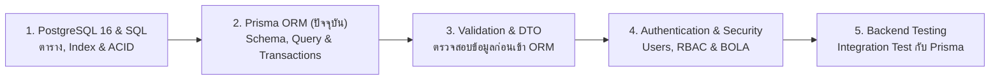

## 1. ข้อผิดพลาดที่พบบ่อย (Anti-patterns)

1. **การสร้าง `new PrismaClient()` หลายอินสแตนซ์ในแอปพลิเคชัน**
   - **ปัญหา**: ทำให้เกิดการเปิด Connection Pool ซ้อนกันหลายชุดจนฐานข้อมูล PostgreSQL ล่มด้วยข้อผิดพลาด `too many clients already`
   - **วิธีแก้**: Inject `PrismaService` ที่เป็น Singleton ผ่าน Dependency Injection ของ NestJS เสมอ
2. **การเรียกใช้ `this.prisma` แทน `tx` ภายใน Interactive Transaction**
   - **ปัญหา**: คำสั่งที่เรียกผ่าน `this.prisma` จะไม่ถูกรวมอยู่ใน Transaction นั้น หากเกิด Error จะไม่ถูก Rollback และหากมีการล็อกแถวเดียวกันจะทำให้เกิด Deadlock กับตัวเองทันที
   - **วิธีแก้**: ส่งต่อและเรียกใช้เฉพาะพารามิเตอร์ `tx` ตลอดทั้งฟังก์ชันที่ทำงานใน `$transaction(async (tx) => { ... })`
3. **การดึงข้อมูลทั้งหมดมาคำนวณในหน่วยความจำของ Node.js แทนการใช้ Database Aggregation**
   - **ปัญหา**: สั่ง `prisma.order.findMany()` ดึงใบสั่งซื้อ 100,000 แถวมาหาผลรวมยอดขายใน JavaScript ทำให้ Event Loop ค้างและเกิด Out-Of-Memory
   - **วิธีแก้**: ใช้ `prisma.order.aggregate({ _sum: { grandTotalThb: true } })` หรือ `groupBy` เสมอ
4. **การลืมสร้าง Index ให้คอลัมน์ Foreign Key และคอลัมน์ที่ใช้ใน `WHERE` / `ORDER BY`**
   - **ปัญหา**: ใน PostgreSQL คอลัมน์ Foreign Key ไม่มี Index อัตโนมัติ ทำให้การ `include` หรือกรองตาม `categoryId` / `userId` ช้าลงอย่างมากเมื่อข้อมูลโตขึ้น
   - **วิธีแก้**: ประกาศ `@@index([foreignKey])` และ Composite Index สำหรับคิวรีหลักใน `schema.prisma` ทุกครั้ง
5. **การปล่อยให้ `PrismaClientKnownRequestError` หลุดออกไปเป็น HTTP 500**
   - **ปัญหา**: เมื่อลูกค้ากรอกอีเมลซ้ำ Prisma โยน `P2002` ถ้าระบบไม่ดักจับจะกลายเป็น `500 Internal Server Error` แทนที่จะเป็น `409 Conflict`
   - **วิธีแก้**: ติดตั้ง `PrismaClientExceptionFilter` เพื่อแปลงรหัส `P2002`, `P2003`, `P2025` ให้เป็น HTTP Status Code ที่มีความหมายชัดเจน

---

---

## 2. Checklist สรุป

| หมวดหมู่ | รายการตรวจสอบสำหรับการใช้ Prisma ORM ระดับ Production | สถานะที่แนะนำ |
| :--- | :--- | :--- |
| **Schema Design** | ใช้ `Decimal` (`@db.Decimal(12, 2)`) สำหรับราคาและยอดเงินทั้งหมด ห้ามใช้ `Float` | ✅ ต้องผ่าน |
| **Naming Convention** | ใช้ `@map` และ `@@map` เพื่อแปลงชื่อเป็น `snake_case` ใน PostgreSQL | ✅ ต้องผ่าน |
| **Indexing** | สร้าง `@@index` ให้กับทุกคอลัมน์ที่เป็น Foreign Key และคอลัมน์ที่ใช้ Filter/Sort บ่อย | ✅ ต้องผ่าน |
| **Referential Integrity** | กำหนด `onDelete: Restrict` บนตารางการเงินและประวัติคำสั่งซื้อ (`Order`, `Payment`) | ✅ ต้องผ่าน |
| **Query Efficiency** | ใช้ `select` เลือกเฉพาะฟิลด์ที่จำเป็น และไม่ดึง `passwordHash` ติดออกมาโดยไม่จำเป็น | ✅ ต้องผ่าน |
| **Concurrency & ACID** | ใช้ `$transaction` ร่วมกับ Atomic `updateMany` หรือ `FOR UPDATE` ในการตัดสต็อกและรับชำระเงิน | ✅ ต้องผ่าน |
| **SQL Security** | ใช้ Tagged Template `$queryRaw` เท่านั้น และห้ามใช้ `$queryRawUnsafe` กับข้อมูลจากผู้ใช้ | ✅ ต้องผ่าน |
| **Connection Lifecycle** | ใช้ `PrismaService` แบบ Singleton, ตั้งค่า Pool Limit และเปิด `app.enableShutdownHooks()` | ✅ ต้องผ่าน |

---

---

## 3. ลำดับการเรียนที่แนะนำ และ ดูเพิ่มเติมที่

### ดูเพิ่มเติมที่:
- **กลุ่ม BACKEND**:
  - [NestJS 11](/docs/backend/nestjs) — การจัดการ Dependency Injection และ Lifecycle Hooks (`OnModuleInit`, `OnModuleDestroy`)
  - [REST API Design](/docs/backend/rest-api) — การนำคิวรีของ Prisma ไปเชื่อมต่อกับ Offset/Cursor Pagination และ Error Envelope
  - [Validation](/docs/backend/validation) — การตรวจสอบ DTO ขาเข้าด้วย `class-validator` ก่อนส่งเข้าสู่ `PrismaService`
  - [Authentication](/docs/backend/authentication) — การจัดเก็บ `User`, `passwordHash` และการจัดการ Refresh Token ในฐานข้อมูล
  - [Security](/docs/backend/security) — การป้องกันช่องโหว่ BOLA/IDOR โดยการบังคับเงื่อนไข `userId` ในระดับ Prisma Query
- **กลุ่ม DATABASE**:
  - [PostgreSQL 16](/docs/database/postgresql) — สถาปัตยกรรมเชิงลึกของ PostgreSQL, ชนิดข้อมูล Native และ MVCC
  - [Database Design](/docs/database/database-design) — การทำ Normalization, การออกแบบตาราง `OrderItem` และการเก็บ Snapshot ราคา
  - [Indexing](/docs/database/indexing) — หลักการทำงานของ B-Tree Index และการออกแบบ Composite Index ให้ตรงกับ Prisma `where`
  - [Transactions](/docs/database/transactions) — เจาะลึกระดับ Isolation Levels (`Read Committed`, `Repeatable Read`, `Serializable`)
  - [Concurrency](/docs/database/concurrency) — การแก้ปัญหา Race Condition, Lost Update และ Deadlock ในระดับ SQL
  - [Migrations](/docs/database/migrations) — กระบวนการจัดการ Schema Migration บนระบบ Production แบบ Zero-Downtime
  - [Connection Pooling](/docs/database/connection-pooling) — การคำนวณขนาด Connection Pool (`pg.Pool` และ PgBouncer) ให้เหมาะสมกับขนาดเซิร์ฟเวอร์
- **กลุ่ม TESTING**:
  - [Backend Testing](/docs/testing/backend-testing) — เทคนิคการทำ Unit Test (Mocking `PrismaService`) และ Integration Test กับฐานข้อมูลจริง
