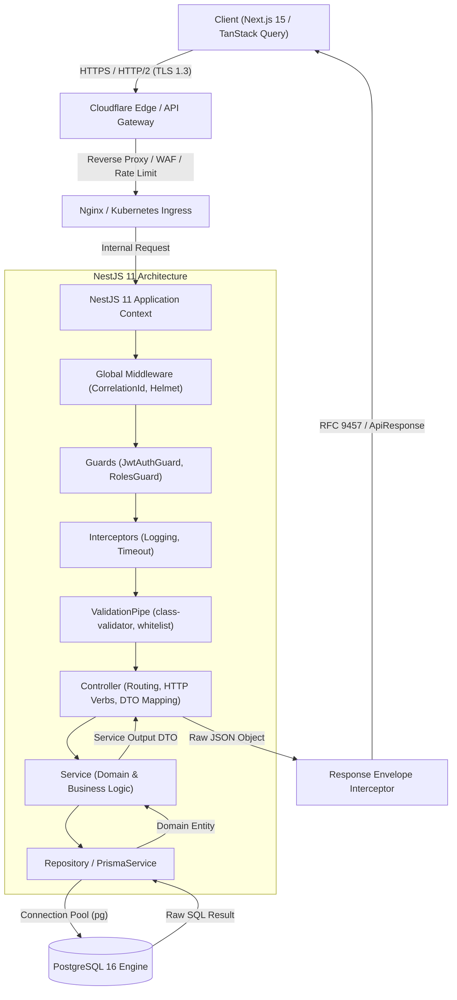

# REST API Design: Enterprise Architecture Blueprint

ยินดีต้อนรับสู่คู่มือแม่บทเชิงสถาปัตยกรรมระดับ **Enterprise Architecture Blueprint** สำหรับการออกแบบและสร้าง **RESTful Web Services** บนมาตรฐาน **HTTP/2** และเฟรมเวิร์ก **NestJS 11** ที่ถูกนำมาปรับใช้จริงในระบบพาณิชย์อิเล็กทรอนิกส์ **Smart Butcher Marketplace** (แพลตฟอร์มการประมูลและจัดจำหน่ายเนื้อสัตว์พรีเมียม เนื้อวากิว A5 และเนื้อ Dry-Aged บ่มพิเศษ)

เอกสารฉบับนี้กำหนดมาตรฐานทางวิศวกรรมซอฟต์แวร์ตั้งแต่การกำหนดโครงสร้าง URL, การบริหารจัดการ HTTP Status Codes ตามมาตรฐาน **RFC 9110 (HTTP Semantics)**, การออกแบบข้อผิดพลาดตามมาตรฐาน **RFC 9457 (Problem Details for HTTP APIs)**, การออกแบบความไม่เปลี่ยนแปลงของผลลัพธ์ (HTTP Idempotency), การจัดการ Pagination แบบ Cursor-based, ไปจนถึงการจัดทำสัญญาร่วมกันระหว่าง Backend และ Frontend (API Contract First) เพื่อรองรับทราฟฟิกระดับหมื่นคำขอต่อวินาทีอย่างมีเสถียรภาพสูงสุด

---

## 1. แนวคิด (Concept)

สถาปัตยกรรม **REST (Representational State Transfer)** ที่คิดค้นโดย Roy Fielding ไม่ใช่โพรโทคอล แต่เป็น **ข้อกำหนดทางสถาปัตยกรรม (Architectural Style)** ที่กำหนดเงื่อนไขสำคัญ 6 ประการ เพื่อให้ระบบแบบกระจายตัว (Distributed Systems) มีความยืดหยุ่น ขยายขีดความสามารถได้ง่าย (Scalability) และมีอิสระในการพัฒนาแยกจากกัน (Modularity):

1. **Client-Server Architecture**: แยกความรับผิดชอบระหว่างส่วนติดต่อผู้ใช้ (Next.js 15 Client) ออกจากระบบประมวลผลข้อมูลและพื้นที่จัดเก็บถาวร (NestJS 11 + PostgreSQL 16)
2. **Statelessness**: ทุก Request ที่ส่งจาก Client มายังเซิร์ฟเวอร์ต้องมีข้อมูลครบถ้วนสมบูรณ์ในตัวเอง เซิร์ฟเวอร์จะไม่เก็บ Session State ใดๆ ของไคลเอนต์ไว้ในหน่วยความจำเครื่อง ทำให้ระบบสามารถทำ Horizontal Scaling เพิ่ม Pods ใน Kubernetes ได้อย่างไร้ขีดจำกัด
3. **Cacheability**: ข้อมูลทุก Response ต้องประกาศอย่างชัดเจนผ่าน HTTP Headers (`Cache-Control`, `ETag`) ว่าสามารถแคชได้หรือไม่ และแคชได้นานเท่าใด เพื่อลดภาระของ Database
4. **Layered System**: ไคลเอนต์ไม่จำเป็นต้องรับรู้ว่ากำลังสื่อสารกับเซิร์ฟเวอร์ปลายทางโดยตรง หรือกำลังผ่าน Cloudflare CDN, API Gateway, Load Balancer หรือ Reverse Proxy
5. **Uniform Interface**: การกำหนดช่องทางการเข้าถึงและจัดการ Resource ที่เป็นมาตรฐานเดียวกันทั้งหมดผ่าน URI, HTTP Verbs (`GET`, `POST`, `PUT`, `PATCH`, `DELETE`) และ MIME Types (`application/json`)
6. **Code on Demand (Optional)**: เซิร์ฟเวอร์สามารถส่งโค้ดประมวลผลมาให้ไคลเอนต์รันได้ชั่วคราว (ไม่นิยมใช้ในสถาปัตยกรรม Microservices/Modern REST)

<Callout type="note" title="ทำไม Smart Butcher Marketplace จึงเลือก REST คู่กับ HTTP/2?">
แม้ว่า gRPC จะมีประสิทธิภาพด้าน Serialization สูงกว่า และ GraphQL จะมีความยืดหยุ่นในการเลือกฟิลด์ข้อมูล แต่สำหรับระบบค้าปลีกเนื้อสัตว์พรีเมียมที่ต้องเชื่อมต่อกับบุคคลภายนอก เช่น ระบบชำระเงินของธนาคาร, ระบบจัดส่งห้องเย็นควบคุมอุณหภูมิ และระบบแคช CDN สาธารณะ สถาปัตยกรรม REST บนมาตรฐาน HTTP/2 มอบความสมดุลสูงสุดทั้งด้าน Caching ประสิทธิภาพการบีบอัดส่วนหัว HPACK และความง่ายต่อการพัฒนา
</Callout>

---

## 2. หลักการเบื้องหลัง (Under the Hood)

### 2.1 ภาพรวมวงจรการเดินทางของข้อมูล (End-to-End Request Lifecycle)

ในระบบ **Smart Butcher Marketplace** คำขอที่ถูกส่งเข้ามาจากผู้ใช้งานจะเดินทางผ่านเลเยอร์ต่างๆ ตามสถาปัตยกรรมแบบ Clean Architecture ดังแผนภาพต่อไปนี้:



### 2.2 การประมวลผลบนโปรโตคอล HTTP/2

ระบบ Backend รองรับ **HTTP/2 Multiplexing** ทำให้คำขอมากกว่า 100 รายการสามารถส่งผ่าน TCP Connection เพียงชุดเดียวแบบคู่ขนาน ป้องกันปัญหา Head-of-Line Blocking ที่เคยเกิดใน HTTP/1.1 นอกจากนี้การบีบอัดส่วนหัวคำขอด้วยอัลกอริทึม **HPACK** ยังช่วยลดขนาด Overhead ของ JWT Cookie และ Security Headers ลงได้มากกว่า 85%

### 2.3 ตารางสารบัญเจาะลึก 7 หัวข้อย่อยในโมดูล REST API

| ลำดับ | หัวข้อย่อย | ขอบเขตเนื้อหาและแกนสถาปัตยกรรม | ลิงก์เข้าสู่บทเรียน |
| :---: | :--- | :--- | :--- |
| 1 | **Status Codes** | การเลือกใช้ HTTP Status Codes (2xx, 3xx, 4xx, 5xx) ให้สอดคล้องกับผลลัพธ์เชิงธุรกิจและ RFC 9110 | [เปิดอ่าน Status Codes](/docs/backend/rest-api/status-codes) |
| 2 | **Resource URL** | กฎเกณฑ์การตั้งชื่อ Resource URI, Plural Nouns, Hierarchical Relationship, Sub-resources | [เปิดอ่าน Resource URL](/docs/backend/rest-api/resource-url) |
| 3 | **HTTP Idempotency** | กลไก `Idempotency-Key` ร่วมกับ Redis ป้องกันการหักเงินซ้ำและการสั่งซื้อเนื้อซ้ำซ้อน | [เปิดอ่าน HTTP Idempotency](/docs/backend/rest-api/http-idempotency) |
| 4 | **Response Envelope** | การออกแบบโครงสร้างมาตรฐาน `ApiResponse<T>` ทั้ง Success และ RFC 9457 Problem Details | [เปิดอ่าน Response Envelope](/docs/backend/rest-api/response-envelope) |
| 5 | **Pagination Filter** | สถาปัตยกรรม Cursor-based vs Offset-based Pagination และ Dynamic Search / Filtering | [เปิดอ่าน Pagination Filter](/docs/backend/rest-api/pagination-filter) |
| 6 | **Versioning CORS** | กลยุทธ์การทำ URI Versioning (`/v1`, `/v2`) และการคอนฟิก Cross-Origin Resource Sharing ขั้นสูง | [เปิดอ่าน Versioning CORS](/docs/backend/rest-api/versioning-cors) |
| 7 | **Frontend Contract** | สัญญาระหว่าง Client-Server, Type Sharing, OpenAPI Codegen และ TanStack Query Integration | [เปิดอ่าน Frontend Contract](/docs/backend/rest-api/frontend-contract) |
| 8 | **Anti-patterns** | ข้อผิดพลาดที่พบบ่อย (Anti-patterns), เช็กลิสต์ความพร้อมก่อนส่งมอบงาน และลำดับการเรียนรู้ | [เปิดอ่าน Anti-patterns](/docs/backend/rest-api/pitfalls) |

---

## 3. ตัวอย่างโค้ด (Smart Butcher Marketplace)

### ตัวอย่างที่ 1: การออกแบบ Resource Controller ระดับ Enterprise สำหรับจัดการแคตตาล็อกเนื้อพรีเมียม

ตัวอย่างนี้แสดงการใช้งาน Controller ที่ปฏิบัติตามมาตรฐาน RESTful อย่างเคร่งครัด: การตั้งชื่อ URL ด้วย Plural Noun, การใช้ HTTP Verbs ที่ถูกต้อง, การระบุ HTTP Status Codes ตามมาตรฐาน RFC, การทำ Parameter Validation, และการเชื่อมโยงกับ Swagger Documentation

```typescript filename="src/modules/products/products.controller.ts"
import {
  Controller,
  Get,
  Post,
  Put,
  Patch,
  Delete,
  Param,
  Query,
  Body,
  HttpCode,
  HttpStatus,
  ParseUUIDPipe,
  UseGuards,
  ValidationPipe,
} from '@nestjs/common';
import {
  ApiTags,
  ApiOperation,
  ApiResponse,
  ApiParam,
  ApiBearerAuth,
} from '@nestjs/swagger';
import { ProductsService } from './products.service';
import { CreateProductDto } from './dto/create-product.dto';
import { UpdateProductDto } from './dto/update-product.dto';
import { ProductQueryDto } from './dto/product-query.dto';
import { ProductResponseDto } from './dto/product-response.dto';
import { PaginatedResponseDto } from '../../common/dto/paginated-response.dto';
import { JwtAuthGuard } from '../auth/guards/jwt-auth.guard';
import { RolesGuard } from '../auth/guards/roles.guard';
import { Roles } from '../auth/decorators/roles.decorator';
import { Role } from '@prisma/client';

@ApiTags('Products (Meat Catalog)')
@Controller({ path: 'products', version: '1' })
export class ProductsController {
  constructor(private readonly productsService: ProductsService) {}

  @Get()
  @ApiOperation({ summary: 'ดึงรายการสินค้าเนื้อสัตว์ทั้งหมด พร้อมระบบกรองและ Cursor Pagination' })
  @ApiResponse({ status: HttpStatus.OK, description: 'สำเร็จ', type: PaginatedResponseDto<ProductResponseDto> })
  async findAll(
    @Query(new ValidationPipe({ transform: true, whitelist: true }))
    query: ProductQueryDto,
  ): Promise<PaginatedResponseDto<ProductResponseDto>> {
    return this.productsService.findAll(query);
  }

  @Get(':id')
  @ApiOperation({ summary: 'ดึงรายละเอียดเนื้อสัตว์รายชิ้นตาม UUID พร้อมหมวดหมู่และระดับมาร์บลิง' })
  @ApiParam({ name: 'id', description: 'รหัส UUID ประจำตัวสินค้า' })
  @ApiResponse({ status: HttpStatus.OK, description: 'พบข้อมูลสินค้า', type: ProductResponseDto })
  @ApiResponse({ status: HttpStatus.NOT_FOUND, description: 'ไม่พบสินค้าชิ้นนี้ในระบบ' })
  async findOne(
    @Param('id', new ParseUUIDPipe({ version: '4' })) id: string,
  ): Promise<ProductResponseDto> {
    return this.productsService.findOneById(id);
  }

  @Post()
  @UseGuards(JwtAuthGuard, RolesGuard)
  @Roles(Role.ADMIN, Role.BUTCHER_CHEF)
  @ApiBearerAuth()
  @HttpCode(HttpStatus.CREATED)
  @ApiOperation({ summary: 'เพิ่มสินค้าเนื้อสัตว์ใหม่เข้าสู่ระบบ (เฉพาะ Butcher Chef และ Admin)' })
  @ApiResponse({ status: HttpStatus.CREATED, description: 'สร้างสินค้าสำเร็จ', type: ProductResponseDto })
  @ApiResponse({ status: HttpStatus.BAD_REQUEST, description: 'ข้อมูล DTO ไม่ถูกต้อง' })
  async create(
    @Body(new ValidationPipe({ whitelist: true, forbidNonWhitelisted: true }))
    dto: CreateProductDto,
  ): Promise<ProductResponseDto> {
    return this.productsService.create(dto);
  }

  @Patch(':id')
  @UseGuards(JwtAuthGuard, RolesGuard)
  @Roles(Role.ADMIN, Role.BUTCHER_CHEF)
  @ApiBearerAuth()
  @ApiOperation({ summary: 'อัปเดตข้อมูลสินค้าเนื้อสัตว์เฉพาะบางส่วน (เช่น ราคาหรือจำนวนสต็อก)' })
  @ApiResponse({ status: HttpStatus.OK, description: 'อัปเดตสำเร็จ', type: ProductResponseDto })
  async updatePartial(
    @Param('id', new ParseUUIDPipe({ version: '4' })) id: string,
    @Body(new ValidationPipe({ whitelist: true, forbidNonWhitelisted: true }))
    dto: UpdateProductDto,
  ): Promise<ProductResponseDto> {
    return this.productsService.updatePartial(id, dto);
  }

  @Delete(':id')
  @UseGuards(JwtAuthGuard, RolesGuard)
  @Roles(Role.ADMIN)
  @ApiBearerAuth()
  @HttpCode(HttpStatus.NO_CONTENT)
  @ApiOperation({ summary: 'ลบสินค้าเนื้อสัตว์ออกจากระบบแบบ Soft Delete' })
  @ApiResponse({ status: HttpStatus.NO_CONTENT, description: 'ลบสินค้าสำเร็จ (ไม่มีเนื้อหาส่งกลับ)' })
  async remove(
    @Param('id', new ParseUUIDPipe({ version: '4' })) id: string,
  ): Promise<void> {
    await this.productsService.softDelete(id);
  }
}
```

---

### ตัวอย่างที่ 2: ระบบสั่งซื้อสินค้าเนื้อสัตว์แบบ Idempotent REST API พร้อม Interceptor บันทึก Key

ในระบบสั่งซื้อเนื้อวากิวที่มีมูลค่าสูง การกดส่งคำสั่งซื้อซ้ำซ้อนจากอินเทอร์เน็ตที่กระตุก (Network Flapping) อาจทำให้เกิดการตัดเงินซ้ำซ้อน หรือสต็อกเนื้อถูกจองสองรอบ ตัวอย่างนี้แสดงการใช้งาน `IdempotencyInterceptor` และการจัดการ Transaction:

```typescript filename="src/common/interceptors/idempotency.interceptor.ts"
import {
  Injectable,
  NestInterceptor,
  ExecutionContext,
  CallHandler,
  ConflictException,
  BadRequestException,
} from '@nestjs/common';
import { Observable, of } from 'rxjs';
import { tap } from 'rxjs/operators';
import { Request } from 'express';
import { RedisService } from '../../modules/redis/redis.service';

@Injectable()
export class IdempotencyInterceptor implements NestInterceptor {
  constructor(private readonly redisService: RedisService) {}

  async intercept(context: ExecutionContext, next: CallHandler): Promise<Observable<unknown>> {
    const request = context.switchToHttp().getRequest<Request>();
    const idempotencyKey = request.header('x-idempotency-key');

    // ถ้าไม่มี Header ส่งมา บังคับปฏิเสธคำขอสำหรับ Endpoint สำคัญทางการเงิน
    if (!idempotencyKey) {
      throw new BadRequestException('ส่วนหัว X-Idempotency-Key จำเป็นสำหรับการทำธุรกรรมสั่งซื้อ');
    }

    const redisKey = `idempotency:${idempotencyKey}`;
    const cachedResponse = await this.redisService.get(redisKey);

    if (cachedResponse) {
      const parsed = JSON.parse(cachedResponse);
      if (parsed.status === 'IN_PROGRESS') {
        throw new ConflictException('คำขอนี้กำลังอยู่ระหว่างการประมวลผล กรุณารอผลลัพธ์เดิม');
      }
      // ส่งคืนผลลัพธ์เดิมที่เคยประมวลผลสำเร็จไปแล้วทันที
      return of(parsed.data);
    }

    // ล็อกสถานะไว้ 120 วินาที ป้องกันคำขอคู่ขนานซ้อนกัน (Race Condition)
    await this.redisService.set(
      redisKey,
      JSON.stringify({ status: 'IN_PROGRESS' }),
      'EX',
      120,
    );

    return next.handle().pipe(
      tap(async (responseData) => {
        // เมื่อประมวลผลสำเร็จ บันทึกผลลัพธ์จริงลง Redis เป็นเวลา 24 ชั่วโมง
        await this.redisService.set(
          redisKey,
          JSON.stringify({ status: 'COMPLETED', data: responseData }),
          'EX',
          86400,
        );
      }),
    );
  }
}
```

```typescript filename="src/modules/orders/orders.controller.ts"
import {
  Controller,
  Post,
  Body,
  UseGuards,
  UseInterceptors,
  HttpStatus,
  HttpCode,
} from '@nestjs/common';
import { ApiTags, ApiOperation, ApiResponse, ApiHeader, ApiBearerAuth } from '@nestjs/swagger';
import { OrdersService } from './orders.service';
import { CreateOrderDto } from './dto/create-order.dto';
import { OrderResponseDto } from './dto/order-response.dto';
import { JwtAuthGuard } from '../auth/guards/jwt-auth.guard';
import { CurrentUser } from '../auth/decorators/current-user.decorator';
import { UserPayload } from '../auth/interfaces/user-payload.interface';
import { IdempotencyInterceptor } from '../../common/interceptors/idempotency.interceptor';

@ApiTags('Orders')
@Controller({ path: 'orders', version: '1' })
export class OrdersController {
  constructor(private readonly ordersService: OrdersService) {}

  @Post('checkout')
  @UseGuards(JwtAuthGuard)
  @UseInterceptors(IdempotencyInterceptor)
  @ApiBearerAuth()
  @HttpCode(HttpStatus.CREATED)
  @ApiOperation({ summary: 'ยืนยันสั่งซื้อเนื้อพรีเมียมและตัดสต็อก (รองรับ Idempotency ป้องกันบิลเบิ้ล)' })
  @ApiHeader({
    name: 'X-Idempotency-Key',
    description: 'UUID v4 เพื่อป้องกันคำขอซ้ำซ้อนจาก Network Timeout',
    required: true,
  })
  @ApiResponse({ status: HttpStatus.CREATED, description: 'สร้างคำสั่งซื้อสำเร็จ', type: OrderResponseDto })
  async checkout(
    @CurrentUser() user: UserPayload,
    @Body() createOrderDto: CreateOrderDto,
  ): Promise<OrderResponseDto> {
    return this.ordersService.processCheckout(user.id, createOrderDto);
  }
}
```

---

## 4. ข้อผิดพลาดที่พบบ่อย (Anti-pattern vs Best Practice)

### 4.1 Anti-pattern: การคืนค่า HTTP 200 OK เสมอแล้วยัด Error ลงใน Response Body

ความผิดพลาดที่พบบ่อยที่สุดของนักพัฒนาคือการไม่กล้าคืนรหัส 4xx หรือ 5xx และเลือกคืนค่า 200 OK ทุกกรณี:

```json
// ❌ ผิดมหันต์: 200 OK พร้อม Error ซ่อนใน JSON
HTTP/1.1 200 OK
Content-Type: application/json

{
  "status": "error",
  "code": 404,
  "message": "Product Japanese Wagyu A5 Ribeye not found"
}
```

**ผลกระทบเชิงลบ**:
- API Gateway, Load Balancer และ CDN (เช่น Cloudflare) จะเข้าใจว่าคำขอนี้สำเร็จ จึงนำข้อผิดพลาดนี้ไปแคชไว้ ส่งผลให้ผู้ใช้รายอื่นได้รับผลผิดพลาดตามไปด้วย
- เครื่องมือ Monitoring อย่าง Datadog, Prometheus หรือ New Relic จะตรวจไม่พบอัตราความผิดพลาด (Error Rate) ทำให้การตั้ง Alert ล้มเหลว

**แนวทางที่ถูกต้อง (Best Practice)**:
คืนรหัส `404 Not Found` หรือ `400 Bad Request` พร้อมโครงสร้างมาตรฐาน **RFC 9457 Problem Details**:

```json
//  ถูกต้อง: คืน 404 Not Found ตามมาตรฐาน RFC 9457
HTTP/1.1 404 Not Found
Content-Type: application/problem+json

{
  "type": "https://api.smartbutcher.com/errors/product-not-found",
  "title": "Resource Not Found",
  "status": 404,
  "detail": "สินค้าเนื้อวากิวรหัส 'c3b8-4d5e' ไม่มีอยู่ในระบบหรือถูกยกเลิกการจัดจำหน่ายแล้ว",
  "instance": "/v1/products/c3b8-4d5e",
  "traceId": "req-98fa-1123-bcde"
}
```

### 4.2 Anti-pattern: การตั้งชื่อ URL เป็นคำกริยา (Action-oriented RPC Style)

การใช้คำกริยาใน URL เป็นการละเมิดหลักการ Uniform Interface ของ REST:

-  `POST /api/createProduct` ➔  `POST /api/v1/products`
-  `GET /api/getAllMeatCategories` ➔  `GET /api/v1/categories`
-  `POST /api/deleteOrder?id=123` ➔  `DELETE /api/v1/orders/123`
-  `POST /api/updateProductPrice` ➔  `PATCH /api/v1/products/123`

---

## 5. ควรใช้เมื่อไหร่ และ ไม่ควรใช้เมื่อไหร่

### ควรใช้ RESTful API เมื่อ:
1. **Public APIs & Client-Facing Web**: ระบบที่ต้องการให้แอปพลิเคชันภายนอก, พาร์ตเนอร์จัดส่ง, ธนาคาร, หรือเว็บเบราว์เซอร์เข้าถึงได้ง่ายโดยไม่ต้องพึ่งพา SDK หรือ Library พิเศษ
2. **ระบบที่ต้องการใช้ประโยชน์สูงสุดจาก HTTP Caching**: แคตตาล็อกเนื้อสัตว์, รายการราคา, เมนูหมวดหมู่สินค้า ที่สามารถวางแคชไว้บน Edge Server (Cloudflare) เพื่อประหยัดค่าเซิร์ฟเวอร์
3. **ระบบ CRUD มาตรฐาน**: งานบันทึกและจัดการข้อมูลที่สอดคล้องกับโมเดลฐานข้อมูลที่มีรูปแบบชัดเจน
4. **ทีมพัฒนาแยกขาดจากกันชัดเจน**: ทีม Frontend และ Backend ตกลงสเปกผ่าน OpenAPI / Swagger Specification ล่วงหน้าได้

### ไม่ควรใช้ RESTful API เมื่อ:
1. **การสื่อสารระหว่าง Microservices ภายในระบบ (East-West Traffic)**: ควรเปลี่ยนไปใช้ **gRPC over HTTP/2** หรือ **Message Broker (Kafka / RabbitMQ)** เพราะ Binary Protocol อย่าง Protobuf มีความเร็วในการ Serialize สูงกว่า JSON ถึง 5–10 เท่า
2. **การประมูลเนื้อสัตว์แบบ Real-time (Meat Live Auction)**: การยิง HTTP Polling ทุก 500ms เป็นการสิ้นเปลืองทรัพยากรมหาศาล ควรเปลี่ยนไปใช้ **WebSocket** หรือ **Server-Sent Events (SSE)**
3. **การดึงข้อมูลที่มีความสัมพันธ์ซับซ้อนหลายมิติ**: หากหน้า Mobile App ต้องการเลือกดึงฟิลด์เฉพาะเจาะจงเพื่อประหยัด Data บนมือถือ การใช้ **GraphQL** อาจเหมาะสมกว่าการสร้าง Custom Endpoint สำหรับแต่ละหน้าจอ

---

## 6. คำถามสัมภาษณ์งาน (Interview Q&A)

### Q1: อธิบายความแตกต่างเชิงลึกระหว่าง `PUT` และ `PATCH` ในการอัปเดตข้อมูลสินค้าเนื้อสัตว์ และจะออกแบบอย่างไรให้ปลอดภัยจาก Over-posting และ Idempotency?
> **แนวคำตอบระดับ Principal Architect:**
> ตามมาตรฐาน **RFC 9110**:
> - **`PUT` เป็น Idempotent Method**: มีเจตนารมณ์ในการ **แทนที่ Resource ทั้งก้อน (Complete Replacement)** นั่นแปลว่าหากผู้ใช้ส่งเฉพาะ `{ "price": 1200 }` มาทาง `PUT /v1/products/wagyu-a5` ฟิลด์อื่นๆ เช่น `name`, `category`, `marblingScore` ที่ไม่ได้ระบุมาจะต้องถูกรีเซ็ตหรือล้างค่าเป็นค่าดีฟอลต์ หาก Resource นั้นยังไม่มีอยู่ ระบบอาจสร้าง Resource ใหม่ด้วยค่านั้น (Upsert) การเรียก `PUT` ซ้ำกี่ครั้งด้วย Payload เดียวกัน ผลลัพธ์สุดท้ายในฐานข้อมูลจะต้องเหมือนเดิมเสมอ
> - **`PATCH` ไม่จำเป็นต้องเป็น Idempotent**: มีเจตนารมณ์ในการ **ปรับปรุงเฉพาะบางส่วน (Partial Modification)** เช่น ส่งเฉพาะฟิลด์ที่ต้องการเปลี่ยน `{ "stockQuantity": 15 }` ไปอัปเดตเฉพาะคอลัมน์นั้นในฐานข้อมูล
> 
> ในการป้องกันความปลอดภัย:
> 1. **Over-posting Prevention**: ต้องใช้งาน NestJS `ValidationPipe` ร่วมกับออปชัน `whitelist: true` และ `forbidNonWhitelisted: true` ใน `UpdateProductDto` เพื่อทิ้งหรือส่ง 400 Bad Request ทันทีหากมีใครพยายามส่งฟิลด์อันตราย เช่น `{ "isVerified": true }` หรือ `{ "adminDiscount": 100 }`
> 2. **Idempotency Protection**: หากการ `PATCH` มีลักษณะเป็นคำสั่งสัมพัทธ์ เช่น "หักสต็อกเนื้อ 2 ชิ้น" (`decrement: 2`) ซึ่งไม่ใช่ Idempotent ในตัวเอง จะต้องบังคับให้ไคลเอนต์แนบ Header `X-Idempotency-Key` แล้วนำไปควบคุม Atomic Lock ด้วย Redis เสมอ

### Q2: ในระบบ E-Commerce ที่มีคำสั่งซื้อเนื้อสัตว์ Dry-Aged ราคาสูง เราจะออกแบบ API ให้รองรับ "Network Timeout & Retry" อย่างไรโดยไม่เกิดปัญหาการตัดเงินหรือหักสต็อกซ้ำสอง?
> **แนวคำตอบระดับ Principal Architect:**
> ปัญหานี้เรียกว่า **Two Generals' Problem** บนระบบเครือข่ายที่ไม่น่าเชื่อถือ (Unreliable Network) แนวทางการออกแบบมี 3 ขั้นตอนหลัก:
> 1. **Idempotency Key Pattern**: ไคลเอนต์ (Next.js) จะต้องสร้าง UUID v4 ขึ้นมาเป็น `X-Idempotency-Key` ประจำตะกร้าสินค้านั้น และส่งมาใน Header ของคำขอ `POST /v1/orders/checkout`
> 2. **Distributed Lock & State Caching ใน Redis**:
>    - เมื่อคำขอมาถึง เซิร์ฟเวอร์จะทำคำสั่ง `SET idempotency:<key> "IN_PROGRESS" NX EX 120` บน Redis
>    - หากส่งคำขอเดิมซ้ำขณะที่ระบบกำลังประมวลผล เซิร์ฟเวอร์จะคืนรหัส `409 Conflict` หรือ `425 Too Early` เพื่อแจ้งให้ไคลเอนต์รอ
>    - หากประมวลผลเสร็จสิ้น (บันทึกฐานข้อมูลและเรียก Payment Gateway สำเร็จ) ผลลัพธ์ `OrderResponseDto` จะถูกบันทึกทับลงในคีย์เดิมเป็นเวลา 24 ชั่วโมง
>    - หากเกิด Network Timeout ระหว่างทางแล้วไคลเอนต์ส่ง Retry เข้ามาใหม่ เซิร์ฟเวอร์จะตรวจพบว่าคีย์นี้ประมวลผลเสร็จแล้ว และดึงผลลัพธ์จาก Redis คืนกลับไปทันทีโดยไม่ต้องรันคำสั่งตัดเงินหรือหักสต็อกซ้ำในฐานข้อมูล
> 3. **Database Transaction Isolation**: การหักสต็อกสินค้าต้องทำภายใต้ Database Transaction ระดับ `SERIALIZABLE` หรือใช้คำสั่ง SQL `SELECT ... FOR UPDATE` บนแถวของสินค้าเนื้อชิ้นนั้น เพื่อป้องกัน Race Condition จากคำขอคู่ขนาน

---

## Production Checklist ก่อนปล่อย API ออกสู่ Production

- [ ] **1. URL Naming Standard**: ใช้คำนามพหูพจน์ (Plural Noun), อักษรพิมพ์เล็กคั่นด้วยเครื่องหมายขีดกลาง (Kebab-case เช่น `/dry-aged-steaks`), และไม่มีการใส่คำกริยาใน Path
- [ ] **2. API Versioning**: กำหนด Versioning ผ่าน URI (`/v1/...`) เป็นค่าเริ่มต้น และเปิดใช้งานบน NestJS Application Context อย่างถูกต้อง
- [ ] **3. Strict Status Code Mapping**: คืนรหัส 201 สำหรับสร้าง, 204 สำหรับลบ, 400 สำหรับ DTO ผิดพลาด, 401/403 สำหรับสิทธิ์, 404 สำหรับไม่พบ, 409 สำหรับขัดแย้ง, 422 สำหรับเงื่อนไขธุรกิจ
- [ ] **4. Global RFC 9457 Error Filter**: มี `HttpExceptionFilter` คอยดักจับข้อผิดพลาดทั้งระบบ และแปลงเป็น JSON Format ที่มี `traceId` สำหรับสืบค้นใน Log
- [ ] **5. DTO Whitelisting**: เปิดออปชัน `whitelist: true` และ `forbidNonWhitelisted: true` ใน `ValidationPipe` ทุก Endpoint เพื่อสกัดกั้น Mass Assignment Attack
- [ ] **6. Idempotency Support**: รองรับ `X-Idempotency-Key` ในทุก Endpoint ที่เกี่ยวกับเงินและสต็อกสินค้า โดยมี Redis ทำหน้าที่เป็น Idempotency Store
- [ ] **7. HTTP/2 & Compression**: เปิดใช้งานการเชื่อมต่อแบบ HTTP/2 บน Reverse Proxy (Nginx / Cloudflare) และเปิดใช้งาน Gzip/Brotli Compression สำหรับ Payload ขนาดใหญ่กว่า 1KB
- [ ] **8. Security Headers**: ติดตั้ง `@fastify/helmet` หรือ `helmet` พร้อมตั้งค่า Strict Content-Security-Policy และ HSTS
- [ ] **9. Rate Limiting**: กำหนดขีดจำกัดจำนวนคำขอด้วย `@nestjs/throttler` (เช่น จำกัด 100 คำขอต่อนาทีสำหรับผู้ใช้ทั่วไป และ 5 คำขอต่อนาทีสำหรับ Endpoint เข้าสู่ระบบ)
- [ ] **10. OpenAPI & Type Synchronization**: รันคำสั่งตรวจสอบว่า Swagger Doc สอดคล้องกับ DTO จริง 100% พร้อม Export OpenAPI Specification ไปสร้าง TypeScript Client ฝั่ง Frontend

---

## ลำดับการเรียนที่แนะนำ และ ดูเพิ่มเติมที่

เพื่อความเข้าใจในสถาปัตยกรรม REST API อย่างสมบูรณ์ ขอแนะนำให้ศึกษาหัวข้อต่างๆ ตามลำดับดังต่อไปนี้:

1. ศึกษาความหมายและหน้าที่ของรหัสสถานะ: [Status Codes](/docs/backend/rest-api/status-codes)
2. กฎการตั้งชื่อ URL และความสัมพันธ์ของ Resource: [Resource URL](/docs/backend/rest-api/resource-url)
3. กลไกความปลอดภัยในการทำธุรกรรมซ้ำ: [HTTP Idempotency](/docs/backend/rest-api/http-idempotency)
4. การออกแบบโครงสร้างห่อหุ้มข้อมูลผลลัพธ์: [Response Envelope](/docs/backend/rest-api/response-envelope)
5. การแบ่งหน้าและการกรองข้อมูลขนาดใหญ่: [Pagination Filter](/docs/backend/rest-api/pagination-filter)
6. การจัดการเวอร์ชันและการรักษาความปลอดภัยข้ามโดเมน: [Versioning CORS](/docs/backend/rest-api/versioning-cors)
7. การสร้างสัญญาร่วมกับฝั่ง Frontend: [Frontend Contract](/docs/backend/rest-api/frontend-contract)
8. ข้อผิดพลาดร้ายแรงที่ต้องหลีกเลี่ยง: [REST API Anti-patterns](/docs/backend/rest-api/pitfalls)
