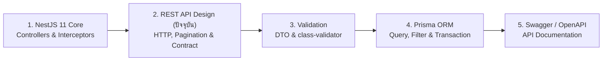

# REST API Design

คู่มือการออกแบบสถาปัตยกรรม **RESTful API** ระดับ Production-Grade สำหรับระบบ **Smart Butcher Marketplace** (แพลตฟอร์มอีคอมเมิร์ซค้าเนื้อสัตว์พรีเมียม เนื้อวากิว A5 และเนื้อ Dry-Aged) โดยอ้างอิงตามมาตรฐาน **RFC 9110 (HTTP Semantics)**, **RFC 9457 (Problem Details for HTTP APIs)** และการประยุกต์ใช้งานจริงบน **NestJS 11** และ **HTTP/2** เพื่อให้ระบบมีความสม่ำเสมอ ทนทานต่อเครือข่ายที่ไม่เสถียร และเชื่อมต่อกับฝั่ง Frontend (Next.js / TanStack Query) ได้อย่างไร้รอยต่อ

## สารบัญหัวข้อในหน้านี้

| ลำดับ | หัวข้อหลัก | สิ่งที่คุณจะได้เรียนรู้ |
| :--- | :--- | :--- |
| **1** | [1. HTTP Methods และ Idempotency](#1-http-methods-และ-idempotency) | ความหมายเชิงลึกของ GET, POST, PUT, PATCH, DELETE และการทำ Idempotency Key ป้องกันการตัดเงินซ้ำ |
| **2** | [2. HTTP Status Codes ที่ใช้จริงในระบบ Production](#2-http-status-codes-ที่ใช้จริงในระบบ-production) | การเลือกใช้รหัสสถานะ 2xx, 3xx, 4xx, 5xx อย่างแม่นยำตามบริบททางธุรกิจ |
| **3** | [3. การตั้งชื่อ Resource และออกแบบ URL Structure](#3-การตั้งชื่อ-resource-และออกแบบ-url-structure) | กฎการใช้คำนามพหูพจน์, Hierarchical Sub-resources และการแปลง Action เป็น Resource |
| **4** | [4. มาตรฐานรูปแบบ Response และ Error Envelope](#4-มาตรฐานรูปแบบ-response-และ-error-envelope) | การสร้าง Standard Response Wrapper และ Global Error Envelope ตามมาตรฐาน RFC 9457 |
| **5** | [5. Pagination, Filtering, Sorting และ Searching](#5-pagination-filtering-sorting-และ-searching) | เปรียบเทียบ Offset vs Cursor Pagination และการออกแบบ Query Parameters ที่ยืดหยุ่น |
| **6** | [6. API Versioning, CORS และความต่างระหว่าง PUT vs PATCH](#6-api-versioning-cors-และความต่างระหว่าง-put-vs-patch) | กลยุทธ์การแบ่งเวอร์ชัน API, การตั้งค่า CORS ที่ปลอดภัย และการอัปเดตข้อมูลแบบเต็มก้อนเทียบกับบางส่วน |
| **7** | [7. การออกแบบ API Contract ให้ฝั่ง Frontend ใช้งานง่าย](#7-การออกแบบ-api-contract-ให้ฝั่ง-frontend-ใช้งานง่าย) | แนวทาง Contract-First, มาตรฐานวันที่ ISO 8601, การจัดการหน่วยเงิน และการรองรับ Optimistic UI |
| **8** | [ข้อผิดพลาดที่พบบ่อย (Anti-patterns)](#ข้อผิดพลาดที่พบบ่อย-anti-patterns) | หลุมพรางการออกแบบ API ที่ทำให้ระบบดูแลรักษายากและเสี่ยงต่อบั๊ก |
| **9** | [Checklist สรุป](#checklist-สรุป) | ตารางตรวจสอบความพร้อมของ REST API ก่อนขึ้นระบบ Production |
| **10** | [ลำดับการเรียนที่แนะนำ และ ดูเพิ่มเติมที่](#ลำดับการเรียนที่แนะนำ-และ-ดูเพิ่มเติมที่) | แผนผังการเรียนรู้ต่อเนื่องและลิงก์เชื่อมโยงไปยังบทเรียนที่เกี่ยวข้อง |

---

## 1. HTTP Methods และ Idempotency

### แนวคิด (Concept)
ในสถาปัตยกรรม REST (Representational State Transfer) เราใช้ **HTTP Methods (Verbs)** เป็นตัวกำหนด "เจตนาของการกระทำ" ต่อข้อมูล (Resource) แทนการเขียนชื่อกริยาไว้ใน URL โดยคุณลักษณะสำคัญที่วิศวกร Backend ต้องเข้าใจอย่างถ่องแท้คือ **Safety (ความปลอดภัยต่อสถานะ)** และ **Idempotency (การทำซ้ำแล้วผลลัพธ์ทางสถานะของระบบเหมือนเดิม)**

| HTTP Method | หน้าที่หลักใน Smart Butcher | Safe? | Idempotent? | รองรับ Request Body? |
| :--- | :--- | :---: | :---: | :---: |
| **GET** | ดึงข้อมูลรายการเนื้อพรีเมียม (`Product`), หมวดหมู่ (`Category`), หรือรายละเอียดคำสั่งซื้อ (`Order`) | ✅ ใช่ | ✅ ใช่ | ❌ ไม่ควรมี |
| **POST** | สร้างคำสั่งซื้อเนื้อใหม่ (`Order`) หรือสร้างรายการชำระเงิน (`Payment`) | ❌ ไม่ | ❌ ไม่ (โดยปกติ) | ✅ มี |
| **PUT** | แทนที่ข้อมูลสินค้า (`Product`) หรือที่อยู่จัดส่งทั้งหมดของ `User` ด้วยข้อมูลก้อนใหม่ทั้งก้อน | ❌ ไม่ | ✅ ใช่ | ✅ มี |
| **PATCH** | แก้ไขข้อมูลบางฟิลด์ เช่น ปรับราคาเนื้อวากิว หรือเปลี่ยนสถานะ `Order` | ❌ ไม่ | ⚠️ ขึ้นกับการออกแบบ | ✅ มี |
| **DELETE** | ลบสินค้าออกจากระบบ หรือยกเลิกรายการในตะกร้า (`OrderItem`) | ❌ ไม่ | ✅ ใช่ | ❌ ไม่นิยมใช้ |

<Callout type="note" title="Idempotency คือหัวใจของระบบการเงินและสต็อกสินค้า">
คำว่า Idempotent หมายความว่า ไม่ว่าไคลเอนต์จะส่งคำขอเดิมซ้ำกี่ครั้ง (เช่น ลูกค้ากดปุ่มจ่ายเงินซ้ำเพราะเน็ตมือถือค้าง หรือระบบ Retry อัตโนมัติทำงาน) ผลลัพธ์ที่เกิดขึ้นกับสถานะในฐานข้อมูลจะต้องเหมือนกับการส่งคำขอเพียงครั้งเดียวเสมอ
</Callout>

### หลักการเบื้องหลัง (Under the Hood)
ตามมาตรฐาน **RFC 9110**:
1. **GET, HEAD, OPTIONS** เป็นทั้ง *Safe* และ *Idempotent* เพราะเป็นเพียงการอ่านข้อมูล ไม่เปลี่ยนแปลงสถานะของเซิร์ฟเวอร์
2. **PUT** เป็น *Idempotent* เสมอ เพราะเป็นการนำ Payload ไปทับสถานะเดิมที่ตำแหน่ง URI นั้นตรงๆ เช่น การสั่งตั้งค่าราคาเนื้อ `ribeye-a5` ให้เป็น `4500` บาท ไม่ว่าจะส่งซ้ำ 10 ครั้ง ราคาก็ยังเป็น `4500` บาท
3. **DELETE** เป็น *Idempotent* ในแง่ของสถานะระบบ แม้การเรียกครั้งแรกจะคืนค่า `200 OK` หรือ `204 No Content` และครั้งถัดไปอาจคืนค่า `404 Not Found` แต่ผลลัพธ์ปลายทางในฐานข้อมูลคือ Resource นั้นถูกลบหายไปเหมือนกัน
4. **POST** ไม่เป็น *Idempotent* โดยธรรมชาติ การยิง `POST /api/v1/orders` ซ้ำ 2 ครั้ง จะสร้างใบสั่งซื้อ 2 ใบ และตัดสต็อกเนื้อวากิว 2 รอบ ดังนั้นในระบบ Production เราจึงต้องสร้างกลไก **Idempotency Key** ผ่าน HTTP Header `Idempotency-Key` เพื่อแปลงให้ POST ในเส้นทางสำคัญ (เช่น การสร้าง `Order` และ `Payment`) มีคุณสมบัติ Idempotent

### ตัวอย่างโค้ด (Smart Butcher Marketplace)

#### ตัวอย่างที่ 1: การใช้ HTTP Methods อย่างถูกต้องใน ProductsController (พื้นฐาน)
```typescript filename="src/modules/products/products.controller.ts"
import {
  Controller,
  Get,
  Post,
  Put,
  Patch,
  Delete,
  Param,
  Body,
  HttpCode,
  HttpStatus,
  ParseUUIDPipe,
} from '@nestjs/common';
import { ProductsService } from './products.service';
import {
  CreateProductDto,
  ReplaceProductDto,
  UpdateProductStockDto,
} from './dto/product.dto';

@Controller('products')
export class ProductsController {
  constructor(private readonly productsService: ProductsService) {}

  // GET: Safe & Idempotent - ดึงข้อมูลเนื้อพรีเมียมตาม ID
  @Get(':id')
  async findOne(@Param('id', ParseUUIDPipe) id: string) {
    return this.productsService.findById(id);
  }

  // POST: Non-Idempotent - เพิ่มรายการเนื้อตัดแต่งชิ้นใหม่เข้าระบบ
  @Post()
  @HttpCode(HttpStatus.CREATED)
  async create(@Body() createDto: CreateProductDto) {
    return this.productsService.create(createDto);
  }

  // PUT: Idempotent - แทนที่ข้อมูลสินค้าชิ้นนั้นทั้งหมดด้วยข้อมูลชุดใหม่
  @Put(':id')
  async replace(
    @Param('id', ParseUUIDPipe) id: string,
    @Body() replaceDto: ReplaceProductDto,
  ) {
    return this.productsService.replace(id, replaceDto);
  }

  // PATCH: อัปเดตเฉพาะจำนวนสต็อกหรือราคาแบบเจาะจงฟิลด์
  @Patch(':id/stock')
  async updateStock(
    @Param('id', ParseUUIDPipe) id: string,
    @Body() updateStockDto: UpdateProductStockDto,
  ) {
    return this.productsService.setExactStock(id, updateStockDto.stockQuantity);
  }

  // DELETE: Idempotent - ลบรายการสินค้าออกจากแคตตาล็อก
  @Delete(':id')
  @HttpCode(HttpStatus.NO_CONTENT)
  async remove(@Param('id', ParseUUIDPipe) id: string): Promise<void> {
    await this.productsService.deleteIfExists(id);
  }
}
```

#### ตัวอย่างที่ 2: การสร้าง Idempotency Interceptor สำหรับ POST /payments (ขั้นสูง)
```typescript filename="src/common/interceptors/idempotency.interceptor.ts"
import {
  Injectable,
  NestInterceptor,
  ExecutionContext,
  CallHandler,
  BadRequestException,
  ConflictException,
} from '@nestjs/common';
import { Observable, of } from 'rxjs';
import { tap } from 'rxjs/operators';
import { Request, Response } from 'express';

interface CachedIdempotentRecord {
  status: 'PROCESSING' | 'COMPLETED';
  statusCode?: number;
  responseBody?: unknown;
  createdAt: number;
}

@Injectable()
export class IdempotencyInterceptor implements NestInterceptor {
  // ใน Production จริง แนะนำให้ใช้ Redis พร้อมตั้งค่า TTL 24 ชั่วโมง
  private readonly store = new Map<string, CachedIdempotentRecord>();

  intercept(context: ExecutionContext, next: CallHandler): Observable<unknown> {
    const httpContext = context.switchToHttp();
    const req = httpContext.getRequest<Request>();
    const res = httpContext.getResponse<Response>();

    // บังคับใช้เฉพาะ POST หรือ PATCH ที่ต้องการป้องกันการส่งซ้ำ
    if (req.method !== 'POST') {
      return next.handle();
    }

    const idempotencyKey = req.headers['idempotency-key'];
    if (!idempotencyKey || typeof idempotencyKey !== 'string') {
      throw new BadRequestException({
        code: 'MISSING_IDEMPOTENCY_KEY',
        message: 'กรุณาระบุ Header "Idempotency-Key" (UUID v4) สำหรับการสั่งซื้อและชำระเงิน',
      });
    }

    const userId = (req as Request & { user?: { id: string } }).user?.id ?? 'anonymous';
    const compositeKey = `idemp:${userId}:${req.originalUrl}:${idempotencyKey}`;
    const existingRecord = this.store.get(compositeKey);

    if (existingRecord) {
      if (existingRecord.status === 'PROCESSING') {
        throw new ConflictException({
          code: 'CONCURRENT_IDEMPOTENT_REQUEST',
          message: 'คำสั่งซื้อเนื้อพรีเมียมรายการนี้กำลังอยู่ในระหว่างการประมวลผล กรุณารอสักครู่',
        });
      }

      // คืนค่าผลลัพธ์เดิมทันทีโดยไม่รัน Business Logic หรือตัดบัตรเครดิตซ้ำ
      res.status(existingRecord.statusCode ?? 200);
      res.setHeader('X-Idempotent-Replayed', 'true');
      return of(existingRecord.responseBody);
    }

    // ล็อกสถานะเป็น PROCESSING ก่อนเข้าสู่ Controller
    this.store.set(compositeKey, {
      status: 'PROCESSING',
      createdAt: Date.now(),
    });

    return next.handle().pipe(
      tap({
        next: (responseBody: unknown) => {
          this.store.set(compositeKey, {
            status: 'COMPLETED',
            statusCode: res.statusCode,
            responseBody,
            createdAt: Date.now(),
          });
        },
        error: () => {
          // หากเกิด Error ให้ลบ Lock เพื่อให้ไคลเอนต์สามารถ Retry ด้วย Key เดิมได้
          this.store.delete(compositeKey);
        },
      }),
    );
  }
}
```

### ผิด vs ถูก (Anti-pattern vs Best Practice)

```typescript filename="src/modules/orders/anti-pattern-vs-best.ts"
// ❌ ผิด (Anti-pattern): ใช้ GET เพื่อเปลี่ยนแปลงข้อมูลในฐานข้อมูล หรือใช้ PATCH แบบบวกเพิ่มโดยไม่มี Idempotency Key
// ปัญหา: Browser Prefetch หรือ Web Crawler อาจเรียก URL นี้เอง ทำให้คำสั่งซื้อถูกยกเลิกโดยไม่ตั้งใจ
// GET /api/v1/orders/ord-999/cancel

// และการใช้ PATCH แบบ Relative Increment โดยไม่มี Idempotency Key:
// PATCH /api/v1/products/wagyu-a5/stock -> { "adjustBy": -2 }
// หาก Network Timeout แล้ว Client Retry ซ้ำ สต็อกเนื้อจะถูกตัดเบิ้ลเป็น -4 ชิ้นทันที!

// ✅ ถูก (Best Practice): ใช้ HTTP Method ให้ตรงกับความหมาย และออกแบบ Payload ให้เป็น Absolute State หรือมี Idempotency Key
// 1. การยกเลิกคำสั่งซื้อ ต้องใช้ POST (Sub-resource Action) หรือ PATCH เปลี่ยนสถานะ
// PATCH /api/v1/orders/ord-999 -> { "status": "CANCELLED", "cancelReason": "Customer changed cut thickness" }

// 2. การชำระเงิน ต้องแนบ Header Idempotency-Key เสมอ
export interface CreatePaymentHeaders {
  'idempotency-key': string; // เช่น "550e8400-e29b-41d4-a716-446655440000"
}
```

### ควรใช้เมื่อไหร่ และ ไม่ควรใช้เมื่อไหร่
- **ควรใช้ Idempotency Key เมื่อ**: เป็น Endpoint ประเภท `POST` หรือ `PATCH` ที่เกี่ยวข้องกับการตัดเงิน (`Payment`), การตัดสต็อกเนื้อวากิวที่มีจำกัด (`Order` / `OrderItem`), หรือการส่งอีเมล/SMS แจ้งเตือนสำคัญ
- **ไม่ควรใช้ Idempotency Key เมื่อ**: เป็นคำขอประเภท `GET`, `PUT`, `DELETE` ที่มีธรรมชาติเป็น Idempotent อยู่แล้ว หรือเป็นระบบบันทึก Log ทั่วไปที่ไม่ส่งผลกระทบต่อความถูกต้องของข้อมูลทางธุรกิจ

### คำถามสัมภาษณ์ (Interview Q&A)
1. **คำถาม**: ทำไม `PUT` ถึงเป็น Idempotent เสมอ แต่ `PATCH` อาจไม่เป็น Idempotent?
   - **แนวคำตอบ**: เพราะ `PUT` คือการนำสถานะใหม่ทั้งก้อนไปทับสถานะเดิมของ Resource (เช่น ตั้งค่า `weightGrams: 500`) ไม่ว่าจะเรียกซ้ำกี่ครั้ง ค่าในฐานข้อมูลก็จะเป็น `500` เสมอ ในขณะที่ `PATCH` เป็นการระบุวิธีแก้ไขบางส่วน ซึ่งหากออกแบบให้รับค่าแบบสัมพัทธ์ (เช่น `{ "incrementPriceBy": 100 }`) การเรียกซ้ำแต่ละครั้งจะทำให้ราคาเนื้อเพิ่มขึ้นเรื่อยๆ จึงไม่เป็น Idempotent ยกเว้นจะออกแบบ `PATCH` ให้รับค่าสัมบูรณ์ (เช่น `{ "pricePerKg": 4500 }`)
2. **คำถาม**: ถ้าลูกค้ากดสั่งซื้อเนื้อ Dry-Aged ราคาแพงแล้วอินเทอร์เน็ตหลุดก่อนได้รับ Response จนลูกค้ากดซ้ำอีกครั้ง ระบบ Backend จะป้องกันการตัดเงินซ้ำได้อย่างไร?
   - **แนวคำตอบ**: ให้ฝั่ง Frontend สร้าง UUID v4 ขึ้นมาทันทีที่เปิดหน้า Checkout แล้วส่งมาใน HTTP Header `Idempotency-Key` เมื่อ Backend ได้รับคำขอ จะทำการ Atomic Lock ใน Redis ด้วย Key นั้น หากคำขอแรกประมวลผลเสร็จแล้วแต่เน็ตลูกค้าหลุด เมื่อคำขอที่สองส่งมาด้วย `Idempotency-Key` เดิม ระบบจะดึงผลลัพธ์ของคำขอแรกจาก Cache ส่งกลับไปทันทีโดยไม่รันโค้ดตัดเงินซ้ำ

---

## 2. HTTP Status Codes ที่ใช้จริงในระบบ Production

### แนวคิด (Concept)
**HTTP Status Code** คือภาษาสากลที่เซิร์ฟเวอร์ใช้บอกผลลัพธ์ของการประมวลผลให้ไคลเอนต์ทราบทันทีตั้งแต่ระดับ HTTP Header โดยไม่ต้องแกะอ่าน JSON Body การเลือกรหัสสถานะที่ถูกต้องช่วยให้ทั้ง Frontend (เช่น TanStack Query), API Gateway, CDN และระบบ Monitoring (เช่น Datadog / Prometheus) ตัดสินใจทำงานต่อได้อย่างแม่นยำ เช่น รู้ทันทีว่าควร Retry อัตโนมัติ หรือควรเด้งไปหน้า Login

<Callout type="warning" title="ห้ามทำ 200 OK ซ่อน Error เด็ดขาด">
หนึ่งในความผิดพลาดที่ร้ายแรงที่สุดคือการคืนค่า HTTP 200 OK ทุกครั้งแต่ใส่ข้อความใน JSON ว่า status เป็น error เพราะจะทำให้ระบบ Reverse Proxy, CDN caching และ Error Monitoring เข้าใจผิดว่าระบบทำงานปกติทั้งหมด
</Callout>

### หลักการเบื้องหลัง (Under the Hood)
รหัสสถานะแบ่งออกเป็น 5 หมวดหมู่ตามเลขหลักแรก แต่ในระบบ Production API ของ **Smart Butcher Marketplace** เราจะเน้นใช้งานรหัสหลักๆ ดังนี้:
- **2xx (Success)**:
  - `200 OK`: สำเร็จตามปกติและมีเนื้อหาส่งกลับ (ใช้กับ `GET`, `PUT`, `PATCH`)
  - `201 Created`: สร้าง Resource ใหม่สำเร็จ (ใช้กับ `POST` เช่น สร้าง `Order` หรือ `Product` ใหม่) และควรแนบ Header `Location` ชี้ไปยัง URI ของที่เพิ่งสร้าง
  - `202 Accepted`: รับคำขอเข้าคิวประมวลผลแบบ Asynchronous แล้ว (เช่น สั่งสร้างใบกำกับภาษี PDF หรือส่งคำขอตัดแต่งเนื้อพิเศษเข้า Message Queue)
  - `204 No Content`: สำเร็จแต่ไม่มีข้อมูลส่งกลับใน Body (ใช้กับ `DELETE` หรือการกดบันทึกที่ไม่ต้องคืนข้อมูล)
- **3xx (Redirection / Caching)**:
  - `304 Not Modified`: ข้อมูลเนื้อในแคตตาล็อกยังไม่เปลี่ยนแปลงตั้งแต่ครั้งล่าสุดที่ถาม (ใช้คู่กับ `ETag` หรือ `If-None-Match` เพื่อประหยัดแบนด์วิดท์)
- **4xx (Client Error - ไคลเอนต์ส่งข้อมูลไม่ถูกต้อง ห้าม Retry ด้วยข้อมูลเดิม)**:
  - `400 Bad Request`: รูปแบบ JSON พัง หรือพารามิเตอร์ผิดโครงสร้างพื้นฐาน
  - `401 Unauthorized`: ยังไม่ได้ยืนยันตัวตน หรือ JWT Access Token หมดอายุ/ไม่ถูกต้อง
  - `403 Forbidden`: ยืนยันตัวตนแล้ว แต่ไม่มีสิทธิ์เข้าถึง (เช่น ลูกค้าทั่วไป `CUSTOMER` พยายามเรียก Endpoint ลบสินค้าของ `ADMIN`)
  - `404 Not Found`: ไม่พบ Resource ที่ระบุ เช่น รหัสเนื้อ `Product` หรือรหัสใบสั่งซื้อ `Order` ไม่มีอยู่จริง
  - `409 Conflict`: ขัดแย้งกับสถานะปัจจุบันของระบบ เช่น อีเมลสมาชิกซ้ำ, สต็อกเนื้อวากิวชิ้นนั้นถูกคนอื่นซื้อตัดหน้าไปแล้ว, หรือพยายามยกเลิก `Order` ที่จัดส่งออกไปแล้ว
  - `422 Unprocessable Entity`: โครงสร้าง JSON ถูกต้อง แต่ไม่ผ่านกฎทางธุรกิจหรือ Validation เชิงลึก (เช่น สั่งเนื้อ Dry-Aged น้ำหนักต่ำกว่าขั้นต่ำ 200 กรัม)
  - `429 Too Many Requests`: ส่งคำขอถี่เกินขีดจำกัด (Rate Limit Exceeded)
- **5xx (Server Error - ระบบหลังบ้านมีปัญหา ไคลเอนต์สามารถทำ Exponential Backoff Retry ได้)**:
  - `500 Internal Server Error`: เกิด Unhandled Exception ในโค้ดฝั่งเซิร์ฟเวอร์
  - `502 Bad Gateway` / `503 Service Unavailable` / `504 Gateway Timeout`: เซิร์ฟเวอร์ปลายทาง (เช่น ระบบ Payment Gateway ธนาคาร หรือฐานข้อมูล) ล่มหรือตอบสนองไม่ทันเวลา

### ตัวอย่างโค้ด (Smart Butcher Marketplace)

#### ตัวอย่างที่ 1: การระบุ Status Code อย่างชัดเจนใน OrdersController (พื้นฐาน)
```typescript filename="src/modules/orders/orders.controller.ts"
import {
  Controller,
  Post,
  Get,
  Delete,
  Param,
  Body,
  Res,
  HttpCode,
  HttpStatus,
  ParseUUIDPipe,
} from '@nestjs/common';
import { Response } from 'express';
import { OrdersService } from './orders.service';
import { CreateOrderDto } from './dto/create-order.dto';

@Controller('orders')
export class OrdersController {
  constructor(private readonly ordersService: OrdersService) {}

  // คืนค่า 201 Created พร้อมแนบ Header Location ชี้ไปยัง Order ที่สร้างเสร็จ
  @Post()
  @HttpCode(HttpStatus.CREATED)
  async createOrder(
    @Body() dto: CreateOrderDto,
    @Res({ passthrough: true }) res: Response,
  ) {
    const createdOrder = await this.ordersService.createOrder(dto);
    res.setHeader('Location', `/api/v1/orders/${createdOrder.id}`);
    return createdOrder;
  }

  // คืนค่า 202 Accepted สำหรับงานที่ใช้เวลาประมวลผลนานใน Background Queue
  @Post(':id/invoice-generation')
  @HttpCode(HttpStatus.ACCEPTED)
  async requestTaxInvoice(@Param('id', ParseUUIDPipe) orderId: string) {
    const jobTicket = await this.ordersService.enqueueTaxInvoicePdf(orderId);
    return {
      message: 'รับคำขอออกใบกำกับภาษีเต็มรูปแบบแล้ว ระบบกำลังจัดทำเอกสาร',
      ticketId: jobTicket.id,
      statusCheckUrl: `/api/v1/orders/${orderId}/invoice-status/${jobTicket.id}`,
    };
  }

  // คืนค่า 204 No Content เมื่อลบรายการ OrderItem ออกจากตะกร้าสำเร็จ
  @Delete(':orderId/items/:itemId')
  @HttpCode(HttpStatus.NO_CONTENT)
  async removeOrderItem(
    @Param('orderId', ParseUUIDPipe) orderId: string,
    @Param('itemId', ParseUUIDPipe) itemId: string,
  ): Promise<void> {
    await this.ordersService.removeOrderItem(orderId, itemId);
  }
}
```

#### ตัวอย่างที่ 2: การโยน HTTP Exceptions ที่สื่อความหมายตามบริบทธุรกิจใน OrdersService (ขั้นสูง)
```typescript filename="src/modules/orders/orders.service.ts"
import {
  Injectable,
  NotFoundException,
  ForbiddenException,
  ConflictException,
  UnprocessableEntityException,
  ServiceUnavailableException,
} from '@nestjs/common';
import { CreateOrderDto } from './dto/create-order.dto';

export interface OrderEntity {
  id: string;
  userId: string;
  status: 'PENDING_PAYMENT' | 'PAID' | 'PREPARING_CUT' | 'SHIPPED' | 'CANCELLED';
  totalAmountThb: number;
}

@Injectable()
export class OrdersService {
  async cancelOrder(orderId: string, currentUserId: string, userRole: string): Promise<OrderEntity> {
    const order = await this.findOrderFromDb(orderId);

    // 1. 404 Not Found: ไม่พบรหัสคำสั่งซื้อในระบบ
    if (!order) {
      throw new NotFoundException({
        code: 'ORDER_NOT_FOUND',
        message: `ไม่พบคำสั่งซื้อรหัส ${orderId} ในระบบ Smart Butcher`,
      });
    }

    // 2. 403 Forbidden: เป็นคำสั่งซื้อของคนอื่น และผู้ใช้ไม่ใช่ ADMIN
    if (order.userId !== currentUserId && userRole !== 'ADMIN') {
      throw new ForbiddenException({
        code: 'ORDER_ACCESS_DENIED',
        message: 'คุณไม่มีสิทธิ์ยกเลิกคำสั่งซื้อของลูกค้ารายอื่น',
      });
    }

    // 3. 409 Conflict: สถานะปัจจุบันของ Resource ไม่สามารถเปลี่ยนเป็น CANCELLED ได้
    if (order.status === 'PREPARING_CUT' || order.status === 'SHIPPED') {
      throw new ConflictException({
        code: 'ORDER_ALREADY_IN_PREPARATION',
        message: `ไม่สามารถยกเลิกคำสั่งซื้อได้เนื่องจากเชฟกำลังตัดแต่งเนื้อหรือจัดส่งแล้ว (สถานะปัจจุบัน: ${order.status})`,
      });
    }

    return {
      ...order,
      status: 'CANCELLED',
    };
  }

  async createOrder(dto: CreateOrderDto): Promise<OrderEntity> {
    // 4. 422 Unprocessable Entity: ตรวจสอบกฎทางธุรกิจเชิงลึก (น้ำหนักเนื้อขั้นต่ำสำหรับการสั่งตัดพิเศษ)
    for (const item of dto.items) {
      if (item.isCustomDryAgeCut && item.weightGrams < 300) {
        throw new UnprocessableEntityException({
          code: 'MINIMUM_CUT_WEIGHT_VIOLATION',
          message: `เนื้อสั่งตัดพิเศษ (Custom Cut) รหัส ${item.productId} ต้องสั่งขั้นต่ำ 300 กรัมขึ้นไป`,
        });
      }
    }

    // 5. 503 Service Unavailable: กรณีระบบตรวจสอบอุณหภูมิคลังห้องเย็นเชื่อมต่อไม่ได้ชั่วคราว
    const isColdChainSystemOnline = true;
    if (!isColdChainSystemOnline) {
      throw new ServiceUnavailableException({
        code: 'COLD_STORAGE_TELEMETRY_OFFLINE',
        message: 'ระบบตรวจสอบสต็อกห้องเย็นกำลังบำรุงรักษาชั่วคราว กรุณาลองใหม่อีกครั้งใน 1 นาที',
      });
    }

    return {
      id: 'ord-778899',
      userId: dto.userId,
      status: 'PENDING_PAYMENT',
      totalAmountThb: 5400,
    };
  }

  private async findOrderFromDb(id: string): Promise<OrderEntity | null> {
    if (id === '00000000-0000-0000-0000-000000000000') return null;
    return {
      id,
      userId: 'usr-customer-01',
      status: 'PREPARING_CUT',
      totalAmountThb: 3200,
    };
  }

  async enqueueTaxInvoicePdf(orderId: string) {
    return { id: `job-inv-${orderId}` };
  }

  async removeOrderItem(_orderId: string, _itemId: string): Promise<void> {
    return;
  }
}
```

### ผิด vs ถูก (Anti-pattern vs Best Practice)

```typescript filename="src/modules/payments/status-code-comparison.ts"
// ❌ ผิด (Anti-pattern): คืนค่า HTTP 200 OK ตลอดกาล แล้วบังคับให้ Frontend เช็ค flag เอาเอง
export function handlePaymentAntiPattern() {
  // HTTP/1.1 200 OK
  return {
    success: false,
    statusCode: 500,
    errorMessage: 'Database connection failed',
  };
}

// ✅ ถูก (Best Practice): คืนค่า HTTP Status Code ตามความจริง เพื่อให้ HTTP Layer ทำงานร่วมกับ Client Library ได้ทันที
import { ConflictException, UnauthorizedException } from '@nestjs/common';

export function handlePaymentBestPractice(isTokenValid: boolean, isAlreadyPaid: boolean) {
  if (!isTokenValid) {
    // คืน HTTP 401 -> Frontend Interceptor ดักจับเพื่อทำ Refresh Token อัตโนมัติได้ทันที
    throw new UnauthorizedException('เซสชันหมดอายุ กรุณาเข้าสู่ระบบใหม่');
  }
  if (isAlreadyPaid) {
    // คืน HTTP 409 -> บอกชัดเจนว่าคำสั่งซื้อนี้ถูกชำระเงินเรียบร้อยแล้ว
    throw new ConflictException('คำสั่งซื้อนี้ได้รับการชำระเงินเสร็จสมบูรณ์แล้ว');
  }
}
```

### ควรใช้เมื่อไหร่ และ ไม่ควรใช้เมื่อไหร่
- **ควรใช้ `401` vs `403` ให้ชัดเจน**: ใช้ `401 Unauthorized` เมื่อระบบยังไม่รู้ว่าผู้เรียกคือใคร (ยังไม่ส่ง Token หรือ Token หมดอายุ) และใช้ `403 Forbidden` เมื่อระบบรู้แล้วว่าคือใคร แต่ Role หรือ Permission ไม่ถึงเกณฑ์
- **ไม่ควรใช้ `404` แทน `400/422`**: หากลูกค้าส่งรหัสคูปองส่วนลดไม่ถูกต้องในการสร้าง `Order` ควรคืน `422 Unprocessable Entity` พร้อมรหัสข้อผิดพลาดเฉพาะเจาะจง แทนการคืน `404 Not Found` เฉยๆ ซึ่งจะทำให้ Frontend แยกไม่ออกว่า URL ของ Endpoint ผิด หรือข้อมูลข้างในไม่ถูกต้อง

### คำถามสัมภาษณ์ (Interview Q&A)
1. **คำถาม**: ความแตกต่างระหว่าง `400 Bad Request`, `409 Conflict` และ `422 Unprocessable Entity` ในการออกแบบ REST API คืออะไร?
   - **แนวคำตอบ**:
     - `400 Bad Request` ใช้เมื่อไคลเอนต์ส่งข้อมูลที่ผิดไวยากรณ์ (Malformed syntax) เช่น JSON ปิดปีกกาไม่ครบ หรือส่งชนิดข้อมูลพื้นฐานผิด
     - `422 Unprocessable Entity` ใช้เมื่อโครงสร้าง JSON และชนิดข้อมูลถูกต้องครบถ้วน แต่ผิดเงื่อนไขทางธุรกิจ (Semantic validation error) เช่น วันจัดส่งเนื้อพรีเมียมที่เลือกเป็นวันในอดีต
     - `409 Conflict` ใช้เมื่อข้อมูลที่ส่งมาถูกต้องทุกอย่าง แต่ขัดแย้งกับสถานะของข้อมูลในฐานข้อมูล ณ เวลานั้น เช่น พยายามตัดสต็อกสินค้าที่เพิ่งหมดไป หรือลงทะเบียนด้วยเบอร์โทรศัพท์ที่ซ้ำกับที่มีอยู่
2. **คำถาม**: เมื่อไหร่ที่เราควรตอบกลับด้วย `202 Accepted` แทนที่จะเป็น `200 OK` หรือ `201 Created`?
   - **แนวคำตอบ**: ใช้เมื่อการประมวลผลคำขอนั้นใช้เวลานานเกินกว่าจะให้ HTTP Request รอได้ (เช่น เกิน 1-2 วินาที) เช่น การสั่งสร้างรายงานยอดขายเนื้อประจำปี, การประมวลผลวิดีโอตรวจสอบลายไขมันเนื้อด้วย AI, หรือการส่งงานเข้า Message Queue (BullMQ / RabbitMQ) เซิร์ฟเวอร์จะรับเรื่องและตอบ `202 Accepted` พร้อมแนบ URL สำหรับเช็คสถานะงาน (Polling) หรือแจ้งผลผ่าน WebSocket/Webhook ในภายหลัง

---

## 3. การตั้งชื่อ Resource และออกแบบ URL Structure

### แนวคิด (Concept)
ในสถาปัตยกรรม REST ทุกสิ่งในระบบถูกมองเป็น **Resource (ทรัพยากรหรือข้อมูล)** ดังนั้นการออกแบบ URL (Uniform Resource Locator) จึงต้องสะท้อนถึง "สิ่งของหรือนามธรรมในโดเมนธุรกิจ" ไม่ใช่ "ชื่อฟังก์ชันในโค้ด" การออกแบบโครงสร้าง URL ที่ดีจะทำให้ API อ่านเข้าใจได้ด้วยตัวเอง (Self-descriptive) และคาดเดาโครงสร้าง Endpoint อื่นๆ ในระบบได้ทันที

กฎเหล็ก 5 ข้อในการตั้งชื่อ URL ของ **Smart Butcher Marketplace**:
1. **ใช้คำนามพหูพจน์ (Plural Nouns)**: เช่น `/products`, `/categories`, `/orders`, `/users`, `/payments`
2. **ใช้ตัวพิมพ์เล็กทั้งหมดและคั่นด้วยขีดกลาง (kebab-case)**: เช่น `/meat-categories`, `/delivery-slots` (หลีกเลี่ยง `camelCase` หรือ `snake_case` ใน Path)
3. **ห้ามมีคำกริยาใน URL ปกติ**: เช่น ใช้ `POST /orders` แทน `/createOrder` หรือใช้ `DELETE /products/:id` แทน `/deleteProduct/:id`
4. **แสดงความสัมพันธ์เชิงลำดับชั้น (Hierarchical Sub-resources) ไม่เกิน 2-3 ระดับ**: เช่น `/orders/:orderId/items`
5. **สำหรับ Action พิเศษที่ไม่ใช่ CRUD มาตรฐาน**: ให้แปลงคำกริยาเป็นคำนามของกระบวนการ หรือใช้ Sub-resource Action ที่ปลายทาง เช่น `POST /orders/:id/cancellation` หรือ `POST /payments/:id/refunds`

### หลักการเบื้องหลัง (Under the Hood)
การรักษาความสม่ำเสมอของ URL Structure ช่วยให้การจัดการ Routing Tree ใน NestJS (ซึ่งใช้ `path-to-regexp` หรือ `find-my-way` ใน Fastify) ทำงานได้อย่างมีประสิทธิภาพสูงสุดและไม่เกิดปัญหา Route Collision (เช่น ความสับสนระหว่างพารามิเตอร์ `:id` กับ Sub-path คงที่) นอกจากนี้ การจัดกลุ่มตาม Resource ยังสอดคล้องกับการแบ่งโมดูลตามหลัก Domain-Driven Design (DDD) และการตั้งค่าสิทธิ์ใน API Gateway หรือ CDN Cache Rules (เช่น การตั้งกฎ Cache เฉพาะ `/api/v1/categories/*` และ `/api/v1/products/*`)

### ตัวอย่างโค้ด (Smart Butcher Marketplace)

#### ตัวอย่างที่ 1: การจัดโครงสร้าง Nested Sub-resources สำหรับ Order และ OrderItem (พื้นฐาน)
```typescript filename="src/modules/orders/order-items.controller.ts"
import {
  Controller,
  Get,
  Post,
  Patch,
  Delete,
  Param,
  Body,
  ParseUUIDPipe,
} from '@nestjs/common';
import { CreateOrderItemDto, UpdateOrderItemQuantityDto } from './dto/order-item.dto';

// โครงสร้าง URL: /api/v1/orders/:orderId/items
// สื่อความหมายชัดเจนว่า OrderItem เป็นส่วนประกอบภายใต้ Order เสมอ
@Controller('orders/:orderId/items')
export class OrderItemsController {
  // GET /api/v1/orders/:orderId/items
  @Get()
  async listItems(@Param('orderId', ParseUUIDPipe) orderId: string) {
    return {
      orderId,
      items: [
        {
          id: 'item-01',
          productId: 'prod-wagyu-ribeye',
          cutStyle: 'STEAK_2.5CM',
          weightGrams: 400,
          unitPriceThb: 3200,
        },
      ],
    };
  }

  // POST /api/v1/orders/:orderId/items
  @Post()
  async addItem(
    @Param('orderId', ParseUUIDPipe) orderId: string,
    @Body() dto: CreateOrderItemDto,
  ) {
    return {
      message: 'เพิ่มรายการเนื้อเข้าสู่ใบสั่งซื้อสำเร็จ',
      orderId,
      item: dto,
    };
  }

  // PATCH /api/v1/orders/:orderId/items/:itemId
  @Patch(':itemId')
  async updateQuantity(
    @Param('orderId', ParseUUIDPipe) orderId: string,
    @Param('itemId', ParseUUIDPipe) itemId: string,
    @Body() dto: UpdateOrderItemQuantityDto,
  ) {
    return {
      orderId,
      itemId,
      updatedWeightGrams: dto.weightGrams,
    };
  }

  // DELETE /api/v1/orders/:orderId/items/:itemId
  @Delete(':itemId')
  async removeItem(
    @Param('orderId', ParseUUIDPipe) orderId: string,
    @Param('itemId', ParseUUIDPipe) itemId: string,
  ) {
    return { deleted: true, orderId, itemId };
  }
}
```

#### ตัวอย่างที่ 2: การแปลง Business Action ซับซ้อนให้เป็น RESTful Sub-resources (ขั้นสูง)
```typescript filename="src/modules/payments/payments.controller.ts"
import {
  Controller,
  Post,
  Get,
  Param,
  Body,
  HttpCode,
  HttpStatus,
  ParseUUIDPipe,
} from '@nestjs/common';

export class CreateRefundRequestDto {
  reason!: 'DAMAGED_PACKAGING' | 'TEMPERATURE_BREACH' | 'WRONG_MEAT_CUT';
  amountThb!: number;
  evidenceImageUrls!: string[];
}

export class VerifyPromptPaySlipDto {
  slipPayload!: string;
  transferredAtIso!: string;
}

@Controller('payments')
export class PaymentsController {
  // แทนที่จะสร้าง URL แบบ RPC เช่น POST /api/v1/refundPaymentById
  // เราออกแบบให้ "การขอคืนเงิน (refunds)" เป็น Sub-resource ของการชำระเงิน (payments)
  // POST /api/v1/payments/:paymentId/refunds
  @Post(':paymentId/refunds')
  @HttpCode(HttpStatus.CREATED)
  async createRefund(
    @Param('paymentId', ParseUUIDPipe) paymentId: string,
    @Body() dto: CreateRefundRequestDto,
  ) {
    return {
      refundId: 'ref-990011',
      paymentId,
      status: 'UNDER_QUALITY_REVIEW',
      reason: dto.reason,
      refundAmountThb: dto.amountThb,
      createdAt: new Date().toISOString(),
    };
  }

  // ดึงประวัติการขอคืนเงินทั้งหมดของรายการชำระเงินนี้
  // GET /api/v1/payments/:paymentId/refunds
  @Get(':paymentId/refunds')
  async getPaymentRefunds(@Param('paymentId', ParseUUIDPipe) paymentId: string) {
    return {
      paymentId,
      refunds: [],
    };
  }

  // สำหรับกระบวนการตรวจสอบสลิปโอนเงิน PromptPay ออกแบบเป็น Sub-resource "slip-verifications"
  // POST /api/v1/payments/:paymentId/slip-verifications
  @Post(':paymentId/slip-verifications')
  @HttpCode(HttpStatus.OK)
  async verifySlip(
    @Param('paymentId', ParseUUIDPipe) paymentId: string,
    @Body() dto: VerifyPromptPaySlipDto,
  ) {
    return {
      paymentId,
      verified: true,
      bankReferenceNo: '20261017BBL998877',
      verifiedAt: dto.transferredAtIso,
    };
  }
}
```

### ผิด vs ถูก (Anti-pattern vs Best Practice)

```typescript filename="src/common/constants/url-design-examples.ts"
// ❌ ผิด (Anti-pattern): ใช้กริยาปนใน URL, ใช้เอกพจน์ปนพหูพจน์, และซ้อนลำดับชั้นลึกเกินไป
export const BAD_URLS = [
  'GET /api/v1/getAllProducts', // เอาชื่อฟังก์ชันมาตั้งเป็น URL
  'POST /api/v1/product/createNew', // ใช้คำนามเอกพจน์และมีกริยา
  'POST /api/v1/deleteOrder?order_id=123', // ใช้ POST เพื่อลบข้อมูลผ่าน Query String
  'GET /api/v1/categories/cat-1/products/prod-2/orders/ord-3/items/item-4/payments', // ซ้อนลึก 5 ชั้น!
] as const;

// ✅ ถูก (Best Practice): ใช้คำนามพหูพจน์ kebab-case และซ้อนไม่เกิน 2 ชั้น
export const GOOD_URLS = [
  'GET /api/v1/products',
  'POST /api/v1/products',
  'DELETE /api/v1/orders/ord-123',
  'GET /api/v1/categories/cat-1/products', // ดึงสินค้าในหมวดหมู่
  'GET /api/v1/orders/ord-3/payments', // ตัดระดับความลึกให้เริ่มจาก Aggregate Root (orders)
] as const;
```

### ควรใช้เมื่อไหร่ และ ไม่ควรใช้เมื่อไหร่
- **ควรใช้ Nested URL (`/parent/:id/children`) เมื่อ**: ข้อมูลลูกไม่มีความหมายหากขาดข้อมูลแม่ หรือต้องเข้าถึงภายใต้บริบทของข้อมูลแม่เสมอ เช่น `/orders/:orderId/items`
- **ไม่ควรซ้อน URL เกิน 2 ระดับ**: หากต้องการดึงข้อมูลที่ลึกกว่านั้น เช่น รายละเอียดการชำระเงินของใบสั่งซื้อ ให้ใช้ URL ระดับบนสุดของ Resource นั้นโดยตรง เช่น `GET /payments/:paymentId` หรือใช้ Query Parameter ช่วยกรอง เช่น `GET /payments?orderId=ord-123`

### คำถามสัมภาษณ์ (Interview Q&A)
1. **คำถาม**: หากระบบมีฟีเจอร์ที่ไม่ได้ตรงกับ CRUD (Create, Read, Update, Delete) เช่น "การคำนวณค่าจัดส่งรถห้องเย็น" หรือ "การจองคิวเชฟแล่เนื้อ" เราควรออกแบบ URL ใน REST API อย่างไร?
   - **แนวคำตอบ**: เราสามารถแปลงกริยาของการกระทำนั้นให้กลายเป็น "คำนามของผลลัพธ์หรือกระบวนการ" (Noun-ified Resource) ได้ เช่น:
     - การคำนวณค่าจัดส่งรถห้องเย็น -> สร้าง Endpoint `POST /api/v1/cold-chain-shipping-quotes` (ส่งน้ำหนักเนื้อและพิกัดไป แล้วได้ใบเสนอราคาค่าส่งกลับมา)
     - การจองคิวเชฟแล่เนื้อ -> สร้าง Endpoint `POST /api/v1/butcher-reservations`
2. **คำถาม**: ทำไมเราจึงไม่ควรระบุดึงข้อมูลที่มีความลึกมากๆ เช่น `/users/1/orders/2/items/3/product`?
   - **แนวคำตอบ**: เพราะทำให้ URL ยาวเกินความจำเป็น ผูกติดโครงสร้าง API เข้ากับลำดับชั้นของตารางฐานข้อมูลมากเกินไป (Tight Coupling) หากวันหน้าโครงสร้างความสัมพันธ์เปลี่ยน URL จะพังทันที และยังทำให้การจัดการ Caching ยุ่งยาก วิธีที่ถูกต้องคือใช้ Aggregate Root ไม่เกิน 2 ระดับ เช่น `GET /orders/2/items/3` และหากต้องการดูข้อมูลสินค้าก็เรียก `GET /products/:productId` โดยตรง

---

## 4. มาตรฐานรูปแบบ Response และ Error Envelope

### แนวคิด (Concept)
การที่แต่ละ Endpoint ในระบบส่งข้อมูลกลับมาคนละโครงสร้างกัน (เช่น บางเส้นคืน Array เปล่าๆ `[...]`, บางเส้นคืน `{ data: [...] }`, บางเส้นเมื่อเกิด Error คืน `{ msg: "..." }`, อีกเส้นคืน `{ errors: [...] }`) คือฝันร้ายของนักพัฒนา Frontend การกำหนด **Standard Response Envelope** และ **Error Envelope ตามมาตรฐาน RFC 9457 (Problem Details for HTTP APIs)** จะช่วยให้ฝั่ง Frontend เขียน Type-safe HTTP Client และ Global Error Handler เพียงครั้งเดียวแล้วใช้งานได้ทั้งโปรเจกต์

<Callout type="tip" title="มาตรฐาน RFC 9457 (เดิมคือ RFC 7807)">
RFC 9457 คือมาตรฐานสากลในการออกแบบ JSON Error Response สำหรับ HTTP API โดยกำหนดฟิลด์มาตรฐาน ได้แก่ type, title, status, detail, instance และเปิดให้เราขยายฟิลด์เพิ่มเติม เช่น code, timestamp, traceId และ fieldErrors สำหรับฟอร์มฝั่ง Frontend ได้อย่างเป็นระเบียบ
</Callout>

### หลักการเบื้องหลัง (Under the Hood)
ใน **NestJS 11** เราไม่จำเป็นต้องเขียนโค้ดห่อหุ้ม `{ success: true, data: ... }` ซ้ำๆ ในทุก Controller Method แต่เราจะใช้กลไกของ Framework 2 ส่วนคือ:
1. **Global Response Transform Interceptor (`NestInterceptor`)**: ดักจับข้อมูลขาออกจาก Controller ทุกตัว แล้วห่อเข้าสู่โครงสร้างมาตรฐานพร้อมแนบ `meta` (เช่น `timestamp`, `requestId` และข้อมูล Pagination) โดยอัตโนมัติ
2. **Global Exception Filter (`ExceptionFilter`)**: ดักจับทุก Exception ที่เกิดขึ้นในระบบ (ทั้ง `HttpException`, Validation Error จาก `class-validator`, และ Prisma Database Error) แล้วแปลงให้อยู่ในรูป Error Envelope มาตรฐานเดียวกันทั้งหมด

### ตัวอย่างโค้ด (Smart Butcher Marketplace)

#### ตัวอย่างที่ 1: การสร้าง Global Response Transform Interceptor (พื้นฐาน)
```typescript filename="src/common/interceptors/transform-response.interceptor.ts"
import {
  Injectable,
  NestInterceptor,
  ExecutionContext,
  CallHandler,
} from '@nestjs/common';
import { Observable } from 'rxjs';
import { map } from 'rxjs/operators';
import { Request } from 'express';

export interface PaginationMeta {
  page?: number;
  limit?: number;
  totalItems?: number;
  totalPages?: number;
  nextCursor?: string | null;
}

export interface ApiSuccessResponse<T> {
  success: true;
  data: T;
  meta: {
    timestamp: string;
    path: string;
    requestId: string;
    pagination?: PaginationMeta;
  };
}

// โครงสร้างที่ Service สามารถส่งกลับมาได้หากมีข้อมูล Pagination
export interface PaginatedResult<T> {
  items: T[];
  pagination: PaginationMeta;
}

function isPaginatedResult<T>(value: unknown): value is PaginatedResult<T> {
  return (
    typeof value === 'object' &&
    value !== null &&
    'items' in value &&
    'pagination' in value &&
    Array.isArray((value as PaginatedResult<T>).items)
  );
}

@Injectable()
export class TransformResponseInterceptor<T>
  implements NestInterceptor<T, ApiSuccessResponse<T | unknown[]>>
{
  intercept(
    context: ExecutionContext,
    next: CallHandler<T>,
  ): Observable<ApiSuccessResponse<T | unknown[]>> {
    const req = context.switchToHttp().getRequest<Request>();
    const requestId =
      (req.headers['x-request-id'] as string) ?? crypto.randomUUID();

    return next.handle().pipe(
      map((payload) => {
        if (isPaginatedResult(payload)) {
          return {
            success: true,
            data: payload.items,
            meta: {
              timestamp: new Date().toISOString(),
              path: req.originalUrl,
              requestId,
              pagination: payload.pagination,
            },
          };
        }

        return {
          success: true,
          data: payload,
          meta: {
            timestamp: new Date().toISOString(),
            path: req.originalUrl,
            requestId,
          },
        };
      }),
    );
  }
}
```

#### ตัวอย่างที่ 2: การสร้าง Global RFC 9457 Problem Details Exception Filter (ขั้นสูง)
```typescript filename="src/common/filters/global-problem-details.filter.ts"
import {
  ExceptionFilter,
  Catch,
  ArgumentsHost,
  HttpException,
  HttpStatus,
  Logger,
} from '@nestjs/common';
import { Request, Response } from 'express';

export interface FieldValidationError {
  field: string;
  message: string;
}

export interface ProblemDetailsErrorEnvelope {
  success: false;
  error: {
    type: string;
    title: string;
    status: number;
    code: string;
    detail: string;
    instance: string;
    timestamp: string;
    traceId: string;
    fieldErrors?: FieldValidationError[];
  };
}

@Catch()
export class GlobalProblemDetailsFilter implements ExceptionFilter {
  private readonly logger = new Logger(GlobalProblemDetailsFilter.name);

  catch(exception: unknown, host: ArgumentsHost): void {
    const ctx = host.switchToHttp();
    const res = ctx.getResponse<Response>();
    const req = ctx.getRequest<Request>();

    const traceId =
      (req.headers['x-request-id'] as string) ?? crypto.randomUUID();

    let status = HttpStatus.INTERNAL_SERVER_ERROR;
    let code = 'INTERNAL_SERVER_ERROR';
    let title = 'เกิดข้อผิดพลาดภายในเซิร์ฟเวอร์';
    let detail = 'ระบบไม่สามารถประมวลผลคำขอได้ในขณะนี้ กรุณาลองใหม่อีกครั้ง';
    let fieldErrors: FieldValidationError[] | undefined;

    if (exception instanceof HttpException) {
      status = exception.getStatus();
      const responseObj = exception.getResponse();

      if (typeof responseObj === 'string') {
        detail = responseObj;
        title = exception.name;
      } else if (typeof responseObj === 'object' && responseObj !== null) {
        const record = responseObj as Record<string, unknown>;
        code = (record.code as string) ?? this.mapStatusToDefaultCode(status);
        title = (record.error as string) ?? exception.name;

        // กรณีเกิด Validation Error จาก ValidationPipe
        if (Array.isArray(record.message)) {
          code = 'VALIDATION_FAILED';
          title = 'ข้อมูลที่ส่งมาไม่ผ่านการตรวจสอบ (Validation Failed)';
          detail = 'กรุณาตรวจสอบความถูกต้องของข้อมูลในฟอร์มสั่งซื้อเนื้อพรีเมียม';
          fieldErrors = (record.message as string[]).map((msg) => {
            const [fieldPart, ...rest] = msg.split(':');
            return {
              field: rest.length > 0 ? fieldPart.trim() : 'general',
              message: rest.length > 0 ? rest.join(':').trim() : msg,
            };
          });
        } else if (typeof record.message === 'string') {
          detail = record.message;
        }
      }
    } else if (exception instanceof Error) {
      // บันทึก Stack Trace เต็มรูปแบบลง Server Log เท่านั้น ห้ามส่งออกไปให้ Client เด็ดขาด
      this.logger.error(
        `Unhandled Error on ${req.method} ${req.originalUrl}: ${exception.message}`,
        exception.stack,
      );
    }

    const envelope: ProblemDetailsErrorEnvelope = {
      success: false,
      error: {
        type: `https://api.smartbutcher.co.th/errors/${code.toLowerCase()}`,
        title,
        status,
        code,
        detail,
        instance: req.originalUrl,
        timestamp: new Date().toISOString(),
        traceId,
        ...(fieldErrors ? { fieldErrors } : {}),
      },
    };

    res
      .status(status)
      .setHeader('Content-Type', 'application/problem+json; charset=utf-8')
      .json(envelope);
  }

  private mapStatusToDefaultCode(status: number): string {
    switch (status) {
      case HttpStatus.BAD_REQUEST:
        return 'BAD_REQUEST';
      case HttpStatus.UNAUTHORIZED:
        return 'UNAUTHENTICATED';
      case HttpStatus.FORBIDDEN:
        return 'PERMISSION_DENIED';
      case HttpStatus.NOT_FOUND:
        return 'RESOURCE_NOT_FOUND';
      case HttpStatus.CONFLICT:
        return 'RESOURCE_CONFLICT';
      case HttpStatus.UNPROCESSABLE_ENTITY:
        return 'BUSINESS_RULE_VIOLATION';
      case HttpStatus.TOO_MANY_REQUESTS:
        return 'RATE_LIMIT_EXCEEDED';
      default:
        return 'INTERNAL_SERVER_ERROR';
    }
  }
}
```

### ผิด vs ถูก (Anti-pattern vs Best Practice)

```typescript filename="src/common/filters/error-envelope-comparison.ts"
// ❌ ผิด (Anti-pattern): ส่ง Stack Trace และโครงสร้างตารางฐานข้อมูลออกไปใน Error Response
export const INSECURE_ERROR_RESPONSE = {
  error:
    'PrismaClientKnownRequestError: Unique constraint failed on the fields: (`email`) at /app/node_modules/@prisma/client/runtime/library.js:123:45',
  sql: 'INSERT INTO "public"."users" ("email", "password_hash") VALUES ($1, $2)',
};

// ✅ ถูก (Best Practice): ส่ง Error Envelope ที่ปลอดภัย มีรหัส Machine-readable (code) และ traceId สำหรับให้ทีม Support ค้นหาใน Log
export const SECURE_ERROR_RESPONSE = {
  success: false,
  error: {
    type: 'https://api.smartbutcher.co.th/errors/duplicate_email',
    title: 'Conflict',
    status: 409,
    code: 'DUPLICATE_USER_EMAIL',
    detail: 'อีเมลนี้ถูกลงทะเบียนในระบบสมาชิก Smart Butcher แล้ว',
    instance: '/api/v1/users',
    timestamp: '2026-10-17T08:30:00.000Z',
    traceId: 'req-99887766-5544-3322-1100',
  },
};
```

### ควรใช้เมื่อไหร่ และ ไม่ควรใช้เมื่อไหร่
- **ควรใช้ Response & Error Envelope มาตรฐานเมื่อ**: พัฒนา REST API ทุกประเภทที่เชื่อมต่อกับ Web Frontend, Mobile App หรือ Third-party Partners เพื่อให้การดักจับข้อผิดพลาดและการทำ Type Narrowing (`if (res.success)`) แม่นยำ 100%
- **ไม่ควรใช้ Transform Interceptor เมื่อ**: เป็น Endpoint ที่ต้องส่งข้อมูลแบบ Raw Stream, ไฟล์ CSV/PDF ดาวน์โหลด, หรือ Webhook ปลายทางที่ผู้ให้บริการภายนอก (เช่น Stripe / Omise) กำหนดรูปแบบ Response เฉพาะเจาะจงไว้แล้ว (สามารถสร้าง `@SkipEnvelope()` Decorator เพื่อยกเว้นเฉพาะ Route ได้)

### คำถามสัมภาษณ์ (Interview Q&A)
1. **คำถาม**: ทำไมเราควรมีทั้ง `status` (เช่น `409`) และ `code` ที่เป็นข้อความ (เช่น `INSUFFICIENT_WAGYU_STOCK`) ใน Error Response?
   - **แนวคำตอบ**: เพราะ HTTP Status Code `409 Conflict` บอกเพียงหมวดหมู่กว้างๆ ว่าเกิดความขัดแย้งของสถานะ แต่ในหนึ่งหน้าจอของการสั่งซื้ออาจเกิด `409` ได้จากหลายสาเหตุ เช่น สต็อกเนื้อหมด (`INSUFFICIENT_WAGYU_STOCK`), คูปองถูกใช้ไปแล้ว (`COUPON_ALREADY_REDEEMED`), หรือราคาเนื้อมีการเปลี่ยนแปลง (`PRICE_CHANGED`) การมี Machine-readable `code` ช่วยให้ Frontend เขียนเงื่อนไข `switch (error.code)` เพื่อแสดง UI หรือเปิด Modal แก้ไขปัญหาให้ลูกค้าได้ตรงจุดโดยไม่ต้องผูกโค้ดกับข้อความภาษาไทยที่อาจเปลี่ยนไปมา
2. **คำถาม**: ประโยชน์ของการแนบ `traceId` (หรือ `requestId`) กลับมาใน Error Envelope คืออะไร?
   - **แนวคำตอบ**: เมื่อลูกค้าเจอปัญหาการชำระเงินล้มเหลว (500 Internal Server Error) หน้าเว็บสามารถแสดงข้อความว่า *"เกิดข้อผิดพลาด (รหัสอ้างอิง: req-998877)"* เมื่อลูกค้าแจ้งรหัสนี้แก่ทีม Support วิศวกรสามารถนำ `traceId` ไปค้นหาในระบบ Centralized Logging (เช่น Grafana Loki หรือ Elasticsearch) เพื่อดู Stack Trace และลำดับเหตุการณ์ทั้งหมดของคำขอนั้นได้ภายในไม่กี่วินาที โดยไม่ต้องเปิดเผยข้อมูลความลับของเซิร์ฟเวอร์ออกสู่สาธารณะ

---

## 5. Pagination, Filtering, Sorting และ Searching

### แนวคิด (Concept)
ในระบบอีคอมเมิร์ซที่มีสินค้าและคำสั่งซื้อหลักแสนรายการ การดึงข้อมูลทั้งหมดกลับไปในครั้งเดียว (`SELECT * FROM products`) จะทำให้ฐานข้อมูลล่ม, หน่วยความจำของ Node.js เต็ม (Out of Memory), และหน้าเว็บของลูกค้าค้าง ดังนั้น API ที่ดึงข้อมูลเป็นรายการ (Collection Endpoints) จะต้องรองรับกลไก **Pagination (การแบ่งหน้า)**, **Filtering (การกรองตามเงื่อนไข)**, **Sorting (การจัดเรียงลำดับ)** และ **Searching (การค้นหาด้วยคำสำคัญ)** เสมอ

### หลักการเบื้องหลัง (Under the Hood)
การแบ่งหน้า (Pagination) ในระบบ Production มี 2 รูปแบบหลักที่มีกลไกการทำงานในฐานข้อมูลต่างกันอย่างสิ้นเชิง:

| คุณสมบัติ | Offset-based Pagination (`page`, `limit`) | Cursor-based / Keyset Pagination (`cursor`, `limit`) |
| :--- | :--- | :--- |
| **กลไก SQL** | `LIMIT 20 OFFSET 10000` | `WHERE (created_at, id) < ($1, $2) ORDER BY created_at DESC, id DESC LIMIT 20` |
| **ความเร็วเมื่อข้อมูลลึกขึ้น** | ช้าลงแบบเชิงเส้น $O(N)$ เพราะ Database ต้องกวาดอ่านแล้วทิ้ง 10,000 แถวแรก | เร็วคงที่ $O(1)$ ตลอดกาลเพราะกระโดดไปยังตำแหน่ง B-Tree Index ทันที |
| **ปัญหาข้อมูลซ้ำ/ตกหล่น** | เกิดปัญหา **Page Drift** เมื่อมีรายการเนื้อใหม่แทรกเข้ามาขณะลูกค้ากำลังเลื่อนหน้า | ไม่มีปัญหาข้อมูลซ้ำหรือกระโดดข้าม แม้มีข้อมูลใหม่เพิ่มเข้ามาตลอดเวลา |
| **การกระโดดข้ามหน้า** | กระโดดไปหน้า 50 ได้ทันที เหมาะกับตาราง Admin Backoffice | กระโดดไปหน้า произвольный ไม่ได้ เหมาะกับ Infinite Scroll หรือ Feed สินค้า |

### ตัวอย่างโค้ด (Smart Butcher Marketplace)

#### ตัวอย่างที่ 1: การออกแบบ Query DTO สำหรับ Filtering, Sorting, Searching และ Offset Pagination (พื้นฐาน)
```typescript filename="src/modules/products/dto/query-products.dto.ts"
import {
  IsOptional,
  IsInt,
  Min,
  Max,
  IsString,
  IsEnum,
  IsBoolean,
} from 'class-validator';
import { Type, Transform } from 'class-transformer';

export enum MeatGradeFilter {
  A5 = 'A5',
  A4 = 'A4',
  PRIME = 'PRIME',
  CHOICE = 'CHOICE',
}

export enum ProductSortField {
  PRICE_PER_KG = 'pricePerKg',
  CREATED_AT = 'createdAt',
  MARBLING_SCORE = 'marblingScore',
}

export enum SortOrder {
  ASC = 'asc',
  DESC = 'desc',
}

export class QueryProductsDto {
  // Pagination (Offset-based พร้อมจำกัดค่าสูงสุดของ limit ป้องกัน DoS)
  @IsOptional()
  @Type(() => Number)
  @IsInt()
  @Min(1)
  page: number = 1;

  @IsOptional()
  @Type(() => Number)
  @IsInt()
  @Min(1)
  @Max(100)
  limit: number = 20;

  // Searching (ค้นหาชื่อชิ้นเนื้อ เช่น "Ribeye", "Miyazaki")
  @IsOptional()
  @IsString()
  search?: string;

  // Filtering (กรองตามหมวดหมู่, เกรดเนื้อ, ช่วงราคา และสถานะสต็อก)
  @IsOptional()
  @IsString()
  categoryId?: string;

  @IsOptional()
  @IsEnum(MeatGradeFilter)
  grade?: MeatGradeFilter;

  @IsOptional()
  @Type(() => Number)
  @IsInt()
  @Min(0)
  minPrice?: number;

  @IsOptional()
  @Type(() => Number)
  @IsInt()
  @Min(0)
  maxPrice?: number;

  @IsOptional()
  @Transform(({ value }) => value === 'true' || value === true)
  @IsBoolean()
  inStockOnly?: boolean;

  // Sorting (บังคับผ่าน Enum Whitelist เพื่อป้องกัน SQL Injection หรือการ Sort คอลัมน์ที่ไม่มี Index)
  @IsOptional()
  @IsEnum(ProductSortField)
  sortBy: ProductSortField = ProductSortField.CREATED_AT;

  @IsOptional()
  @IsEnum(SortOrder)
  sortOrder: SortOrder = SortOrder.DESC;
}
```

#### ตัวอย่างที่ 2: การทำ Cursor-based Pagination พร้อมเข้ารหัส Opaque Cursor สำหรับหน้า Feed สินค้าและประวัติ Order (ขั้นสูง)
```typescript filename="src/modules/products/products-query.service.ts"
import { Injectable, BadRequestException } from '@nestjs/common';
import { QueryProductsDto } from './dto/query-products.dto';

export interface ProductSummary {
  id: string;
  name: string;
  categorySlug: string;
  grade: string;
  marblingScore: number;
  pricePerKgThb: number;
  inStock: boolean;
  createdAt: string;
}

interface DecodedCursor {
  createdAt: string;
  id: string;
}

@Injectable()
export class ProductsQueryService {
  // 1. การดึงข้อมูลแบบ Offset Pagination สำหรับหน้าตารางจัดการสินค้าของ Admin
  async findWithOffsetPagination(query: QueryProductsDto) {
    const skip = (query.page - 1) * query.limit;
    const take = query.limit;

    // จำลองการสร้างเงื่อนไขส่งเข้า Prisma ORM (ดูรายละเอียดเชิงลึกในบทเรียน Prisma ORM)
    const totalItems = 145;
    const totalPages = Math.ceil(totalItems / take);

    const items: ProductSummary[] = [
      {
        id: 'prod-001',
        name: 'Miyazaki Wagyu A5 Striploin',
        categorySlug: 'japanese-wagyu',
        grade: 'A5',
        marblingScore: 12,
        pricePerKgThb: 6900,
        inStock: true,
        createdAt: '2026-10-17T07:00:00.000Z',
      },
    ];

    return {
      items,
      pagination: {
        page: query.page,
        limit: query.limit,
        totalItems,
        totalPages,
        skip,
      },
    };
  }

  // 2. การดึงข้อมูลแบบ Cursor-based Pagination สำหรับหน้า Infinite Scroll ของลูกค้า
  async findWithCursorPagination(limit: number = 20, rawCursor?: string) {
    const safeLimit = Math.min(Math.max(limit, 1), 50);
    const decoded = rawCursor ? this.decodeCursor(rawCursor) : null;

    // เมื่อดึงจาก DB เราจะดึงมา safeLimit + 1 แถว เพื่อเช็คว่ามีหน้าถัดไปหรือไม่
    const mockDbRows: ProductSummary[] = [
      {
        id: 'prod-101',
        name: '45-Day Dry-Aged USDA Prime Tomahawk',
        categorySlug: 'dry-aged-steaks',
        grade: 'PRIME',
        marblingScore: 9,
        pricePerKgThb: 4200,
        inStock: true,
        createdAt: '2026-10-17T06:30:00.000Z',
      },
      {
        id: 'prod-102',
        name: 'Kagoshima Wagyu A4 Tenderloin',
        categorySlug: 'japanese-wagyu',
        grade: 'A4',
        marblingScore: 10,
        pricePerKgThb: 5800,
        inStock: true,
        createdAt: '2026-10-17T06:00:00.000Z',
      },
    ];

    const hasNextPage = mockDbRows.length > safeLimit;
    const items = hasNextPage ? mockDbRows.slice(0, safeLimit) : mockDbRows;
    const lastItem = items[items.length - 1];

    const nextCursor =
      hasNextPage && lastItem
        ? this.encodeCursor({ createdAt: lastItem.createdAt, id: lastItem.id })
        : null;

    return {
      items,
      pagination: {
        limit: safeLimit,
        appliedCursor: decoded,
        nextCursor,
      },
    };
  }

  private encodeCursor(payload: DecodedCursor): string {
    return Buffer.from(JSON.stringify(payload), 'utf8').toString('base64url');
  }

  private decodeCursor(cursor: string): DecodedCursor {
    try {
      const jsonStr = Buffer.from(cursor, 'base64url').toString('utf8');
      const parsed = JSON.parse(jsonStr) as DecodedCursor;
      if (!parsed.createdAt || !parsed.id) {
        throw new Error('Invalid cursor structure');
      }
      return parsed;
    } catch {
      throw new BadRequestException({
        code: 'INVALID_PAGINATION_CURSOR',
        message: 'รหัส Cursor สำหรับเลื่อนหน้าไม่ถูกต้อง',
      });
    }
  }
}
```

### ผิด vs ถูก (Anti-pattern vs Best Practice)

```typescript filename="src/modules/products/pagination-comparison.ts"
// ❌ ผิด (Anti-pattern): ไม่จำกัดค่าสูงสุดของ limit และยอมรับชื่อคอลัมน์ sortBy จาก Query String โดยตรง
export function buildUnsafeQuery(limitParam: number, sortByParam: string) {
  // 1. แฮกเกอร์สามารถส่ง ?limit=99999999 เพื่อโจมตีให้ Server Memory เต็ม (OOM Crash)
  // 2. แฮกเกอร์สามารถส่ง ?sortBy=passwordHash หรือคอลัมน์ที่ไม่มี Index ทำให้เกิด Full Table Scan
  return { take: limitParam, orderBy: { [sortByParam]: 'desc' } };
}

// ✅ ถูก (Best Practice): บังคับเพดาน limit สูงสุดไม่เกิน 100 และตรวจ sortBy ผ่าน Enum Whitelist เท่านั้น
import { ProductSortField, SortOrder } from './dto/query-products.dto';

export function buildSafeQuery(
  limitParam: number,
  sortByParam: ProductSortField,
  sortOrderParam: SortOrder,
) {
  const safeLimit = Math.min(Math.max(limitParam, 1), 100);
  return {
    take: safeLimit,
    orderBy: [{ [sortByParam]: sortOrderParam }, { id: 'asc' as const }], // ใส่ id เป็น Tie-breaker เสมอ
  };
}
```

### ควรใช้เมื่อไหร่ และ ไม่ควรใช้เมื่อไหร่
- **ควรใช้ Offset Pagination (`page`, `limit`) เมื่อ**: เป็นหน้า Dashboard ของผู้ดูแลระบบ (Admin Backoffice) ที่ต้องการเห็นจำนวนหน้าทั้งหมด และต้องการคลิกกระโดดไปหน้าเลขใดๆ ก็ได้ และจำนวนข้อมูลที่กรองแล้วไม่ได้อยู่ในระดับหลายล้านแถว
- **ควรใช้ Cursor Pagination (`cursor`, `limit`) เมื่อ**: เป็นหน้าแสดงรายการสินค้าฝั่งลูกค้า (Infinite Scroll), หน้าประวัติคำสั่งซื้อ (`Order`), หรือการดึงข้อมูลต่อเนื่องผ่าน Mobile App ที่เน้นความเร็วคงที่และห้ามเกิดข้อมูลซ้ำเมื่อมีสินค้าใหม่เติมเข้ามา

### คำถามสัมภาษณ์ (Interview Q&A)
1. **คำถาม**: ทำไมการทำ Sorting หรือ Cursor Pagination จึงต้องใส่คอลัมน์ที่เป็น Unique (เช่น `id`) เป็น Tie-breaker ตัวสุดท้ายใน `ORDER BY` เสมอ?
   - **แนวคำตอบ**: เพราะหากเราเรียงลำดับด้วยคอลัมน์ที่สามารถมีค่าซ้ำกันได้ เช่น `pricePerKg` (เนื้อหลายชิ้นราคา 3,500 บาทเท่ากัน) หรือ `createdAt` ที่เวลาตรงกันระดับมิลลิวินาที ลำดับการคืนค่าของฐานข้อมูลในแถวที่มีค่าเท่ากันจะไม่แน่นอน (Non-deterministic) ทำให้เวลาเลื่อนหน้าถัดไปอาจเจอสินค้าชิ้นเดิมซ้ำ หรือสินค้าบางชิ้นหายไป การใส่ `ORDER BY price_per_kg DESC, id ASC` จะการันตีลำดับที่แน่นอน 100% ทุกครั้ง
2. **คำถาม**: การเข้ารหัส Cursor เป็น `base64url` (Opaque Cursor) มีข้อดีกว่าการส่งค่า `lastCreatedAt` และ `lastId` เปลือยๆ ใน Query String อย่างไร?
   - **แนวคำตอบ**: การทำ Opaque Cursor ช่วยซ่อนรายละเอียดโครงสร้างคอลัมน์ภายในฐานข้อมูล (Abstraction) หากในอนาคตทีม Backend เปลี่ยนวิธีจัดเรียงลำดับจาก `createdAt + id` ไปเป็น `popularityScore + createdAt + id` ฝั่ง Frontend ก็ไม่จำเป็นต้องแก้ไขโค้ดเลย เพราะ Frontend มีหน้าที่เพียงนำสตริง `nextCursor` ที่ได้รับไปส่งต่อในคำขอถัดไปเท่านั้น

---

## 6. API Versioning, CORS และความต่างระหว่าง PUT vs PATCH

### แนวคิด (Concept)
เมื่อระบบ **Smart Butcher Marketplace** เติบโตขึ้นและมีทั้งเว็บไซต์ Next.js, แอปมือถือ iOS/Android ของลูกค้า และระบบเครื่องชั่งดิจิทัลในโรงเชือดเชื่อมต่อเข้ามาพร้อมกัน เราไม่สามารถแก้ไขโครงสร้าง API เดิมแบบหักดิบ (Breaking Changes) ได้เพราะลูกค้าที่ยังไม่อัปเดตแอปมือถือจะใช้งานไม่ได้ทันที ดังนั้นเราจึงต้องมี **API Versioning (การจัดการเวอร์ชันของ API)**, การตั้งค่าความปลอดภัยข้ามโดเมนด้วย **CORS (Cross-Origin Resource Sharing)** และการทำความเข้าใจความแตกต่างเชิงสัญญะระหว่าง **PUT vs PATCH**

### หลักการเบื้องหลัง (Under the Hood)
1. **API Versioning ใน NestJS 11**: รองรับ 4 รูปแบบคือ:
   - **URI Versioning** (`/api/v1/products`, `/api/v2/products`): นิยมที่สุดในระบบ Production เพราะเห็นชัดเจนใน Browser DevTools, Server Logs และตั้งค่า Routing บน API Gateway / Cloudflare ได้ง่ายที่สุด
   - **Header Versioning** (`X-API-Version: 2`): URL สะอาด แต่ทดสอบผ่าน Browser ตรงๆ ยากกว่า
   - **Media Type Versioning** (`Accept: application/vnd.smartbutcher.v2+json`): ตามหลัก REST บริสุทธิ์แต่ซับซ้อนในการดูแล
2. **CORS (Cross-Origin Resource Sharing)**: กลไกความปลอดภัยของเบราว์เซอร์ที่จะส่งคำขอ **Preflight (`OPTIONS`)** มาถามเซิร์ฟเวอร์ก่อนเมื่อมีการเรียกข้ามโดเมน หรือมีการใช้ Custom Headers (เช่น `Authorization`, `Idempotency-Key`) หากเราใช้ `credentials: true` (เพื่อส่ง `HttpOnly Cookie`) มาตรฐาน W3C จะห้ามตั้งค่า `Access-Control-Allow-Origin: *` โดยเด็ดขาด ต้องระบุโดเมนต้นทางอย่างชัดเจนเท่านั้น
3. **ความต่างระหว่าง PUT vs PATCH**:
   - **PUT (Full Replacement)**: ไคลเอนต์ต้องส่งฟิลด์ทั้งหมดของ Resource มา หากไม่ส่งฟิลด์ใดมา เซิร์ฟเวอร์ต้องถือว่าต้องการล้างฟิลด์นั้นเป็น `null` หรือค่าเริ่มต้น
   - **PATCH (Partial Update)**: ไคลเอนต์ส่งเฉพาะฟิลด์ที่ต้องการเปลี่ยน ฟิลด์ที่ไม่ถูกส่งมา (`undefined`) จะต้องคงค่าเดิมในฐานข้อมูลไว้ แต่หากส่งฟิลด์มาเป็น `null` อย่างจงใจ หมายถึงต้องการล้างค่าฟิลด์นั้น

### ตัวอย่างโค้ด (Smart Butcher Marketplace)

#### ตัวอย่างที่ 1: การเปิดใช้งาน URI Versioning และตั้งค่า Strict CORS ใน main.ts (พื้นฐาน)
```typescript filename="src/main.ts"
import { NestFactory } from '@nestjs/core';
import { VersioningType, ValidationPipe } from '@nestjs/common';
import { AppModule } from './app.module';

async function bootstrap() {
  const app = await NestFactory.create(AppModule);

  // 1. ตั้งค่า Global Prefix ยกเว้นหน้า Health Check
  app.setGlobalPrefix('api', {
    exclude: ['health'],
  });

  // 2. เปิดใช้งาน URI Versioning (/api/v1/..., /api/v2/...)
  app.enableVersioning({
    type: VersioningType.URI,
    defaultVersion: '1',
  });

  // 3. ตั้งค่า CORS แบบปลอดภัยสำหรับ Production ที่ใช้งานร่วมกับ HttpOnly Cookie
  const allowedOrigins = (
    process.env.ALLOWED_ORIGINS ?? 'https://smartbutcher.co.th,https://admin.smartbutcher.co.th'
  ).split(',');

  app.enableCors({
    origin: (requestOrigin, callback) => {
      // อนุญาตคำขอจาก Server-to-Server หรือ Mobile App ที่ไม่มี Origin Header
      if (!requestOrigin || allowedOrigins.includes(requestOrigin)) {
        callback(null, true);
      } else {
        callback(new Error(`Origin ${requestOrigin} is not allowed by CORS policy`));
      }
    },
    methods: ['GET', 'POST', 'PUT', 'PATCH', 'DELETE', 'OPTIONS'],
    allowedHeaders: [
      'Content-Type',
      'Authorization',
      'Idempotency-Key',
      'X-Request-Id',
    ],
    exposedHeaders: ['Location', 'X-Idempotent-Replayed', 'X-Request-Id'],
    credentials: true, // จำเป็นสำหรับการส่ง HttpOnly Cookie ข้าม Subdomain
    maxAge: 86400, // ให้ Browser จดจำผลลัพธ์ Preflight OPTIONS นาน 24 ชั่วโมงเพื่อลด Latency
  });

  app.useGlobalPipes(
    new ValidationPipe({
      whitelist: true,
      forbidNonWhitelisted: true,
      transform: true,
    }),
  );

  await app.listen(process.env.PORT ?? 3000);
}
bootstrap();
```

#### ตัวอย่างที่ 2: การจัดการ Controller หลายเวอร์ชัน และความต่างของ PUT vs PATCH (ขั้นสูง)
```typescript filename="src/modules/products/products-versioned.controller.ts"
import {
  Controller,
  Get,
  Put,
  Patch,
  Param,
  Body,
  Version,
  Res,
  ParseUUIDPipe,
} from '@nestjs/common';
import { Response } from 'express';

export class ReplaceProductPutDto {
  name!: string;
  categoryId!: string;
  pricePerKgThb!: number;
  dryAgedDays!: number | null; // ต้องส่งทุกฟิลด์ หากไม่ใช่เนื้อ Dry-Aged ต้องส่ง null
  tastingNotes!: string | null;
}

export class UpdateProductPatchDto {
  name?: string;
  categoryId?: string;
  pricePerKgThb?: number;
  dryAgedDays?: number | null; // ส่งเฉพาะฟิลด์ที่ต้องการเปลี่ยน
  tastingNotes?: string | null;
}

@Controller('products')
export class ProductsVersionedController {
  // GET /api/v1/products/:id (Deprecated - เตรียมยกเลิกในอีก 6 เดือน)
  @Version('1')
  @Get(':id')
  async getProductV1(
    @Param('id', ParseUUIDPipe) id: string,
    @Res({ passthrough: true }) res: Response,
  ) {
    // แนบ Deprecation & Sunset Headers ตามมาตรฐาน IETF เพื่อแจ้งเตือนทีม Frontend/Partner
    res.setHeader('Deprecation', 'true');
    res.setHeader('Sunset', 'Sat, 01 May 2027 00:00:00 GMT');
    res.setHeader('Link', '</api/v2/products>; rel="successor-version"');

    return {
      id,
      name: 'Miyazaki Wagyu A5',
      price: 6900, // V1 ใช้ฟิลด์ชื่อ price เฉยๆ
    };
  }

  // GET /api/v2/products/:id (โครงสร้างใหม่แยกสกุลเงินและหน่วยน้ำหนักชัดเจน)
  @Version('2')
  @Get(':id')
  async getProductV2(@Param('id', ParseUUIDPipe) id: string) {
    return {
      id,
      name: 'Miyazaki Wagyu A5',
      pricing: {
        amountSubunits: 690000, // 6,900.00 บาท (เก็บเป็นสตางค์)
        currency: 'THB',
        unit: 'KG',
      },
    };
  }

  // PUT /api/v1/products/:id -> แทนที่ข้อมูลทั้งก้อน (Full Replacement)
  @Version('1')
  @Put(':id')
  async replaceProduct(
    @Param('id', ParseUUIDPipe) id: string,
    @Body() dto: ReplaceProductPutDto,
  ) {
    // ทุกฟิลด์ในฐานข้อมูลจะถูกเขียนทับด้วยค่าใน dto ทันที
    return {
      operation: 'PUT_FULL_REPLACE',
      id,
      persistedState: {
        name: dto.name,
        categoryId: dto.categoryId,
        pricePerKgThb: dto.pricePerKgThb,
        dryAgedDays: dto.dryAgedDays ?? null,
        tastingNotes: dto.tastingNotes ?? null,
      },
    };
  }

  // PATCH /api/v1/products/:id -> แก้ไขเฉพาะฟิลด์ที่ส่งมา (Partial Update)
  @Version('1')
  @Patch(':id')
  async updateProductPartially(
    @Param('id', ParseUUIDPipe) id: string,
    @Body() dto: UpdateProductPatchDto,
  ) {
    const existingInDb = {
      name: 'Miyazaki Wagyu A5',
      categoryId: 'cat-wagyu',
      pricePerKgThb: 6900,
      dryAgedDays: 45,
      tastingNotes: 'Rich buttery aroma with nutty finish',
    };

    // ฟิลด์ที่เป็น undefined จะไม่ถูกนำไปทับค่าเดิม แต่ถ้าส่ง null มาจะล้างค่าเป็น null
    const updatedState = {
      name: dto.name !== undefined ? dto.name : existingInDb.name,
      categoryId:
        dto.categoryId !== undefined ? dto.categoryId : existingInDb.categoryId,
      pricePerKgThb:
        dto.pricePerKgThb !== undefined
          ? dto.pricePerKgThb
          : existingInDb.pricePerKgThb,
      dryAgedDays:
        dto.dryAgedDays !== undefined
          ? dto.dryAgedDays
          : existingInDb.dryAgedDays,
      tastingNotes:
        dto.tastingNotes !== undefined
          ? dto.tastingNotes
          : existingInDb.tastingNotes,
    };

    return {
      operation: 'PATCH_PARTIAL_UPDATE',
      id,
      persistedState: updatedState,
    };
  }
}
```

### ผิด vs ถูก (Anti-pattern vs Best Practice)

```typescript filename="src/modules/products/put-patch-comparison.ts"
// ❌ ผิด (Anti-pattern): ใช้ PUT แต่เขียนโค้ดข้างในเป็น Partial Update หรือตั้งค่า CORS origin: '*' ทั้งที่เปิด credentials
export const WRONG_CORS_CONFIG = {
  origin: '*', // พังทันทีเมื่อใช้คู่กับ credentials: true บน Browser สมัยใหม่!
  credentials: true,
};

// ✅ ถูก (Best Practice): แยกแยะความต่างระหว่าง undefined (ไม่ได้ส่งมา = คงค่าเดิมใน PATCH) กับ null (ตั้งใจล้างค่าให้ว่าง)
export function buildPrismaPatchData(dto: { tastingNotes?: string | null }) {
  return {
    // ถ้า dto.tastingNotes เป็น undefined Prisma จะข้ามการอัปเดตคอลัมน์นี้
    // ถ้า dto.tastingNotes เป็น null Prisma จะสั่ง SET tasting_notes = NULL
    tastingNotes: dto.tastingNotes,
  };
}
```

### ควรใช้เมื่อไหร่ และ ไม่ควรใช้เมื่อไหร่
- **ควรขึ้น API Version ใหม่ (`v2`) เมื่อ**: มีการเกิด **Breaking Changes** เท่านั้น เช่น การลบฟิลด์เดิมออก, การเปลี่ยนชื่อฟิลด์ (`price` เป็น `pricing`), การเปลี่ยนชนิดข้อมูล (จาก `number` เป็น `object`), หรือการเพิ่มฟิลด์บังคับ (Required field) ใน Request Body
- **ไม่ควรขึ้น API Version ใหม่เมื่อ**: เป็นการเพิ่มฟิลด์ใหม่แบบ Optional ใน Request หรือเพิ่มฟิลด์ใหม่ใน Response ซึ่งไคลเอนต์รุ่นเก่าสามารถละเว้นฟิลด์ที่ตัวเองไม่รู้จักได้ตามปกติ (Backward-compatible change)

### คำถามสัมภาษณ์ (Interview Q&A)
1. **คำถาม**: ทำไมการตั้งค่า `maxAge` ใน CORS Configuration จึงช่วยเพิ่มประสิทธิภาพให้กับ REST API บน Production ได้อย่างมาก?
   - **แนวคำตอบ**: เพราะทุกครั้งที่ Frontend ส่งคำขอแบบ Cross-Origin ที่มี Header พิเศษ (เช่น `Authorization` หรือ `Idempotency-Key`) หรือใช้เมธอด `PUT`, `PATCH`, `DELETE` เบราว์เซอร์จะยิงคำขอ `OPTIONS` (Preflight Request) ไปถามเซิร์ฟเวอร์ก่อน 1 รอบเสมอ ส่งผลให้เกิด Network Round-Trip เพิ่มขึ้นเป็น 2 เท่า การตั้งค่า `maxAge: 86400` (Access-Control-Max-Age) จะสั่งให้เบราว์เซอร์แคชผลการอนุญาต CORS ไว้ 24 ชั่วโมง ทำให้คำขอถัดๆ ไปยิงตรงเข้า API ทันทีโดยไม่ต้องยิง `OPTIONS` ซ้ำ
2. **คำถาม**: ในการทำ `PATCH` เราจะแยกได้อย่างไรว่าไคลเอนต์ "ไม่ต้องการแก้ไขฟิลด์ `tastingNotes`" กับ "ต้องการลบข้อความใน `tastingNotes` ทิ้งให้เป็นค่าว่าง"?
   - **แนวคำตอบ**: ใช้ความแตกต่างระหว่าง `undefined` และ `null` ใน JSON:
     - หากไคลเอนต์ไม่ต้องการแก้ไขฟิลด์นั้น ไคลเอนต์จะไม่ส่งคีย์นั้นมาใน JSON เลย (ใน TypeScript ค่าจะเป็น `undefined`) เซิร์ฟเวอร์จะคงค่าเดิมไว้
     - หากไคลเอนต์ต้องการล้างค่าในฐานข้อมูลให้ว่าง ไคลเอนต์จะส่ง `{ "tastingNotes": null }` มาอย่างชัดเจน เซิร์ฟเวอร์จึงสั่งอัปเดตคอลัมน์นั้นในฐานข้อมูลให้เป็น `NULL`

---

## 7. การออกแบบ API Contract ให้ฝั่ง Frontend ใช้งานง่าย

### แนวคิด (Concept)
API ที่ดีไม่ได้วัดกันที่โค้ดฝั่ง Backend สวยงามเพียงอย่างเดียว แต่วัดกันที่ **Developer Experience (DX)** ของทีม Frontend และ Mobile ที่นำ API ไปใช้งาน การออกแบบ **API Contract** ที่ดีต้องช่วยลดภาระการแปลงข้อมูลซ้ำซ้อนฝั่งบ้านหน้าบ้าน ป้องกันบั๊กเรื่องการคำนวณทศนิยมของเงินและเขตเวลา (Timezone) และส่งข้อมูลที่พร้อมนำไปเรนเดอร์บนหน้าจอ (UI-ready representation) ได้ทันทีโดยไม่ต้องยิง API ย่อยตามหลังอีกหลายสิบครั้ง

หลักการสำคัญในการออกแบบ API Contract สำหรับ **Smart Butcher Marketplace**:
1. **ใช้ `camelCase` สำหรับ JSON Keys ทั้งหมด**: เพื่อให้ตรงกับมาตรฐาน JavaScript / TypeScript ฝั่ง Frontend
2. **วันที่และเวลาต้องเป็น ISO 8601 ในเขตเวลา UTC เสมอ**: เช่น `"2026-10-17T09:15:30.000Z"` เพื่อให้ Frontend นำไปแปลงแสดงผลตาม Timezone ของผู้ใช้แต่ละคนได้อย่างแม่นยำ
3. **ข้อมูลการเงินและน้ำหนักต้องชัดเจนเรื่องหน่วย**: ระบุหน่วยในชื่อฟิลด์ เช่น `weightGrams` (กรัม), `totalAmountThb` หรือส่งค่าเป็นหน่วยย่อยสตางค์ (`amountSatang: 450000`) เพื่อป้องกันปัญหา Floating-point (`0.1 + 0.2 !== 0.3`)
4. **คืนค่า Resource ล่าสุดกลับมาเสมอหลังทำ `POST`, `PUT`, `PATCH`**: เพื่อให้ Frontend (เช่น TanStack Query) นำไปอัปเดต Local Cache ได้ทันทีโดยไม่ต้องเสียเวลายิง `GET` ซ้ำ
5. **แนบ Computed Permissions / Allowed Actions**: แทนที่จะให้ Frontend เขียน `if-else` ซ้ำกับ Backend ว่าปุ่ม "ยกเลิกคำสั่งซื้อ" ควรกดได้หรือไม่ ให้ Backend คำนวณและส่งฟิลด์ `capabilities` หรือ `allowedActions` ไปให้พร้อมใช้งาน

### หลักการเบื้องหลัง (Under the Hood)
เมื่อเรานำแนวคิด **Contract-First / Schema-Driven Development** มาใช้ใน NestJS 11 ร่วมกับ `@nestjs/swagger` (OpenAPI 3.1) คลาส DTO ขาเข้าและขาออกที่เราประกาศจะถูกใช้สร้างไฟล์ `openapi.json` โดยอัตโนมัติ ซึ่งทีม Frontend สามารถใช้เครื่องมืออย่าง `openapi-typescript` เจนเนอเรตออกมาเป็น TypeScript Interfaces ที่ตรงกับ Backend 100% หาก Backend แก้ไขชื่อฟิลด์ใน DTO ระบบ CI/CD จะแจ้งเตือน Type Error ที่ฝั่ง Frontend ทันทีตั้งแต่ก่อนขึ้น Production

### ตัวอย่างโค้ด (Smart Butcher Marketplace)

#### ตัวอย่างที่ 1: การออกแบบ OrderDetailResponseDto ที่ครบจบพร้อมเรนเดอร์และรองรับ TanStack Query (พื้นฐาน)
```typescript filename="src/modules/orders/dto/order-detail-response.dto.ts"
export type OrderStatus =
  | 'PENDING_PAYMENT'
  | 'PAID'
  | 'PREPARING_CUT'
  | 'READY_FOR_COLD_DELIVERY'
  | 'DELIVERED'
  | 'CANCELLED';

export interface OrderItemContractDto {
  id: string;
  product: {
    id: string;
    sku: string;
    name: string;
    thumbnailUrl: string;
    categoryName: string; // แนบชื่อหมวดหมู่มาให้เลย ไม่ต้องให้ Frontend ยิง GET /categories/:id ซ้ำ
  };
  cutSpecification: {
    style: 'STEAK' | 'SHABU' | 'YAKINIKU' | 'WHOLE_BLOCK';
    thicknessMm: number;
    vacuumSealed: boolean;
  };
  weightGrams: number;
  unitPricePerKgThb: number;
  lineTotalSatang: number; // เก็บเป็นสตางค์ (จำนวนเต็ม) ป้องกันปัญหาทศนิยมคลาดเคลื่อน
  lineTotalFormatted: string; // เช่น "฿3,450.00" พร้อมแสดงผลทันทีหากไม่ต้องการคำนวณเพิ่ม
}

export interface OrderDetailContractDto {
  id: string;
  orderNumber: string; // รหัสที่มนุษย์อ่านง่ายสำหรับแสดงบนหน้าเว็บ เช่น "SB-20261017-0089"
  status: OrderStatus;
  customer: {
    id: string;
    fullName: string;
    phoneNumber: string;
  };
  items: OrderItemContractDto[];
  pricingSummary: {
    subtotalSatang: number;
    coldChainShippingSatang: number;
    discountSatang: number;
    grandTotalSatang: number;
    currency: 'THB';
  };
  deliverySchedule: {
    estimatedArrivalStartIso: string; // ISO 8601 UTC: "2026-10-18T03:00:00.000Z"
    estimatedArrivalEndIso: string;   // ISO 8601 UTC: "2026-10-18T05:00:00.000Z"
    targetTemperatureCelsius: number; // เช่น 2 องศาเซลเซียส
  };
  // Computed Capabilities: บอก Frontend ชัดเจนว่าสถานะนี้ผู้ใช้กดปุ่มอะไรได้บ้าง
  allowedActions: {
    canCancel: boolean;
    canChangeDeliverySlot: boolean;
    canDownloadTaxInvoice: boolean;
    canRequestQualityRefund: boolean;
  };
  createdAtIso: string;
  updatedAtIso: string;
}
```

#### ตัวอย่างที่ 2: การสร้าง Mapper Service แปลง Entity จากฐานข้อมูลให้เป็น Frontend-Friendly Contract (ขั้นสูง)
```typescript filename="src/modules/orders/orders-contract.mapper.ts"
import { Injectable } from '@nestjs/common';
import {
  OrderDetailContractDto,
  OrderStatus,
} from './dto/order-detail-response.dto';

export interface RawOrderFromPrisma {
  id: string;
  orderNumber: string;
  status: OrderStatus;
  userId: string;
  userFullName: string;
  userPhone: string;
  subtotalSatang: number;
  shippingSatang: number;
  discountSatang: number;
  grandTotalSatang: number;
  deliveryStart: Date;
  deliveryEnd: Date;
  createdAt: Date;
  updatedAt: Date;
}

@Injectable()
export class OrdersContractMapper {
  toDetailContract(raw: RawOrderFromPrisma): OrderDetailContractDto {
    // คำนวณสิทธิ์การกดปุ่มบนหน้าจอจากสถานะปัจจุบันที่ฝั่ง Backend เพียงที่เดียว (Single Source of Truth)
    const canCancel =
      raw.status === 'PENDING_PAYMENT' || raw.status === 'PAID';
    const canChangeDeliverySlot =
      raw.status === 'PENDING_PAYMENT' || raw.status === 'PAID';
    const canDownloadTaxInvoice =
      raw.status === 'PAID' ||
      raw.status === 'PREPARING_CUT' ||
      raw.status === 'READY_FOR_COLD_DELIVERY' ||
      raw.status === 'DELIVERED';
    const canRequestQualityRefund = raw.status === 'DELIVERED';

    return {
      id: raw.id,
      orderNumber: raw.orderNumber,
      status: raw.status,
      customer: {
        id: raw.userId,
        fullName: raw.userFullName,
        phoneNumber: raw.userPhone,
      },
      items: [
        {
          id: 'item-wagyu-01',
          product: {
            id: 'prod-kobe-a5',
            sku: 'SB-KOBE-RIB-A5',
            name: 'Kobe Wine Beef Ribeye A5',
            thumbnailUrl: 'https://cdn.smartbutcher.co.th/cuts/kobe-ribeye.webp',
            categoryName: 'Japanese Wagyu A5',
          },
          cutSpecification: {
            style: 'STEAK',
            thicknessMm: 25,
            vacuumSealed: true,
          },
          weightGrams: 500,
          unitPricePerKgThb: 8800,
          lineTotalSatang: 440000,
          lineTotalFormatted: this.formatSatangToThb(440000),
        },
      ],
      pricingSummary: {
        subtotalSatang: raw.subtotalSatang,
        coldChainShippingSatang: raw.shippingSatang,
        discountSatang: raw.discountSatang,
        grandTotalSatang: raw.grandTotalSatang,
        currency: 'THB',
      },
      deliverySchedule: {
        estimatedArrivalStartIso: raw.deliveryStart.toISOString(),
        estimatedArrivalEndIso: raw.deliveryEnd.toISOString(),
        targetTemperatureCelsius: 1.5,
      },
      allowedActions: {
        canCancel,
        canChangeDeliverySlot,
        canDownloadTaxInvoice,
        canRequestQualityRefund,
      },
      createdAtIso: raw.createdAt.toISOString(),
      updatedAtIso: raw.updatedAt.toISOString(),
    };
  }

  private formatSatangToThb(satang: number): string {
    const baht = satang / 100;
    return new Intl.NumberFormat('th-TH', {
      style: 'currency',
      currency: 'THB',
      minimumFractionDigits: 2,
    }).format(baht);
  }
}
```

### ผิด vs ถูก (Anti-pattern vs Best Practice)

```typescript filename="src/modules/orders/contract-comparison.ts"
// ❌ ผิด (Anti-pattern): ส่งเฉพาะ Foreign Key ID เปลือยๆ, ส่งเวลาแบบไม่มี Timezone, และคืนแค่ { updated: true } ตอน PATCH
export const UNFRIENDLY_CONTRACT = {
  id: 'ord-1',
  user_id: 'usr-9', // ใช้ snake_case ปน และส่งแค่ ID ทำให้ Frontend ต้องยิง API อีกเส้นเพื่อเอาชื่อลูกค้า
  cat_id: 'cat-2',
  total_price: 4400.000000000001, // ปัญหา Floating point!
  created_at: '17/10/2026 15:30', // ไม่มี Timezone และไม่เป็นมาตรฐาน ISO 8601
};

// ✅ ถูก (Best Practice): ใช้ camelCase สม่ำเสมอ, แนบข้อมูลสำคัญของ Relation ที่ต้องแสดงผลมาให้พอดี, และใช้ ISO 8601 UTC
export const FRIENDLY_CONTRACT = {
  id: 'ord-1',
  orderNumber: 'SB-20261017-0001',
  customerSummary: {
    id: 'usr-9',
    displayName: 'คุณธนภัทร นักชิมเนื้อ',
  },
  grandTotalSatang: 440000,
  createdAtIso: '2026-10-17T08:30:00.000Z',
};
```

### ควรใช้เมื่อไหร่ และ ไม่ควรใช้เมื่อไหร่
- **ควรแนบข้อมูล Relation ย่อย (Embedded Summary Object) เมื่อ**: หน้าจอ UI ต้องแสดงชื่อหมวดหมู่ (`categoryName`) หรือชื่อสินค้า (`product.name`) คู่กับรายการใบสั่งซื้อเสมอ เพื่อป้องกันไม่ให้ Frontend เกิดปัญหา N+1 HTTP Requests
- **ไม่ควรส่ง Entity จาก Prisma ออกไปตรงๆ โดยไม่ผ่าน DTO/Mapper**: เพราะโครงสร้างตารางในฐานข้อมูลอาจมีฟิลด์ความลับ (เช่น `passwordHash`, `costPricePerKg` ต้นทุนเนื้อของร้าน) และทำให้การเปลี่ยนชื่อคอลัมน์ในฐานข้อมูลกระทบกับ Frontend ทันที

### คำถามสัมภาษณ์ (Interview Q&A)
1. **คำถาม**: ทำไมหลังจากทำคำขอ `PATCH /api/v1/products/:id` หรือ `POST /api/v1/orders` เราจึงควรส่งข้อมูลอ็อบเจกต์ที่อัปเดตล่าสุดกลับไปใน Response Body แทนที่จะส่งแค่ `{ "message": "Success" }`?
   - **แนวคำตอบ**: เพราะเมื่อเซิร์ฟเวอร์ประมวลผลเสร็จ มักจะมีฟิลด์ที่ถูกคำนวณหรือเปลี่ยนแปลงโดยเซิร์ฟเวอร์ เช่น `updatedAt`, `orderNumber`, หรือราคารวมสุทธิหลังหักส่วนลด การส่ง Resource ล่าสุดกลับมาช่วยให้ State Management ฝั่ง Frontend (เช่น TanStack Query `queryClient.setQueryData`) นำข้อมูลก้อนใหม่ไปอัปเดตหน้าจอได้ทันทีโดยไม่ต้องเสียเวลายิง `GET` ซ้ำอีกรอบ ช่วยลดทั้ง Latency และภาระของเซิร์ฟเวอร์ได้ถึงครึ่งหนึ่ง
2. **คำถาม**: การส่งฟิลด์ `allowedActions` (เช่น `{ canCancel: false, canDownloadTaxInvoice: true }`) ไปใน API Response ช่วยแก้ปัญหาทางสถาปัตยกรรมอย่างไร?
   - **แนวคำตอบ**: ช่วยรักษาหลักการ **Single Source of Truth** ของกฎทางธุรกิจ (Business Rules) หากเราไม่ส่ง `allowedActions` ไป นักพัฒนา Web, iOS และ Android จะต้องไปเขียน `if (order.status === 'PENDING' || ...)` แยกกันถึง 3 ที่ เมื่อบริษัทเปลี่ยนกฎว่า *"คำสั่งซื้อที่จ่ายเงินแล้วแต่ยังไม่เกิน 15 นาทียังยกเลิกได้"* ถ้าไม่ส่ง `allowedActions` จาก Backend เราจะต้องแก้โค้ดและรออัปเดตแอปมือถือทั้งระบบ แต่ถ้าใช้ `allowedActions` เราแก้โค้ดที่ Backend จุดเดียว ทุกแพลตฟอร์มจะแสดงผลปุ่มกดตามกฎใหม่ทันที

---

## ข้อผิดพลาดที่พบบ่อย (Anti-patterns)

1. **HTTP 200 OK ซ่อน Error (`{ "status": 200, "isError": true }`)**
   - **ปัญหา**: ทำลายกลไกมาตรฐานของโปรโตคอล HTTP ทำให้ API Gateway, ระบบตรวจจับ Error อัตโนมัติ และ `onError` ของ TanStack Query ไม่ทำงาน
   - **วิธีแก้**: โยน `HttpException` ของ NestJS ที่ตรงกับสถานะจริง (`400`, `401`, `403`, `404`, `409`, `422`, `500`) ร่วมกับ Global Exception Filter เสมอ
2. **การสร้าง Chatty APIs (ต้องยิงหลายสิบ Request เพื่อเรนเดอร์หน้าเดียว)**
   - **ปัญหา**: หน้าประวัติคำสั่งซื้อดึง `GET /orders` ได้มา 20 รายการ แต่มีแค่ `productId` ทำให้ Frontend ต้องวนลูปยิง `GET /products/:id` อีก 20 ครั้ง
   - **วิธีแก้**: ออกแบบ Response DTO ของ `GET /orders` ให้แนบข้อมูลสรุปของสินค้า (`product: { id, name, thumbnailUrl }`) มาพร้อมกันในครั้งเดียว
3. **การปล่อยให้ Collection Endpoint ไม่มี Pagination**
   - **ปัญหา**: ตอนเปิดระบบวันแรกมีสินค้าเนื้อ 50 ชิ้น ระบบทำงานเร็วมาก แต่เมื่อผ่านไป 1 ปีมีคำสั่งซื้อ 500,000 รายการ การเรียก `GET /orders` จะทำให้เซิร์ฟเวอร์ค้างทันที
   - **วิธีแก้**: บังคับใช้ Pagination พร้อมกำหนดค่าเริ่มต้น (`limit = 20`) และค่าสูงสุด (`@Max(100)`) ในทุกๆ Endpoint ที่คืนค่าเป็น Array ตั้งแต่วันแรกที่เขียนโค้ด
4. **การผูกโครงสร้าง API เข้ากับตาราง Database แบบ 1:1 (Database-Driven API)**
   - **ปัญหา**: คืนผลลัพธ์จาก `prisma.user.findUnique()` ออกไปตรงๆ ทำให้ฟิลด์ภายในรั่วไหล และเมื่อต้อง Refactor ตารางในฐานข้อมูล API ของลูกค้าจะพังทันที
   - **วิธีแก้**: คั่นกลางด้วย Response DTO และ Mapper Layer เสมอ เพื่อแยก Data Model ออกจาก API Contract
5. **การรับค่าเงินเป็นทศนิยม Floating-Point โดยไม่มีการจัดการหน่วยย่อย**
   - **ปัญหา**: การคำนวณส่วนลดและภาษีของเนื้อวากิวด้วย `number` ทศนิยมใน JavaScript อาจเกิดค่าคลาดเคลื่อน เช่น `199.99 * 3 = 599.9700000000001`
   - **วิธีแก้**: รับส่งและคำนวณมูลค่าเงินเป็นหน่วยย่อยจำนวนเต็ม (เช่น สตางค์ `satang`) หรือใช้ชนิดข้อมูล `Decimal` ในฐานข้อมูลแล้วแปลงเป็นรูปแบบที่แม่นยำใน API Contract

---

## Checklist สรุป

| หมวดหมู่ | รายการตรวจสอบสำหรับ Production REST API | สถานะที่แนะนำ |
| :--- | :--- | :--- |
| **HTTP Semantics** | ใช้ HTTP Methods (`GET`, `POST`, `PUT`, `PATCH`, `DELETE`) ตรงตามหน้าที่และไม่ใช้ `GET` แก้ไขข้อมูล | ✅ ต้องผ่าน |
| **Idempotency** | รองรับ `Idempotency-Key` Header ในเส้นทางสร้างคำสั่งซื้อ (`Order`) และตัดเงิน (`Payment`) | ✅ ต้องผ่าน |
| **Status Codes** | คืนค่า Status Code แม่นยำ (`201`, `202`, `204`, `400`, `401`, `403`, `404`, `409`, `422`, `429`) | ✅ ต้องผ่าน |
| **URL Design** | ใช้คำนามพหูพจน์ `kebab-case` และซ้อน Sub-resource ไม่เกิน 2 ระดับ | ✅ ต้องผ่าน |
| **Envelope & Errors** | มี Global Transform Interceptor และ Global Exception Filter ตามมาตรฐาน RFC 9457 | ✅ ต้องผ่าน |
| **Pagination** | ทุก Collection Endpoint มีการจำกัด `limit` สูงสุด และมี Unique Tie-breaker ในการ Sort | ✅ ต้องผ่าน |
| **Versioning & CORS** | เปิดใช้งาน URI Versioning (`/api/v1`) และตั้งค่า CORS `origin` แบบ Whitelist คู่กับ `credentials: true` | ✅ ต้องผ่าน |
| **Frontend Contract** | ใช้ `camelCase`, วันที่เป็น ISO 8601 UTC (`Z`), และคืน Resource ล่าสุดหลังทำ Mutation เสมอ | ✅ ต้องผ่าน |

---

## ลำดับการเรียนที่แนะนำ และ ดูเพิ่มเติมที่



### ดูเพิ่มเติมที่:
- **กลุ่ม BACKEND**:
  - [NestJS 11](/docs/backend/nestjs) — โครงสร้างพื้นฐานของ Controllers, Interceptors และ Exception Filters
  - [Validation](/docs/backend/validation) — การตรวจสอบความถูกต้องของ Query Parameters และ Request Body ด้วย `class-validator`
  - [Prisma ORM](/docs/backend/prisma-orm) — การนำพารามิเตอร์ Pagination และ Filtering ไปเขียนคำสั่งคิวรีลงฐานข้อมูล
  - [Authentication](/docs/backend/authentication) — การป้องกัน Endpoint และการจัดการสถานะ `401` / `403`
  - [Security](/docs/backend/security) — การตั้งค่า CORS เชิงลึก, Helmet และการจำกัด Rate Limit (`429`)
  - [Swagger / OpenAPI](/docs/backend/swagger) — การสร้างเอกสาร API Contract อัตโนมัติให้ทีม Frontend
- **กลุ่ม DATABASE**:
  - [Indexing](/docs/database/indexing) — การสร้าง B-Tree Index เพื่อรองรับ Cursor Pagination และการทำ Sorting ความเร็วสูง
  - [Query Performance](/docs/database/query-performance) — วิเคราะห์ความแตกต่างด้านประสิทธิภาพของ `OFFSET` เทียบกับ Keyset Pagination
- **กลุ่ม FRONTEND**:
  - [TanStack Query](/docs/tanstack-query) — การเชื่อมต่อ REST API, การทำ Infinite Scroll Pagination และการจัดการ Cache ฝั่ง Frontend
  - [TypeScript](/docs/typescript) — การออกแบบ Discriminated Unions สำหรับ `ApiSuccessResponse` และ `ProblemDetailsErrorEnvelope`
