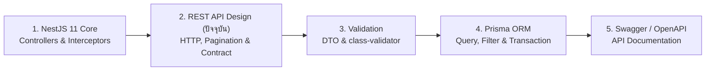

## 1. ข้อผิดพลาดที่พบบ่อย (Anti-patterns)

1. **HTTP 200 OK ซ่อน Error (`{ "status": 200, "isError": true }`)**
   - **ปัญหา**: ทำลายกลไกมาตรฐานของโปรโตคอล HTTP ทำให้ API Gateway, ระบบตรวจจับ Error อัตโนมัติ และ `onError` ของ TanStack Query ไม่ทำงาน
   - **วิธีแก้**: โยน `HttpException` ของ NestJS ที่ตรงกับสถานะจริง (`400`, `401`, `403`, `404`, `409`, `422`, `500`) ร่วมกับ Global Exception Filter เสมอ
2. **การสร้าง Chatty APIs (ต้องยิงหลายสิบ Request เพื่อเรนเดอร์หน้าเดียว)**
   - **ปัญหา**: หน้าประวัติคำสั่งซื้อดึง `GET /orders` ได้มา 20 รายการ แต่มีแค่ `productId` ทำให้ Frontend ต้องวนลูปยิง `GET /products/:id` อีก 20 ครั้ง
   - **วิธีแก้**: ออกแบบ Response DTO ของ `GET /orders` ให้แนบข้อมูลสรุปของสินค้า (`product: { id, name, thumbnailUrl }`) มาพร้อมกันในครั้งเดียว
3. **การปล่อยให้ Collection Endpoint ไม่มี Pagination**
   - **ปัญหา**: ตอนเปิดระบบวันแรกมีสินค้าเนื้อ 50 ชิ้น ระบบทำงานเร็วมาก แต่เมื่อผ่านไป 1 ปีมีคำสั่งซื้อ 500,000 รายการ การเรียก `GET /orders` จะทำให้เซิร์ฟเวอร์ค้างทันที
   - **วิธีแก้**: บังคับใช้ Pagination พร้อมกำหนดค่าเริ่มต้น (`limit = 20`) และค่าสูงสุด (`@Max(100)`) ในทุกๆ Endpoint ที่คืนค่าเป็น Array ตั้งแต่วันแรกที่เขียนโค้ด
4. **การผูกโครงสร้าง API เข้ากับตาราง Database แบบ 1:1 (Database-Driven API)**
   - **ปัญหา**: คืนผลลัพธ์จาก `prisma.user.findUnique()` ออกไปตรงๆ ทำให้ฟิลด์ภายในรั่วไหล และเมื่อต้อง Refactor ตารางในฐานข้อมูล API ของลูกค้าจะพังทันที
   - **วิธีแก้**: คั่นกลางด้วย Response DTO และ Mapper Layer เสมอ เพื่อแยก Data Model ออกจาก API Contract
5. **การรับค่าเงินเป็นทศนิยม Floating-Point โดยไม่มีการจัดการหน่วยย่อย**
   - **ปัญหา**: การคำนวณส่วนลดและภาษีของเนื้อวากิวด้วย `number` ทศนิยมใน JavaScript อาจเกิดค่าคลาดเคลื่อน เช่น `199.99 * 3 = 599.9700000000001`
   - **วิธีแก้**: รับส่งและคำนวณมูลค่าเงินเป็นหน่วยย่อยจำนวนเต็ม (เช่น สตางค์ `satang`) หรือใช้ชนิดข้อมูล `Decimal` ในฐานข้อมูลแล้วแปลงเป็นรูปแบบที่แม่นยำใน API Contract

---

---

## 2. Checklist สรุป

| หมวดหมู่ | รายการตรวจสอบสำหรับ Production REST API | สถานะที่แนะนำ |
| :--- | :--- | :--- |
| **HTTP Semantics** | ใช้ HTTP Methods (`GET`, `POST`, `PUT`, `PATCH`, `DELETE`) ตรงตามหน้าที่และไม่ใช้ `GET` แก้ไขข้อมูล | ✅ ต้องผ่าน |
| **Idempotency** | รองรับ `Idempotency-Key` Header ในเส้นทางสร้างคำสั่งซื้อ (`Order`) และตัดเงิน (`Payment`) | ✅ ต้องผ่าน |
| **Status Codes** | คืนค่า Status Code แม่นยำ (`201`, `202`, `204`, `400`, `401`, `403`, `404`, `409`, `422`, `429`) | ✅ ต้องผ่าน |
| **URL Design** | ใช้คำนามพหูพจน์ `kebab-case` และซ้อน Sub-resource ไม่เกิน 2 ระดับ | ✅ ต้องผ่าน |
| **Envelope & Errors** | มี Global Transform Interceptor และ Global Exception Filter ตามมาตรฐาน RFC 9457 | ✅ ต้องผ่าน |
| **Pagination** | ทุก Collection Endpoint มีการจำกัด `limit` สูงสุด และมี Unique Tie-breaker ในการ Sort | ✅ ต้องผ่าน |
| **Versioning & CORS** | เปิดใช้งาน URI Versioning (`/api/v1`) และตั้งค่า CORS `origin` แบบ Whitelist คู่กับ `credentials: true` | ✅ ต้องผ่าน |
| **Frontend Contract** | ใช้ `camelCase`, วันที่เป็น ISO 8601 UTC (`Z`), และคืน Resource ล่าสุดหลังทำ Mutation เสมอ | ✅ ต้องผ่าน |

---

---

## 3. ลำดับการเรียนที่แนะนำ และ ดูเพิ่มเติมที่

### ดูเพิ่มเติมที่:
- **กลุ่ม BACKEND**:
  - [NestJS 11](/docs/backend/nestjs) — โครงสร้างพื้นฐานของ Controllers, Interceptors และ Exception Filters
  - [Validation](/docs/backend/validation) — การตรวจสอบความถูกต้องของ Query Parameters และ Request Body ด้วย `class-validator`
  - [Prisma ORM](/docs/backend/prisma-orm) — การนำพารามิเตอร์ Pagination และ Filtering ไปเขียนคำสั่งคิวรีลงฐานข้อมูล
  - [Authentication](/docs/backend/authentication) — การป้องกัน Endpoint และการจัดการสถานะ `401` / `403`
  - [Security](/docs/backend/security) — การตั้งค่า CORS เชิงลึก, Helmet และการจำกัด Rate Limit (`429`)
  - [Swagger / OpenAPI](/docs/backend/swagger) — การสร้างเอกสาร API Contract อัตโนมัติให้ทีม Frontend
- **กลุ่ม DATABASE**:
  - [Indexing](/docs/database/indexing) — การสร้าง B-Tree Index เพื่อรองรับ Cursor Pagination และการทำ Sorting ความเร็วสูง
  - [Query Performance](/docs/database/query-performance) — วิเคราะห์ความแตกต่างด้านประสิทธิภาพของ `OFFSET` เทียบกับ Keyset Pagination
- **กลุ่ม FRONTEND**:
  - [TanStack Query](/docs/tanstack-query) — การเชื่อมต่อ REST API, การทำ Infinite Scroll Pagination และการจัดการ Cache ฝั่ง Frontend
  - [TypeScript](/docs/typescript) — การออกแบบ Discriminated Unions สำหรับ `ApiSuccessResponse` และ `ProblemDetailsErrorEnvelope`
