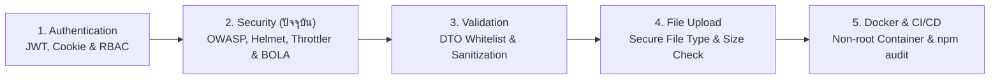

# Security

คู่มือการวางสถาปัตยกรรมความมั่นคงปลอดภัยระดับ Production-Grade (**Application & API Security**) บน **NestJS 11** สำหรับระบบอีคอมเมิร์ซ **Smart Butcher Marketplace** โดยอ้างอิงตามมาตรฐานสากล **OWASP API Security Top 10**, การป้องกันช่องโหว่ **XSS** และ **CSRF** เมื่อใช้งานร่วมกับ `HttpOnly Cookie`, การตั้งค่า HTTP Security Headers ด้วย **Helmet**, การจำกัดอัตราการยิงคำขอและป้องกันการเดารหัสผ่านด้วย **`@nestjs/throttler`**, การป้องกันช่องโหว่อันดับหนึ่งของโลกอย่าง **BOLA / IDOR (Broken Object Level Authorization)**, ไปจนถึงการจัดการความลับของระบบ (**Secrets Management**) และการตรวจสอบช่องโหว่ของแพ็กเกจด้วย **`npm audit`**

## สารบัญหัวข้อในหน้านี้

| ลำดับ | หัวข้อหลัก | สิ่งที่คุณจะได้เรียนรู้ |
| :--- | :--- | :--- |
| **1** | [1. OWASP Top 10 สำหรับระบบ API สมัยใหม่](#1-owasp-top-10-สำหรับระบบ-api-สมัยใหม่) | วิเคราะห์ความเสี่ยงสูงสุดของ API ยุคใหม่ (BOLA, BOPLA/Mass Assignment, SSRF, Resource Consumption) |
| **2** | [2. การป้องกัน XSS, CSRF และความเชื่อมโยงกับ Cookie Security](#2-การป้องกัน-xss-csrf-และความเชื่อมโยงกับ-cookie-security) | กลไกการโจมตีของ XSS และ CSRF และการป้องกันด้วย Double-Submit CSRF Token คู่กับ `SameSite` Cookie |
| **3** | [3. การตั้งค่า Helmet และ CORS ร่วมกับ Credentials](#3-การตั้งค่า-helmet-และ-cors-ร่วมกับ-credentials) | การตั้งค่า HTTP Security Headers (HSTS, CSP, X-Content-Type-Options) และ Strict CORS Origin Validation |
| **4** | [4. Rate Limiting และป้องกัน Brute-force ด้วย @nestjs/throttler](#4-rate-limiting-และป้องกัน-brute-force-ด้วย-nestjsthrottler) | การตั้งค่า Multi-tier Throttler (Short/Medium/Long) และการจำกัดความถี่เฉพาะหน้า Login และ Payment |
| **5** | [5. Object-Level Authorization (ป้องกันปัญหา BOLA / IDOR)](#5-object-level-authorization-ป้องกันปัญหา-bola-idor) | การตรวจสอบสิทธิ์ความเป็นเจ้าของข้อมูลระดับแถว (Row-level Ownership) ของ `Order` และ `Payment` |
| **6** | [6. การจัดการ Secrets, Data Sanitization และตรวจสอบช่องโหว่ด้วย npm audit](#6-การจัดการ-secrets-data-sanitization-และตรวจสอบช่องโหว่ด้วย-npm-audit) | การตรวจสอบ Environment Variables แบบ Fail-Fast, การทำ Webhook HMAC Verification และ Supply Chain Audit |
| **7** | [ข้อผิดพลาดที่พบบ่อย (Anti-patterns)](#ข้อผิดพลาดที่พบบ่อย-anti-patterns) | หลุมพรางด้านความปลอดภัยที่มักทำให้ระบบรั่วไหลหรือถูกโจมตี |
| **8** | [Checklist สรุป](#checklist-สรุป) | ตารางตรวจสอบความปลอดภัยครบวงจรก่อนเปิดใช้งานจริงบน Production |
| **9** | [ลำดับการเรียนที่แนะนำ และ ดูเพิ่มเติมที่](#ลำดับการเรียนที่แนะนำ-และ-ดูเพิ่มเติมที่) | แผนผังการเรียนรู้ต่อเนื่องและลิงก์เชื่อมโยงสู่บทเรียนที่เกี่ยวข้อง |

---

## 1. OWASP Top 10 สำหรับระบบ API สมัยใหม่

### แนวคิด (Concept)
ในสถาปัตยกรรมเว็บยุคใหม่ที่แยกส่วน Frontend (Next.js / Mobile App) ออกจาก Backend (NestJS REST API) อย่างชัดเจน รูปแบบการโจมตีได้เปลี่ยนจากการเจาะหน้าเว็บแบบดั้งเดิมมาเป็นการยิงโจมตีที่ **API Endpoints** โดยตรง ทางมูลนิธิ **OWASP (Open Web Application Security Project)** จึงได้จัดทำมาตรฐาน **OWASP API Security Top 10** ซึ่งสรุปช่องโหว่ที่พบบ่อยและสร้างความเสียหายรุนแรงที่สุดต่อระบบธุรกิจ:

| รหัส OWASP API | ชื่อช่องโหว่ | ตัวอย่างเหตุการณ์จริงใน Smart Butcher Marketplace | แนวทางป้องกันใน NestJS 11 |
| :--- | :--- | :--- | :--- |
| **API1** | **Broken Object Level Authorization (BOLA / IDOR)** | ลูกค้า A เปลี่ยนรหัสใบสั่งซื้อใน URL `GET /orders/:id` เป็นรหัสของลูกค้า B แล้วดูที่อยู่และเบอร์โทรของลูกค้า B ได้ | บังคับใส่เงื่อนไข `where: { id: orderId, userId: currentUser.id }` ใน Prisma เสมอ |
| **API2** | **Broken Authentication** | แฮกเกอร์รันสคริปต์สุ่มรหัสผ่านบัญชีลูกค้า VIP นับหมื่นครั้งโดยไม่ถูกบล็อก | ใช้ Bcrypt (Cost 12), Rate Limiting (`@nestjs/throttler`), และ Refresh Token Rotation |
| **API3** | **Broken Object Property Level Authorization (BOPLA)** | ลูกค้าแอบส่งฟิลด์ `"role": "ADMIN"` หรือ `"isPaid": true` แถมมาใน JSON Body ตอนแก้ไขโปรไฟล์หรือสร้างออเดอร์ (Mass Assignment) | เปิดใช้งาน `ValidationPipe({ whitelist: true, forbidNonWhitelisted: true })` และแยก DTO ขาเข้า/ขาออก |
| **API4** | **Unrestricted Resource Consumption** | แฮกเกอร์ส่ง `?limit=10000000` หรือส่ง JSON Body ขนาด 500MB เข้ามาจนเซิร์ฟเวอร์หน่วยความจำเต็ม (DoS) | จำกัดขนาด Body (`json({ limit: '100kb' })`), บังคับ `@Max(100)` ใน Pagination และตั้ง Timeout |
| **API8** | **Security Misconfiguration** | เปิด CORS `origin: '*'`, ลืมใส่ Security Headers หรือปล่อยให้ Prisma Stack Trace โชว์ออกหน้าเว็บ | ติดตั้ง `helmet`, ตั้งค่า Strict CORS Whitelist และใช้ Global Exception Filter ซ่อนรายละเอียดภายใน |

<Callout type="warning" title="หลักการ Defense in Depth (การป้องกันหลายชั้น)">
ระบบที่ปลอดภัยระดับ Enterprise จะไม่ฝากความหวังไว้ที่ด่านตรวจเพียงชั้นเดียว หาก Guard ชั้นแรกพลาด ชั้น ValidationPipe, ชั้น Service Business Logic และชั้น Database Constraint ของ Prisma จะต้องช่วยกันสกัดกั้นไม่ให้เกิดความเสียหายต่อข้อมูลได้
</Callout>

### หลักการเบื้องหลัง (Under the Hood)
ช่องโหว่ **API3: Broken Object Property Level Authorization (BOPLA)** เป็นการรวมกันของ 2 ปัญหาใหญ่คือ:
1. **Mass Assignment (ขาเข้า)**: เกิดเมื่อนักพัฒนาส่ง `req.body` เข้าสู่ `prisma.user.update({ data: req.body })` โดยตรง ทำให้ผู้โจมตีสามารถเดาชื่อคอลัมน์ในฐานข้อมูล (เช่น `role`, `isActive`) แล้วส่งค่าเข้ามาแก้ไขสิทธิ์ตัวเองได้
2. **Excessive Data Exposure (ขาออก)**: เกิดเมื่อนักพัฒนาส่งอ็อบเจกต์จาก `prisma.user.findUnique()` ออกไปทาง Controller โดยตรงโดยไม่คัดกรองฟิลด์ ทำให้ `passwordHash` หรือข้อมูลส่วนบุคคลรั่วไหลออกไปใน JSON Response

### ตัวอย่างโค้ด (Smart Butcher Marketplace)

#### ตัวอย่างที่ 1: การป้องกัน Mass Assignment และ Resource Exhaustion ในระดับ Bootstrap (พื้นฐาน)
```typescript filename="src/common/security/bootstrap-security.config.ts"
import { INestApplication, ValidationPipe } from '@nestjs/common';
import { json, urlencoded } from 'express';

export function configureCoreApiSecurity(app: INestApplication): void {
  // 1. ป้องกัน OWASP API4 (Unrestricted Resource Consumption):
  // จำกัดขนาด JSON Payload สูงสุดไม่เกิน 100KB ป้องกันการยิง JSON ขนาดยักษ์ถล่ม Memory
  app.use(json({ limit: '100kb' }));
  app.use(urlencoded({ extended: true, limit: '100kb' }));

  // 2. ป้องกัน OWASP API3 (Mass Assignment / BOPLA):
  // whitelist: true จะตัดทุกฟิลด์ที่ไม่ได้ประกาศ Decorator ใน DTO ทิ้งทันที
  // forbidNonWhitelisted: true จะโยน 400 Bad Request ทันทีหากตรวจพบฟิลด์แปลกปลอม
  app.useGlobalPipes(
    new ValidationPipe({
      whitelist: true,
      forbidNonWhitelisted: true,
      transform: true,
      stopAtFirstError: false,
    }),
  );
}
```

#### ตัวอย่างที่ 2: การป้องกัน SSRF (Server-Side Request Forgery - OWASP API7) เมื่อรับ URL รูปหลักฐานจากภายนอก (ขั้นสูง)
```typescript filename="src/common/security/ssrf-url-validator.service.ts"
import { Injectable, BadRequestException } from '@nestjs/common';
import { URL } from 'url';

@Injectable()
export class SsrfUrlValidatorService {
  // อนุญาตให้ดึงไฟล์เฉพาะจากโดเมน CDN ของบริษัทที่ผ่านการรับรองแล้วเท่านั้น
  private readonly ALLOWED_IMAGE_HOSTS = new Set([
    'cdn.smartbutcher.co.th',
    'storage.smartbutcher.co.th',
  ]);

  validateExternalImageUrl(rawUrl: string): string {
    let parsed: URL;
    try {
      parsed = new URL(rawUrl);
    } catch {
      throw new BadRequestException({
        code: 'INVALID_URL_FORMAT',
        message: 'รูปแบบ URL ของรูปภาพไม่ถูกต้อง',
      });
    }

    // 1. บังคับใช้โปรโตคอล HTTPS เท่านั้น (ป้องกัน file://, gopher://, http://)
    if (parsed.protocol !== 'https:') {
      throw new BadRequestException({
        code: 'INSECURE_URL_PROTOCOL',
        message: 'อนุญาตเฉพาะ URL ที่ใช้โปรโตคอล HTTPS เท่านั้น',
      });
    }

    // 2. ป้องกันการชี้ไปยัง Internal Network / Cloud Metadata IP (เช่น 169.254.169.254 หรือ localhost)
    if (!this.ALLOWED_IMAGE_HOSTS.has(parsed.hostname)) {
      throw new BadRequestException({
        code: 'UNTRUSTED_IMAGE_HOST',
        message: `ไม่อนุญาตให้ใช้รูปภาพจากโดเมนภายนอก (${parsed.hostname})`,
      });
    }

    return parsed.toString();
  }
}
```

### ผิด vs ถูก (Anti-pattern vs Best Practice)

```typescript filename="src/modules/users/owasp-bopla-comparison.ts"
// ❌ ผิด (Anti-pattern): ส่ง Body เข้า Prisma ตรงๆ (เปิดช่องโหว่ Mass Assignment เปลี่ยนตัวเองเป็น ADMIN!)
export async function updateProfileAntiPattern(prisma: any, userId: string, rawBody: any) {
  // ถ้าแฮกเกอร์ส่ง { "fullName": "Hacker", "role": "ADMIN" } เข้ามา จะกลายเป็น ADMIN ทันที!
  return prisma.user.update({
    where: { id: userId },
    data: rawBody,
  });
}

// ✅ ถูก (Best Practice): ระบุฟิลด์ที่อนุญาตให้อัปเดตอย่างชัดเจนจาก DTO ที่ผ่าน ValidationPipe แล้วเท่านั้น
export async function updateProfileBestPractice(
  prisma: any,
  userId: string,
  safeDto: { fullName: string; phoneNumber?: string },
) {
  return prisma.user.update({
    where: { id: userId },
    data: {
      fullName: safeDto.fullName,
      phoneNumber: safeDto.phoneNumber,
    },
    select: {
      id: true,
      email: true,
      fullName: true,
      phoneNumber: true,
      role: true, // เลือกเฉพาะฟิลด์ที่ปลอดภัยส่งกลับ ไม่ส่ง passwordHash
    },
  });
}
```

### ควรใช้เมื่อไหร่ และ ไม่ควรใช้เมื่อไหร่
- **ควรตั้งค่า `json({ limit: '100kb' })` เป็นค่าเริ่มต้นสำหรับ REST API ทั่วไปเสมอ**: เพื่อป้องกันการโจมตีแบบ JSON Bomb หรือ Payload Flood
- **ไม่ควรอนุญาตให้เซิร์ฟเวอร์ Backend ดึงข้อมูลจาก URL ที่ผู้ใช้กรอกเข้ามาโดยตรง (`fetch(userProvidedUrl)`)**: โดยไม่ตรวจสอบ Hostname Whitelist เพราะแฮกเกอร์สามารถส่ง `http://169.254.169.254/latest/meta-data/` เพื่อขโมย IAM Credentials ของ Cloud Server ได้ (ช่องโหว่ SSRF)

### คำถามสัมภาษณ์ (Interview Q&A)
1. **คำถาม**: ช่องโหว่ Mass Assignment (อยู่ในหมวด OWASP API3: BOPLA) เกิดขึ้นได้อย่างไร และใน NestJS 11 เราป้องกันได้อย่างไร?
   - **แนวคำตอบ**: เกิดจากการที่ Backend รับ JSON Object จากผู้ใช้งานแล้วส่งต่อไปอัปเดตลง ORM (เช่น Prisma หรือ TypeORM) โดยตรง ทำให้ผู้โจมตีสามารถเพิ่มฟิลด์ที่มีชื่อตรงกับคอลัมน์สำคัญในฐานข้อมูล เช่น `role: 'ADMIN'`, `balance: 999999` หรือ `isVerified: true` เข้ามาใน Request Body ได้ วิธีป้องกันใน NestJS 11 คือการสร้าง DTO ที่ระบุเฉพาะฟิลด์ที่อนุญาตให้แก้ไข เปิดใช้งาน `ValidationPipe({ whitelist: true, forbidNonWhitelisted: true })` ระดับ Global และในชั้น Service ให้ Map ฟิลด์ลงคำสั่ง `prisma.update` แบบ Explicit เท่านั้น
2. **คำถาม**: ทำไมการปล่อยให้ขนาดของ Request Body เป็นค่าเริ่มต้นหรือตั้งไว้สูงมาก (เช่น `50mb`) สำหรับทุก Endpoint จึงอันตรายต่อระบบ Node.js?
   - **แนวคำตอบ**: เพราะการ Parse JSON (`JSON.parse`) ใน Node.js เป็นการทำงานแบบ Synchronous ที่ใช้ทั้ง CPU และ V8 Heap Memory สูงมาก หากผู้โจมตีส่ง JSON ขนาด 50MB เข้ามาพร้อมกันเพียง 10-20 คำขอ Event Loop ของเซิร์ฟเวอร์จะหยุดชะงัก (Event Loop Block) และหน่วยความจำจะเต็มจนโปรเซสแครช (OOM Kill) ทั้งระบบ ดังนั้นจึงควรจำกัด JSON Body ทั่วไปไว้ที่ `100kb` และเปิดรับไฟล์ขนาดใหญ่เฉพาะที่ Endpoint อัปโหลดไฟล์ (`multipart/form-data`) ที่มีระบบ Streaming เท่านั้น

---

## 2. การป้องกัน XSS, CSRF และความเชื่อมโยงกับ Cookie Security

### แนวคิด (Concept)
ในการออกแบบระบบความปลอดภัยของเว็บแอปพลิเคชัน ช่องโหว่ฝั่งไคลเอนต์ที่เชื่อมโยงกับ Backend มากที่สุดคือ **XSS** และ **CSRF**:
1. **XSS (Cross-Site Scripting)**: ผู้โจมตีฝังโค้ด JavaScript อันตรายลงในข้อมูล (เช่น พิมพ์ `<script>...</script>` ลงในช่องหมายเหตุการหั่นเนื้อสเต็ก หรือชื่อผู้รับสินค้า) เมื่อผู้ดูแลระบบหรือลูกค้ารายอื่นเปิดดูหน้าเว็บ โค้ดนั้นจะถูกรันบนเบราว์เซอร์ของเหยื่อ
   - **ความเชื่อมโยงกับ Cookie**: หากเราเก็บ JWT ไว้ใน `localStorage` โค้ด XSS จะขโมย Token ออกไปได้ทันที แต่ถ้าเราเก็บใน **`HttpOnly Cookie`** โค้ด JavaScript ของ XSS จะไม่สามารถอ่านค่า Cookie ออกไปได้เลย!
2. **CSRF (Cross-Site Request Forgery)**: เมื่อเราใช้ Cookie ในการยืนยันตัวตน เบราว์เซอร์จะแนบ Cookie ไปกับทุกคำขอที่ยิงไปยังโดเมน `api.smartbutcher.co.th` โดยอัตโนมัติ ผู้โจมตีจึงสร้างเว็บหลอก (เช่น `evil-wagyu-promo.com`) ที่แอบยิงคำขอข้ามโดเมนมาสั่งซื้อเนื้อหรือเปลี่ยนที่อยู่จัดส่งในนามของเหยื่อที่ยังล็อกอินค้างไว้
   - **ความเชื่อมโยงกับ Cookie**: เราป้องกัน CSRF ได้ด้วยการตั้งค่า Cookie `SameSite=Lax` หรือ `SameSite=Strict`, การบังคับใช้ JSON Content-Type (`application/json`) ร่วมกับ Strict CORS, และการใช้ **Double-Submit Cookie Pattern (`X-CSRF-Token`)**

### หลักการเบื้องหลัง (Under the Hood)
กลไก **Stateless Double-Submit Cookie Pattern (HMAC-Signed CSRF Token)** ทำงานโดยไม่ต้องพึ่งพา Server Session:
1. เซิร์ฟเวอร์สร้างค่าสุ่ม `csrfToken` (ผูกกับรหัสผู้ใช้ด้วย HMAC) แล้วส่งให้ไคลเอนต์ผ่าน Cookie ที่อนุญาตให้ JavaScript บนโดเมนตัวเองอ่านค่าได้ (`httpOnly: false`, `sameSite: 'strict'`) หรือส่งผ่าน Endpoint เริ่มต้น
2. เมื่อ Frontend (Next.js) ยิงคำขอที่เปลี่ยนแปลงข้อมูล (`POST`, `PUT`, `PATCH`, `DELETE`) โค้ด Frontend จะอ่านค่าจาก Cookie นั้นมาใส่ใน HTTP Header พิเศษชื่อ **`X-CSRF-Token`**
3. เนื่องจากกฎ **Same-Origin Policy** ของเบราว์เซอร์ เว็บไซต์แปลกปลอม (`evil.com`) จะไม่สามารถอ่านค่า Cookie ของ `smartbutcher.co.th` มาใส่ใน Header `X-CSRF-Token` ได้เลย! เมื่อ Guard บนเซิร์ฟเวอร์เปรียบเทียบค่าใน Header กับค่าใน Cookie ว่าตรงกัน จึงมั่นใจได้ 100% ว่าคำขอนั้นมาจากหน้าเว็บจริงของเราเอง

### ตัวอย่างโค้ด (Smart Butcher Marketplace)

#### ตัวอย่างที่ 1: การสร้าง Stateless CSRF Protection Guard ด้วย Double-Submit Pattern (พื้นฐาน)
```typescript filename="src/common/security/csrf.guard.ts"
import {
  Injectable,
  CanActivate,
  ExecutionContext,
  ForbiddenException,
} from '@nestjs/common';
import { Request, Response } from 'express';
import * as crypto from 'crypto';

export const CSRF_COOKIE_NAME = 'sb_csrf_token';
export const CSRF_HEADER_NAME = 'x-csrf-token';

@Injectable()
export class CsrfProtectionGuard implements CanActivate {
  private readonly SAFE_METHODS = new Set(['GET', 'HEAD', 'OPTIONS']);

  canActivate(context: ExecutionContext): boolean {
    const http = context.switchToHttp();
    const req = http.getRequest<Request>();
    const res = http.getResponse<Response>();

    const cookies = req.cookies as Record<string, string> | undefined;
    let csrfCookieValue = cookies?.[CSRF_COOKIE_NAME];

    // หากยังไม่มี CSRF Cookie ให้สร้างและแนบกลับไปพร้อมกับคำขอ GET
    if (!csrfCookieValue) {
      csrfCookieValue = crypto.randomBytes(32).toString('hex');
      res.cookie(CSRF_COOKIE_NAME, csrfCookieValue, {
        httpOnly: false, // ต้องเป็น false เพื่อให้ Frontend ของเราอ่านไปใส่ใน Header X-CSRF-Token ได้
        secure: process.env.NODE_ENV === 'production',
        sameSite: 'strict',
        path: '/',
      });
    }

    // ข้ามการตรวจสอบสำหรับ Safe Methods (GET, HEAD, OPTIONS)
    if (this.SAFE_METHODS.has(req.method)) {
      return true;
    }

    const csrfHeaderValue = req.headers[CSRF_HEADER_NAME];
    if (
      !csrfHeaderValue ||
      typeof csrfHeaderValue !== 'string' ||
      csrfHeaderValue.length !== csrfCookieValue.length
    ) {
      throw new ForbiddenException({
        code: 'CSRF_TOKEN_MISMATCH',
        message: 'คำขอถูกปฏิเสธเนื่องจากไม่พบรหัสป้องกัน CSRF ที่ถูกต้อง (Invalid CSRF Token)',
      });
    }

    // เปรียบเทียบแบบ Constant-time ป้องกัน Timing Attack
    const isValid = crypto.timingSafeEqual(
      Buffer.from(csrfCookieValue, 'utf8'),
      Buffer.from(csrfHeaderValue, 'utf8'),
    );

    if (!isValid) {
      throw new ForbiddenException({
        code: 'CSRF_TOKEN_MISMATCH',
        message: 'รหัสป้องกัน CSRF ไม่ตรงกับเซสชันปัจจุบัน',
      });
    }

    return true;
  }
}
```

#### ตัวอย่างที่ 2: การทำ HTML/Script Sanitization สำหรับข้อความหมายเหตุการตัดแต่งเนื้อเพื่อป้องกัน Stored XSS (ขั้นสูง)
```typescript filename="src/common/security/text-sanitizer.util.ts"
import { Transform } from 'class-transformer';

// ฟังก์ชันล้างแท็ก HTML อันตรายและควบคุมอักขระพิเศษก่อนบันทึกลงฐานข้อมูล (ป้องกัน Stored XSS)
export function sanitizePlainText(input: unknown): unknown {
  if (typeof input !== 'string') {
    return input;
  }

  return (
    input
      // 1. ลบแท็ก <script>...</script> และแท็ก HTML ทั้งหมดออก
      .replace(/<script\b[^<]*(?:(?!<\/script>)<[^<]*)*<\/script>/gi, '')
      .replace(/<\/?[^>]+(>|$)/g, '')
      // 2. ลบโปรโตคอลอันตราย เช่น javascript: หรือ data:text/html
      .replace(/javascript\s*:/gi, '')
      // 3. ตัดช่องว่างหัวท้ายและจำกัดอักขระควบคุมที่มองไม่เห็น
      .trim()
  );
}

// Custom Decorator สำหรับแปะบนฟิลด์ข้อความใน DTO เพื่อล้างโค้ดอันตรายอัตโนมัติ
export function SanitizeText() {
  return Transform(({ value }) => sanitizePlainText(value));
}
```

```typescript filename="src/modules/orders/dto/butcher-note.dto.ts"
import { IsString, MaxLength } from 'class-validator';
import { SanitizeText } from '../../../common/security/text-sanitizer.util';

export class ButcherCuttingNoteDto {
  @SanitizeText()
  @IsString()
  @MaxLength(300)
  chefInstructionNote!: string; // เช่น "หั่นความหนา 2.5 ซม. แยกแพ็คสูญญากาศชิ้นละ 1 แพ็ค"
}
```

### ผิด vs ถูก (Anti-pattern vs Best Practice)

```typescript filename="src/common/security/cookie-csrf-comparison.ts"
// ❌ ผิด (Anti-pattern): ตั้งค่า Cookie เป็น sameSite: 'none' โดยไม่มี CSRF Guard และอนุญาตให้ส่งข้อมูลผ่าน Form URL-Encoded โดยไม่เช็ค Content-Type
export const INSECURE_COOKIE_OPTIONS = {
  httpOnly: false, // เสี่ยงต่อ XSS ขโมย Token!
  secure: false,   // เสี่ยงต่อการถูกดักฟังกลางทางบน Wi-Fi สาธารณะ!
  sameSite: 'none' as const, // เปิดประตูให้เว็บอื่นยิง CSRF ข้ามโดเมนได้ทันที!
};

// ✅ ถูก (Best Practice): ใช้ HttpOnly + Secure + SameSite=Lax/Strict สำหรับ Auth Token
// ร่วมกับ Double-Submit CSRF Header (X-CSRF-Token) สำหรับทุก Mutation Request
export const SECURE_AUTH_COOKIE_OPTIONS = {
  httpOnly: true,
  secure: true,
  sameSite: 'lax' as const,
};
```

### ควรใช้เมื่อไหร่ และ ไม่ควรใช้เมื่อไหร่
- **ควรใช้ CSRF Protection (`SameSite` Cookie + Custom Header `X-CSRF-Token`) เมื่อ**: ระบบยืนยันตัวตนใช้ Cookie (`HttpOnly Cookie`) ในการแนบสิทธิ์เข้าสู่ API
- **ไม่จำเป็นต้องใช้ CSRF Token เมื่อ**: Endpoint นั้นรับเฉพาะ Bearer Token ผ่าน Header `Authorization: Bearer <token>` ล้วนๆ (เช่น API สำหรับ Mobile App โดยเฉพาะที่ไม่ได้อ่านค่าจาก Cookie เลย) เพราะเบราว์เซอร์ไม่สามารถแนบ Header `Authorization` ข้ามเว็บไซต์เองโดยอัตโนมัติได้

### คำถามสัมภาษณ์ (Interview Q&A)
1. **คำถาม**: ในกลไก Double-Submit Cookie ทำไมเราถึงต้องตั้งค่าให้ CSRF Cookie มี `httpOnly: false` ในเมื่อเราถูกสอนมาตลอดว่า Cookie ที่ปลอดภัยต้องเป็น `httpOnly: true`?
   - **แนวคำตอบ**: เพราะเราต้องแยกหน้าที่ของ Cookie ทั้ง 2 ตัวออกจากกัน:
     1. **Auth Cookie (`sb_access_token`)**: เก็บ JWT ที่ใช้ยืนยันตัวตน ตัวนี้ **ต้องเป็น `httpOnly: true` เสมอ** เพื่อห้าม JavaScript อ่านเด็ดขาด
     2. **CSRF Cookie (`sb_csrf_token`)**: เก็บเพียงค่าสุ่มอ้างอิงที่ไม่ได้มีสิทธิ์เข้าถึงข้อมูลด้วยตัวเอง แต่มีไว้เพื่อให้โค้ด JavaScript บนโดเมนที่ถูกต้องของเราอ่านค่าไปแนบใส่ใน HTTP Header `X-CSRF-Token` เพื่อพิสูจน์ว่าคำขอถูกยิงมาจาก Origin เดียวกัน (เนื่องจากเว็บไซต์แปลกปลอมข้ามโดเมนไม่สามารถอ่าน Cookie ตัวนี้และไม่สามารถแนบ Custom Header ข้ามโดเมนโดยไม่ผ่าน CORS Preflight ได้)
2. **คำถาม**: การที่ API ของเรารับข้อมูลเฉพาะ `Content-Type: application/json` (ไม่อนุญาต `application/x-www-form-urlencoded` หรือ `text/plain`) ช่วยลดความเสี่ยงของ CSRF ได้อย่างไร?
   - **แนวคำตอบ**: เพราะ HTML `<form>` มาตรฐานที่แฮกเกอร์ใช้ทำ CSRF สามารถส่งได้เฉพาะ `application/x-www-form-urlencoded`, `multipart/form-data`, และ `text/plain` เท่านั้น (เรียกว่า Simple Requests ที่ไม่ติด CORS Preflight) หากแฮกเกอร์พยายามใช้ `fetch` ส่ง `Content-Type: application/json` ข้ามโดเมน เบราว์เซอร์จะบังคับยิงคำขอ `OPTIONS` (CORS Preflight) ไปถามเซิร์ฟเวอร์ของเราก่อนเสมอ และเมื่อเซิร์ฟเวอร์ไม่อนุญาต Origin ของแฮกเกอร์ เบราว์เซอร์ก็จะบล็อกคำขอจริงทันที

---

## 3. การตั้งค่า Helmet และ CORS ร่วมกับ Credentials

### แนวคิด (Concept)
โดยค่าเริ่มต้น HTTP Server ของ Node.js / Express จะส่ง Header ที่เปิดเผยข้อมูลเทคโนโลยีเบื้องหลัง เช่น `X-Powered-By: Express` และไม่ได้ส่ง HTTP Security Headers ที่สั่งให้เบราว์เซอร์เปิดเกราะป้องกันตัวเอง การติดตั้งมิดเดิลแวร์ **Helmet** ใน NestJS 11 จะช่วยเพิ่มและปรับแต่ง HTTP Response Headers กว่า 11 รายการในบรรทัดเดียว เพื่อป้องกันทั้งการถูกนำเว็บไปครอบด้วย `<iframe>` (Clickjacking), การเดาชนิดไฟล์ผิดพลาด (MIME Sniffing) และการบังคับใช้ HTTPS ตลอดกาล (HSTS)

### หลักการเบื้องหลัง (Under the Hood)
Header สำคัญที่ **Helmet** ตั้งค่าให้กับทุก Response มีดังนี้:
- **`Strict-Transport-Security` (HSTS)**: เช่น `max-age=31536000; includeSubDomains; preload` สั่งให้เบราว์เซอร์จดจำว่าต้องเชื่อมต่อกับโดเมนนี้ผ่าน `HTTPS` เท่านั้นเป็นเวลา 1 ปี ป้องกันการโจมตีแบบ SSL Stripping (Man-in-the-Middle)
- **`X-Content-Type-Options: nosniff`**: ห้ามเบราว์เซอร์เดาชนิดไฟล์เอง (MIME-type sniffing) เช่น หากลูกค้าอัปโหลดไฟล์รูปสลิปโอนเงินแต่แอบยัดโค้ด HTML ไว้ข้างใน เบราว์เซอร์จะไม่รันไฟล์นั้นเป็น HTML
- **`X-Frame-Options: DENY` และ `Content-Security-Policy: frame-ancestors 'none'`**: ป้องกันแฮกเกอร์นำหน้าชำระเงินของเราไปซ้อนใน `<iframe>` โปร่งใสเพื่อหลอกให้ลูกค้ากดปุ่ม (Clickjacking)
- **`Content-Security-Policy` (CSP)**: กำหนดแหล่งที่มาของ Script, Image, และ API ที่อนุญาตให้โหลดได้

เมื่อใช้งานร่วมกับ **CORS ที่มี `credentials: true`** (เพื่อรับส่ง `HttpOnly Cookie`) เซิร์ฟเวอร์จะต้องตอบกลับ Header `Access-Control-Allow-Origin` เป็นชื่อโดเมนที่ตรงกับ `Origin` ของผู้เรียกแบบเฉพาะเจาะจงเท่านั้น (เช่น `https://smartbutcher.co.th`) และเพิ่ม Header `Vary: Origin` เสมอเพื่อไม่ให้ CDN แคช CORS Header ของโดเมนหนึ่งไปส่งให้โดเมนอื่น

### ตัวอย่างโค้ด (Smart Butcher Marketplace)

#### ตัวอย่างที่ 1: การติดตั้งและตั้งค่า Helmet ระดับ Production สำหรับ API Server ใน main.ts (พื้นฐาน)
```typescript filename="src/main.ts"
import { NestFactory } from '@nestjs/core';
import helmet from 'helmet';
import * as cookieParser from 'cookie-parser';
import { AppModule } from './app.module';
import { configureCoreApiSecurity } from './common/security/bootstrap-security.config';

async function bootstrap() {
  const app = await NestFactory.create(AppModule);

  // 1. ติดตั้ง Helmet พร้อมตั้งค่า Security Headers ที่เข้มงวดสำหรับ REST API
  app.use(
    helmet({
      // ปิด X-Powered-By: Express อัตโนมัติ
      hidePoweredBy: true,
      // บังคับ HTTPS นาน 1 ปีเต็ม พร้อมครอบคลุมทุก Subdomain
      hsts: {
        maxAge: 31536000,
        includeSubDomains: true,
        preload: true,
      },
      // ป้องกัน MIME Sniffing
      noSniff: true,
      // ป้องกัน Clickjacking 100%
      frameguard: {
        action: 'deny',
      },
      // ตั้งค่า Content Security Policy สำหรับ API (ไม่อนุญาตให้รันสคริปต์หรือฝังเฟรมใดๆ)
      contentSecurityPolicy: {
        directives: {
          defaultSrc: ["'none'"],
          frameAncestors: ["'none'"],
        },
      },
      // อนุญาตให้ Frontend ที่อยู่คนละ Subdomain (เช่น smartbutcher.co.th เรียก api.smartbutcher.co.th) โหลดทรัพยากรได้
      crossOriginResourcePolicy: { policy: 'cross-origin' },
    }),
  );

  // 2. ติดตั้ง Cookie Parser และตั้งค่า Validation / Body Size Limit
  app.use(cookieParser());
  configureCoreApiSecurity(app);

  await app.listen(process.env.PORT ?? 3000);
}
bootstrap();
```

#### ตัวอย่างที่ 2: การสร้าง Dynamic CORS Configuration Factory ที่รองรับ Credentials และ Subdomains อย่างปลอดภัย (ขั้นสูง)
```typescript filename="src/common/security/cors-options.factory.ts"
import { CorsOptions } from '@nestjs/common/interfaces/external/cors-options.interface';
import { ForbiddenException } from '@nestjs/common';

export function createProductionCorsOptions(
  allowedOriginsEnv: string | undefined,
): CorsOptions {
  const explicitWhitelist = new Set(
    (allowedOriginsEnv ?? 'https://smartbutcher.co.th,https://admin.smartbutcher.co.th')
      .split(',')
      .map((origin) => origin.trim())
      .filter(Boolean),
  );

  return {
    origin: (
      requestOrigin: string | undefined,
      callback: (err: Error | null, allow?: boolean) => void,
    ) => {
      // 1. คำขอที่ไม่มี Origin Header (เช่น Mobile App, Webhook จากธนาคาร, หรือ Server-to-Server SSR)
      if (!requestOrigin) {
        return callback(null, true);
      }

      // 2. ตรวจสอบว่าอยู่ในรายการ Whitelist ที่อนุญาตหรือไม่
      if (explicitWhitelist.has(requestOrigin)) {
        return callback(null, true);
      }

      // 3. ในโหมด Development อนุญาต localhost เฉพาะพอร์ตของ Next.js (3000, 3001)
      if (
        process.env.NODE_ENV === 'development' &&
        /^http:\/\/localhost:(3000|3001)$/.test(requestOrigin)
      ) {
        return callback(null, true);
      }

      return callback(
        new ForbiddenException(
          `CORS Policy Violation: Origin "${requestOrigin}" is not permitted to access Smart Butcher API`,
        ),
        false,
      );
    },
    credentials: true, // เปิดรับส่ง HttpOnly Cookie และ Authorization Header
    methods: ['GET', 'POST', 'PUT', 'PATCH', 'DELETE', 'OPTIONS'],
    allowedHeaders: [
      'Content-Type',
      'Authorization',
      'X-CSRF-Token',
      'Idempotency-Key',
      'X-Request-Id',
    ],
    exposedHeaders: [
      'Location',
      'X-Request-Id',
      'X-RateLimit-Limit',
      'X-RateLimit-Remaining',
      'X-RateLimit-Reset',
    ],
    maxAge: 86400, // แคช Preflight OPTIONS 24 ชั่วโมง
  };
}
```

### ผิด vs ถูก (Anti-pattern vs Best Practice)

```typescript filename="src/common/security/cors-helmet-comparison.ts"
// ❌ ผิด (Anti-pattern): สะท้อนค่า Origin ทุกตัวกลับไปเป็น true (origin: true) คู่กับ credentials: true!
export const DANGEROUS_CORS_CONFIG = {
  // อันตรายร้ายแรง! การใส่ origin: true แปลว่าเว็บพนันหรือเว็บแฮกเกอร์ใดๆ ในโลกก็สามารถยิง API
  // พร้อมแนบ HttpOnly Cookie ของลูกค้าเข้ามาสั่งเนื้อฟรีได้ทั้งหมด!
  origin: true,
  credentials: true,
};

// ✅ ถูก (Best Practice): เมื่อเปิด credentials: true ต้องตรวจสอบ requestOrigin กับ Set ของ Whitelist ที่ระบุโดเมนชัดเจนเท่านั้น
```

### ควรใช้เมื่อไหร่ และ ไม่ควรใช้เมื่อไหร่
- **ควรเปิดใช้งาน `helmet()` ในทุกโปรเจกต์ NestJS เสมอ**: โดยหากมีการเปิดหน้าเอกสาร Swagger UI (`/api/docs`) บนโหมด Development อาจต้องผ่อนปรน `contentSecurityPolicy` เฉพาะในโหมด Development เพื่อให้สคริปต์ของหน้า Swagger โหลดได้
- **ไม่ควรใช้ `origin: true` หรือ Regex ที่หละหลวม (เช่น `/smartbutcher/`) ใน CORS**: เพราะแฮกเกอร์สามารถจดโดเมนชื่อ `https://evil-smartbutcher.com` เพื่อให้ผ่าน Regex ของเราได้ทันที!

### คำถามสัมภาษณ์ (Interview Q&A)
1. **คำถาม**: ทำไมการตั้งค่า CORS เป็น `{ origin: true, credentials: true }` จึงอันตรายยิ่งกว่าการตั้งค่า `{ origin: '*' }` เสียอีก?
   - **แนวคำตอบ**: เพราะถ้าเราตั้ง `{ origin: '*', credentials: true }` เบราว์เซอร์สมัยใหม่จะตรวจพบว่าผิดมาตรฐาน W3C และบล็อกไม่ให้ทำงานตั้งแต่แรก แต่การตั้ง `{ origin: true, credentials: true }` ใน Express/NestJS คือการสั่งให้เซิร์ฟเวอร์อ่านค่า `Origin` จาก Request ของใครก็ได้ แล้วคัดลอกชื่อโดเมนนั้นใส่ลงใน `Access-Control-Allow-Origin` ตอบกลับไปแบบไดนามิก ทำให้เบราว์เซอร์เข้าใจว่าเซิร์ฟเวอร์อนุญาตเว็บของผู้โจมตีอย่างเป็นทางการ และยอมส่ง `HttpOnly Cookie` ของเหยื่อข้ามโดเมนไปให้ทันที!
2. **คำถาม**: Header `Cross-Origin-Resource-Policy` (CORP) ของ Helmet ส่งผลอย่างไรเมื่อ Frontend ของเราอยู่ที่ `https://smartbutcher.co.th` แต่ API และรูปภาพอยู่ที่ `https://api.smartbutcher.co.th`?
   - **แนวคำตอบ**: ค่าเริ่มต้นของ Helmet จะตั้ง `Cross-Origin-Resource-Policy: same-origin` ซึ่งจะบล็อกไม่ให้หน้าเว็บที่อยู่คนละ Subdomain โหลดรูปภาพหรือข้อมูลได้ ดังนั้นเมื่อแยก Subdomain ระหว่าง Frontend กับ API เราจึงต้องตั้งค่าใน Helmet เป็น `crossOriginResourcePolicy: { policy: 'cross-origin' }` หรือ `'same-site'` เพื่อให้โดเมนภายใต้ `*.smartbutcher.co.th` โหลดข้อมูลร่วมกันได้

---

## 4. Rate Limiting และป้องกัน Brute-force ด้วย @nestjs/throttler

### แนวคิด (Concept)
แม้เราจะใช้ Bcrypt เข้ารหัสรหัสผ่านแล้ว แต่หากเราปล่อยให้ผู้โจมตีสามารถยิง `POST /api/v1/auth/login` หรือยิงขอรหัส OTP เข้ามาได้วินาทีละ 1,000 ครั้ง แฮกเกอร์จะสามารถสุ่มรหัสผ่านสำเร็จ (Brute-force / Credential Stuffing), ผลาญงบค่าส่ง SMS OTP ของบริษัทจนหมดตัว, หรือทำให้ CPU ของเซิร์ฟเวอร์เต็ม 100% จากการคำนวณ Bcrypt (Denial of Service)

ใน **NestJS 11** เราใช้แพ็กเกจทางการ **`@nestjs/throttler`** เพื่อทำ **Multi-Tier Rate Limiting (การจำกัดอัตราการยิงคำขอหลายระดับความละเอียด)** และปรับแต่งให้เข้มงวดเป็นพิเศษในจุดเสี่ยงสำคัญ

### หลักการเบื้องหลัง (Under the Hood)
`ThrottlerGuard` ทำงานโดยการนับจำนวนคำขอจากรหัสระบุตัวตนของไคลเอนต์ (Tracker Key เช่น IP Address หรือ User ID) ภายในกรอบเวลาที่กำหนด (`ttl` หน่วยเป็นมิลลิวินาทีใน `@nestjs/throttler` v5/v6+) หากจำนวนคำขอเกินกว่าค่า `limit` ที่ตั้งไว้ Guard จะตัดจบคำขอทันทีตั้งแต่หน้าประตูด้วยสถานะ **`429 Too Many Requests`** พร้อมแนบ Header มาตรฐาน (`Retry-After`, `X-RateLimit-Limit`, `X-RateLimit-Remaining`) โดยไม่ปล่อยให้คำขอหลุดเข้าไปถึง Controller หรือฐานข้อมูลเลย

<Callout type="important" title="การอ่าน IP จริงเมื่อรันหลัง Reverse Proxy / Cloudflare / Nginx">
เมื่อนำ NestJS ขึ้นรันบน Production หลัง Load Balancer, Nginx หรือ Docker ตัวแปร req.ip จะกลายเป็น IP ภายในของ Load Balancer เสมอ (เช่น 10.0.0.1) ทำให้ลูกค้าทุกคนทั้งประเทศถูกนับรวมเป็นคนเดียวกันและโดนบล็อกพร้อมกันทั้งหมด! ดังนั้นจึงต้องตั้งค่า app.set('trust proxy', 1) และเขียน Custom ThrottlerGuard เพื่อดึง IP จริงอย่างถูกต้อง
</Callout>

### ตัวอย่างโค้ด (Smart Butcher Marketplace)

#### ตัวอย่างที่ 1: การตั้งค่า Multi-tier ThrottlerModule (Short, Medium, Long) ใน AppModule (พื้นฐาน)
```typescript filename="src/app.module.ts"
import { Module } from '@nestjs/common';
import { APP_GUARD } from '@nestjs/core';
import { ThrottlerModule, seconds, minutes } from '@nestjs/throttler';
import { CustomProxyThrottlerGuard } from './common/security/custom-throttler.guard';

@Module({
  imports: [
    // ตั้งค่า Rate Limit 3 ระดับความถี่พร้อมกันทั่วทั้งระบบ
    ThrottlerModule.forRoot([
      {
        name: 'short-burst',
        ttl: seconds(1), // ใน 1 วินาที
        limit: 5,        // ห้ามยิงรัวเกิน 5 ครั้ง (ป้องกัน Bot สคริปต์รัวปุ่ม)
      },
      {
        name: 'medium-window',
        ttl: seconds(10), // ใน 10 วินาที
        limit: 25,        // ห้ามเกิน 25 ครั้ง
      },
      {
        name: 'long-sustained',
        ttl: minutes(1),  // ใน 1 นาที
        limit: 100,       // ห้ามเกิน 100 ครั้งสำหรับการใช้งานทั่วไป
      },
    ]),
  ],
  providers: [
    {
      provide: APP_GUARD,
      useClass: CustomProxyThrottlerGuard,
    },
  ],
})
export class AppModule {}
```

#### ตัวอย่างที่ 2: การสร้าง CustomProxyThrottlerGuard และการจำกัดความถี่เข้มงวดพิเศษที่หน้า Login & Checkout (ขั้นสูง)
```typescript filename="src/common/security/custom-throttler.guard.ts"
import {
  Injectable,
  ExecutionContext,
  HttpException,
  HttpStatus,
} from '@nestjs/common';
import { ThrottlerGuard, ThrottlerLimitDetail } from '@nestjs/throttler';
import { Request } from 'express';

@Injectable()
export class CustomProxyThrottlerGuard extends ThrottlerGuard {
  // สกัด Tracker Key จากทั้ง User ID (ถ้าล็อกอินแล้ว) และ IP จริงหลัง Reverse Proxy
  protected async getTracker(req: Record<string, any>): Promise<string> {
    const expressReq = req as Request & { user?: { id: string } };

    const forwardedFor = expressReq.headers['x-forwarded-for'];
    const clientIp =
      typeof forwardedFor === 'string'
        ? forwardedFor.split(',')[0].trim()
        : (expressReq.ips?.length ? expressReq.ips[0] : expressReq.ip) ??
          'unknown-ip';

    // หากผู้ใช้ล็อกอินแล้ว ให้ผูก Rate Limit ตามรหัสผู้ใช้คู่กับ IP เพื่อความแม่นยำสูงสุด
    if (expressReq.user?.id) {
      return `user:${expressReq.user.id}:ip:${clientIp}`;
    }

    return `anon-ip:${clientIp}`;
  }

  // ปรับแต่งข้อความแจ้งเตือน 429 Too Many Requests ให้เป็นภาษาไทยตามมาตรฐานระบบ
  protected async throwThrottlingException(
    _context: ExecutionContext,
    throttlerLimitDetail: ThrottlerLimitDetail,
  ): Promise<void> {
    throw new HttpException(
      {
        code: 'RATE_LIMIT_EXCEEDED',
        message: `คุณส่งคำขอถี่เกินกำหนด กรุณารอ ${throttlerLimitDetail.timeToExpire} วินาทีแล้วลองใหม่อีกครั้ง`,
        retryAfterSeconds: throttlerLimitDetail.timeToExpire,
      },
      HttpStatus.TOO_MANY_REQUESTS,
    );
  }
}
```

```typescript filename="src/modules/auth/auth-rate-limited.controller.ts"
import { Controller, Post, Get, Body } from '@nestjs/common';
import { Throttle, SkipThrottle, minutes } from '@nestjs/throttler';
import { Public } from './guards/jwt-auth.guard';

@Controller('auth')
export class AuthRateLimitedController {
  // 1. เข้มงวดสูงสุดสำหรับหน้า Login: อนุญาตให้ลองรหัสผ่านได้ไม่เกิน 5 ครั้งภายใน 1 นาที!
  @Public()
  @Throttle({
    'short-burst': { limit: 1, ttl: minutes(1) / 5 },
    'long-sustained': { limit: 5, ttl: minutes(1) },
  })
  @Post('login')
  async login(@Body() dto: { email: string; password: string }) {
    return { status: 'authenticated', email: dto.email };
  }

  // 2. เข้มงวดสูงสุดสำหรับการขอรหัส OTP ทาง SMS: ไม่เกิน 3 ครั้งใน 15 นาที ป้องกัน SMS Pumping!
  @Public()
  @Throttle({
    'long-sustained': { limit: 3, ttl: minutes(15) },
  })
  @Post('request-phone-otp')
  async requestOtp(@Body() dto: { phoneNumber: string }) {
    return { otpSent: true, phoneNumber: dto.phoneNumber };
  }

  // 3. ยกเว้นการทำ Rate Limit สำหรับ Endpoint ตรวจสอบสถานะเซิร์ฟเวอร์ของ Load Balancer
  @Public()
  @SkipThrottle()
  @Get('health-ping')
  healthPing() {
    return { ok: true };
  }
}
```

### ผิด vs ถูก (Anti-pattern vs Best Practice)

```typescript filename="src/common/security/throttler-comparison.ts"
// ❌ ผิด (Anti-pattern): ใช้ Rate Limit ค่าเดียวกันทั้งระบบ (เช่น 100 ครั้ง/นาที) โดยไม่จำกัดเฉพาะที่หน้า Login และ OTP
// ปัญหา: แฮกเกอร์สามารถสุ่มรหัสผ่านได้ถึง 100 ครั้งต่อนาที (6,000 ครั้งต่อชั่วโมง) หรือยิงผลาญ SMS OTP ได้นับพันบาทในไม่กี่นาที!

// ✅ ถูก (Best Practice): ใช้ Global Throttler สำหรับ API ทั่วไป และแปะ @Throttle() บีบขีดจำกัดให้ต่ำมาก (เช่น 3-5 ครั้ง/นาที)
// เฉพาะที่เส้นทาง /auth/login, /auth/register, /auth/forgot-password และ /payments
```

### ควรใช้เมื่อไหร่ และ ไม่ควรใช้เมื่อไหร่
- **ควรใช้ Redis Storage สำหรับ `@nestjs/throttler` เมื่อ**: รันระบบ Production แบบหลายอินสแตนซ์ (Multiple Pods / Containers) เพื่อให้ตัวนับจำนวนครั้งถูกแชร์ร่วมกันที่ศูนย์กลาง ไม่ใช่แยกนับตามหน่วยความจำของแต่ละ Pod
- **ไม่ควรใช้ `@SkipThrottle()` กับ Endpoint ที่มีการคิวรีฐานข้อมูลหรือประมวลผลหนัก**: ควรใช้ `@SkipThrottle()` เฉพาะกับ Lightweight Health Check ของระบบโครงสร้างพื้นฐานเท่านั้น

### คำถามสัมภาษณ์ (Interview Q&A)
1. **คำถาม**: ถ้าเรารันแอปพลิเคชัน NestJS จำนวน 4 Instances (Pods) อยู่หลัง Load Balancer แบบ Round-Robin แต่เราใช้ Default In-Memory Storage ของ `@nestjs/throttler` ที่ตั้งไว้ 5 ครั้งต่อนาทีสำหรับหน้า Login จะเกิดช่องโหว่อะไรขึ้น?
   - **แนวคำตอบ**: ผู้โจมตีจะสามารถยิงเดารหัสผ่านได้ถึง $5 \times 4 = 20$ ครั้งต่อนาที! เพราะ In-Memory Storage เก็บตัวนับไว้ใน RAM ของแต่ละ Instance แยกจากกัน เมื่อ Load Balancer กระจายคำขอวนไปทีละเครื่อง เครื่องละ 5 ครั้ง จึงไม่มีเครื่องไหนรู้ว่าเครื่องอื่นรับคำขอไปแล้วกี่ครั้ง วิธีแก้คือต้องเปลี่ยน Storage ของ `ThrottlerModule` ให้เชื่อมต่อกับ **Redis** เพื่อให้ทุก Instance นับคะแนนรวมที่จุดเดียว secara Atomic
2. **คำถาม**: ในการป้องกันการสุ่มรหัสผ่านที่หน้า Login ทำไมการล็อกตาม IP Address เพียงอย่างเดียวจึงยังไม่เพียงพอสำหรับการโจมตีด้วย Botnet สมัยใหม่?
   - **แนวคำตอบ**: เพราะผู้โจมตีที่ใช้ Distributed Botnet หรือบริการ Residential Proxy สามารถสลับ IP Address ใหม่ทุกๆ คำขอได้นับหมื่น IP ทำให้การนับตาม IP ไม่ถึงขีดจำกัดสักที ดังนั้นในระบบระดับสูง เราจึงต้องนับ Rate Limit 2 แกนควบคู่กัน คือ **(1) นับตาม IP Address** และ **(2) นับตาม `email` เป้าหมายที่ถูกพยายามล็อกอิน** (เช่น หากบัญชี `vip@smartbutcher.co.th` ถูกลองรหัสผิดครบ 5 ครั้งไม่ว่าจะมาจาก IP ใดก็ตาม ให้หน่วงเวลาหรือบังคับตรวจ CAPTCHA / ส่งอีเมลแจ้งเตือนทันที)

---

## 5. Object-Level Authorization (ป้องกันปัญหา BOLA / IDOR)

### แนวคิด (Concept)
**BOLA (Broken Object Level Authorization)** หรือที่รู้จักในชื่อเดิมว่า **IDOR (Insecure Direct Object Reference)** คือช่องโหว่อันดับที่ 1 ในทำเนียบ OWASP API Security Top 10 ตลอดกาล!

ช่องโหว่นี้เกิดขึ้นเมื่อระบบตรวจสอบแล้วว่าผู้ใช้ล็อกอินจริง (`JwtAuthGuard` ผ่าน) และมีบทบาทเป็น `CUSTOMER` จริง (`RolesGuard` ผ่าน) แต่เมื่อผู้ใช้เรียก `GET /api/v1/orders/ord-999` หรือ `PATCH /api/v1/orders/ord-999` โค้ดใน Service กลับดึงข้อมูลด้วย `prisma.order.findUnique({ where: { id: orderId } })` โดย **ลืมตรวจสอบว่าใบสั่งซื้อ `ord-999` นั้นเป็นของ `currentUser.id` จริงหรือไม่!** ส่งผลให้ลูกค้าคนใดก็ได้สามารถเข้าดูใบเสร็จ ที่อยู่บ้าน เบอร์โทรศัพท์ หรือสั่งยกเลิกใบสั่งซื้อเนื้อวากิวของลูกค้าคนอื่นได้ทั้งหมดเพียงแค่เปลี่ยนรหัส ID ใน URL

### หลักการเบื้องหลัง (Under the Hood)
การป้องกันปัญหา BOLA / IDOR อย่างเด็ดขาดในสถาปัตยกรรม NestJS 11 + Prisma ORM ต้องยึดหลักการ 3 ข้อ:
1. **ใช้ UUID v4 หรือ ULID แทน Auto-increment Integer ID (`1, 2, 3`)**: เพื่อป้องกันไม่ให้ผู้โจมตีเขียนลูป `for (let id = 1; id <= 10000; id++)` กวาดดูข้อมูลทั้งระบบได้ง่ายๆ (แต่พึงระลึกไว้เสมอว่าการใช้ UUID ช่วยป้องกันการเดาสุ่มเท่านั้น ไม่ได้ทดแทนการเช็คสิทธิ์ Ownership!)
2. **Query-Level Ownership Scoping**: ในการคิวรี แก้ไข หรือลบข้อมูลของลูกค้า ให้ฝังเงื่อนไข `userId: currentUser.id` ลงไปในบล็อก `where` ของ Prisma โดยตรงเสมอ
3. **Policy / Ownership Check สำหรับ Multi-Role**: หากเป็นข้อมูลที่อนุญาตให้ทั้งเจ้าของ (`order.userId === user.id`) และผู้ดูแลระบบ (`user.role === 'ADMIN'`) เข้าถึงได้ ให้สร้าง Ownership Policy Method ที่ชัดเจนและคืนค่า `404 Not Found` หรือ `403 Forbidden` ทันทีเมื่อไม่มีสิทธิ์

### ตัวอย่างโค้ด (Smart Butcher Marketplace)

#### ตัวอย่างที่ 1: การบังคับใช้ Query-Level Ownership Scoping ใน OrdersOwnershipService (พื้นฐาน)
```typescript filename="src/modules/orders/orders-ownership.service.ts"
import {
  Injectable,
  NotFoundException,
  ForbiddenException,
} from '@nestjs/common';
import { UserRole } from '@prisma/client';
import { PrismaService } from '../../database/prisma.service';
import { AuthenticatedUser } from '../auth/strategies/jwt.strategy';

@Injectable()
export class OrdersOwnershipService {
  constructor(private readonly prisma: PrismaService) {}

  // 1. การดึงข้อมูลใบสั่งซื้อ: ตรวจสอบสิทธิ์ความเป็นเจ้าของระดับแถว (Row-level Ownership)
  async getOrderByIdSecurely(orderId: string, currentUser: AuthenticatedUser) {
    const order = await this.prisma.order.findUnique({
      where: { id: orderId },
      include: {
        items: {
          include: {
            product: { select: { id: true, name: true, sku: true } },
          },
        },
        payment: true,
      },
    });

    if (!order) {
      throw new NotFoundException({
        code: 'ORDER_NOT_FOUND',
        message: `ไม่พบคำสั่งซื้อรหัส ${orderId}`,
      });
    }

    // 🛡️ หัวใจของการป้องกัน BOLA / IDOR:
    // อนุญาตเฉพาะเจ้าของคำสั่งซื้อ, เชฟแล่เนื้อ, หรือผู้ดูแลระบบเท่านั้น
    const isOwner = order.userId === currentUser.id;
    const isPrivilegedStaff =
      currentUser.role === UserRole.ADMIN ||
      currentUser.role === UserRole.BUTCHER_CHEF;

    if (!isOwner && !isPrivilegedStaff) {
      // สามารถเลือกโยน 403 Forbidden หรือโยน 404 Not Found เพื่อไม่ให้ผู้โจมตีรู้ว่ารหัสนี้มีอยู่จริง
      throw new ForbiddenException({
        code: 'ORDER_OWNERSHIP_VIOLATION',
        message: 'คุณไม่มีสิทธิ์เข้าถึงข้อมูลคำสั่งซื้อของลูกค้ารายอื่น',
      });
    }

    return order;
  }

  // 2. การแก้ไขที่อยู่จัดส่ง: ฝัง userId ลงในคำสั่ง WHERE ของฐานข้อมูลโดยตรง (Atomic Ownership Check)
  async updateShippingAddressByCustomer(
    orderId: string,
    customerId: string,
    newShippingAddress: Record<string, string>,
  ) {
    // อัปเดตเฉพาะแถวที่ทั้ง id และ userId ตรงกับผู้เรียกในคำสั่งเดียว!
    const updated = await this.prisma.order.updateMany({
      where: {
        id: orderId,
        userId: customerId, // ถ้าไม่ใช่เจ้าของ คำสั่งนี้จะได้ count === 0 ทันที!
      },
      data: {
        shippingAddressJson: newShippingAddress,
      },
    });

    if (updated.count === 0) {
      throw new NotFoundException({
        code: 'ORDER_NOT_FOUND_OR_UNAUTHORIZED',
        message: 'ไม่พบคำสั่งซื้อของคุณที่ต้องการแก้ไขที่อยู่จัดส่ง',
      });
    }

    return this.prisma.order.findUnique({ where: { id: orderId } });
  }
}
```

#### ตัวอย่างที่ 2: การป้องกัน Nested BOLA เมื่อลูกค้าจัดการรายการย่อย `OrderItem` และขอใบเสร็จ `Payment` (ขั้นสูง)
```typescript filename="src/modules/payments/payments-ownership.controller.ts"
import {
  Controller,
  Get,
  Delete,
  Param,
  ParseUUIDPipe,
  NotFoundException,
} from '@nestjs/common';
import { PrismaService } from '../../database/prisma.service';
import { CurrentUser } from '../auth/decorators/current-user.decorator';
import { AuthenticatedUser } from '../auth/strategies/jwt.strategy';

@Controller()
export class PaymentsAndItemsOwnershipController {
  constructor(private readonly prisma: PrismaService) {}

  // ป้องกัน Nested BOLA: เมื่อลูกค้าลบ OrderItem ใน URL /orders/:orderId/items/:itemId
  // ต้องตรวจทั้งว่า itemId อยู่ภายใต้ orderId นั้นจริง และ orderId นั้นเป็นของ currentUser.id จริง!
  @Delete('orders/:orderId/items/:itemId')
  async deleteMyOrderItem(
    @Param('orderId', ParseUUIDPipe) orderId: string,
    @Param('itemId', ParseUUIDPipe) itemId: string,
    @CurrentUser() user: AuthenticatedUser,
  ) {
    // ใช้ Relational Filter ใน Prisma เพื่อตรวจสอบสิทธิ์ทะลุไปถึงตารางแม่ (Order.userId) ในคิวรีเดียว!
    const deleted = await this.prisma.orderItem.deleteMany({
      where: {
        id: itemId,
        orderId: orderId,
        order: {
          userId: user.id,
          status: 'PENDING_PAYMENT', // ลบได้เฉพาะตอนที่ยังไม่จ่ายเงินเท่านั้น
        },
      },
    });

    if (deleted.count === 0) {
      throw new NotFoundException({
        code: 'ORDER_ITEM_NOT_MODIFIABLE',
        message: 'ไม่พบรายการสินค้าในใบสั่งซื้อของคุณ หรือใบสั่งซื้อชำระเงินแล้ว',
      });
    }

    return { deleted: true, itemId };
  }

  // ป้องกัน BOLA บนตาราง Payment: ตรวจสอบความเชื่อมโยงผ่าน payment.order.userId
  @Get('payments/:paymentId/receipt')
  async getMyPaymentReceipt(
    @Param('paymentId', ParseUUIDPipe) paymentId: string,
    @CurrentUser() user: AuthenticatedUser,
  ) {
    const payment = await this.prisma.payment.findFirst({
      where: {
        id: paymentId,
        // บังคับว่า Order ที่ผูกกับ Payment นี้ต้องเป็นของ User คนที่กำลังเรียก API อยู่เท่านั้น!
        ...(user.role === 'CUSTOMER' ? { order: { userId: user.id } } : {}),
      },
      include: {
        order: {
          select: {
            id: true,
            orderNumber: true,
            grandTotalThb: true,
          },
        },
      },
    });

    if (!payment) {
      throw new NotFoundException({
        code: 'PAYMENT_RECEIPT_NOT_FOUND',
        message: 'ไม่พบข้อมูลใบเสร็จรับเงินที่คุณร้องขอ',
      });
    }

    return payment;
  }
}
```

### ผิด vs ถูก (Anti-pattern vs Best Practice)

```typescript filename="src/modules/orders/bola-idor-comparison.ts"
// ❌ ผิด (Anti-pattern): เช็คแค่ @UseGuards(JwtAuthGuard) แล้วลบหรือดึงข้อมูลด้วย id อย่างเดียว (ช่องโหว่ BOLA เต็มๆ!)
export async function deleteOrderVulnerableToBola(prisma: any, orderId: string) {
  // ลูกค้าคนไหนที่ล็อกอินแล้ว ยิง DELETE /orders/<รหัสของคนอื่น> ก็สามารถลบออเดอร์คนอื่นได้ทั้งระบบ!
  return prisma.order.delete({
    where: { id: orderId },
  });
}

// ✅ ถูก (Best Practice): ส่ง currentUser.id เข้าไปใน Service ทุกครั้ง และผูกเงื่อนไข where: { id: orderId, userId: currentUser.id }
export async function deleteOrderProtectedFromBola(
  prisma: any,
  orderId: string,
  currentUserId: string,
) {
  return prisma.order.deleteMany({
    where: {
      id: orderId,
      userId: currentUserId,
    },
  });
}
```

### ควรใช้เมื่อไหร่ และ ไม่ควรใช้เมื่อไหร่
- **ควรฝัง `userId: currentUser.id` ลงใน `where` ของ Prisma ทุกครั้งเมื่อ**: เป็น Endpoint สำหรับลูกค้าในการดู แก้ไข หรือลบข้อมูลส่วนตัว เช่น `Order`, `OrderItem`, `Payment`, ที่อยู่จัดส่ง
- **ไม่ควรตรวจแต่ตารางลูกโดยลืมตรวจความสัมพันธ์กับตารางแม่**: เช่น ใน `/orders/:orderId/items/:itemId` หากเราสั่ง `where: { id: itemId }` โดยไม่เช็คว่า `item.orderId === orderId` และ `order.userId === currentUser.id` ผู้โจมตีจะสามารถใส่ `orderId` ของตัวเองคู่กับ `itemId` ของคนอื่นเพื่อลบรายการเนื้อของคนอื่นได้ (เรียกว่า **Cross-Aggregate BOLA**)

### คำถามสัมภาษณ์ (Interview Q&A)
1. **คำถาม**: ถ้าเราเปลี่ยนรหัส Primary Key ของตาราง `orders` จากตัวเลขเรียงลำดับ (`1, 2, 3`) ไปเป็น `UUID v4` แล้ว เรายังจำเป็นต้องเขียนโค้ดเช็ค `order.userId === currentUser.id` อยู่หรือไม่?
   - **แนวคำตอบ**: **จำเป็นต้องเช็ค 100% ไม่มีข้อยกเว้น!** การใช้ UUID เป็นเพียงการทำ Security through obscurity ที่ช่วยป้องกันการสุ่มเดาตัวเลขเรียงกันเท่านั้น แต่รหัส UUID ของใบสั่งซื้ออาจรั่วไหลได้จากหลายช่องทาง เช่น ประวัติใน Browser History บนเครื่องสาธารณะ, การแชร์ลิงก์หน้าจอ, Log ของระบบภายนอก, หรือผู้ขายเนื้อที่เคยเห็นรหัสออเดอร์ หากไม่มีการตรวจสอบ Ownership ที่ฝั่งเซิร์ฟเวอร์ ผู้ที่รู้ UUID ก็ยังสามารถเข้าถึงและแก้ไขข้อมูลของคนอื่นได้อยู่ดี
2. **คำถาม**: ในกรณีที่ตรวจพบว่าผู้ใช้ A พยายามเรียกดูใบสั่งซื้อของลูกค้า B ด้วย `GET /api/v1/orders/:id` การคืนค่า `404 Not Found` กับ `403 Forbidden` มีข้อดีข้อเสียต่างกันอย่างไรในมุมมองด้านความปลอดภัย?
   - **แนวคำตอบ**:
     - การคืน `403 Forbidden` สื่อความหมายชัดเจนตามมาตรฐาน HTTP ว่ามี Resource นี้อยู่แต่คุณไม่มีสิทธิ์ แต่ในบางระบบที่ต้องการความลับสูง การคืน `403` อาจทำให้ผู้โจมตีรู้ว่ารหัส ID ที่สุ่มมานั้นมีอยู่จริงในฐานข้อมูล (Resource Existence Disclosure)
     - การใช้ `findFirst({ where: { id: orderId, userId: currentUser.id } })` แล้วคืน `404 Not Found` ทันทีเมื่อไม่พบ มีข้อดีคือผู้โจมตีไม่สามารถแยกแยะได้เลยว่ารหัส ID นั้นไม่มีอยู่จริง หรือเป็นของคนอื่นกันแน่ และยังเขียนโค้ดได้กระชับจบในคิวรีเดียว

---

## 6. การจัดการ Secrets, Data Sanitization และตรวจสอบช่องโหว่ด้วย npm audit

### แนวคิด (Concept)
ความมั่นคงปลอดภัยของระบบ Backend ไม่ได้จบแค่โค้ดใน Controller แต่ต้องครอบคลุมถึง:
1. **Secrets Management & Fail-Fast Env Validation**: ห้ามเขียนรหัสผ่านฐานข้อมูล (`DATABASE_URL`), กุญแจ `JWT_SECRET`, หรือ API Key ของระบบชำระเงินไว้ในโค้ด (Hardcoded Secrets) หรือเผลอ Commit ไฟล์ `.env` ขึ้น Git เด็ดขาด และต้องตรวจสอบตัวแปรสภาพแวดล้อมทั้งหมดตั้งแต่วินาทีที่เปิดเซิร์ฟเวอร์ (Fail-Fast)
2. **Webhook Signature Verification & Data Sanitization**: เมื่อระบบ Payment Gateway ยิงแจ้งเตือนการโอนเงินค่าเนื้อวากิวเข้ามาที่ Webhook ของเรา เราต้องตรวจสอบลายเซ็นดิจิทัล (`HMAC-SHA256`) ด้วย `crypto.timingSafeEqual` เสมอเพื่อป้องกันแฮกเกอร์ปลอมแปลงยอดโอนเงิน
3. **Dependency Supply Chain Security (`npm audit`)**: การตรวจสอบและอุดช่องโหว่ (CVEs) ที่แฝงอยู่ในไลบรารี Third-party ใน `node_modules` อย่างสม่ำเสมอใน CI/CD Pipeline

### หลักการเบื้องหลัง (Under the Hood)
ในการเปรียบเทียบค่าความลับ เช่น ลายเซ็น Webhook (`x-payment-signature`) กับค่าที่เซิร์ฟเวอร์คำนวณได้ หากเราใช้เครื่องหมาย `===` ปกติของ JavaScript เครื่องยนต์ V8 จะเปรียบเทียบตัวอักษรทีละตัวจากซ้ายไปขวา และหยุดทำงานทันทีที่เจอตัวอักษรตัวแรกที่ไม่ตรงกัน (Short-circuit evaluation) ทำให้แฮกเกอร์สามารถวัดเวลาตอบสนองระดับนาโนวินาที (Timing Side-Channel Attack) เพื่อเดาตัวอักษรของลายเซ็นทีละตัวได้ การใช้ **`crypto.timingSafeEqual(bufA, bufB)`** ของ Node.js จะบังคับให้ CPU เปรียบเทียบทุกไบต์ด้วยเวลาที่คงที่เท่ากันเสมอ จึงป้องกัน Timing Attack ได้อย่างสมบูรณ์

### ตัวอย่างโค้ด (Smart Butcher Marketplace)

#### ตัวอย่างที่ 1: การทำ Fail-Fast Environment Variables Validation ตอนเริ่มระบบ (พื้นฐาน)
```typescript filename="src/config/env.validation.ts"
import { plainToInstance } from 'class-transformer';
import {
  IsEnum,
  IsInt,
  IsNotEmpty,
  IsString,
  Min,
  MinLength,
  validateSync,
} from 'class-validator';

export enum NodeEnvironment {
  DEVELOPMENT = 'development',
  PRODUCTION = 'production',
  TEST = 'test',
}

export class EnvironmentVariablesSchema {
  @IsEnum(NodeEnvironment)
  NODE_ENV: NodeEnvironment = NodeEnvironment.DEVELOPMENT;

  @IsInt()
  @Min(1024)
  PORT: number = 3000;

  @IsString()
  @IsNotEmpty()
  DATABASE_URL!: string;

  // บังคับว่า Secret Key ของ JWT ต้องมีความยาวอย่างน้อย 32 ตัวอักษร (256-bit entropy)
  @IsString()
  @MinLength(32, {
    message: 'JWT_ACCESS_SECRET ต้องมีความยาวอย่างน้อย 32 ตัวอักษรเพื่อป้องกันการสุ่มเดา',
  })
  JWT_ACCESS_SECRET!: string;

  @IsString()
  @MinLength(32, {
    message: 'JWT_REFRESH_SECRET ต้องมีความยาวอย่างน้อย 32 ตัวอักษรและห้ามซ้ำกับ Access Secret',
  })
  JWT_REFRESH_SECRET!: string;

  @IsString()
  @MinLength(32)
  PAYMENT_WEBHOOK_SECRET!: string;
}

// ฟังก์ชันตรวจสอบที่จะหยุดการทำงานของแอปทันทีหากตั้งค่า .env ไม่ครบหรือไม่ปลอดภัย
export function validateEnvironmentVariables(
  config: Record<string, unknown>,
): EnvironmentVariablesSchema {
  const validatedConfig = plainToInstance(EnvironmentVariablesSchema, config, {
    enableImplicitConversion: true,
  });

  const errors = validateSync(validatedConfig, {
    skipMissingProperties: false,
  });

  if (errors.length > 0) {
    const messages = errors
      .map((err) => Object.values(err.constraints ?? {}).join(', '))
      .join('; ');
    throw new Error(
      `❌ Security Configuration Error (Fail-Fast): ${messages}`,
    );
  }

  if (
    validatedConfig.JWT_ACCESS_SECRET === validatedConfig.JWT_REFRESH_SECRET
  ) {
    throw new Error(
      '❌ Security Configuration Error: JWT_ACCESS_SECRET และ JWT_REFRESH_SECRET ห้ามใช้ค่าเดียวกันเด็ดขาด!',
    );
  }

  return validatedConfig;
}
```

#### ตัวอย่างที่ 2: การตรวจสอบลายเซ็น Webhook ชำระเงินด้วย HMAC-SHA256 และการรัน `npm audit` ใน CI/CD (ขั้นสูง)
```typescript filename="src/modules/payments/webhook-signature.guard.ts"
import {
  Injectable,
  CanActivate,
  ExecutionContext,
  UnauthorizedException,
} from '@nestjs/common';
import { ConfigService } from '@nestjs/config';
import { Request } from 'express';
import * as crypto from 'crypto';

@Injectable()
export class PaymentWebhookSignatureGuard implements CanActivate {
  // อายุของ Webhook Timestamp ต้องไม่เก่าเกิน 5 นาที (ป้องกัน Replay Attack)
  private readonly MAX_TIMESTAMP_DRIFT_SECONDS = 300;

  constructor(private readonly configService: ConfigService) {}

  canActivate(context: ExecutionContext): boolean {
    const req = context.switchToHttp().getRequest<Request>();
    const signatureHeader = req.headers['x-butcherpay-signature'];
    const timestampHeader = req.headers['x-butcherpay-timestamp'];

    if (
      typeof signatureHeader !== 'string' ||
      typeof timestampHeader !== 'string'
    ) {
      throw new UnauthorizedException({
        code: 'MISSING_WEBHOOK_SIGNATURE',
        message: 'ไม่พบลายเซ็นดิจิทัลสำหรับยืนยันความถูกต้องของ Webhook',
      });
    }

    // 1. ตรวจสอบ Timestamp เพื่อป้องกันการดักจับแพ็กเก็ตเก่ามายิงซ้ำ (Replay Attack)
    const webhookEpochSec = Number(timestampHeader);
    const nowEpochSec = Math.floor(Date.now() / 1000);
    if (
      Number.isNaN(webhookEpochSec) ||
      Math.abs(nowEpochSec - webhookEpochSec) > this.MAX_TIMESTAMP_DRIFT_SECONDS
    ) {
      throw new UnauthorizedException({
        code: 'WEBHOOK_TIMESTAMP_EXPIRED',
        message: 'คำขอ Webhook หมดอายุหรือเวลาคลาดเคลื่อนเกินกำหนด',
      });
    }

    // 2. คำนวณ HMAC-SHA256 จาก `${timestamp}.${JSON.stringify(body)}`
    const webhookSecret = this.configService.getOrThrow<string>(
      'PAYMENT_WEBHOOK_SECRET',
    );
    const rawPayload = `${timestampHeader}.${JSON.stringify(req.body)}`;
    const expectedSignature = crypto
      .createHmac('sha256', webhookSecret)
      .update(rawPayload, 'utf8')
      .digest('hex');

    const incomingBuf = Buffer.from(signatureHeader, 'utf8');
    const expectedBuf = Buffer.from(expectedSignature, 'utf8');

    if (
      incomingBuf.length !== expectedBuf.length ||
      !crypto.timingSafeEqual(incomingBuf, expectedBuf)
    ) {
      throw new UnauthorizedException({
        code: 'INVALID_WEBHOOK_SIGNATURE',
        message: 'ลายเซ็นดิจิทัลของ Webhook ชำระเงินไม่ถูกต้อง',
      });
    }

    return true;
  }
}
```

```json filename="package.json"
{
  "name": "smart-butcher-backend",
  "version": "1.0.0",
  "scripts": {
    "build": "nest build",
    "start:prod": "node dist/main",
    "security:audit": "npm audit --omit=dev --audit-level=high",
    "security:audit-fix": "npm audit fix",
    "ci:verify": "npm run security:audit && npm run build && npm test"
  }
}
```

### ผิด vs ถูก (Anti-pattern vs Best Practice)

```typescript filename="src/config/secrets-comparison.ts"
// ❌ ผิด (Anti-pattern): Hardcode รหัสลับไว้ในซอร์สโค้ด และรับข้อมูล Webhook เปลือยๆ โดยไม่ตรวจลายเซ็น HMAC
export const BAD_PAYMENT_CONFIG = {
  jwtSecret: 'smartbutcher1234', // สั้นเกินไปและอยู่ใน Git Repository!
};

// ✅ ถูก (Best Practice): อ่านค่าจาก Environment Variable ที่ผ่านการตรวจความยาว >= 32 ตัวอักษร
// และใช้ npm audit --omit=dev --audit-level=high บล็อก CI/CD ทันทีหากพบช่องโหว่ระดับ High/Critical ใน Production Dependencies
```

### ควรใช้เมื่อไหร่ และ ไม่ควรใช้เมื่อไหร่
- **ควรใช้ `npm audit --omit=dev --audit-level=high` ใน CI/CD Pipeline ทุกครั้งก่อน Deploy**: เพื่อตรวจสอบเฉพาะไลบรารีที่รันจริงบน Production Server ว่าไม่มีช่องโหว่ร้ายแรง (High/Critical CVE)
- **ไม่ควรรัน `npm audit fix --force` แบบอัตโนมัติโดยไม่รัน Automated Tests**: เพราะธง `--force` อาจอัปเกรดไลบรารีข้าม Major Version ที่มี Breaking Changes จนทำให้ระบบทำงานผิดพลาดได้

### คำถามสัมภาษณ์ (Interview Q&A)
1. **คำถาม**: ในการรับ Webhook ยืนยันการชำระเงินจากธนาคาร ทำไมการตรวจสอบแค่ `HMAC-SHA256` ของ Body จึงยังไม่ปลอดภัย 100% หากเราไม่นำ `timestamp` มารวมในการคำนวณลายเซ็นด้วย?
   - **แนวคำตอบ**: เพราะหากเราเซ็นชื่อเฉพาะตัว JSON Body อย่างเดียว ผู้โจมตีที่ดักจับคำขอ Webhook ที่ถูกต้องได้ในอดีต สามารถนำคำขอเดิมพร้อมลายเซ็นเดิมนั้นมายิงซ้ำเข้าเซิร์ฟเวอร์ของเราได้อีกในอีก 2 วันข้างหน้า (เรียกว่า **Replay Attack**) การบังคับให้นำ `timestamp` มารวมเป็นส่วนหนึ่งของข้อมูลที่ใช้คำนวณ HMAC (`${timestamp}.${rawBody}`) และตรวจสอบว่า `timestamp` ห่างจากเวลาปัจจุบันไม่เกิน 5 นาที จะทำให้แฮกเกอร์ไม่สามารถแก้ไขเวลาได้ (เพราะถ้าแก้เวลา ลายเซ็น HMAC จะพังทันที) และไม่สามารถนำคำขอที่เก่าเกิน 5 นาทีกลับมาใช้ซ้ำได้
2. **คำถาม**: ทำไมเราจึงต้องใช้ `crypto.timingSafeEqual()` แทนการใช้เครื่องหมาย `===` ในการเปรียบเทียบ HMAC Signature หรือ API Key?
   - **แนวคำตอบ**: เพราะเครื่องหมาย `===` จะหยุดทำงานทันทีที่พบอักขระตัวแรกที่ไม่ตรงกัน ทำให้เวลาในการประมวลผลแปรผันตามจำนวนตัวอักษรด้านหน้าที่ผู้โจมตีเดาถูก ผู้โจมตีสามารถยิงคำขอนับแสนครั้งและวิเคราะห์สถิติเวลาตอบสนอง (Timing Attack) เพื่อแกะรหัสลับทีละตัวอักษรได้ ในขณะที่ `crypto.timingSafeEqual()` ใช้เวลาเปรียบเทียบเท่ากันเสมอไม่ว่าจะผิดตั้งแต่ตัวแรกหรือตัวสุดท้าย

---

## ข้อผิดพลาดที่พบบ่อย (Anti-patterns)

1. **การตรวจแค่ Authentication (`JwtAuthGuard`) แต่ลืมตรวจ Object Ownership (เกิดช่องโหว่ BOLA / IDOR)**
   - **ปัญหา**: ผู้ใช้ที่ล็อกอินแล้วสามารถดู แก้ไข หรือลบใบสั่งซื้อ (`Order`) ของลูกค้ารายอื่นได้ทั้งหมดเพียงแค่เปลี่ยนรหัส UUID ใน URL
   - **วิธีแก้**: บังคับใส่เงื่อนไข `userId: currentUser.id` ลงในคิวรีของ Prisma หรือตรวจสอบสิทธิ์ความเป็นเจ้าของในชั้น Service เสมอ
2. **การลืมตั้งค่า `app.set('trust proxy', 1)` เมื่อใช้งาน `@nestjs/throttler` หลัง Nginx / Cloudflare**
   - **ปัญหา**: `req.ip` ของลูกค้าทุกคนจะเห็นเป็น IP เดียวกัน (IP ของ Load Balancer) ทำให้เมื่อมีลูกค้าใช้งานรวมกันครบ 100 ครั้ง ระบบจะบล็อกลูกค้าทั้งประเทศพร้อมกัน!
   - **วิธีแก้**: เปิดใช้งาน `trust proxy` และเขียน `getTracker()` ใน Custom `ThrottlerGuard` เพื่อดึง IP จริงและผูกกับ `user.id`
3. **การตั้งค่า CORS `{ origin: true, credentials: true }` บน Production**
   - **ปัญหา**: อนุญาตให้ทุกเว็บไซต์ในโลกสามารถยิงคำขอข้ามโดเมนพร้อมแนบ `HttpOnly Cookie` ของเหยื่อเข้ามาสั่งงาน API ได้ทันที
   - **วิธีแก้**: ตรวจสอบ `requestOrigin` กับชุดรายการโดเมน Whitelist ที่ระบุอย่างชัดเจนเท่านั้น
4. **การปล่อยให้ใช้รหัสผ่านหรือคำสั่งซื้อได้ไม่จำกัดจำนวนครั้งต่อวินาทีที่หน้า `/auth/login` และ `/auth/otp`**
   - **ปัญหา**: เปิดโอกาสให้ถูกโจมตีแบบ Brute-force เดารหัสผ่านและถูกยิงผลาญงบ SMS OTP (SMS Pumping)
   - **วิธีแก้**: แปะ `@Throttle()` กำหนดขีดจำกัดต่ำเป็นพิเศษ (เช่น 5 ครั้งต่อนาที) บนทุก Endpoint ที่เกี่ยวกับการยืนยันตัวตนและการชำระเงิน
5. **การพิมพ์ข้อมูลอ่อนไหว (`req.body`, รหัสผ่าน, Token) ลงใน Server Logs**
   - **ปัญหา**: รหัสผ่านของลูกค้าและ JWT Access Token ถูกบันทึกเป็นข้อความธรรมดาอยู่ในระบบ Log (เช่น CloudWatch / Datadog)
   - **วิธีแก้**: ตั้งค่า `redact` ใน Logger (เช่น `nestjs-pino`) เพื่อปิดบังฟิลด์ `password`, `authorization`, `cookie` อัตโนมัติ

---

## Checklist สรุป

| หมวดหมู่ | รายการตรวจสอบด้านความปลอดภัยสำหรับ Production API | สถานะที่แนะนำ |
| :--- | :--- | :--- |
| **OWASP BOLA / IDOR** | ทุก Endpoint ของลูกค้ามีการตรวจสอบ `userId === currentUser.id` ในระดับ Prisma Query | ✅ ต้องผ่าน |
| **OWASP Mass Assignment** | เปิดใช้งาน `ValidationPipe({ whitelist: true, forbidNonWhitelisted: true })` ระดับ Global | ✅ ต้องผ่าน |
| **Payload Protection** | จำกัดขนาด JSON Body (`json({ limit: '100kb' })`) และจำกัด `@Max(100)` ใน Pagination | ✅ ต้องผ่าน |
| **HTTP Headers & CORS** | ติดตั้ง `helmet()` และตั้งค่า CORS `origin` แบบ Strict Whitelist คู่กับ `credentials: true` | ✅ ต้องผ่าน |
| **CSRF & XSS Defense** | ใช้ `HttpOnly, Secure, SameSite` Cookie คู่กับ `CsrfProtectionGuard` (`X-CSRF-Token`) และทำ Text Sanitization | ✅ ต้องผ่าน |
| **Rate Limiting** | ติดตั้ง `@nestjs/throttler` ระดับ Global และจำกัดหน้า `/auth/login` ไม่เกิน 5 ครั้ง/นาที | ✅ ต้องผ่าน |
| **Secrets & Webhooks** | ตรวจ `.env` แบบ Fail-Fast ตอนเริ่มระบบ และตรวจลายเซ็น Webhook ด้วย `crypto.timingSafeEqual` | ✅ ต้องผ่าน |
| **Supply Chain Audit** | รัน `npm audit --omit=dev --audit-level=high` ใน CI/CD Pipeline ก่อนขึ้น Production ทุกครั้ง | ✅ ต้องผ่าน |

---

## ลำดับการเรียนที่แนะนำ และ ดูเพิ่มเติมที่



### ดูเพิ่มเติมที่:
- **กลุ่ม BACKEND**:
  - [Authentication](/docs/backend/authentication) — สถาปัตยกรรม JWT Dual-Token, การตั้งค่า `HttpOnly Cookie`, Bcrypt และ `RolesGuard`
  - [Validation](/docs/backend/validation) — การใช้ `class-validator` และ `class-transformer` ป้องกัน Mass Assignment และซ่อนข้อมูลความลับขาออกด้วย `@Exclude()`
  - [Prisma ORM](/docs/backend/prisma-orm) — การเขียน Parameterized Queries ป้องกัน SQL Injection และการล็อกแถวข้อมูลป้องกัน Race Condition
  - [File Upload](/docs/backend/file-upload) — การตรวจสอบ Magic Bytes และจำกัดขนาดไฟล์อัปโหลดรูปเนื้อและสลิปโอนเงินอย่างปลอดภัย
  - [Docker](/docs/backend/docker) — การรัน Container ด้วย Non-root User และการจัดการ Secrets ใน Production Container
- **กลุ่ม DATABASE**:
  - [Database Security](/docs/database/security) — การตั้งค่าสิทธิ์ Database User ตามหลัก Least Privilege, Row-Level Security (RLS) และการเข้ารหัสข้อมูล
- **กลุ่ม TESTING**:
  - [Git Hooks & CI](/docs/testing/git-hooks-ci) — การผูกคำสั่ง `npm audit` และการตรวจจับ Secret รั่วไหลในขั้นตอน Pre-commit และ CI Pipeline
  - [Backend Testing](/docs/testing/backend-testing) — การเขียนชุดทดสอบอัตโนมัติเพื่อยืนยันว่าผู้ใช้ไม่สามารถเข้าถึงข้อมูลข้ามบัญชีได้ (BOLA Security Tests)
- **กลุ่ม FRONTEND**:
  - [Next.js](/docs/nextjs) — การตั้งค่า Security Headers และการจัดการ CSRF Token ในฝั่ง Next.js App Router
