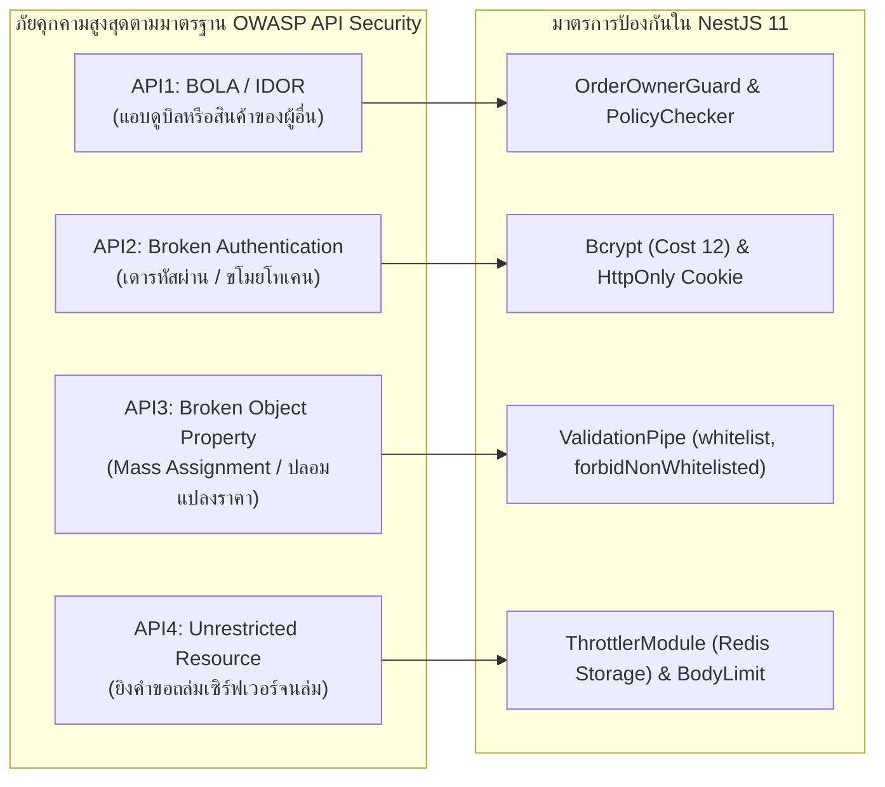

# Enterprise Security Architecture: Defense in Depth & OWASP Hardening

ยินดีต้อนรับสู่พิมพ์เขียวสถาปัตยกรรมความมั่นคงปลอดภัยระดับ Enterprise ด้วยหลักการ **การป้องกันเชิงลึก (Defense in Depth)** บนเฟรมเวิร์ก **NestJS 11** ที่ถูกนำมาปรับใช้จริงในระบบพาณิชย์อิเล็กทรอนิกส์ **Smart Butcher Marketplace** (แพลตฟอร์มตลาดประมูลและสั่งซื้อเนื้อวากิวเกรด A5 และเนื้อ Dry-Aged บ่มพิเศษ)

เอกสารฉบับนี้กำหนดมาตรฐานการปกป้องแอปพลิเคชันจากการโจมตีทางไซเบอร์ตามมาตรฐานสากล **OWASP API Security Top 10**, การตั้งค่า HTTP Security Headers ด้วย **Helmet**, การบริหารจัดการ Cross-Origin Resource Sharing (**CORS**), การจำกัดอัตราการยิงคำขอด้วย **`@nestjs/throttler`**, ตลอดจนการออกแบบ Guard สกัดกั้นช่องโหว่อันดับหนึ่งของโลกอย่าง **BOLA / IDOR (Broken Object Level Authorization)**

---

## 1. แนวคิด (Concept)

หลักการ **การป้องกันเชิงลึก (Defense in Depth - DiD)** กำหนดว่าระบบความปลอดภัยต้องไม่พึ่งพากลไกป้องกันเพียงชั้นเดียว หากปราการด่านหน้าถูกเจาะ จะต้องมีปราการด่านถัดไปคอยสกัดกั้นการโจมตีเสมอ

ในระบบ **Smart Butcher Marketplace** เราแบ่งชั้นความปลอดภัยออกเป็น 5 ระดับ:
1. **Perimeter Layer (Cloudflare / WAF)**: ป้องกันการโจมตีแบบ Distributed Denial of Service (DDoS), ดักจับบอทที่ไม่พึงประสงค์, และบังคับใช้ TLS 1.3
2. **Network & Ingress Layer (Reverse Proxy / Nginx)**: บังคับใช้ HSTS, บีบอัด Payload, และส่งต่อคำขอผ่าน Private Virtual Network
3. **HTTP Transport & Header Layer (Helmet & CORS)**: ติดตั้ง Security Headers เพื่อป้องกัน Clickjacking, MIME-Sniffing, และควบคุมโดเมนที่ได้รับอนุญาตให้ส่งคำขอ
4. **Application Logic Layer (NestJS Guards, Pipes & Throttler)**: ตรวจสอบความถูกต้องของข้อมูล (Input Sanitization), ตรวจสอบสิทธิ์ระดับวัตถุ (BOLA Protection), และจำกัดความถี่ของคำขอ (Rate Limiting)
5. **Data & Storage Layer (PostgreSQL & Secrets Management)**: เข้ารหัสข้อมูลที่จัดเก็บ (Encryption at Rest), สิทธิ์การเข้าถึงฐานข้อมูลแบบ Least Privilege, และการปกป้องกุญแจความลับด้วย Vault หรือ Doppler

<Callout type="warning" title="ความเข้าใจผิดเรื่อง UUID กับความปลอดภัย">
นักพัฒนาจำนวนมากเข้าใจผิดว่า "เมื่อใช้รหัสสินค้าหรือรหัสใบสั่งซื้อแบบ UUID v4 แล้ว ระบบจะปลอดภัยจากการเดาไอดี (IDOR)" ในความเป็นจริง UUID เพียงแค่ทำให้เดาค่ายากขึ้น แต่ไม่ได้ป้องกันช่องโหว่ BOLA เลยแม้แต่น้อย หากผู้ใช้สามารถเข้าถึงคำสั่งซื้อของผู้อื่นได้เพียงเพราะรู้ UUID ของคำสั่งซื้อนั้น ระบบจะยังคงมีช่องโหว่ระดับวิกฤตอยู่ดี!
</Callout>

---

## 2. หลักการเบื้องหลัง (Under the Hood)

### 2.1 การวิเคราะห์ช่องโหว่ OWASP API Security Top 10

ในระบบค้าเนื้อสัตว์พรีเมียม ข้อมูลคำสั่งซื้อและธุรกรรมการเงินตกเป็นเป้าหมายของการโจมตีอยู่เสมอ นี่คือ 4 ช่องโหว่สำคัญที่สุดที่ต้องป้องกันอย่างเข้มงวด:



1. **API1:2023 Broken Object Level Authorization (BOLA)**: เกิดขึ้นเมื่อไคลเอนต์เรียก Endpoint `GET /v1/orders/:id` แล้วเซิร์ฟเวอร์ตรวจสอบแค่ว่า "ล็อกอินหรือยัง?" แต่ไม่ได้ตรวจสอบว่า "คำสั่งซื้อนี้เป็นของคนที่เรียกหรือไม่?" ทำให้ลูกค้าสามารถส่องดูที่อยู่และรายการซื้อเนื้อวากิวของลูกค้าคนอื่นได้
2. **API2:2023 Broken Authentication**: การเปิดโอกาสให้แฮกเกอร์ใช้เครื่องมือ Brute-force ยิงรหัสผ่านได้ไม่จำกัด หรือการออกโทเคนที่ไม่มีวันหมดอายุ
3. **API3:2023 Broken Object Property Level Authorization (Mass Assignment & Excessive Data Exposure)**: ลูกค้าส่ง Payload `{ "totalAmount": 10, "isPaid": true }` ผ่านคำสั่ง `POST /v1/orders` แล้วเซิร์ฟเวอร์บันทึกลงฐานข้อมูลตรงๆ โดยไม่มีการสกัดฟิลด์ (Over-posting)
4. **API4:2023 Unrestricted Resource Consumption**: การไม่จำกัดขนาด Body ของไฟล์รูปภาพเนื้อ หรือการยอมให้ยิง `GET /v1/products?limit=1000000` จนเซิร์ฟเวอร์ Out of Memory

### 2.2 การทำงานของ HTTP Security Headers (Helmet)

โมดูล **Helmet** ช่วยตั้งค่า HTTP Response Headers อัตโนมัติ เพื่อบังคับให้เบราว์เซอร์ปฏิบัติตามกฎความปลอดภัย:

| Security Header | การทำงานในเชิงลึก | ภัยคุกคามที่ป้องกัน |
| :--- | :--- | :--- |
| **Strict-Transport-Security (HSTS)** | สั่งให้เบราว์เซอร์สื่อสารผ่าน HTTPS เท่านั้นเป็นเวลา 1 ปี (`max-age=31536000; includeSubDomains; preload`) | การดักฟังข้อมูล (Man-in-the-Middle) และ SSL Stripping |
| **Content-Security-Policy (CSP)** | กำหนดแหล่งที่มาของสคริปต์, สไตล์, และรูปภาพที่อนุญาตให้โหลด | การโจมตีแบบ Cross-Site Scripting (XSS) และ Data Injection |
| **X-Frame-Options: DENY** | ห้ามนำหน้าเว็บไปฝังใน `<iframe>` ของเว็บไซต์อื่น | การหลอกให้คลิกปุ่มโดยไม่รู้ตัว (Clickjacking) |
| **X-Content-Type-Options: nosniff** | สั่งให้เบราว์เซอร์เชื่อค่า `Content-Type` ที่เซิร์ฟเวอร์ส่งมาเสมอ ห้ามเดาชนิดไฟล์เอง | การแอบอัปโหลดไฟล์สคริปต์อันตรายที่ปลอมนามสกุลเป็นรูปภาพ |
| **Referrer-Policy** | ส่งค่า Referrer เฉพาะเมื่อข้ามไปยัง HTTPS โดเมนเดียวกัน (`strict-origin-when-cross-origin`) | ข้อมูล Token หรือ URL ความลับรั่วไหลไปยังเว็บไซต์ภายนอก |

### 2.3 ตารางสารบัญเจาะลึก 6 หัวข้อย่อยในโมดูล Security

| ลำดับ | หัวข้อย่อย | ขอบเขตเนื้อหาและแกนสถาปัตยกรรม | ลิงก์เข้าสู่บทเรียน |
| :---: | :--- | :--- | :--- |
| 1 | **Helmet & CORS** | การคอนฟิก Security Headers และการตั้งค่า CORS Allowlist ในระดับ Production | [เปิดอ่าน Helmet CORS](/docs/backend/security/helmet-cors) |
| 2 | **Rate Limiting** | สถาปัตยกรรม `@nestjs/throttler` ร่วมกับ Redis Cluster เพื่อป้องกัน DDoS และ Brute-force | [เปิดอ่าน Rate Limiting](/docs/backend/security/rate-limiting) |
| 3 | **XSS & CSRF Defense** | การป้องกัน Cross-Site Scripting และการรับมือ CSRF เมื่อใช้งานร่วมกับ HttpOnly Cookie | [เปิดอ่าน XSS CSRF Defense](/docs/backend/security/xss-csrf-defense) |
| 4 | **BOLA IDOR Guard** | สถาปัตยกรรมตรวจจับและสกัดกั้น Broken Object Level Authorization ในระดับ Domain | [เปิดอ่าน BOLA IDOR Guard](/docs/backend/security/bola-idor-guard) |
| 5 | **Secrets Audit** | การบริหารจัดการ Secret Keys, Doppler/Vault Integration, และการสแกนด้วย `npm audit` | [เปิดอ่าน Secrets Audit](/docs/backend/security/secrets-audit) |
| 6 | **OWASP Top 10** | สรุปภาพรวมและแนวทางการรับมือช่องโหว่ OWASP API Security Top 10 ทั้งหมด | [เปิดอ่าน OWASP Top 10](/docs/backend/security/owasp-top-10) |
| 7 | **Anti-patterns** | ข้อผิดพลาดร้ายแรงด้าน Security (Anti-patterns), เช็กลิสต์ความพร้อมก่อนส่งมอบ | [เปิดอ่าน Anti-patterns](/docs/backend/security/pitfalls) |

---

## 3. ตัวอย่างโค้ด (Smart Butcher Marketplace)

### ตัวอย่างที่ 1: การตั้งค่า Security Middleware, Helmet, Strict CORS และ Rate Limiter ใน Bootstrap File

ไฟล์นี้กำหนดมาตรฐานความปลอดภัยขั้นพื้นฐานของระบบ Backend ก่อนที่คำขอใดๆ จะถูกส่งต่อไปยัง Controller:

```typescript filename="src/main.ts"
import { NestFactory } from '@nestjs/core';
import { ValidationPipe, VersioningType, Logger } from '@nestjs/common';
import helmet from 'helmet';
import * as compression from 'compression';
import { AppModule } from './app.module';
import { ConfigService } from '@nestjs/config';

async function bootstrap() {
  const logger = new Logger('Bootstrap');
  const app = await NestFactory.create(AppModule, {
    bodyParser: true,
  });

  const configService = app.get(ConfigService);
  const isProduction = configService.get<string>('NODE_ENV') === 'production';

  // 1. ติดตั้ง HTTP Security Headers ด้วย Helmet
  app.use(
    helmet({
      contentSecurityPolicy: isProduction ? undefined : false, // ปิด CSP ในโหมด dev เพื่อให้ Swagger UI แสดงผลได้
      crossOriginEmbedderPolicy: isProduction,
      crossOriginOpenerPolicy: { policy: 'same-origin' },
      crossOriginResourcePolicy: { policy: 'same-site' },
      dnsPrefetchControl: { allow: false },
      frameguard: { action: 'deny' },
      hidePoweredBy: true, // ซ่อน Header X-Powered-By: Express
      hsts: {
        maxAge: 31536000, // 1 ปี
        includeSubDomains: true,
        preload: true,
      },
      ieNoOpen: true,
      noSniff: true,
      referrerPolicy: { policy: 'strict-origin-when-cross-origin' },
    }),
  );

  // 2. บีบอัดข้อมูลด้วย Gzip Compression เพื่อลดขนาด Payload
  app.use(compression());

  // 3. กำหนด Strict CORS Allowlist (ห้ามใช้ origin: '*' บน Production)
  const allowedOrigins = configService
    .get<string>('ALLOWED_ORIGINS', 'https://smartbutcher.com,https://admin.smartbutcher.com')
    .split(',')
    .map((origin) => origin.trim());

  app.enableCors({
    origin: (requestOrigin, callback) => {
      // ยอมรับคำขอที่ไม่มี origin (เช่น Server-to-Server, Health Check หรือ Mobile App)
      if (!requestOrigin || allowedOrigins.includes(requestOrigin)) {
        callback(null, true);
      } else {
        logger.warn(`[CORS Blocked] คำขอถูกปฏิเสธจาก Origin: ${requestOrigin}`);
        callback(new Error('Origin นี้ไม่ได้รับอนุญาตตามนโยบาย CORS'));
      }
    },
    methods: ['GET', 'POST', 'PUT', 'PATCH', 'DELETE', 'OPTIONS'],
    credentials: true, // อนุญาตให้แนบ HttpOnly Cookie มากับคำขอข้ามโดเมน
    allowedHeaders: [
      'Origin',
      'X-Requested-With',
      'Content-Type',
      'Accept',
      'Authorization',
      'X-Idempotency-Key',
    ],
    maxAge: 86400, // แคชผลการ Preflight Request ไว้ 24 ชั่วโมง
  });

  // 4. กำหนด URI Versioning เป็นมาตรฐาน (/v1/...)
  app.enableVersioning({
    type: VersioningType.URI,
    defaultVersion: '1',
  });

  // 5. เปิดใช้งาน Global Validation พร้อมลบฟิลด์แปลกปลอม (ป้องกัน Mass Assignment)
  app.useGlobalPipes(
    new ValidationPipe({
      whitelist: true, // ตัดฟิลด์ที่ไม่ได้นิยามใน DTO ทิ้งทันที
      forbidNonWhitelisted: true, // หากมีฟิลด์แปลกปลอมส่งมา ให้โยน 400 Bad Request
      transform: true,
      transformOptions: {
        enableImplicitConversion: false, // ป้องกัน Type Confusion
      },
    }),
  );

  const port = configService.get<number>('PORT', 4000);
  await app.listen(port);
  logger.log(`Smart Butcher Backend API พร้อมให้บริการบนพอร์ต ${port} [Env: ${configService.get('NODE_ENV')}]`);
}

bootstrap();
```

---

### ตัวอย่างที่ 2: สถาปัตยกรรมป้องกัน BOLA / IDOR ด้วย OrderOwnerGuard สำหรับระบบสั่งซื้อเนื้อวากิว

ตัวอย่างนี้แสดง Guard ที่ทำหน้าที่ตรวจสอบสิทธิ์ระดับ Resource Object: ป้องกันไม่ให้ลูกค้าคนหนึ่งแอบดูคำสั่งซื้อ หรือเข้าถึงสลิปการชำระเงินของลูกค้าคนอื่น:

```typescript filename="src/modules/orders/guards/order-owner.guard.ts"
import {
  Injectable,
  CanActivate,
  ExecutionContext,
  NotFoundException,
  ForbiddenException,
  BadRequestException,
} from '@nestjs/common';
import { PrismaService } from '../../../database/prisma.service';
import { Role } from '@prisma/client';
import { isUUID } from 'class-validator';
import { UserPayload } from '../../auth/interfaces/user-payload.interface';

@Injectable()
export class OrderOwnerGuard implements CanActivate {
  constructor(private readonly prisma: PrismaService) {}

  async canActivate(context: ExecutionContext): Promise<boolean> {
    const request = context.switchToHttp().getRequest();
    const user: UserPayload = request.user;
    const orderId = request.params.id;

    if (!user) {
      throw new ForbiddenException('กรุณายืนยันตัวตนก่อนเข้าถึงข้อมูลคำสั่งซื้อ');
    }

    // หากผู้ใช้มีสิทธิ์ระดับ ADMIN หรือ BUTCHER_CHEF ให้ผ่านได้ทันที
    if (user.role === Role.ADMIN || user.role === Role.BUTCHER_CHEF) {
      return true;
    }

    if (!orderId || !isUUID(orderId)) {
      throw new BadRequestException('รหัสคำสั่งซื้อ (Order ID) ต้องอยู่ในรูปแบบ UUID v4 ที่ถูกต้อง');
    }

    // ค้นหาข้อมูลคำสั่งซื้อเพื่อตรวจสอบความเป็นเจ้าของ
    const order = await this.prisma.order.findUnique({
      where: { id: orderId },
      select: { id: true, userId: true },
    });

    if (!order) {
      throw new NotFoundException(`ไม่พบคำสั่งซื้อรหัส "${orderId}" ในระบบ`);
    }

    // 🚨 ตรวจจับช่องโหว่ BOLA: หาก User ID ใน Token ไม่ตรงกับเจ้าของ Order
    if (order.userId !== user.id) {
      throw new ForbiddenException('คุณไม่มีสิทธิ์ในการเข้าถึงหรือจัดการคำสั่งซื้อนี้');
    }

    // แนบข้อมูลคำสั่งซื้อที่ตรวจสอบแล้วลงใน request เพื่อลดการคิวรีซ้ำใน Service
    request.validatedOrder = order;

    return true;
  }
}
```

```typescript filename="src/modules/orders/orders.controller.ts"
import { Controller, Get, Param, UseGuards } from '@nestjs/common';
import { ApiTags, ApiOperation, ApiResponse, ApiBearerAuth } from '@nestjs/swagger';
import { OrdersService } from './orders.service';
import { JwtAuthGuard } from '../auth/guards/jwt-auth.guard';
import { OrderOwnerGuard } from './guards/order-owner.guard';
import { OrderResponseDto } from './dto/order-response.dto';

@ApiTags('Orders')
@Controller({ path: 'orders', version: '1' })
export class OrdersController {
  constructor(private readonly ordersService: OrdersService) {}

  @Get(':id')
  @UseGuards(JwtAuthGuard, OrderOwnerGuard)
  @ApiBearerAuth()
  @ApiOperation({ summary: 'ดึงรายละเอียดคำสั่งซื้อ (ปลอดภัยจาก BOLA/IDOR ด้วย OrderOwnerGuard)' })
  @ApiResponse({ status: 200, description: 'พบข้อมูลคำสั่งซื้อ', type: OrderResponseDto })
  @ApiResponse({ status: 403, description: 'ไม่มีสิทธิ์เข้าถึงคำสั่งซื้อของผู้อื่น' })
  @ApiResponse({ status: 404, description: 'ไม่พบคำสั่งซื้อ' })
  async findOne(@Param('id') id: string): Promise<OrderResponseDto> {
    return this.ordersService.getOrderDetail(id);
  }
}
```

---

## 4. ข้อผิดพลาดที่พบบ่อย (Anti-pattern vs Best Practice)

### 4.1 Anti-pattern: การตั้งค่า `origin: '*'` คู่กับ `credentials: true` ใน CORS

```typescript
// ❌ ผิดมหันต์: อนุญาตให้ทุกเว็บไซต์ในโลกส่งคำขอพร้อมแนบ Cookie ของผู้ใช้มาได้
app.enableCors({
  origin: '*',
  credentials: true, // เบราว์เซอร์มาตรฐานจะบล็อก แต่สร้างความเสี่ยงสูงหากตั้ง regex ผิด
});
```

**ผลกระทบเชิงลบ**:
เว็บไซต์หลอกลวงของแฮกเกอร์สามารถยิงคำขอข้ามไซต์ (Cross-Origin Request) มายัง API สั่งซื้อเนื้อวากิวได้โดยที่เบราว์เซอร์จะแนบสิทธิ์ของผู้ใช้ตามไปด้วย นำไปสู่การทำธุรกรรมโดยที่เจ้าของบัญชีไม่รู้ตัว

**แนวทางที่ถูกต้อง (Best Practice)**:
ระบุเฉพาะโดเมนของ Production อย่างชัดเจนผ่าน Environment Variable เท่านั้น (เช่น `https://smartbutcher.com`)

### 4.2 Anti-pattern: การใช้คำสั่ง SQL String Concatenation (SQL Injection)

```typescript
// ❌ ผิดมหันต์: การนำ User Input มาต่อสตริงในคำสั่ง SQL ตรงๆ
const result = await prisma.$queryRawUnsafe(
  `SELECT * FROM "Product" WHERE name = '${userInput}'`
);
```

**แนวทางที่ถูกต้อง (Best Practice)**:
ใช้ Prepared Statements เสมอผ่าน Tagged Template Literal ของ Prisma:

```typescript
//  ถูกต้อง: มีการ Escape ตัวอักษรและป้องกัน SQL Injection ในระดับ Driver
const result = await tx.$queryRaw`
  SELECT * FROM "Product" WHERE name = ${userInput}
`;
```

---

## 5. ควรใช้เมื่อไหร่ และ ไม่ควรใช้เมื่อไหร่

### ควรใช้มาตรการความปลอดภัยทั้งหมดเมื่อ:
1. **ระบบเปิดให้บริการสู่เครือข่ายอินเทอร์เน็ตสาธารณะ (Public API)**: มีผู้ใช้ภายนอกเข้าถึงได้ ต้องมีทั้ง Cloudflare, Helmet, CORS, Throttler, และ BOLA Guard ครบทุกชั้น
2. **ระบบมีธุรกรรมทางการเงินและข้อมูลส่วนบุคคล (PII)**: ข้อมูลบัตรเครดิต, ที่อยู่จัดส่งเนื้อแช่แข็ง, เบอร์โทรศัพท์ลูกค้า ต้องได้รับการปกป้องตามมาตรฐาน PDPA และ PCI-DSS

### สิ่งที่ไม่ควรทำ (ข้อยกเว้นที่ต้องระวัง):
1. **อย่าเปิดใช้ CSP ที่เข้มงวดเกินไปในสภาพแวดล้อม Development**: การบล็อก Inline Scripts ในโหมด dev จะทำให้หน้าเอกสาร Swagger UI (`/api/docs`) หรือ GraphQL Playground ไม่สามารถทำงานได้ ให้ปิดเฉพาะใน Dev และเปิดใน Production
2. **อย่าทำ Rate Limiting กับ Trusted Webhooks**: การกำหนด Throttler ที่เข้มงวดเกินไปกับ Endpoint รับ Webhook จากธนาคาร (เช่น แจ้งเตือนยอดโอนเงิน PromptPay สำเร็จ) อาจทำให้ระบบปฏิเสธคำขอยืนยันยอดเงินของธนาคาร ส่งผลให้คำสั่งซื้อค้าง สำหรับ Webhook ให้ใช้การตรวจสอบ **HMAC Digital Signature** แทน Rate Limiter

---

## 6. คำถามสัมภาษณ์งาน (Interview Q&A)

### Q1: อธิบายช่องโหว่ BOLA (Broken Object Level Authorization / IDOR) ในระบบ API เหตุใดจึงเป็นช่องโหว่อันดับ 1 ของ OWASP API Security และมีสถาปัตยกรรมในการป้องกันอย่างไรให้ครอบคลุมทั้งระบบ?
> **แนวคำตอบระดับ Principal Architect:**
> **BOLA (หรือเดิมเรียกว่า IDOR - Insecure Direct Object References)** เป็นช่องโหว่ที่เกิดขึ้นเมื่อแอปพลิเคชันพึ่งพา ID ของทรัพยากรที่ส่งมาจากไคลเอนต์ (เช่น `/v1/orders/789`) โดยไม่มีการตรวจสอบความเป็นเจ้าของในระดับตรรกะทางธุรกิจ (Business Logic Authorization)
> 
> **เหตุใดจึงครองอันดับ 1 ของ OWASP**:
> 1. เครื่องมือ Static Code Analysis ทั่วไปและ WAF ตรวจจับ BOLA ได้ยากมาก เพราะคำขอมีหน้าตาถูกต้องตามหลักไวยากรณ์และมี JWT Token ที่ถูกต้องทุกประการ
> 2. ความเสียหายเกิดขึ้นเป็นวงกว้าง แฮกเกอร์สามารถเขียนบอตลูปเปลี่ยน ID เพื่อดึงข้อมูลลูกค้าทั้งฐานข้อมูล (Data Exfiltration) ได้อย่างเงียบเชียบ
> 
> **สถาปัตยกรรมการป้องกันระดับ Enterprise**:
> 1. **Resource Ownership Guard**: ออกแบบ NestJS Guard ตรวจสอบความเป็นเจ้าของในทุกเส้นทางที่มีพารามิเตอร์ `:id` ก่อนที่คำขอจะไปถึง Controller
> 2. **Tenant/User Scoped Database Queries**: ใน Repository หรือ Prisma Layer ให้บังคับกรองด้วย `userId` เสมอ เช่น:
>    `prisma.order.findFirst({ where: { id: orderId, userId: currentUser.id } })` แทนที่จะใช้ `findUnique({ where: { id: orderId } })`
> 3. **Attribute-Based Access Control (ABAC)**: ใช้ไลบรารีอย่าง CASL สำหรับการจัดการสิทธิ์ที่ซับซ้อน เช่น หัวหน้าเชฟดูสินค้าในสาขาของตนเองได้เท่านั้น

### Q2: ในระบบ E-Commerce ที่ต้องรับ Webhook จากระบบชำระเงินภายนอก (เช่น Stripe หรือ Payment Gateway ธนาคาร) เราจะวางระบบรักษาความปลอดภัยอย่างไรเพื่อป้องกันการปลอมแปลงยอดเงินและคำสั่งซื้อ?
> **แนวคำตอบระดับ Principal Architect:**
> การรับ Webhook ทางการเงินต้องปฏิเสธการเชื่อถือข้อมูลดิบโดยสิ้นเชิง และปฏิบัติตาม 4 มาตรการนี้:
> 1. **Cryptographic HMAC Signature Verification**:
>    - ผู้ให้บริการชำระเงินจะแนบ Header เช่น `Stripe-Signature` หรือ `X-Bank-Signature` ซึ่งเป็นค่า Hash ที่เกิดจากการนำ Raw Request Body มาคำนวณร่วมกับ Secret Key ด้วยอัลกอริทึม HMAC-SHA256
>    - Backend ต้องเก็บ Raw Body ไว้ (ห้ามแปลงเป็น JSON Object ก่อนคำนวณ) และคำนวณ Signature เทียบกันโดยใช้ฟังก์ชัน `crypto.timingSafeEqual` เพื่อป้องกัน Timing Attack
> 2. **Replay Attack Prevention via Timestamp Check**:
>    - Signature Header มักฝังค่า UNIX Timestamp มาด้วย Backend ต้องตรวจสอบว่าเวลาของคำขอต้องไม่ห่างจากเวลาปัจจุบันเกิน 5 นาที
> 3. **Idempotent Webhook Processing**:
>    - บันทึก `event_id` ของ Webhook ลงในฐานข้อมูลหรือ Redis หากได้รับ Event เดิมซ้ำ ให้คืน 200 OK ทันทีโดยไม่ต้องอัปเดตสถานะบิลซ้ำสอง
> 4. **Reverse Verification (Optional but Recommended)**:
>    - เมื่อได้รับ Webhook แจ้งเตือนว่าบิลจ่ายสำเร็จ Backend สามารถยิง API ตรงกลับไปยังธนาคารเพื่อ Query ตรวจสอบสถานะจริงของ Transaction ID นั้นอีกชั้นหนึ่ง ก่อนจะสั่งตัดสต็อกเนื้อวากิวและออกใบกำกับภาษี

---

## Production Security Audit Checklist

- [ ] **1. Helmet Protection**: ติดตั้ง Helmet พร้อมตั้งค่า HSTS (`max-age=31536000`), `noSniff: true`, และ `frameguard: { action: 'deny' }`
- [ ] **2. Production CORS Restriction**: ไม่อนุญาต `origin: '*'` และระบุเฉพาะ Fully Qualified Domain Names (FQDN) ของ Frontend ที่ผ่านการอนุมัติเท่านั้น
- [ ] **3. BOLA / IDOR Verification**: ทุกคำขอที่เข้าถึง Resource เฉพาะบุคคล (Order, Payment, Address) มี Guard หรือ Query ที่ผูก `userId` เสมอ
- [ ] **4. Rate Limiting Coverage**: เปิดใช้งาน `@nestjs/throttler` บน Redis โดยเฉพาะใน Endpoint `/auth/*` (จำกัด 5 req/min) และ Public Catalog (จำกัด 100 req/min)
- [ ] **5. Mass Assignment Defense**: เปิดใช้ `whitelist: true` และ `forbidNonWhitelisted: true` ใน Global `ValidationPipe`
- [ ] **6. Secrets Management**: ไม่มี API Keys, Database Password, หรือ JWT Secrets ฝังอยู่ในโค้ด หรือ Git Repository และใช้เครื่องมืออย่าง `git-secrets` หรือ Gitleaks ตรวจจับก่อน Push
- [ ] **7. Dependency Vulnerability Audit**: รันคำสั่ง `npm audit --audit-level=high` ใน CI/CD Pipeline และใช้ Dependabot/Snyk ตรวจจับแพ็กเกจที่มีช่องโหว่
- [ ] **8. Safe Raw SQL**: ห้ามใช้ `prisma.$queryRawUnsafe` กับข้อมูลที่มาจาก User Input โดยเด็ดขาด
- [ ] **9. Request Body Size Limits**: จำกัดขนาดของ Payload ไม่ให้เกิน 100KB สำหรับ JSON ทั่วไป และ 5MB สำหรับการอัปโหลดรูปภาพชิ้นเนื้อ
- [ ] **10. Audit & Error Masking**: มี Global Exception Filter คอยซ่อน Error Stack Trace และข้อความแจ้งเตือนภายในของฐานข้อมูล ไม่ให้หลุดไปถึงผู้ใช้ภายนอก

---

## ลำดับการเรียนที่แนะนำ และ ดูเพิ่มเติมที่

เพื่อความเชี่ยวชาญด้านวิศวกรรมความมั่นคงปลอดภัยของ Backend ขอแนะนำให้ศึกษาหัวข้อต่างๆ ตามลำดับดังต่อไปนี้:

1. การตั้งค่าเกราะป้องกันส่วนหัวและโดเมน: [Helmet & CORS](/docs/backend/security/helmet-cors)
2. การสกัดกั้นการยิงถล่มด้วย Rate Limiting: [Rate Limiting](/docs/backend/security/rate-limiting)
3. กลยุทธ์การป้องกันสคริปต์อันตราย: [XSS & CSRF Defense](/docs/backend/security/xss-csrf-defense)
4. การป้องกันช่องโหว่อันดับหนึ่งของโลก: [BOLA / IDOR Guard](/docs/backend/security/bola-idor-guard)
5. การบริหารจัดการความลับและการสแกนช่องโหว่: [Secrets Audit](/docs/backend/security/secrets-audit)
6. คู่มือเจาะลึกภัยคุกคามมาตรฐานสากล: [OWASP API Security Top 10](/docs/backend/security/owasp-top-10)
7. หลุมพรางด้านความปลอดภัยที่พบบ่อย: [Security Anti-patterns](/docs/backend/security/pitfalls)
