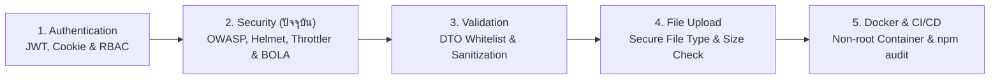

## 1. ข้อผิดพลาดที่พบบ่อย (Anti-patterns)

1. **การตรวจแค่ Authentication (`JwtAuthGuard`) แต่ลืมตรวจ Object Ownership (เกิดช่องโหว่ BOLA / IDOR)**
   - **ปัญหา**: ผู้ใช้ที่ล็อกอินแล้วสามารถดู แก้ไข หรือลบใบสั่งซื้อ (`Order`) ของลูกค้ารายอื่นได้ทั้งหมดเพียงแค่เปลี่ยนรหัส UUID ใน URL
   - **วิธีแก้**: บังคับใส่เงื่อนไข `userId: currentUser.id` ลงในคิวรีของ Prisma หรือตรวจสอบสิทธิ์ความเป็นเจ้าของในชั้น Service เสมอ
2. **การลืมตั้งค่า `app.set('trust proxy', 1)` เมื่อใช้งาน `@nestjs/throttler` หลัง Nginx / Cloudflare**
   - **ปัญหา**: `req.ip` ของลูกค้าทุกคนจะเห็นเป็น IP เดียวกัน (IP ของ Load Balancer) ทำให้เมื่อมีลูกค้าใช้งานรวมกันครบ 100 ครั้ง ระบบจะบล็อกลูกค้าทั้งประเทศพร้อมกัน!
   - **วิธีแก้**: เปิดใช้งาน `trust proxy` และเขียน `getTracker()` ใน Custom `ThrottlerGuard` เพื่อดึง IP จริงและผูกกับ `user.id`
3. **การตั้งค่า CORS `{ origin: true, credentials: true }` บน Production**
   - **ปัญหา**: อนุญาตให้ทุกเว็บไซต์ในโลกสามารถยิงคำขอข้ามโดเมนพร้อมแนบ `HttpOnly Cookie` ของเหยื่อเข้ามาสั่งงาน API ได้ทันที
   - **วิธีแก้**: ตรวจสอบ `requestOrigin` กับชุดรายการโดเมน Whitelist ที่ระบุอย่างชัดเจนเท่านั้น
4. **การปล่อยให้ใช้รหัสผ่านหรือคำสั่งซื้อได้ไม่จำกัดจำนวนครั้งต่อวินาทีที่หน้า `/auth/login` และ `/auth/otp`**
   - **ปัญหา**: เปิดโอกาสให้ถูกโจมตีแบบ Brute-force เดารหัสผ่านและถูกยิงผลาญงบ SMS OTP (SMS Pumping)
   - **วิธีแก้**: แปะ `@Throttle()` กำหนดขีดจำกัดต่ำเป็นพิเศษ (เช่น 5 ครั้งต่อนาที) บนทุก Endpoint ที่เกี่ยวกับการยืนยันตัวตนและการชำระเงิน
5. **การพิมพ์ข้อมูลอ่อนไหว (`req.body`, รหัสผ่าน, Token) ลงใน Server Logs**
   - **ปัญหา**: รหัสผ่านของลูกค้าและ JWT Access Token ถูกบันทึกเป็นข้อความธรรมดาอยู่ในระบบ Log (เช่น CloudWatch / Datadog)
   - **วิธีแก้**: ตั้งค่า `redact` ใน Logger (เช่น `nestjs-pino`) เพื่อปิดบังฟิลด์ `password`, `authorization`, `cookie` อัตโนมัติ

---

---

## 2. Checklist สรุป

| หมวดหมู่ | รายการตรวจสอบด้านความปลอดภัยสำหรับ Production API | สถานะที่แนะนำ |
| :--- | :--- | :--- |
| **OWASP BOLA / IDOR** | ทุก Endpoint ของลูกค้ามีการตรวจสอบ `userId === currentUser.id` ในระดับ Prisma Query | ✅ ต้องผ่าน |
| **OWASP Mass Assignment** | เปิดใช้งาน `ValidationPipe({ whitelist: true, forbidNonWhitelisted: true })` ระดับ Global | ✅ ต้องผ่าน |
| **Payload Protection** | จำกัดขนาด JSON Body (`json({ limit: '100kb' })`) และจำกัด `@Max(100)` ใน Pagination | ✅ ต้องผ่าน |
| **HTTP Headers & CORS** | ติดตั้ง `helmet()` และตั้งค่า CORS `origin` แบบ Strict Whitelist คู่กับ `credentials: true` | ✅ ต้องผ่าน |
| **CSRF & XSS Defense** | ใช้ `HttpOnly, Secure, SameSite` Cookie คู่กับ `CsrfProtectionGuard` (`X-CSRF-Token`) และทำ Text Sanitization | ✅ ต้องผ่าน |
| **Rate Limiting** | ติดตั้ง `@nestjs/throttler` ระดับ Global และจำกัดหน้า `/auth/login` ไม่เกิน 5 ครั้ง/นาที | ✅ ต้องผ่าน |
| **Secrets & Webhooks** | ตรวจ `.env` แบบ Fail-Fast ตอนเริ่มระบบ และตรวจลายเซ็น Webhook ด้วย `crypto.timingSafeEqual` | ✅ ต้องผ่าน |
| **Supply Chain Audit** | รัน `npm audit --omit=dev --audit-level=high` ใน CI/CD Pipeline ก่อนขึ้น Production ทุกครั้ง | ✅ ต้องผ่าน |

---

---

## 3. ลำดับการเรียนที่แนะนำ และ ดูเพิ่มเติมที่

### ดูเพิ่มเติมที่:
- **กลุ่ม BACKEND**:
  - [Authentication](/docs/backend/authentication) — สถาปัตยกรรม JWT Dual-Token, การตั้งค่า `HttpOnly Cookie`, Bcrypt และ `RolesGuard`
  - [Validation](/docs/backend/validation) — การใช้ `class-validator` และ `class-transformer` ป้องกัน Mass Assignment และซ่อนข้อมูลความลับขาออกด้วย `@Exclude()`
  - [Prisma ORM](/docs/backend/prisma-orm) — การเขียน Parameterized Queries ป้องกัน SQL Injection และการล็อกแถวข้อมูลป้องกัน Race Condition
  - [File Upload](/docs/backend/file-upload) — การตรวจสอบ Magic Bytes และจำกัดขนาดไฟล์อัปโหลดรูปเนื้อและสลิปโอนเงินอย่างปลอดภัย
  - [Docker](/docs/backend/docker) — การรัน Container ด้วย Non-root User และการจัดการ Secrets ใน Production Container
- **กลุ่ม DATABASE**:
  - [Database Security](/docs/database/security) — การตั้งค่าสิทธิ์ Database User ตามหลัก Least Privilege, Row-Level Security (RLS) และการเข้ารหัสข้อมูล
- **กลุ่ม TESTING**:
  - [Git Hooks & CI](/docs/testing/git-hooks) — การผูกคำสั่ง `npm audit` และการตรวจจับ Secret รั่วไหลในขั้นตอน Pre-commit และ CI Pipeline
  - [Backend Testing](/docs/testing/backend-testing) — การเขียนชุดทดสอบอัตโนมัติเพื่อยืนยันว่าผู้ใช้ไม่สามารถเข้าถึงข้อมูลข้ามบัญชีได้ (BOLA Security Tests)
- **กลุ่ม FRONTEND**:
  - [Next.js](/docs/nextjs) — การตั้งค่า Security Headers และการจัดการ CSRF Token ในฝั่ง Next.js App Router
