# Data Integrity & Input Sanitization: Enterprise Validation Architecture Blueprint

ยินดีต้อนรับสู่พิมพ์เขียวสถาปัตยกรรมระบบตรวจสอบความถูกต้องของข้อมูล (**Data Integrity**) และการคัดกรองข้อมูลขาเข้าและขาออก (**Input Sanitization & Output Serialization**) ระดับ Enterprise บนเฟรมเวิร์ก **NestJS 11** ด้วยชุดเครื่องมือ **`class-validator`** และ **`class-transformer`** สำหรับระบบพาณิชย์อิเล็กทรอนิกส์ **Smart Butcher Marketplace** (แพลตฟอร์มตลาดประมูลและสั่งซื้อเนื้อวากิวเกรด A5 และเนื้อ Dry-Aged บ่มพิเศษ)

เอกสารฉบับนี้กำหนดมาตรฐานการสร้าง **Data Transfer Object (DTO)**, กลไกการทำงานของ **Global `ValidationPipe`**, การป้องกันช่องโหว่ **Mass Assignment (Over-posting)** ด้วย `whitelist` และ `forbidNonWhitelisted`, การตรวจสอบอ็อบเจกต์ซ้อนทับหลายมิติ (**Nested Validation**), ตลอดจนการคัดกรองข้อมูลความลับไม่ให้รั่วไหลออกสู่สาธารณะด้วย **`ClassSerializerInterceptor`**

---

## 1. แนวคิด (Concept)

หลักการพื้นฐานที่สุดของวิศวกรรมความมั่นคงปลอดภัยของระบบฝั่งเซิร์ฟเวอร์คือ **"Never Trust User Input (อย่าไว้วางใจข้อมูลจากผู้ใช้โดยเด็ดขาด)"** ไม่ว่าข้อมูลนั้นจะส่งมาจากหน้าบ้านของตนเอง (Next.js 15), แอปพลิเคชันมือถือ หรือคู่ค้าภายนอก ข้อมูลทุกชิ้นที่ส่งผ่านเครือข่ายจะต้องผ่านการตรวจสอบความสมบูรณ์และแปลงชนิดข้อมูลให้ถูกต้องก่อนเข้าสู่ Business Logic Layer เสมอ

ในระบบ **Smart Butcher Marketplace** สถาปัตยกรรม Validation แบ่งกระบวนการออกเป็น 2 ทิศทาง:

```mermaid
flowchart LR
    subgraph Inbound_Pipeline ["Inbound Pipeline (Input Validation)"]
        RawJSON["Raw HTTP JSON"] --> CTransformIn["class-transformer<br/>(plainToInstance)"]
        CTransformIn --> CValidate["class-validator<br/>(Metadata Reflection)"]
        CValidate --> CleanDTO["Validated & Typed DTO"]
    end
    
    CleanDTO --> Service["NestJS Service Layer (Domain Logic)"]
    Service --> DB[(PostgreSQL 16)]
    DB --> RawEntity["Database Domain Entity"]
    
    subgraph Outbound_Pipeline ["Outbound Pipeline (Output Sanitization)"]
        RawEntity --> Serializer["ClassSerializerInterceptor<br/>(@Exclude / @Expose)"]
        Serializer --> SafeJSON["Sanitized Public JSON Response"]
    end
```



1. **Inbound Pipeline (ขาเข้า)**: รับ JSON ดิบจาก HTTP Request Body/Query/Params นำมาแปลงเป็น TypeScript Class Instance ผ่าน `class-transformer` แล้วนำกฎเกณฑ์ Decorators จาก `class-validator` มาประเมินผล หากข้อมูลผิดแม้แต่ฟิลด์เดียว ระบบจะปฏิเสธคำขอด้วยรหัส `400 Bad Request` ทันทีโดยที่โค้ดใน Service จะยังไม่ถูกรัน
2. **Outbound Pipeline (ขาออก)**: เมื่อ Service ดึงข้อมูล `User` หรือ `Order` จากฐานข้อมูล ตัว `ClassSerializerInterceptor` จะทำหน้าที่กรองฟิลด์ที่เป็นความลับ เช่น `passwordHash`, `refreshToken`, หรือต้นทุนเนื้อวากิวของเขียง (`costPrice`) ทิ้งไป เพื่อส่งเฉพาะข้อมูลที่ผู้ใช้มีสิทธิ์เห็นกลับไปให้ไคลเอนต์

<Callout type="tip" title="การป้องกันช่องโหว่ Mass Assignment (Over-posting)">
ในระบบสั่งซื้อเนื้อสัตว์ หากไม่มีการคัดกรองฟิลด์แปลกปลอม แฮกเกอร์สามารถแอบส่ง `{ "totalAmount": 1, "isPaid": true }` เข้ามาในคำขอสั่งซื้อเนื้อวากิวราคา 5,000 บาทได้ การเปิดใช้ `whitelist: true` ร่วมกับ `forbidNonWhitelisted: true` ใน `ValidationPipe` จะตัดฟิลด์แปลกปลอมทิ้งทันที และส่งสัญญาณเตือน 400 Bad Request หากตรวจพบฟิลด์ที่ไม่ได้นิยามไว้ใน DTO
</Callout>

---

## 2. หลักการเบื้องหลัง (Under the Hood)

### 2.1 กลไกการทำงานของ ValidationPipe และ Reflection Metadata

การทำงานของ `class-validator` ใน NestJS 11 อาศัยคุณสมบัติ **Reflection Metadata (`reflect-metadata`)** ของ TypeScript:

1. **Decorator Compilation**: เมื่อเราเขียน `@IsString()` หรือ `@Min(1)` เหนือ Property ของคลาส DTO ตัว TypeScript Compiler จะบันทึก Metadata ของชนิดข้อมูลและฟังก์ชันตรวจสอบความถูกต้องไว้ใน Prototype ของคลาสนั้น
2. **Pipeline Execution**: เมื่อมี Request ส่งเข้ามา:
   - `ValidationPipe` ดึงชนิดคลาสปลายทาง (`metatype`) ของ Controller Parameter ออกมา
   - เรียกใช้ `plainToInstance(metatype, body)` ของ `class-transformer` เพื่อแปลง Plain JavaScript Object ให้กลายเป็น Instance จริงของ DTO
   - เรียกใช้ `validate(instance, options)` เพื่อรันฟังก์ชันตรวจสอบกฎเกณฑ์ทั้งหมดที่ผูกไว้กับ Metadata
3. **Fail-Fast Error Transformation**: หากพบข้อผิดพลาด `ValidationPipe` จะรวบรวมรายการความผิดพลาด (`ValidationError[]`) แล้วแปลงเป็นโครงสร้าง JSON ข้อความแจ้งเตือนที่ชัดเจน

### 2.2 ตารางเปรียบเทียบออปชันสำคัญของ Global ValidationPipe

| ออปชันใน ValidationPipe | ค่าที่แนะนำ (Production) | หน้าที่และผลกระทบในเชิงลึก |
| :--- | :---: | :--- |
| **`whitelist`** | `true` | ตัด (Strip) ทุกฟิลด์แปลกปลอมที่ไม่มี Decorator ใน DTO ทิ้งโดยอัตโนมัติ |
| **`forbidNonWhitelisted`** | `true` | ปฏิเสธคำขอทันทีและโยน `400 Bad Request` หากพบฟิลด์แปลกปลอม เพื่อตรวจจับแฮกเกอร์ |
| **`transform`** | `true` | แปลง Payload เป็น Class Instance จริง และแปลงชนิดข้อมูลพื้นฐานตาม TypeScript type |
| **`transformOptions.enableImplicitConversion`** | `false` | ปิดการแปลง Type อัตโนมัติแบบเดาสุ่ม เพื่อป้องกันปัญหา Type Confusion เช่น แปลง `"false"` เป็น boolean `true` |
| **`stopAtFirstError`** | `false` | ตรวจสอบจนครบทุกฟิลด์ในครั้งเดียว เพื่อส่งรายการข้อผิดพลาดทั้งหมดให้ Frontend แสดงผลได้ครบถ้วน |

### 2.3 ตารางสารบัญเจาะลึก 6 หัวข้อย่อยในโมดูล Validation

| ลำดับ | หัวข้อย่อย | ขอบเขตเนื้อหาและแกนสถาปัตยกรรม | ลิงก์เข้าสู่บทเรียน |
| :---: | :--- | :--- | :--- |
| 1 | **ValidationPipe** | การตั้งค่า Global vs Scoped Pipes และการปรับแต่งโครงสร้าง Error Response ภาษาไทย | [เปิดอ่าน ValidationPipe](/docs/backend/validation/validation-pipe) |
| 2 | **Class Validator** | คู่มือ Decorators พื้นฐาน (`@IsNotEmpty`, `@IsNumber`, `@IsEnum`, `@IsUUID`, `@Min`) | [เปิดอ่าน Class Validator](/docs/backend/validation/class-validator) |
| 3 | **Nested Transform** | การตรวจสอบข้อมูลซ้อนชั้น Array และ Object ด้วย `@ValidateNested()` และ `@Type()` | [เปิดอ่าน Nested Transform](/docs/backend/validation/nested-transform) |
| 4 | **Exclude Expose** | การตัดฟิลด์ความลับขาออกด้วย `@Exclude()` และ `@Expose()` ร่วมกับ Serializer | [เปิดอ่าน Exclude Expose](/docs/backend/validation/exclude-expose) |
| 5 | **Mapped Types** | การลดโค้ดซ้ำซ้อนด้วย `PartialType`, `PickType`, `OmitType` จาก `@nestjs/swagger` | [เปิดอ่าน Mapped Types](/docs/backend/validation/mapped-types) |
| 6 | **Validator vs Zod** | การเปรียบเทียบเชิงลึกด้าน Performance, Bundle Size, Type Inference กับ Zod | [เปิดอ่าน Validator vs Zod](/docs/backend/validation/validator-vs-zod) |
| 7 | **Anti-patterns** | ข้อผิดพลาดที่พบบ่อย (Anti-patterns), เช็กลิสต์ความพร้อมก่อนส่งมอบ | [เปิดอ่าน Anti-patterns](/docs/backend/validation/pitfalls) |

---

## 3. ตัวอย่างโค้ด (Smart Butcher Marketplace)

### ตัวอย่างที่ 1: การออกแบบ DTO สินค้าเนื้อพรีเมียมด้วย Mapped Types และ Custom Validation Logic

ตัวอย่างนี้แสดงการสร้าง `CreateProductDto` ที่มีกฎเกณฑ์ตรวจสอบระดับไขมันแทรก (BMS Score), น้ำหนัก, และราคา พร้อมการใช้ `PartialType` เพื่อสืบทอดไปเป็น `UpdateProductDto`:

```typescript filename="src/modules/products/dto/create-product.dto.ts"
import {
  IsString,
  IsNotEmpty,
  IsNumber,
  IsPositive,
  IsInt,
  Min,
  Max,
  IsUUID,
  IsEnum,
  IsOptional,
  MaxLength,
} from 'class-validator';
import { ApiProperty, ApiPropertyOptional } from '@nestjs/swagger';

export enum MeatCategoryEnum {
  JAPANESE_WAGYU_A5 = 'JAPANESE_WAGYU_A5',
  AUSTRALIAN_ANGUS = 'AUSTRALIAN_ANGUS',
  DRY_AGED_BEEF = 'DRY_AGED_BEEF',
  KUROBUTA_PORK = 'KUROBUTA_PORK',
}

export class CreateProductDto {
  @ApiProperty({ description: 'ชื่อสินค้าเนื้อสัตว์พรีเมียม', example: 'Miyazaki Wagyu A5 Ribeye Steak' })
  @IsString({ message: 'ชื่อสินค้าต้องเป็นข้อความตัวอักษร' })
  @IsNotEmpty({ message: 'กรุณาระบุชื่อสินค้าเนื้อสัตว์' })
  @MaxLength(150, { message: 'ชื่อสินค้าต้องมีความยาวไม่เกิน 150 ตัวอักษร' })
  readonly name: string;

  @ApiProperty({ description: 'หมวดหมู่เนื้อสัตว์', enum: MeatCategoryEnum })
  @IsEnum(MeatCategoryEnum, { message: 'หมวดหมู่เนื้อสัตว์ไม่ถูกต้องตามรายการที่กำหนด' })
  @IsNotEmpty({ message: 'กรุณาเลือกหมวดหมู่เนื้อสัตว์' })
  readonly category: MeatCategoryEnum;

  @ApiProperty({ description: 'ราคาจำหน่ายต่อหน่วย (บาท)', example: 3850.50 })
  @IsNumber({ maxDecimalPlaces: 2 }, { message: 'ราคาต้องเป็นตัวเลขทศนิยมไม่เกิน 2 ตำแหน่ง' })
  @IsPositive({ message: 'ราคาสินค้าต้องมากกว่า 0 บาท' })
  readonly price: number;

  @ApiProperty({ description: 'จำนวนสินค้าในสต็อก (ชิ้น)', example: 12 })
  @IsInt({ message: 'จำนวนสต็อกต้องเป็นจำนวนเต็ม' })
  @Min(0, { message: 'จำนวนสต็อกต้องไม่ติดลบ' })
  readonly stockQuantity: number;

  @ApiPropertyOptional({
    description: 'คะแนนลายไขมันแทรก Beef Marbling Score (BMS 1 - 12 เฉพาะเนื้อวากิว)',
    example: 11,
    minimum: 1,
    maximum: 12,
  })
  @IsOptional()
  @IsInt({ message: 'คะแนน Marbling Score ต้องเป็นจำนวนเต็ม' })
  @Min(1, { message: 'คะแนน Marbling Score ต่ำสุดคือ 1' })
  @Max(12, { message: 'คะแนน Marbling Score สูงสุดคือ 12' })
  readonly marblingScore?: number;

  @ApiPropertyOptional({ description: 'ระยะเวลาการบ่ม Dry-Aged (จำนวนวัน)', example: 45 })
  @IsOptional()
  @IsInt({ message: 'ระยะเวลาบ่มต้องเป็นจำนวนเต็มของวัน' })
  @Min(7, { message: 'ระยะเวลาบ่มขั้นต่ำต้องไม่น้อยกว่า 7 วัน' })
  readonly agingDays?: number;

  @ApiProperty({ description: 'รหัส UUID ประจำตัวฟาร์มต้นกำเนิด' })
  @IsUUID('4', { message: 'รหัสฟาร์ม (farmId) ต้องอยู่ในรูปแบบ UUID v4 ที่ถูกต้อง' })
  readonly farmId: string;
}
```

```typescript filename="src/modules/products/dto/update-product.dto.ts"
import { PartialType } from '@nestjs/swagger';
import { CreateProductDto } from './create-product.dto';

/**
 * UpdateProductDto สืบทอดฟิลด์ทั้งหมดจาก CreateProductDto
 * โดยเปลี่ยนทุกฟิลด์ให้เป็น Optional อัตโนมัติ (รองรับคำสั่ง PATCH)
 * พร้อมคง Validation Decorators เดิมไว้ทั้งหมดอย่างสมบูรณ์
 */
export class UpdateProductDto extends PartialType(CreateProductDto) {}
```

---

### ตัวอย่างที่ 2: สถาปัตยกรรม Nested Validation สำหรับคำสั่งซื้อเนื้อสัตว์ พร้อม Array Transformation

ตัวอย่างนี้แสดงการตรวจสอบโครงสร้างที่มีความซับซ้อนหลายชั้น: ใบสั่งซื้อ (`CreateOrderDto`) ที่มีอาร์เรย์ของรายการสินค้า (`OrderItemDto[]`) และข้อมูลการตัดแต่งชิ้นเนื้อแบบพิเศษ:

```typescript filename="src/modules/orders/dto/order-item.dto.ts"
import {
  IsUUID,
  IsInt,
  Min,
  Max,
  IsNumber,
  IsPositive,
  IsString,
  IsOptional,
  MaxLength,
} from 'class-validator';
import { ApiProperty, ApiPropertyOptional } from '@nestjs/swagger';

export class OrderItemDto {
  @ApiProperty({ description: 'รหัส UUID ประจำตัวสินค้าเนื้อสัตว์' })
  @IsUUID('4', { message: 'รหัสสินค้า (productId) ต้องเป็น UUID v4' })
  readonly productId: string;

  @ApiProperty({ description: 'จำนวนชิ้นที่ต้องการสั่งซื้อ (1 - 50 ชิ้น)', example: 2 })
  @IsInt({ message: 'จำนวนสินค้าต้องเป็นจำนวนเต็ม' })
  @Min(1, { message: 'ต้องสั่งซื้อเนื้อสัตว์อย่างน้อย 1 ชิ้น' })
  @Max(50, { message: 'สั่งซื้อได้สูงสุดไม่เกิน 50 ชิ้นต่อคำสั่งซื้อ' })
  readonly quantity: number;

  @ApiProperty({ description: 'ราคาต่อหน่วยที่ตกลงซื้อ ณ ขณะสั่งซื้อ (บาท)', example: 2400 })
  @IsNumber({ maxDecimalPlaces: 2 }, { message: 'ราคาต่อหน่วยต้องเป็นตัวเลขทศนิยมไม่เกิน 2 ตำแหน่ง' })
  @IsPositive({ message: 'ราคาต่อหน่วยต้องมากกว่า 0' })
  readonly unitPrice: number;

  @ApiPropertyOptional({
    description: 'คำขอตัดแต่งเนื้อพิเศษจากเชฟ (Custom Cut Instruction)',
    example: 'หั่นความหนา 2.5 ซม. สเต๊กสไตล์ และตัดแต่งพังผืดขอบข้างออก',
  })
  @IsOptional()
  @IsString({ message: 'คำขอตัดแต่งพิเศษต้องเป็นข้อความ' })
  @MaxLength(300, { message: 'คำขอตัดแต่งพิเศษต้องไม่เกิน 300 ตัวอักษร' })
  readonly cutSpecification?: string;
}
```

```typescript filename="src/modules/orders/dto/create-order.dto.ts"
import {
  IsArray,
  ValidateNested,
  ArrayMinSize,
  IsString,
  IsNotEmpty,
  IsEnum,
} from 'class-validator';
import { Type } from 'class-transformer';
import { ApiProperty } from '@nestjs/swagger';
import { OrderItemDto } from './order-item.dto';

export enum DeliveryMethod {
  TEMPERATURE_CONTROLLED_COOL = 'TEMPERATURE_CONTROLLED_COOL', // รถห้องเย็น 0 ถึง 4 องศา
  SUPER_FROZEN_EXPRESS = 'SUPER_FROZEN_EXPRESS',              // รถห้องเย็นติดลบ -18 องศา
}

export class CreateOrderDto {
  @ApiProperty({
    description: 'รายการชิ้นเนื้อสัตว์พรีเมียมที่ต้องการสั่งซื้อ (อย่างน้อย 1 รายการ)',
    type: [OrderItemDto],
  })
  @IsArray({ message: 'รายการสินค้า (items) ต้องส่งมาในรูปแบบ Array' })
  @ArrayMinSize(1, { message: 'คำสั่งซื้อต้องมีรายการเนื้อสัตว์อย่างน้อย 1 ชิ้น' })
  @ValidateNested({ each: true, message: 'ข้อมูลชิ้นเนื้อในรายการสินค้าไม่ผ่านเกณฑ์การตรวจสอบ' })
  @Type(() => OrderItemDto) // ⚠️ จำเป็นอย่างยิ่ง เพื่อให้ class-transformer แปลง Plain Object เป็น OrderItemDto
  readonly items: OrderItemDto[];

  @ApiProperty({ description: 'วิธีการจัดส่งควบคุมอุณหภูมิ', enum: DeliveryMethod })
  @IsEnum(DeliveryMethod, { message: 'กรุณาเลือกวิธีการจัดส่งควบคุมอุณหภูมิที่ถูกต้อง' })
  readonly deliveryMethod: DeliveryMethod;

  @ApiProperty({ description: 'ที่อยู่จัดส่งปลายทางพร้อมรหัสไปรษณีย์' })
  @IsString({ message: 'ที่อยู่จัดส่งต้องเป็นข้อความ' })
  @IsNotEmpty({ message: 'กรุณาระบุที่อยู่จัดส่งเนื้อสัตว์' })
  readonly shippingAddress: string;
}
```

---

## 4. ข้อผิดพลาดที่พบบ่อย (Anti-pattern vs Best Practice)

### 4.1 Anti-pattern: ลืมใส่ `@Type(() => ChildDto)` ในการทำ Nested Validation

นี่คือข้อผิดพลาดอันดับ 1 ในการใช้งาน NestJS Validation:

```typescript
// ❌ ผิดมหันต์: ใส่ @ValidateNested แต่ลืม @Type
export class BadOrderDto {
  @IsArray()
  @ValidateNested({ each: true })
  // ขาด @Type(() => OrderItemDto) ทำให้ class-transformer ไม่แปลงเป็น Instance!
  readonly items: OrderItemDto[];
}
```

**ผลกระทบเชิงลบ**:
เมื่อไม่มี `@Type(() => OrderItemDto)` ข้อมูลในอาร์เรย์จะยังคงเป็น Plain JavaScript Object ธรรมดา ซึ่ง `class-validator` จะไม่สามารถอ่าน Reflection Metadata ของ `OrderItemDto` ได้ ส่งผลให้ข้อมูลใน `items` **ผ่านการตรวจสอบไปได้ทุกกรณีโดยไม่มีการ validate เลยแม้แต่บรรทัดเดียว!** แฮกเกอร์สามารถส่ง `{ "quantity": -99999 }` ผ่านเข้ามาได้ทันที

**แนวทางที่ถูกต้อง (Best Practice)**:
ใส่ `@Type(() => ChildDto)` คู่กับ `@ValidateNested()` เสมอ เพื่อบังคับให้เกิด Class Hydration อย่างสมบูรณ์

### 4.2 Anti-pattern: การใช้ TypeScript Type โดยไม่มี Decorator

```typescript
// ❌ ผิดมหันต์: คิดว่ามี type ": number" แล้ว NestJS จะตรวจสอบให้
export class BadPriceDto {
  price: number; // ไม่มี Decorator ใดๆ เลย
}
```

**ผลกระทบเชิงลบ**:
TypeScript Type เป็นเพียง Compile-time Information และจะถูกลบทิ้งไปทั้งหมด (Type Erasure) เมื่อคอมไพล์เป็น JavaScript ที่รันไทม์ เซิร์ฟเวอร์จึงยอมรับค่าอะไรก็ได้ เช่น ส่งสตริง `"free"` หรืออ็อบเจกต์ `{}` เข้ามาได้โดยไม่เกิด Error

---

## 5. ควรใช้เมื่อไหร่ และ ไม่ควรใช้เมื่อไหร่

### ควรใช้ `class-validator` + `class-transformer` เมื่อ:
1. **พัฒนาด้วย NestJS Framework เป็นหลัก**: เป็นมาตรฐานอย่างเป็นทางการที่ผสานการทำงานเข้ากับ NestJS Dependency Injection, Interceptors, และ Swagger CLI Plugin อย่างแนบแน่นที่สุด
2. **ต้องการเอกสาร API แบบอัตโนมัติ (Swagger/OpenAPI)**: ตัวแปลง Swagger ของ NestJS สามารถอ่าน Decorator ของ `class-validator` เพื่อสร้าง OpenAPI Specification ให้ตรงกับกฎเกณฑ์ของระบบโดยอัตโนมัติ
3. **ระบบสถาปัตยกรรมแบบ Object-Oriented Programming (OOP)**: ชอบการจัดการแบบแยกไฟล์ DTO เป็นคลาส และการนำกลับมาใช้ใหม่ผ่าน Inheritance เช่น `PartialType`

### ไม่ควรใช้ / ควรพิจารณาใช้ Zod เมื่อ:
1. **ต้องการแชร์ Schema ร่วมกันแบบ End-to-End Type Safety กับ Frontend (Next.js 15)**: หากคุณมี Monorepo (เช่น Turborepo) และต้องการประกาศ Schema เพียงครั้งเดียว แล้วใช้ validate ทั้งฟอร์มของ React Hook Form หน้าบ้าน และ API หลังบ้าน การใช้ **Zod** จะให้ Developer Experience ที่คล่องตัวกว่าเพราะเป็น Plain TypeScript
2. **สถาปัตยกรรม Functional Programming หรือ Micro-benchmarks Latency**: Zod มีความเร็วในการ Parse ข้อมูลที่เร็วกว่า `class-transformer` + `class-validator` ในบางกรณีเนื่องจากไม่มี Overhead จาก Reflection Metadata

---

## 6. คำถามสัมภาษณ์งาน (Interview Q&A)

### Q1: อธิบายกลไกการทำงานของ `@ValidateNested()` และเหตุใดจึงต้องใส่ `@Type(() => ChildDto)` จาก `class-transformer` เสมอ หากลืมใส่จะเกิดผลกระทบอะไรขึ้นกับระบบ?
> **แนวคำตอบระดับ Principal Architect:**
> กลไกการทำงานแบ่งเป็น 2 ส่วนที่ต้องพึ่งพาอาศัยกัน:
> 1. `class-validator` ตรวจสอบกฎเกณฑ์โดยการอ่าน Metadata ที่ถูกบันทึกไว้บน **Class Prototype** ของอินสแตนซ์นั้นๆ
> 2. อย่างไรก็ตาม ข้อมูลที่เดินทางมาจากระบบเครือข่ายผ่าน HTTP Request Body จะถูก Express หรือ Fastify พาร์สมาเป็น **Plain JavaScript Object (POJO)** ซึ่งเป็นอ็อบเจกต์เปล่าที่ไม่มี Class Prototype ของ DTO ผูกติดอยู่เลย
> 3. หน้าที่ของ `@Type(() => ChildDto)` คือการสั่งให้ `class-transformer` นำข้อมูลในอาร์เรย์หรืออ็อบเจกต์ย่อยนั้น มาแปลงรูป (Instantiate) ให้กลายเป็น Class Instance ของ `ChildDto` จริง
> 4. เมื่อข้อมูลกลายเป็น Class Instance แล้ว ตัว Decorator `@ValidateNested()` จึงจะสามารถสั่งให้ `class-validator` วิ่งเข้าไปอ่าน Metadata ในระดับ Prototype ของ `ChildDto` เพื่อรันการตรวจสอบได้
> 
> **ผลกระทบหากลืมใส่ `@Type`**:
> ตัว `class-validator` จะมองเห็นอ็อบเจกต์ย่อยเป็นเพียง POJO และไม่รู้ว่าต้องใช้กฎเกณฑ์ของคลาสใดมาตรวจสอบ ส่งผลให้การตรวจสอบในชั้นลึกถูก **ข้ามการทำงานไปอย่างเงียบๆ (Silent Bypass)** ข้อมูลที่ผิดพลาดหรืออันตรายทั้งหมดจะหลุดรอดเข้าไปถึงฐานข้อมูล เกิดช่องโหว่ความปลอดภัยระดับวิกฤต

### Q2: เปรียบเทียบข้อดีและข้อจำกัดในเชิงสถาปัตยกรรมระหว่าง `class-validator` (Decorator-based) กับ `Zod` (Schema-based) ในระบบ NestJS 11 ขนาดใหญ่?
> **แนวคำตอบระดับ Principal Architect:**
> **1. ด้าน Architecture & Framework Ergonomics:**
> - `class-validator`: ผสานการทำงานเข้ากับโครงสร้าง OOP ของ NestJS ได้ดีเยี่ยม มีการประกาศ DTO เป็นคลาสที่ทำหน้าที่เป็นทั้ง Type Definition, Validation Definition และ Swagger Metadata ผ่าน CLI Plugin โดยไม่ต้องประกาศสิ่งใดซ้ำซ้อน
> - `Zod`: อิงหลักการ Functional Programming และ Schema Definition ซึ่งแม้จะเขียนกระชับกว่า แต่ใน NestJS คลาส DTO เป็นสิ่งที่จำเป็นสำหรับ Metadata Reflection ของ Dependency Injection ทำให้ต้องใช้ Library เสริม เช่น `nestjs-zod` เพื่อแปลง Zod Schema ให้กลายเป็น Class
> 
> **2. ด้าน Type Inference & Code Sharing:**
> - `Zod` มีความโดดเด่นอย่างชัดเจนใน Fullstack Monorepo ด้วยคำสั่ง `z.infer<typeof schema>` ทำให้ Frontend (Next.js) นำ Schema ตัวเดียวกันไปใช้กับ React Hook Form ได้ทันทีโดยไม่ต้องคอมไพล์โค้ด
> - `class-validator` มักมีปัญหาเมื่อนำไปรันบนฝั่งเบราว์เซอร์ เนื่องจากต้องการโพลีฟิลล์ `reflect-metadata` และทำให้ Bundle Size ของหน้าบ้านมีขนาดใหญ่ขึ้น
> 
> **3. ด้าน Runtime Performance:**
> - `Zod` ทำงานได้เร็วกว่าและกินหน่วยความจำน้อยกว่า `class-transformer` + `class-validator` เล็กน้อย เนื่องจากไม่มีกระบวนการ Reflection และ Prototype Mapping หลายชั้น

---

## Production Checklist ด้าน Validation

- [ ] **1. Global ValidationPipe Registration**: ติดตั้ง `ValidationPipe` ใน `main.ts` ด้วย NestFactory Global Pipe
- [ ] **2. Whitelist Defense**: เปิดออปชัน `whitelist: true` เพื่อลบฟิลด์แปลกปลอมทิ้งเสมอ
- [ ] **3. Forbid Non-Whitelisted**: เปิดออปชัน `forbidNonWhitelisted: true` เพื่อตรวจจับและปฏิเสธคำขอที่มีความพยายามทำ Mass Assignment ทันที
- [ ] **4. Explicit Type Conversion**: ตั้งค่า `transform: true` และหลีกเลี่ยง `enableImplicitConversion: true` บน Global Scope เพื่อป้องกัน Type Confusion
- [ ] **5. Mandatory Type Decorator on Nested DTOs**: ตรวจสอบว่าทุกที่ที่มี `@ValidateNested()` ต้องมี `@Type(() => TargetDto)` กำกับอยู่ด้วยเสมอ
- [ ] **6. Output Serialization Guard**: เปิดใช้งาน `ClassSerializerInterceptor` ร่วมกับ `@Exclude()` เพื่อป้องกันการรั่วไหลของรหัสผ่านและข้อมูล PII ออกทาง Response
- [ ] **7. Domain-Specific Custom Validators**: สร้าง Custom Validator สำหรับเงื่อนไขธุรกิจที่ซับซ้อน เช่น การตรวจสอบความเข้ากันได้ของชิ้นส่วนเนื้อวากิวและวิธีการปรุง
- [ ] **8. Localized Error Messages**: กำหนดข้อความแจ้งเตือน (`message`) ในภาษาไทยที่เข้าใจง่ายและระบุปัญหาชัดเจนในทุก Decorator
- [ ] **9. Mapped Types Utilization**: ใช้ `PartialType` หรือ `PickType` จาก `@nestjs/swagger` สำหรับ DTO อัปเดต เพื่อรักษาความสอดคล้องของ Schema
- [ ] **10. Pagination Query Constraints**: กำหนด `@Min(1)` และ `@Max(100)` บนพารามิเตอร์ `limit` หรือ `take` เสมอ เพื่อป้องกันการดึงข้อมูลถล่มฐานข้อมูล

---

## ลำดับการเรียนที่แนะนำ และ ดูเพิ่มเติมที่

เพื่อความเชี่ยวชาญด้านการตรวจสอบความถูกต้องของข้อมูลใน NestJS ขอแนะนำให้ศึกษาหัวข้อต่างๆ ตามลำดับดังต่อไปนี้:

1. สถาปัตยกรรมท่อส่งข้อมูลขาเข้า: [ValidationPipe](/docs/backend/validation/validation-pipe)
2. รวมมิตร Decorators ตรวจสอบข้อมูลพื้นฐาน: [Class Validator](/docs/backend/validation/class-validator)
3. การตรวจสอบโครงสร้างข้อมูลที่ซับซ้อนหลายชั้น: [Nested Transform](/docs/backend/validation/nested-transform)
4. การปกป้องข้อมูลความลับขาออก: [Exclude Expose](/docs/backend/validation/exclude-expose)
5. เทคนิคการลดความซ้ำซ้อนของโค้ด DTO: [Mapped Types](/docs/backend/validation/mapped-types)
6. ศึกษาวิเคราะห์เปรียบเทียบกับ Zod: [Validator vs Zod](/docs/backend/validation/validator-vs-zod)
7. หลุมพรางและข้อผิดพลาดร้ายแรง: [Validation Anti-patterns](/docs/backend/validation/pitfalls)
