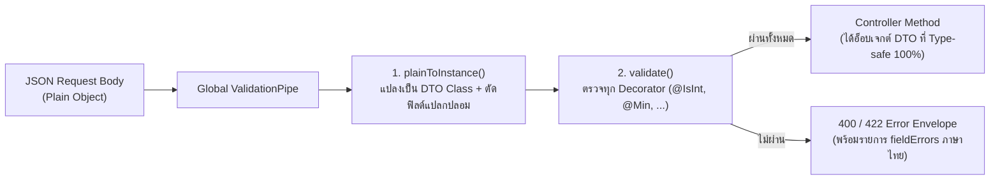
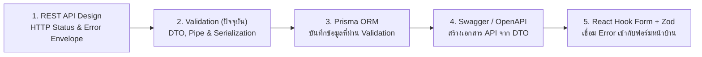

# Validation

คู่มือการออกแบบระบบตรวจสอบความถูกต้องของข้อมูลขาเข้า (**Input Validation**) และการจัดรูปแบบข้อมูลขาออก (**Output Serialization**) ระดับ Production-Grade บน **NestJS 11** ด้วย **`class-validator`** และ **`class-transformer`** สำหรับระบบอีคอมเมิร์ซ **Smart Butcher Marketplace** เนื้อหาเจาะลึกตั้งแต่สถาปัตยกรรม **DTO (Data Transfer Object)**, การตั้งค่า **Global `ValidationPipe`** ป้องกันช่องโหว่ Mass Assignment, การปรับแต่งข้อความแจ้งเตือนภาษาไทยที่สื่อความหมายชัดเจน, การตรวจสอบอ็อบเจกต์ซ้อนกันหลายชั้น (**Nested Validation** สำหรับ `Order` และ `OrderItem[]`), การซ่อนข้อมูลความลับขาออกด้วย **`@Exclude()` / `@Expose()`**, การลดโค้ดซ้ำซ้อนด้วย **Mapped Types**, การเขียน **Custom Validator**, ไปจนถึงการเปรียบเทียบเชิงลึกกับ **Zod** ที่ใช้ในฝั่ง Frontend

## สารบัญหัวข้อในหน้านี้

| ลำดับ | หัวข้อหลัก | สิ่งที่คุณจะได้เรียนรู้ |
| :--- | :--- | :--- |
| **1** | [1. สถาปัตยกรรม DTO และ Global ValidationPipe ใน NestJS 11](#1-สถาปัตยกรรม-dto-และ-global-validationpipe-ใน-nestjs-11) | ทำไมต้องใช้ `class` แทน `interface`, กลไก `whitelist`, `forbidNonWhitelisted`, `transform` และ `exceptionFactory` |
| **2** | [2. Decorators ที่ใช้บ่อยของ class-validator และการปรับแต่งข้อความภาษาไทย](#2-decorators-ที่ใช้บ่อยของ-class-validator-และการปรับแต่งข้อความภาษาไทย) | การใช้ String, Number, Enum, UUID Validators และตัวแปร `$property`, `$value`, `$constraint1` ในข้อความภาษาไทย |
| **3** | [3. Nested Validation และการแปลงชนิดข้อมูลด้วย class-transformer (@Type)](#3-nested-validation-และการแปลงชนิดข้อมูลด้วย-class-transformer-type) | การใช้ `@ValidateNested({ each: true })` คู่กับ `@Type(() => ...)` และ `@Transform()` สำหรับ `Order` + `OrderItem[]` |
| **4** | [4. การซ่อนข้อมูลอ่อนไหวในขาออกด้วย @Exclude, @Expose และ ClassSerializerInterceptor](#4-การซ่อนข้อมูลอ่อนไหวในขาออกด้วย-exclude-expose-และ-classserializerinterceptor) | การป้องกัน `passwordHash` รั่วไหล และการสร้าง Computed Fields ใน Response DTO ด้วย `@Expose()` |
| **5** | [5. Mapped Types (PartialType, PickType, OmitType) และการสร้าง Custom Validator](#5-mapped-types-partialtype-picktype-omittype-และการสร้าง-custom-validator) | การสืบทอดกฎจาก `CreateProductDto` สู่ `UpdateProductDto` และการเขียน Custom Constraint ตรวจสอบน้ำหนักเนื้อขั้นต่ำ |
| **6** | [6. เปรียบเทียบ class-validator (Backend) กับ Zod (Frontend)](#6-เปรียบเทียบ-class-validator-backend-กับ-zod-frontend) | วิเคราะห์ความต่างเชิงสถาปัตยกรรมระหว่าง Decorator Metadata กับ Functional Schema และการทำ Fullstack Validation |
| **7** | [ข้อผิดพลาดที่พบบ่อย (Anti-patterns)](#ข้อผิดพลาดที่พบบ่อย-anti-patterns) | หลุมพรางที่ทำให้ ValidationPipe ไม่ทำงานหรือปล่อยให้ข้อมูลผิดพลาดหลุดเข้าฐานข้อมูล |
| **8** | [Checklist สรุป](#checklist-สรุป) | ตารางตรวจสอบความสมบูรณ์ของ DTO และ Validation Layer ก่อนขึ้น Production |
| **9** | [ลำดับการเรียนที่แนะนำ และ ดูเพิ่มเติมที่](#ลำดับการเรียนที่แนะนำ-และ-ดูเพิ่มเติมที่) | แผนผังการเรียนรู้ต่อเนื่องและลิงก์เชื่อมโยงสู่บทเรียนที่เกี่ยวข้อง |

---

## 1. สถาปัตยกรรม DTO และ Global ValidationPipe ใน NestJS 11

### แนวคิด (Concept)
**DTO (Data Transfer Object)** คืออ็อบเจกต์ที่กำหนดสัญญาโครงสร้างข้อมูล (Data Contract) ที่เดินทางเข้าและออกจาก API ของเรา กฎเหล็กที่สำคัญที่สุดของการเขียน DTO ใน NestJS 11 คือ **ต้องประกาศ DTO ด้วย `class` ของ TypeScript เสมอ ห้ามใช้ `interface` หรือ `type` เด็ดขาด!**

ทำไมถึงใช้ `interface` ไม่ได้? เพราะเมื่อโค้ด TypeScript ถูกคอมไพล์เป็น JavaScript เพื่อรันบน Node.js (`nest build`) ตัว `interface` และ `type` ทั้งหมดจะถูกลบทิ้งหายไป (Type Erasure) ทำให้ที่ Runtime ไม่มีข้อมูลใดๆ เหลือให้ `ValidationPipe` ตรวจสอบเลย ในขณะที่ `class` จะยังคงอยู่เป็น JavaScript Constructor Function และสามารถแนบ **Decorator Metadata (`reflect-metadata`)** ของ `class-validator` ไว้ตรวจจับที่ Runtime ได้อย่างสมบูรณ์



### หลักการเบื้องหลัง (Under the Hood)
เมื่อเราลงทะเบียน `ValidationPipe` ระดับ Global ใน `main.ts` หรือ `AppModule` มีออปชันสำคัญ 4 ตัวที่ควบคุมความปลอดภัยและพฤติกรรมเบื้องหลัง:
1. **`whitelist: true`**: สั่งให้ลบทุกฟิลด์ใน JSON ขาเข้าที่ **ไม่ได้มี Decorator ของ `class-validator` แปะอยู่** ในคลาส DTO ทิ้งโดยอัตโนมัติ (ป้องกันช่องโหว่ Mass Assignment เช่น แฮกเกอร์แอบส่ง `"role": "ADMIN"` แถมมา)
2. **`forbidNonWhitelisted: true`** (ต้องเปิดคู่กับ `whitelist: true`): แทนที่จะแอบลบฟิลด์แปลกปลอมทิ้งเงียบๆ ให้โยน Error ปฏิเสธคำขอนั้นทันที เพื่อให้ทีม Frontend รู้ตัวทันทีว่าพิมพ์ชื่อฟิลด์ผิด (เช่น พิมพ์ `weightGram` ตกตัว `s`)
3. **`transform: true`**: สั่งให้ `class-transformer` แปลง Plain JSON Object ธรรมดาให้กลายเป็น Instance ของคลาส DTO จริงๆ (`dto instanceof CreateProductDto === true`) และแปลงชนิดพารามิเตอร์บน URL เช่น `@Param('page') page: number` จากสตริง `'1'` ให้เป็นตัวเลข `1`
4. **`exceptionFactory`**: ฟังก์ชันสำหรับแปลงรายการ `ValidationError[]` ของ `class-validator` ให้เป็นโครงสร้าง `fieldErrors: [{ field, message }]` ที่ฝั่ง Frontend (เช่น React Hook Form `setError`) นำไปผูกแสดงผลใต้ช่อง Input แต่ละช่องได้ทันที!

<Callout type="warning" title="ระวังการเปิด enableImplicitConversion: true แบบ Global">
แม้การตั้งค่า transformOptions: { enableImplicitConversion: true } จะช่วยแปลงสตริงเป็นตัวเลขหรือ Boolean ให้อัตโนมัติ แต่ก็มีอันตรายแฝงอยู่ เพราะใน JavaScript การแปลงสตริง "false" ด้วย Boolean("false") จะได้ค่าเป็น true เสมอ! ดังนั้นในระดับ Production แนะนำให้ใช้ @Type(() => Number) และ @Transform() อย่างชัดเจนแทนการเปิด Implicit Conversion แบบเหมาเข่ง
</Callout>

### ตัวอย่างโค้ด (Smart Butcher Marketplace)

#### ตัวอย่างที่ 1: การตั้งค่า Global ValidationPipe มาตรฐาน Production ใน main.ts (พื้นฐาน)
```typescript filename="src/main.ts"
import { NestFactory } from '@nestjs/core';
import { ValidationPipe } from '@nestjs/common';
import { AppModule } from './app.module';
import { createValidationExceptionFactory } from './common/pipes/validation-exception.factory';

async function bootstrap() {
  const app = await NestFactory.create(AppModule);

  app.useGlobalPipes(
    new ValidationPipe({
      // 1. คัดกรองเฉพาะฟิลด์ที่มี Decorator ใน DTO เท่านั้น
      whitelist: true,
      // 2. แจ้งเตือนทันทีหากไคลเอนต์ส่งฟิลด์ที่ไม่อยู่ในสัญญาเข้ามา
      forbidNonWhitelisted: true,
      // 3. แปลง Plain Object ให้เป็น Class Instance ของ DTO
      transform: true,
      // 4. ปิดการเดาชนิดข้อมูลอัตโนมัติแบบเหมาเข่ง เพื่อป้องกันบั๊ก Boolean("false") === true
      transformOptions: {
        enableImplicitConversion: false,
      },
      // 5. รวบรวมข้อผิดพลาดของทุกฟิลด์ส่งกลับในครั้งเดียว ไม่หยุดแค่ฟิลด์แรก
      stopAtFirstError: false,
      // 6. จัดรูปแบบ Error ให้เข้ากับ React Hook Form และ RFC 9457
      exceptionFactory: createValidationExceptionFactory(),
    }),
  );

  await app.listen(process.env.PORT ?? 3000);
}
bootstrap();
```

#### ตัวอย่างที่ 2: การสร้าง Recursive Validation Exception Factory ที่รองรับ Nested Objects และส่งคืน `fieldErrors` (ขั้นสูง)
```typescript filename="src/common/pipes/validation-exception.factory.ts"
import { UnprocessableEntityException, ValidationError } from '@nestjs/common';

export interface StructuredFieldError {
  field: string;   // เช่น "email" หรือ "items[0].weightGrams"
  rule: string;    // เช่น "min", "isEnum"
  message: string; // ข้อความภาษาไทยที่พร้อมแสดงใต้ช่องกรอกข้อมูล
}

// ฟังก์ชันคลี่ ValidationError ที่อาจซ้อนกันหลายชั้น (Nested DTOs) ออกมาเป็นรายการแบนราบ
function flattenValidationErrors(
  errors: ValidationError[],
  parentPath: string = '',
): StructuredFieldError[] {
  const result: StructuredFieldError[] = [];

  for (const error of errors) {
    const currentPath = parentPath
      ? Array.isArray(error.target)
        ? `${parentPath}[${error.property}]`
        : `${parentPath}.${error.property}`
      : error.property;

    if (error.constraints) {
      for (const [ruleKey, messageText] of Object.entries(error.constraints)) {
        result.push({
          field: currentPath,
          rule: ruleKey,
          message: messageText,
        });
      }
    }

    if (error.children && error.children.length > 0) {
      result.push(...flattenValidationErrors(error.children, currentPath));
    }
  }

  return result;
}

export function createValidationExceptionFactory() {
  return (validationErrors: ValidationError[]) => {
    const fieldErrors = flattenValidationErrors(validationErrors);

    return new UnprocessableEntityException({
      code: 'VALIDATION_FAILED',
      error: 'Unprocessable Entity',
      message: 'ข้อมูลที่ส่งมาไม่ผ่านเกณฑ์การตรวจสอบ กรุณาตรวจสอบรายละเอียดในแต่ละช่อง',
      fieldErrors,
    });
  };
}
```

### ผิด vs ถูก (Anti-pattern vs Best Practice)

```typescript filename="src/modules/products/dto-interface-vs-class.ts"
// ❌ ผิด (Anti-pattern): ใช้ TypeScript interface เป็น DTO ใน Controller
export interface BadCreateProductDto {
  name: string;
  pricePerKgThb: number;
}
// เมื่อรันจริง ValidationPipe จะปล่อยให้ { "name": 12345, "pricePerKgThb": -9999, "hack": true } ผ่านทะลุเข้าไปทั้งหมด!

// ✅ ถูก (Best Practice): ใช้ class พร้อมแปะ Decorator จาก class-validator ทุกฟิลด์เสมอ
import { IsString, IsNotEmpty, IsNumber, Min } from 'class-validator';

export class GoodCreateProductDto {
  @IsString()
  @IsNotEmpty()
  name!: string;

  @IsNumber({ maxDecimalPlaces: 2 })
  @Min(1)
  pricePerKgThb!: number;
}
```

### ควรใช้เมื่อไหร่ และ ไม่ควรใช้เมื่อไหร่
- **ควรเปิด `whitelist: true` และ `forbidNonWhitelisted: true` เสมอ**: สำหรับ REST API ภายในองค์กรและ API ที่เชื่อมต่อกับ Frontend ของเราเอง เพื่อดักจับทั้งผู้โจมตีและบั๊กการพิมพ์ชื่อฟิลด์ผิดตั้งแต่เนิ่นๆ
- **อาจพิจารณาปิด `forbidNonWhitelisted` (แต่ยังต้องเปิด `whitelist: true` เสมอ!) เมื่อ**: เป็น Endpoint รับ Webhook จากผู้ให้บริการภายนอก (เช่น Stripe / Omise) ที่อาจมีการเพิ่มฟิลด์ใหม่ๆ ในอนาคต เพื่อให้ระบบของเราตัดฟิลด์ที่ไม่รู้จักทิ้งเงียบๆ โดยไม่ทำ Webhook พัง

### คำถามสัมภาษณ์ (Interview Q&A)
1. **คำถาม**: ถ้าเราสร้าง `class CreateOrderDto` ที่มีฟิลด์ `note: string` แต่เราไม่ได้แปะ Decorator ใดๆ ของ `class-validator` บนฟิลด์ `note` เลย เมื่อเปิดใช้งาน `ValidationPipe({ whitelist: true })` จะเกิดอะไรขึ้นเมื่อลูกค้าส่ง `{ "note": "ขอมันน้อยๆ" }` เข้ามา?
   - **แนวคำตอบ**: ฟิลด์ `note` จะถูกลบทิ้งหายไป (หรือถูกบล็อกด้วย Error ทันทีหากเปิด `forbidNonWhitelisted: true`)! เพราะกลไก `whitelist: true` ของ `class-validator` จะรู้จักเฉพาะฟิลด์ที่มี Decorator ของ `class-validator` แปะอยู่เท่านั้น (เพื่อบันทึกลง Metadata Registry) ดังนั้นแม้ฟิลด์นั้นจะเป็น Optional ที่ไม่ต้องการตรวจเงื่อนไขซับซ้อน ก็ **ต้องแปะ `@IsOptional()` คู่กับ `@IsString()` เสมอ**
2. **คำถาม**: ทำไมการปรับแต่ง `exceptionFactory` ให้ส่งคืนโครงสร้าง `fieldErrors: [{ field: "items[0].weightGrams", message: "..." }]` จึงดีกว่าการใช้โครงสร้างค่าเริ่มต้นของ NestJS?
   - **แนวคำตอบ**: ค่าเริ่มต้นของ NestJS จะส่งคืน `message` เป็น Array ของสตริงธรรมดา เช่น `["weightGrams must not be less than 200"]` โดยไม่ระบุชื่อคีย์แยกกับข้อความ ทำให้ฝั่ง Frontend (เช่น React Hook Form) ไม่รู้ว่าจะนำข้อความนั้นไปผูกแสดงเป็นตัวหนังสือสีแดงใต้ช่อง Input ช่องไหน แต่การแยก `field` และ `message` ชัดเจนช่วยให้ Frontend เขียนลูป `fieldErrors.forEach(e => form.setError(e.field, { message: e.message }))` ได้ใน 3 บรรทัด

---

## 2. Decorators ที่ใช้บ่อยของ class-validator และการปรับแต่งข้อความภาษาไทย

### แนวคิด (Concept)
ไลบรารี **`class-validator`** มี Decorators สำเร็จรูปครอบคลุมการตรวจสอบข้อมูลแทบทุกชนิดในระบบธุรกิจ ตั้งแต่การตรวจชนิดข้อมูลพื้นฐาน, รูปแบบข้อความ (Email, UUID, Phone, Regex), ขอบเขตตัวเลขและทศนิยม, ไปจนถึงขนาดของ Array

สิ่งที่ยกระดับประสบการณ์ผู้ใช้ (UX) ในระบบ **Smart Butcher Marketplace** คือการปรับแต่งข้อความแจ้งเตือน (`message`) ให้เป็น **ภาษาไทยที่เข้าใจง่ายและระบุค่าที่ผิดพลาดอย่างชัดเจน** โดยใช้ Validation Message Tokens ของ `class-validator`:
- `$property`: ชื่อฟิลด์ที่กำลังถูกตรวจสอบ
- `$value`: ค่าที่ผู้ใช้ส่งเข้ามาแล้วไม่ผ่านเกณฑ์
- `$constraint1`, `$constraint2`: ค่าเงื่อนไขที่ตั้งไว้ใน Decorator (เช่น ค่าต่ำสุด หรือค่าสูงสุด)

### หลักการเบื้องหลัง (Under the Hood)
ในหนึ่งฟิลด์ที่มี Decorator หลายตัว (เช่น `@IsNotEmpty()`, `@IsString()`, `@MinLength(3)`) ตัว `class-validator` จะประเมิน Decorator และเก็บผลลัพธ์ลงในอ็อบเจกต์ `constraints` ของฟิลด์นั้น สิ่งที่ต้องระวังเป็นพิเศษคือพฤติกรรมของ **`@IsOptional()`**:
- ใน `class-validator` ตัว `@IsOptional()` จะข้ามการตรวจสอบ Decorator ตัวอื่นๆ บนฟิลด์นั้นก็ต่อเมื่อค่าที่ส่งมาเป็น **`null` หรือ `undefined` เท่านั้น**
- หากฝั่ง Frontend ส่งสตริงว่าง `""` เข้ามาในฟิลด์ Optional (เช่น `phoneNumber: ""`) ตัว `@IsOptional()` จะถือว่ามีค่าส่งมาแล้ว และส่งต่อไปตรวจ `@Matches()` จนเกิด Error! ดังนั้นสำหรับฟิลด์ข้อความที่เป็น Optional จึงควรใช้คู่กับ `@Transform` แปลงสตริงว่าง `""` ให้เป็น `undefined` ก่อนเสมอ

### ตัวอย่างโค้ด (Smart Butcher Marketplace)

#### ตัวอย่างที่ 1: การสร้าง CreateProductDto ที่ใช้ Decorators ครบถ้วนพร้อมข้อความภาษาไทยและ Validation Tokens (พื้นฐาน)
```typescript filename="src/modules/products/dto/create-product.dto.ts"
import {
  IsString,
  IsNotEmpty,
  IsEnum,
  IsInt,
  IsNumber,
  IsBoolean,
  IsOptional,
  IsUUID,
  Min,
  Max,
  MinLength,
  MaxLength,
  Matches,
  ArrayMinSize,
  ArrayMaxSize,
  IsArray,
} from 'class-validator';
import { MeatGrade } from '@prisma/client';

export class CreateProductDto {
  @IsString({ message: 'รหัสสินค้า (SKU) ต้องเป็นข้อความตัวอักษร' })
  @Matches(/^SB-[A-Z0-9]{3,10}-[A-Z0-9]{2,10}$/, {
    message:
      'รหัส SKU ($value) ไม่ตรงตามรูปแบบมาตรฐานของร้าน (ตัวอย่างที่ถูกต้อง: SB-WAGYU-A501)',
  })
  sku!: string;

  @IsString({ message: 'ชื่อชิ้นเนื้อพรีเมียมต้องเป็นข้อความ' })
  @IsNotEmpty({ message: 'กรุณาระบุชื่อชิ้นเนื้อพรีเมียม' })
  @MinLength(5, {
    message: 'ชื่อสินค้าต้องมีความยาวอย่างน้อย $constraint1 ตัวอักษร (คุณกรอกมาเพียง "$value")',
  })
  @MaxLength(200, {
    message: 'ชื่อสินค้าต้องมีความยาวไม่เกิน $constraint1 ตัวอักษร',
  })
  name!: string;

  @IsUUID('4', { message: 'รหัสหมวดหมู่สินค้า (categoryId) ต้องเป็น UUID v4 ที่ถูกต้อง' })
  categoryId!: string;

  @IsEnum(MeatGrade, {
    message: ({ value }) =>
      `เกรดเนื้อ "${value}" ไม่ถูกต้อง กรุณาเลือกจาก: ${Object.values(MeatGrade).join(', ')}`,
  })
  grade!: MeatGrade;

  @IsInt({ message: 'ระดับคะแนนไขมันแทรก (marblingScore) ต้องเป็นจำนวนเต็ม' })
  @Min(1, { message: 'คะแนนไขมันแทรก (BMS) ต้องมีค่าตั้งแต่ $constraint1 ขึ้นไป' })
  @Max(12, { message: 'คะแนนไขมันแทรก (BMS) สูงสุดตามมาตรฐานญี่ปุ่นคือ $constraint1' })
  marblingScore!: number;

  @IsOptional()
  @IsInt({ message: 'จำนวนวันบ่มเนื้อ Dry-Aged ต้องเป็นจำนวนเต็ม' })
  @Min(14, { message: 'เนื้อ Dry-Aged ต้องผ่านการบ่มอย่างน้อย $constraint1 วันขึ้นไป' })
  @Max(120, { message: 'จำนวนวันบ่มเนื้อ Dry-Aged ต้องไม่เกิน $constraint1 วัน' })
  dryAgedDays?: number | null;

  @IsNumber(
    { maxDecimalPlaces: 2, allowNaN: false, allowInfinity: false },
    { message: 'ราคาต่อกิโลกรัมต้องเป็นตัวเลขและมีทศนิยมไม่เกิน 2 ตำแหน่ง' },
  )
  @Min(100, { message: 'ราคาเนื้อต่อกิโลกรัมต้องไม่ต่ำกว่า $constraint1 บาท' })
  @Max(100000, { message: 'ราคาเนื้อต่อกิโลกรัมต้องไม่เกิน $constraint1 บาท' })
  pricePerKgThb!: number;

  @IsInt({ message: 'น้ำหนักสต็อกเนื้อ (กรัม) ต้องเป็นจำนวนเต็มหน่วยกรัม' })
  @Min(0, { message: 'น้ำหนักสต็อกเนื้อไม่สามารถติดลบได้' })
  stockWeightGrams!: number;

  @IsOptional()
  @IsArray({ message: 'รายการคำแนะนำการย่าง (cookingTips) ต้องเป็น Array' })
  @ArrayMinSize(1, { message: 'หากระบุคำแนะนำการย่าง ต้องมีอย่างน้อย $constraint1 ข้อ' })
  @ArrayMaxSize(5, { message: 'ระบุคำแนะนำการย่างได้ไม่เกิน $constraint1 ข้อ' })
  @IsString({ each: true, message: 'คำแนะนำการย่างแต่ละข้อต้องเป็นข้อความตัวอักษร' })
  cookingTips?: string[];

  @IsOptional()
  @IsBoolean({ message: 'สถานะการเปิดขาย (isAvailable) ต้องเป็น true หรือ false เท่านั้น' })
  isAvailable?: boolean;
}
```

#### ตัวอย่างที่ 2: การสร้าง Reusable Thai Validation Messages Dictionary เพื่อคุมโทนข้อความทั้งองค์กร (ขั้นสูง)
```typescript filename="src/common/validation/thai-validation-messages.ts"
import { ValidationArguments } from 'class-validator';

// คลังข้อความภาษาไทยกลาง ช่วยให้ทุก DTO ในโปรเจกต์ใช้สำนวนเดียวกันทั้งหมด
export const ThaiValidationMsg = {
  required: (fieldLabel: string) => ({
    message: `กรุณาระบุ${fieldLabel} ห้ามเว้นว่าง`,
  }),
  isString: (fieldLabel: string) => ({
    message: `${fieldLabel}ต้องเป็นชนิดข้อความ (String)`,
  }),
  isInt: (fieldLabel: string) => ({
    message: `${fieldLabel}ต้องเป็นตัวเลขจำนวนเต็มเท่านั้น`,
  }),
  minNumber: (fieldLabel: string) => ({
    message: (args: ValidationArguments) =>
      `${fieldLabel}ต้องมีค่าไม่น้อยกว่า ${args.constraints[0].toLocaleString('th-TH')} (ค่าที่ส่งมาคือ ${args.value})`,
  }),
  maxNumber: (fieldLabel: string) => ({
    message: (args: ValidationArguments) =>
      `${fieldLabel}ต้องมีค่าไม่เกิน ${args.constraints[0].toLocaleString('th-TH')}`,
  }),
  thaiPhone: () => ({
    message: 'หมายเลขโทรศัพท์ต้องเป็นเบอร์มือถือไทย 10 หลัก (เช่น 0812345678)',
  }),
} as const;
```

```typescript filename="src/modules/users/dto/register-customer.dto.ts"
import {
  IsEmail,
  IsString,
  MinLength,
  MaxLength,
  Matches,
} from 'class-validator';
import { ThaiValidationMsg } from '../../../common/validation/thai-validation-messages';

export class RegisterCustomerDto {
  @IsEmail({}, { message: 'รูปแบบอีเมลไม่ถูกต้อง (ตัวอย่าง: customer@smartbutcher.co.th)' })
  email!: string;

  @IsString(ThaiValidationMsg.isString('รหัสผ่าน'))
  @MinLength(8, { message: 'รหัสผ่านต้องมีความยาวอย่างน้อย 8 ตัวอักษร' })
  @MaxLength(64, {
    message: 'รหัสผ่านต้องไม่เกิน 64 ตัวอักษร (เพื่อให้รองรับขีดจำกัด 72 bytes ของ Bcrypt)',
  })
  @Matches(/^(?=.*[a-z])(?=.*[A-Z])(?=.*\d)/, {
    message: 'รหัสผ่านต้องประกอบด้วยตัวพิมพ์เล็ก ตัวพิมพ์ใหญ่ และตัวเลขอย่างน้อยอย่างละ 1 ตัว',
  })
  password!: string;

  @IsString(ThaiValidationMsg.isString('ชื่อ-นามสกุล'))
  @MinLength(2, { message: 'กรุณาระบุชื่อ-นามสกุลจริงอย่างน้อย 2 ตัวอักษร' })
  @MaxLength(150)
  fullName!: string;

  @IsString(ThaiValidationMsg.isString('เบอร์โทรศัพท์'))
  @Matches(/^0[689]\d{8}$/, ThaiValidationMsg.thaiPhone())
  phoneNumber!: string;
}
```

### ผิด vs ถูก (Anti-pattern vs Best Practice)

```typescript filename="src/modules/products/decorator-comparison.ts"
import { IsArray, IsString, IsNumber } from 'class-validator';

// ❌ ผิด (Anti-pattern): ใช้ @IsArray() แต่ลืมใส่ { each: true } และใช้ @IsNumber() โดยไม่จำกัดทศนิยมกับราคาเงิน
export class BadProductTagsDto {
  @IsArray()
  // ลืมตรวจสมาชิกข้างใน! แฮกเกอร์สามารถส่ง tags: [{ malicious: true }, 99999] เข้ามาได้!
  tags!: string[];

  @IsNumber()
  // ลูกค้าสามารถส่งราคา 199.9999999999 บาท เข้ามาทำลายระบบคำนวณบัญชีได้!
  pricePerKgThb!: number;
}

// ✅ ถูก (Best Practice): ใช้ { each: true } ตรวจทุกสมาชิกใน Array และใช้ { maxDecimalPlaces: 2 } กับจำนวนเงินเสมอ
export class GoodProductTagsDto {
  @IsArray()
  @IsString({ each: true, message: 'ป้ายกำกับแต่ละรายการต้องเป็นข้อความ' })
  tags!: string[];

  @IsNumber({ maxDecimalPlaces: 2 })
  pricePerKgThb!: number;
}
```

### ควรใช้เมื่อไหร่ และ ไม่ควรใช้เมื่อไหร่
- **ควรใช้ `@IsInt()` แทน `@IsNumber()` เมื่อ**: ฟิลด์นั้นต้องเป็นจำนวนเต็มเท่านั้น เช่น จำนวนชิ้น, น้ำหนักหน่วยกรัม (`weightGrams`), คะแนนไขมันแทรก (`marblingScore`), หรือหน่วยเงินสตางค์ (`amountSatang`)
- **ไม่ควรใช้ `@IsString()` อย่างเดียวโดยไม่กำหนด `@MaxLength()`**: เพราะผู้โจมตีสามารถส่งสตริงความยาว 50,000 ตัวอักษรเข้ามาในฟิลด์ชื่อลูกค้าจนล้นขนาด `VARCHAR(150)` ของ PostgreSQL และทำให้เกิด Database Error 500 ได้

### คำถามสัมภาษณ์ (Interview Q&A)
1. **คำถาม**: ใน `class-validator` การแปะ `@IsString()` เฉยๆ ป้องกันสตริงว่าง `""` หรือสตริงที่มีแต่ช่องว่าง `"   "` ได้หรือไม่?
   - **แนวคำตอบ**: **ไม่ได้!** เพราะทั้ง `""` และ `"   "` มีชนิดข้อมูลเป็น `string` ใน JavaScript จึงผ่าน `@IsString()` ได้ทั้งหมด และต่อให้แปะ `@IsNotEmpty()` เพิ่ม ตัว `"   "` (เคาะวรรค 3 ครั้ง) ก็ยังผ่าน `@IsNotEmpty()` ได้เพราะความยาวสตริงมากกว่า 0! วิธีที่ถูกต้องระดับ Production คือการใช้ `@Transform(({ value }) => typeof value === 'string' ? value.trim() : value)` เพื่อตัดช่องว่างหัวท้ายออกก่อน แล้วจึงตามด้วย `@IsNotEmpty()` หรือ `@MinLength(1)`
2. **คำถาม**: ทำไมเวลาตรวจสอบฟิลด์ที่เป็น Array ของข้อความ เช่น `cookingTips: string[]` เราจึงต้องแปะทั้ง `@IsArray()` และ `@IsString({ each: true })` คู่กัน?
   - **แนวคำตอบ**: หากเราแปะเฉพาะ `@IsString({ each: true })` โดยไม่แปะ `@IsArray()` ในบางกรณีที่ผู้ใช้งานส่งค่าที่ไม่ใช่ Array เข้ามา ข้อความแจ้งเตือนอาจจะไม่ชัดเจน และหากแปะเฉพาะ `@IsArray()` โดยไม่ใส่ `{ each: true }` ตัว Validator จะตรวจแค่ว่าตัวแปรนอกสุดเป็น `Array` หรือไม่ แต่จะไม่ตรวจสมาชิกข้างในเลย การใส่คู่กันพร้อม `@ArrayMaxSize()` จึงรัดกุมที่สุดทั้งโครงสร้างนอกและสมาชิกใน

---

## 3. Nested Validation และการแปลงชนิดข้อมูลด้วย class-transformer (@Type)

### แนวคิด (Concept)
ในระบบสั่งซื้อเนื้อพรีเมียม คำขอสร้างใบสั่งซื้อ (`POST /api/v1/orders`) ไม่ได้เป็นเพียง JSON ชั้นเดียวแบนๆ แต่มีโครงสร้างซ้อนกันหลายระดับ (Nested Structure) เช่น ภายใน `CreateOrderDto` จะมีอ็อบเจกต์ที่อยู่จัดส่ง `shippingAddress: ShippingAddressDto` และมีรายการเนื้อที่สั่งซื้อ `items: CreateOrderItemDto[]`

การตรวจสอบข้อมูลซ้อนกันใน NestJS ต้องอาศัยการทำงานร่วมกันของ **2 Decorators จาก 2 ไลบรารีเสมอ** คือ:
1. **`@ValidateNested()` (จาก `class-validator`)**: บอกให้ Validator มุดลงไปตรวจสอบกฎภายในอ็อบเจกต์ลูกด้วย (และถ้าเป็น Array ของอ็อบเจกต์ ต้องใส่ **`@ValidateNested({ each: true })`**)
2. **`@Type(() => ChildDto)` (จาก `class-transformer`)**: บอกให้ Transformer รู้ว่าจะต้องแปลง Plain JSON ของอ็อบเจกต์ลูกนั้นให้เป็น Instance ของคลาสอะไร

<Callout type="important" title="หลุมพรางอันดับ 1: ใส่ @ValidateNested แต่ลืมใส่ @Type">
หากคุณแปะเฉพาะ @ValidateNested({ each: true }) บน items: CreateOrderItemDto[] โดยลืมแปะ @Type(() => CreateOrderItemDto) จาก class-transformer ตัว ValidationPipe จะไม่รู้ว่าสมาชิกใน Array คือคลาสอะไร (เพราะ TypeScript ลบ Type ของ Array ทิ้งตอน Compile) ส่งผลให้การตรวจสอบใน CreateOrderItemDto ไม่ทำงานเลยแม้แต่ข้อเดียว!
</Callout>

### หลักการเบื้องหลัง (Under the Hood)
ทำไม TypeScript ถึงไม่บอกชนิดของ `items: CreateOrderItemDto[]` ให้ `class-transformer` รู้อัตโนมัติ?
- เมื่อเปิด `emitDecoratorMetadata: true` ใน `tsconfig.json` ตัว TypeScript Compiler จะบันทึกชนิดของฟิลด์ลงใน `design:type`
- สำหรับฟิลด์เดี่ยวอย่าง `shippingAddress: ShippingAddressDto` ค่า `design:type` คือ `ShippingAddressDto`
- แต่สำหรับฟิลด์ที่เป็น Array อย่าง `items: CreateOrderItemDto[]` ค่า `design:type` ที่ TypeScript สร้างออกมาได้มีแค่คำว่า **`Array`** เท่านั้น! (ไม่ได้บอกว่าข้างใน `Array` คือ `CreateOrderItemDto`)
- ดังนั้นเราจึงต้องระบุ `@Type(() => CreateOrderItemDto)` ด้วยตัวเองเสมอ เพื่อให้ `plainToInstance()` สร้างอินสแตนซ์ของ `CreateOrderItemDto` ให้กับสมาชิกทุกตัวใน Array ก่อนส่งเข้า `validate()`

### ตัวอย่างโค้ด (Smart Butcher Marketplace)

#### ตัวอย่างที่ 1: การทำ Nested Validation สำหรับ CreateOrderDto, ShippingAddressDto และ CreateOrderItemDto[] (พื้นฐาน)
```typescript filename="src/modules/orders/dto/create-order.dto.ts"
import {
  IsString,
  IsNotEmpty,
  IsUUID,
  IsInt,
  IsEnum,
  IsBoolean,
  Min,
  Max,
  Matches,
  ValidateNested,
  IsArray,
  ArrayMinSize,
  ArrayMaxSize,
  IsDefined,
} from 'class-validator';
import { Type, Transform } from 'class-transformer';
import { PaymentMethod } from '@prisma/client';

export enum MeatCutStyle {
  STEAK_THICK_25MM = 'STEAK_THICK_25MM',
  STEAK_MEDIUM_20MM = 'STEAK_MEDIUM_20MM',
  YAKINIKU_5MM = 'YAKINIKU_5MM',
  SHABU_THIN_2MM = 'SHABU_THIN_2MM',
  WHOLE_SUBPRIMAL_BLOCK = 'WHOLE_SUBPRIMAL_BLOCK',
}

// 1. DTO ย่อยสำหรับที่อยู่จัดส่งรถห้องเย็น
export class ColdChainShippingAddressDto {
  @Transform(({ value }) => (typeof value === 'string' ? value.trim() : value))
  @IsString({ message: 'ชื่อผู้รับสินค้าต้องเป็นข้อความ' })
  @IsNotEmpty({ message: 'กรุณาระบุชื่อผู้รับสินค้า' })
  recipientName!: string;

  @IsString()
  @Matches(/^0[689]\d{8}$/, {
    message: 'เบอร์โทรศัพท์ผู้รับต้องเป็นเบอร์มือถือไทย 10 หลัก',
  })
  phoneNumber!: string;

  @Transform(({ value }) => (typeof value === 'string' ? value.trim() : value))
  @IsString()
  @IsNotEmpty({ message: 'กรุณาระบุบ้านเลขที่และรายละเอียดที่อยู่จัดส่ง' })
  addressLine!: string;

  @IsString()
  @Matches(/^[1-9]\d{4}$/, {
    message: 'รหัสไปรษณีย์ต้องเป็นตัวเลข 5 หลักที่ถูกต้อง',
  })
  postalCode!: string;
}

// 2. DTO ย่อยสำหรับรายการชิ้นเนื้อแต่ละชิ้นในตะกร้า (OrderItem)
export class CreateOrderItemDto {
  @IsUUID('4', { message: 'รหัสสินค้า (productId) ต้องเป็น UUID v4' })
  productId!: string;

  @IsEnum(MeatCutStyle, {
    message: 'รูปแบบการหั่นเนื้อ (cutStyle) ไม่ถูกต้อง',
  })
  cutStyle!: MeatCutStyle;

  @IsInt({ message: 'น้ำหนักเนื้อที่สั่ง (weightGrams) ต้องเป็นจำนวนเต็มหน่วยกรัม' })
  @Min(200, { message: 'สั่งซื้อเนื้อพรีเมียมขั้นต่ำรายการละ $constraint1 กรัมขึ้นไป' })
  @Max(10000, { message: 'สั่งซื้อเนื้อต่อรายการได้ไม่เกิน $constraint1 กรัม (10 กก.)' })
  weightGrams!: number;

  @IsBoolean({ message: 'กรุณาระบุว่าต้องการแพ็คสูญญากาศแยกชิ้นหรือไม่ (true/false)' })
  isCustomDryAgeCut!: boolean;
}

// 3. DTO หลักของใบสั่งซื้อ (Order) ที่ประกอบร่าง Nested DTOs เข้าด้วยกัน
export class CreateOrderDto {
  @IsUUID('4')
  userId!: string;

  @IsEnum(PaymentMethod, {
    message: 'ช่องทางการชำระเงินไม่ถูกต้อง',
  })
  paymentMethod!: PaymentMethod;

  // ตรวจสอบอ็อบเจกต์ซ้อน 1:1 (ต้องมีทั้ง @IsDefined, @ValidateNested และ @Type)
  @IsDefined({ message: 'กรุณาระบุข้อมูลที่อยู่สำหรับจัดส่งรถห้องเย็น (shippingAddress)' })
  @ValidateNested()
  @Type(() => ColdChainShippingAddressDto)
  shippingAddress!: ColdChainShippingAddressDto;

  // ตรวจสอบ Array ของอ็อบเจกต์ซ้อน 1:N (ต้องมี @IsArray, @ValidateNested({ each: true }) และ @Type)
  @IsArray({ message: 'รายการสินค้าที่สั่งซื้อ (items) ต้องเป็น Array' })
  @ArrayMinSize(1, { message: 'ใบสั่งซื้อต้องมีรายการเนื้ออย่างน้อย 1 รายการ' })
  @ArrayMaxSize(30, { message: 'สั่งซื้อได้สูงสุดไม่เกิน 30 รายการต่อ 1 ใบสั่งซื้อ' })
  @ValidateNested({ each: true })
  @Type(() => CreateOrderItemDto)
  items!: CreateOrderItemDto[];
}
```

#### ตัวอย่างที่ 2: การใช้ `@Transform` และ `@Type` จัดการ Query String ที่ซับซ้อน (Boolean, Comma-separated Array, Date) (ขั้นสูง)
```typescript filename="src/modules/orders/dto/filter-orders-query.dto.ts"
import {
  IsOptional,
  IsEnum,
  IsBoolean,
  IsDate,
  IsInt,
  Min,
  Max,
  IsArray,
} from 'class-validator';
import { Type, Transform } from 'class-transformer';
import { OrderStatus } from '@prisma/client';

export class FilterOrdersQueryDto {
  // แปลง Query String ?page=2&limit=20 จาก string เป็น number อย่างปลอดภัยด้วย @Type(() => Number)
  @IsOptional()
  @Type(() => Number)
  @IsInt()
  @Min(1)
  page: number = 1;

  @IsOptional()
  @Type(() => Number)
  @IsInt()
  @Min(1)
  @Max(100)
  limit: number = 20;

  // รองรับทั้ง ?statuses=PAID,SHIPPED และ ?statuses=PAID&statuses=SHIPPED
  @IsOptional()
  @Transform(({ value }): unknown => {
    if (typeof value === 'string') {
      return value
        .split(',')
        .map((s) => s.trim())
        .filter(Boolean);
    }
    return value;
  })
  @IsArray()
  @IsEnum(OrderStatus, { each: true, message: 'สถานะคำสั่งซื้อในตัวกรองไม่ถูกต้อง' })
  statuses?: OrderStatus[];

  // แปลงสตริง "true" / "false" ใน Query String ให้เป็น boolean ที่ถูกต้อง 100%
  @IsOptional()
  @Transform(({ value }): unknown => {
    if (value === 'true' || value === '1' || value === true) return true;
    if (value === 'false' || value === '0' || value === false) return false;
    return value;
  })
  @IsBoolean({ message: 'พารามิเตอร์ isColdChainExpress ต้องเป็น true หรือ false' })
  isColdChainExpress?: boolean;

  // แปลงสตริงวันที่ ISO 8601 เป็น Date Object พร้อมตรวจว่าเป็นวันที่ที่ถูกต้อง
  @IsOptional()
  @Type(() => Date)
  @IsDate({ message: 'รูปแบบวันที่เริ่มต้น (fromDate) ไม่ถูกต้อง ต้องเป็น ISO 8601' })
  fromDate?: Date;
}
```

### ผิด vs ถูก (Anti-pattern vs Best Practice)

```typescript filename="src/modules/orders/nested-validation-comparison.ts"
import { ValidateNested, IsDefined } from 'class-validator';
import { Type } from 'class-transformer';
import { ColdChainShippingAddressDto } from './dto/create-order.dto';

// ❌ ผิด (Anti-pattern): แปะแค่ @ValidateNested() แต่ไม่ใส่ @IsDefined() และไม่ใส่ @Type()
export class BadOrderDto {
  // 1. ถ้าลูกค้าส่ง {} เปล่าๆ มา (ไม่ส่ง shippingAddress มาเลย) @ValidateNested() จะข้ามไปเฉยๆ เหมือนเป็น Optional!
  // 2. ถ้าส่งมาแต่ไม่มี @Type() กฎข้างใน ColdChainShippingAddressDto จะไม่ถูกรันเลย!
  @ValidateNested()
  shippingAddress!: ColdChainShippingAddressDto;
}

// ✅ ถูก (Best Practice): สำหรับ Required Nested Object ต้องใส่ครบทั้ง @IsDefined(), @ValidateNested() และ @Type() เสมอ!
export class GoodOrderDto {
  @IsDefined({ message: 'กรุณาระบุข้อมูลที่อยู่จัดส่ง' })
  @ValidateNested()
  @Type(() => ColdChainShippingAddressDto)
  shippingAddress!: ColdChainShippingAddressDto;
}
```

### ควรใช้เมื่อไหร่ และ ไม่ควรใช้เมื่อไหร่
- **ควรใช้ `@IsDefined()` คู่กับ `@ValidateNested()` และ `@Type()` เสมอเมื่อ**: อ็อบเจกต์ย่อยนั้นเป็นฟิลด์บังคับ (Required) เพราะโดยธรรมชาติ `@ValidateNested()` จะข้ามการทำงานหากค่าของฟิลด์นั้นเป็น `undefined` หรือ `null`
- **ไม่ควรใช้ `@Type(() => Boolean)` กับค่าใน Query String (`?inStock=false`)**: เพราะใน JavaScript `new Boolean("false")` จะได้ค่าความจริงเป็น `true` เสมอ! ต้องใช้ `@Transform(({ value }) => value === 'true')` ตามตัวอย่างที่ 2 เท่านั้น

### คำถามสัมภาษณ์ (Interview Q&A)
1. **คำถาม**: ทำไมการส่ง Query String `?inStock=false` เข้ามายัง DTO ที่แปะ `@Type(() => Boolean)` จึงได้ค่าใน Controller ออกมาเป็น `true` และต้องแก้ไขอย่างไร?
   - **แนวคำตอบ**: เพราะ `@Type(() => Boolean)` ของ `class-transformer` จะเรียกฟังก์ชัน `Boolean(value)` ของ JavaScript มาครอบสตริง `"false"` ซึ่งในภาษา JavaScript สตริงใดๆ ที่ไม่ใช่สตริงว่าง `""` จะเป็นค่า Truthy ทั้งหมด ทำให้ `Boolean("false") === true`! วิธีแก้ไขคือห้ามใช้ `@Type(() => Boolean)` กับ Query String แต่ให้เขียน `@Transform(({ value }) => value === 'true' ? true : value === 'false' ? false : value)` ร่วมกับ `@IsBoolean()` แทน
2. **คำถาม**: ถ้าลูกค้าส่ง `items: "not-an-array"` เข้ามาใน `CreateOrderDto` ที่มีแต่ `@ValidateNested({ each: true })` โดยไม่ได้แปะ `@IsArray()` จะเกิดปัญหาอะไร?
   - **แนวคำตอบ**: อาจเกิดพฤติกรรมที่ไม่คาดคิดหรือข้อความแจ้งเตือนที่ไม่ตรงจุด เพราะ `@ValidateNested({ each: true })` คาดหวังว่าตัวแปรนั้นเป็น Iterable/Array อยู่แล้ว ดังนั้นสำหรับฟิลด์ที่เป็น Array ของ Nested Objects จึงต้องแปะเรียงกันให้ครบทั้ง 4 ตัวคือ `@IsArray()`, `@ArrayMinSize(1)`, `@ValidateNested({ each: true })`, และ `@Type(() => ItemDto)`

---

## 4. การซ่อนข้อมูลอ่อนไหวในขาออกด้วย @Exclude, @Expose และ ClassSerializerInterceptor

### แนวคิด (Concept)
นอกจากจะต้องตรวจสอบข้อมูลขาเข้าอย่างเข้มงวดแล้ว การควบคุมข้อมูลขาออก (**Output Serialization**) เพื่อป้องกันไม่ให้ข้อมูลความลับในฐานข้อมูล (เช่น `passwordHash` ของผู้ใช้, `internalCostPerKg` ต้นทุนเนื้อของร้าน, หรือ `gatewaySecretToken`) รั่วไหลออกไปใน JSON Response ก็มีความสำคัญระดับวิกฤต (ป้องกัน **OWASP API3: Excessive Data Exposure**)

ใน **NestJS 11** เราใช้ **`ClassSerializerInterceptor`** ร่วมกับ Decorators จาก `class-transformer` ได้แก่:
- **`@Exclude()`**: สั่งตัดฟิลด์นั้นทิ้ง ห้ามแปลงออกเป็น JSON เด็ดขาด (หรือแปะ `@Exclude()` ที่ระดับหัวคลาสเพื่อซ่อนทุกฟิลด์เป็นค่าเริ่มต้นแบบ Whitelist Strategy)
- **`@Expose()`**: สั่งอนุญาตให้แสดงฟิลด์นั้น หรือใช้แปะบน `getter` method เพื่อสร้างฟิลด์คำนวณพิเศษ (Computed Property) ส่งออกไปให้ Frontend
- **`@Transform()`**: แปลงชนิดข้อมูลขาออก เช่น แปลง `Prisma.Decimal` ให้เป็น `number` หรือจัดรูปแบบเงินบาท

### หลักการเบื้องหลัง (Under the Hood)
เมื่อเปิดใช้งาน `ClassSerializerInterceptor` ใน NestJS ทุกครั้งที่ Controller คืนค่าอ็อบเจกต์ที่เป็น **Instance ของคลาส** (เช่น `new UserResponseDto(user)` หรือผ่าน `plainToInstance(UserResponseDto, user)`) ตัว Interceptor จะเรียกเมธอด **`instanceToPlain(responseObject)`** ของ `class-transformer` เบื้องหลัง

<Callout type="warning" title="ข้อควรระวังเมื่อคืนค่าจาก Prisma โดยตรง">
ผลลัพธ์ที่ได้จากคำสั่ง prisma.user.findUnique() เป็นเพียง Plain JavaScript Object ธรรมดา ไม่ใช่ Instance ของคลาส UserResponseDto! หากคุณ return ผลลัพธ์ของ Prisma ออกไปจาก Controller ตรงๆ ตัว ClassSerializerInterceptor จะไม่รู้ว่าต้องใช้กฎ @Exclude() ของคลาสไหน และปล่อยให้ passwordHash หลุดออกไปทันที! ดังนั้นจึงต้องแปลงผ่าน plainToInstance(UserResponseDto, rawUser, { excludeExtraneousValues: true }) เสมอ
</Callout>

### ตัวอย่างโค้ด (Smart Butcher Marketplace)

#### ตัวอย่างที่ 1: การใช้ `@Exclude()` ซ่อนรหัสผ่าน และ `@Expose()` สร้าง Computed Fields ใน UserResponseDto (พื้นฐาน)
```typescript filename="src/modules/users/dto/user-response.dto.ts"
import { Exclude, Expose } from 'class-transformer';
import { UserRole } from '@prisma/client';

// แนวทางที่ปลอดภัยที่สุด (Secure Whitelist): แปะ @Exclude() ระดับ Class
// เพื่อซ่อนทุกฟิลด์เป็นค่าเริ่มต้น แล้วเลือกเปิดเฉพาะฟิลด์ที่มี @Expose() เท่านั้น!
@Exclude()
export class UserResponseDto {
  @Expose()
  id!: string;

  @Expose()
  email!: string;

  @Expose()
  fullName!: string;

  @Expose()
  phoneNumber!: string | null;

  @Expose()
  role!: UserRole;

  @Expose()
  createdAt!: Date;

  // ฟิลด์ความลับจากฐานข้อมูลจะถูกตัดทิ้ง 100% แม้จะเผลอส่งติดมาจาก Prisma
  passwordHash?: string;
  refreshTokenHash?: string | null;

  // สร้าง Computed Property ส่งให้ Frontend ใช้งานได้ทันทีด้วย @Expose() บน getter
  @Expose()
  get MaskedPhoneNumber(): string | null {
    if (!this.phoneNumber || this.phoneNumber.length < 10) {
      return null;
    }
    // แปลง "0812345678" เป็น "081-XXX-5678"
    return `${this.phoneNumber.slice(0, 3)}-XXX-${this.phoneNumber.slice(-4)}`;
  }

  @Expose()
  get isButcherStaff(): boolean {
    return (
      this.role === UserRole.ADMIN || this.role === UserRole.BUTCHER_CHEF
    );
  }

  constructor(partial: Partial<UserResponseDto>) {
    Object.assign(this, partial);
  }
}
```

#### ตัวอย่างที่ 2: การจัดการ Serialization ของ `Prisma.Decimal` และ Nested Entities ใน ProductDetailResponseDto (ขั้นสูง)
```typescript filename="src/modules/products/dto/product-detail-response.dto.ts"
import { Exclude, Expose, Transform, Type } from 'class-transformer';
import { Prisma, MeatGrade } from '@prisma/client';

@Exclude()
export class CategorySummaryResponseDto {
  @Expose()
  id!: string;

  @Expose()
  name!: string;

  @Expose()
  slug!: string;
}

@Exclude()
export class ProductDetailResponseDto {
  @Expose()
  id!: string;

  @Expose()
  sku!: string;

  @Expose()
  name!: string;

  @Expose()
  grade!: MeatGrade;

  @Expose()
  marblingScore!: number;

  @Expose()
  dryAgedDays!: number | null;

  // แปลงชนิดข้อมูล Prisma.Decimal ขาออกให้เป็นตัวเลขทศนิยม 2 ตำแหน่งสำหรับ JSON
  @Expose()
  @Transform(({ value }: { value: Prisma.Decimal | number }) =>
    value !== undefined && value !== null ? Number(value) : 0,
  )
  pricePerKgThb!: number;

  @Expose()
  stockWeightGrams!: number;

  // ซ่อนต้นทุนนำเข้าเนื้อของร้าน (wholesaleCostPerKgThb) ไม่ให้หลุดออกไปหาลูกค้าเด็ดขาด!
  wholesaleCostPerKgThb?: Prisma.Decimal;

  @Expose()
  @Type(() => CategorySummaryResponseDto)
  category?: CategorySummaryResponseDto;

  // คำนวณราคาตัวอย่างสำหรับชิ้นสเต็กมาตรฐานขนาด 300 กรัม ให้ Frontend นำไปโชว์ได้ทันที
  @Expose()
  get estimatedSteak300gPriceThb(): number {
    const priceNum = Number(this.pricePerKgThb ?? 0);
    return Math.round(priceNum * 0.3);
  }
}
```

```typescript filename="src/modules/products/products-serialization.controller.ts"
import {
  Controller,
  Get,
  Param,
  UseInterceptors,
  ClassSerializerInterceptor,
  SerializeOptions,
  ParseUUIDPipe,
} from '@nestjs/common';
import { plainToInstance } from 'class-transformer';
import { ProductDetailResponseDto } from './dto/product-detail-response.dto';

@Controller('products')
@UseInterceptors(ClassSerializerInterceptor)
// บังคับให้ตัดทุกฟิลด์ที่ไม่ได้แปะ @Expose() ทิ้งอย่างเด็ดขาดทั่วทั้ง Controller
@SerializeOptions({ strategy: 'excludeAll', excludeExtraneousValues: true })
export class ProductsSerializationController {
  @Get(':id/serialized')
  async getSerializedProduct(
    @Param('id', ParseUUIDPipe) id: string,
  ): Promise<ProductDetailResponseDto> {
    // ข้อมูลดิบจาก Prisma ที่มีฟิลด์ความลับ wholesaleCostPerKgThb ติดมาด้วย
    const rawFromPrisma = {
      id,
      sku: 'SB-KOBE-A5-01',
      name: 'Kobe Beef Striploin A5',
      grade: 'JAPANESE_A5',
      marblingScore: 12,
      dryAgedDays: null,
      pricePerKgThb: 9500,
      wholesaleCostPerKgThb: 5200, // ข้อมูลความลับ! จะถูกตัดทิ้งโดยอัตโนมัติ
      stockWeightGrams: 4500,
      category: {
        id: 'cat-01',
        name: 'Japanese Wagyu',
        slug: 'japanese-wagyu',
        internalNotes: 'Import from Hyogo Prefecture', // จะถูกตัดทิ้งเช่นกัน!
      },
    };

    return plainToInstance(ProductDetailResponseDto, rawFromPrisma, {
      excludeExtraneousValues: true,
    });
  }
}
```

### ผิด vs ถูก (Anti-pattern vs Best Practice)

```typescript filename="src/modules/users/serialization-comparison.ts"
import { plainToInstance } from 'class-transformer';
import { UserResponseDto } from './dto/user-response.dto';

// ❌ ผิด (Anti-pattern): ใช้ Blacklist (@Exclude เฉพาะบางฟิลด์) และลืมครอบ plainToInstance ก่อนส่งออกจาก Controller
export function returnUserAntiPattern(rawPrismaUser: any) {
  // 1. คืน Plain Object จาก Prisma ตรงๆ -> ClassSerializerInterceptor ไม่ทำงาน!
  // 2. ถ้าวันหน้าเพิ่มคอลัมน์ twoFactorSecret ในตาราง users แล้วลืมมาเติม @Exclude() ข้อมูลจะรั่วไหลทันที!
  return rawPrismaUser;
}

// ✅ ถูก (Best Practice): ใช้ Whitelist Strategy (@Exclude() ระดับ Class + @Expose() เฉพาะฟิลด์ที่เปิดเผย)
// และแปลงด้วย plainToInstance(..., { excludeExtraneousValues: true }) เสมอ
export function returnUserBestPractice(rawPrismaUser: unknown): UserResponseDto {
  return plainToInstance(UserResponseDto, rawPrismaUser, {
    excludeExtraneousValues: true,
  });
}
```

### ควรใช้เมื่อไหร่ และ ไม่ควรใช้เมื่อไหร่
- **ควรใช้กลยุทธ์ `excludeExtraneousValues: true` (Whitelist Serialization) เสมอ**: เพื่อการันตีว่าต่อให้นักพัฒนาคนอื่นเพิ่มคอลัมน์ความลับใหม่ในตาราง PostgreSQL คอลัมน์นั้นจะไม่มีวันหลุดออกไปทาง API จนกว่าจะมีการมาแปะ `@Expose()` อย่างจงใจ
- **ไม่ควรพึ่งพาแค่ `@Exclude()` ขาออกแทนการใช้ `select` ใน Prisma**: สำหรับคอลัมน์ใหญ่หรือข้อมูลความลับสุดยอด ควรใช้ทั้ง `select` ใน Prisma (เพื่อไม่ดึงขึ้นมาจาก DB ตั้งแต่แรก) และใช้ `ResponseDto` เป็นด่านป้องกันชั้นที่สอง (Defense in Depth)

### คำถามสัมภาษณ์ (Interview Q&A)
1. **คำถาม**: ทำไมเราจึงควรตั้งค่า `@Exclude()` ที่ระดับหัวคลาส แล้วค่อยแปะ `@Expose()` ที่แต่ละฟิลด์ (Whitelist approach) แทนที่จะแปะ `@Exclude()` เฉพาะที่ฟิลด์ `passwordHash` (Blacklist approach)?
   - **แนวคำตอบ**: เพราะในโปรเจกต์จริง โมเดลในฐานข้อมูลมีการเพิ่มคอลัมน์ใหม่ตลอดเวลา เช่น ในอนาคตทีมอาจเพิ่มคอลัมน์ `stripeCustomerId`, `resetPasswordToken`, หรือ `internalCreditScore` ลงในตาราง `users` หากใช้แบบ Blacklist แล้วนักพัฒนาลืมตามไปแปะ `@Exclude()` ในทุกๆ Response DTO ข้อมูลความลับใหม่เหล่านั้นจะรั่วไหลออกไปทาง API ทันทีโดยไม่มีใครรู้ตัว แต่ถ้าใช้แบบ Whitelist ฟิลด์ใหม่ทุกตัวจะถูกซ่อนไว้เป็นค่าเริ่มต้นเสมอจนกว่าเราจะอนุญาตด้วย `@Expose()`
2. **คำถาม**: ถ้าเราเปิดใช้งาน `ClassSerializerInterceptor` ระดับ Global แล้ว แต่ทำไมเวลา Controller ของเรา `return await this.prisma.user.findMany()` ฟิลด์ที่มี `@Exclude()` ถึงยังไม่ถูกตัดออก?
   - **แนวคำตอบ**: เพราะ `ClassSerializerInterceptor` ตรวจสอบจากต้นแบบของอ็อบเจกต์ (`Object.getPrototypeOf`) ว่าเป็น Instance ของคลาสที่มี Metadata ของ `class-transformer` หรือไม่ ซึ่งอ็อบเจกต์ที่คืนมาจาก Prisma Client เป็นเพียง Plain Object (`{}`) ที่ไม่มี Prototype ของคลาส `UserResponseDto` วิธีแก้คือต้องแปลงอ็อบเจกต์นั้นด้วย `plainToInstance(UserResponseDto, users)` หรือ `new UserResponseDto(user)` ก่อนส่งออกจาก Controller

---

## 5. Mapped Types (PartialType, PickType, OmitType) และการสร้าง Custom Validator

### แนวคิด (Concept)
ในการสร้าง CRUD API เรามักจะมี DTO ที่มีฟิลด์คล้ายคลึงกัน เช่น `CreateProductDto`, `UpdateProductDto`, `UpdateProductPriceDto` หากเราคัดลอกโค้ด Decorator ทั้งหมดไปวางซ้ำๆ ในทุกไฟล์ เมื่อต้องเปลี่ยนกฎขั้นต่ำของราคาเนื้อ เราจะต้องตามไปแก้ทุกไฟล์ (ผิดหลักการ **DRY - Don't Repeat Yourself**)

แพ็กเกจ **`@nestjs/mapped-types`** (หรือ **`@nestjs/swagger`** หากต้องการให้เอกสาร OpenAPI อัปเดตตามด้วย) จึงมีฟังก์ชันสร้างคลาส DTO ใหม่จากคลาสตั้งต้นโดยคงกฎของ `class-validator` ไว้ครบถ้วน:
1. **`PartialType(BaseDto)`**: คัดลอกทุกฟิลด์พร้อมกฎเดิม แต่เติม `@IsOptional()` ให้ทุกฟิลด์อัตโนมัติ (เหมาะสำหรับ `PATCH`)
2. **`PickType(BaseDto, ['fieldA', 'fieldB'] as const)`**: เลือกมาเฉพาะบางฟิลด์ที่ระบุ
3. **`OmitType(BaseDto, ['sku'] as const)`**: เอาทุกฟิลด์ยกเว้นฟิลด์ที่ระบุ (เช่น ห้ามแก้ไขรหัส `sku` ตอนทำ Update)
4. **`IntersectionType(DtoA, DtoB)`**: รวมฟิลด์และกฎจาก 2 คลาสเข้าด้วยกัน

และสำหรับกฎทางธุรกิจที่ซับซ้อนเกินกว่า Decorator มาตรฐาน (เช่น กฎเปรียบเทียบระหว่าง 2 ฟิลด์ในอ็อบเจกต์เดียวกัน: *"ถ้าเลือกหั่นแบบ `STEAK_THICK_25MM` น้ำหนักเนื้อ `weightGrams` ต้องสั่งขั้นต่ำ 350 กรัมขึ้นไป"*) เราสามารถเขียน **Custom Validator (`ValidatorConstraint`)** ขึ้นมาใช้งานเองได้

### หลักการเบื้องหลัง (Under the Hood)
ต่างจาก Utility Types ของ TypeScript (`Partial<T>`, `Pick<T>`, `Omit<T>`) ที่ทำงานเฉพาะตอน Compile-time แล้วหายไปตอนรันจริง ฟังก์ชัน `PartialType`, `PickType`, `OmitType` ของ NestJS เป็น **Runtime Class Factory Functions** ที่ทำการคัดลอก Property Metadata ของ `class-validator` และ `class-transformer` จาก Prototype ของคลาสแม่ มาผูกเข้ากับคลาสลูกที่สร้างขึ้นใหม่ในหน่วยความจำ ทำให้ `ValidationPipe` ตรวจสอบคลาสลูกได้เหมือนเขียน Decorator เองทุกประการ

### ตัวอย่างโค้ด (Smart Butcher Marketplace)

#### ตัวอย่างที่ 1: การประกอบร่าง UpdateProductDto ด้วย PartialType และ OmitType (พื้นฐาน)
```typescript filename="src/modules/products/dto/update-product.dto.ts"
// หมายเหตุ: หากโปรเจกต์ใช้ @nestjs/swagger ให้ import จาก '@nestjs/swagger' แทน '@nestjs/mapped-types'
// เพื่อให้หน้าเอกสาร Swagger UI แสดงฟิลด์เป็น Optional ตามไปด้วยโดยอัตโนมัติ
import { PartialType, OmitType, PickType } from '@nestjs/mapped-types';
import { CreateProductDto } from './create-product.dto';

// 1. UpdateProductDto สำหรับ PATCH /products/:id
// - ห้ามแก้ไขรหัส 'sku' และ 'categoryId' (ใช้ OmitType ตัดออก)
// - ฟิลด์ที่เหลือทั้งหมดกลายเป็น Optional แต่ยังคงกฎ @Min, @Max, @IsEnum เดิมไว้ 100%!
export class UpdateProductDto extends PartialType(
  OmitType(CreateProductDto, ['sku', 'categoryId'] as const),
) {}

// 2. QuickAdjustStockAndPriceDto สำหรับหน้าปรับราคาและสต็อกด่วนของเชฟ
// - ดึงมาเฉพาะ 2 ฟิลด์คือ pricePerKgThb และ stockWeightGrams แบบบังคับกรอก (Required)
export class QuickAdjustStockAndPriceDto extends PickType(CreateProductDto, [
  'pricePerKgThb',
  'stockWeightGrams',
] as const) {}
```

#### ตัวอย่างที่ 2: การสร้าง Cross-Field Custom Validator ตรวจสอบความสัมพันธ์ระหว่างรูปแบบการหั่นเนื้อและน้ำหนักขั้นต่ำ (ขั้นสูง)
```typescript filename="src/modules/orders/validators/valid-cut-weight.validator.ts"
import {
  ValidatorConstraint,
  ValidatorConstraintInterface,
  ValidationArguments,
   ValidationOptions,
  registerDecorator,
} from 'class-validator';
import { MeatCutStyle } from '../dto/create-order.dto';

interface CutWeightTarget {
  cutStyle?: MeatCutStyle;
  weightGrams?: number;
}

// กฎทางธุรกิจของเชฟแล่เนื้อ Smart Butcher:
// - หั่นสเต็กหนา 25 มม. (STEAK_THICK_25MM) ต้องสั่งขั้นต่ำ 350 กรัม ต่อชิ้น
// - สั่งเนื้อก้อนใหญ่ไม่หั่น (WHOLE_SUBPRIMAL_BLOCK) ต้องสั่งขั้นต่ำ 1,500 กรัม (1.5 กก.)
// - หั่นชาบูหรือยากินิกุ สั่งขั้นต่ำ 200 กรัม
const MIN_WEIGHT_BY_CUT_STYLE: Record<MeatCutStyle, number> = {
  [MeatCutStyle.STEAK_THICK_25MM]: 350,
  [MeatCutStyle.STEAK_MEDIUM_20MM]: 250,
  [MeatCutStyle.YAKINIKU_5MM]: 200,
  [MeatCutStyle.SHABU_THIN_2MM]: 200,
  [MeatCutStyle.WHOLE_SUBPRIMAL_BLOCK]: 1500,
};

@ValidatorConstraint({ name: 'isValidMeatCutWeight', async: false })
export class IsValidMeatCutWeightConstraint
  implements ValidatorConstraintInterface
{
  validate(weightGrams: unknown, args: ValidationArguments): boolean {
    if (typeof weightGrams !== 'number') {
      return false;
    }

    const object = args.object as CutWeightTarget;
    if (!object.cutStyle || !(object.cutStyle in MIN_WEIGHT_BY_CUT_STYLE)) {
      return true; // ให้ @IsEnum ของ cutStyle เป็นตัวแจ้งเตือนแทนหาก cutStyle ผิด
    }

    const requiredMinGrams = MIN_WEIGHT_BY_CUT_STYLE[object.cutStyle];
    return weightGrams >= requiredMinGrams;
  }

  defaultMessage(args: ValidationArguments): string {
    const object = args.object as CutWeightTarget;
    const requiredMinGrams = object.cutStyle
      ? (MIN_WEIGHT_BY_CUT_STYLE[object.cutStyle] ?? 200)
      : 200;

    return `สำหรับการสั่งตัดรูปแบบ "${object.cutStyle}" ต้องระบุน้ำหนักเนื้อขั้นต่ำอย่างน้อย ${requiredMinGrams.toLocaleString('th-TH')} กรัมขึ้นไป (คุณระบุ ${args.value} กรัม)`;
  }
}

// สร้าง Custom Decorator @IsValidMeatCutWeight() เพื่อให้เรียกใช้งานบนฟิลด์ใน DTO ได้อย่างสะอาดตา
export function IsValidMeatCutWeight(validationOptions?: ValidationOptions) {
  return function (object: object, propertyName: string) {
    registerDecorator({
      target: object.constructor,
      propertyName,
      options: validationOptions,
      constraints: [],
      validator: IsValidMeatCutWeightConstraint,
    });
  };
}
```

```typescript filename="src/modules/orders/dto/custom-validated-order-item.dto.ts"
import { IsEnum, IsInt, Max } from 'class-validator';
import { MeatCutStyle } from './create-order.dto';
import { IsValidMeatCutWeight } from '../validators/valid-cut-weight.validator';

export class CustomValidatedOrderItemDto {
  @IsEnum(MeatCutStyle)
  cutStyle!: MeatCutStyle;

  @IsInt()
  @Max(10000)
  // ใช้ Custom Decorator ที่เราสร้างขึ้นเพื่อตรวจเทียบกับค่า cutStyle ของอ็อบเจกต์เดียวกัน!
  @IsValidMeatCutWeight()
  weightGrams!: number;
}
```

### ผิด vs ถูก (Anti-pattern vs Best Practice)

```typescript filename="src/modules/products/mapped-types-comparison.ts"
import { CreateProductDto } from './dto/create-product.dto';

// ❌ ผิด (Anti-pattern): ใช้ TypeScript Partial<CreateProductDto> หรือใช้ Asynchronous Custom Validator ยิงเช็ค DB ในทุกๆ แถวของ Array
export type BrokenUpdateDto = Partial<CreateProductDto>; // เป็น type ที่ถูกลบทิ้งตอนรันจริง ValidationPipe ไม่ทำงาน!

// ✅ ถูก (Best Practice): ใช้ PartialType(CreateProductDto) จาก @nestjs/mapped-types (หรือ @nestjs/swagger)
// และหลีกเลี่ยงการคิวรีฐานข้อมูลใน Custom Validator หากสามารถตรวจแบบ Batch ในชั้น Service ได้เร็วกว่า
```

### ควรใช้เมื่อไหร่ และ ไม่ควรใช้เมื่อไหร่
- **ควรใช้ Custom Validator (`ValidatorConstraint`) เมื่อ**: เป็นการตรวจสอบรูปแบบข้อมูลหรือความสัมพันธ์ระหว่างฟิลด์ภายใน DTO เดียวกันที่จบในหน่วยความจำ (CPU-bound validation) เช่น วันสิ้นสุดโปรโมชั่นต้องมากกว่าวันเริ่มต้น (`endDate > startDate`) หรือน้ำหนักเนื้อสัมพันธ์กับรูปแบบการหั่น
- **ไม่ควรใช้ Async Custom Validator เพื่อคิวรีฐานข้อมูลใน Array (`items[]`)**: เช่น หากลูกค้าส่ง `items` มา 30 รายการ แล้วเราใช้ Async Custom Validator เช็ค `prisma.product.findUnique()` ทีละรายการ จะเกิด N+1 Database Queries ตั้งแต่ใน Pipe! สำหรับการเช็คว่า `productId` มีอยู่จริงหรือไม่ ให้รวบรวม ID ทั้งหมดไปเช็คด้วย `prisma.product.findMany({ where: { id: { in: ids } } })` เพียงครั้งเดียวในชั้น Service จะเร็วกว่าหลายสิบเท่า

### คำถามสัมภาษณ์ (Interview Q&A)
1. **คำถาม**: ถ้าโปรเจกต์ของเราติดตั้ง `@nestjs/swagger` เพื่อสร้างเอกสาร OpenAPI อยู่แล้ว เหตุใดเราจึงต้อง `import { PartialType, PickType, OmitType } from '@nestjs/swagger'` แทนที่จะ import จาก `'@nestjs/mapped-types'`?
   - **แนวคำตอบ**: เพราะฟังก์ชันใน `@nestjs/mapped-types` จะคัดลอกเฉพาะ Metadata ของ `class-validator` และ `class-transformer` เท่านั้น แต่ไม่คัดลอก Metadata ของ `@ApiProperty()` สำหรับ Swagger ส่งผลให้ในหน้าเอกสาร Swagger UI คลาส `UpdateProductDto` จะปรากฏเป็นอ็อบเจกต์ว่างเปล่า! ในขณะที่ `PartialType` จาก `@nestjs/swagger` จะคัดลอกทั้งกฎของ `class-validator` และปรับ `@ApiProperty({ required: false })` ให้ในหน้า Swagger พร้อมกันโดยอัตโนมัติ
2. **คำถาม**: หากต้องการเขียน Async Custom Validator ที่ต้องเรียกใช้ `PrismaService` (ผ่าน Dependency Injection ของ NestJS) เราต้องตั้งค่าอะไรเพิ่มเติมใน `main.ts`?
   - **แนวคำตอบ**: โดยค่าเริ่มต้น `class-validator` จะสร้างอินสแตนซ์ของ `ValidatorConstraint` เองทำให้ไม่รู้จัก DI Container ของ NestJS (`this.prisma` จะเป็น `undefined`) เราต้องเรียกฟังก์ชัน `useContainer(app.select(AppModule), { fallbackOnErrors: true })` จากแพ็กเกจ `class-validator` ในไฟล์ `main.ts` และแปะ `@Injectable()` บนคลาส Constraint นั้น

---

## 6. เปรียบเทียบ class-validator (Backend) กับ Zod (Frontend)

### แนวคิด (Concept)
ในสถาปัตยกรรม Fullstack TypeScript สมัยใหม่ (Next.js Frontend + NestJS 11 Backend) นักพัฒนามักมีคำถามสำคัญว่า *"ทำไมฝั่ง Frontend ถึงนิยมใช้ **Zod** คู่กับ React Hook Form แต่ฝั่ง Backend ของ NestJS ถึงนิยมใช้ **`class-validator` + `class-transformer`** และทั้งสองตัวมีข้อดี-ข้อเสียต่างกันอย่างไร?"*

### หลักการเบื้องหลัง (Under the Hood)

| มิติการเปรียบเทียบ | `class-validator` + `class-transformer` (NestJS Standard) | `Zod` (Frontend & Functional Schema Standard) |
| :--- | :--- | :--- |
| **กระบวนทัศน์ (Paradigm)** | **OOP & Decorator Metadata (`reflect-metadata`)** ผูกกับคลาส TypeScript | **Functional & Schema-first (`z.object()`)** สกัด Type ด้วย `z.infer<typeof schema>` |
| **การทำงานร่วมกับ NestJS Ecosystem** | **Native 100%**: รองรับ `ValidationPipe`, `ClassSerializerInterceptor` และ `@nestjs/swagger` CLI Plugin อัตโนมัติ | ต้องใช้ Pipe เสริม (เช่น `nestjs-zod`) และต้องแปลง Schema เป็น OpenAPI แยกต่างหาก |
| **ขนาด Bundle Size (Frontend)** | ใหญ่และต้องเปิด `emitDecoratorMetadata` จึงไม่เหมาะกับการรันบนเบราว์เซอร์ | เล็กกะทัดรัด ไร้การพึ่งพา `reflect-metadata` และรองรับ `@hookform/resolvers/zod` โดยตรง |
| **Type Safety ตอนแปลงข้อมูล** | แยกส่วนกันระหว่าง `@Transform()` (แปลงค่า) กับ `@Is*()` (ตรวจค่า) ต้องระวังลำดับการทำงาน | รวมการ Parse และ Transform เป็น Pipeline เดียวกัน (`z.coerce`, `.transform()`, `.refine()`) |
| **การทำ Output Serialization** | ทรงพลังมากด้วย `@Exclude()`, `@Expose()` และ `ClassSerializerInterceptor` | ต้องสร้าง Schema ขาออกแยก (`OutputSchema.parse(data)`) ซึ่งทำสำเนาอ็อบเจกต์ใหม่ทุกครั้ง |

<Callout type="tip" title="สถาปัตยกรรมที่ลงตัวที่สุดสำหรับ Fullstack (Next.js + NestJS 11)">
ในโปรเจกต์ระดับ Enterprise เราสามารถดึงจุดแข็งของทั้งสองโลกมาทำงานร่วมกันได้อย่างสมบูรณ์แบบ: ใช้ Zod คู่กับ React Hook Form ในฝั่ง Next.js เพื่อตรวจสอบฟอร์มแบบทันที (Instant Client Validation) และใช้ class-validator + Swagger ในฝั่ง NestJS 11 เป็นปราการเหล็กด่านสุดท้ายที่สร้าง OpenAPI Contract ส่งกลับไปให้ฝั่ง Frontend!
</Callout>

### ตัวอย่างโค้ด (Smart Butcher Marketplace)

#### ตัวอย่างที่ 1: การเปรียบเทียบ Schema เดียวกันสำหรับฟอร์มสั่งตัดเนื้อพิเศษใน Zod (Frontend) คู่กับ class-validator (Backend) (พื้นฐาน)
```typescript filename="src/modules/orders/dto/steak-custom-order-comparison.ts"
// ============================================================================
// ฝั่งที่ 1: Zod Schema (นิยมใช้บน Next.js Frontend คู่กับ React Hook Form)
// ============================================================================
import { z } from 'zod';

export const SteakCustomOrderZodSchema = z
  .object({
    productId: z.string().uuid('รหัสสินค้าต้องเป็น UUID v4'),
    cutThicknessMm: z
      .number({ invalid_type_error: 'ความหนาต้องเป็นตัวเลข' })
      .int('ความหนาต้องเป็นจำนวนเต็มมิลลิเมตร')
      .min(10, 'หั่นสเต็กความหนาขั้นต่ำ 10 มม.')
      .max(50, 'หั่นสเต็กความหนาสูงสุดไม่เกิน 50 มม.'),
    weightGrams: z
      .number()
      .int()
      .min(200, 'น้ำหนักขั้นต่ำ 200 กรัม'),
    vacuumPacked: z.boolean().default(true),
  })
  .refine(
    (data) => !(data.cutThicknessMm >= 30 && data.weightGrams < 400),
    {
      message: 'สเต็กความหนาตั้งแต่ 30 มม. ขึ้นไป ต้องสั่งน้ำหนักอย่างน้อย 400 กรัม',
      path: ['weightGrams'],
    },
  );

export type SteakCustomOrderZodType = z.infer<typeof SteakCustomOrderZodSchema>;

// ============================================================================
// ฝั่งที่ 2: class-validator DTO (ใช้บน NestJS 11 Backend คู่กับ ValidationPipe & Swagger)
// ============================================================================
import {
  IsUUID,
  IsInt,
  Min,
  Max,
  IsBoolean,
  IsOptional,
} from 'class-validator';

export class SteakCustomOrderBackendDto {
  @IsUUID('4', { message: 'รหัสสินค้าต้องเป็น UUID v4' })
  productId!: string;

  @IsInt({ message: 'ความหนาต้องเป็นจำนวนเต็มมิลลิเมตร' })
  @Min(10, { message: 'หั่นสเต็กความหนาขั้นต่ำ $constraint1 มม.' })
  @Max(50, { message: 'หั่นสเต็กความหนาสูงสุดไม่เกิน $constraint1 มม.' })
  cutThicknessMm!: number;

  @IsInt()
  @Min(200, { message: 'น้ำหนักขั้นต่ำ $constraint1 กรัม' })
  weightGrams!: number;

  @IsOptional()
  @IsBoolean()
  vacuumPacked: boolean = true;
}
```

#### ตัวอย่างที่ 2: การสร้าง Reusable Custom `ZodValidationPipe` ในกรณีที่ต้องการแชร์ Zod Schema ใน Monorepo กับ NestJS 11 (ขั้นสูง)
```typescript filename="src/common/pipes/zod-validation.pipe.ts"
import {
  PipeTransform,
  Injectable,
  UnprocessableEntityException,
} from '@nestjs/common';
import { ZodSchema, ZodError } from 'zod';

// ทางเลือกเสริม: หากทีมใช้ Monorepo (เช่น Turborepo) และต้องการใช้ Zod Schema ตัวเดียวกันทั้งหน้าบ้านและหลังบ้านในบาง Route
@Injectable()
export class ZodValidationPipe<TOutput>
  implements PipeTransform<unknown, TOutput>
{
  constructor(private readonly schema: ZodSchema<TOutput>) {}

  transform(value: unknown): TOutput {
    const result = this.schema.safeParse(value);

    if (result.success) {
      return result.data;
    }

    // แปลง ZodError ให้กลายเป็นโครงสร้าง fieldErrors มาตรฐานเดียวกับ GlobalProblemDetailsFilter!
    const fieldErrors = this.formatZodError(result.error);

    throw new UnprocessableEntityException({
      code: 'VALIDATION_FAILED',
      error: 'Unprocessable Entity',
      message: 'ข้อมูลไม่ผ่านการตรวจสอบตามโครงสร้าง Schema',
      fieldErrors,
    });
  }

  private formatZodError(error: ZodError) {
    return error.issues.map((issue) => ({
      field: issue.path.join('.') || 'general',
      rule: issue.code,
      message: issue.message,
    }));
  }
}
```

### ผิด vs ถูก (Anti-pattern vs Best Practice)

```typescript filename="src/common/pipes/validation-strategy-comparison.ts"
// ❌ ผิด (Anti-pattern): ตรวจความถูกต้องของข้อมูลเฉพาะที่ฝั่ง Frontend (React Hook Form + Zod)
// แล้วฝั่ง Backend รับ req.body เข้าฐานข้อมูลเลยโดยไม่มี ValidationPipe เพราะคิดว่า "หน้าบ้านดักไว้แล้ว"!
// ปัญหา: แฮกเกอร์ไม่ได้กดผ่านหน้าเว็บ React แต่ยิง cURL / Postman ตรงเข้า API ทำให้ส่งข้อมูลขยะหรือโจมตีระบบได้ทันที!

// ✅ ถูก (Best Practice):
// - Frontend Validation (Zod) มีไว้เพื่อ "User Experience (แจ้งเตือนผู้ใช้ทันทีไม่ต้องรอเน็ต)"
// - Backend Validation (class-validator) มีไว้เพื่อ "Data Integrity & Security (ห้ามเชื่อข้อมูลจากไคลเอนต์เด็ดขาด)"
```

### ควรใช้เมื่อไหร่ และ ไม่ควรใช้เมื่อไหร่
- **ควรใช้ `class-validator` + `class-transformer` เป็นหลักใน NestJS 11 เมื่อ**: ต้องการใช้ความสามารถเต็มรูปแบบของ `@nestjs/swagger`, `MappedTypes`, และ `ClassSerializerInterceptor` ตามมาตรฐานหลักของเฟรมเวิร์ก
- **ควรใช้ `Zod` เมื่อ**: พัฒนาฟอร์มฝั่ง Frontend (React Hook Form), ตรวจสอบข้อมูลใน Next.js Server Actions, หรือตรวจสอบโครงสร้าง JSON ผลลัพธ์ที่ได้จาก AI / External Webhook

### คำถามสัมภาษณ์ (Interview Q&A)
1. **คำถาม**: ถ้าเราเขียน Validation ด้วย Zod บนหน้าเว็บ Next.js ครบถ้วนทุกช่องแล้ว ทำไมเรายังต้องเขียน DTO ด้วย `class-validator` ซ้ำอีกครั้งที่ฝั่ง NestJS Backend?
   - **แนวคำตอบ**: เพราะโค้ดทั้งหมดที่รันอยู่บนเบราว์เซอร์ของผู้ใช้ (Frontend) อยู่ภายใต้การควบคุมของผู้ใช้ 100% ผู้โจมตีสามารถปิด JavaScript, แก้ไขโค้ดผ่าน Browser DevTools, หรือใช้โปรแกรมอย่าง Postman / Burp Suite / cURL ยิง HTTP Request ตรงเข้ามายัง NestJS API โดยไม่ผ่านหน้าเว็บ Next.js เลย ดังนั้นการทำ Validation ฝั่ง Frontend จึงมีไว้เพื่อความสะดวกของผู้ใช้ (UX) เท่านั้น ส่วนการทำ Validation ฝั่ง Backend คือปราการรักษาความปลอดภัยและปกป้องความถูกต้องของฐานข้อมูลที่ขาดไม่ได้เด็ดขาด
2. **คำถาม**: ในกรณีที่เราต้องการให้ Error จาก `ValidationPipe` ของ NestJS แสดงผลใต้ช่อง Input ของ React Hook Form บนฝั่ง Frontend โดยอัตโนมัติ เราต้องเชื่อมโยงกันอย่างไร?
   - **แนวคำตอบ**: ให้ตั้งค่า `exceptionFactory` ใน `ValidationPipe` ของ NestJS ให้คืนค่า Array ของ `{ field, message }` ที่ใช้ชื่อ Path ตรงกับชื่อฟิลด์ในฟอร์ม (เช่น `"shippingAddress.postalCode"` หรือ `"items[0].weightGrams"`) เมื่อฝั่ง Frontend ได้รับ HTTP `422` ก็สามารถวนลูปเรียก `form.setError(err.field, { type: 'server', message: err.message })` ของ React Hook Form เพื่อแสดงข้อความภาษาไทยจาก Backend ใต้ช่องกรอกข้อมูลนั้นได้ทันที

---

## ข้อผิดพลาดที่พบบ่อย (Anti-patterns)

1. **การประกาศ DTO ด้วย `interface` หรือ `type` แทนการใช้ `class`**
   - **ปัญหา**: TypeScript ลบ `interface` ทิ้งทั้งหมดเมื่อคอมไพล์เป็น JavaScript ทำให้ `ValidationPipe` มองไม่เห็นกฎใดๆ และปล่อยข้อมูลอันตรายผ่านทะลุเข้าสู่ Service ทั้งหมด
   - **วิธีแก้**: ประกาศ DTO ทุกตัวเป็น `export class ...Dto` พร้อมแปะ Decorator ของ `class-validator` เสมอ
2. **การใช้ `@ValidateNested()` โดยลืมแปะ `@Type(() => SubDto)` และ `@IsDefined()`**
   - **ปัญหา**: กฎการตรวจสอบใน DTO ลูกไม่ทำงานเลย หรือปล่อยให้ส่ง `undefined` ผ่านเข้ามาในฟิลด์บังคับได้
   - **วิธีแก้**: แปะ `@IsDefined()`, `@ValidateNested()` และ `@Type(() => SubDto)` คู่กันเสมอสำหรับ Required Nested Object (และเพิ่ม `@IsArray()` สำหรับ Array)
3. **การลืมแปะ Decorator บนฟิลด์ใน DTO เมื่อเปิด `whitelist: true`**
   - **ปัญหา**: ฟิลด์ที่ไม่ได้แปะ Decorator ของ `class-validator` อย่างน้อย 1 ตัว จะถูก `ValidationPipe` ลบทิ้งออกจากอ็อบเจกต์เงียบๆ ทำให้ค่ากลายเป็น `undefined` ใน Controller
   - **วิธีแก้**: แม้จะเป็นฟิลด์ Optional ก็ต้องแปะ `@IsOptional()` คู่กับชนิดข้อมูล เช่น `@IsString()` เสมอ
4. **การใช้ `@Type(() => Boolean)` แปลงค่าจาก Query String (`?active=false`)**
   - **ปัญหา**: `Boolean("false")` ใน JavaScript คืนค่าเป็น `true` ทำให้ลูกค้ากรอง `active=false` แต่ได้ค่า `true` เสมอ
   - **วิธีแก้**: ใช้ `@Transform(({ value }) => value === 'true' ? true : value === 'false' ? false : value)` ร่วมกับ `@IsBoolean()`
5. **การส่ง Plain Object จาก Prisma ออกไปตรงๆ โดยไม่แปลงเป็นอินสแตนซ์ของ `ResponseDto`**
   - **ปัญหา**: `ClassSerializerInterceptor` ไม่ทำงานกับ Plain Object ทำให้ฟิลด์ความลับอย่าง `passwordHash` หลุดออกไปใน JSON Response
   - **วิธีแก้**: ใช้ `plainToInstance(ResponseDto, rawData, { excludeExtraneousValues: true })` ร่วมกับ `@Exclude()` ระดับคลาสและ `@Expose()` เฉพาะฟิลด์ที่ปลอดภัย

---

## Checklist สรุป

| หมวดหมู่ | รายการตรวจสอบสำหรับระบบ Validation & Serialization | สถานะที่แนะนำ |
| :--- | :--- | :--- |
| **DTO Definition** | ทุก DTO ประกาศเป็น `class` และทุกฟิลด์มี Decorator ของ `class-validator` กำกับอย่างน้อย 1 ตัว | ✅ ต้องผ่าน |
| **Global Pipe** | ตั้งค่า `ValidationPipe` ด้วย `whitelist: true`, `forbidNonWhitelisted: true`, `transform: true` | ✅ ต้องผ่าน |
| **String & Number Rules** | กำหนด `@MaxLength()` ให้ทุกฟิลด์ข้อความ และกำหนด `@Min()`, `@Max()`, `maxDecimalPlaces` ให้ตัวเลขเสมอ | ✅ ต้องผ่าน |
| **Nested Validation** | อ็อบเจกต์ย่อยและ Array ของอ็อบเจกต์มีทั้ง `@ValidateNested({ each: true })` และ `@Type(() => ChildDto)` | ✅ ต้องผ่าน |
| **Query Transformation** | ใช้ `@Transform()` จัดการค่า Boolean และ Array ใน Query String โดยไม่เปิด `enableImplicitConversion` เหมาเข่ง | ✅ ต้องผ่าน |
| **Output Serialization** | ใช้ Whitelist Strategy (`@Exclude()` ที่คลาส + `@Expose()` ที่ฟิลด์) และแปลงผ่าน `plainToInstance` เสมอ | ✅ ต้องผ่าน |
| **DRY Mapped Types** | ใช้ `PartialType`, `PickType`, `OmitType` เพื่อสืบทอดกฎจาก `CreateDto` สู่ `UpdateDto` | ✅ ต้องผ่าน |
| **Error UX** | ปรับแต่ง `exceptionFactory` ให้ส่งคืน `fieldErrors: [{ field, message }]` ภาษาไทยที่พร้อมผูกกับฟอร์ม | ✅ ต้องผ่าน |

---

## ลำดับการเรียนที่แนะนำ และ ดูเพิ่มเติมที่



### ดูเพิ่มเติมที่:
- **กลุ่ม BACKEND**:
  - [NestJS 11](/docs/backend/nestjs) — วงจรการทำงานของ Pipes และ Interceptors ใน NestJS Request Lifecycle
  - [REST API Design](/docs/backend/rest-api) — การออกแบบ Error Envelope มาตรฐาน RFC 9457 เพื่อห่อหุ้ม `fieldErrors`
  - [Security](/docs/backend/security) — การป้องกันช่องโหว่ Mass Assignment (OWASP API3) และการทำ HTML Text Sanitization ป้องกัน XSS
  - [Prisma ORM](/docs/backend/prisma-orm) — การส่งต่อข้อมูลจาก DTO ที่ตรวจสอบแล้วเข้าสู่ `PrismaService` อย่างปลอดภัย
  - [Swagger / OpenAPI](/docs/backend/swagger) — การใช้ `@ApiProperty()` ร่วมกับ DTO ของ `class-validator` เพื่อสร้างเอกสาร API อัตโนมัติ
  - [File Upload](/docs/backend/file-upload) — การใช้ `ParseFilePipe`, `MaxFileSizeValidator` และ `FileTypeValidator` สำหรับตรวจสอบไฟล์รูปภาพ
- **กลุ่ม TESTING**:
  - [Backend Testing](/docs/testing/backend-testing) — การเขียน Unit Test ทดสอบคลาส DTO และ Custom Validators ด้วยฟังก์ชัน `validate()` โดยตรง
- **กลุ่ม FRONTEND**:
  - [React Hook Form + Zod](/docs/react-hook-form-zod) — การตรวจสอบฟอร์มฝั่ง Frontend ด้วย Zod และการนำ `fieldErrors` จาก Backend มาแสดงผลด้วย `setError`
  - [TypeScript](/docs/typescript) — ความแตกต่างระหว่าง Compile-time Types (`interface`/`type`) กับ Runtime Classes & Decorators
