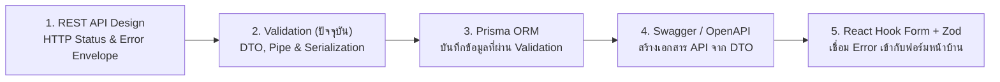

## 1. ข้อผิดพลาดที่พบบ่อย (Anti-patterns)

1. **การประกาศ DTO ด้วย `interface` หรือ `type` แทนการใช้ `class`**
   - **ปัญหา**: TypeScript ลบ `interface` ทิ้งทั้งหมดเมื่อคอมไพล์เป็น JavaScript ทำให้ `ValidationPipe` มองไม่เห็นกฎใดๆ และปล่อยข้อมูลอันตรายผ่านทะลุเข้าสู่ Service ทั้งหมด
   - **วิธีแก้**: ประกาศ DTO ทุกตัวเป็น `export class ...Dto` พร้อมแปะ Decorator ของ `class-validator` เสมอ
2. **การใช้ `@ValidateNested()` โดยลืมแปะ `@Type(() => SubDto)` และ `@IsDefined()`**
   - **ปัญหา**: กฎการตรวจสอบใน DTO ลูกไม่ทำงานเลย หรือปล่อยให้ส่ง `undefined` ผ่านเข้ามาในฟิลด์บังคับได้
   - **วิธีแก้**: แปะ `@IsDefined()`, `@ValidateNested()` และ `@Type(() => SubDto)` คู่กันเสมอสำหรับ Required Nested Object (และเพิ่ม `@IsArray()` สำหรับ Array)
3. **การลืมแปะ Decorator บนฟิลด์ใน DTO เมื่อเปิด `whitelist: true`**
   - **ปัญหา**: ฟิลด์ที่ไม่ได้แปะ Decorator ของ `class-validator` อย่างน้อย 1 ตัว จะถูก `ValidationPipe` ลบทิ้งออกจากอ็อบเจกต์เงียบๆ ทำให้ค่ากลายเป็น `undefined` ใน Controller
   - **วิธีแก้**: แม้จะเป็นฟิลด์ Optional ก็ต้องแปะ `@IsOptional()` คู่กับชนิดข้อมูล เช่น `@IsString()` เสมอ
4. **การใช้ `@Type(() => Boolean)` แปลงค่าจาก Query String (`?active=false`)**
   - **ปัญหา**: `Boolean("false")` ใน JavaScript คืนค่าเป็น `true` ทำให้ลูกค้ากรอง `active=false` แต่ได้ค่า `true` เสมอ
   - **วิธีแก้**: ใช้ `@Transform(({ value }) => value === 'true' ? true : value === 'false' ? false : value)` ร่วมกับ `@IsBoolean()`
5. **การส่ง Plain Object จาก Prisma ออกไปตรงๆ โดยไม่แปลงเป็นอินสแตนซ์ของ `ResponseDto`**
   - **ปัญหา**: `ClassSerializerInterceptor` ไม่ทำงานกับ Plain Object ทำให้ฟิลด์ความลับอย่าง `passwordHash` หลุดออกไปใน JSON Response
   - **วิธีแก้**: ใช้ `plainToInstance(ResponseDto, rawData, { excludeExtraneousValues: true })` ร่วมกับ `@Exclude()` ระดับคลาสและ `@Expose()` เฉพาะฟิลด์ที่ปลอดภัย

---

---

## 2. Checklist สรุป

| หมวดหมู่ | รายการตรวจสอบสำหรับระบบ Validation & Serialization | สถานะที่แนะนำ |
| :--- | :--- | :--- |
| **DTO Definition** | ทุก DTO ประกาศเป็น `class` และทุกฟิลด์มี Decorator ของ `class-validator` กำกับอย่างน้อย 1 ตัว | ✅ ต้องผ่าน |
| **Global Pipe** | ตั้งค่า `ValidationPipe` ด้วย `whitelist: true`, `forbidNonWhitelisted: true`, `transform: true` | ✅ ต้องผ่าน |
| **String & Number Rules** | กำหนด `@MaxLength()` ให้ทุกฟิลด์ข้อความ และกำหนด `@Min()`, `@Max()`, `maxDecimalPlaces` ให้ตัวเลขเสมอ | ✅ ต้องผ่าน |
| **Nested Validation** | อ็อบเจกต์ย่อยและ Array ของอ็อบเจกต์มีทั้ง `@ValidateNested({ each: true })` และ `@Type(() => ChildDto)` | ✅ ต้องผ่าน |
| **Query Transformation** | ใช้ `@Transform()` จัดการค่า Boolean และ Array ใน Query String โดยไม่เปิด `enableImplicitConversion` เหมาเข่ง | ✅ ต้องผ่าน |
| **Output Serialization** | ใช้ Whitelist Strategy (`@Exclude()` ที่คลาส + `@Expose()` ที่ฟิลด์) และแปลงผ่าน `plainToInstance` เสมอ | ✅ ต้องผ่าน |
| **DRY Mapped Types** | ใช้ `PartialType`, `PickType`, `OmitType` เพื่อสืบทอดกฎจาก `CreateDto` สู่ `UpdateDto` | ✅ ต้องผ่าน |
| **Error UX** | ปรับแต่ง `exceptionFactory` ให้ส่งคืน `fieldErrors: [{ field, message }]` ภาษาไทยที่พร้อมผูกกับฟอร์ม | ✅ ต้องผ่าน |

---

---

## 3. ลำดับการเรียนที่แนะนำ และ ดูเพิ่มเติมที่

### ดูเพิ่มเติมที่:
- **กลุ่ม BACKEND**:
  - [NestJS 11](/docs/backend/nestjs) — วงจรการทำงานของ Pipes และ Interceptors ใน NestJS Request Lifecycle
  - [REST API Design](/docs/backend/rest-api) — การออกแบบ Error Envelope มาตรฐาน RFC 9457 เพื่อห่อหุ้ม `fieldErrors`
  - [Security](/docs/backend/security) — การป้องกันช่องโหว่ Mass Assignment (OWASP API3) และการทำ HTML Text Sanitization ป้องกัน XSS
  - [Prisma ORM](/docs/backend/prisma-orm) — การส่งต่อข้อมูลจาก DTO ที่ตรวจสอบแล้วเข้าสู่ `PrismaService` อย่างปลอดภัย
  - [Swagger / OpenAPI](/docs/backend/swagger) — การใช้ `@ApiProperty()` ร่วมกับ DTO ของ `class-validator` เพื่อสร้างเอกสาร API อัตโนมัติ
  - [File Upload](/docs/backend/file-upload) — การใช้ `ParseFilePipe`, `MaxFileSizeValidator` และ `FileTypeValidator` สำหรับตรวจสอบไฟล์รูปภาพ
- **กลุ่ม TESTING**:
  - [Backend Testing](/docs/testing/backend-testing) — การเขียน Unit Test ทดสอบคลาส DTO และ Custom Validators ด้วยฟังก์ชัน `validate()` โดยตรง
- **กลุ่ม FRONTEND**:
  - [React Hook Form + Zod](/docs/react-hook-form-zod) — การตรวจสอบฟอร์มฝั่ง Frontend ด้วย Zod และการนำ `fieldErrors` จาก Backend มาแสดงผลด้วย `setError`
  - [TypeScript](/docs/typescript) — ความแตกต่างระหว่าง Compile-time Types (`interface`/`type`) กับ Runtime Classes & Decorators
