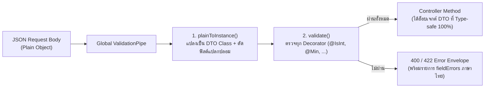

## 1. แนวคิด (Concept)
**DTO (Data Transfer Object)** คืออ็อบเจกต์ที่กำหนดสัญญาโครงสร้างข้อมูล (Data Contract) ที่เดินทางเข้าและออกจาก API ของเรา กฎเหล็กที่สำคัญที่สุดของการเขียน DTO ใน NestJS 11 คือ **ต้องประกาศ DTO ด้วย `class` ของ TypeScript เสมอ ห้ามใช้ `interface` หรือ `type` เด็ดขาด!**

ทำไมถึงใช้ `interface` ไม่ได้? เพราะเมื่อโค้ด TypeScript ถูกคอมไพล์เป็น JavaScript เพื่อรันบน Node.js (`nest build`) ตัว `interface` และ `type` ทั้งหมดจะถูกลบทิ้งหายไป (Type Erasure) ทำให้ที่ Runtime ไม่มีข้อมูลใดๆ เหลือให้ `ValidationPipe` ตรวจสอบเลย ในขณะที่ `class` จะยังคงอยู่เป็น JavaScript Constructor Function และสามารถแนบ **Decorator Metadata (`reflect-metadata`)** ของ `class-validator` ไว้ตรวจจับที่ Runtime ได้อย่างสมบูรณ์



## 2. หลักการเบื้องหลัง (Under the Hood)
เมื่อเราลงทะเบียน `ValidationPipe` ระดับ Global ใน `main.ts` หรือ `AppModule` มีออปชันสำคัญ 4 ตัวที่ควบคุมความปลอดภัยและพฤติกรรมเบื้องหลัง:
1. **`whitelist: true`**: สั่งให้ลบทุกฟิลด์ใน JSON ขาเข้าที่ **ไม่ได้มี Decorator ของ `class-validator` แปะอยู่** ในคลาส DTO ทิ้งโดยอัตโนมัติ (ป้องกันช่องโหว่ Mass Assignment เช่น แฮกเกอร์แอบส่ง `"role": "ADMIN"` แถมมา)
2. **`forbidNonWhitelisted: true`** (ต้องเปิดคู่กับ `whitelist: true`): แทนที่จะแอบลบฟิลด์แปลกปลอมทิ้งเงียบๆ ให้โยน Error ปฏิเสธคำขอนั้นทันที เพื่อให้ทีม Frontend รู้ตัวทันทีว่าพิมพ์ชื่อฟิลด์ผิด (เช่น พิมพ์ `weightGram` ตกตัว `s`)
3. **`transform: true`**: สั่งให้ `class-transformer` แปลง Plain JSON Object ธรรมดาให้กลายเป็น Instance ของคลาส DTO จริงๆ (`dto instanceof CreateProductDto === true`) และแปลงชนิดพารามิเตอร์บน URL เช่น `@Param('page') page: number` จากสตริง `'1'` ให้เป็นตัวเลข `1`
4. **`exceptionFactory`**: ฟังก์ชันสำหรับแปลงรายการ `ValidationError[]` ของ `class-validator` ให้เป็นโครงสร้าง `fieldErrors: [{ field, message }]` ที่ฝั่ง Frontend (เช่น React Hook Form `setError`) นำไปผูกแสดงผลใต้ช่อง Input แต่ละช่องได้ทันที!

<Callout type="warning" title="ระวังการเปิด enableImplicitConversion: true แบบ Global">
แม้การตั้งค่า transformOptions: { enableImplicitConversion: true } จะช่วยแปลงสตริงเป็นตัวเลขหรือ Boolean ให้อัตโนมัติ แต่ก็มีอันตรายแฝงอยู่ เพราะใน JavaScript การแปลงสตริง "false" ด้วย Boolean("false") จะได้ค่าเป็น true เสมอ! ดังนั้นในระดับ Production แนะนำให้ใช้ @Type(() => Number) และ @Transform() อย่างชัดเจนแทนการเปิด Implicit Conversion แบบเหมาเข่ง
</Callout>

## 3. ตัวอย่างโค้ด (Smart Butcher Marketplace)

### ตัวอย่างที่ 1: การตั้งค่า Global ValidationPipe มาตรฐาน Production ใน main.ts (พื้นฐาน)
```typescript filename="src/main.ts"
import { NestFactory } from '@nestjs/core';
import { ValidationPipe } from '@nestjs/common';
import { AppModule } from './app.module';
import { createValidationExceptionFactory } from './common/pipes/validation-exception.factory';

async function bootstrap() {
  const app = await NestFactory.create(AppModule);

  app.useGlobalPipes(
    new ValidationPipe({
      // 1. คัดกรองเฉพาะฟิลด์ที่มี Decorator ใน DTO เท่านั้น
      whitelist: true,
      // 2. แจ้งเตือนทันทีหากไคลเอนต์ส่งฟิลด์ที่ไม่อยู่ในสัญญาเข้ามา
      forbidNonWhitelisted: true,
      // 3. แปลง Plain Object ให้เป็น Class Instance ของ DTO
      transform: true,
      // 4. ปิดการเดาชนิดข้อมูลอัตโนมัติแบบเหมาเข่ง เพื่อป้องกันบั๊ก Boolean("false") === true
      transformOptions: {
        enableImplicitConversion: false,
      },
      // 5. รวบรวมข้อผิดพลาดของทุกฟิลด์ส่งกลับในครั้งเดียว ไม่หยุดแค่ฟิลด์แรก
      stopAtFirstError: false,
      // 6. จัดรูปแบบ Error ให้เข้ากับ React Hook Form และ RFC 9457
      exceptionFactory: createValidationExceptionFactory(),
    }),
  );

  await app.listen(process.env.PORT ?? 3000);
}
bootstrap();
```

### ตัวอย่างที่ 2: การสร้าง Recursive Validation Exception Factory ที่รองรับ Nested Objects และส่งคืน `fieldErrors` (ขั้นสูง)
```typescript filename="src/common/pipes/validation-exception.factory.ts"
import { UnprocessableEntityException, ValidationError } from '@nestjs/common';

export interface StructuredFieldError {
  field: string;   // เช่น "email" หรือ "items[0].weightGrams"
  rule: string;    // เช่น "min", "isEnum"
  message: string; // ข้อความภาษาไทยที่พร้อมแสดงใต้ช่องกรอกข้อมูล
}

// ฟังก์ชันคลี่ ValidationError ที่อาจซ้อนกันหลายชั้น (Nested DTOs) ออกมาเป็นรายการแบนราบ
function flattenValidationErrors(
  errors: ValidationError[],
  parentPath: string = '',
): StructuredFieldError[] {
  const result: StructuredFieldError[] = [];

  for (const error of errors) {
    const currentPath = parentPath
      ? Array.isArray(error.target)
        ? `${parentPath}[${error.property}]`
        : `${parentPath}.${error.property}`
      : error.property;

    if (error.constraints) {
      for (const [ruleKey, messageText] of Object.entries(error.constraints)) {
        result.push({
          field: currentPath,
          rule: ruleKey,
          message: messageText,
        });
      }
    }

    if (error.children && error.children.length > 0) {
      result.push(...flattenValidationErrors(error.children, currentPath));
    }
  }

  return result;
}

export function createValidationExceptionFactory() {
  return (validationErrors: ValidationError[]) => {
    const fieldErrors = flattenValidationErrors(validationErrors);

    return new UnprocessableEntityException({
      code: 'VALIDATION_FAILED',
      error: 'Unprocessable Entity',
      message: 'ข้อมูลที่ส่งมาไม่ผ่านเกณฑ์การตรวจสอบ กรุณาตรวจสอบรายละเอียดในแต่ละช่อง',
      fieldErrors,
    });
  };
}
```

## 4. ผิด vs ถูก (Anti-pattern vs Best Practice)

```typescript filename="src/modules/products/dto-interface-vs-class.ts"
// ❌ ผิด (Anti-pattern): ใช้ TypeScript interface เป็น DTO ใน Controller
export interface BadCreateProductDto {
  name: string;
  pricePerKgThb: number;
}
// เมื่อรันจริง ValidationPipe จะปล่อยให้ { "name": 12345, "pricePerKgThb": -9999, "hack": true } ผ่านทะลุเข้าไปทั้งหมด!

// ✅ ถูก (Best Practice): ใช้ class พร้อมแปะ Decorator จาก class-validator ทุกฟิลด์เสมอ
import { IsString, IsNotEmpty, IsNumber, Min } from 'class-validator';

export class GoodCreateProductDto {
  @IsString()
  @IsNotEmpty()
  name!: string;

  @IsNumber({ maxDecimalPlaces: 2 })
  @Min(1)
  pricePerKgThb!: number;
}
```

## 5. ควรใช้เมื่อไหร่ และ ไม่ควรใช้เมื่อไหร่
- **ควรเปิด `whitelist: true` และ `forbidNonWhitelisted: true` เสมอ**: สำหรับ REST API ภายในองค์กรและ API ที่เชื่อมต่อกับ Frontend ของเราเอง เพื่อดักจับทั้งผู้โจมตีและบั๊กการพิมพ์ชื่อฟิลด์ผิดตั้งแต่เนิ่นๆ
- **อาจพิจารณาปิด `forbidNonWhitelisted` (แต่ยังต้องเปิด `whitelist: true` เสมอ!) เมื่อ**: เป็น Endpoint รับ Webhook จากผู้ให้บริการภายนอก (เช่น Stripe / Omise) ที่อาจมีการเพิ่มฟิลด์ใหม่ๆ ในอนาคต เพื่อให้ระบบของเราตัดฟิลด์ที่ไม่รู้จักทิ้งเงียบๆ โดยไม่ทำ Webhook พัง

## 6. คำถามสัมภาษณ์ (Interview Q&A)
1. **คำถาม**: ถ้าเราสร้าง `class CreateOrderDto` ที่มีฟิลด์ `note: string` แต่เราไม่ได้แปะ Decorator ใดๆ ของ `class-validator` บนฟิลด์ `note` เลย เมื่อเปิดใช้งาน `ValidationPipe({ whitelist: true })` จะเกิดอะไรขึ้นเมื่อลูกค้าส่ง `{ "note": "ขอมันน้อยๆ" }` เข้ามา?
   - **แนวคำตอบ**: ฟิลด์ `note` จะถูกลบทิ้งหายไป (หรือถูกบล็อกด้วย Error ทันทีหากเปิด `forbidNonWhitelisted: true`)! เพราะกลไก `whitelist: true` ของ `class-validator` จะรู้จักเฉพาะฟิลด์ที่มี Decorator ของ `class-validator` แปะอยู่เท่านั้น (เพื่อบันทึกลง Metadata Registry) ดังนั้นแม้ฟิลด์นั้นจะเป็น Optional ที่ไม่ต้องการตรวจเงื่อนไขซับซ้อน ก็ **ต้องแปะ `@IsOptional()` คู่กับ `@IsString()` เสมอ**
2. **คำถาม**: ทำไมการปรับแต่ง `exceptionFactory` ให้ส่งคืนโครงสร้าง `fieldErrors: [{ field: "items[0].weightGrams", message: "..." }]` จึงดีกว่าการใช้โครงสร้างค่าเริ่มต้นของ NestJS?
   - **แนวคำตอบ**: ค่าเริ่มต้นของ NestJS จะส่งคืน `message` เป็น Array ของสตริงธรรมดา เช่น `["weightGrams must not be less than 200"]` โดยไม่ระบุชื่อคีย์แยกกับข้อความ ทำให้ฝั่ง Frontend (เช่น React Hook Form) ไม่รู้ว่าจะนำข้อความนั้นไปผูกแสดงเป็นตัวหนังสือสีแดงใต้ช่อง Input ช่องไหน แต่การแยก `field` และ `message` ชัดเจนช่วยให้ Frontend เขียนลูป `fieldErrors.forEach(e => form.setError(e.field, { message: e.message }))` ได้ใน 3 บรรทัด

---
