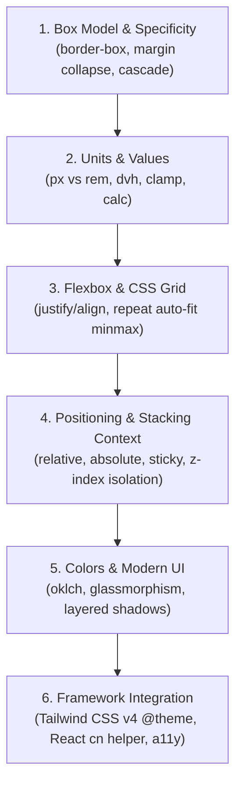

## 1. แนวคิด (Concept)

CSS ดูเหมือนง่ายในวันแรกที่เขียน แต่เมื่อโปรเจกต์เติบโตขึ้นสู่ระดับองค์กร CSS คือสิ่งที่ก่อให้เกิด **"หนี้ทางเทคนิค (Technical Debt)"** ได้รวดเร็วที่สุด หากไม่ระมัดระวัง

การหลีกเลี่ยง **6 บาปมหันต์ของ CSS** คือสิ่งที่แยกแยะระหว่างมือสมัครเล่นกับวิศวกร UI ระดับมืออาชีพ

---

## 2. รวม 6 บาปมหันต์ของ Anti-Patterns ใน CSS

### 1. สงคราม `!important` (The !important War)
การใช้ `!important` แก้ปัญหาเฉพาะหน้า เมื่อมีคนหนึ่งเริ่มใช้ คนถัดไปก็ต้องใช้ `!important` ที่ Selector ยาวขึ้น จนสุดท้ายไม่สามารถขยับสไตล์ใดๆ ได้อีก

### 2. บ้าพลังพิกเซล (Pixel Everything)
การใช้ `px` กับฟอนต์และระยะห่างทุกจุดในหน้าจอ ทำให้หน้าเว็บไม่เคารพ Accessibility ของผู้พิการทางสายตา และพังทลายบนอุปกรณ์ที่มีความหนาแน่นพิกเซลต่างกัน

### 3. ใช้ `position: absolute` จัด Layout ทั้งหน้าจอ
การนำ `absolute` มาวางกล่องซ้ายขวาบนล่างแทนที่จะใช้ Flexbox หรือ Grid ทำให้หน้าเว็บล้นจอและพังทันทีเมื่อผู้ใช้เปลี่ยนขนาดหน้าจอ

### 4. ลืมตั้งค่า `box-sizing: border-box`
ทำให้การใส่ `width: 100%` คู่กับ `padding` แล้วเกิดแถบเลื่อนแนวนอน (Horizontal Scroll) ล้นจอแบบหาสาเหตุไม่เจอ

### 5. มหากาพย์ `z-index: 999999`
การแข่งกันเพิ่มเลข 9 เพื่อให้ของตัวเองลอยขึ้นมา โดยไม่เข้าใจกลไกเรื่อง Stacking Context

### 6. Selector ซ้อนลึกเกิน 3-4 ชั้น (Deep Selector Nesting)
เช่น `.main .content .section ul li a span` ทำให้โค้ดผูกติดกับ HTML แน่นเกินไป และทำให้คะแนน Specificity สูงจนแก้ไขไม่ได้

---

## 3. ตัวอย่างโค้ด: เปรียบเทียบ ผิด vs ถูก

### ตัวอย่างที่ 1: การจัด Layout หน้าจอ (Absolute vs Flex/Grid)

#### ❌ โค้ดที่ผิด: ใช้ `position: absolute` วางตำแหน่ง
```css
/* ผิด: พังทันทีบนมือถือ และ Element อื่นเลื่อนมาทับ */
.sidebar { position: absolute; left: 0; width: 250px; }
.main-content { position: absolute; left: 260px; right: 0; }
```

#### ✅ โค้ดที่ถูกต้อง: ใช้ CSS Grid หรือ Flexbox
```css
/* ถูกต้อง: ยืดหยุ่น ไหลตาม Flow ตอบสนองทุกขนาดหน้าจอ */
.app-layout {
  display: grid;
  grid-template-columns: 250px 1fr;
  min-height: 100dvh;
}
```

---

## 4. Checklist สรุปสิ่งที่ต้องรู้สำหรับ Modern CSS

- [x] **Box Model**: ตั้งค่า `box-sizing: border-box` ที่ `*, *::before, *::after` เสมอ
- [x] **Responsive Units**: ใช้ `rem` สำหรับ Typography/Spacing และใช้ `dvh` สำหรับความสูงเต็มจอบนมือถือ
- [x] **Modern Color Space**: เริ่มปรับใช้ระบบสี `oklch()` เพื่อความสม่ำเสมอของสายตาและ P3 Wide Gamut
- [x] **Layout Discipline**: ใช้ Flexbox สำหรับ 1 มิติ (Content-first) และใช้ CSS Grid สำหรับ 2 มิติ (Layout-first)
- [x] **Clean Selectors**: เลิกใช้ ID สำหรับสไตล์ และไม่ซ้อน Selector ลึกเกินไป ใช้ BEM หรือ CSS Modules
- [x] **Motion Safety**: ใช้ `transform` และ `opacity` สำหรับแอนิเมชัน 60 FPS เสมอ และเคารพ `prefers-reduced-motion`
- [x] **Focus Ring**: ห้ามลบ `outline` โดยไม่มี `:focus-visible` ชดเชย

---

## 5. ลำดับขั้นตอนการเรียนรู้ที่แนะนำ (Modern CSS Roadmap)



---

## 6. คำถามสัมภาษณ์งานยอดนิยม (Top Interview Questions)

### Q1: ถ้าหน้าเว็บบนมือถือมีอาการเลื่อนไปทางขวาได้เล็กน้อย (Horizontal Overflow Bug) มีขั้นตอนการหาสาเหตุและแก้ไขอย่างไร?
**แนวทางคำตอบ**:
1. **หาสาเหตุใน DevTools**: พิมพ์คำสั่งใน Console:
   ```javascript
   document.querySelectorAll('*').forEach(el => el.offsetWidth > document.documentElement.offsetWidth && console.log(el));
   ```
   หรือใส่สไตล์ชั่วคราว `* { outline: 1px solid red; }` เพื่อดูว่ากล่องใดล้นทะลุขอบจอออกมา
2. **สาเหตุที่พบบ่อย**:
   - Element มี `width: 100%` หรือ `width: 100vw` ร่วมกับ `padding` หรือ `margin` โดยไม่ได้ตั้ง `box-sizing: border-box`
   - ข้อความคำภาษาไทยหรือ URL ยาวๆ ไม่มีคำสั่ง `overflow-wrap: break-word`
   - รูปภาพไม่ได้ใส่ `max-width: 100%; height: auto;`
3. **การแก้ไข**: แก้ที่ต้นเหตุของ Element นั้นๆ หลีกเลี่ยงการแปะ `overflow-x: hidden` บนแท็ก `body` แบบมักง่าย เพราะจะทำให้ `position: sticky` พังทลาย

### Q2: จงอธิบายความสัมพันธ์ระหว่าง CSS Specificity, `@layer`, และ `!important` ว่าเบราว์เซอร์จัดลำดับความสำคัญในการตัดสินใจอย่างไร?
**แนวทางคำตอบ**: 
ลำดับความสำคัญเรียงจากสูงสุดไปต่ำสุด:
1. **`!important` นอกเลเยอร์ปกติ**: ชนะทุกสิ่ง
2. **`!important` ภายใน `@layer`**: จุดที่น่าสนใจคือใน Cascade Layers นั้น `!important` ในเลเยอร์ก่อนหน้า (เช่น base) จะมีน้ำหนักชนะ `!important` ในเลเยอร์หลัง เพื่อเปิดโอกาสให้ Reset สไตล์พื้นฐานป้องกันการแทรกแซงได้
3. **Inline Styles (`style="..."`)**: มีความสำคัญเหนือสไตล์ในไฟล์ CSS
4. **Specificity ในเลเยอร์เดียวกัน**: ตัดสินตามคะแนน `(ID, Class, Element)`
5. **ลำดับของ `@layer`**: กฎในเลเยอร์ที่ประกาศไว้ทีหลังจะชนะเลเยอร์ก่อนหน้าเสมอโดยไม่ต้องสนคะแนน Specificity
6. **Source Order**: หากทุกอย่างเสมอกัน คำสั่งที่อยู่บรรทัดล่างสุดในไฟล์จะชนะ
