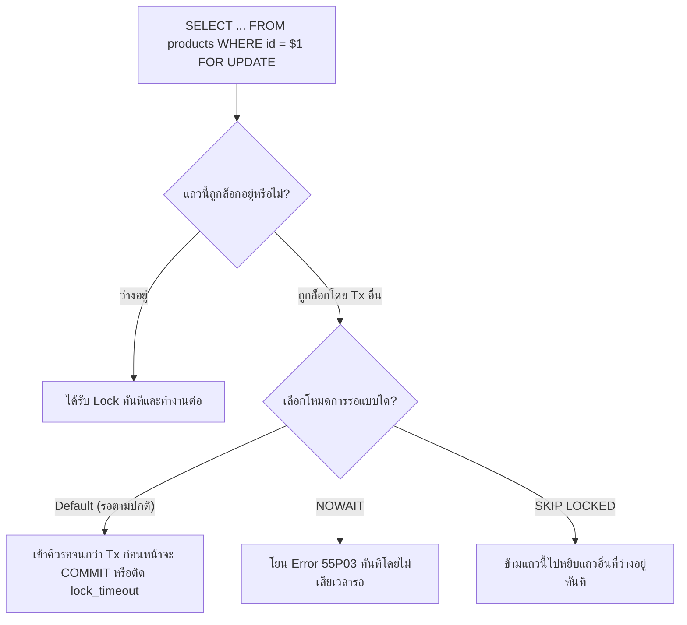
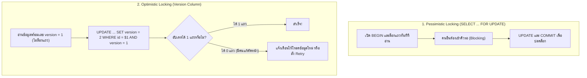
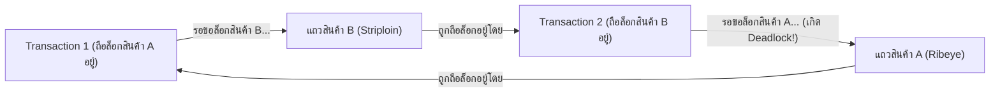
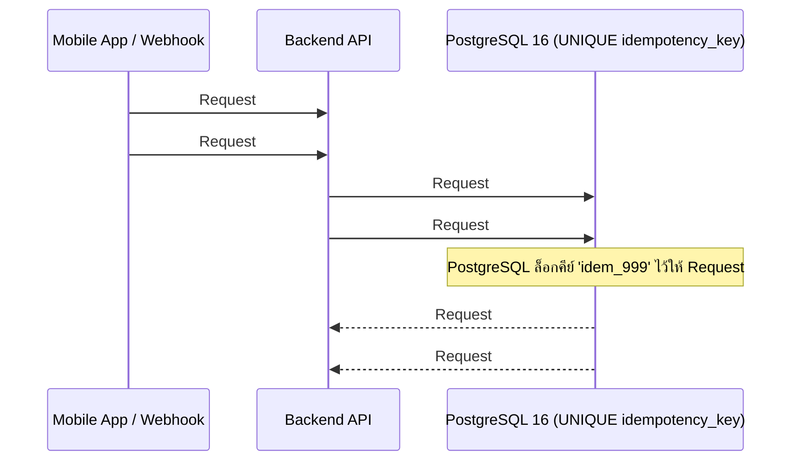

# Concurrency

เมื่อระบบอีคอมเมิร์ซเปิดขายสินค้าโปรโมชันหรือเนื้อพรีเมียมล็อตพิเศษที่มีจำกัดเพียงไม่กี่ชิ้น จะเกิดเหตุการณ์ที่ลูกค้าหลายร้อยคนกดปุ่มสั่งซื้อและชำระเงินเข้ามาในระดับมิลลิวินาทีเดียวกัน (**High Concurrency**) หากระบบไม่ได้รับการออกแบบกลไกควบคุมการเข้าถึงข้อมูลพร้อมกัน (**Concurrency Control**) อย่างรัดกุม จะเกิดหายนะทางธุรกิจทันที เช่น การขายสินค้าเกินจำนวนที่มีอยู่ในคลังจริง (Overselling) การตัดเงินลูกค้าซ้ำสองครั้ง หรือระบบค้างตายจากปัญหา Deadlock เอกสารฉบับนี้จะเจาะลึกกลไกการล็อกแถวข้อมูลของ PostgreSQL 16 การเลือกใช้ Pessimistic vs Optimistic Locking การป้องกัน Deadlock และการทำ Idempotency บนระบบ **Smart Butcher Marketplace**

| หมวดหมู่เนื้อหา | หัวข้อหลักในหน้านี้ | เป้าหมายการเรียนรู้ |
| :--- | :--- | :--- |
| **1. ปัญหาการทำงานพร้อมกัน** | ปัญหาการแย่งชิงข้อมูลพร้อมกัน (Race Conditions) ในระบบ E-Commerce | เข้าใจ Lost Update, Time-of-Check to Time-of-Use (TOCTOU) และ Overselling |
| **2. กลไกการล็อกใน Postgres** | กลไกการล็อกข้อมูล (SELECT ... FOR UPDATE, Row Locks และ Advisory Locks) | ใช้ `FOR UPDATE`, `SKIP LOCKED`, `NOWAIT` และ `pg_advisory_xact_lock` |
| **3. กลยุทธ์การล็อก** | Pessimistic Locking vs Optimistic Locking (Version Column) | เปรียบเทียบการล็อกแถวล่วงหน้า กับการตรวจสอบด้วยคอลัมน์ `version` |
| **4. การจัดการภาวะล็อกตาย** | สาเหตุการเกิด Deadlock และเทคนิคการป้องกันในระดับสถาปัตยกรรม | จัดเรียงลำดับการล็อก (`ORDER BY id`) เพื่อขจัดโอกาสเกิด Deadlock 100% |
| **5. ความปลอดภัยและการทดสอบ** | การทำ Idempotency ป้องกันการกดสั่งซื้อหรือตัดเงินซ้ำและการทดสอบ Race Condition | ออกแบบ `idempotency_key` และการเขียนสคริปต์จำลองยิง Request พร้อมกัน |

<Callout type="warning" title="การเปิด Transaction เฉยๆ ไม่ได้ป้องกัน Race Condition เสมอไป">
ความเข้าใจผิดที่พบบ่อยที่สุดของนักพัฒนาคือคิดว่าแค่หุ้มโค้ดด้วย BEGIN ... COMMIT หรือ prisma.$transaction (ในโหมดค่าเริ่มต้น READ COMMITTED) ก็ปลอดภัยจาก Race Condition แล้ว ในความเป็นจริง หากคุณเขียนโค้ดแบบ SELECT ค่ามาเช็คในตัวแปร แล้วค่อยสั่ง UPDATE ค่าใหม่กลับลงไปโดยไม่ล็อกแถวหรือไม่ใช้ Atomic Update ระบบจะยังคงเกิดปัญหา Lost Update และขายของเกินสต็อกได้เหมือนเดิม!
</Callout>

---

## 1. ปัญหาการแย่งชิงข้อมูลพร้อมกัน (Race Conditions) ในระบบ E-Commerce

### แนวคิด (Concept)
**Race Condition** คือภาวะที่ผลลัพธ์ของระบบขึ้นอยู่กับจังหวะเวลาที่คำสั่งของแต่ละผู้ใช้งานวิ่งเข้ามากระทบกัน โดยปัญหาที่อันตรายที่สุดในระบบ **Smart Butcher Marketplace** คือรูปแบบที่เรียกว่า **Read-Modify-Write (หรือ TOCTOU: Time-of-Check to Time-of-Use)**

ลองดูเหตุการณ์จริงเมื่อเนื้อ **Miyazaki Wagyu A5 (`stock_qty = 1`)** เหลือแพ็กสุดท้ายในตู้แช่ แล้วมีลูกค้า 2 คน (คุณสมชาย และ คุณวิภา) กดปุ่มสั่งซื้อเข้ามาในเสี้ยววินาทีเดียวกัน:
1. **เวลา $t_1$:** Request ของสมชาย รันคำสั่ง `SELECT stock_qty FROM products WHERE id = ...` อ่านค่าได้ `1`
2. **เวลา $t_2$:** Request ของวิภา รันคำสั่ง `SELECT stock_qty FROM products WHERE id = ...` อ่านค่าได้ `1` เช่นกัน (เพราะสมชายยังไม่ได้เขียนค่าใหม่ลงไป)
3. **เวลา $t_3$:** โค้ดของทั้งคู่เช็ค `if (stockQty >= 1)` ผ่านทั้งคู่! แล้วคำนวณในหน่วยความจำว่า `newStock = 1 - 1 = 0`
4. **เวลา $t_4$:** สมชายสั่ง `UPDATE products SET stock_qty = 0` และ `COMMIT` สำเร็จ
5. **เวลา $t_5$:** วิภาสั่ง `UPDATE products SET stock_qty = 0` ทับลงไปและ `COMMIT` สำเร็จเช่นกัน!

**ผลลัพธ์คือ:** สต็อกในฐานข้อมูลแสดงเลข `0` (ไม่ติดลบด้วยซ้ำ!) แต่มีใบสั่งซื้อถูกสร้างสำเร็จไปถึง **2 ใบ** ทั้งที่มีเนื้ออยู่แค่แพ็กเดียว เหตุการณ์ที่การอัปเดตของคนหลังเขียนทับการอัปเดตของคนแรกหายไปนี้เรียกว่า **Lost Update**

```mermaid filename="docs/database/concurrency-diagram.mmd"
sequenceDiagram
    participant T1 as Transaction 1 (คุณสมชาย)
    participant DB as PostgreSQL (stock_qty = 1)
    participant T2 as Transaction 2 (คุณวิภา)
    T1->>DB: SELECT stock_qty (ได้ค่า 1)
    T2->>DB: SELECT stock_qty (ได้ค่า 1 เหมือนกัน!)
    Note over T1,T2: ทั้งคู่เช็คในโค้ดว่า 1 >= 1 (ผ่านทั้งคู่!) และคำนวณ 1 - 1 = 0
    T1->>DB: UPDATE products SET stock_qty = 0; COMMIT;
    T2->>DB: UPDATE products SET stock_qty = 0; COMMIT; (Lost Update!)
    Note over DB: หายนะ: สต็อกเหลือ 0 แต่ขายเนื้อแพ็กเดียวให้ลูกค้าไป 2 คน!
```

### หลักการเบื้องหลัง (Under the Hood)
ทำไมในระดับค่าเริ่มต้น `READ COMMITTED` ของ PostgreSQL 16 จึงยอมให้เหตุการณ์ด้านบนเกิดขึ้น?
- เพราะคำสั่ง `SELECT` ปกติใน PostgreSQL **ไม่ทำการล็อกแถวข้อมูลใดๆ เลย** (Readers never block readers, and readers never block writers)
- เมื่อทั้งสอง Transaction รัน `SELECT` พร้อมกัน ทั้งคู่จึงอ่านภาพ Snapshot ที่เห็นว่า `stock_qty = 1` เหมือนกัน
- และเมื่อทั้งคู่ส่งคำสั่ง `UPDATE products SET stock_qty = 0 WHERE id = ...` เข้ามา ตัว PostgreSQL ไม่สามารถล่วงรู้ได้เลยว่าเลข `0` ที่แอปพลิเคชันส่งมานั้นคำนวณมาจากค่าเก่าที่ล้าสมัยไปแล้ว มันรู้เพียงแค่ว่าคุณสั่งให้เปลี่ยนค่าเป็น `0` เฉยๆ!

การแก้ปัญหานี้ในระดับพื้นฐานที่สุดโดยไม่ต้องพึ่งการล็อกซับซ้อน คือการเปลี่ยนจาก Read-Modify-Write ในโค้ด มาเป็น **Atomic Relative Update with Predicate** ในระดับ SQL!

### ตัวอย่างโค้ด (Smart Butcher Marketplace)

#### ตัวอย่างที่ 1: การตัดสต็อกแบบ Atomic Update ในคำสั่ง SQL เดียวเพื่อป้องกัน Lost Update และ Overselling
แทนที่จะดึงค่า `stock_qty` ออกมาลบในโค้ดแล้วส่งค่าผลลัพธ์กลับเข้าไป ให้สั่งให้ PostgreSQL เป็นผู้ลบค่าจากคอลัมน์จริงพร้อมตรวจสอบเงื่อนไขในคำสั่ง `UPDATE ... RETURNING` เดียว:

```sql filename="sql/01_atomic_stock_deduction.sql"
-- ✅ วิธีที่ปลอดภัย 100%: ให้ PostgreSQL ล็อกแถว ตรวจสอบว่า stock_qty >= 1 และหักลบค่าในคำสั่งเดียว!
UPDATE products
SET stock_qty = stock_qty - 1,
    version = version + 1,
    updated_at = CURRENT_TIMESTAMP
WHERE id = '8e94fae4-18df-4158-b34e-6e8ebdc5fca1'
  AND is_active = TRUE
  AND deleted_at IS NULL
  AND stock_qty >= 1
RETURNING id, sku, name, stock_qty, price_per_kg;
```

#### ตัวอย่างที่ 2: การทำ Atomic Check-and-Insert สำหรับการใช้คูปองส่วนลดจำนวนจำกัดด้วย CTE
สมมติร้านค้าแจกโค้ดส่วนลดวันเกิดที่มีโควตาจำกัด 100 สิทธิ์ หากเช็คจำนวนสิทธิ์ด้วย `SELECT COUNT(*)` ก่อนแล้วค่อย `INSERT` จะเกิด Race Condition ทันที เราสามารถยุบรวมการหักโควตาและการสร้างประวัติการใช้คูปองไว้ใน Atomic CTE เดียว:

```sql filename="sql/02_atomic_cte_coupon_redemption.sql"
-- หักโควตาคูปองและสร้างใบสั่งซื้อพร้อมกันเฉพาะเมื่อโควตายังเหลือเท่านั้น
WITH claimed_product AS (
    UPDATE products
    SET stock_qty = stock_qty - 2,
        updated_at = CURRENT_TIMESTAMP
    WHERE id = '8e94fae4-18df-4158-b34e-6e8ebdc5fca1'
      AND stock_qty >= 2
      AND is_active = TRUE
    RETURNING id, name, sku, price_per_kg
)
INSERT INTO order_items (
    order_id, product_id, product_name_snapshot, product_sku_snapshot, quantity, unit_price
)
SELECT 
    'd1111111-1111-1111-1111-111111111111'::uuid,
    cp.id,
    cp.name,
    cp.sku,
    2,
    cp.price_per_kg
FROM claimed_product cp
RETURNING id, product_id, quantity, subtotal;
```

### ผิด vs ถูก (Anti-pattern vs Best Practice)

| มิติการเปรียบเทียบ | ❌ ผิด (Anti-pattern) | ✅ ถูก (Best Practice) |
| :--- | :--- | :--- |
| **การคำนวณตัดสต็อกหรือยอดเงิน** | ดึงค่ามาลบในตัวแปร JS/TS แล้วสั่ง `SET stock_qty = ${newStock}` | สั่งหักลบแบบสัมพัทธ์ใน SQL เสมอ: `SET stock_qty = stock_qty - $1 WHERE id = $2 AND stock_qty >= $1` |
| **การตรวจสอบว่าอัปเดตสำเร็จหรือไม่** | รัน `UPDATE` โดยไม่ตรวจเช็คจำนวนแถวที่ได้รับผลกระทบ (`rowCount` / `RETURNING`) | เช็คเสมอว่าคำสั่ง `UPDATE ... WHERE stock_qty >= $1` อัปเดตได้ครบ 1 แถวจริงหรือไม่ ถ้าได้ 0 แถวให้ Rollback ทันที |

### ควรใช้เมื่อไหร่ และ ไม่ควรใช้เมื่อไหร่
- **ควรใช้ Atomic Update (`SET col = col - $1 WHERE col >= $1`) เมื่อ:** ต้องการเพิ่มหรือลดค่าตัวเลข (สต็อกสินค้า, ยอดเงินคงเหลือใน Wallet, จำนวนสิทธิ์คูปอง) อย่างรวดเร็วและปลอดภัยที่สุดโดยไม่ต้องถือ Lock นาน
- **ไม่เพียงพอที่จะใช้แค่ Atomic Update เดี่ยวๆ เมื่อ:** ต้องอ่านข้อมูลจากหลายตารางมาคำนวณด้วยลอจิกทางธุรกิจที่ซับซ้อนในฝั่ง Application ก่อนตัดสินใจเขียนกลับลงไป ซึ่งกรณีนี้ต้องใช้ `SELECT ... FOR UPDATE` หรือ Optimistic Locking เข้ามาช่วย

### คำถามสัมภาษณ์ (Interview Q&A)
- **Q1: เกิดอะไรขึ้นในระดับภายในของ PostgreSQL เมื่อมี 2 Transactions รันคำสั่ง `UPDATE products SET stock_qty = stock_qty - 1 WHERE id = 'uuid-เดียวกัน' AND stock_qty >= 1;` เข้ามาในเสี้ยววินาทีเดียวกันเป๊ะ (สมมติตอนแรก `stock_qty = 1`)?**
  - **แนวคำตอบ:** ในระดับ `READ COMMITTED` ตัว Transaction แรกที่มาถึงก่อนจะได้รับ Row-level Lock บนแถวนั้นและเปลี่ยนค่า `stock_qty` จาก `1` เป็น `0` ส่วน Transaction ที่สองจะถูกบล็อกให้รอคิวอยู่ตรงแถวนั้น ทันทีที่ Transaction แรกสั่ง `COMMIT` ตัว PostgreSQL จะทำกระบวนการ **EvalPlanQual (Re-evaluating the `WHERE` condition)** คือดึงแถวเวอร์ชันล่าสุดที่เพิ่ง Commit ไป (`stock_qty = 0`) มาตรวจเช็คเงื่อนไข `WHERE stock_qty >= 1` ใหม่อีกครั้ง! เมื่อพบว่า `0 >= 1` เป็นเท็จ คำสั่ง `UPDATE` ของคนที่สองจึงไม่แก้ไขแถวใดเลย (คืนค่า `UPDATE 0`) ทำให้ไม่มีการขายเกินสต็อกเกิดขึ้นแม้แต่น้อย!
- **Q2: ทำไมการใส่แค่ `CHECK (stock_qty >= 0)` บนตาราง `products` จึงไม่สามารถป้องกันปัญหา Lost Update จากการเขียนโค้ดแบบ Read-Modify-Write (`SET stock_qty = 0`) ได้?**
  - **แนวคำตอบ:** เพราะ `CHECK (stock_qty >= 0)` ตรวจสอบเพียงว่าค่าใหม่ที่ส่งเข้ามาไม่ติดลบเท่านั้น แต่ในกรณี Read-Modify-Write ที่สต็อกเริ่มต้นมี 1 ชิ้น แล้วลูกค้า 2 คนอ่านได้เลข 1 พร้อมกัน ทั้งคู่ต่างคำนวณ `1 - 1 = 0` แล้วส่งคำสั่ง `SET stock_qty = 0` เข้ามาทั้งสองคน ซึ่งเลข `0` ผ่านเกณฑ์ `>= 0` ทั้งสองครั้ง! ดังนั้นจึงต้องใช้ `SET stock_qty = stock_qty - 1` คู่กับ `CHECK (stock_qty >= 0)` เสมอ

---

## 2. กลไกการล็อกข้อมูล (SELECT ... FOR UPDATE, Row Locks และ Advisory Locks)

### แนวคิด (Concept)
ในกรณีที่ลอจิกทางธุรกิจมีความซับซ้อนเกินกว่าจะเขียนจบในคำสั่ง `UPDATE` บรรทัดเดียว เช่น เราต้องดึงข้อมูลใบสั่งซื้อ (`orders`) และรายการสินค้า (`products`) ขึ้นมาตรวจสอบเงื่อนไขหลายข้อในโค้ด TypeScript แล้วจึงตัดสินใจแก้ไขข้อมูลกลับลงไป เราจำเป็นต้องสั่งให้ PostgreSQL **"ล็อกแถวข้อมูลนั้นไว้ตั้งแต่วินาทีที่เริ่มอ่าน"** เพื่อห้ามไม่ให้ใครเข้ามาแอบเปลี่ยนค่าตัดหน้าเราจนกว่าเราจะจบ Transaction

PostgreSQL 16 มีเครื่องมือล็อกข้อมูลที่ทรงพลังให้เลือกใช้ตามสถานการณ์:
1. **`SELECT ... FOR UPDATE` / `FOR NO KEY UPDATE`:** ล็อกแถวที่ดึงขึ้นมาทันที หากมี Transaction อื่นพยายามจะแก้ไขหรือสั่ง `FOR UPDATE` ซ้ำบนแถวเดียวกัน จะต้องเข้าคิวรอจนกว่าเราจะ `COMMIT`
2. **`FOR UPDATE NOWAIT`:** หากแถวนั้นมีคนอื่นล็อกอยู่แล้ว **ไม่ต้องรอคิว ให้โยน Error ทันที!** (เหมาะกับการป้องกันไม่ให้ API ค้างสะสม)
3. **`FOR UPDATE SKIP LOCKED`:** หากแถวไหนมีคนล็อกอยู่แล้ว **ให้กระโดดข้ามแถวนั้นไปหยิบแถวถัดไปที่ยังว่างอยู่ทันที!** (เหมาะสำหรับการทำระบบคิวงาน หรือการหยิบแพ็กเนื้อชิ้นถัดไปในคลัง)
4. **Advisory Locks (`pg_advisory_xact_lock`):** การสร้างกุญแจล็อกในหน่วยความจำด้วยตัวเลข 64-bit ที่แอปพลิเคชันกำหนดความหมายขึ้นเอง สำหรับล็อกกระบวนการทางธุรกิจที่ยังไม่มีแถวข้อมูลอยู่จริงในตาราง



### หลักการเบื้องหลัง (Under the Hood)
ทำไม PostgreSQL 16 จึงสามารถล็อกแถวข้อมูลได้เป็นล้านๆ แถวพร้อมกันโดยที่หน่วยความจำ Lock Table ใน RAM ไม่เต็ม (ต่างจาก RDBMS อื่นที่เกิดปัญหา Lock Escalation เปลี่ยนจากล็อกแถวเป็นล็อกทั้งตาราง)?
- เพราะ PostgreSQL **ไม่ได้เก็บสถานะการล็อกแถวไว้ในหน่วยความจำ RAM** แต่เขียนหมายเลข Transaction ID ของผู้ล็อกลงไปในช่อง `t_xmax` พร้อมตั้งค่า Bit Flags (`infomask`) **ไว้บนส่วนหัวของแถวข้อมูลในหน้าบล็อก 8KB โดยตรง!**
- นอกจากนี้ PostgreSQL แยกระดับความแรงของ Row-level Locks ออกเป็น 4 ระดับสำคัญ:
  - **`FOR UPDATE`:** ล็อกระดับแรงสุด บล็อกการแก้ไขทุกชนิดและบล็อกการสร้างแถวลูกที่อ้างอิง Foreign Key มายังแถวนี้
  - **`FOR NO KEY UPDATE`:** (เป็นค่าที่คำสั่ง `UPDATE` ปกติใช้เมื่อไม่ได้แก้คอลัมน์ Primary/Unique Key) บล็อกไม่ให้ใครแก้ไขแถวนี้ แต่ยังอนุญาตให้ตารางลูก `INSERT` อ้างอิง Foreign Key มายังแถวนี้ได้พร้อมกันโดยไม่ติดขัด!
  - **`FOR SHARE` / `FOR KEY SHARE`:** ล็อกแบบอ่านร่วมกัน ห้ามใครแก้ไขหรือลบคีย์หลักของแถวนี้จนกว่าจะจบ Transaction

### ตัวอย่างโค้ด (Smart Butcher Marketplace)

#### ตัวอย่างที่ 1: การใช้ `SELECT ... FOR NO KEY UPDATE` และ `SKIP LOCKED` สำหรับระบบจัดสรรงานห้องเชือดเนื้อ
เมื่อมีพนักงานแล่เนื้อ (Butchers) 10 คนกดปุ่ม "ขอรับใบสั่งซื้อถัดไปมาตัดแต่ง" พร้อมกัน เราใช้ `FOR UPDATE SKIP LOCKED` เพื่อให้พนักงานแต่ละคนได้ใบสั่งซื้อคนละใบทันทีโดยไม่ชนกันและไม่ต้องรอคิวกันเลย:

```sql filename="sql/03_row_locks_and_skip_locked_queue.sql"
BEGIN;

-- พนักงานแล่เนื้อดึงออเดอร์ที่ชำระเงินแล้ว 1 ใบที่เก่าที่สุด โดยข้ามใบที่พนักงานคนอื่นกำลังล็อกทำงานอยู่ทันที!
WITH next_order_to_prepare AS (
    SELECT id
    FROM orders
    WHERE status = 'PAID'
    ORDER BY created_at ASC
    LIMIT 1
    FOR NO KEY UPDATE SKIP LOCKED
)
UPDATE orders o
SET status = 'PREPARING',
    updated_at = CURRENT_TIMESTAMP
FROM next_order_to_prepare n
WHERE o.id = n.id
RETURNING o.id, o.order_number, o.status, o.shipping_address;

COMMIT;
```

#### ตัวอย่างที่ 2: การใช้ Transaction-level Advisory Lock (`pg_advisory_xact_lock`) ป้องกันการสร้างรหัสใบเสร็จรายวันชนกัน
เมื่อต้องการล็อกการทำงานระดับผู้ใช้หรือระดับกระบวนการที่ยังไม่มีแถวให้ล็อก (เช่น ป้องกันไม่ให้ลูกค้าคนเดิมส่งคำขอสร้างตะกร้าสั่งซื้อด่วนซ้อนกัน 2 ครั้งในเวลาเดียวกัน) เราสามารถใช้ `pg_advisory_xact_lock(hashtext(...))` ซึ่งจะปลดล็อกให้อัตโนมัติทันทีที่ `COMMIT` หรือ `ROLLBACK`:

```sql filename="sql/04_advisory_xact_lock.sql"
BEGIN;

-- สร้างกุญแจล็อกระดับ Transaction จากรหัสผู้ใช้ (หากผู้ใช้คนเดิมยิงซ้อนเข้ามา จะต้องรอหรือใช้ pg_try_advisory_xact_lock)
-- การใช้ _xact_lock รับประกันว่ากุญแจจะถูกปลดล็อกอัตโนมัติ 100% เมื่อจบ Transaction (ปลอดภัยกับ PgBouncer!)
SELECT pg_advisory_xact_lock(hashtext('checkout_user_' || 'a1111111-1111-1111-1111-111111111111'));

-- ตรวจสอบว่าลูกค้ารายนี้มีออเดอร์สถานะ PENDING ค้างอยู่หรือไม่อย่างปลอดภัยโดยไม่มีทางเกิด Race Condition
SELECT id, order_number, total_amount
FROM orders
WHERE user_id = 'a1111111-1111-1111-1111-111111111111'
  AND status = 'PENDING';

COMMIT;
```

### ผิด vs ถูก (Anti-pattern vs Best Practice)

| มิติการเปรียบเทียบ | ❌ ผิด (Anti-pattern) | ✅ ถูก (Best Practice) |
| :--- | :--- | :--- |
| **การใช้ Session Advisory Lock กับ Pooler** | ใช้ `pg_advisory_lock()` (ระดับ Session) ร่วมกับ PgBouncer หรือ Prisma Pool แล้วเกิด Exception จนลืมปลดล็อก ทำให้ Connection นั้นติดล็อกค้างตลอดกาล | ใช้ **`pg_advisory_xact_lock()`** (ระดับ Transaction) เสมอ เพราะ PostgreSQL จะปลดล็อกให้อัตโนมัติเมื่อ `COMMIT` หรือ `ROLLBACK` |
| **การใช้ `FOR UPDATE` กับการ JOIN หลายตาราง** | เขียน `SELECT * FROM orders o JOIN users u ... FOR UPDATE` โดยไม่ระบุชื่อตาราง ทำให้เผลอไปล็อกตาราง `users` และ `categories` ไปด้วยโดยไม่จำเป็น | ระบุชื่อตารางที่ต้องการล็อกให้ชัดเจนเสมอ เช่น `FOR NO KEY UPDATE OF o` เพื่อล็อกเฉพาะตาราง `orders` เท่านั้น |
| **การดึงคิวงานด้วย `SELECT` ปกติ** | ดึงงานที่ `status = 'PAID'` ด้วย `SELECT` ปกติ ทำให้ Worker 5 ตัวหยิบงานใบเดียวกันไปทำซ้ำ 5 รอบ | ใช้ `FOR UPDATE SKIP LOCKED` เพื่อให้แต่ละ Worker หยิบงานคนละใบอย่างปลอดภัย 100% |

### ควรใช้เมื่อไหร่ และ ไม่ควรใช้เมื่อไหร่
- **ควรใช้ `SELECT ... FOR UPDATE` (หรือ `FOR NO KEY UPDATE`) เมื่อ:** ต้องอ่านข้อมูลแถวนั้นขึ้นมาตรวจสอบเงื่อนไขซับซ้อนในโค้ดก่อนจะทำการ `UPDATE` แถวนั้นกลับลงไปภายใน Transaction เดียวกัน
- **ควรใช้ `FOR UPDATE SKIP LOCKED` เมื่อ:** ทำระบบ Job Queue, ระบบแจกคูปอง/ซีเรียลนัมเบอร์จากกองกลาง, หรือระบบจัดสรรคิวงานให้พนักงานหลายคนที่ทำงานขนานกัน
- **ไม่ควรใช้ `FOR UPDATE` เมื่อ:** เป็นแค่คิวรีอ่านข้อมูลไปแสดงผลหน้าเว็บเฉยๆ โดยไม่ได้มีการแก้ไขข้อมูลต่อเนื่องใน Transaction นั้น

### คำถามสัมภาษณ์ (Interview Q&A)
- **Q1: ใน PostgreSQL 16 คำสั่ง `SELECT ... FOR UPDATE` กับ `SELECT ... FOR NO KEY UPDATE` ต่างกันอย่างไร และทำไมการเลือกใช้ `FOR NO KEY UPDATE` จึงช่วยลดปัญหาคอขวดได้?**
  - **แนวคำตอบ:** `FOR UPDATE` เป็นการล็อกแถวที่สมมติว่าเราอาจจะแก้ไขค่าคีย์หลัก (`id`) หรือลบแถวนั้นทิ้ง ส่งผลให้หากมีตารางลูกต้องการ `INSERT` ข้อมูลที่อ้างอิง Foreign Key มายังแถวนี้ ตารางลูกจะต้องหยุดรอคิวไปด้วย! ในขณะที่หากเราต้องการแก้ไขแค่คอลัมน์ทั่วไปที่ไม่ใช่ Primary Key (เช่น แก้ไข `status` หรือ `stock_qty`) การใช้ `FOR NO KEY UPDATE` จะช่วยล็อกไม่ให้ใครมาแก้แถวนี้ชนกับเรา แต่ยังคงเปิดทางให้ตารางลูกสามารถ `INSERT` ข้อมูลที่อ้างอิง Foreign Key มายังแถวนี้ได้พร้อมกันโดยไม่ติดบล็อกเลย
- **Q2: ทำไมการใช้ `pg_advisory_lock()` (Session-level) จึงเป็นอันตรายอย่างยิ่งเมื่อใช้งานร่วมกับ Connection Pooler อย่าง PgBouncer ในโหมด Transaction Pooling?**
  - **แนวคำตอบ:** เพราะ `pg_advisory_lock()` ผูกติดอยู่กับระดับ Database Connection (Session) ไม่ได้ผูกกับ Transaction เมื่อจบ Transaction แล้ว PgBouncer อาจสลับนำ Connection นั้นไปให้ Request อื่นใช้งานต่อ หรือหากโค้ดเกิด Error ก่อนที่จะรันคำสั่ง `pg_advisory_unlock()` กุญแจล็อกนั้นจะค้างติดอยู่กับ Connection นั้นไปตลอดกาล! ดังนั้นจึงต้องใช้ `pg_advisory_xact_lock()` ซึ่งผูกกับ Transaction และปลดล็อกตัวเองอัตโนมัติทันทีที่จบ Transaction เสมอ

---

## 3. Pessimistic Locking vs Optimistic Locking (Version Column)

### แนวคิด (Concept)
ในการป้องกันไม่ให้ผู้ใช้งานสองคนแก้ไขข้อมูลแถวเดียวกันทับกัน (Lost Update) เรามีปรัชญาการออกแบบหลักอยู่ 2 แนวทางที่ตรงกันข้ามกัน:
1. **Pessimistic Locking (การล็อกแบบมองโลกในแง่ร้าย):** มองว่า "ต้องมีคนอื่นเข้ามาแย่งแก้ข้อมูลชนกับเราแน่ๆ ดังนั้นล็อกแถวไว้ก่อนเลยตั้งแต่วินาทีที่อ่าน!" โดยใช้คำสั่ง `SELECT ... FOR UPDATE` ภายใน Transaction ผู้ใช้คนอื่นที่เข้ามาทีหลังจะต้องเข้าคิวรอจนกว่าคนแรกจะทำเสร็จ
2. **Optimistic Locking (การล็อกแบบมองโลกในแง่ดี / Version Column):** มองว่า "โอกาสที่จะมีคนมาแก้ข้อมูลแถวเดียวกันในเสี้ยววินาทีเดียวกันมีไม่บ่อยหรอก อย่าเพิ่งล็อกฐานข้อมูลเลย!" โดยเราจะเพิ่มคอลัมน์ **`version INTEGER`** ไว้ในตาราง ตอนอ่านข้อมูลให้อ่านเลข `version` มาด้วย (เช่น `version = 5`) และตอนบันทึกกลับลงไปให้ใส่เงื่อนไข `WHERE id = $1 AND version = 5` พร้อมสั่งเพิ่มค่า `SET version = version + 1` หากระหว่างทางมีคนอื่นแอบแก้ตัดหน้าไปก่อนจน `version` กลายเป็น `6` แล้ว คำสั่งอัปเดตของเราจะกระทบ `0 แถว` ทันที!



### หลักการเบื้องหลัง (Under the Hood)
ทำไมเราจึงต้องมีทั้งสองวิธีและเลือกใช้ให้ถูกสถานการณ์?
- **ข้อจำกัดของ Pessimistic Locking:** การใช้ `SELECT ... FOR UPDATE` บังคับให้ทั้งขั้นตอนการอ่านและการเขียนต้องอยู่ใน **Database Transaction เดียวกันที่เปิดค้างไว้** ดังนั้นเราไม่สามารถใช้ Pessimistic Locking ข้าม HTTP Requests ได้ (เช่น แอดมินเปิดหน้าแก้ไขราคาสินค้าค้างไว้บนหน้าเว็บ 5 นาทีแล้วค่อยกดปุ่ม Save เราไม่สามารถเปิด SQL Transaction ล็อกแถวรอแอดมินพิมพ์นาน 5 นาทีได้!)
- **ข้อได้เปรียบของ Optimistic Locking:** ไม่มีการถือครอง Lock ในฐานข้อมูลระหว่างที่ผู้ใช้กำลังดูหรือแก้ไขฟอร์มบนหน้าจอเลย และเมื่อเกิดการชนกันในการตัดสต็อกความเร็วสูง แอปพลิเคชันสามารถตรวจจับจากผลลัพธ์ `updated rows = 0` แล้วตัดสินใจแจ้งเตือนผู้ใช้หรือทำการอ่านค่าใหม่เพื่อคำนวณซ้ำ (Retry) ได้

#### ตารางเปรียบเทียบ Pessimistic Locking vs Optimistic Locking

| มิติการเปรียบเทียบ | Pessimistic Locking (`FOR UPDATE`) | Optimistic Locking (`version` column) |
| :--- | :--- | :--- |
| **กลไกการทำงาน** | ล็อกแถวใน DB ทันทีที่อ่าน คนมาทีหลังต้องรอคิว | ไม่ล็อกตอนอ่าน แต่เช็ค `WHERE version = ค่าเดิม` ตอนเขียน |
| **เมื่อเกิดการชนกัน (Conflict)** | คนมาทีหลัง **รอคิว (Wait)** พอคนแรกเสร็จจึงทำงานต่อได้เลย | คนมาทีหลัง **ล้มเหลวทันที (Fail Fast)** ต้อง Retry หรือแจ้งผู้ใช้ |
| **กรณีที่มีการแย่งชิงสูงมาก (High Contention)** | **เหมาะกว่า:** เพราะจัดคิวทำงานเรียงลำดับ ไม่ต้องเสีย CPU รันซ้ำทิ้งขว้าง | เสี่ยงเกิด **Retry Storm** (ชนกันแล้ววนลูปยิงซ้ำพร้อมกันจน DB หนักกว่าเดิม) |
| **กรณีแก้ไขข้อมูลผ่านหน้าจอ UI นานๆ** | **ห้ามใช้เด็ดขาด** (ล็อก DB ค้างข้าม HTTP Request ไม่ได้) | **เหมาะที่สุด:** ส่งเลข `version` ไปกับฟอร์ม ตอนกด Save ค่อยเช็ค `version` |

### ตัวอย่างโค้ด (Smart Butcher Marketplace)

#### ตัวอย่างที่ 1: การทำ Pessimistic Locking ด้วย `SELECT ... FOR NO KEY UPDATE` สำหรับการโอนย้ายสต็อกระหว่างคลัง
เมื่อระบบต้องตรวจสอบและปรับปรุงสต็อกภายใน Transaction สั้นๆ ที่มีการแย่งชิงสูงและต้องการให้คำสั่งที่เข้ามาพร้อมกันเข้าคิวรอกันอย่างเป็นระเบียบ:

```sql filename="sql/05_pessimistic_locking_for_update.sql"
BEGIN;

-- 1. ล็อกแถวสินค้าด้วย FOR NO KEY UPDATE ทันทีที่อ่าน (Transaction อื่นที่จะแก้สินค้านี้ต้องเข้าคิวรอตรงนี้)
SELECT id, sku, name, stock_qty, price_per_kg
FROM products
WHERE id = '8e94fae4-18df-4158-b34e-6e8ebdc5fca1'
  AND is_active = TRUE
FOR NO KEY UPDATE;

-- 2. หลังจากตรวจสอบในโค้ดว่า stock_qty เพียงพอแล้ว จึงทำการอัปเดตโดยมั่นใจ 100% ว่าไม่มีใครแอบเปลี่ยนค่าระหว่างทาง
UPDATE products
SET stock_qty = stock_qty - 3,
    version = version + 1,
    updated_at = CURRENT_TIMESTAMP
WHERE id = '8e94fae4-18df-4158-b34e-6e8ebdc5fca1';

COMMIT;
```

#### ตัวอย่างที่ 2: การทำ Optimistic Locking ด้วยคอลัมน์ `version` ใน NestJS + Prisma
เมื่อแอดมินสองคนเปิดหน้าแก้ไขรายละเอียดและราคาของเนื้อวากิวชิ้นเดียวกันบนหน้าเว็บ แอดมินคนที่กด Save ทีหลังจะต้องได้รับแจ้งเตือนว่าข้อมูลถูกแก้ไขไปแล้ว แทนที่จะเผลอเขียนราคาเก่าทับงานของเพื่อน:

```typescript filename="src/catalog/products-optimistic.service.ts"
import { Injectable, ConflictException, NotFoundException } from '@nestjs/common';
import { PrismaService } from '../prisma/prisma.service';

interface UpdateProductPriceDto {
  productId: string;
  expectedVersion: number; // เลข version ที่หน้าเว็บอ่านไปตอนเปิดฟอร์ม
  newPricePerKg: number;
  newStockQty: number;
}

@Injectable()
export class ProductsOptimisticService {
  constructor(private readonly prisma: PrismaService) {}

  async updateProductOptimistic(dto: UpdateProductPriceDto) {
    // ใช้ updateMany เพื่อระบุเงื่อนไขคู่กันทั้ง id และ version เดิมที่คาดหวัง
    const result = await this.prisma.product.updateMany({
      where: {
        id: dto.productId,
        version: dto.expectedVersion,
        deletedAt: null,
      },
      data: {
        pricePerKg: dto.newPricePerKg,
        stockQty: dto.newStockQty,
        version: { increment: 1 }, // บวกเลข version เพิ่มขึ้น 1 เสมอเมื่อแก้ไขสำเร็จ
      },
    });

    // หากอัปเดตได้ 0 แถว แปลว่าไม่พบสินค้า หรือมีคนอื่นแก้ไขตัดหน้าไปก่อนจนเลข version เปลี่ยนไปแล้ว!
    if (result.count === 0) {
      const exists = await this.prisma.product.findUnique({
        where: { id: dto.productId },
        select: { id: true, version: true },
      });

      if (!exists) {
        throw new NotFoundException('ไม่พบรายการสินค้านี้ในระบบ');
      }

      throw new ConflictException(
        `ข้อมูลสินค้าถูกแก้ไขโดยผู้ใช้อื่นไปแล้ว (Version ปัจจุบันคือ ${exists.version}) กรุณารีเฟรชหน้าจอแล้วลองใหม่`,
      );
    }

    return await this.prisma.product.findUnique({
      where: { id: dto.productId },
    });
  }
}
```

### ผิด vs ถูก (Anti-pattern vs Best Practice)

| มิติการเปรียบเทียบ | ❌ ผิด (Anti-pattern) | ✅ ถูก (Best Practice) |
| :--- | :--- | :--- |
| **การเช็ค `version` แยกคำสั่งกับ `UPDATE`** | รัน `SELECT version` มาเช็ค `if (db.version === dto.version)` ในโค้ด แล้วค่อยรัน `UPDATE WHERE id = $1` (เกิดช่องโหว่ Race Condition ระหว่างบรรทัด!) | ต้องใส่ `AND version = $expected_version` ลงไปในเงื่อนไข `WHERE` ของคำสั่ง `UPDATE` โดยตรงเสมอ |
| **การใช้ `updated_at` แทนเลข `version`** | ใช้เวลา `WHERE updated_at = $old_time` ทำ Optimistic Lock ซึ่งอาจชนกันได้หากมีการแก้ไข 2 ครั้งภายในมิลลิวินาทีเดียวกัน | ใช้คอลัมน์ `version INTEGER NOT NULL DEFAULT 1` ที่บวกเพิ่มทีละ 1 (`version = version + 1`) ทุกครั้งที่อัปเดต |

### ควรใช้เมื่อไหร่ และ ไม่ควรใช้เมื่อไหร่
- **ควรใช้ Optimistic Locking (`version`) เมื่อ:** เป็นระบบจัดการข้อมูลหลังบ้าน (CMS / Admin Panel / แก้ไขข้อมูลสินค้าหรือใบสั่งซื้อผ่านฟอร์ม UI) หรือระบบที่โอกาสชนกันต่ำถึงปานกลางและต้องการหลีกเลี่ยงการถือ Database Lock
- **ควรใช้ Pessimistic Locking (`FOR UPDATE`) หรือ Atomic Update เมื่อ:** เป็นจุดที่มีการแย่งชิงข้อมูลแถวเดิมสูงมากภายในเสี้ยววินาที (เช่น การตัดสต็อกสินค้า Flash Sale หรือการปรับยอดเงินในบัญชีร้านค้า) ที่ต้องการให้คำสั่งเรียงคิวทำงานต่อกันไปโดยไม่ต้องโยน Error ให้ลูกค้ากดสั่งซื้อใหม่

### คำถามสัมภาษณ์ (Interview Q&A)
- **Q1: ทำไมใน Prisma ORM เมื่อเราต้องการทำ Optimistic Locking เราจึงมักใช้ `prisma.product.updateMany({ where: { id, version }, data: ... })` แทนการใช้ `prisma.product.update(...)`?**
  - **แนวคำตอบ:** เพราะเมธอด `updateMany` จะคืนค่า `{ count: number }` กลับมาอย่างชัดเจน (เป็น `0` เมื่อ `version` ไม่ตรง หรือเป็น `1` เมื่ออัปเดตสำเร็จ) ทำให้เราตรวจสอบ `if (result.count === 0)` เพื่อโยน `ConflictException (HTTP 409)` ได้อย่างสะอาดและไม่ต้องสร้าง Unique Index ซ้อนบน `(id, version)` ในขณะที่ `update` ปกติหากไม่ตรงเงื่อนไขจะโยน Generic Prisma Error (`P2025`) ซึ่งแยกแยะยากกว่าว่าเกิดจากหา `id` ไม่เจอหรือเกิดจาก `version` ไม่ตรงกัน
- **Q2: หากมีสินค้า Flash Sale เหลือ 100 ชิ้น และมีลูกค้ากดซื้อพร้อมกัน 100 คนในวินาทีเดียวกัน ถ้าเราใช้ Optimistic Locking โดยไม่มีระบบ Retry จะเกิดอะไรขึ้นกับลูกค้าทั้ง 100 คน?**
  - **แนวคำตอบ:** เมื่อทั้ง 100 คนอ่านข้อมูลพร้อมกัน ทั้งหมดจะเห็น `version = 1` เหมือนกันหมด แต่เมื่อทั้ง 100 คนส่งคำสั่ง `UPDATE ... WHERE version = 1` เข้ามาพร้อมกัน **จะมีเพียงคนแรกแค่ 1 คนเท่านั้นที่อัปเดตสำเร็จ (เปลี่ยนเป็น `version = 2`) ส่วนอีก 99 คนที่เหลือจะล้มเหลวทั้งหมด (`count = 0`) ทันทีทั้งที่ของในสต็อกยังเหลืออีกตั้ง 99 ชิ้น!** นี่คือเหตุผลว่าทำไมกับการตัดสต็อก Flash Sale การใช้ **Atomic Update (`SET stock_qty = stock_qty - 1 WHERE stock_qty >= 1`)** หรือ Pessimistic Locking จึงเหมาะสมกว่ามาก เพราะทั้ง 100 คนจะเรียงคิวตัดสต็อกสำเร็จครบทุกคน

---

## 4. สาเหตุการเกิด Deadlock และเทคนิคการป้องกันในระดับสถาปัตยกรรม

### แนวคิด (Concept)
**Deadlock (ภาวะล็อกตาย)** เกิดขึ้นเมื่อมีอย่างน้อย 2 Transactions ถือครองกุญแจล็อกของทรัพยากรคนละชิ้น แล้วต่างฝ่ายต่างพยายามขอใช้ทรัพยากรที่อีกฝ่ายถืออยู่ จนไม่มีใครเดินหน้าต่อได้!

ตัวอย่างคลาสสิกในร้าน **Smart Butcher Marketplace**:
สมมติลูกค้าสั่งซื้อสินค้าเป็นชุด 2 รายการในตะกร้าเดียวกัน คือ **เนื้อ Ribeye (สินค้า A)** และ **เนื้อ Striploin (สินค้า B)**
- **Transaction ที่ 1 (ลูกค้าคนแรก):** ส่งรายการเข้ามาในลำดับ `[สินค้า A, สินค้า B]` -> ทำการล็อก **สินค้า A** สำเร็จ แล้วกำลังจะขอล็อก **สินค้า B**
- **Transaction ที่ 2 (ลูกค้าคนที่สอง):** ส่งรายการเข้ามาในลำดับสลับกันคือ `[สินค้า B, สินค้า A]` -> ทำการล็อก **สินค้า B** สำเร็จในเสี้ยววินาทีเดียวกัน แล้วกำลังจะขอล็อก **สินค้า A**
- **ผลลัพธ์:** Transaction 1 รอให้ Transaction 2 ปล่อยสินค้า B ในขณะที่ Transaction 2 ก็รอให้ Transaction 1 ปล่อยสินค้า A เกิดวงจรการรอคอยแบบงูกินหาง (**Circular Wait**) ที่ไม่มีวันจบสิ้น!



### หลักการเบื้องหลัง (Under the Hood)
PostgreSQL 16 จัดการกับภาวะ Deadlock อย่างไร?
- เมื่อคำสั่งใดติดรอคิว Lock นานเกินค่าพารามิเตอร์ **`deadlock_timeout` (ค่าเริ่มต้นคือ `1s` หรือ 1 วินาที)** ตัว PostgreSQL จะปลุกอัลกอริทึมตรวจสอบ **Wait-For Graph** ขึ้นมาเช็คว่ามีการรอคอยเป็นวงกลมหรือไม่
- หากตรวจพบว่าเป็น Deadlock จริง PostgreSQL จะเลือก **ฆ่า (Abort & Rollback) Transaction ตัวใดตัวหนึ่งทันที** เพื่อปลดล็อกให้ Transaction ที่เหลือทำงานต่อไปได้ โดยผู้ที่ถูกยกเลิกจะได้รับ Error รหัส `40P01`:
  `ERROR: deadlock detected`

**เทคนิคการป้องกัน Deadlock 100% ในระดับสถาปัตยกรรม (Deterministic Lock Ordering):**
สาเหตุเดียวที่ทำให้เกิด Circular Wait คือการที่แต่ละ Transaction ล็อกแถวข้อมูล **คนละลำดับกัน** (`A -> B` ชนกับ `B -> A`) หากเราตั้งกฎเหล็กในโค้ดและใน SQL ว่า **"ไม่ว่าลูกค้าจะหยิบสินค้าใส่ตะกร้ามาในลำดับใด ก่อนที่จะทำการล็อกหรืออัปเดตหลายแถวในตารางเดียวกัน จะต้องเรียงลำดับตาม `product_id ASC` เสมอ!"**
เมื่อทุกคนล็อกตามลำดับ `A -> B` เหมือนกันทั้งหมด 100% คนที่มาทีหลังจะหยุดรอตั้งแต่หน้าประตูของ `A` โดยไม่ไปยึด `B` ค้างไว้ จึงไม่มีทางเกิดวงจร Deadlock ได้อีกเลย!

### ตัวอย่างโค้ด (Smart Butcher Marketplace)

#### ตัวอย่างที่ 1: การล็อกและตัดสต็อกสินค้าหลายชิ้นพร้อมกันโดยเรียงลำดับ `ORDER BY id ASC` ใน SQL
เมื่อใบสั่งซื้อ 1 ใบมีสินค้าเนื้อหลายรายการ เราใช้คำสั่ง `SELECT ... FOR NO KEY UPDATE ORDER BY id ASC` หรืออัปเดตเป็นชุดตามลำดับ `id` เพื่อขจัดโอกาสเกิด Deadlock อย่างสมบูรณ์:

```sql filename="sql/06_prevent_deadlock_consistent_lock_order.sql"
BEGIN;

-- 1. ล็อกแถวสินค้าทุกตัวที่อยู่ในตะกร้าโดยบังคับเรียงลำดับตาม id ASC เสมอ!
-- ไม่ว่า Transaction อื่นจะมีสินค้าซ้ำกับเราหรือไม่ ทุกคนจะเข้าแถวล็อกตามลำดับตัวอักษร UUID เดียวกันเป๊ะ!
SELECT id, sku, stock_qty
FROM products
WHERE id IN (
    'f9999999-9999-9999-9999-999999999999',
    '8e94fae4-18df-4158-b34e-6e8ebdc5fca1'
)
ORDER BY id ASC
FOR NO KEY UPDATE;

-- 2. ทำการตัดสต็อกของสินค้าทั้งหมดในคำสั่งเดียวผ่านตาราง VALUES
UPDATE products p
SET stock_qty = p.stock_qty - v.qty_to_deduct,
    version = p.version + 1,
    updated_at = CURRENT_TIMESTAMP
FROM (
    VALUES 
        ('8e94fae4-18df-4158-b34e-6e8ebdc5fca1'::uuid, 2),
        ('f9999999-9999-9999-9999-999999999999'::uuid, 1)
) AS v(product_id, qty_to_deduct)
WHERE p.id = v.product_id
  AND p.stock_qty >= v.qty_to_deduct;

COMMIT;
```

#### ตัวอย่างที่ 2: การเรียงลำดับรายการสินค้าใน TypeScript/NestJS ก่อนตัดสต็อกพร้อมกลไก Retry เมื่อเกิด Deadlock
แสดงวิธีเขียนโค้ดฝั่ง Backend ที่จัดเรียง `items` ตาม `productId` ก่อนเข้า Transaction และมีฟังก์ชันดักจับรหัส `40P01` / `P2034` เพื่อทำการ Retry อัตโนมัติ:

```typescript filename="src/orders/multi-item-checkout.service.ts"
import { Injectable, BadRequestException } from '@nestjs/common';
import { Prisma } from '@prisma/client';
import { PrismaService } from '../prisma/prisma.service';

interface CartItemInput {
  productId: string;
  quantity: number;
}

@Injectable()
export class MultiItemCheckoutService {
  constructor(private readonly prisma: PrismaService) {}

  async checkoutCartSafely(userId: string, rawItems: CartItemInput[]) {
    // กฎเหล็กป้องกัน Deadlock: เรียงลำดับรายการสินค้าตาม productId จากน้อยไปมากเสมอ!
    const sortedItems = [...rawItems].sort((a, b) =>
      a.productId.localeCompare(b.productId),
    );

    const maxRetries = 3;
    for (let attempt = 1; attempt <= maxRetries; attempt++) {
      try {
        return await this.prisma.$transaction(async (tx) => {
          // วนลูปตัดสต็อกตามลำดับ productId ที่เรียงไว้แล้ว
          for (const item of sortedItems) {
            const updated = await tx.product.updateMany({
              where: {
                id: item.productId,
                isActive: true,
                deletedAt: null,
                stockQty: { gte: item.quantity },
              },
              data: {
                stockQty: { decrement: item.quantity },
                version: { increment: 1 },
              },
            });

            if (updated.count === 0) {
              throw new BadRequestException(
                `สินค้า ID ${item.productId} มีสต็อกไม่เพียงพอ`,
              );
            }
          }

          // สร้างใบสั่งซื้อหลังจากล็อกและตัดสต็อกตามลำดับเรียบร้อยแล้ว
          return await tx.order.create({
            data: {
              userId,
              orderNumber: `ORD-${Date.now()}-${Math.floor(Math.random() * 1000)}`,
              status: 'PENDING',
              subtotalAmount: 5000,
              totalAmount: 5000,
              shippingAddress: { note: 'Standard Delivery' },
            },
          });
        });
      } catch (error) {
        // หากเกิด Deadlock (P2034 ใน Prisma หรือ 40P01 ใน Postgres) ให้หน่วงเวลาสั้นๆ แบบสุ่มแล้ว Retry
        const isDeadlockOrConflict =
          error instanceof Prisma.PrismaClientKnownRequestError &&
          error.code === 'P2034';

        if (isDeadlockOrConflict && attempt < maxRetries) {
          const backoffMs = attempt * 50 + Math.floor(Math.random() * 50);
          await new Promise((resolve) => setTimeout(resolve, backoffMs));
          continue;
        }
        throw error;
      }
    }
  }
}
```

### ผิด vs ถูก (Anti-pattern vs Best Practice)

| มิติการเปรียบเทียบ | ❌ ผิด (Anti-pattern) | ✅ ถูก (Best Practice) |
| :--- | :--- | :--- |
| **ลำดับการอัปเดตหลายแถว** | วนลูป `UPDATE` สินค้าตามลำดับที่ Frontend ส่งมาใน Array โดยไม่ Sort ก่อน ทำให้เกิด `A -> B` ชนกับ `B -> A` | เรียงลำดับ Array ตาม `productId ASC` (และเรียงลำดับตารางที่ต้องแก้ไขให้ตรงกันทุกฟังก์ชัน) ก่อนเริ่มล็อกเสมอ |
| **ลำดับการล็อกข้ามตาราง** | ฟังก์ชันที่ 1 ล็อก `orders` แล้วไปแก้ `products` แต่ฟังก์ชันที่ 2 ล็อก `products` แล้วไปแก้ `orders` | กำหนดลำดับชั้นของตารางในสถาปัตยกรรมให้ชัดเจน (เช่น แก้ไข `orders` ก่อน `products` เสมอในทุกฟังก์ชัน) |

### ควรใช้เมื่อไหร่ และ ไม่ควรใช้เมื่อไหร่
- **ควรจัดเรียงลำดับคีย์ (`ORDER BY id ASC`) ก่อนล็อกเสมอเมื่อ:** ภายใน 1 Transaction ต้องทำการ `UPDATE`, `DELETE`, หรือ `SELECT ... FOR UPDATE` ข้อมูลมากกว่า 1 แถวขึ้นไป
- **ไม่ควรตั้งค่า `deadlock_timeout` ให้ต่ำเกินไป (เช่น `10ms`) เมื่อ:** ระบบมีภาระงานปกติ เพราะการรันอัลกอริทึมตรวจหา Deadlock ใช้ CPU สูง ค่าเริ่มต้น `1s` ของ PostgreSQL 16 เหมาะสมที่สุดแล้วสำหรับการแยกแยะระหว่างการรอคิวปกติกับ Deadlock จริง

### คำถามสัมภาษณ์ (Interview Q&A)
- **Q1: นอกจากการที่ Transaction 2 ตัวอัปเดตแถวในตารางเดียวกันสลับลำดับกันแล้ว Deadlock ใน PostgreSQL ยังสามารถเกิดขึ้นจากกรณีของ Foreign Key ที่ไม่มีการแก้ไขสลับลำดับได้หรือไม่?**
  - **แนวคำตอบ:** เกิดขึ้นได้! หากตารางลูกไม่มีการสร้าง Index บนคอลัมน์ Foreign Key หรือเมื่อ Transaction แรกทำการ `ALTER` / `DELETE` ตารางแม่พร้อมกับที่ Transaction ที่สองทำการ `INSERT` ตารางลูกและอัปเดตตารางแม่ในลำดับที่สวนทางกัน นอกจากนี้ การใช้ `SELECT ... FOR UPDATE` (แทนที่จะเป็น `FOR NO KEY UPDATE`) บนตารางแม่จะไปบล็อกการ `INSERT` ของตารางลูก ซึ่งหากมีคำสั่งต่อเนื่องที่อ้างอิงสลับกันก็จะทำให้เกิด Deadlock ข้ามตารางแม่-ลูกได้ทันที
- **Q2: ทำไมในการทำ Retry เมื่อเกิด Deadlock (`40P01`) หรือ Serialization Failure (`40001`) เราจึงต้องใส่ Random Jitter (สุ่มเวลาหน่วงเพิ่มเล็กน้อย เช่น `50ms + random(0..50ms)`) เข้าไปด้วย?**
  - **แนวคำตอบ:** หากมี 2 Transactions ชนกันแล้วถูกสั่งให้รอเวลาคงที่เท่ากันเป๊ะ (เช่น รอ `100ms` เท่ากัน) เมื่อครบ `100ms` ทั้งสองตัวก็จะตื่นขึ้นมาพร้อมกันและยิงคำสั่งกลับมาชนกันซ้ำอีกในจังหวะเดิม (เรียกว่าปัญหา **Thundering Herd / Lockstep Collision**) การบวกเวลาสุ่ม (Jitter) เข้าไปจะช่วยให้ตัวหนึ่งวิ่งเข้าไปทำงานเสร็จก่อนที่อีกตัวจะตื่นขึ้นมา

---

## 5. การทำ Idempotency ป้องกันการกดสั่งซื้อหรือตัดเงินซ้ำและการทดสอบ Race Condition

### แนวคิด (Concept)
ในโลกความเป็นจริงของระบบเครือข่าย ลูกค้าอาจกดปุ่ม "ชำระเงิน" บนมือถือแล้วสัญญาณอินเทอร์เน็ตกระตุก จึงรัวกดปุ่มซ้ำ 3 ครั้งติดกัน หรือระบบ Payment Gateway (เช่น Stripe / Omise) ส่ง Webhook แจ้งว่าชำระเงินสำเร็จเข้ามาที่เซิร์ฟเวอร์เรา แต่เกิด Network Timeout ตอนตอบกลับ ทำให้ Payment Gateway ส่ง Webhook เดิมซ้ำเข้ามาอีก 5 ครั้ง!

หากระบบของเราไม่ได้ทำ **Idempotency (คุณสมบัติที่การส่งคำขอเดิมซ้ำกี่ครั้งก็ตาม จะให้ผลลัพธ์และการเปลี่ยนแปลงในฐานข้อมูลเกิดขึ้นเพียงแค่ครั้งเดียวเท่านั้น)** ลูกค้าจะถูกสร้างออเดอร์ซ้ำ 3 ใบ หรือถูกเติมเงิน/ตัดสต็อกซ้ำ 5 รอบทันที!

กลไกที่ดีที่สุดในการทำ Idempotency คือการใช้ **`idempotency_key` ที่ผูกกับ `UNIQUE` constraint ในฐานข้อมูล PostgreSQL 16** ควบคู่กับคำสั่ง `INSERT ... ON CONFLICT`!



### หลักการเบื้องหลัง (Under the Hood)
ทำไมการเช็ค Idempotency ด้วยการเขียนโค้ด `const existing = await prisma.payment.findUnique({ where: { idempotencyKey } }); if (existing) return existing;` ก่อนสั่ง `create` จึงยังพังได้เมื่อลูกค้ากดปุ่มเบิ้ลพร้อมกัน?
- เพราะถ้า Request #1 และ Request #2 มาถึงบรรทัด `findUnique` ในมิลลิวินาทีเดียวกัน ทั้งคู่จะได้รับค่า `null` เหมือนกัน แล้วผ่านเข้าไปทำขั้นตอนตัดเงินทั้งคู่!
- แต่เมื่อเราใช้คำสั่ง **`INSERT INTO payments (...) VALUES (...) ON CONFLICT (idempotency_key) DO NOTHING`** (หรือให้ Database โยน Unique Violation `23505` / Prisma `P2002` ตั้งแต่วินาทีแรกที่เริ่มบันทึก) ตัว **B-Tree Unique Index ของ PostgreSQL 16** จะทำหน้าที่เป็นปราการระดับอะตอมมิก:
  - ทันทีที่ Request #1 เริ่ม `INSERT` คีย์ `'idem_999'` ลงใน Unique Index (แม้จะยังไม่ `COMMIT`) หาก Request #2 พยายาม `INSERT` คีย์ `'idem_999'` ตามเข้ามาในเสี้ยววินาทีเดียวกัน **PostgreSQL จะบล็อก Request #2 ให้หยุดรอตรงหน้า Unique Index ทันที!**
  - ทันทีที่ Request #1 สั่ง `COMMIT` ตัว Request #2 จะรับรู้ทันทีว่าคีย์ซ้ำและไม่ทำงานซ้ำซ้อน!

### ตัวอย่างโค้ด (Smart Butcher Marketplace)

#### ตัวอย่างที่ 1: การประมวลผล Payment Webhook แบบ Idempotent 100% ในระดับ SQL
เมื่อได้รับแจ้งผลการชำระเงินจากผู้ให้บริการชำระเงิน เราใช้ `INSERT ... ON CONFLICT (idempotency_key) DO NOTHING` ภายใน CTE เพื่อรับประกันว่าไม่ว่า Webhook จะส่งซ้ำมากี่สิบครั้ง สถานะออเดอร์จะถูกอัปเดตและประมวลผลเพียงครั้งเดียวเท่านั้น:

```sql filename="sql/07_idempotent_payment_webhook.sql"
-- ใช้ CTE ร่วมกับ ON CONFLICT (idempotency_key) DO NOTHING
-- หาก idempotency_key นี้เคยถูกบันทึกไปแล้ว inserted_payment จะคืนค่า 0 แถว และ UPDATE orders ด้านล่างจะไม่ถูกรันซ้ำ!
WITH inserted_payment AS (
    INSERT INTO payments (
        order_id, idempotency_key, payment_method, amount, status, provider_tx_id, paid_at
    ) VALUES (
        'd1111111-1111-1111-1111-111111111111',
        'webhook_evt_omise_20261017_8888',
        'PROMPTPAY_QR',
        10550.00,
        'SUCCEEDED',
        'chrg_test_8888',
        CURRENT_TIMESTAMP
    )
    ON CONFLICT (idempotency_key) DO NOTHING
    RETURNING id, order_id, amount, status
)
UPDATE orders o
SET status = 'PAID',
    updated_at = CURRENT_TIMESTAMP
FROM inserted_payment ip
WHERE o.id = ip.order_id
  AND o.status = 'PENDING'
RETURNING o.id AS order_id, o.order_number, o.status, ip.id AS payment_id;
```

#### ตัวอย่างที่ 2: การเขียน Integration Test จำลองยิง 20 Concurrent Requests พร้อมกันเพื่อพิสูจน์ว่าไม่มี Race Condition
เราไม่ควรเชื่อว่าโค้ดของเราปลอดภัยจนกว่าจะได้ทดสอบยิงคำสั่งพร้อมกันจริงๆ! ตัวอย่างนี้แสดงการเขียนสคริปต์ทดสอบด้วย `Promise.allSettled` ยิงคำสั่งซื้อแย่งเนื้อวากิวที่เหลือในสต็อกเพียง 5 ชิ้น จากลูกค้า 20 คนในเสี้ยววินาทีเดียวกัน:

```typescript filename="test/concurrency-stock-race.e2e-spec.ts"
import { Test, TestingModule } from '@nestjs/testing';
import { PrismaService } from '../src/prisma/prisma.service';
import { OrdersCheckoutService } from '../src/orders/orders-checkout.service';

describe('Smart Butcher Concurrency & Race Condition Test', () => {
  let prisma: PrismaService;
  let checkoutService: OrdersCheckoutService;
  const testProductId = '8e94fae4-18df-4158-b34e-6e8ebdc5fca1';
  const testUserId = 'a1111111-1111-1111-1111-111111111111';

  beforeAll(async () => {
    const moduleFixture: TestingModule = await Test.createTestingModule({
      providers: [PrismaService, OrdersCheckoutService],
    }).compile();

    prisma = moduleFixture.get<PrismaService>(PrismaService);
    checkoutService = moduleFixture.get<OrdersCheckoutService>(OrdersCheckoutService);
  });

  it('ต้องอนุญาตให้สั่งซื้อสำเร็จเพียง 5 ออเดอร์เป๊ะ เมื่อมีสต็อก 5 ชิ้นแต่ยิงเข้ามาพร้อมกัน 20 Requests', async () => {
    // 1. ตั้งค่าสต็อกเริ่มต้นของเนื้อ Miyazaki Wagyu A5 ให้มีเพียง 5 ชิ้นเท่านั้น
    await prisma.product.update({
      where: { id: testProductId },
      data: { stockQty: 5, version: 1 },
    });

    // 2. จำลองลูกค้า 20 คนกดสั่งซื้อคนละ 1 ชิ้นพร้อมกันในเสี้ยววินาทีเดียวกันด้วย Promise.allSettled
    const concurrentRequests = Array.from({ length: 20 }, (_, index) =>
      checkoutService.checkoutSingleItemOrder({
        userId: testUserId,
        productId: testProductId,
        quantity: 1,
        shippingAddress: { attempt: index + 1 },
      }),
    );

    const results = await Promise.allSettled(concurrentRequests);

    // 3. นับจำนวน Request ที่สำเร็จ (fulfilled) และล้มเหลวเพราะของหมด (rejected)
    const succeededOrders = results.filter((r) => r.status === 'fulfilled');
    const failedOrders = results.filter((r) => r.status === 'rejected');

    // 4. ตรวจสอบความถูกต้อง: ต้องสำเร็จแค่ 5 ออเดอร์ ล้มเหลว 15 ออเดอร์ และสต็อกสุดท้ายต้องเท่ากับ 0 เป๊ะ!
    const finalProduct = await prisma.product.findUniqueOrThrow({
      where: { id: testProductId },
    });

    expect(succeededOrders).toHaveLength(5);
    expect(failedOrders).toHaveLength(15);
    expect(finalProduct.stockQty).toBe(0);
  });
});
```

### ผิด vs ถูก (Anti-pattern vs Best Practice)

| มิติการเปรียบเทียบ | ❌ ผิด (Anti-pattern) | ✅ ถูก (Best Practice) |
| :--- | :--- | :--- |
| **การป้องกันการกดปุ่มซ้ำ** | ปิดปุ่ม (Disable button) ที่หน้าเว็บ React/Next.js อย่างเดียวโดยไม่ทำ Idempotency ที่ Backend และ Database | ปิดปุ่มที่หน้าเว็บเพื่อ UX ที่ดี **และ** บังคับใช้ `idempotency_key UNIQUE` ในฐานข้อมูลเสมอ |
| **การเช็คคีย์ซ้ำก่อน Insert** | รัน `SELECT` เช็คว่ามี `idempotency_key` หรือยัง ถ้ายังไม่มีค่อยรัน `INSERT` แยกคำสั่งกัน | ใช้ `INSERT ... ON CONFLICT (idempotency_key) DO NOTHING` หรือดัก Unique Constraint Violation จากการ `INSERT` ตรงๆ |
| **การทดสอบระบบตัดสต็อก** | ทดสอบด้วยการกดปุ่มทีละครั้งใน Postman แล้วสรุปว่าระบบตัดสต็อกทำงานถูกต้อง | เขียน Automated Test ที่ใช้ `Promise.allSettled` ยิงคำขอพร้อมกัน 20-50 Requests เพื่อพิสูจน์ว่าไม่มี Overselling |

### ควรใช้เมื่อไหร่ และ ไม่ควรใช้เมื่อไหร่
- **ควรทำ Idempotency Key เสมอเมื่อ:** เป็น API ที่ก่อให้เกิดผลกระทบทางการเงินหรือการเปลี่ยนแปลงสถานะที่ทำซ้ำไม่ได้ เช่น การสร้างคำสั่งซื้อ (`POST /orders`), การตัดเงิน (`POST /payments`), และการรับ Webhook จากบุคคลที่สาม
- **ไม่จำเป็นต้องสร้าง Idempotency Key เมื่อ:** คำสั่งนั้นมีธรรมชาติเป็น Idempotent ในตัวเองอยู่แล้ว เช่น การอ่านข้อมูล (`GET`), การแก้ไขข้อมูลเป็นค่าตายตัว (`PUT /profile` ตั้งชื่อเป็น `'สมชาย'`), หรือการลบข้อมูลตาม ID (`DELETE`)

### คำถามสัมภาษณ์ (Interview Q&A)
- **Q1: หากลูกค้ากดปุ่มชำระเงินซ้ำ 2 ครั้งติดกันด้วย `Idempotency-Key` เดียวกัน ในขณะที่ Request แรกกำลังประมวลผลอยู่ในฐานข้อมูลและยังไม่ได้ `COMMIT` ตัว PostgreSQL จะจัดการกับ Request ที่สองที่พยายาม `INSERT` คีย์เดียวกันอย่างไร?**
  - **แนวคำตอบ:** เมื่อ Request แรกทำการ `INSERT` แถวที่มี `idempotency_key = 'abc'` ลงในตาราง แม้จะยังไม่ได้ `COMMIT` แต่ PostgreSQL จะวางล็อกบนค่า `'abc'` ในโครงสร้าง B-Tree Unique Index ทันที เมื่อ Request ที่สองพยายาม `INSERT` ค่า `'abc'` เข้ามาพร้อมกัน มันจะไม่ผ่านไปได้และไม่โยน Error ทันที แต่จะถูก **บล็อกให้หยุดรอผลลัพธ์ของ Request แรก** หาก Request แรกสั่ง `COMMIT` สำเร็จ Request ที่สองจึงจะได้รับ Unique Constraint Violation (หรือทำงานตาม `ON CONFLICT DO NOTHING`) แต่หาก Request แรกล้มเหลวและ `ROLLBACK` ตัว Request ที่สองก็จะได้รับการปลดล็อกให้เข้าไปบันทึกข้อมูลต่อได้ทันที!
- **Q2: ถ้าเราต้องเรียก Payment Gateway ภายนอกเพื่อตัดบัตรเครดิตของลูกค้า เราจะออกแบบขั้นตอนร่วมกับตารางในฐานข้อมูลอย่างไรให้ทั้งไม่ถือ Lock ค้างตอนยิง HTTP และไม่ตัดเงินลูกค้าซ้ำซ้อน?**
  - **แนวคำตอบ:** ใช้รูปแบบ **3-Step Idempotent State Transition**:
    1. **Step 1 (Short DB Transaction):** รับ `idempotency_key` มาทำการ `INSERT INTO payments (..., status = 'PROCESSING')` แล้วสั่ง `COMMIT` ทันที! (หากมี Request ซ้ำเข้ามาในจังหวะนี้จะติด Unique Constraint ของ `idempotency_key` ทันทีตั้งแต่ยังไม่ทันไปเรียกธนาคาร)
    2. **Step 2 (External HTTP Call - นอก DB Transaction):** ส่งคำขอตัดเงินไปยัง Payment Gateway พร้อมแนบ `idempotency_key` เดียวกันไปให้ Payment Gateway ด้วย
    3. **Step 3 (Short DB Transaction):** เมื่อได้รับผลตอบกลับจากธนาคาร จึงเปิด Transaction สั้นๆ อีกครั้งเพื่ออัปเดต `payments.status = 'SUCCEEDED'` และเปลี่ยน `orders.status = 'PAID'`

---

## ข้อผิดพลาดที่พบบ่อย (Anti-patterns)

1. **Read-Modify-Write Without Locking:** การดึงค่าสต็อกหรือยอดเงินด้วย `SELECT` ปกติมาเก็บในตัวแปร บวกลบในโค้ด แล้วสั่ง `UPDATE ... SET stock_qty = ค่าใหม่` ซึ่งพังทลายทันทีเมื่อมี Request เข้ามาพร้อมกันเพียง 2 รายการ
2. **Inconsistent Lock Acquisition Order:** การล็อกหรืออัปเดตหลายแถวใน Transaction โดยไม่เรียงลำดับตาม Primary Key (`ORDER BY id ASC`) ก่อน ส่งผลให้เกิดภาวะ Deadlock (`40P01`) เมื่อมีผู้ใช้ซื้อสินค้าชุดเดียวกันสลับลำดับกัน
3. **Using Session-Level Advisory Locks with Connection Pooling:** การเรียกใช้ `pg_advisory_lock()` แทนที่จะใช้ `pg_advisory_xact_lock()` ในระบบที่ใช้ PgBouncer หรือ Connection Pool ทำให้กุญแจล็อกค้างติดอยู่กับ Connection ข้าม Request
4. **Relying Only on Frontend Button Disabling for Idempotency:** การป้องกันการกดสั่งซื้อซ้ำด้วยการปิดปุ่มบนหน้าเว็บเพียงอย่างเดียวโดยไม่มี `idempotency_key UNIQUE` ในฐานข้อมูล ทำให้เมื่อเกิดการ Retry ของเครือข่ายหรือการยิง Webhook ซ้ำ ข้อมูลถูกบันทึกซ้ำซ้อน
5. **Locking Entire Tables Instead of Rows:** การใช้ `LOCK TABLE products IN EXCLUSIVE MODE` เพื่อแก้ปัญหา Race Condition ซึ่งทำให้ทั้งเว็บไซต์หยุดชะงักไม่สามารถซื้อสินค้าชิ้นอื่นได้เลย แทนที่จะใช้ Row-level Lock หรือ Atomic Update เฉพาะแถวสินค้าที่เกี่ยวข้อง

---

## Checklist สรุป

- [ ] **Atomic Counter Updates:** การตัดสต็อกสินค้าและการเพิ่มลดยอดเงินทุกจุดใช้คำสั่งแบบสัมพัทธ์ `SET stock_qty = stock_qty - $1 WHERE id = $2 AND stock_qty >= $1` คู่กับ `CHECK (stock_qty >= 0)` เสมอ
- [ ] **Right Locking Strategy Chosen:** ใช้ `SELECT ... FOR NO KEY UPDATE` สำหรับ Pessimistic Locking ใน Transaction สั้นๆ, ใช้ `FOR UPDATE SKIP LOCKED` สำหรับระบบคิวงาน, และใช้คอลัมน์ `version` สำหรับ Optimistic Locking ข้าม HTTP Requests
- [ ] **Transaction-Scoped Advisory Locks:** หากมีการใช้ Advisory Lock จะต้องใช้ฟังก์ชันระดับ Transaction (`pg_advisory_xact_lock`) เท่านั้น ห้ามใช้ระดับ Session
- [ ] **Deterministic Lock Ordering:** ทุกฟังก์ชันที่มีการล็อกหรืออัปเดตข้อมูลหลายแถวมีการเรียงลำดับตาม `id ASC` เสมอเพื่อป้องกันปัญหา Deadlock 100%
- [ ] **Idempotency Enforced at DB Level:** ตารางธุรกรรมสำคัญ (`payments`, `orders`) มีคอลัมน์ `idempotency_key` ที่เป็น `UNIQUE` และใช้ `INSERT ... ON CONFLICT` เพื่อป้องกันการทำงานซ้ำซ้อน
- [ ] **Verified with Concurrent Tests:** มีชุดทดสอบอัตโนมัติที่ใช้ `Promise.allSettled` ยิงคำขอพร้อมกันเพื่อยืนยันว่าไม่มีปัญหา Overselling หรือ Lost Update

---

## ลำดับการเรียนที่แนะนำ และ ดูเพิ่มเติมที่

ยินดีด้วย! คุณได้ศึกษาครบทั้ง 5 เสาหลักของการออกแบบและบริหารจัดการฐานข้อมูลระดับ Production แล้ว ตั้งแต่ Database Design, Indexing, Query Performance, Transactions ไปจนถึง Concurrency Control ขั้นตอนต่อไปคือการศึกษาวิธีการจัดการ Schema Migrations, การทำ Connection Pooling และการรักษาความปลอดภัยของฐานข้อมูล:

<Callout type="tip" title="ก้าวต่อไปสู่การบริหารจัดการฐานข้อมูลบน Production เต็มรูปแบบ">
เมื่อโค้ดและคิวรีของคุณปลอดภัยจาก Race Condition แล้ว อย่าลืมศึกษาการตั้งค่า Connection Pooling ด้วย PgBouncer/Supavisor เพื่อรองรับผู้ใช้งานพร้อมกันจำนวนมาก และการวางระบบ Backup & Recovery
</Callout>

- **ทบทวนชุดคู่มือหลักในกลุ่ม DATABASE:**
  - [Database Design](/docs/database/database-design)
  - [Indexing](/docs/database/indexing)
  - [Query Performance](/docs/database/query-performance)
  - [Transactions](/docs/database/transactions)
  - [PostgreSQL 16](/docs/database/postgresql)
  - [SQL](/docs/database/sql)
- **การดูแลรักษาระบบ Production และความปลอดภัย (ลำดับถัดไปที่แนะนำ):**
  - [Connection Pooling](/docs/database/connection-pooling)
  - [Database Migrations](/docs/database/migrations)
  - [Database Security](/docs/database/security)
  - [Backup & Recovery](/docs/database/backup)
  - [Supabase](/docs/database/supabase)
- **การเชื่อมต่อและพัฒนาฝั่ง Backend:**
  - [Prisma ORM](/docs/backend/prisma-orm)
  - [NestJS](/docs/backend/nestjs)
  - [Node.js](/docs/backend/nodejs)
  - [Docker](/docs/backend/docker)
