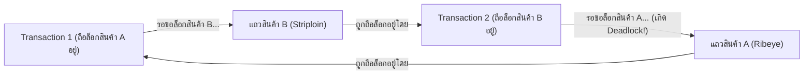

## 1. แนวคิด (Concept)
**Deadlock (ภาวะล็อกตาย)** เกิดขึ้นเมื่อมีอย่างน้อย 2 Transactions ถือครองกุญแจล็อกของทรัพยากรคนละชิ้น แล้วต่างฝ่ายต่างพยายามขอใช้ทรัพยากรที่อีกฝ่ายถืออยู่ จนไม่มีใครเดินหน้าต่อได้!

ตัวอย่างคลาสสิกในร้าน **Smart Butcher Marketplace**:
สมมติลูกค้าสั่งซื้อสินค้าเป็นชุด 2 รายการในตะกร้าเดียวกัน คือ **เนื้อ Ribeye (สินค้า A)** และ **เนื้อ Striploin (สินค้า B)**
- **Transaction ที่ 1 (ลูกค้าคนแรก):** ส่งรายการเข้ามาในลำดับ `[สินค้า A, สินค้า B]` -> ทำการล็อก **สินค้า A** สำเร็จ แล้วกำลังจะขอล็อก **สินค้า B**
- **Transaction ที่ 2 (ลูกค้าคนที่สอง):** ส่งรายการเข้ามาในลำดับสลับกันคือ `[สินค้า B, สินค้า A]` -> ทำการล็อก **สินค้า B** สำเร็จในเสี้ยววินาทีเดียวกัน แล้วกำลังจะขอล็อก **สินค้า A**
- **ผลลัพธ์:** Transaction 1 รอให้ Transaction 2 ปล่อยสินค้า B ในขณะที่ Transaction 2 ก็รอให้ Transaction 1 ปล่อยสินค้า A เกิดวงจรการรอคอยแบบงูกินหาง (**Circular Wait**) ที่ไม่มีวันจบสิ้น!



## 2. หลักการเบื้องหลัง (Under the Hood)
PostgreSQL 16 จัดการกับภาวะ Deadlock อย่างไร?
- เมื่อคำสั่งใดติดรอคิว Lock นานเกินค่าพารามิเตอร์ **`deadlock_timeout` (ค่าเริ่มต้นคือ `1s` หรือ 1 วินาที)** ตัว PostgreSQL จะปลุกอัลกอริทึมตรวจสอบ **Wait-For Graph** ขึ้นมาเช็คว่ามีการรอคอยเป็นวงกลมหรือไม่
- หากตรวจพบว่าเป็น Deadlock จริง PostgreSQL จะเลือก **ฆ่า (Abort & Rollback) Transaction ตัวใดตัวหนึ่งทันที** เพื่อปลดล็อกให้ Transaction ที่เหลือทำงานต่อไปได้ โดยผู้ที่ถูกยกเลิกจะได้รับ Error รหัส `40P01`:
  `ERROR: deadlock detected`

**เทคนิคการป้องกัน Deadlock 100% ในระดับสถาปัตยกรรม (Deterministic Lock Ordering):**
สาเหตุเดียวที่ทำให้เกิด Circular Wait คือการที่แต่ละ Transaction ล็อกแถวข้อมูล **คนละลำดับกัน** (`A -> B` ชนกับ `B -> A`) หากเราตั้งกฎเหล็กในโค้ดและใน SQL ว่า **"ไม่ว่าลูกค้าจะหยิบสินค้าใส่ตะกร้ามาในลำดับใด ก่อนที่จะทำการล็อกหรืออัปเดตหลายแถวในตารางเดียวกัน จะต้องเรียงลำดับตาม `product_id ASC` เสมอ!"**
เมื่อทุกคนล็อกตามลำดับ `A -> B` เหมือนกันทั้งหมด 100% คนที่มาทีหลังจะหยุดรอตั้งแต่หน้าประตูของ `A` โดยไม่ไปยึด `B` ค้างไว้ จึงไม่มีทางเกิดวงจร Deadlock ได้อีกเลย!

## 3. ตัวอย่างโค้ด (Smart Butcher Marketplace)

### ตัวอย่างที่ 1: การล็อกและตัดสต็อกสินค้าหลายชิ้นพร้อมกันโดยเรียงลำดับ `ORDER BY id ASC` ใน SQL
เมื่อใบสั่งซื้อ 1 ใบมีสินค้าเนื้อหลายรายการ เราใช้คำสั่ง `SELECT ... FOR NO KEY UPDATE ORDER BY id ASC` หรืออัปเดตเป็นชุดตามลำดับ `id` เพื่อขจัดโอกาสเกิด Deadlock อย่างสมบูรณ์:

```sql filename="sql/06_prevent_deadlock_consistent_lock_order.sql"
BEGIN;

-- 1. ล็อกแถวสินค้าทุกตัวที่อยู่ในตะกร้าโดยบังคับเรียงลำดับตาม id ASC เสมอ!
-- ไม่ว่า Transaction อื่นจะมีสินค้าซ้ำกับเราหรือไม่ ทุกคนจะเข้าแถวล็อกตามลำดับตัวอักษร UUID เดียวกันเป๊ะ!
SELECT id, sku, stock_qty
FROM products
WHERE id IN (
    'f9999999-9999-9999-9999-999999999999',
    '8e94fae4-18df-4158-b34e-6e8ebdc5fca1'
)
ORDER BY id ASC
FOR NO KEY UPDATE;

-- 2. ทำการตัดสต็อกของสินค้าทั้งหมดในคำสั่งเดียวผ่านตาราง VALUES
UPDATE products p
SET stock_qty = p.stock_qty - v.qty_to_deduct,
    version = p.version + 1,
    updated_at = CURRENT_TIMESTAMP
FROM (
    VALUES 
        ('8e94fae4-18df-4158-b34e-6e8ebdc5fca1'::uuid, 2),
        ('f9999999-9999-9999-9999-999999999999'::uuid, 1)
) AS v(product_id, qty_to_deduct)
WHERE p.id = v.product_id
  AND p.stock_qty >= v.qty_to_deduct;

COMMIT;
```

### ตัวอย่างที่ 2: การเรียงลำดับรายการสินค้าใน TypeScript/NestJS ก่อนตัดสต็อกพร้อมกลไก Retry เมื่อเกิด Deadlock
แสดงวิธีเขียนโค้ดฝั่ง Backend ที่จัดเรียง `items` ตาม `productId` ก่อนเข้า Transaction และมีฟังก์ชันดักจับรหัส `40P01` / `P2034` เพื่อทำการ Retry อัตโนมัติ:

```typescript filename="src/orders/multi-item-checkout.service.ts"
import { Injectable, BadRequestException } from '@nestjs/common';
import { Prisma } from '@prisma/client';
import { PrismaService } from '../prisma/prisma.service';

interface CartItemInput {
  productId: string;
  quantity: number;
}

@Injectable()
export class MultiItemCheckoutService {
  constructor(private readonly prisma: PrismaService) {}

  async checkoutCartSafely(userId: string, rawItems: CartItemInput[]) {
    // กฎเหล็กป้องกัน Deadlock: เรียงลำดับรายการสินค้าตาม productId จากน้อยไปมากเสมอ!
    const sortedItems = [...rawItems].sort((a, b) =>
      a.productId.localeCompare(b.productId),
    );

    const maxRetries = 3;
    for (let attempt = 1; attempt <= maxRetries; attempt++) {
      try {
        return await this.prisma.$transaction(async (tx) => {
          // วนลูปตัดสต็อกตามลำดับ productId ที่เรียงไว้แล้ว
          for (const item of sortedItems) {
            const updated = await tx.product.updateMany({
              where: {
                id: item.productId,
                isActive: true,
                deletedAt: null,
                stockQty: { gte: item.quantity },
              },
              data: {
                stockQty: { decrement: item.quantity },
                version: { increment: 1 },
              },
            });

            if (updated.count === 0) {
              throw new BadRequestException(
                `สินค้า ID ${item.productId} มีสต็อกไม่เพียงพอ`,
              );
            }
          }

          // สร้างใบสั่งซื้อหลังจากล็อกและตัดสต็อกตามลำดับเรียบร้อยแล้ว
          return await tx.order.create({
            data: {
              userId,
              orderNumber: `ORD-${Date.now()}-${Math.floor(Math.random() * 1000)}`,
              status: 'PENDING',
              subtotalAmount: 5000,
              totalAmount: 5000,
              shippingAddress: { note: 'Standard Delivery' },
            },
          });
        });
      } catch (error) {
        // หากเกิด Deadlock (P2034 ใน Prisma หรือ 40P01 ใน Postgres) ให้หน่วงเวลาสั้นๆ แบบสุ่มแล้ว Retry
        const isDeadlockOrConflict =
          error instanceof Prisma.PrismaClientKnownRequestError &&
          error.code === 'P2034';

        if (isDeadlockOrConflict && attempt < maxRetries) {
          const backoffMs = attempt * 50 + Math.floor(Math.random() * 50);
          await new Promise((resolve) => setTimeout(resolve, backoffMs));
          continue;
        }
        throw error;
      }
    }
  }
}
```

## 4. ผิด vs ถูก (Anti-pattern vs Best Practice)

| มิติการเปรียบเทียบ | ❌ ผิด (Anti-pattern) | ✅ ถูก (Best Practice) |
| :--- | :--- | :--- |
| **ลำดับการอัปเดตหลายแถว** | วนลูป `UPDATE` สินค้าตามลำดับที่ Frontend ส่งมาใน Array โดยไม่ Sort ก่อน ทำให้เกิด `A -> B` ชนกับ `B -> A` | เรียงลำดับ Array ตาม `productId ASC` (และเรียงลำดับตารางที่ต้องแก้ไขให้ตรงกันทุกฟังก์ชัน) ก่อนเริ่มล็อกเสมอ |
| **ลำดับการล็อกข้ามตาราง** | ฟังก์ชันที่ 1 ล็อก `orders` แล้วไปแก้ `products` แต่ฟังก์ชันที่ 2 ล็อก `products` แล้วไปแก้ `orders` | กำหนดลำดับชั้นของตารางในสถาปัตยกรรมให้ชัดเจน (เช่น แก้ไข `orders` ก่อน `products` เสมอในทุกฟังก์ชัน) |

## 5. ควรใช้เมื่อไหร่ และ ไม่ควรใช้เมื่อไหร่
- **ควรจัดเรียงลำดับคีย์ (`ORDER BY id ASC`) ก่อนล็อกเสมอเมื่อ:** ภายใน 1 Transaction ต้องทำการ `UPDATE`, `DELETE`, หรือ `SELECT ... FOR UPDATE` ข้อมูลมากกว่า 1 แถวขึ้นไป
- **ไม่ควรตั้งค่า `deadlock_timeout` ให้ต่ำเกินไป (เช่น `10ms`) เมื่อ:** ระบบมีภาระงานปกติ เพราะการรันอัลกอริทึมตรวจหา Deadlock ใช้ CPU สูง ค่าเริ่มต้น `1s` ของ PostgreSQL 16 เหมาะสมที่สุดแล้วสำหรับการแยกแยะระหว่างการรอคิวปกติกับ Deadlock จริง

## 6. คำถามสัมภาษณ์ (Interview Q&A)
- **Q1: นอกจากการที่ Transaction 2 ตัวอัปเดตแถวในตารางเดียวกันสลับลำดับกันแล้ว Deadlock ใน PostgreSQL ยังสามารถเกิดขึ้นจากกรณีของ Foreign Key ที่ไม่มีการแก้ไขสลับลำดับได้หรือไม่?**
  - **แนวคำตอบ:** เกิดขึ้นได้! หากตารางลูกไม่มีการสร้าง Index บนคอลัมน์ Foreign Key หรือเมื่อ Transaction แรกทำการ `ALTER` / `DELETE` ตารางแม่พร้อมกับที่ Transaction ที่สองทำการ `INSERT` ตารางลูกและอัปเดตตารางแม่ในลำดับที่สวนทางกัน นอกจากนี้ การใช้ `SELECT ... FOR UPDATE` (แทนที่จะเป็น `FOR NO KEY UPDATE`) บนตารางแม่จะไปบล็อกการ `INSERT` ของตารางลูก ซึ่งหากมีคำสั่งต่อเนื่องที่อ้างอิงสลับกันก็จะทำให้เกิด Deadlock ข้ามตารางแม่-ลูกได้ทันที
- **Q2: ทำไมในการทำ Retry เมื่อเกิด Deadlock (`40P01`) หรือ Serialization Failure (`40001`) เราจึงต้องใส่ Random Jitter (สุ่มเวลาหน่วงเพิ่มเล็กน้อย เช่น `50ms + random(0..50ms)`) เข้าไปด้วย?**
  - **แนวคำตอบ:** หากมี 2 Transactions ชนกันแล้วถูกสั่งให้รอเวลาคงที่เท่ากันเป๊ะ (เช่น รอ `100ms` เท่ากัน) เมื่อครบ `100ms` ทั้งสองตัวก็จะตื่นขึ้นมาพร้อมกันและยิงคำสั่งกลับมาชนกันซ้ำอีกในจังหวะเดิม (เรียกว่าปัญหา **Thundering Herd / Lockstep Collision**) การบวกเวลาสุ่ม (Jitter) เข้าไปจะช่วยให้ตัวหนึ่งวิ่งเข้าไปทำงานเสร็จก่อนที่อีกตัวจะตื่นขึ้นมา

---
