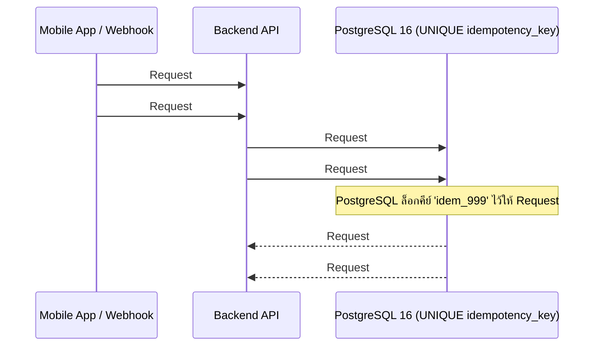

## 1. แนวคิด (Concept)
ในโลกความเป็นจริงของระบบเครือข่าย ลูกค้าอาจกดปุ่ม "ชำระเงิน" บนมือถือแล้วสัญญาณอินเทอร์เน็ตกระตุก จึงรัวกดปุ่มซ้ำ 3 ครั้งติดกัน หรือระบบ Payment Gateway (เช่น Stripe / Omise) ส่ง Webhook แจ้งว่าชำระเงินสำเร็จเข้ามาที่เซิร์ฟเวอร์เรา แต่เกิด Network Timeout ตอนตอบกลับ ทำให้ Payment Gateway ส่ง Webhook เดิมซ้ำเข้ามาอีก 5 ครั้ง!

หากระบบของเราไม่ได้ทำ **Idempotency (คุณสมบัติที่การส่งคำขอเดิมซ้ำกี่ครั้งก็ตาม จะให้ผลลัพธ์และการเปลี่ยนแปลงในฐานข้อมูลเกิดขึ้นเพียงแค่ครั้งเดียวเท่านั้น)** ลูกค้าจะถูกสร้างออเดอร์ซ้ำ 3 ใบ หรือถูกเติมเงิน/ตัดสต็อกซ้ำ 5 รอบทันที!

กลไกที่ดีที่สุดในการทำ Idempotency คือการใช้ **`idempotency_key` ที่ผูกกับ `UNIQUE` constraint ในฐานข้อมูล PostgreSQL 16** ควบคู่กับคำสั่ง `INSERT ... ON CONFLICT`!



## 2. หลักการเบื้องหลัง (Under the Hood)
ทำไมการเช็ค Idempotency ด้วยการเขียนโค้ด `const existing = await prisma.payment.findUnique({ where: { idempotencyKey } }); if (existing) return existing;` ก่อนสั่ง `create` จึงยังพังได้เมื่อลูกค้ากดปุ่มเบิ้ลพร้อมกัน?
- เพราะถ้า Request #1 และ Request #2 มาถึงบรรทัด `findUnique` ในมิลลิวินาทีเดียวกัน ทั้งคู่จะได้รับค่า `null` เหมือนกัน แล้วผ่านเข้าไปทำขั้นตอนตัดเงินทั้งคู่!
- แต่เมื่อเราใช้คำสั่ง **`INSERT INTO payments (...) VALUES (...) ON CONFLICT (idempotency_key) DO NOTHING`** (หรือให้ Database โยน Unique Violation `23505` / Prisma `P2002` ตั้งแต่วินาทีแรกที่เริ่มบันทึก) ตัว **B-Tree Unique Index ของ PostgreSQL 16** จะทำหน้าที่เป็นปราการระดับอะตอมมิก:
  - ทันทีที่ Request #1 เริ่ม `INSERT` คีย์ `'idem_999'` ลงใน Unique Index (แม้จะยังไม่ `COMMIT`) หาก Request #2 พยายาม `INSERT` คีย์ `'idem_999'` ตามเข้ามาในเสี้ยววินาทีเดียวกัน **PostgreSQL จะบล็อก Request #2 ให้หยุดรอตรงหน้า Unique Index ทันที!**
  - ทันทีที่ Request #1 สั่ง `COMMIT` ตัว Request #2 จะรับรู้ทันทีว่าคีย์ซ้ำและไม่ทำงานซ้ำซ้อน!

## 3. ตัวอย่างโค้ด (Smart Butcher Marketplace)

### ตัวอย่างที่ 1: การประมวลผล Payment Webhook แบบ Idempotent 100% ในระดับ SQL
เมื่อได้รับแจ้งผลการชำระเงินจากผู้ให้บริการชำระเงิน เราใช้ `INSERT ... ON CONFLICT (idempotency_key) DO NOTHING` ภายใน CTE เพื่อรับประกันว่าไม่ว่า Webhook จะส่งซ้ำมากี่สิบครั้ง สถานะออเดอร์จะถูกอัปเดตและประมวลผลเพียงครั้งเดียวเท่านั้น:

```sql filename="sql/07_idempotent_payment_webhook.sql"
-- ใช้ CTE ร่วมกับ ON CONFLICT (idempotency_key) DO NOTHING
-- หาก idempotency_key นี้เคยถูกบันทึกไปแล้ว inserted_payment จะคืนค่า 0 แถว และ UPDATE orders ด้านล่างจะไม่ถูกรันซ้ำ!
WITH inserted_payment AS (
    INSERT INTO payments (
        order_id, idempotency_key, payment_method, amount, status, provider_tx_id, paid_at
    ) VALUES (
        'd1111111-1111-1111-1111-111111111111',
        'webhook_evt_omise_20261017_8888',
        'PROMPTPAY_QR',
        10550.00,
        'SUCCEEDED',
        'chrg_test_8888',
        CURRENT_TIMESTAMP
    )
    ON CONFLICT (idempotency_key) DO NOTHING
    RETURNING id, order_id, amount, status
)
UPDATE orders o
SET status = 'PAID',
    updated_at = CURRENT_TIMESTAMP
FROM inserted_payment ip
WHERE o.id = ip.order_id
  AND o.status = 'PENDING'
RETURNING o.id AS order_id, o.order_number, o.status, ip.id AS payment_id;
```

### ตัวอย่างที่ 2: การเขียน Integration Test จำลองยิง 20 Concurrent Requests พร้อมกันเพื่อพิสูจน์ว่าไม่มี Race Condition
เราไม่ควรเชื่อว่าโค้ดของเราปลอดภัยจนกว่าจะได้ทดสอบยิงคำสั่งพร้อมกันจริงๆ! ตัวอย่างนี้แสดงการเขียนสคริปต์ทดสอบด้วย `Promise.allSettled` ยิงคำสั่งซื้อแย่งเนื้อวากิวที่เหลือในสต็อกเพียง 5 ชิ้น จากลูกค้า 20 คนในเสี้ยววินาทีเดียวกัน:

```typescript filename="test/concurrency-stock-race.e2e-spec.ts"
import { Test, TestingModule } from '@nestjs/testing';
import { PrismaService } from '../src/prisma/prisma.service';
import { OrdersCheckoutService } from '../src/orders/orders-checkout.service';

describe('Smart Butcher Concurrency & Race Condition Test', () => {
  let prisma: PrismaService;
  let checkoutService: OrdersCheckoutService;
  const testProductId = '8e94fae4-18df-4158-b34e-6e8ebdc5fca1';
  const testUserId = 'a1111111-1111-1111-1111-111111111111';

  beforeAll(async () => {
    const moduleFixture: TestingModule = await Test.createTestingModule({
      providers: [PrismaService, OrdersCheckoutService],
    }).compile();

    prisma = moduleFixture.get<PrismaService>(PrismaService);
    checkoutService = moduleFixture.get<OrdersCheckoutService>(OrdersCheckoutService);
  });

  it('ต้องอนุญาตให้สั่งซื้อสำเร็จเพียง 5 ออเดอร์เป๊ะ เมื่อมีสต็อก 5 ชิ้นแต่ยิงเข้ามาพร้อมกัน 20 Requests', async () => {
    // 1. ตั้งค่าสต็อกเริ่มต้นของเนื้อ Miyazaki Wagyu A5 ให้มีเพียง 5 ชิ้นเท่านั้น
    await prisma.product.update({
      where: { id: testProductId },
      data: { stockQty: 5, version: 1 },
    });

    // 2. จำลองลูกค้า 20 คนกดสั่งซื้อคนละ 1 ชิ้นพร้อมกันในเสี้ยววินาทีเดียวกันด้วย Promise.allSettled
    const concurrentRequests = Array.from({ length: 20 }, (_, index) =>
      checkoutService.checkoutSingleItemOrder({
        userId: testUserId,
        productId: testProductId,
        quantity: 1,
        shippingAddress: { attempt: index + 1 },
      }),
    );

    const results = await Promise.allSettled(concurrentRequests);

    // 3. นับจำนวน Request ที่สำเร็จ (fulfilled) และล้มเหลวเพราะของหมด (rejected)
    const succeededOrders = results.filter((r) => r.status === 'fulfilled');
    const failedOrders = results.filter((r) => r.status === 'rejected');

    // 4. ตรวจสอบความถูกต้อง: ต้องสำเร็จแค่ 5 ออเดอร์ ล้มเหลว 15 ออเดอร์ และสต็อกสุดท้ายต้องเท่ากับ 0 เป๊ะ!
    const finalProduct = await prisma.product.findUniqueOrThrow({
      where: { id: testProductId },
    });

    expect(succeededOrders).toHaveLength(5);
    expect(failedOrders).toHaveLength(15);
    expect(finalProduct.stockQty).toBe(0);
  });
});
```

## 4. ผิด vs ถูก (Anti-pattern vs Best Practice)

| มิติการเปรียบเทียบ | ❌ ผิด (Anti-pattern) | ✅ ถูก (Best Practice) |
| :--- | :--- | :--- |
| **การป้องกันการกดปุ่มซ้ำ** | ปิดปุ่ม (Disable button) ที่หน้าเว็บ React/Next.js อย่างเดียวโดยไม่ทำ Idempotency ที่ Backend และ Database | ปิดปุ่มที่หน้าเว็บเพื่อ UX ที่ดี **และ** บังคับใช้ `idempotency_key UNIQUE` ในฐานข้อมูลเสมอ |
| **การเช็คคีย์ซ้ำก่อน Insert** | รัน `SELECT` เช็คว่ามี `idempotency_key` หรือยัง ถ้ายังไม่มีค่อยรัน `INSERT` แยกคำสั่งกัน | ใช้ `INSERT ... ON CONFLICT (idempotency_key) DO NOTHING` หรือดัก Unique Constraint Violation จากการ `INSERT` ตรงๆ |
| **การทดสอบระบบตัดสต็อก** | ทดสอบด้วยการกดปุ่มทีละครั้งใน Postman แล้วสรุปว่าระบบตัดสต็อกทำงานถูกต้อง | เขียน Automated Test ที่ใช้ `Promise.allSettled` ยิงคำขอพร้อมกัน 20-50 Requests เพื่อพิสูจน์ว่าไม่มี Overselling |

## 5. ควรใช้เมื่อไหร่ และ ไม่ควรใช้เมื่อไหร่
- **ควรทำ Idempotency Key เสมอเมื่อ:** เป็น API ที่ก่อให้เกิดผลกระทบทางการเงินหรือการเปลี่ยนแปลงสถานะที่ทำซ้ำไม่ได้ เช่น การสร้างคำสั่งซื้อ (`POST /orders`), การตัดเงิน (`POST /payments`), และการรับ Webhook จากบุคคลที่สาม
- **ไม่จำเป็นต้องสร้าง Idempotency Key เมื่อ:** คำสั่งนั้นมีธรรมชาติเป็น Idempotent ในตัวเองอยู่แล้ว เช่น การอ่านข้อมูล (`GET`), การแก้ไขข้อมูลเป็นค่าตายตัว (`PUT /profile` ตั้งชื่อเป็น `'สมชาย'`), หรือการลบข้อมูลตาม ID (`DELETE`)

## 6. คำถามสัมภาษณ์ (Interview Q&A)
- **Q1: หากลูกค้ากดปุ่มชำระเงินซ้ำ 2 ครั้งติดกันด้วย `Idempotency-Key` เดียวกัน ในขณะที่ Request แรกกำลังประมวลผลอยู่ในฐานข้อมูลและยังไม่ได้ `COMMIT` ตัว PostgreSQL จะจัดการกับ Request ที่สองที่พยายาม `INSERT` คีย์เดียวกันอย่างไร?**
  - **แนวคำตอบ:** เมื่อ Request แรกทำการ `INSERT` แถวที่มี `idempotency_key = 'abc'` ลงในตาราง แม้จะยังไม่ได้ `COMMIT` แต่ PostgreSQL จะวางล็อกบนค่า `'abc'` ในโครงสร้าง B-Tree Unique Index ทันที เมื่อ Request ที่สองพยายาม `INSERT` ค่า `'abc'` เข้ามาพร้อมกัน มันจะไม่ผ่านไปได้และไม่โยน Error ทันที แต่จะถูก **บล็อกให้หยุดรอผลลัพธ์ของ Request แรก** หาก Request แรกสั่ง `COMMIT` สำเร็จ Request ที่สองจึงจะได้รับ Unique Constraint Violation (หรือทำงานตาม `ON CONFLICT DO NOTHING`) แต่หาก Request แรกล้มเหลวและ `ROLLBACK` ตัว Request ที่สองก็จะได้รับการปลดล็อกให้เข้าไปบันทึกข้อมูลต่อได้ทันที!
- **Q2: ถ้าเราต้องเรียก Payment Gateway ภายนอกเพื่อตัดบัตรเครดิตของลูกค้า เราจะออกแบบขั้นตอนร่วมกับตารางในฐานข้อมูลอย่างไรให้ทั้งไม่ถือ Lock ค้างตอนยิง HTTP และไม่ตัดเงินลูกค้าซ้ำซ้อน?**
  - **แนวคำตอบ:** ใช้รูปแบบ **3-Step Idempotent State Transition**:
    1. **Step 1 (Short DB Transaction):** รับ `idempotency_key` มาทำการ `INSERT INTO payments (..., status = 'PROCESSING')` แล้วสั่ง `COMMIT` ทันที! (หากมี Request ซ้ำเข้ามาในจังหวะนี้จะติด Unique Constraint ของ `idempotency_key` ทันทีตั้งแต่ยังไม่ทันไปเรียกธนาคาร)
    2. **Step 2 (External HTTP Call - นอก DB Transaction):** ส่งคำขอตัดเงินไปยัง Payment Gateway พร้อมแนบ `idempotency_key` เดียวกันไปให้ Payment Gateway ด้วย
    3. **Step 3 (Short DB Transaction):** เมื่อได้รับผลตอบกลับจากธนาคาร จึงเปิด Transaction สั้นๆ อีกครั้งเพื่ออัปเดต `payments.status = 'SUCCEEDED'` และเปลี่ยน `orders.status = 'PAID'`

---
