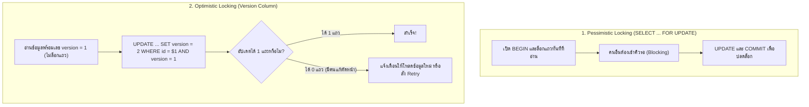

## 1. แนวคิด (Concept)
ในการป้องกันไม่ให้ผู้ใช้งานสองคนแก้ไขข้อมูลแถวเดียวกันทับกัน (Lost Update) เรามีปรัชญาการออกแบบหลักอยู่ 2 แนวทางที่ตรงกันข้ามกัน:
1. **Pessimistic Locking (การล็อกแบบมองโลกในแง่ร้าย):** มองว่า "ต้องมีคนอื่นเข้ามาแย่งแก้ข้อมูลชนกับเราแน่ๆ ดังนั้นล็อกแถวไว้ก่อนเลยตั้งแต่วินาทีที่อ่าน!" โดยใช้คำสั่ง `SELECT ... FOR UPDATE` ภายใน Transaction ผู้ใช้คนอื่นที่เข้ามาทีหลังจะต้องเข้าคิวรอจนกว่าคนแรกจะทำเสร็จ
2. **Optimistic Locking (การล็อกแบบมองโลกในแง่ดี / Version Column):** มองว่า "โอกาสที่จะมีคนมาแก้ข้อมูลแถวเดียวกันในเสี้ยววินาทีเดียวกันมีไม่บ่อยหรอก อย่าเพิ่งล็อกฐานข้อมูลเลย!" โดยเราจะเพิ่มคอลัมน์ **`version INTEGER`** ไว้ในตาราง ตอนอ่านข้อมูลให้อ่านเลข `version` มาด้วย (เช่น `version = 5`) และตอนบันทึกกลับลงไปให้ใส่เงื่อนไข `WHERE id = $1 AND version = 5` พร้อมสั่งเพิ่มค่า `SET version = version + 1` หากระหว่างทางมีคนอื่นแอบแก้ตัดหน้าไปก่อนจน `version` กลายเป็น `6` แล้ว คำสั่งอัปเดตของเราจะกระทบ `0 แถว` ทันที!



## 2. หลักการเบื้องหลัง (Under the Hood)
ทำไมเราจึงต้องมีทั้งสองวิธีและเลือกใช้ให้ถูกสถานการณ์?
- **ข้อจำกัดของ Pessimistic Locking:** การใช้ `SELECT ... FOR UPDATE` บังคับให้ทั้งขั้นตอนการอ่านและการเขียนต้องอยู่ใน **Database Transaction เดียวกันที่เปิดค้างไว้** ดังนั้นเราไม่สามารถใช้ Pessimistic Locking ข้าม HTTP Requests ได้ (เช่น แอดมินเปิดหน้าแก้ไขราคาสินค้าค้างไว้บนหน้าเว็บ 5 นาทีแล้วค่อยกดปุ่ม Save เราไม่สามารถเปิด SQL Transaction ล็อกแถวรอแอดมินพิมพ์นาน 5 นาทีได้!)
- **ข้อได้เปรียบของ Optimistic Locking:** ไม่มีการถือครอง Lock ในฐานข้อมูลระหว่างที่ผู้ใช้กำลังดูหรือแก้ไขฟอร์มบนหน้าจอเลย และเมื่อเกิดการชนกันในการตัดสต็อกความเร็วสูง แอปพลิเคชันสามารถตรวจจับจากผลลัพธ์ `updated rows = 0` แล้วตัดสินใจแจ้งเตือนผู้ใช้หรือทำการอ่านค่าใหม่เพื่อคำนวณซ้ำ (Retry) ได้

### ตารางเปรียบเทียบ Pessimistic Locking vs Optimistic Locking

| มิติการเปรียบเทียบ | Pessimistic Locking (`FOR UPDATE`) | Optimistic Locking (`version` column) |
| :--- | :--- | :--- |
| **กลไกการทำงาน** | ล็อกแถวใน DB ทันทีที่อ่าน คนมาทีหลังต้องรอคิว | ไม่ล็อกตอนอ่าน แต่เช็ค `WHERE version = ค่าเดิม` ตอนเขียน |
| **เมื่อเกิดการชนกัน (Conflict)** | คนมาทีหลัง **รอคิว (Wait)** พอคนแรกเสร็จจึงทำงานต่อได้เลย | คนมาทีหลัง **ล้มเหลวทันที (Fail Fast)** ต้อง Retry หรือแจ้งผู้ใช้ |
| **กรณีที่มีการแย่งชิงสูงมาก (High Contention)** | **เหมาะกว่า:** เพราะจัดคิวทำงานเรียงลำดับ ไม่ต้องเสีย CPU รันซ้ำทิ้งขว้าง | เสี่ยงเกิด **Retry Storm** (ชนกันแล้ววนลูปยิงซ้ำพร้อมกันจน DB หนักกว่าเดิม) |
| **กรณีแก้ไขข้อมูลผ่านหน้าจอ UI นานๆ** | **ห้ามใช้เด็ดขาด** (ล็อก DB ค้างข้าม HTTP Request ไม่ได้) | **เหมาะที่สุด:** ส่งเลข `version` ไปกับฟอร์ม ตอนกด Save ค่อยเช็ค `version` |

## 3. ตัวอย่างโค้ด (Smart Butcher Marketplace)

### ตัวอย่างที่ 1: การทำ Pessimistic Locking ด้วย `SELECT ... FOR NO KEY UPDATE` สำหรับการโอนย้ายสต็อกระหว่างคลัง
เมื่อระบบต้องตรวจสอบและปรับปรุงสต็อกภายใน Transaction สั้นๆ ที่มีการแย่งชิงสูงและต้องการให้คำสั่งที่เข้ามาพร้อมกันเข้าคิวรอกันอย่างเป็นระเบียบ:

```sql filename="sql/05_pessimistic_locking_for_update.sql"
BEGIN;

-- 1. ล็อกแถวสินค้าด้วย FOR NO KEY UPDATE ทันทีที่อ่าน (Transaction อื่นที่จะแก้สินค้านี้ต้องเข้าคิวรอตรงนี้)
SELECT id, sku, name, stock_qty, price_per_kg
FROM products
WHERE id = '8e94fae4-18df-4158-b34e-6e8ebdc5fca1'
  AND is_active = TRUE
FOR NO KEY UPDATE;

-- 2. หลังจากตรวจสอบในโค้ดว่า stock_qty เพียงพอแล้ว จึงทำการอัปเดตโดยมั่นใจ 100% ว่าไม่มีใครแอบเปลี่ยนค่าระหว่างทาง
UPDATE products
SET stock_qty = stock_qty - 3,
    version = version + 1,
    updated_at = CURRENT_TIMESTAMP
WHERE id = '8e94fae4-18df-4158-b34e-6e8ebdc5fca1';

COMMIT;
```

### ตัวอย่างที่ 2: การทำ Optimistic Locking ด้วยคอลัมน์ `version` ใน NestJS + Prisma
เมื่อแอดมินสองคนเปิดหน้าแก้ไขรายละเอียดและราคาของเนื้อวากิวชิ้นเดียวกันบนหน้าเว็บ แอดมินคนที่กด Save ทีหลังจะต้องได้รับแจ้งเตือนว่าข้อมูลถูกแก้ไขไปแล้ว แทนที่จะเผลอเขียนราคาเก่าทับงานของเพื่อน:

```typescript filename="src/catalog/products-optimistic.service.ts"
import { Injectable, ConflictException, NotFoundException } from '@nestjs/common';
import { PrismaService } from '../prisma/prisma.service';

interface UpdateProductPriceDto {
  productId: string;
  expectedVersion: number; // เลข version ที่หน้าเว็บอ่านไปตอนเปิดฟอร์ม
  newPricePerKg: number;
  newStockQty: number;
}

@Injectable()
export class ProductsOptimisticService {
  constructor(private readonly prisma: PrismaService) {}

  async updateProductOptimistic(dto: UpdateProductPriceDto) {
    // ใช้ updateMany เพื่อระบุเงื่อนไขคู่กันทั้ง id และ version เดิมที่คาดหวัง
    const result = await this.prisma.product.updateMany({
      where: {
        id: dto.productId,
        version: dto.expectedVersion,
        deletedAt: null,
      },
      data: {
        pricePerKg: dto.newPricePerKg,
        stockQty: dto.newStockQty,
        version: { increment: 1 }, // บวกเลข version เพิ่มขึ้น 1 เสมอเมื่อแก้ไขสำเร็จ
      },
    });

    // หากอัปเดตได้ 0 แถว แปลว่าไม่พบสินค้า หรือมีคนอื่นแก้ไขตัดหน้าไปก่อนจนเลข version เปลี่ยนไปแล้ว!
    if (result.count === 0) {
      const exists = await this.prisma.product.findUnique({
        where: { id: dto.productId },
        select: { id: true, version: true },
      });

      if (!exists) {
        throw new NotFoundException('ไม่พบรายการสินค้านี้ในระบบ');
      }

      throw new ConflictException(
        `ข้อมูลสินค้าถูกแก้ไขโดยผู้ใช้อื่นไปแล้ว (Version ปัจจุบันคือ ${exists.version}) กรุณารีเฟรชหน้าจอแล้วลองใหม่`,
      );
    }

    return await this.prisma.product.findUnique({
      where: { id: dto.productId },
    });
  }
}
```

## 4. ผิด vs ถูก (Anti-pattern vs Best Practice)

| มิติการเปรียบเทียบ | ❌ ผิด (Anti-pattern) | ✅ ถูก (Best Practice) |
| :--- | :--- | :--- |
| **การเช็ค `version` แยกคำสั่งกับ `UPDATE`** | รัน `SELECT version` มาเช็ค `if (db.version === dto.version)` ในโค้ด แล้วค่อยรัน `UPDATE WHERE id = $1` (เกิดช่องโหว่ Race Condition ระหว่างบรรทัด!) | ต้องใส่ `AND version = $expected_version` ลงไปในเงื่อนไข `WHERE` ของคำสั่ง `UPDATE` โดยตรงเสมอ |
| **การใช้ `updated_at` แทนเลข `version`** | ใช้เวลา `WHERE updated_at = $old_time` ทำ Optimistic Lock ซึ่งอาจชนกันได้หากมีการแก้ไข 2 ครั้งภายในมิลลิวินาทีเดียวกัน | ใช้คอลัมน์ `version INTEGER NOT NULL DEFAULT 1` ที่บวกเพิ่มทีละ 1 (`version = version + 1`) ทุกครั้งที่อัปเดต |

## 5. ควรใช้เมื่อไหร่ และ ไม่ควรใช้เมื่อไหร่
- **ควรใช้ Optimistic Locking (`version`) เมื่อ:** เป็นระบบจัดการข้อมูลหลังบ้าน (CMS / Admin Panel / แก้ไขข้อมูลสินค้าหรือใบสั่งซื้อผ่านฟอร์ม UI) หรือระบบที่โอกาสชนกันต่ำถึงปานกลางและต้องการหลีกเลี่ยงการถือ Database Lock
- **ควรใช้ Pessimistic Locking (`FOR UPDATE`) หรือ Atomic Update เมื่อ:** เป็นจุดที่มีการแย่งชิงข้อมูลแถวเดิมสูงมากภายในเสี้ยววินาที (เช่น การตัดสต็อกสินค้า Flash Sale หรือการปรับยอดเงินในบัญชีร้านค้า) ที่ต้องการให้คำสั่งเรียงคิวทำงานต่อกันไปโดยไม่ต้องโยน Error ให้ลูกค้ากดสั่งซื้อใหม่

## 6. คำถามสัมภาษณ์ (Interview Q&A)
- **Q1: ทำไมใน Prisma ORM เมื่อเราต้องการทำ Optimistic Locking เราจึงมักใช้ `prisma.product.updateMany({ where: { id, version }, data: ... })` แทนการใช้ `prisma.product.update(...)`?**
  - **แนวคำตอบ:** เพราะเมธอด `updateMany` จะคืนค่า `{ count: number }` กลับมาอย่างชัดเจน (เป็น `0` เมื่อ `version` ไม่ตรง หรือเป็น `1` เมื่ออัปเดตสำเร็จ) ทำให้เราตรวจสอบ `if (result.count === 0)` เพื่อโยน `ConflictException (HTTP 409)` ได้อย่างสะอาดและไม่ต้องสร้าง Unique Index ซ้อนบน `(id, version)` ในขณะที่ `update` ปกติหากไม่ตรงเงื่อนไขจะโยน Generic Prisma Error (`P2025`) ซึ่งแยกแยะยากกว่าว่าเกิดจากหา `id` ไม่เจอหรือเกิดจาก `version` ไม่ตรงกัน
- **Q2: หากมีสินค้า Flash Sale เหลือ 100 ชิ้น และมีลูกค้ากดซื้อพร้อมกัน 100 คนในวินาทีเดียวกัน ถ้าเราใช้ Optimistic Locking โดยไม่มีระบบ Retry จะเกิดอะไรขึ้นกับลูกค้าทั้ง 100 คน?**
  - **แนวคำตอบ:** เมื่อทั้ง 100 คนอ่านข้อมูลพร้อมกัน ทั้งหมดจะเห็น `version = 1` เหมือนกันหมด แต่เมื่อทั้ง 100 คนส่งคำสั่ง `UPDATE ... WHERE version = 1` เข้ามาพร้อมกัน **จะมีเพียงคนแรกแค่ 1 คนเท่านั้นที่อัปเดตสำเร็จ (เปลี่ยนเป็น `version = 2`) ส่วนอีก 99 คนที่เหลือจะล้มเหลวทั้งหมด (`count = 0`) ทันทีทั้งที่ของในสต็อกยังเหลืออีกตั้ง 99 ชิ้น!** นี่คือเหตุผลว่าทำไมกับการตัดสต็อก Flash Sale การใช้ **Atomic Update (`SET stock_qty = stock_qty - 1 WHERE stock_qty >= 1`)** หรือ Pessimistic Locking จึงเหมาะสมกว่ามาก เพราะทั้ง 100 คนจะเรียงคิวตัดสต็อกสำเร็จครบทุกคน

---
