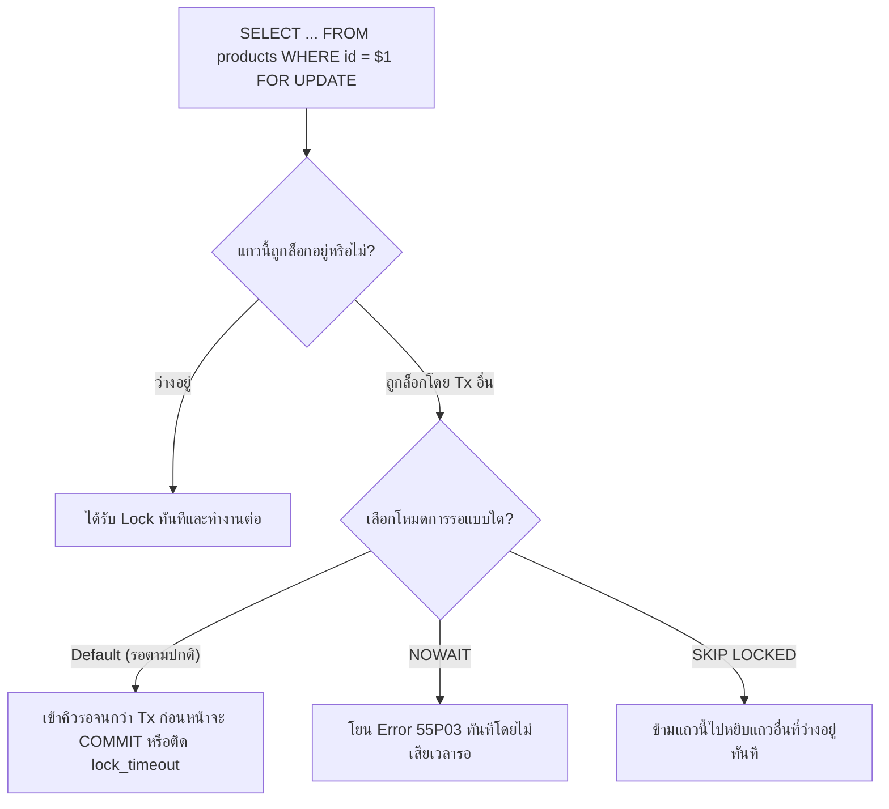

## 1. แนวคิด (Concept)
ในกรณีที่ลอจิกทางธุรกิจมีความซับซ้อนเกินกว่าจะเขียนจบในคำสั่ง `UPDATE` บรรทัดเดียว เช่น เราต้องดึงข้อมูลใบสั่งซื้อ (`orders`) และรายการสินค้า (`products`) ขึ้นมาตรวจสอบเงื่อนไขหลายข้อในโค้ด TypeScript แล้วจึงตัดสินใจแก้ไขข้อมูลกลับลงไป เราจำเป็นต้องสั่งให้ PostgreSQL **"ล็อกแถวข้อมูลนั้นไว้ตั้งแต่วินาทีที่เริ่มอ่าน"** เพื่อห้ามไม่ให้ใครเข้ามาแอบเปลี่ยนค่าตัดหน้าเราจนกว่าเราจะจบ Transaction

PostgreSQL 16 มีเครื่องมือล็อกข้อมูลที่ทรงพลังให้เลือกใช้ตามสถานการณ์:
1. **`SELECT ... FOR UPDATE` / `FOR NO KEY UPDATE`:** ล็อกแถวที่ดึงขึ้นมาทันที หากมี Transaction อื่นพยายามจะแก้ไขหรือสั่ง `FOR UPDATE` ซ้ำบนแถวเดียวกัน จะต้องเข้าคิวรอจนกว่าเราจะ `COMMIT`
2. **`FOR UPDATE NOWAIT`:** หากแถวนั้นมีคนอื่นล็อกอยู่แล้ว **ไม่ต้องรอคิว ให้โยน Error ทันที!** (เหมาะกับการป้องกันไม่ให้ API ค้างสะสม)
3. **`FOR UPDATE SKIP LOCKED`:** หากแถวไหนมีคนล็อกอยู่แล้ว **ให้กระโดดข้ามแถวนั้นไปหยิบแถวถัดไปที่ยังว่างอยู่ทันที!** (เหมาะสำหรับการทำระบบคิวงาน หรือการหยิบแพ็กเนื้อชิ้นถัดไปในคลัง)
4. **Advisory Locks (`pg_advisory_xact_lock`):** การสร้างกุญแจล็อกในหน่วยความจำด้วยตัวเลข 64-bit ที่แอปพลิเคชันกำหนดความหมายขึ้นเอง สำหรับล็อกกระบวนการทางธุรกิจที่ยังไม่มีแถวข้อมูลอยู่จริงในตาราง



## 2. หลักการเบื้องหลัง (Under the Hood)
ทำไม PostgreSQL 16 จึงสามารถล็อกแถวข้อมูลได้เป็นล้านๆ แถวพร้อมกันโดยที่หน่วยความจำ Lock Table ใน RAM ไม่เต็ม (ต่างจาก RDBMS อื่นที่เกิดปัญหา Lock Escalation เปลี่ยนจากล็อกแถวเป็นล็อกทั้งตาราง)?
- เพราะ PostgreSQL **ไม่ได้เก็บสถานะการล็อกแถวไว้ในหน่วยความจำ RAM** แต่เขียนหมายเลข Transaction ID ของผู้ล็อกลงไปในช่อง `t_xmax` พร้อมตั้งค่า Bit Flags (`infomask`) **ไว้บนส่วนหัวของแถวข้อมูลในหน้าบล็อก 8KB โดยตรง!**
- นอกจากนี้ PostgreSQL แยกระดับความแรงของ Row-level Locks ออกเป็น 4 ระดับสำคัญ:
  - **`FOR UPDATE`:** ล็อกระดับแรงสุด บล็อกการแก้ไขทุกชนิดและบล็อกการสร้างแถวลูกที่อ้างอิง Foreign Key มายังแถวนี้
  - **`FOR NO KEY UPDATE`:** (เป็นค่าที่คำสั่ง `UPDATE` ปกติใช้เมื่อไม่ได้แก้คอลัมน์ Primary/Unique Key) บล็อกไม่ให้ใครแก้ไขแถวนี้ แต่ยังอนุญาตให้ตารางลูก `INSERT` อ้างอิง Foreign Key มายังแถวนี้ได้พร้อมกันโดยไม่ติดขัด!
  - **`FOR SHARE` / `FOR KEY SHARE`:** ล็อกแบบอ่านร่วมกัน ห้ามใครแก้ไขหรือลบคีย์หลักของแถวนี้จนกว่าจะจบ Transaction

## 3. ตัวอย่างโค้ด (Smart Butcher Marketplace)

### ตัวอย่างที่ 1: การใช้ `SELECT ... FOR NO KEY UPDATE` และ `SKIP LOCKED` สำหรับระบบจัดสรรงานห้องเชือดเนื้อ
เมื่อมีพนักงานแล่เนื้อ (Butchers) 10 คนกดปุ่ม "ขอรับใบสั่งซื้อถัดไปมาตัดแต่ง" พร้อมกัน เราใช้ `FOR UPDATE SKIP LOCKED` เพื่อให้พนักงานแต่ละคนได้ใบสั่งซื้อคนละใบทันทีโดยไม่ชนกันและไม่ต้องรอคิวกันเลย:

```sql filename="sql/03_row_locks_and_skip_locked_queue.sql"
BEGIN;

-- พนักงานแล่เนื้อดึงออเดอร์ที่ชำระเงินแล้ว 1 ใบที่เก่าที่สุด โดยข้ามใบที่พนักงานคนอื่นกำลังล็อกทำงานอยู่ทันที!
WITH next_order_to_prepare AS (
    SELECT id
    FROM orders
    WHERE status = 'PAID'
    ORDER BY created_at ASC
    LIMIT 1
    FOR NO KEY UPDATE SKIP LOCKED
)
UPDATE orders o
SET status = 'PREPARING',
    updated_at = CURRENT_TIMESTAMP
FROM next_order_to_prepare n
WHERE o.id = n.id
RETURNING o.id, o.order_number, o.status, o.shipping_address;

COMMIT;
```

### ตัวอย่างที่ 2: การใช้ Transaction-level Advisory Lock (`pg_advisory_xact_lock`) ป้องกันการสร้างรหัสใบเสร็จรายวันชนกัน
เมื่อต้องการล็อกการทำงานระดับผู้ใช้หรือระดับกระบวนการที่ยังไม่มีแถวให้ล็อก (เช่น ป้องกันไม่ให้ลูกค้าคนเดิมส่งคำขอสร้างตะกร้าสั่งซื้อด่วนซ้อนกัน 2 ครั้งในเวลาเดียวกัน) เราสามารถใช้ `pg_advisory_xact_lock(hashtext(...))` ซึ่งจะปลดล็อกให้อัตโนมัติทันทีที่ `COMMIT` หรือ `ROLLBACK`:

```sql filename="sql/04_advisory_xact_lock.sql"
BEGIN;

-- สร้างกุญแจล็อกระดับ Transaction จากรหัสผู้ใช้ (หากผู้ใช้คนเดิมยิงซ้อนเข้ามา จะต้องรอหรือใช้ pg_try_advisory_xact_lock)
-- การใช้ _xact_lock รับประกันว่ากุญแจจะถูกปลดล็อกอัตโนมัติ 100% เมื่อจบ Transaction (ปลอดภัยกับ PgBouncer!)
SELECT pg_advisory_xact_lock(hashtext('checkout_user_' || 'a1111111-1111-1111-1111-111111111111'));

-- ตรวจสอบว่าลูกค้ารายนี้มีออเดอร์สถานะ PENDING ค้างอยู่หรือไม่อย่างปลอดภัยโดยไม่มีทางเกิด Race Condition
SELECT id, order_number, total_amount
FROM orders
WHERE user_id = 'a1111111-1111-1111-1111-111111111111'
  AND status = 'PENDING';

COMMIT;
```

## 4. ผิด vs ถูก (Anti-pattern vs Best Practice)

| มิติการเปรียบเทียบ | ❌ ผิด (Anti-pattern) | ✅ ถูก (Best Practice) |
| :--- | :--- | :--- |
| **การใช้ Session Advisory Lock กับ Pooler** | ใช้ `pg_advisory_lock()` (ระดับ Session) ร่วมกับ PgBouncer หรือ Prisma Pool แล้วเกิด Exception จนลืมปลดล็อก ทำให้ Connection นั้นติดล็อกค้างตลอดกาล | ใช้ **`pg_advisory_xact_lock()`** (ระดับ Transaction) เสมอ เพราะ PostgreSQL จะปลดล็อกให้อัตโนมัติเมื่อ `COMMIT` หรือ `ROLLBACK` |
| **การใช้ `FOR UPDATE` กับการ JOIN หลายตาราง** | เขียน `SELECT * FROM orders o JOIN users u ... FOR UPDATE` โดยไม่ระบุชื่อตาราง ทำให้เผลอไปล็อกตาราง `users` และ `categories` ไปด้วยโดยไม่จำเป็น | ระบุชื่อตารางที่ต้องการล็อกให้ชัดเจนเสมอ เช่น `FOR NO KEY UPDATE OF o` เพื่อล็อกเฉพาะตาราง `orders` เท่านั้น |
| **การดึงคิวงานด้วย `SELECT` ปกติ** | ดึงงานที่ `status = 'PAID'` ด้วย `SELECT` ปกติ ทำให้ Worker 5 ตัวหยิบงานใบเดียวกันไปทำซ้ำ 5 รอบ | ใช้ `FOR UPDATE SKIP LOCKED` เพื่อให้แต่ละ Worker หยิบงานคนละใบอย่างปลอดภัย 100% |

## 5. ควรใช้เมื่อไหร่ และ ไม่ควรใช้เมื่อไหร่
- **ควรใช้ `SELECT ... FOR UPDATE` (หรือ `FOR NO KEY UPDATE`) เมื่อ:** ต้องอ่านข้อมูลแถวนั้นขึ้นมาตรวจสอบเงื่อนไขซับซ้อนในโค้ดก่อนจะทำการ `UPDATE` แถวนั้นกลับลงไปภายใน Transaction เดียวกัน
- **ควรใช้ `FOR UPDATE SKIP LOCKED` เมื่อ:** ทำระบบ Job Queue, ระบบแจกคูปอง/ซีเรียลนัมเบอร์จากกองกลาง, หรือระบบจัดสรรคิวงานให้พนักงานหลายคนที่ทำงานขนานกัน
- **ไม่ควรใช้ `FOR UPDATE` เมื่อ:** เป็นแค่คิวรีอ่านข้อมูลไปแสดงผลหน้าเว็บเฉยๆ โดยไม่ได้มีการแก้ไขข้อมูลต่อเนื่องใน Transaction นั้น

## 6. คำถามสัมภาษณ์ (Interview Q&A)
- **Q1: ใน PostgreSQL 16 คำสั่ง `SELECT ... FOR UPDATE` กับ `SELECT ... FOR NO KEY UPDATE` ต่างกันอย่างไร และทำไมการเลือกใช้ `FOR NO KEY UPDATE` จึงช่วยลดปัญหาคอขวดได้?**
  - **แนวคำตอบ:** `FOR UPDATE` เป็นการล็อกแถวที่สมมติว่าเราอาจจะแก้ไขค่าคีย์หลัก (`id`) หรือลบแถวนั้นทิ้ง ส่งผลให้หากมีตารางลูกต้องการ `INSERT` ข้อมูลที่อ้างอิง Foreign Key มายังแถวนี้ ตารางลูกจะต้องหยุดรอคิวไปด้วย! ในขณะที่หากเราต้องการแก้ไขแค่คอลัมน์ทั่วไปที่ไม่ใช่ Primary Key (เช่น แก้ไข `status` หรือ `stock_qty`) การใช้ `FOR NO KEY UPDATE` จะช่วยล็อกไม่ให้ใครมาแก้แถวนี้ชนกับเรา แต่ยังคงเปิดทางให้ตารางลูกสามารถ `INSERT` ข้อมูลที่อ้างอิง Foreign Key มายังแถวนี้ได้พร้อมกันโดยไม่ติดบล็อกเลย
- **Q2: ทำไมการใช้ `pg_advisory_lock()` (Session-level) จึงเป็นอันตรายอย่างยิ่งเมื่อใช้งานร่วมกับ Connection Pooler อย่าง PgBouncer ในโหมด Transaction Pooling?**
  - **แนวคำตอบ:** เพราะ `pg_advisory_lock()` ผูกติดอยู่กับระดับ Database Connection (Session) ไม่ได้ผูกกับ Transaction เมื่อจบ Transaction แล้ว PgBouncer อาจสลับนำ Connection นั้นไปให้ Request อื่นใช้งานต่อ หรือหากโค้ดเกิด Error ก่อนที่จะรันคำสั่ง `pg_advisory_unlock()` กุญแจล็อกนั้นจะค้างติดอยู่กับ Connection นั้นไปตลอดกาล! ดังนั้นจึงต้องใช้ `pg_advisory_xact_lock()` ซึ่งผูกกับ Transaction และปลดล็อกตัวเองอัตโนมัติทันทีที่จบ Transaction เสมอ

---
