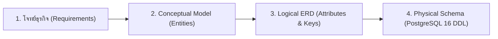
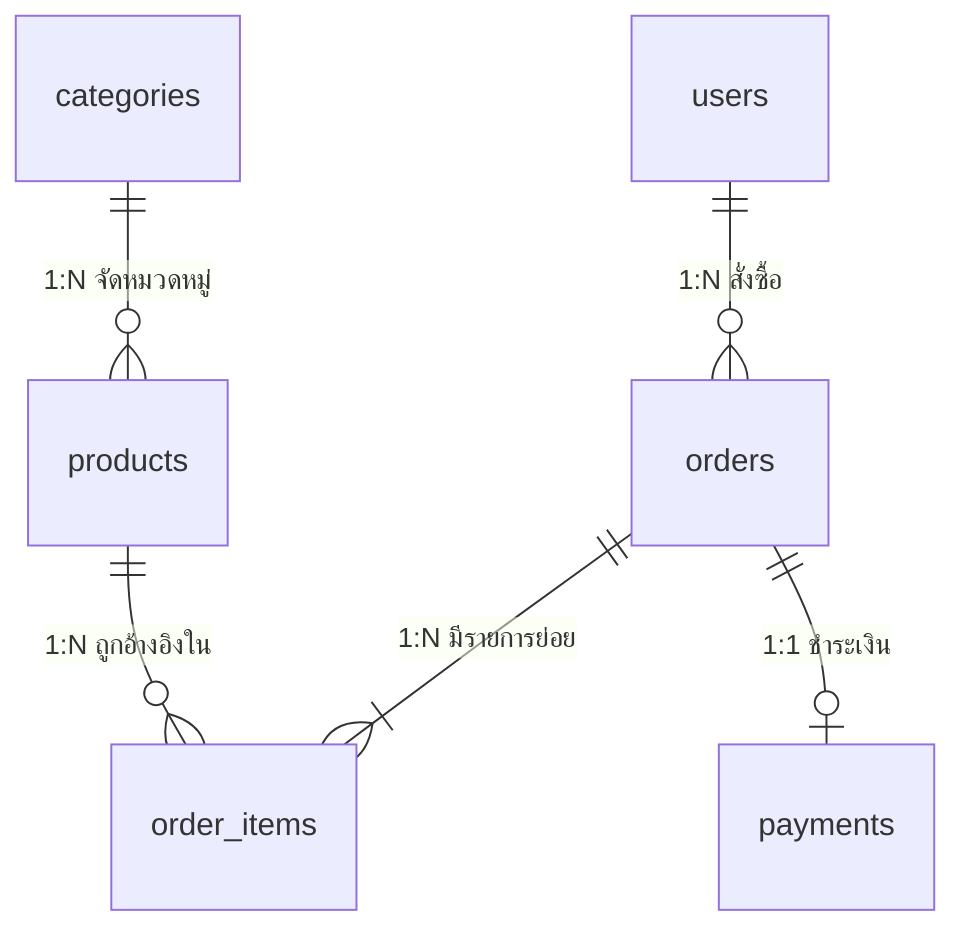
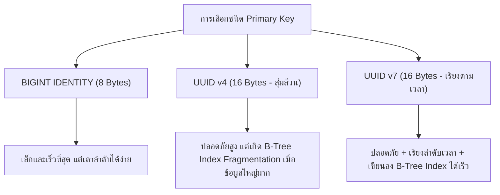
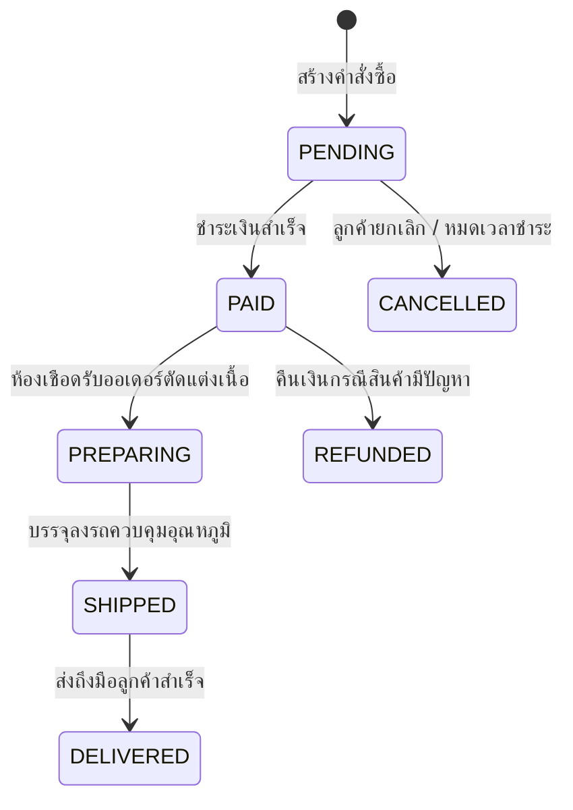
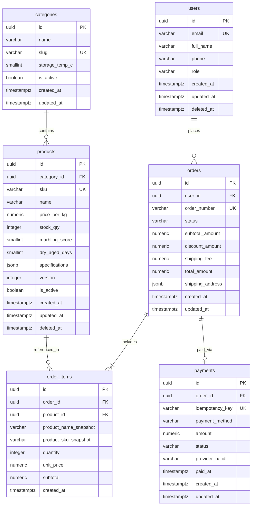

# Database Design

การออกแบบฐานข้อมูล (Database Design) คือรากฐานที่สำคัญที่สุดของสถาปัตยกรรมซอฟต์แวร์ โครงสร้างตารางที่ออกแบบมาอย่างดีจะช่วยให้คิวรีทำงานได้รวดเร็ว รักษาความถูกต้องของข้อมูล (Data Integrity) ในระดับ Engine ป้องกันข้อมูลขยะหรือยอดเงินคลาดเคลื่อน และรองรับการขยายตัวของธุรกิจในระยะยาวโดยไม่ต้องรื้อระบบใหม่ เอกสารฉบับนี้จะพาเจาะลึกกระบวนการออกแบบฐานข้อมูลระดับ Production บน PostgreSQL 16 ผ่านกรณีศึกษาแพลตฟอร์ม **Smart Butcher Marketplace** (ระบบอีคอมเมิร์ซจำหน่ายเนื้อพรีเมียมและเนื้อดรายเอจออนไลน์)

| หมวดหมู่เนื้อหา | หัวข้อหลักในหน้านี้ | เป้าหมายการเรียนรู้ |
| :--- | :--- | :--- |
| **1. การวิเคราะห์และจำลองข้อมูล** | กระบวนการออกแบบจากโจทย์ธุรกิจสู่ ER Diagram และโครงสร้างตาราง | แปลง Requirement เป็น Entities, Attributes และ Physical Tables |
| **2. ความสัมพันธ์เชิงโครงสร้าง** | ความสัมพันธ์ของข้อมูล (1-1, 1-N, M-N พร้อม Junction Table) | ออกแบบ Foreign Keys, Referential Actions และตารางเชื่อมความสัมพันธ์ |
| **3. การจัดระเบียบข้อมูล** | Normalization (1NF ถึง 3NF) และจังหวะที่ควรทำ Denormalization | ลดความซ้ำซ้อนของข้อมูล และตัดสินใจ Trade-off เพื่อความเร็วในการอ่าน |
| **4. คีย์หลักและมาตรฐานชื่อ** | การเลือก Primary Key (Auto-increment/Identity vs UUID v4/v7) และมาตรฐานการตั้งชื่อ | เลือกชนิดคีย์หลักที่เหมาะสมกับ Index และกำหนด Naming Conventions |
| **5. ข้อมูลธุรกรรมและสถานะ** | การเก็บข้อมูลการเงิน, Snapshot ราคาในออเดอร์ และ State Machine ของสถานะ | ป้องกันความคลาดเคลื่อนทางการเงินและควบคุมลำดับการเปลี่ยนสถานะออเดอร์ |
| **6. การรักษาประวัติและตรวจสอบ** | Soft Delete, Timestamps (created_at/updated_at) และ Audit Log | จัดการการลบข้อมูลอย่างปลอดภัยและบันทึกร่องรอยการแก้ไขระดับตาราง |
| **7. พิมพ์เขียวใช้งานจริง** | พิมพ์เขียว Schema ระบบ Smart Butcher Marketplace ฉบับสมบูรณ์ | โครงสร้าง SQL DDL และ Prisma Schema ครบวงจรสำหรับระบบ Production |

<Callout type="tip" title="หัวใจของการออกแบบฐานข้อมูลระดับ Enterprise">
หลักการสำคัญที่สุดของการออกแบบ Relational Database คือการบังคับใช้กฎความถูกต้องของข้อมูล (Constraints) ที่ชั้นฐานข้อมูลเสมอ ไม่ควรหวังพึ่งการตรวจสอบจากโค้ดฝั่ง Application เพียงอย่างเดียว เพราะแอปพลิเคชันอาจมีบั๊กหรือมีหลายบริการที่เขียนข้อมูลลงฐานข้อมูลเดียวกัน แต่กฎใน PostgreSQL จะทำหน้าที่เป็นปราการด่านสุดท้ายที่ไม่มีวันยอมให้ข้อมูลผิดพลาดหลุดรอดเข้าไปได้
</Callout>

---

## 1. กระบวนการออกแบบจากโจทย์ธุรกิจสู่ ER Diagram และโครงสร้างตาราง

### แนวคิด (Concept)
การออกแบบฐานข้อมูลไม่ได้เริ่มต้นจากการเปิดโปรแกรมเขียนคำสั่ง `CREATE TABLE` ทันที แต่ต้องเริ่มจากการทำความเข้าใจโจทย์ธุรกิจ (Business Requirements) แล้วสกัดออกมาเป็นคำนามสำคัญซึ่งแทน **Entities** (สิ่งของหรือบุคคลที่เราต้องการเก็บข้อมูล) และคุณลักษณะของสิ่งนั้นซึ่งแทน **Attributes** โดยแบ่งขั้นตอนการออกแบบออกเป็น 3 ระดับ ได้แก่
1. **Conceptual Design:** การระบุว่าธุรกิจมีองค์ประกอบหลักอะไรบ้างและเกี่ยวข้องกันอย่างไร เช่น ลูกค้าสั่งซื้อสินค้าเนื้อวัว ซึ่งสินค้าอยู่ในหมวดหมู่เนื้อพรีเมียม
2. **Logical Design:** การกำหนดโครงสร้างรายละเอียดของแต่ละ Entity ว่ามีฟิลด์อะไรบ้าง คีย์หลักคืออะไร และเชื่อมโยงกันด้วยคีย์นอก (Foreign Key) แบบใด โดยยังไม่ยึดติดกับระบบฐานข้อมูลตัวใดตัวหนึ่ง
3. **Physical Design:** การแปลง Logical Model ให้กลายเป็นโค้ด SQL DDL สำหรับ PostgreSQL 16 โดยระบุชนิดข้อมูลที่แม่นยำ (เช่น `UUID`, `NUMERIC(12,2)`, `TIMESTAMPTZ`) กำหนด `CHECK` constraints และวางแผนสร้าง Indexes



### หลักการเบื้องหลัง (Under the Hood)
เมื่อเรารันคำสั่งสร้างตารางใน PostgreSQL 16 ตัว Database Engine จะนำโครงสร้าง Physical Schema ไปบันทึกไว้ใน System Catalogs เช่น `pg_class` (เก็บข้อมูลตารางและ Index), `pg_attribute` (เก็บข้อมูลคอลัมน์และชนิดข้อมูล) และ `pg_constraint` (เก็บกฎ `PRIMARY KEY`, `FOREIGN KEY`, `UNIQUE`, `CHECK`)

ในระดับการจัดเก็บข้อมูลจริงบนดิสก์ (Storage Layout) PostgreSQL จะจัดเก็บแถวข้อมูล (เรียกว่า Heap Tuples) ลงในบล็อกขนาด 8KB (Pages) การออกแบบคอลัมน์ให้มีชนิดข้อมูลที่กระชับและตรงตามความเป็นจริง เช่น การใช้ `INTEGER` หรือ `SMALLINT` แทนการใช้ `VARCHAR` เก็บตัวเลข หรือการกำหนด `NOT NULL` ให้ชัดเจน จะช่วยให้ PostgreSQL คำนวณขนาดพื้นที่จัดเก็บ (Tuple Header & Data Alignment) ได้อย่างมีประสิทธิภาพ ลดขนาดตาราง และทำให้ดึงข้อมูลขึ้นมาพักบนหน่วยความจำ (`shared_buffers`) ได้มากขึ้น

### ตัวอย่างโค้ด (Smart Butcher Marketplace)

#### ตัวอย่างที่ 1: การแปลงโจทย์หมวดหมู่และสินค้าเนื้อพรีเมียมเป็นตารางพื้นฐาน
โจทย์ระบุว่า ร้าน Smart Butcher ต้องจัดหมวดหมู่เนื้อสัตว์ (`categories`) และเก็บรายการสินค้าเนื้อ (`products`) ที่ระบุรหัสสินค้า ราคาต่อกิโลกรัม และจำนวนสต็อกที่ไม่ติดลบ:

```sql filename="sql/01_conceptual_to_physical_basic.sql"
-- ตารางหมวดหมู่เนื้อสัตว์ (เช่น Wagyu, Dry-Aged, Iberico Pork)
CREATE TABLE categories (
    id UUID PRIMARY KEY DEFAULT gen_random_uuid(),
    name VARCHAR(100) NOT NULL,
    slug VARCHAR(120) NOT NULL UNIQUE,
    description TEXT,
    is_active BOOLEAN NOT NULL DEFAULT TRUE,
    created_at TIMESTAMPTZ NOT NULL DEFAULT CURRENT_TIMESTAMP
);

-- ตารางสินค้าเนื้อพรีเมียม เชื่อมกับหมวดหมู่และบังคับกฎความถูกต้องของราคาและสต็อก
CREATE TABLE products (
    id UUID PRIMARY KEY DEFAULT gen_random_uuid(),
    category_id UUID NOT NULL REFERENCES categories(id) ON DELETE RESTRICT,
    sku VARCHAR(50) NOT NULL UNIQUE,
    name VARCHAR(200) NOT NULL,
    price_per_kg NUMERIC(10, 2) NOT NULL CHECK (price_per_kg > 0),
    stock_qty INTEGER NOT NULL DEFAULT 0 CHECK (stock_qty >= 0),
    created_at TIMESTAMPTZ NOT NULL DEFAULT CURRENT_TIMESTAMP
);
```

#### ตัวอย่างที่ 2: การออกแบบ Physical Table ขั้นสูงพร้อม Domain Constraints และ Metadata
เมื่อโจทย์ธุรกิจซับซ้อนขึ้น เช่น ต้องเก็บระดับไขมันแทรก (BMS Score 1-12), จำนวนวันดรายเอจ และข้อมูลคุณลักษณะเพิ่มเติมของเนื้อแต่ละล็อต เราสามารถใช้ฟีเจอร์ของ PostgreSQL 16 เพื่อคุมกฎธุรกิจในระดับโครงสร้างตารางได้อย่างรัดกุม:

```sql filename="sql/02_physical_schema_advanced.sql"
-- ตารางสินค้าขั้นสูงที่บังคับกฎธุรกิจของร้านเนื้อพรีเมียมอย่างครบถ้วน
CREATE TABLE products_advanced (
    id UUID PRIMARY KEY DEFAULT gen_random_uuid(),
    category_id UUID NOT NULL REFERENCES categories(id) ON DELETE RESTRICT,
    sku VARCHAR(50) NOT NULL UNIQUE,
    name VARCHAR(200) NOT NULL,
    origin_country CHAR(2) NOT NULL DEFAULT 'JP', -- รหัสประเทศ ISO 3166-1 alpha-2
    marbling_score SMALLINT CHECK (marbling_score BETWEEN 1 AND 12),
    dry_aged_days SMALLINT NOT NULL DEFAULT 0 CHECK (dry_aged_days >= 0),
    weight_grams INTEGER NOT NULL CHECK (weight_grams > 0),
    price_per_kg NUMERIC(10, 2) NOT NULL CHECK (price_per_kg > 0),
    stock_qty INTEGER NOT NULL DEFAULT 0 CHECK (stock_qty >= 0),
    specifications JSONB NOT NULL DEFAULT '{}'::jsonb,
    is_active BOOLEAN NOT NULL DEFAULT TRUE,
    created_at TIMESTAMPTZ NOT NULL DEFAULT CURRENT_TIMESTAMP,
    updated_at TIMESTAMPTZ NOT NULL DEFAULT CURRENT_TIMESTAMP,
    -- กฎระดับตาราง: หากเป็นเนื้อ Dry-Aged ต้องระบุจำนวนวันบ่มอย่างน้อย 14 วันขึ้นไป
    CONSTRAINT chk_dry_aged_minimum_days CHECK (
        dry_aged_days = 0 OR dry_aged_days >= 14
    )
);
```

### ผิด vs ถูก (Anti-pattern vs Best Practice)

| มิติการเปรียบเทียบ | ❌ ผิด (Anti-pattern) | ✅ ถูก (Best Practice) |
| :--- | :--- | :--- |
| **การกำหนดชนิดข้อมูล** | ใช้ `TEXT` หรือ `VARCHAR(255)` กับทุกคอลัมน์แม้แต่ราคาและวันที่ | เลือก Data Type ที่ตรงกับข้อมูลจริง เช่น `NUMERIC(10,2)`, `INTEGER`, `TIMESTAMPTZ` |
| **การบังคับค่าว่าง (Nullability)** | ปล่อยให้คอลัมน์เป็น `NULL` ได้โดยปริยายเพราะกลัวเขียนโปรแกรมติด Error | กำหนด `NOT NULL` เป็นค่าตั้งต้นเสมอ เปิดให้เป็น `NULL` เฉพาะฟิลด์ที่เป็น Optional จริงๆ |
| **การตรวจสอบค่าติดลบ** | เช็ค `if (price > 0)` เฉพาะใน JavaScript/TypeScript ฝั่ง Backend | เช็คทั้งในฝั่ง Application และใส่ `CHECK (price_per_kg > 0)` ในตารางฐานข้อมูล |

### ควรใช้เมื่อไหร่ และ ไม่ควรใช้เมื่อไหร่
- **ควรใช้กระบวนการออกแบบ ER Diagram และ Physical Constraints เต็มรูปแบบเมื่อ:** พัฒนาระบบที่มีความสำคัญต่อธุรกิจ (Core Business Systems) เช่น ระบบ E-Commerce, ระบบจัดการสต็อกสินค้า, ระบบบัญชีและการเงิน ที่ต้องการความถูกต้องของข้อมูลสูงสุด
- **ไม่ควรใช้โครงสร้างตารางที่ซับซ้อนและเต็มไปด้วย Constraints เมื่อ:** สร้างตารางพักข้อมูลชั่วคราวสำหรับนำเข้าข้อมูลดิบ (Staging Tables สำหรับ ETL/ELT Pipeline) หรือตารางเก็บ Raw Logs ความเร็วสูงที่ต้องการรับข้อมูลเข้ามาก่อนแล้วค่อยนำมาทำความสะอาดภายหลัง

### คำถามสัมภาษณ์ (Interview Q&A)
- **Q1: ทำไมเราต้องใส่ `CHECK` constraint และ `NOT NULL` ในฐานข้อมูล ทั้งที่มีการทำ Validation ด้วย DTO/Zod ในฝั่ง Backend (เช่น NestJS) อยู่แล้ว?**
  - **แนวคำตอบ:** เพราะฐานข้อมูลเป็นแหล่งเก็บความจริงเพียงหนึ่งเดียว (Single Source of Truth) ที่มักถูกเข้าถึงจากหลายช่องทาง ไม่ใช่แค่ Backend API ตัวหลักตัวเดียว เช่น อาจมี Worker Service, สคริปต์ Cronjob, การรัน Data Migration หรือแม้แต่ทีมงานรันคำสั่ง SQL แก้ไขข้อมูลโดยตรง หากไม่มี Constraints ที่ระดับฐานข้อมูล บั๊กเพียงจุดเดียวในโค้ดหรือการรันสคริปต์ผิดพลาดจะทำให้เกิดข้อมูลขยะ (Data Corruption) เช่น สต็อกติดลบหรือราคาเป็นศูนย์ทันที
- **Q2: ความแตกต่างระหว่าง Logical ERD กับ Physical ERD คืออะไร?**
  - **แนวคำตอบ:** Logical ERD มุ่งเน้นการอธิบายโครงสร้างความสัมพันธ์ของข้อมูลตามมุมมองธุรกิจ (Entities, Attributes, Relationships) โดยยังไม่ผูกติดกับเอนจินฐานข้อมูลใดๆ ส่วน Physical ERD คือพิมพ์เขียวสำหรับการนำไปสร้างจริงบน DBMS ที่เลือก (เช่น PostgreSQL 16) ซึ่งต้องระบุชื่อตารางจริงแบบ `snake_case`, ชนิดข้อมูลเฉพาะของเอนจิน (เช่น `TIMESTAMPTZ`, `JSONB`), Indexes, Constraints และ Partitioning

---

## 2. ความสัมพันธ์ของข้อมูล (1-1, 1-N, M-N พร้อม Junction Table)

### แนวคิด (Concept)
ในระบบฐานข้อมูลเชิงสัมพันธ์ ข้อมูลแต่ละตารางจะไม่ถูกเก็บแยกขาดจากกัน แต่จะเชื่อมโยงกันด้วยคีย์นอก (**Foreign Key**) โดยแบ่งรูปแบบความสัมพันธ์ออกเป็น 3 รูปแบบหลัก:
1. **One-to-One (1:1):** ข้อมูล 1 แถวในตารางแรก จับคู่กับข้อมูลได้ไม่เกิน 1 แถวในตารางที่สอง เช่น คำสั่งซื้อ 1 รายการ (`orders`) มีรายการชำระเงินหลักที่สำเร็จ (`payments`) เพียง 1 รายการ หรือผู้ใช้ 1 คนมีข้อมูลโปรไฟล์สมาชิก VIP 1 รายการ
2. **One-to-Many (1:N):** ความสัมพันธ์ที่ใช้บ่อยที่สุด ข้อมูล 1 แถวในตารางแม่ เชื่อมโยงกับข้อมูลได้หลายแถวในตารางลูก เช่น หมวดหมู่เนื้อ 1 หมวด (`categories`) มีสินค้าเนื้อ (`products`) ได้หลายชิ้น หรือลูกค้า 1 คน (`users`) สั่งซื้อสินค้า (`orders`) ได้หลายครั้ง
3. **Many-to-Many (M:N):** ข้อมูลหลายแถวในตารางแรก เชื่อมโยงกับข้อมูลหลายแถวในตารางที่สอง เช่น คำสั่งซื้อ 1 ใบ (`orders`) มีสินค้าหลายชิ้น (`products`) และสินค้าเนื้อชนิดเดียวกันก็ถูกสั่งอยู่ในคำสั่งซื้อหลายใบได้ ซึ่งในทางปฏิบัติเราไม่สามารถเชื่อม M:N ตรงๆ ได้ แต่ต้องสร้างตารางกลางที่เรียกว่า **Junction Table** (หรือ Associative Entity) เช่น ตาราง `order_items` มาคั่นกลางเพื่อแปลงเป็นความสัมพันธ์แบบ 1:N สองฝั่ง



### หลักการเบื้องหลัง (Under the Hood)
เมื่อเรากำหนด `FOREIGN KEY` ใน PostgreSQL 16 ระบบจะสร้าง System Trigger ภายใน (Internal RI Triggers) เพื่อคอยตรวจสอบความถูกต้องของการอ้างอิง (Referential Integrity) ทุกครั้งที่มีการ `INSERT`, `UPDATE`, หรือ `DELETE` ทั้งในตารางแม่และตารางลูก

สิ่งสำคัญที่ต้องกำหนดเสมอคือ **Referential Actions (`ON DELETE` และ `ON UPDATE`)**:
- `RESTRICT` หรือ `NO ACTION`: ห้ามลบข้อมูลตารางแม่ หากยังมีข้อมูลในตารางลูกอ้างอิงอยู่ (เหมาะกับข้อมูลสำคัญ เช่น ห้ามลบสินค้าหากเคยถูกสั่งซื้อไปแล้วใน `order_items`)
- `CASCADE`: หากลบข้อมูลตารางแม่ ให้ลบข้อมูลในตารางลูกที่อ้างอิงอยู่ตามไปด้วยอัตโนมัติ (เหมาะกับข้อมูลที่เป็นส่วนประกอบย่อย เช่น ลบออเดอร์ร่างทิ้ง ให้ลบรายการย่อยในตะกร้าตามไปด้วย)
- `SET NULL`: หากลบข้อมูลตารางแม่ ให้เปลี่ยนค่า Foreign Key ในตารางลูกเป็น `NULL`

<Callout type="warning" title="PostgreSQL ไม่สร้าง Index บน Foreign Key ให้อัตโนมัติ">
ต่างจาก Primary Key และ Unique Constraint ที่ PostgreSQL จะสร้าง B-Tree Index ให้ทันที คอลัมน์ที่เป็น Foreign Key จะไม่มี Index สร้างให้อัตโนมัติ ดังนั้นนักพัฒนาต้องเขียนคำสั่งสร้าง Index บนคอลัมน์ Foreign Key เองเสมอ มิฉะนั้นเวลาค้นหาข้อมูลตารางลูกหรือเวลาลบข้อมูลตารางแม่ PostgreSQL จะต้องทำ Sequential Scan กวาดอ่านตารางลูกทั้งตารางจนระบบช้าลงอย่างรุนแรง
</Callout>

### ตัวอย่างโค้ด (Smart Butcher Marketplace)

#### ตัวอย่างที่ 1: การสร้างความสัมพันธ์แบบ 1:N และ 1:1 พร้อมกำหนด Referential Actions
แสดงการเชื่อมโยงระหว่างลูกค้า (`users`), คำสั่งซื้อ (`orders` แบบ 1:N), และการชำระเงิน (`payments` แบบ 1:1 โดยบังคับด้วย `UNIQUE` บนคอลัมน์ `order_id`):

```sql filename="sql/03_relationships_1_to_1_and_1_to_n.sql"
CREATE TABLE users (
    id UUID PRIMARY KEY DEFAULT gen_random_uuid(),
    email VARCHAR(255) NOT NULL UNIQUE,
    full_name VARCHAR(150) NOT NULL,
    phone VARCHAR(20) NOT NULL,
    created_at TIMESTAMPTZ NOT NULL DEFAULT CURRENT_TIMESTAMP
);

-- ความสัมพันธ์ 1:N (ผู้ใช้ 1 คน มีได้หลายออเดอร์)
CREATE TABLE orders (
    id UUID PRIMARY KEY DEFAULT gen_random_uuid(),
    user_id UUID NOT NULL REFERENCES users(id) ON DELETE RESTRICT,
    order_number VARCHAR(30) NOT NULL UNIQUE,
    status VARCHAR(30) NOT NULL DEFAULT 'PENDING',
    total_amount NUMERIC(12, 2) NOT NULL CHECK (total_amount >= 0),
    created_at TIMESTAMPTZ NOT NULL DEFAULT CURRENT_TIMESTAMP
);

-- สร้าง Index บน Foreign Key เสมอ
CREATE INDEX idx_orders_user_id ON orders(user_id);

-- ความสัมพันธ์ 1:1 (ออเดอร์ 1 ใบ มีรายการชำระเงินหลัก 1 รายการ บังคับด้วย UNIQUE ที่ order_id)
CREATE TABLE payments (
    id UUID PRIMARY KEY DEFAULT gen_random_uuid(),
    order_id UUID NOT NULL UNIQUE REFERENCES orders(id) ON DELETE RESTRICT,
    payment_method VARCHAR(50) NOT NULL,
    amount NUMERIC(12, 2) NOT NULL CHECK (amount > 0),
    status VARCHAR(30) NOT NULL DEFAULT 'UNPAID',
    paid_at TIMESTAMPTZ,
    created_at TIMESTAMPTZ NOT NULL DEFAULT CURRENT_TIMESTAMP
);
```

#### ตัวอย่างที่ 2: การออกแบบ Junction Table (`order_items`) สำหรับความสัมพันธ์แบบ M:N
ตาราง `order_items` ทำหน้าที่เชื่อมระหว่าง `orders` และ `products` พร้อมทั้งเก็บ Payload ของความสัมพันธ์นั้น เช่น จำนวนชิ้นที่สั่ง ราคาต่อหน่วย ณ เวลาที่ซื้อ และป้องกันการใส่สินค้าชนิดเดียวกันซ้ำสองแถวในออเดอร์ใบเดิม:

```sql filename="sql/04_junction_table_many_to_many.sql"
CREATE TABLE order_items (
    id UUID PRIMARY KEY DEFAULT gen_random_uuid(),
    order_id UUID NOT NULL REFERENCES orders(id) ON DELETE CASCADE,
    product_id UUID NOT NULL REFERENCES products(id) ON DELETE RESTRICT,
    quantity INTEGER NOT NULL CHECK (quantity > 0),
    unit_price NUMERIC(10, 2) NOT NULL CHECK (unit_price >= 0),
    subtotal NUMERIC(12, 2) GENERATED ALWAYS AS (quantity * unit_price) STORED,
    created_at TIMESTAMPTZ NOT NULL DEFAULT CURRENT_TIMESTAMP,
    -- ป้องกันสินค้าตัวเดียวกันปรากฏซ้ำหลายแถวในออเดอร์เดียวกัน
    CONSTRAINT uq_order_items_order_product UNIQUE (order_id, product_id)
);

-- สร้าง Index สำหรับการ JOIN ย้อนกลับหาสินค้า
CREATE INDEX idx_order_items_product_id ON order_items(product_id);
```

### ผิด vs ถูก (Anti-pattern vs Best Practice)

| มิติการเปรียบเทียบ | ❌ ผิด (Anti-pattern) | ✅ ถูก (Best Practice) |
| :--- | :--- | :--- |
| **การเก็บความสัมพันธ์ M:N** | เก็บรหัสสินค้าเป็น Array หรือ Comma-separated string เช่น `'prod1,prod2,prod3'` ในตาราง `orders` | สร้าง Junction Table (`order_items`) ที่มี Foreign Key ชี้ไปยังทั้งสองตารางอย่างถูกต้อง |
| **การตั้งค่า `ON DELETE`** | ใส่ `ON DELETE CASCADE` ทุกตารางโดยไม่คิด ทำให้เผลอลบหมวดหมู่แล้วประวัติออเดอร์ลูกค้าหายหมด | ใช้ `ON DELETE RESTRICT` กับข้อมูลประวัติธุรกรรมและการเงิน ใช้ `CASCADE` เฉพาะข้อมูลย่อยที่ขึ้นตรงต่อตารางแม่เท่านั้น |
| **การบังคับความสัมพันธ์ 1:1** | สร้างแค่ Foreign Key ปกติโดยไม่ใส่ `UNIQUE` ทำให้ข้อมูลกลายเป็น 1:N โดยไม่ตั้งใจ | กำหนด `UNIQUE` constraint บนคอลัมน์ Foreign Key ในตารางลูกเพื่อบังคับให้เป็น 1:1 แท้จริง |

### ควรใช้เมื่อไหร่ และ ไม่ควรใช้เมื่อไหร่
- **ควรแยกตารางแบบ 1:1 เมื่อ:** ตารางหลักมีคอลัมน์จำนวนมากที่มีขนาดใหญ่ (เช่น ข้อมูลเอกสารรับรองฟาร์มเนื้อวัวแบบละเอียด) ที่ไม่ได้ถูกดึงมาใช้งานบ่อยๆ หรือต้องการแยกสิทธิ์ความปลอดภัย (Security Isolation) ออกจากตารางหลัก
- **ไม่ควรแยกตารางแบบ 1:1 เมื่อ:** ข้อมูลทั้งสองส่วนมีขนาดเล็กและต้องถูกดึงมาแสดงผลพร้อมกันเกือบทุกครั้ง การรวมไว้ในตารางเดียวกันจะช่วยลดภาระการทำ `JOIN` โดยไม่จำเป็น

### คำถามสัมภาษณ์ (Interview Q&A)
- **Q1: ในตาราง Junction Table เช่น `order_items` เราควรใช้ Composite Primary Key `(order_id, product_id)` หรือสร้าง Surrogate Key `id` แยกต่างหาก?**
  - **แนวคำตอบ:** ทำได้ทั้งสองแบบขึ้นอยู่กับบริบทธุรกิจ หากเป็นตารางเชื่อมความสัมพันธ์ล้วนๆ (เช่น `product_tags`) การใช้ Composite PK `(product_id, tag_id)` จะประหยัดพื้นที่และไม่ต้องสร้าง Index ซ้ำซ้อน แต่หากเป็นตารางอย่าง `order_items` ที่ในอนาคตลูกค้าอาจสั่งเนื้อชนิดเดียวกันแต่เลือกความหนาของการหั่นต่างกันในออเดอร์เดียว หรือตารางอื่นต้องอ้างอิงมายังแถวรายการสินค้านี้ (เช่น ตารางเคลมสินค้า `refund_items`) การมี Surrogate Key `id UUID PRIMARY KEY` คู่กับ Unique Constraint ตามเงื่อนไขธุรกิจจะยืดหยุ่นต่อการขยายระบบและใช้งานร่วมกับ ORM เช่น Prisma ได้ง่ายกว่ามาก
- **Q2: เกิดอะไรขึ้นถ้าเราตั้ง `ON DELETE CASCADE` ที่คอลัมน์ `user_id` ในตาราง `orders`?**
  - **แนวคำตอบ:** หากแอดมินหรือระบบสั่งลบข้อมูลผู้ใช้จากตาราง `users` คำสั่งซื้อทั้งหมดในอดีตของผู้ใช้คนนั้นในตาราง `orders` จะถูกลบหายไปทันที ส่งผลให้ยอดขายรวมของบริษัทในรายงานการเงินและภาษีผิดเพี้ยนอย่างร้ายแรง ดังนั้นกับตารางธุรกรรมทางการเงินจึงต้องใช้ `ON DELETE RESTRICT` เสมอ

---

## 3. Normalization (1NF ถึง 3NF) และจังหวะที่ควรทำ Denormalization

### แนวคิด (Concept)
**Normalization** คือกระบวนการจัดระเบียบโครงสร้างตารางเพื่อลดความซ้ำซ้อนของข้อมูล (Data Redundancy) และป้องกันความผิดปกติที่เกิดจากการเพิ่ม ลบ หรือแก้ไขข้อมูล (Update, Insert, and Delete Anomalies) โดยระดับที่ใช้เป็นมาตรฐานในระบบ Production คือ **1NF ถึง 3NF**:
1. **First Normal Form (1NF):** ข้อมูลในแต่ละช่อง (Cell) ต้องเป็นค่าเดี่ยว (Atomic Value) ห้ามเก็บหลายค่าปนกันในช่องเดียว และห้ามสร้างคอลัมน์ซ้ำๆ กัน เช่น `cut_type_1`, `cut_type_2`, `cut_type_3`
2. **Second Normal Form (2NF):** ต้องผ่าน 1NF ก่อน และคอลัมน์ที่ไม่ใช่คีย์หลักต้องขึ้นตรงต่อ Primary Key **ทั้งชุด** (Partial Dependency Elimination) มักพบในตารางที่มี Composite Key เช่น ในตาราง `order_items` ไม่ควรเก็บ `product_origin_country` แบบถาวรเพื่อใช้เป็นแหล่งอ้างอิงหลัก เพราะประเทศต้นกำเนิดขึ้นอยู่กับ `product_id` เพียงอย่างเดียว ไม่ได้ขึ้นอยู่กับ `order_id`
3. **Third Normal Form (3NF):** ต้องผ่าน 2NF ก่อน และคอลัมน์ที่ไม่ใช่คีย์หลักต้องไม่ขึ้นอยู่กับคอลัมน์อื่นที่ไม่ใช่คีย์หลัก (Transitive Dependency Elimination) เช่น ในตาราง `orders` มี `user_id` อยู่แล้ว ไม่ควรเก็บ `user_loyalty_tier_discount_percent` ที่แปรผันตามระดับสมาชิกของผู้ใช้ไว้ในตารางออเดอร์โดยตรง แต่ควรแยกตารางระดับสมาชิกออกไป

ส่วน **Denormalization** คือการจงใจเก็บข้อมูลซ้ำซ้อนหรือรวมข้อมูลบางส่วนเข้าด้วยกันอย่างมีแบบแผน **หลังจากที่เราออกแบบระบบให้เป็น 3NF เรียบร้อยแล้ว** เพื่อแลกกับความเร็วในการอ่านข้อมูล (Read Performance) ลดการทำ `JOIN` ข้ามตารางขนาดใหญ่ หรือเพื่อเก็บประวัติข้อมูล ณ เวลานั้น

### หลักการเบื้องหลัง (Under the Hood)
ในแง่การทำงานของ PostgreSQL 16:
- **ข้อดีของ Normalization (3NF) ต่อการเขียนข้อมูล (Write-heavy):** ข้อมูลแต่ละชิ้นถูกเก็บไว้จุดเดียว เช่น ชื่อหมวดหมู่เนื้อเก็บอยู่ที่ตาราง `categories` เพียงแถวเดียว เมื่อต้องการแก้ไขชื่อหมวดหมู่ PostgreSQL จะแก้ไขเพียง 1 Tuple ใน 1 Page ไม่เกิดการล็อกแถวจำนวนมากในตาราง `products` และไม่สร้าง Dead Tuples จำนวนมหาศาล
- **ต้นทุนของ Normalization ต่อการอ่านข้อมูล (Read-heavy):** เมื่อต้องแสดงหน้า Dashboard สรุปยอดขายที่ต้องดึงข้อมูลจาก 6 ตารางพร้อมกัน Query Planner ต้องทำ Hash Join หรือ Nested Loop Join ข้ามตารางทั้งหมด ซึ่งใช้ทั้ง CPU และ `work_mem`
- **กลไกของ Denormalization:** เมื่อเราเพิ่มคอลัมน์สรุปผล เช่น `total_amount` ไว้ในตาราง `orders` (แทนที่จะคิวรี `SUM(quantity * unit_price)` จาก `order_items` ทุกครั้งที่เปิดดูหน้ารายการคำสั่งซื้อ) จะทำให้การอ่านข้อมูลทำได้ด้วยการอ่านแถวเดียว (Index Scan บนตารางเดียว) แต่ต้องแลกมาด้วยภาระในการรักษาความสอดคล้องของข้อมูล (Consistency) ตอนเขียน

### ตัวอย่างโค้ด (Smart Butcher Marketplace)

#### ตัวอย่างที่ 1: การแก้ปัญหาตารางที่ผิดหลัก 1NF-3NF ให้เป็นโครงสร้าง 3NF ที่ถูกต้อง
เปรียบเทียบตารางที่ออกแบบรวมทุกอย่างไว้ด้วยกันจนเกิดความซ้ำซ้อน กับการแยกตารางตามหลัก 3NF:

```sql filename="sql/05_normalization_1nf_to_3nf.sql"
-- ❌ โครงสร้างที่ผิดหลัก 1NF, 2NF และ 3NF:
-- เก็บรายการสินค้าหลายชิ้นในช่องเดียว และเก็บชื่อหมวดหมู่ซ้ำซ้อนในทุกสินค้า
/*
CREATE TABLE bad_product_catalog (
    product_sku VARCHAR(50) PRIMARY KEY,
    product_name VARCHAR(200),
    available_weights_grams VARCHAR(100), -- ผิด 1NF: '200,300,500'
    category_code VARCHAR(30),
    category_name VARCHAR(100),           -- ผิด 3NF: ขึ้นอยู่กับ category_code ไม่ใช่ product_sku
    category_storage_temp_c SMALLINT      -- ผิด 3NF: อุณหภูมิห้องเย็นขึ้นอยู่กับหมวดหมู่
);
*/

-- ✅ โครงสร้างที่ถูกต้องตามหลัก 3NF:
CREATE TABLE storage_categories (
    id UUID PRIMARY KEY DEFAULT gen_random_uuid(),
    code VARCHAR(30) NOT NULL UNIQUE,
    name VARCHAR(100) NOT NULL,
    storage_temp_celsius SMALLINT NOT NULL -- แก้ไขที่เดียว มีผลกับสินค้าทุกชิ้นในหมวดนี้ทันที
);

CREATE TABLE normalized_products (
    id UUID PRIMARY KEY DEFAULT gen_random_uuid(),
    category_id UUID NOT NULL REFERENCES storage_categories(id) ON DELETE RESTRICT,
    sku VARCHAR(50) NOT NULL UNIQUE,
    name VARCHAR(200) NOT NULL,
    price_per_kg NUMERIC(10, 2) NOT NULL CHECK (price_per_kg > 0)
);

-- แยกตัวเลือกน้ำหนักการตัดแบ่งออกมาเป็นตารางย่อยเพื่อให้ผ่าน 1NF
CREATE TABLE product_weight_options (
    id UUID PRIMARY KEY DEFAULT gen_random_uuid(),
    product_id UUID NOT NULL REFERENCES normalized_products(id) ON DELETE CASCADE,
    weight_grams INTEGER NOT NULL CHECK (weight_grams > 0),
    UNIQUE (product_id, weight_grams)
);
```

#### ตัวอย่างที่ 2: การทำ Denormalization อย่างปลอดภัยด้วย Trigger และ Materialized View
ในระบบ Smart Butcher การแสดงหน้ารายการคำสั่งซื้อต้องการเห็นยอดรวม `total_amount` และจำนวนชิ้นรวม `total_items_count` ทันทีโดยไม่ต้อง `JOIN` และ `SUM` จาก `order_items` ทุกครั้ง เราสามารถทำ Denormalization บนตาราง `orders` หรือใช้ Materialized View สำหรับงานรายงาน:

```sql filename="sql/06_controlled_denormalization.sql"
-- เพิ่มคอลัมน์ Denormalized บนตาราง orders เพื่อให้อ่านหน้ารายการคำสั่งซื้อได้เร็วที่สุด
ALTER TABLE orders
ADD COLUMN items_count INTEGER NOT NULL DEFAULT 0 CHECK (items_count >= 0);

-- สร้าง Trigger Function เพื่ออัปเดตยอดรวมและจำนวนชิ้นในตาราง orders อัตโนมัติเมื่อ order_items เปลี่ยนแปลง
CREATE OR REPLACE FUNCTION sync_order_summary()
RETURNS TRIGGER AS $$
DECLARE
    target_order_id UUID;
BEGIN
    target_order_id := COALESCE(NEW.order_id, OLD.order_id);

    UPDATE orders
    SET 
        total_amount = COALESCE((
            SELECT SUM(subtotal) FROM order_items WHERE order_id = target_order_id
        ), 0.00),
        items_count = COALESCE((
            SELECT SUM(quantity) FROM order_items WHERE order_id = target_order_id
        ), 0)
    WHERE id = target_order_id;

    RETURN NULL;
END;
$$ LANGUAGE plpgsql;

CREATE TRIGGER trg_sync_order_summary
AFTER INSERT OR UPDATE OR DELETE ON order_items
FOR EACH ROW EXECUTE FUNCTION sync_order_summary();
```

### ผิด vs ถูก (Anti-pattern vs Best Practice)

| มิติการเปรียบเทียบ | ❌ ผิด (Anti-pattern) | ✅ ถูก (Best Practice) |
| :--- | :--- | :--- |
| **ลำดับการออกแบบ** | ทำ Denormalization ตั้งแต่วันแรกเพราะกลัวการ `JOIN` จะช้า ทั้งที่ข้อมูลยังมีแค่หลักพันแถว | ออกแบบให้เป็น 3NF เป็นมาตรฐานตั้งต้นเสมอ แล้วค่อยทำ Denormalization เฉพาะจุดที่พิสูจน์แล้วว่าเป็นคอขวด |
| **การอัปเดตข้อมูลที่ Denormalize** | ปล่อยให้โค้ดหน้าบ้านหรือ API หลายจุดต่างคนต่างบวกลบค่าสรุปเองจนข้อมูลไม่ตรงกัน | ควบคุมการอัปเดตภายใน Database Transaction เดียวกัน หรือใช้ Database Trigger / Materialized View |
| **การใช้ JSONB แทนตาราง** | ยัดโครงสร้างข้อมูลสำคัญที่ต้องทำ Foreign Key และการค้นหาซับซ้อนลงในคอลัมน์ `JSONB` ก้อนเดียว | ใช้คอลัมน์ปกติสำหรับโครงสร้างหลัก และใช้ `JSONB` เฉพาะข้อมูลคุณลักษณะเสริมที่ยืดหยุ่น (เช่น `specifications`) |

### ควรใช้เมื่อไหร่ และ ไม่ควรใช้เมื่อไหร่
- **ควรยึดหลัก Normalization (3NF) เมื่อ:** ข้อมูลนั้นมีการแก้ไขเปลี่ยนแปลงบ่อย ต้องการความถูกต้องแม่นยำสูง และไม่ต้องการให้เกิดความขัดแย้งกันของข้อมูลในระบบ
- **ควรทำ Denormalization เมื่อ:** ระบบมีสัดส่วนการอ่านสูงกว่าการเขียนอย่างมาก (Read-to-Write ratio สูง) และคิวรีการ `JOIN` หรือ `GROUP BY` เริ่มกินเวลานานแม้จะสร้าง Index อย่างเหมาะสมแล้ว หรือเมื่อต้องการเก็บค่าประวัติ ณ เวลาที่เกิดรายการ (Historical Snapshot)

### คำถามสัมภาษณ์ (Interview Q&A)
- **Q1: "การ JOIN ใน Relational Database ทำให้ระบบช้า เราจึงควรรวมทุกตารางเข้าด้วยกันตั้งแต่แรก" คุณเห็นด้วยกับคำกล่าวนี้หรือไม่ เพราะเหตุใด?**
  - **แนวคำตอบ:** ไม่เห็นด้วยอย่างยิ่ง ใน PostgreSQL 16 การ `JOIN` ตารางที่ผ่านการทำ Normalization และมี B-Tree Index บน Primary Key กับ Foreign Key อย่างถูกต้องสามารถประมวลผลข้อมูลหลักแสนถึงหลักล้านแถวได้ในเวลาเพียงไม่กี่มิลลิวินาที การรวมทุกตารางเข้าด้วยกันตั้งแต่แรกจะทำให้แถวข้อมูลมีขนาดใหญ่เกินความจำเป็น (เปลือง I/O และ Buffer Cache) และทำให้เกิดปัญหา Update Anomaly ร้ายแรงเมื่อข้อมูลมีการเปลี่ยนแปลง
- **Q2: หากต้องทำระบบ Dashboard รายงานยอดขายรายวันของเนื้อแต่ละหมวดหมู่ ซึ่งคิวรีจริงใช้เวลา 3 วินาที คุณจะแก้ปัญหานี้ด้วยแนวคิด Denormalization อย่างไรโดยไม่กระทบโครงสร้างตารางหลัก?**
  - **แนวคำตอบ:** ใช้ฟีเจอร์ **Materialized View** ของ PostgreSQL เพื่อบันทึกผลลัพธ์ของการ `JOIN` และ `SUM` ลงบนดิสก์เสมือนเป็นตารางสรุปพร้อมสร้าง Index กำกับ แล้วตั้งเวลาสั่ง `REFRESH MATERIALIZED VIEW CONCURRENTLY` เป็นระยะ (เช่น ทุก 5 หรือ 15 นาที) วิธีนี้ช่วยให้หน้า Dashboard อ่านข้อมูลได้ในระดับมิลลิวินาทีโดยที่ตารางธุรกรรมหลักยังคงเป็น 3NF บริสุทธิ์

---

## 4. การเลือก Primary Key (Auto-increment/Identity vs UUID v4/v7) และมาตรฐานการตั้งชื่อ

### แนวคิด (Concept)
**Primary Key (PK)** คือตัวระบุความไม่ซ้ำกันของแต่ละแถวในตาราง การเลือกชนิดของ Primary Key ส่งผลกระทบโดยตรงต่อทั้งความปลอดภัยของ API, ขนาดของดัชนี (Index Size), และประสิทธิภาพการเขียนข้อมูลลงดิสก์ โดยตัวเลือกหลักในยุคปัจจุบันมี 3 รูปแบบ:
1. **BIGINT GENERATED ALWAYS AS IDENTITY (Auto-increment ยุคใหม่):** ตัวเลขเรียงลำดับ `1, 2, 3, ...` ขนาด 8 Bytes (มาตรฐาน SQL ที่เข้ามาแทนที่ `SERIAL` แบบเดิม)
2. **UUID v4 (`gen_random_uuid()`):** รหัสสุ่มขนาด 16 Bytes (128-bit) เช่น `f47ac10b-58cc-4372-a567-0e02b2c3d479` ที่คาดเดาไม่ได้และสร้างจากฝั่ง Application ได้เลยโดยไม่ชนกัน
3. **UUID v7 (Time-ordered UUID):** มาตรฐาน UUID ยุคใหม่ขนาด 16 Bytes ที่นำค่าเวลา **Unix Timestamp ระดับมิลลิวินาที (48 bits แรก)** มาไว้ข้างหน้า ตามด้วยค่าสุ่ม ทำให้ได้ทั้งความปลอดภัยแบบ UUID และการเรียงลำดับตามเวลาเหมือน Auto-increment



### หลักการเบื้องหลัง (Under the Hood)
ทุกครั้งที่มีการสร้าง Primary Key ระบบ PostgreSQL จะสร้าง **B-Tree Index** ให้โดยอัตโนมัติเพื่อรักษาความไม่ซ้ำและใช้ค้นหาแถวอย่างรวดเร็ว:
- **กรณีใช้ `BIGINT IDENTITY` หรือ `UUID v7`:** เนื่องจากค่าคีย์ที่สร้างใหม่จะมีค่ามากกว่าคีย์เดิมเสมอ (Monotonically Increasing) PostgreSQL จึงนำค่าใหม่ไปต่อท้ายที่ใบขวาสุด (Right-most Leaf Page) ของโครงสร้าง B-Tree เสมอ ทำให้เขียนข้อมูลลงหน่วยความจำและดิสก์ได้เร็วมาก และบล็อกข้อมูลถูกใช้งานเต็มความจุ
- **กรณีใช้ `UUID v4` (แบบสุ่มล้วน):** เมื่อตารางมีขนาดใหญ่ระดับหลายล้านแถว ค่า UUID ใหม่ที่สุ่มขึ้นมาจะกระจายตัวไปแทรกตามจุดต่างๆ ทั่วทั้งต้นไม้ B-Tree ส่งผลให้ PostgreSQL ต้องดึง Index Pages จากดิสก์ขึ้นมาแก้ไขกระจายไปทั่ว (Random I/O) และเกิดปรากฏการณ์ **Page Splits** บ่อยครั้ง ทำให้ Index บวม (Index Bloat) และประสิทธิภาพการ `INSERT` ลดลงเมื่อตารางมีขนาดใหญ่มาก

#### ตารางเปรียบเทียบชนิด Primary Key เชิงลึก

| คุณสมบัติ | `BIGINT IDENTITY` | `UUID v4` | `UUID v7` |
| :--- | :--- | :--- | :--- |
| **ขนาดพื้นที่จัดเก็บ** | 8 Bytes | 16 Bytes | 16 Bytes |
| **ความปลอดภัยเมื่อแสดงบน URL** | ต่ำ (เกิด Enumeration Attack เดาจำนวนออเดอร์คู่แข่งได้) | สูงมาก (สุ่มสมบูรณ์ เดาไม่ได้) | สูง (ส่วนท้ายเป็นค่าสุ่ม 74 bits เดาไม่ได้) |
| **ประสิทธิภาพการ INSERT (B-Tree)** | **เร็วที่สุด** (ต่อท้ายเสมอ) | ช้าลงเมื่อตารางใหญ่เกินหลายล้านแถว (Random Page Splits) | **เร็วมาก** (เรียงตามเวลา ต่อท้าย B-Tree เสมอ) |
| **การสร้าง ID จากฝั่ง App/ 분산** | ไม่ได้ (ต้องรอ Database แจกเลข) | ทำได้ทันที | ทำได้ทันที (ทั้งใน App หรือ DB Function) |

#### มาตรฐานการตั้งชื่อ (PostgreSQL Naming Conventions)
1. **ใช้ `snake_case` ตัวพิมพ์เล็กทั้งหมด:** เช่น `order_items`, `price_per_kg` เพื่อหลีกเลี่ยงการต้องใส่เครื่องหมาย Double Quotes (`"OrderItems"`) เวลาเขียนคิวรีใน PostgreSQL
2. **ชื่อตารางใช้คำนามพหูพจน์ (Plural Nouns):** เช่น `users`, `products`, `categories`, `orders`, `order_items`, `payments`
3. **ชื่อคอลัมน์ Foreign Key:** ใช้ชื่อตารางแม่ในรูปเอกพจน์ตามด้วย `_id` เช่น `user_id`, `category_id`, `product_id`
4. **ชื่อคอลัมน์ Boolean:** ขึ้นต้นด้วยกริยาช่วย `is_`, `has_`, หรือ `can_` เช่น `is_active`, `is_verified`, `has_bone`
5. **ชื่อคอลัมน์วันเวลา:** ลงท้ายด้วย `_at` สำหรับ Timestamp (เช่น `created_at`, `paid_at`) และลงท้ายด้วย `_date` สำหรับ Date ล้วน

### ตัวอย่างโค้ด (Smart Butcher Marketplace)

#### ตัวอย่างที่ 1: การใช้ `GENERATED ALWAYS AS IDENTITY` และมาตรฐานการตั้งชื่อที่ถูกต้อง
สำหรับตารางอ้างอิงภายในหรือตารางลำดับคิวการตัดแต่งเนื้อที่ต้องการตัวเลขเรียงลำดับขนาดเล็ก:

```sql filename="sql/07_identity_and_naming_conventions.sql"
-- ใช้ GENERATED ALWAYS AS IDENTITY แทน SERIAL แบบเก่าตามมาตรฐาน SQL
CREATE TABLE butcher_stations (
    id BIGINT GENERATED ALWAYS AS IDENTITY PRIMARY KEY,
    station_code VARCHAR(20) NOT NULL UNIQUE,
    station_name VARCHAR(100) NOT NULL,
    max_daily_capacity_kg NUMERIC(8, 2) NOT NULL CHECK (max_daily_capacity_kg > 0),
    is_operational BOOLEAN NOT NULL DEFAULT TRUE,
    created_at TIMESTAMPTZ NOT NULL DEFAULT CURRENT_TIMESTAMP
);
```

#### ตัวอย่างที่ 2: การสร้างฟังก์ชัน `uuid_generate_v7()` บน PostgreSQL 16 สำหรับตารางขนาดใหญ่
เพื่อให้ตารางธุรกรรมหลักอย่าง `orders` และ `order_items` ได้รับประโยชน์ทั้งความปลอดภัยของ UUID และความเร็วในการเรียงลำดับ B-Tree Index แบบ Time-ordered:

```sql filename="sql/08_uuid_v7_implementation.sql"
CREATE EXTENSION IF NOT EXISTS pgcrypto;

-- ฟังก์ชันสร้าง UUID v7 (Time-ordered UUID ตามมาตรฐาน RFC 9562) บน PostgreSQL 16
CREATE OR REPLACE FUNCTION uuid_generate_v7()
RETURNS UUID AS $$
DECLARE
    unix_ts_ms BYTEA;
    uuid_bytes BYTEA;
BEGIN
    -- ดึงเวลาปัจจุบันระดับมิลลิวินาที (48 bits / 6 bytes)
    unix_ts_ms := substring(int8send(floor(extract(epoch FROM clock_timestamp()) * 1000)::bigint) FROM 3 FOR 6);
    -- สร้าง bytes สุ่ม 10 bytes แล้วนำมารวมกับเวลา 6 bytes แรก
    uuid_bytes := unix_ts_ms || gen_random_bytes(10);
    -- ตั้งค่า Version 7 (0111) ที่ byte ลำดับที่ 6
    uuid_bytes := set_byte(uuid_bytes, 6, (b'0111' || get_byte(uuid_bytes, 6)::bit(4))::bit(8)::int);
    -- ตั้งค่า Variant (10) ที่ byte ลำดับที่ 8
    uuid_bytes := set_byte(uuid_bytes, 8, (b'10' || get_byte(uuid_bytes, 8)::bit(6))::bit(8)::int);

    RETURN encode(uuid_bytes, 'hex')::uuid;
END;
$$ LANGUAGE plpgsql VOLATILE;

-- นำ UUID v7 ไปใช้เป็นค่าเริ่มต้นของตารางคำสั่งซื้อ
CREATE TABLE high_volume_orders (
    id UUID PRIMARY KEY DEFAULT uuid_generate_v7(),
    user_id UUID NOT NULL REFERENCES users(id) ON DELETE RESTRICT,
    order_number VARCHAR(30) NOT NULL UNIQUE,
    total_amount NUMERIC(12, 2) NOT NULL CHECK (total_amount >= 0),
    created_at TIMESTAMPTZ NOT NULL DEFAULT CURRENT_TIMESTAMP
);
```

### ผิด vs ถูก (Anti-pattern vs Best Practice)

| มิติการเปรียบเทียบ | ❌ ผิด (Anti-pattern) | ✅ ถูก (Best Practice) |
| :--- | :--- | :--- |
| **การตั้งชื่อตารางและคอลัมน์** | ใช้ `camelCase` หรือ `PascalCase` เช่น `"OrderItems"`, `"unitPrice"` ทำให้ต้องใส่ `""` ตลอดเวลาใน SQL | ใช้ `snake_case` ตัวพิมพ์เล็กทั้งหมด เช่น `order_items`, `unit_price` (ใน Prisma ค่อยใช้ `@map` และ `@@map` ช่วย) |
| **การเก็บค่า UUID** | เก็บ UUID ลงในคอลัมน์ `VARCHAR(36)` หรือ `TEXT` ซึ่งกินพื้นที่ถึง 37 Bytes และเปรียบเทียบช้า | ใช้ชนิดข้อมูล `UUID` แท้ของ PostgreSQL ซึ่งจัดเก็บเป็น Binary ขนาดเพียง 16 Bytes เสมอ |
| **การเปิดเผย Auto-increment ID** | นำ `id` ที่เป็นตัวเลขเรียง `1001, 1002` ไปแสดงบน URL สาธารณะ เช่น `/api/orders/1002` | ใช้ `UUID` (v4 หรือ v7) สำหรับทรัพยากรที่ต้องอ้างอิงผ่าน API สาธารณะควบคู่กับรหัสอ้างอิงธุรกิจเช่น `order_number` |

### ควรใช้เมื่อไหร่ และ ไม่ควรใช้เมื่อไหร่
- **ควรใช้ `UUID v7` (หรือ `UUID v4` สำหรับตารางขนาดทั่วไป) เมื่อ:** ตารางนั้นเป็นทรัพยากรหลักที่ต้องส่ง ID ออกไปให้ Frontend/Mobile App ใช้งานผ่าน API หรือระบบมีสถาปัตยกรรมแบบกระจายตัว (Distributed Systems)
- **ควรใช้ `BIGINT GENERATED ALWAYS AS IDENTITY` เมื่อ:** เป็นตารางภายในที่ไม่เปิดเผย ID ออกสู่สาธารณะ หรือเป็นตารางเก็บข้อมูลปริมาณมหาศาลระดับร้อยล้านแถวขึ้นไป (เช่น ตาราง Audit Logs หรือ Sensor Logs ห้องเย็น) ที่ต้องการประหยัดพื้นที่ RAM และขนาดของ Index ให้เล็กที่สุด

### คำถามสัมภาษณ์ (Interview Q&A)
- **Q1: ทำไมใน PostgreSQL ยุคใหม่จึงแนะนำให้ใช้ `GENERATED ALWAYS AS IDENTITY` แทนการใช้ `SERIAL` หรือ `BIGSERIAL`?**
  - **แนวคำตอบ:** คำสั่ง `SERIAL` เป็นคำสั่งเฉพาะของ PostgreSQL ยุคเก่าที่ไม่ใช่มาตรฐาน ANSI SQL และมีข้อเสียคือผู้ใช้สามารถเผลอ `INSERT` ตัวเลขระบุค่า `id` ทับเข้าไปตรงๆ ได้ ส่งผลให้ค่า Sequence ลำดับถัดไปชนกับค่าที่เพิ่งใส่เข้าไปและเกิด Error `duplicate key value violates unique constraint` ในภายหลัง ในขณะที่ `GENERATED ALWAYS AS IDENTITY` เป็นมาตรฐาน SQL ที่ป้องกันไม่ให้ใครระบุค่า `id` เองโดยพลการ และจัดการสิทธิ์ของ Sequence ผูกกับตารางให้อัตโนมัติ
- **Q2: UUID v7 แก้ปัญหาคอขวดของ UUID v4 ในฐานข้อมูลอย่างไร?**
  - **แนวคำตอบ:** UUID v4 เป็นค่าสุ่มทั้งหมด ทำให้เวลา `INSERT` แถวใหม่ลงใน B-Tree Index ข้อมูลจะกระจายไปแทรกตามบล็อกต่างๆ แบบสุ่ม (Random I/O) เกิดการแตกบล็อก (Page Splits) และทำให้ Buffer Cache ไม่สามารถเก็บหน้า Index ที่ใช้งานบ่อยไว้ใน RAM ได้อย่างคุ้มค่า ส่วน UUID v7 มีส่วนหัว 48 บิตแรกเป็น Timestamp เรียงตามเวลา ทำให้ค่าที่สร้างใหม่มีค่ามากกว่าค่าเก่าเสมอ การ `INSERT` จึงเป็นการต่อท้ายที่หน้าขวาสุดของ B-Tree เหมือนกับ Auto-increment ลด I/O ลงอย่างมหาศาล

---

## 5. การเก็บข้อมูลการเงิน, Snapshot ราคาในออเดอร์ และ State Machine ของสถานะ

### แนวคิด (Concept)
ในการออกแบบระบบอีคอมเมิร์ซและการเงินของ **Smart Butcher Marketplace** มีกติกาทองคำ 3 ข้อที่ห้ามละเมิดเด็ดขาด:
1. **ความแม่นยำของตัวเลขการเงิน (Exact Numeric Representation):** ห้ามใช้ชนิดข้อมูลทศนิยมแบบเลขลอยตัว (`FLOAT`, `REAL`, `DOUBLE PRECISION`) เก็บจำนวนเงินหรือน้ำหนักสินค้าเด็ดขาด เพราะคอมพิวเตอร์เก็บค่าแบบ Binary Floating-Point (IEEE 754) ซึ่งทำให้ `0.1 + 0.2` ได้ผลลัพธ์เป็น `0.30000000000000004` ต้องใช้ชนิดข้อมูล **`NUMERIC(precision, scale)`** (หรือ `DECIMAL`) หรือเก็บเป็นหน่วยย่อยสุดแบบจำนวนเต็ม `BIGINT` (เช่น สตางค์) เท่านั้น
2. **การทำ Snapshot ราคาและข้อมูลสินค้าในออเดอร์ (Historical Order Snapshot):** ราคาเนื้อวากิวในตาราง `products` วันนี้อาจอยู่ที่กิโลกรัมละ 4,500 บาท แต่วันพรุ่งนี้ร้านค้าอาจปรับราคาขึ้นเป็น 5,200 บาท หรือเปลี่ยนชื่อสินค้า หากตาราง `order_items` เก็บแค่ `product_id` แล้วไปดึงราคาจากตาราง `products` มาคำนวณย้อนหลัง ใบเสร็จของลูกค้าที่ซื้อไปเมื่อวานจะเปลี่ยนยอดเงินทันที! ดังนั้นต้องบันทึก **Snapshot** ของราคาต่อหน่วย (`unit_price`) และชื่อสินค้า ณ วินาทีที่สั่งซื้อลงในตาราง `order_items` เสมอ
3. **การควบคุมสถานะด้วย State Machine:** สถานะของคำสั่งซื้อ (`orders.status`) และการชำระเงิน (`payments.status`) ต้องมีทิศทางการเปลี่ยนสถานะที่ชัดเจนและจำกัด เช่น ออเดอร์ที่เป็น `CANCELLED` แล้ว ห้ามเปลี่ยนกลับเป็น `PAID` หรือ `SHIPPED` ได้อีก



### หลักการเบื้องหลัง (Under the Hood)
ใน PostgreSQL 16 ชนิดข้อมูล `NUMERIC(p, s)` จะจัดเก็บตัวเลขในรูปแบบ Base-10000 (16-bit integers แทนตัวเลขฐานสิบ 4 หลักต่อกลุ่ม) แยกส่วนจำนวนเต็มและทศนิยมอย่างชัดเจน ทำให้การบวก ลบ และคูณตัวเลขทางการเงินมีความแม่นยำตรงตามหลักคณิตศาสตร์ 100% ไม่มีเศษทศนิยมเพี้ยนแม้แต่สตางค์เดียว

สำหรับการทำ **State Machine** ในระดับฐานข้อมูล นอกจากเราจะใช้ `CHECK` constraint เพื่อจำกัดว่าสถานะมีค่าใดได้บ้างแล้ว เรายังสามารถใช้ **BEFORE UPDATE Trigger** ใน PostgreSQL เพื่อตรวจสอบค่า `OLD.status` เทียบกับ `NEW.status` ได้โดยตรง หากมีโค้ดส่วนใดพยายามอัปเดตสถานะข้ามขั้นหรือย้อนกลับอย่างผิดกฎ ฐานข้อมูลจะโยน Exception และยกเลิกคำสั่งนั้นทันที

### ตัวอย่างโค้ด (Smart Butcher Marketplace)

#### ตัวอย่างที่ 1: การออกแบบตาราง `orders` และ `order_items` ที่เก็บ Snapshot ราคาและคำนวณเงินด้วย `NUMERIC`
แสดงการเก็บชื่อสินค้า รหัส SKU และราคาต่อหน่วย ณ เวลาที่สั่งซื้อไว้ใน `order_items` แยกขาดจากการเปลี่ยนแปลงในตาราง `products` ในอนาคต:

```sql filename="sql/09_financial_precision_and_snapshot.sql"
CREATE TABLE orders_financial (
    id UUID PRIMARY KEY DEFAULT gen_random_uuid(),
    user_id UUID NOT NULL REFERENCES users(id) ON DELETE RESTRICT,
    order_number VARCHAR(30) NOT NULL UNIQUE,
    status VARCHAR(30) NOT NULL DEFAULT 'PENDING'
        CHECK (status IN ('PENDING', 'PAID', 'PREPARING', 'SHIPPED', 'DELIVERED', 'CANCELLED', 'REFUNDED')),
    subtotal_amount NUMERIC(12, 2) NOT NULL DEFAULT 0.00 CHECK (subtotal_amount >= 0),
    discount_amount NUMERIC(12, 2) NOT NULL DEFAULT 0.00 CHECK (discount_amount >= 0),
    shipping_fee NUMERIC(10, 2) NOT NULL DEFAULT 0.00 CHECK (shipping_fee >= 0),
    total_amount NUMERIC(12, 2) NOT NULL DEFAULT 0.00 CHECK (total_amount >= 0),
    shipping_address_snapshot JSONB NOT NULL, -- เก็บที่อยู่จัดส่ง ณ วันที่สั่งซื้อ
    created_at TIMESTAMPTZ NOT NULL DEFAULT CURRENT_TIMESTAMP,
    -- กฎการเงิน: ยอดสุทธิต้องเท่ากับ ยอดรวมสินค้า - ส่วนลด + ค่าส่ง เสมอ
    CONSTRAINT chk_orders_total_calculation CHECK (
        total_amount = (subtotal_amount - discount_amount + shipping_fee)
        AND discount_amount <= subtotal_amount
    )
);

CREATE TABLE order_items_snapshot (
    id UUID PRIMARY KEY DEFAULT gen_random_uuid(),
    order_id UUID NOT NULL REFERENCES orders_financial(id) ON DELETE CASCADE,
    product_id UUID NOT NULL REFERENCES products(id) ON DELETE RESTRICT,
    -- Snapshot ข้อมูลสินค้า ณ เวลาที่ลูกค้ากดสั่งซื้อ
    product_name_snapshot VARCHAR(200) NOT NULL,
    product_sku_snapshot VARCHAR(50) NOT NULL,
    unit_price NUMERIC(10, 2) NOT NULL CHECK (unit_price > 0),
    quantity INTEGER NOT NULL CHECK (quantity > 0),
    line_total NUMERIC(12, 2) GENERATED ALWAYS AS (unit_price * quantity) STORED
);
```

#### ตัวอย่างที่ 2: การบังคับกฎ State Machine ของสถานะคำสั่งซื้อในระดับ PostgreSQL Trigger
ป้องกันการเปลี่ยนสถานะคำสั่งซื้อที่ผิดลำดับธุรกิจ เช่น ห้ามเปลี่ยนจาก `CANCELLED` ไปเป็น `SHIPPED` หรือห้ามเปลี่ยนจาก `PENDING` ข้ามไปเป็น `DELIVERED` โดยยังไม่จ่ายเงิน:

```sql filename="sql/10_order_state_machine_trigger.sql"
CREATE OR REPLACE FUNCTION enforce_order_status_transition()
RETURNS TRIGGER AS $$
BEGIN
    -- หากสถานะไม่ได้เปลี่ยน ให้ผ่านได้เลย
    IF OLD.status = NEW.status THEN
        RETURN NEW;
    END IF;

    -- ตรวจสอบทิศทางการเปลี่ยนสถานะที่อนุญาตเท่านั้น (Valid State Transitions)
    IF (OLD.status = 'PENDING' AND NEW.status IN ('PAID', 'CANCELLED')) OR
       (OLD.status = 'PAID' AND NEW.status IN ('PREPARING', 'REFUNDED')) OR
       (OLD.status = 'PREPARING' AND NEW.status IN ('SHIPPED', 'REFUNDED')) OR
       (OLD.status = 'SHIPPED' AND NEW.status IN ('DELIVERED', 'REFUNDED')) THEN
        RETURN NEW;
    ELSE
        RAISE EXCEPTION 'Invalid order status transition from % to % for order %',
            OLD.status, NEW.status, OLD.id
            USING ERRCODE = 'check_violation';
    END IF;
END;
$$ LANGUAGE plpgsql;

CREATE TRIGGER trg_enforce_order_status
BEFORE UPDATE OF status ON orders_financial
FOR EACH ROW EXECUTE FUNCTION enforce_order_status_transition();
```

### ผิด vs ถูก (Anti-pattern vs Best Practice)

| มิติการเปรียบเทียบ | ❌ ผิด (Anti-pattern) | ✅ ถูก (Best Practice) |
| :--- | :--- | :--- |
| **การเก็บราคาในใบสั่งซื้อ** | เก็บแค่ `product_id` และ `quantity` ใน `order_items` แล้วค่อย `JOIN` ไปดึงราคาปัจจุบันจากตาราง `products` | คัดลอก `unit_price`, `product_name_snapshot` ณ วินาทีที่สั่งซื้อลงในตาราง `order_items` เสมอ |
| **การเก็บที่อยู่จัดส่งในออเดอร์** | เก็บแค่ `address_id` ชี้ไปตารางที่อยู่ลูกค้า เมื่อลูกค้าแก้ที่อยู่ใหม่ ประวัติที่อยู่จัดส่งในใบเสร็จเก่าเปลี่ยนตามทันที | เก็บ Snapshot ของที่อยู่จัดส่งลงในตาราง `orders` ด้วย (เป็นคอลัมน์แยกหรือ `JSONB`) |
| **การใช้ `ENUM` Type กับสถานะที่เปลี่ยนบ่อย** | ใช้ `CREATE TYPE status AS ENUM (...)` กับสถานะที่มีโอกาสลบหรือเปลี่ยนชื่อบ่อย ซึ่ง PostgreSQL ไม่รองรับการลบค่าใน ENUM ได้โดยตรง | ใช้ `VARCHAR(30)` คู่กับ `CHECK (status IN (...))` หรือตาราง Lookup ซึ่งแก้ไขผ่าน Migration ได้ง่ายและไม่ล็อกระบบนาน |

### ควรใช้เมื่อไหร่ และ ไม่ควรใช้เมื่อไหร่
- **ควรทำ Snapshot ข้อมูลลงในตารางธุรกรรมเมื่อ:** ข้อมูลต้นทางอาจมีการเปลี่ยนแปลงค่าได้ในอนาคต แต่เอกสารทางธุรกิจหรือกฎหมายบังคับให้ต้องแสดงค่าเดิม ณ เวลาที่ทำรายการ เช่น ราคาสินค้า อัตราภาษี ชื่อสินค้า และที่อยู่ในการออกใบกำกับภาษี
- **ไม่ควรใช้ `NUMERIC` เมื่อ:** เก็บข้อมูลทางสถิติหรือวิทยาศาสตร์ที่ไม่ต้องการความแม่นยำระดับทศนิยมตายตัวและเน้นความเร็วในการคำนวณเชิงเรขาคณิต เช่น พิกัด GPS ละติจูด/ลองจิจูด (ซึ่งเหมาะกับ `DOUBLE PRECISION` หรือ PostGIS มากกว่า)

### คำถามสัมภาษณ์ (Interview Q&A)
- **Q1: ระหว่างการเก็บเงินด้วย `NUMERIC(12, 2)` (เช่น `1500.50` บาท) กับการเก็บเป็นหน่วยสตางค์ด้วย `BIGINT` (เช่น `150050` สตางค์) แบบไหนดีกว่ากันใน PostgreSQL?**
  - **แนวคำตอบ:** ทั้งสองวิธีป้องกันปัญหา Floating-point inaccuracy ได้ 100% เหมือนกัน การใช้ `BIGINT` เก็บเป็นสตางค์ (Cents/Satang) เป็นรูปแบบที่ระบบ Payment Gateway อย่าง Stripe นิยมใช้เพราะส่งค่าผ่าน JSON API เป็น Integer ได้โดยไม่ต้องกังวลเรื่องการแปลงทศนิยมในภาษาโปรแกรมฝั่ง Client อย่างไรก็ตาม ในระดับฐานข้อมูล PostgreSQL การใช้ `NUMERIC(12, 2)` มีข้อดีคืออ่านเข้าใจง่ายจากรายงาน SQL ทันที ไม่ต้องหาร 100 ทุกครั้งที่ทำรายงาน และรองรับการคำนวณภาษีหรือส่วนลดที่มีทศนิยมระหว่างทางได้โดยตรง
- **Q2: ทำไมใน PostgreSQL นักออกแบบฐานข้อมูลหลายคนจึงหลีกเลี่ยง `CREATE TYPE ... AS ENUM` สำหรับสถานะที่มีการปรับปรุงบ่อย แล้วหันมาใช้ `VARCHAR` คู่กับ `CHECK` constraint แทน?**
  - **แนวคำตอบ:** แม้ `ENUM` ใน PostgreSQL จะประหยัดพื้นที่ (ใช้เพียง 4 bytes) แต่มีข้อจำกัดในการทำ Schema Migration คือเราไม่สามารถสั่งลบค่าออกจาก `ENUM` ที่มีอยู่แล้วได้ (`ALTER TYPE ... DROP VALUE` ไม่มีอยู่จริง ต้องสร้าง Type ใหม่แล้วแปลงตารางทั้งหมด) ในขณะที่การใช้ `VARCHAR` คู่กับ `CHECK (status IN (...))` สามารถเพิ่ม ลบ หรือแก้ไขรายการสถานะได้ตลอดเวลาผ่านคำสั่ง `ALTER TABLE` มาตรฐาน

---

## 6. Soft Delete, Timestamps (created_at/updated_at) และ Audit Log

### แนวคิด (Concept)
ในระบบ Production การจัดการวงจรชีวิตของข้อมูลและการตรวจสอบย้อนหลังประกอบด้วย 3 กลไกสำคัญ:
1. **Timestamps (`created_at` และ `updated_at`):** ทุกตารางต้องมีคอลัมน์บันทึกเวลาที่สร้างและเวลาที่แก้ไขล่าสุด โดยต้องใช้ชนิดข้อมูล **`TIMESTAMPTZ` (`TIMESTAMP WITH TIME ZONE`)** เสมอ เพื่อให้ PostgreSQL แปลงและจัดเก็บเวลาเป็นมาตรฐาน **UTC** ภายในเครื่อง ป้องกันปัญหาเวลาเพี้ยนเมื่อเซิร์ฟเวอร์หรือผู้ใช้อยู่คนละเขตเวลา
2. **Soft Delete (`deleted_at`):** แทนที่จะสั่ง `DELETE FROM products WHERE id = ...` ซึ่งทำให้ข้อมูลหายไปจากฐานข้อมูลถาวร (Hard Delete) เราใช้การอัปเดตคอลัมน์ `deleted_at = CURRENT_TIMESTAMP` แทน เพื่อซ่อนข้อมูลนั้นออกจากหน้าเว็บปกติ แต่ยังคงรักษาแถวข้อมูลไว้ให้ตารางประวัติคำสั่งซื้อ (`order_items`) อ้างอิง Foreign Key ต่อไปได้โดยไม่พัง
3. **Audit Log (ประวัติการเปลี่ยนแปลงข้อมูล):** เมื่อมีการแก้ไขข้อมูลสำคัญ เช่น พนักงานเปลี่ยนราคาเนื้อ Miyazaki Wagyu จาก 5,000 บาท เป็น 500 บาท ลำพังแค่ `updated_at` จะบอกได้แค่ว่า "แก้เมื่อไหร่" แต่บอกไม่ได้ว่า "ค่าเดิมคืออะไร ใครเป็นคนแก้ และแก้เป็นอะไร" จึงต้องมีตาราง `audit_logs` คอยดักเก็บ Snapshot ก่อนและหลังการแก้ไข (`old_data`, `new_data`) ทุกครั้ง

### หลักการเบื้องหลัง (Under the Hood)
เมื่อเรานำ **Soft Delete** มาใช้งาน จะเกิดผลกระทบสำคัญต่อ **Unique Constraint** ทันที!
ตัวอย่างเช่น ตาราง `products` มีคอลัมน์ `sku VARCHAR(50) UNIQUE` หากพนักงานสร้างสินค้า `sku = 'WGY-A5-001'` แล้วต่อมาสั่ง Soft Delete (`deleted_at IS NOT NULL`) เมื่อพนักงานต้องการสร้างสินค้าใหม่โดยใช้รหัส `sku = 'WGY-A5-001'` อีกครั้ง ระบบจะโยน Error ว่าข้อมูลซ้ำ เพราะ Unique Constraint ปกติจะตรวจเช็คทุกแถวรวมถึงแถวที่ถูก Soft Delete ไปแล้วด้วย

ทางแก้ระดับ Production ใน PostgreSQL 16 คือการใช้ **Partial Unique Index** โดยใส่เงื่อนไข `WHERE deleted_at IS NULL` เพื่อให้ฐานข้อมูลบังคับความไม่ซ้ำเฉพาะแถวที่ยังมีชีวิตอยู่เท่านั้น!

### ตัวอย่างโค้ด (Smart Butcher Marketplace)

#### ตัวอย่างที่ 1: การทำ Soft Delete คู่กับ Partial Unique Index และการอัปเดต `updated_at` อัตโนมัติ
แสดงวิธีจัดการตาราง `products` ให้รองรับการลบแบบ Soft Delete โดยไม่ทำให้รหัส `sku` หรือ ` email` ติดล็อกถาวร:

```sql filename="sql/11_soft_delete_and_timestamps.sql"
-- ฟังก์ชันกลางสำหรับอัปเดตคอลัมน์ updated_at อัตโนมัติทุกครั้งที่มีการแก้ไขแถว
CREATE OR REPLACE FUNCTION set_updated_at_timestamp()
RETURNS TRIGGER AS $$
BEGIN
    NEW.updated_at = CURRENT_TIMESTAMP;
    RETURN NEW;
END;
$$ LANGUAGE plpgsql;

CREATE TABLE catalog_products (
    id UUID PRIMARY KEY DEFAULT gen_random_uuid(),
    category_id UUID NOT NULL REFERENCES categories(id) ON DELETE RESTRICT,
    sku VARCHAR(50) NOT NULL, -- ไม่ใส่ UNIQUE ตรงนี้ แต่จะใช้ Partial Unique Index ด้านล่างแทน
    name VARCHAR(200) NOT NULL,
    price_per_kg NUMERIC(10, 2) NOT NULL CHECK (price_per_kg > 0),
    created_at TIMESTAMPTZ NOT NULL DEFAULT CURRENT_TIMESTAMP,
    updated_at TIMESTAMPTZ NOT NULL DEFAULT CURRENT_TIMESTAMP,
    deleted_at TIMESTAMPTZ -- ถ้าเป็น NULL แปลว่ายังไม่ถูกลบ (Active)
);

-- สร้าง Partial Unique Index: บังคับว่า SKU ห้ามซ้ำกัน เฉพาะสินค้าที่ยังไม่ถูก Soft Delete เท่านั้น
CREATE UNIQUE INDEX uq_catalog_products_sku_active
ON catalog_products (sku)
WHERE deleted_at IS NULL;

-- ผูก Trigger อัปเดตเวลาแก้ไขล่าสุด
CREATE TRIGGER trg_catalog_products_updated_at
BEFORE UPDATE ON catalog_products
FOR EACH ROW EXECUTE FUNCTION set_updated_at_timestamp();
```

#### ตัวอย่างที่ 2: ระบบ Audit Log อัตโนมัติด้วย `JSONB` สำหรับติดตามการแก้ไขราคาและสต็อก
สร้างตาราง `audit_logs` และ Trigger ที่บันทึกทั้งข้อมูลเก่า (`old_record`) และข้อมูลใหม่ (`new_record`) ทุกครั้งที่มีการเปลี่ยนแปลงในตารางสำคัญ:

```sql filename="sql/12_automated_audit_log_trigger.sql"
CREATE TABLE audit_logs (
    id BIGINT GENERATED ALWAYS AS IDENTITY PRIMARY KEY,
    table_name VARCHAR(100) NOT NULL,
    record_id UUID NOT NULL,
    operation VARCHAR(10) NOT NULL CHECK (operation IN ('INSERT', 'UPDATE', 'DELETE')),
    old_values JSONB,
    new_values JSONB,
    changed_by VARCHAR(100) DEFAULT current_setting('app.current_user_id', true),
    changed_at TIMESTAMPTZ NOT NULL DEFAULT CURRENT_TIMESTAMP
);

CREATE INDEX idx_audit_logs_table_record ON audit_logs(table_name, record_id);

CREATE OR REPLACE FUNCTION record_audit_log()
RETURNS TRIGGER AS $$
BEGIN
    IF TG_OP = 'INSERT' THEN
        INSERT INTO audit_logs (table_name, record_id, operation, old_values, new_values)
        VALUES (TG_TABLE_NAME, NEW.id, 'INSERT', NULL, to_jsonb(NEW));
        RETURN NEW;
    ELSIF TG_OP = 'UPDATE' THEN
        -- บันทึกเฉพาะเมื่อข้อมูลมีการเปลี่ยนแปลงจริงเท่านั้น
        IF to_jsonb(OLD) IS DISTINCT FROM to_jsonb(NEW) THEN
            INSERT INTO audit_logs (table_name, record_id, operation, old_values, new_values)
            VALUES (TG_TABLE_NAME, NEW.id, 'UPDATE', to_jsonb(OLD), to_jsonb(NEW));
        END IF;
        RETURN NEW;
    ELSIF TG_OP = 'DELETE' THEN
        INSERT INTO audit_logs (table_name, record_id, operation, old_values, new_values)
        VALUES (TG_TABLE_NAME, OLD.id, 'DELETE', to_jsonb(OLD), NULL);
        RETURN OLD;
    END IF;
    RETURN NULL;
END;
$$ LANGUAGE plpgsql;

-- นำ Audit Trigger ไปผูกกับตารางสินค้าและตารางการชำระเงิน
CREATE TRIGGER trg_audit_catalog_products
AFTER INSERT OR UPDATE OR DELETE ON catalog_products
FOR EACH ROW EXECUTE FUNCTION record_audit_log();
```

### ผิด vs ถูก (Anti-pattern vs Best Practice)

| มิติการเปรียบเทียบ | ❌ ผิด (Anti-pattern) | ✅ ถูก (Best Practice) |
| :--- | :--- | :--- |
| **ชนิดข้อมูลเวลา** | ใช้ `TIMESTAMP` (ไม่มี Time zone) ทำให้เวลาคลาดเคลื่อนเมื่อย้ายเซิร์ฟเวอร์หรือรันบน Docker ที่เป็น UTC | ใช้ `TIMESTAMPTZ` (`TIMESTAMP WITH TIME ZONE`) กับทุกคอลัมน์ที่เก็บจุดของเวลาเสมอ |
| **การใช้ Soft Delete พร่ำเพรื่อ** | ใส่ `deleted_at` ในทุกตารางแม้แต่ตาราง Junction Table เล็กๆ หรือตาราง Session ทำให้คิวรีทุกอันต้องคอยเช็ค `WHERE deleted_at IS NULL` | ใช้ Soft Delete เฉพาะตาราง Master Data ที่ถูกอ้างอิงโดยประวัติธุรกรรม (เช่น `users`, `products`, `categories`) |
| **การทำ Unique กับ Soft Delete** | ใช้คอลัมน์ `is_deleted BOOLEAN` คู่กับ `UNIQUE(email)` ปกติ ทำให้ผู้ใช้ที่ลบบัญชีไปแล้วสมัครใหม่ด้วยอีเมลเดิมไม่ได้ | ใช้ `deleted_at TIMESTAMPTZ` คู่กับ Partial Unique Index `WHERE deleted_at IS NULL` |

### ควรใช้เมื่อไหร่ และ ไม่ควรใช้เมื่อไหร่
- **ควรใช้ Soft Delete เมื่อ:** ข้อมูลนั้นเป็นข้อมูลหลักที่มีตารางอื่นอ้างอิงถึง (เช่น สินค้าที่เคยขายไปแล้ว หรือพนักงานที่ลาออกไปแล้วแต่มีชื่ออยู่ในใบเบิกของ) หรือต้องการให้ผู้ใช้กู้คืนข้อมูลที่เผลอลบไปได้ภายในระยะเวลาที่กำหนด
- **ไม่ควรใช้ Soft Delete เมื่อ:** กฎหมายคุ้มครองข้อมูลส่วนบุคคล (เช่น PDPA / GDPR Right to be Forgotten) บังคับให้ต้องลบหรือทำ Anonymization ข้อมูลส่วนบุคคลของลูกค้าออกจากระบบอย่างถาวร หรือเป็นตารางชั่วคราว مثل ตะกร้าสินค้า (`cart_items`) และรหัส OTP

### คำถามสัมภาษณ์ (Interview Q&A)
- **Q1: ใน PostgreSQL ชนิดข้อมูล `TIMESTAMP` กับ `TIMESTAMPTZ` ใช้พื้นที่จัดเก็บต่างกันหรือไม่ และทำงานต่างกันอย่างไร?**
  - **แนวคำตอบ:** ทั้งสองชนิดใช้พื้นที่จัดเก็บ **8 Bytes เท่ากันทุกประการ**! ความแตกต่างคือ `TIMESTAMP` จะตัดข้อมูล Time zone ทิ้งและเก็บค่าตัวเลขวันเวลาตามที่ส่งเข้ามาดื้อๆ ในขณะที่ `TIMESTAMPTZ` จะแปลงเวลาที่รับเข้ามาจาก Time zone ใดๆ ให้กลายเป็นเวลา **UTC** ก่อนบันทึกลงดิสก์ และเมื่อดึงข้อมูลออกมาแสดงผลจะแปลงกลับเป็น Time zone ของ Session นั้นๆ ให้โดยอัตโนมัติ จึงปลอดภัยต่อระบบที่ทำงานข้ามภูมิภาค
- **Q2: หากเราใช้ Database Trigger ในการทำ Audit Log แล้วต้องการรู้ว่า `user_id` ของแอดมินคนไหนในแอป NestJS/Prisma เป็นคนสั่งแก้ไขข้อมูล เราจะส่งค่า `user_id` จากแอปเข้ามายัง Trigger ได้อย่างไร?**
  - **แนวคำตอบ:** สามารถส่งผ่าน Session Configuration Parameter ของ PostgreSQL ภายใน Transaction เดียวกันได้โดยรันคำสั่ง `SET LOCAL app.current_user_id = 'uuid-ของแอดมิน';` ก่อนรันคำสั่ง `UPDATE` จากนั้นในฟังก์ชัน Trigger ให้ดึงค่าด้วย `current_setting('app.current_user_id', true)` คำสั่ง `SET LOCAL` จะมีผลเฉพาะใน Transaction นั้นและล้างค่าทิ้งอัตโนมัติเมื่อจบ Transaction จึงปลอดภัยแม้ใช้งานร่วมกับ Connection Pool

---

## 7. พิมพ์เขียว Schema ระบบ Smart Butcher Marketplace ฉบับสมบูรณ์

### แนวคิด (Concept)
ในหัวข้อนี้ เราจะนำหลักการทั้งหมดตั้งแต่ข้อ 1 ถึงข้อ 6 มารวมกันเป็นพิมพ์เขียวระดับ Production ของระบบ **Smart Butcher Marketplace** ที่ครอบคลุมตารางหลักทั้ง 6 ตาราง ได้แก่:
1. `users`: ข้อมูลลูกค้าและผู้ใช้งานระบบ
2. `categories`: หมวดหมู่เนื้อพรีเมียมและอุณหภูมิการจัดเก็บ
3. `products`: รายการเนื้อวัว/เนื้อหมูพรีเมียม สต็อก ราคา และคุณลักษณะเฉพาะ (`JSONB`)
4. `orders`: ใบสั่งซื้อสถานะ State Machine ยอดเงินสุทธิ และ Snapshot ที่อยู่จัดส่ง
5. `order_items`: รายการสินค้าย่อยในใบสั่งซื้อพร้อม Snapshot ราคาและชื่อสินค้า ณ เวลาที่ซื้อ
6. `payments`: ข้อมูลการชำระเงินที่ผูกกับใบสั่งซื้อและรหัสป้องกันการตัดเงินซ้ำ (`idempotency_key`)



### หลักการเบื้องหลัง (Under the Hood)
พิมพ์เขียวฉบับนี้ได้รับการออกแบบให้ทำงานสอดประสานกันระหว่าง **PostgreSQL 16 DDL** และ **Prisma Schema** โดยใช้หลักการ Dual-Layer Enforcement:
- **ในระดับ Prisma Schema:** ใช้ `@map` และ `@@map` เพื่อแปลงชื่อฟิลด์แบบ `camelCase` ที่เป็นมาตรฐานใน TypeScript/NestJS ให้ตรงกับชื่อคอลัมน์แบบ `snake_case` ในฐานข้อมูล PostgreSQL ทุกตัวอักษร
- **ในระดับ PostgreSQL SQL Migration:** เพิ่มเติมกฎเชิงลึกที่ Prisma Schema ไม่สามารถประกาศได้โดยตรง เช่น `CHECK (stock_qty >= 0)`, `GENERATED ALWAYS AS` columns, Partial Unique Indexes สำหรับ Soft Delete และ Triggers

### ตัวอย่างโค้ด (Smart Butcher Marketplace)

#### ตัวอย่างที่ 1: โครงสร้าง PostgreSQL 16 SQL DDL ฉบับสมบูรณ์พร้อมใช้งานจริง
สคริปต์สร้างตาราง กฎความถูกต้อง และดัชนีพื้นฐานสำหรับระบบ Smart Butcher Marketplace:

```sql filename="sql/13_smart_butcher_complete_schema.sql"
CREATE EXTENSION IF NOT EXISTS pgcrypto;

-- 1. ตารางผู้ใช้งาน (users)
CREATE TABLE users (
    id UUID PRIMARY KEY DEFAULT gen_random_uuid(),
    email VARCHAR(255) NOT NULL,
    password_hash VARCHAR(255) NOT NULL,
    full_name VARCHAR(150) NOT NULL,
    phone VARCHAR(20) NOT NULL,
    role VARCHAR(20) NOT NULL DEFAULT 'CUSTOMER'
        CHECK (role IN ('CUSTOMER', 'BUTCHER', 'ADMIN')),
    created_at TIMESTAMPTZ NOT NULL DEFAULT CURRENT_TIMESTAMP,
    updated_at TIMESTAMPTZ NOT NULL DEFAULT CURRENT_TIMESTAMP,
    deleted_at TIMESTAMPTZ
);

CREATE UNIQUE INDEX uq_users_email_active ON users(email) WHERE deleted_at IS NULL;

-- 2. ตารางหมวดหมู่เนื้อพรีเมียม (categories)
CREATE TABLE categories (
    id UUID PRIMARY KEY DEFAULT gen_random_uuid(),
    name VARCHAR(100) NOT NULL,
    slug VARCHAR(120) NOT NULL UNIQUE,
    description TEXT,
    storage_temp_c SMALLINT NOT NULL DEFAULT 0 CHECK (storage_temp_c BETWEEN -30 AND 10),
    is_active BOOLEAN NOT NULL DEFAULT TRUE,
    created_at TIMESTAMPTZ NOT NULL DEFAULT CURRENT_TIMESTAMP,
    updated_at TIMESTAMPTZ NOT NULL DEFAULT CURRENT_TIMESTAMP
);

-- 3. ตารางสินค้าเนื้อพรีเมียม (products)
CREATE TABLE products (
    id UUID PRIMARY KEY DEFAULT gen_random_uuid(),
    category_id UUID NOT NULL REFERENCES categories(id) ON DELETE RESTRICT,
    sku VARCHAR(50) NOT NULL,
    name VARCHAR(200) NOT NULL,
    description TEXT,
    price_per_kg NUMERIC(10, 2) NOT NULL CHECK (price_per_kg > 0),
    stock_qty INTEGER NOT NULL DEFAULT 0 CHECK (stock_qty >= 0),
    marbling_score SMALLINT CHECK (marbling_score BETWEEN 1 AND 12),
    dry_aged_days SMALLINT NOT NULL DEFAULT 0 CHECK (dry_aged_days >= 0),
    specifications JSONB NOT NULL DEFAULT '{}'::jsonb,
    version INTEGER NOT NULL DEFAULT 1 CHECK (version >= 1), -- สำหรับ Optimistic Locking
    is_active BOOLEAN NOT NULL DEFAULT TRUE,
    created_at TIMESTAMPTZ NOT NULL DEFAULT CURRENT_TIMESTAMP,
    updated_at TIMESTAMPTZ NOT NULL DEFAULT CURRENT_TIMESTAMP,
    deleted_at TIMESTAMPTZ
);

CREATE UNIQUE INDEX uq_products_sku_active ON products(sku) WHERE deleted_at IS NULL;
CREATE INDEX idx_products_category_id ON products(category_id);

-- 4. ตารางคำสั่งซื้อ (orders)
CREATE TABLE orders (
    id UUID PRIMARY KEY DEFAULT gen_random_uuid(),
    user_id UUID NOT NULL REFERENCES users(id) ON DELETE RESTRICT,
    order_number VARCHAR(30) NOT NULL UNIQUE,
    status VARCHAR(30) NOT NULL DEFAULT 'PENDING'
        CHECK (status IN ('PENDING', 'PAID', 'PREPARING', 'SHIPPED', 'DELIVERED', 'CANCELLED', 'REFUNDED')),
    subtotal_amount NUMERIC(12, 2) NOT NULL DEFAULT 0.00 CHECK (subtotal_amount >= 0),
    discount_amount NUMERIC(12, 2) NOT NULL DEFAULT 0.00 CHECK (discount_amount >= 0),
    shipping_fee NUMERIC(10, 2) NOT NULL DEFAULT 0.00 CHECK (shipping_fee >= 0),
    total_amount NUMERIC(12, 2) NOT NULL DEFAULT 0.00 CHECK (total_amount >= 0),
    shipping_address JSONB NOT NULL,
    notes TEXT,
    created_at TIMESTAMPTZ NOT NULL DEFAULT CURRENT_TIMESTAMP,
    updated_at TIMESTAMPTZ NOT NULL DEFAULT CURRENT_TIMESTAMP,
    CONSTRAINT chk_orders_net_total CHECK (
        total_amount = (subtotal_amount - discount_amount + shipping_fee)
        AND discount_amount <= subtotal_amount
    )
);

CREATE INDEX idx_orders_user_id ON orders(user_id);
CREATE INDEX idx_orders_status_created_at ON orders(status, created_at DESC);

-- 5. ตารางรายการสินค้าในคำสั่งซื้อ (order_items)
CREATE TABLE order_items (
    id UUID PRIMARY KEY DEFAULT gen_random_uuid(),
    order_id UUID NOT NULL REFERENCES orders(id) ON DELETE CASCADE,
    product_id UUID NOT NULL REFERENCES products(id) ON DELETE RESTRICT,
    product_name_snapshot VARCHAR(200) NOT NULL,
    product_sku_snapshot VARCHAR(50) NOT NULL,
    quantity INTEGER NOT NULL CHECK (quantity > 0),
    unit_price NUMERIC(10, 2) NOT NULL CHECK (unit_price > 0),
    subtotal NUMERIC(12, 2) GENERATED ALWAYS AS (quantity * unit_price) STORED,
    created_at TIMESTAMPTZ NOT NULL DEFAULT CURRENT_TIMESTAMP,
    CONSTRAINT uq_order_items_order_product UNIQUE (order_id, product_id)
);

CREATE INDEX idx_order_items_product_id ON order_items(product_id);

-- 6. ตารางการชำระเงิน (payments)
CREATE TABLE payments (
    id UUID PRIMARY KEY DEFAULT gen_random_uuid(),
    order_id UUID NOT NULL UNIQUE REFERENCES orders(id) ON DELETE RESTRICT,
    idempotency_key VARCHAR(100) NOT NULL UNIQUE,
    payment_method VARCHAR(50) NOT NULL
        CHECK (payment_method IN ('PROMPTPAY_QR', 'CREDIT_CARD', 'BANK_TRANSFER')),
    amount NUMERIC(12, 2) NOT NULL CHECK (amount > 0),
    status VARCHAR(30) NOT NULL DEFAULT 'UNPAID'
        CHECK (status IN ('UNPAID', 'PROCESSING', 'SUCCEEDED', 'FAILED', 'REFUNDED')),
    provider_tx_id VARCHAR(150),
    paid_at TIMESTAMPTZ,
    created_at TIMESTAMPTZ NOT NULL DEFAULT CURRENT_TIMESTAMP,
    updated_at TIMESTAMPTZ NOT NULL DEFAULT CURRENT_TIMESTAMP
);
```

#### ตัวอย่างที่ 2: การแมปโครงสร้างตารางทั้งหมดเข้ากับ Prisma Schema (`schema.prisma`)
เขียนไฟล์ `prisma/schema.prisma` ที่สอดคล้องกับตาราง PostgreSQL 16 ด้านบนทุกประการ พร้อมกำหนดชนิดข้อมูล `@db.Uuid`, `@db.Decimal`, และ `@db.Timestamptz(6)`:

```prisma filename="prisma/schema.prisma"
datasource db {
  provider = "postgresql"
  url      = env("DATABASE_URL")
}

generator client {
  provider = "prisma-client-js"
}

model User {
  id           String    @id @default(dbgenerated("gen_random_uuid()")) @db.Uuid
  email        String    @db.VarChar(255)
  passwordHash String    @map("password_hash") @db.VarChar(255)
  fullName     String    @map("full_name") @db.VarChar(150)
  phone        String    @db.VarChar(20)
  role         String    @default("CUSTOMER") @db.VarChar(20)
  createdAt    DateTime  @default(now()) @map("created_at") @db.Timestamptz(6)
  updatedAt    DateTime  @updatedAt @map("updated_at") @db.Timestamptz(6)
  deletedAt    DateTime? @map("deleted_at") @db.Timestamptz(6)

  orders       Order[]

  @@map("users")
}

model Category {
  id           String    @id @default(dbgenerated("gen_random_uuid()")) @db.Uuid
  name         String    @db.VarChar(100)
  slug         String    @unique @db.VarChar(120)
  description  String?   @db.Text
  storageTempC Int       @default(0) @map("storage_temp_c") @db.SmallInt
  isActive     Boolean   @default(true) @map("is_active")
  createdAt    DateTime  @default(now()) @map("created_at") @db.Timestamptz(6)
  updatedAt    DateTime  @updatedAt @map("updated_at") @db.Timestamptz(6)

  products     Product[]

  @@map("categories")
}

model Product {
  id             String      @id @default(dbgenerated("gen_random_uuid()")) @db.Uuid
  categoryId     String      @map("category_id") @db.Uuid
  sku            String      @db.VarChar(50)
  name           String      @db.VarChar(200)
  description    String?     @db.Text
  pricePerKg     Decimal     @map("price_per_kg") @db.Decimal(10, 2)
  stockQty       Int         @default(0) @map("stock_qty")
  marblingScore  Int?        @map("marbling_score") @db.SmallInt
  dryAgedDays    Int         @default(0) @map("dry_aged_days") @db.SmallInt
  specifications Json        @default("{}") @db.JsonB
  version        Int         @default(1)
  isActive       Boolean     @default(true) @map("is_active")
  createdAt      DateTime    @default(now()) @map("created_at") @db.Timestamptz(6)
  updatedAt      DateTime    @updatedAt @map("updated_at") @db.Timestamptz(6)
  deletedAt      DateTime?   @map("deleted_at") @db.Timestamptz(6)

  category       Category    @relation(fields: [categoryId], references: [id], onDelete: Restrict)
  orderItems     OrderItem[]

  @@index([categoryId], map: "idx_products_category_id")
  @@map("products")
}

model Order {
  id              String      @id @default(dbgenerated("gen_random_uuid()")) @db.Uuid
  userId          String      @map("user_id") @db.Uuid
  orderNumber     String      @unique @map("order_number") @db.VarChar(30)
  status          String      @default("PENDING") @db.VarChar(30)
  subtotalAmount  Decimal     @default(0.00) @map("subtotal_amount") @db.Decimal(12, 2)
  discountAmount  Decimal     @default(0.00) @map("discount_amount") @db.Decimal(12, 2)
  shippingFee     Decimal     @default(0.00) @map("shipping_fee") @db.Decimal(10, 2)
  totalAmount     Decimal     @default(0.00) @map("total_amount") @db.Decimal(12, 2)
  shippingAddress Json        @map("shipping_address") @db.JsonB
  notes           String?     @db.Text
  createdAt       DateTime    @default(now()) @map("created_at") @db.Timestamptz(6)
  updatedAt       DateTime    @updatedAt @map("updated_at") @db.Timestamptz(6)

  user            User        @relation(fields: [userId], references: [id], onDelete: Restrict)
  orderItems      OrderItem[]
  payment         Payment?

  @@index([userId], map: "idx_orders_user_id")
  @@index([status, createdAt(sort: Desc)], map: "idx_orders_status_created_at")
  @@map("orders")
}

model OrderItem {
  id                  String   @id @default(dbgenerated("gen_random_uuid()")) @db.Uuid
  orderId             String   @map("order_id") @db.Uuid
  productId           String   @map("product_id") @db.Uuid
  productNameSnapshot String   @map("product_name_snapshot") @db.VarChar(200)
  productSkuSnapshot  String   @map("product_sku_snapshot") @db.VarChar(50)
  quantity            Int
  unitPrice           Decimal  @map("unit_price") @db.Decimal(10, 2)
  subtotal            Decimal  @default(dbgenerated()) @db.Decimal(12, 2)
  createdAt           DateTime @default(now()) @map("created_at") @db.Timestamptz(6)

  order               Order    @relation(fields: [orderId], references: [id], onDelete: Cascade)
  product             Product  @relation(fields: [productId], references: [id], onDelete: Restrict)

  @@unique([orderId, productId], map: "uq_order_items_order_product")
  @@index([productId], map: "idx_order_items_product_id")
  @@map("order_items")
}

model Payment {
  id             String    @id @default(dbgenerated("gen_random_uuid()")) @db.Uuid
  orderId        String    @unique @map("order_id") @db.Uuid
  idempotencyKey String    @unique @map("idempotency_key") @db.VarChar(100)
  paymentMethod  String    @map("payment_method") @db.VarChar(50)
  amount         Decimal   @db.Decimal(12, 2)
  status         String    @default("UNPAID") @db.VarChar(30)
  providerTxId   String?   @map("provider_tx_id") @db.VarChar(150)
  paidAt         DateTime? @map("paid_at") @db.Timestamptz(6)
  createdAt      DateTime  @default(now()) @map("created_at") @db.Timestamptz(6)
  updatedAt      DateTime  @updatedAt @map("updated_at") @db.Timestamptz(6)

  order          Order     @relation(fields: [orderId], references: [id], onDelete: Restrict)

  @@map("payments")
}
```

### ผิด vs ถูก (Anti-pattern vs Best Practice)

| มิติการเปรียบเทียบ | ❌ ผิด (Anti-pattern) | ✅ ถูก (Best Practice) |
| :--- | :--- | :--- |
| **การใช้งาน Prisma Migrate** | รัน `prisma db push` บน Production และไม่เคยเปิดไฟล์ `.sql` ที่ Prisma สร้างขึ้นเพื่อเติม `CHECK` constraints | ใช้ `prisma migrate dev --create-only` เพื่อตรวจทานไฟล์ SQL และเติม `CHECK` constraints รวมถึง Partial Index ก่อนรันจริง |
| **การแมปชื่อตารางใน ORM** | ปล่อยให้ Prisma สร้างตารางชื่อ `"User"` และ `"OrderItem"` (ตัวพิมพ์ใหญ่ผสมเล็ก) ใน PostgreSQL | ใช้ `@map` และ `@@map` ในทุกรุ่นข้อมูลเพื่อให้ตารางใน PostgreSQL เป็น `snake_case` มาตรฐานทั้งหมด |

### ควรใช้เมื่อไหร่ และ ไม่ควรใช้เมื่อไหร่
- **ควรใช้พิมพ์เขียวโครงสร้างนี้เมื่อ:** สร้างระบบ E-Commerce, Marketplace, ระบบจัดการคำสั่งซื้อและคลังสินค้าที่ต้องการความถูกต้องของสต็อกและประวัติการเงินแบบครบวงจร
- **ไม่ควรนำตารางทั้งหมดไว้ใน Schema เดียวกันโดยไม่แบ่งขอบเขตเมื่อ:** ระบบขยายตัวเป็น Microservices ขนาดใหญ่ที่มีทีมดูแลแยกกันชัดเจน ซึ่งอาจต้องแยก Database Logical Schema (เช่น `catalog.products`, `ordering.orders`) ตามขอบเขต Bounded Context

### คำถามสัมภาษณ์ (Interview Q&A)
- **Q1: ในตาราง `products` ของพิมพ์เขียวนี้ ทำไมจึงมีคอลัมน์ `version INTEGER NOT NULL DEFAULT 1` เก็บไว้ด้วย?**
  - **แนวคำตอบ:** คอลัมน์ `version` มีไว้สำหรับทำ **Optimistic Concurrency Control (Optimistic Locking)** เวลาที่มีการตัดสต็อกหรือแก้ไขข้อมูลสินค้าพร้อมกัน โดยในคำสั่งอัปเดตจะเช็คเงื่อนไข `WHERE id = $1 AND version = $2` พร้อมสั่ง `SET version = version + 1` หากมี Transaction อื่นแก้ไขตัดหน้าไปก่อน ค่า `version` จะเปลี่ยนไป ทำให้คำสั่งอัปเดตกระทบ 0 แถว แอปพลิเคชันจึงรู้ตัวและป้องกันปัญหา Lost Update ได้โดยไม่ต้องล็อกแถวค้างไว้นาน
- **Q2: ทำไมตาราง `payments` จึงต้องมีคอลัมน์ `idempotency_key` ที่เป็น `UNIQUE` แยกต่างหากจาก `id`?**
  - **แนวคำตอบ:** เพื่อป้องกันปัญหาการตัดเงินซ้ำหรือการรับ Webhook ซ้ำจากระบบชำระเงิน เมื่อ Frontend ส่งคำขอชำระเงินหรือ Payment Gateway ยิง Webhook แจ้งผลเข้ามา หากเกิด Network Timeout แล้วมีการส่งซ้ำด้วย `idempotency_key` เดิม Unique Constraint ใน PostgreSQL จะบล็อกไม่ให้สร้างรายการชำระเงินซ้ำเป็นรายการที่สองได้

---

## ข้อผิดพลาดที่พบบ่อย (Anti-patterns)

1. **Entity-Attribute-Value (EAV) Anti-pattern:** การสร้างตารางแบบกว้างๆ เพียงตารางเดียวที่มีคอลัมน์ `(entity_id, attribute_name, attribute_value_text)` เพื่อเก็บคุณลักษณะทุกอย่างของสินค้า ส่งผลให้สูญเสียการตรวจสอบ Data Type ไม่สามารถใส่ Foreign Key ได้ และต้องเขียน `JOIN` ตัวเองเป็นสิบครั้งเวลาดึงข้อมูล ใน PostgreSQL 16 ควรใช้คอลัมน์ปกติสำหรับฟิลด์หลักควบคู่กับคอลัมน์ `JSONB` สำหรับคุณลักษณะเสริมแทน
2. **God Table (ตารางครอบจักรวาล):** การยัดข้อมูลผู้ใช้ ที่อยู่ ข้อมูลร้านค้า และตั้งค่าการแจ้งเตือนรวมไว้ในตาราง `users` ตารางเดียวที่มี 80 คอลัมน์ ทำให้ทุกครั้งที่อัปเดตฟิลด์เล็กๆ เกิดการคัดลอกแถวขนาดใหญ่ทั้งแถวตามกลไก MVCC ของ PostgreSQL
3. **การไม่ระบุ Scale และ Precision ใน `NUMERIC`:** การประกาศแค่ `NUMERIC` ลอยๆ โดยไม่กำหนดเป็น `NUMERIC(12, 2)` ทำให้เผลอเก็บทศนิยมหลายสิบตำแหน่งโดยไม่ตั้งใจ และเกิดปัญหาการปัดเศษไม่ตรงกันระหว่างชั้น Database กับ Application
4. **การลบข้อมูลประวัติด้วย `ON DELETE CASCADE`:** การตั้งค่า Cascade บนความสัมพันธ์ระหว่าง `users` กับ `orders` หรือ `products` กับ `order_items` ซึ่งเสี่ยงต่อการทำลายข้อมูลทางบัญชีและภาษีย้อนหลังทั้งหมดเมื่อมีการลบข้อมูลหลัก
5. **การเก็บข้อมูลหลายค่าคั่นด้วยลูกน้ำ (Comma-Separated Values):** การเก็บแท็กสินค้าหรือตัวเลือกการตัดเนื้อเป็น `'steak,shabu,yakiniku'` ในคอลัมน์ `VARCHAR` ซึ่งผิดหลัก 1NF ทำให้ค้นหาด้วย Index ปกติไม่ได้และตรวจสอบความถูกต้องของแต่ละค่าไม่ได้

---

## Checklist สรุป

- [ ] **Naming Standard:** ชื่อตารางทั้งหมดเป็นคำนามพหูพจน์ และชื่อตารางรวมถึงคอลัมน์ทุกตัวใช้รูปแบบ `snake_case` ตัวพิมพ์เล็กทั้งหมด
- [ ] **Primary Keys:** ตารางทุกตารางมี Primary Key (`UUID` v4/v7 สำหรับตารางที่เปิดเผยผ่าน API หรือ `BIGINT IDENTITY` สำหรับตารางภายใน/Log)
- [ ] **Foreign Keys & Indexes:** ทุกความสัมพันธ์มีการประกาศ `FOREIGN KEY` พร้อมระบุ `ON DELETE RESTRICT` หรือ `CASCADE` อย่างเหมาะสม และสร้าง Index บนคอลัมน์ Foreign Key ทุกตัวแล้ว
- [ ] **Financial Precision:** คอลัมน์ที่เกี่ยวกับราคา ส่วนลด และยอดเงินทั้งหมดใช้ `NUMERIC(10, 2)` หรือ `NUMERIC(12, 2)` เท่านั้น ห้ามมี `FLOAT` หรือ `REAL`
- [ ] **Order Snapshots:** ตาราง `order_items` และ `orders` มีการเก็บ Snapshot ของราคา ชื่อสินค้า และที่อยู่จัดส่ง ณ เวลาที่ทำรายการเรียบร้อยแล้ว
- [ ] **Check Constraints:** มีการใส่ `CHECK` constraint ป้องกันค่าติดลบ (`price_per_kg > 0`, `stock_qty >= 0`) และตรวจสอบความสอดคล้องของยอดเงินรวมในระดับตาราง
- [ ] **Timestamps with Timezone:** ทุกตารางใช้ `TIMESTAMPTZ` สำหรับ `created_at`, `updated_at`, และ `deleted_at`
- [ ] **Soft Delete Safe Unique Index:** ตารางที่ใช้ Soft Delete มีการใช้ Partial Unique Index (`WHERE deleted_at IS NULL`) แทน Unique Constraint ปกติ

---

## ลำดับการเรียนที่แนะนำ และ ดูเพิ่มเติมที่

เมื่อคุณออกแบบโครงสร้างตารางและความสัมพันธ์ของฐานข้อมูลได้อย่างรัดกุมแล้ว ขั้นตอนต่อไปคือการวางกลยุทธ์ดัชนีและการปรับจูนประสิทธิภาพคิวรี:

<Callout type="tip" title="เส้นทางการเรียนรู้ต่อเนื่องสำหรับ Senior Database Engineer">
แนะนำให้ศึกษาต่อในหัวข้อการสร้างดัชนี (Indexing) เพื่อเร่งความเร็วในการค้นหาข้อมูลบนโครงสร้างตารางที่เราเพิ่งออกแบบเสร็จสิ้น และการจัดการ Schema Migration อย่างปลอดภัยบนระบบจริง
</Callout>

- **พื้นฐานระบบฐานข้อมูลและคำสั่ง SQL:**
  - [PostgreSQL 16 Architecture & Data Types](/docs/database/postgresql)
  - [SQL เชิงลึกสำหรับระบบ Production](/docs/database/sql)
  - [เปรียบเทียบ SQL vs NoSQL และการเลือกใช้](/docs/database/sql-vs-nosql)
- **การเพิ่มประสิทธิภาพและการจัดการธุรกรรม (ลำดับถัดไปที่แนะนำ):**
  - [Indexing ใน PostgreSQL 16](/docs/database/indexing)
  - [Query Performance & Optimization](/docs/database/query-performance)
  - [Transactions & ACID](/docs/database/transactions)
  - [Concurrency Control & Locking](/docs/database/concurrency)
- **การดูแลรักษาระบบและการเชื่อมต่อฝั่ง Backend:**
  - [Database Migrations](/docs/database/migrations)
  - [Database Security & Row-Level Security](/docs/database/security)
  - [Prisma ORM](/docs/backend/prisma-orm)
  - [NestJS Framework](/docs/backend/nestjs)
