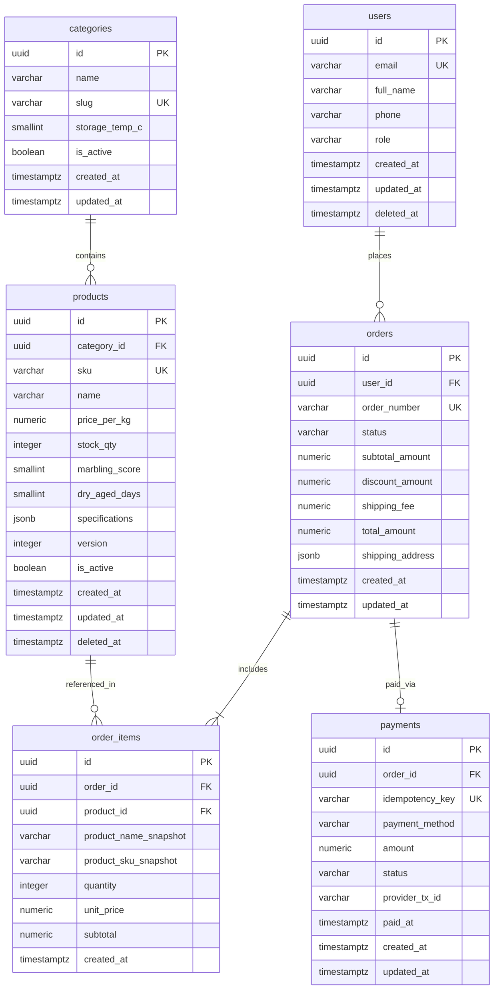

## 1. แนวคิด (Concept)
ในหัวข้อนี้ เราจะนำหลักการทั้งหมดตั้งแต่ข้อ 1 ถึงข้อ 6 มารวมกันเป็นพิมพ์เขียวระดับ Production ของระบบ **Smart Butcher Marketplace** ที่ครอบคลุมตารางหลักทั้ง 6 ตาราง ได้แก่:
1. `users`: ข้อมูลลูกค้าและผู้ใช้งานระบบ
2. `categories`: หมวดหมู่เนื้อพรีเมียมและอุณหภูมิการจัดเก็บ
3. `products`: รายการเนื้อวัว/เนื้อหมูพรีเมียม สต็อก ราคา และคุณลักษณะเฉพาะ (`JSONB`)
4. `orders`: ใบสั่งซื้อสถานะ State Machine ยอดเงินสุทธิ และ Snapshot ที่อยู่จัดส่ง
5. `order_items`: รายการสินค้าย่อยในใบสั่งซื้อพร้อม Snapshot ราคาและชื่อสินค้า ณ เวลาที่ซื้อ
6. `payments`: ข้อมูลการชำระเงินที่ผูกกับใบสั่งซื้อและรหัสป้องกันการตัดเงินซ้ำ (`idempotency_key`)



## 2. หลักการเบื้องหลัง (Under the Hood)
พิมพ์เขียวฉบับนี้ได้รับการออกแบบให้ทำงานสอดประสานกันระหว่าง **PostgreSQL 16 DDL** และ **Prisma Schema** โดยใช้หลักการ Dual-Layer Enforcement:
- **ในระดับ Prisma Schema:** ใช้ `@map` และ `@@map` เพื่อแปลงชื่อฟิลด์แบบ `camelCase` ที่เป็นมาตรฐานใน TypeScript/NestJS ให้ตรงกับชื่อคอลัมน์แบบ `snake_case` ในฐานข้อมูล PostgreSQL ทุกตัวอักษร
- **ในระดับ PostgreSQL SQL Migration:** เพิ่มเติมกฎเชิงลึกที่ Prisma Schema ไม่สามารถประกาศได้โดยตรง เช่น `CHECK (stock_qty >= 0)`, `GENERATED ALWAYS AS` columns, Partial Unique Indexes สำหรับ Soft Delete และ Triggers

## 3. ตัวอย่างโค้ด (Smart Butcher Marketplace)

### ตัวอย่างที่ 1: โครงสร้าง PostgreSQL 16 SQL DDL ฉบับสมบูรณ์พร้อมใช้งานจริง
สคริปต์สร้างตาราง กฎความถูกต้อง และดัชนีพื้นฐานสำหรับระบบ Smart Butcher Marketplace:

```sql filename="sql/13_smart_butcher_complete_schema.sql"
CREATE EXTENSION IF NOT EXISTS pgcrypto;

-- 1. ตารางผู้ใช้งาน (users)
CREATE TABLE users (
    id UUID PRIMARY KEY DEFAULT gen_random_uuid(),
    email VARCHAR(255) NOT NULL,
    password_hash VARCHAR(255) NOT NULL,
    full_name VARCHAR(150) NOT NULL,
    phone VARCHAR(20) NOT NULL,
    role VARCHAR(20) NOT NULL DEFAULT 'CUSTOMER'
        CHECK (role IN ('CUSTOMER', 'BUTCHER', 'ADMIN')),
    created_at TIMESTAMPTZ NOT NULL DEFAULT CURRENT_TIMESTAMP,
    updated_at TIMESTAMPTZ NOT NULL DEFAULT CURRENT_TIMESTAMP,
    deleted_at TIMESTAMPTZ
);

CREATE UNIQUE INDEX uq_users_email_active ON users(email) WHERE deleted_at IS NULL;

-- 2. ตารางหมวดหมู่เนื้อพรีเมียม (categories)
CREATE TABLE categories (
    id UUID PRIMARY KEY DEFAULT gen_random_uuid(),
    name VARCHAR(100) NOT NULL,
    slug VARCHAR(120) NOT NULL UNIQUE,
    description TEXT,
    storage_temp_c SMALLINT NOT NULL DEFAULT 0 CHECK (storage_temp_c BETWEEN -30 AND 10),
    is_active BOOLEAN NOT NULL DEFAULT TRUE,
    created_at TIMESTAMPTZ NOT NULL DEFAULT CURRENT_TIMESTAMP,
    updated_at TIMESTAMPTZ NOT NULL DEFAULT CURRENT_TIMESTAMP
);

-- 3. ตารางสินค้าเนื้อพรีเมียม (products)
CREATE TABLE products (
    id UUID PRIMARY KEY DEFAULT gen_random_uuid(),
    category_id UUID NOT NULL REFERENCES categories(id) ON DELETE RESTRICT,
    sku VARCHAR(50) NOT NULL,
    name VARCHAR(200) NOT NULL,
    description TEXT,
    price_per_kg NUMERIC(10, 2) NOT NULL CHECK (price_per_kg > 0),
    stock_qty INTEGER NOT NULL DEFAULT 0 CHECK (stock_qty >= 0),
    marbling_score SMALLINT CHECK (marbling_score BETWEEN 1 AND 12),
    dry_aged_days SMALLINT NOT NULL DEFAULT 0 CHECK (dry_aged_days >= 0),
    specifications JSONB NOT NULL DEFAULT '{}'::jsonb,
    version INTEGER NOT NULL DEFAULT 1 CHECK (version >= 1), -- สำหรับ Optimistic Locking
    is_active BOOLEAN NOT NULL DEFAULT TRUE,
    created_at TIMESTAMPTZ NOT NULL DEFAULT CURRENT_TIMESTAMP,
    updated_at TIMESTAMPTZ NOT NULL DEFAULT CURRENT_TIMESTAMP,
    deleted_at TIMESTAMPTZ
);

CREATE UNIQUE INDEX uq_products_sku_active ON products(sku) WHERE deleted_at IS NULL;
CREATE INDEX idx_products_category_id ON products(category_id);

-- 4. ตารางคำสั่งซื้อ (orders)
CREATE TABLE orders (
    id UUID PRIMARY KEY DEFAULT gen_random_uuid(),
    user_id UUID NOT NULL REFERENCES users(id) ON DELETE RESTRICT,
    order_number VARCHAR(30) NOT NULL UNIQUE,
    status VARCHAR(30) NOT NULL DEFAULT 'PENDING'
        CHECK (status IN ('PENDING', 'PAID', 'PREPARING', 'SHIPPED', 'DELIVERED', 'CANCELLED', 'REFUNDED')),
    subtotal_amount NUMERIC(12, 2) NOT NULL DEFAULT 0.00 CHECK (subtotal_amount >= 0),
    discount_amount NUMERIC(12, 2) NOT NULL DEFAULT 0.00 CHECK (discount_amount >= 0),
    shipping_fee NUMERIC(10, 2) NOT NULL DEFAULT 0.00 CHECK (shipping_fee >= 0),
    total_amount NUMERIC(12, 2) NOT NULL DEFAULT 0.00 CHECK (total_amount >= 0),
    shipping_address JSONB NOT NULL,
    notes TEXT,
    created_at TIMESTAMPTZ NOT NULL DEFAULT CURRENT_TIMESTAMP,
    updated_at TIMESTAMPTZ NOT NULL DEFAULT CURRENT_TIMESTAMP,
    CONSTRAINT chk_orders_net_total CHECK (
        total_amount = (subtotal_amount - discount_amount + shipping_fee)
        AND discount_amount <= subtotal_amount
    )
);

CREATE INDEX idx_orders_user_id ON orders(user_id);
CREATE INDEX idx_orders_status_created_at ON orders(status, created_at DESC);

-- 5. ตารางรายการสินค้าในคำสั่งซื้อ (order_items)
CREATE TABLE order_items (
    id UUID PRIMARY KEY DEFAULT gen_random_uuid(),
    order_id UUID NOT NULL REFERENCES orders(id) ON DELETE CASCADE,
    product_id UUID NOT NULL REFERENCES products(id) ON DELETE RESTRICT,
    product_name_snapshot VARCHAR(200) NOT NULL,
    product_sku_snapshot VARCHAR(50) NOT NULL,
    quantity INTEGER NOT NULL CHECK (quantity > 0),
    unit_price NUMERIC(10, 2) NOT NULL CHECK (unit_price > 0),
    subtotal NUMERIC(12, 2) GENERATED ALWAYS AS (quantity * unit_price) STORED,
    created_at TIMESTAMPTZ NOT NULL DEFAULT CURRENT_TIMESTAMP,
    CONSTRAINT uq_order_items_order_product UNIQUE (order_id, product_id)
);

CREATE INDEX idx_order_items_product_id ON order_items(product_id);

-- 6. ตารางการชำระเงิน (payments)
CREATE TABLE payments (
    id UUID PRIMARY KEY DEFAULT gen_random_uuid(),
    order_id UUID NOT NULL UNIQUE REFERENCES orders(id) ON DELETE RESTRICT,
    idempotency_key VARCHAR(100) NOT NULL UNIQUE,
    payment_method VARCHAR(50) NOT NULL
        CHECK (payment_method IN ('PROMPTPAY_QR', 'CREDIT_CARD', 'BANK_TRANSFER')),
    amount NUMERIC(12, 2) NOT NULL CHECK (amount > 0),
    status VARCHAR(30) NOT NULL DEFAULT 'UNPAID'
        CHECK (status IN ('UNPAID', 'PROCESSING', 'SUCCEEDED', 'FAILED', 'REFUNDED')),
    provider_tx_id VARCHAR(150),
    paid_at TIMESTAMPTZ,
    created_at TIMESTAMPTZ NOT NULL DEFAULT CURRENT_TIMESTAMP,
    updated_at TIMESTAMPTZ NOT NULL DEFAULT CURRENT_TIMESTAMP
);
```

### ตัวอย่างที่ 2: การแมปโครงสร้างตารางทั้งหมดเข้ากับ Prisma Schema (`schema.prisma`)
เขียนไฟล์ `prisma/schema.prisma` ที่สอดคล้องกับตาราง PostgreSQL 16 ด้านบนทุกประการ พร้อมกำหนดชนิดข้อมูล `@db.Uuid`, `@db.Decimal`, และ `@db.Timestamptz(6)`:

```prisma filename="prisma/schema.prisma"
datasource db {
  provider = "postgresql"
  url      = env("DATABASE_URL")
}

generator client {
  provider = "prisma-client-js"
}

model User {
  id           String    @id @default(dbgenerated("gen_random_uuid()")) @db.Uuid
  email        String    @db.VarChar(255)
  passwordHash String    @map("password_hash") @db.VarChar(255)
  fullName     String    @map("full_name") @db.VarChar(150)
  phone        String    @db.VarChar(20)
  role         String    @default("CUSTOMER") @db.VarChar(20)
  createdAt    DateTime  @default(now()) @map("created_at") @db.Timestamptz(6)
  updatedAt    DateTime  @updatedAt @map("updated_at") @db.Timestamptz(6)
  deletedAt    DateTime? @map("deleted_at") @db.Timestamptz(6)

  orders       Order[]

  @@map("users")
}

model Category {
  id           String    @id @default(dbgenerated("gen_random_uuid()")) @db.Uuid
  name         String    @db.VarChar(100)
  slug         String    @unique @db.VarChar(120)
  description  String?   @db.Text
  storageTempC Int       @default(0) @map("storage_temp_c") @db.SmallInt
  isActive     Boolean   @default(true) @map("is_active")
  createdAt    DateTime  @default(now()) @map("created_at") @db.Timestamptz(6)
  updatedAt    DateTime  @updatedAt @map("updated_at") @db.Timestamptz(6)

  products     Product[]

  @@map("categories")
}

model Product {
  id             String      @id @default(dbgenerated("gen_random_uuid()")) @db.Uuid
  categoryId     String      @map("category_id") @db.Uuid
  sku            String      @db.VarChar(50)
  name           String      @db.VarChar(200)
  description    String?     @db.Text
  pricePerKg     Decimal     @map("price_per_kg") @db.Decimal(10, 2)
  stockQty       Int         @default(0) @map("stock_qty")
  marblingScore  Int?        @map("marbling_score") @db.SmallInt
  dryAgedDays    Int         @default(0) @map("dry_aged_days") @db.SmallInt
  specifications Json        @default("{}") @db.JsonB
  version        Int         @default(1)
  isActive       Boolean     @default(true) @map("is_active")
  createdAt      DateTime    @default(now()) @map("created_at") @db.Timestamptz(6)
  updatedAt      DateTime    @updatedAt @map("updated_at") @db.Timestamptz(6)
  deletedAt      DateTime?   @map("deleted_at") @db.Timestamptz(6)

  category       Category    @relation(fields: [categoryId], references: [id], onDelete: Restrict)
  orderItems     OrderItem[]

  @@index([categoryId], map: "idx_products_category_id")
  @@map("products")
}

model Order {
  id              String      @id @default(dbgenerated("gen_random_uuid()")) @db.Uuid
  userId          String      @map("user_id") @db.Uuid
  orderNumber     String      @unique @map("order_number") @db.VarChar(30)
  status          String      @default("PENDING") @db.VarChar(30)
  subtotalAmount  Decimal     @default(0.00) @map("subtotal_amount") @db.Decimal(12, 2)
  discountAmount  Decimal     @default(0.00) @map("discount_amount") @db.Decimal(12, 2)
  shippingFee     Decimal     @default(0.00) @map("shipping_fee") @db.Decimal(10, 2)
  totalAmount     Decimal     @default(0.00) @map("total_amount") @db.Decimal(12, 2)
  shippingAddress Json        @map("shipping_address") @db.JsonB
  notes           String?     @db.Text
  createdAt       DateTime    @default(now()) @map("created_at") @db.Timestamptz(6)
  updatedAt       DateTime    @updatedAt @map("updated_at") @db.Timestamptz(6)

  user            User        @relation(fields: [userId], references: [id], onDelete: Restrict)
  orderItems      OrderItem[]
  payment         Payment?

  @@index([userId], map: "idx_orders_user_id")
  @@index([status, createdAt(sort: Desc)], map: "idx_orders_status_created_at")
  @@map("orders")
}

model OrderItem {
  id                  String   @id @default(dbgenerated("gen_random_uuid()")) @db.Uuid
  orderId             String   @map("order_id") @db.Uuid
  productId           String   @map("product_id") @db.Uuid
  productNameSnapshot String   @map("product_name_snapshot") @db.VarChar(200)
  productSkuSnapshot  String   @map("product_sku_snapshot") @db.VarChar(50)
  quantity            Int
  unitPrice           Decimal  @map("unit_price") @db.Decimal(10, 2)
  subtotal            Decimal  @default(dbgenerated()) @db.Decimal(12, 2)
  createdAt           DateTime @default(now()) @map("created_at") @db.Timestamptz(6)

  order               Order    @relation(fields: [orderId], references: [id], onDelete: Cascade)
  product             Product  @relation(fields: [productId], references: [id], onDelete: Restrict)

  @@unique([orderId, productId], map: "uq_order_items_order_product")
  @@index([productId], map: "idx_order_items_product_id")
  @@map("order_items")
}

model Payment {
  id             String    @id @default(dbgenerated("gen_random_uuid()")) @db.Uuid
  orderId        String    @unique @map("order_id") @db.Uuid
  idempotencyKey String    @unique @map("idempotency_key") @db.VarChar(100)
  paymentMethod  String    @map("payment_method") @db.VarChar(50)
  amount         Decimal   @db.Decimal(12, 2)
  status         String    @default("UNPAID") @db.VarChar(30)
  providerTxId   String?   @map("provider_tx_id") @db.VarChar(150)
  paidAt         DateTime? @map("paid_at") @db.Timestamptz(6)
  createdAt      DateTime  @default(now()) @map("created_at") @db.Timestamptz(6)
  updatedAt      DateTime  @updatedAt @map("updated_at") @db.Timestamptz(6)

  order          Order     @relation(fields: [orderId], references: [id], onDelete: Restrict)

  @@map("payments")
}
```

## 4. ผิด vs ถูก (Anti-pattern vs Best Practice)

| มิติการเปรียบเทียบ | ❌ ผิด (Anti-pattern) | ✅ ถูก (Best Practice) |
| :--- | :--- | :--- |
| **การใช้งาน Prisma Migrate** | รัน `prisma db push` บน Production และไม่เคยเปิดไฟล์ `.sql` ที่ Prisma สร้างขึ้นเพื่อเติม `CHECK` constraints | ใช้ `prisma migrate dev --create-only` เพื่อตรวจทานไฟล์ SQL และเติม `CHECK` constraints รวมถึง Partial Index ก่อนรันจริง |
| **การแมปชื่อตารางใน ORM** | ปล่อยให้ Prisma สร้างตารางชื่อ `"User"` และ `"OrderItem"` (ตัวพิมพ์ใหญ่ผสมเล็ก) ใน PostgreSQL | ใช้ `@map` และ `@@map` ในทุกรุ่นข้อมูลเพื่อให้ตารางใน PostgreSQL เป็น `snake_case` มาตรฐานทั้งหมด |

## 5. ควรใช้เมื่อไหร่ และ ไม่ควรใช้เมื่อไหร่
- **ควรใช้พิมพ์เขียวโครงสร้างนี้เมื่อ:** สร้างระบบ E-Commerce, Marketplace, ระบบจัดการคำสั่งซื้อและคลังสินค้าที่ต้องการความถูกต้องของสต็อกและประวัติการเงินแบบครบวงจร
- **ไม่ควรนำตารางทั้งหมดไว้ใน Schema เดียวกันโดยไม่แบ่งขอบเขตเมื่อ:** ระบบขยายตัวเป็น Microservices ขนาดใหญ่ที่มีทีมดูแลแยกกันชัดเจน ซึ่งอาจต้องแยก Database Logical Schema (เช่น `catalog.products`, `ordering.orders`) ตามขอบเขต Bounded Context

## 6. คำถามสัมภาษณ์ (Interview Q&A)
- **Q1: ในตาราง `products` ของพิมพ์เขียวนี้ ทำไมจึงมีคอลัมน์ `version INTEGER NOT NULL DEFAULT 1` เก็บไว้ด้วย?**
  - **แนวคำตอบ:** คอลัมน์ `version` มีไว้สำหรับทำ **Optimistic Concurrency Control (Optimistic Locking)** เวลาที่มีการตัดสต็อกหรือแก้ไขข้อมูลสินค้าพร้อมกัน โดยในคำสั่งอัปเดตจะเช็คเงื่อนไข `WHERE id = $1 AND version = $2` พร้อมสั่ง `SET version = version + 1` หากมี Transaction อื่นแก้ไขตัดหน้าไปก่อน ค่า `version` จะเปลี่ยนไป ทำให้คำสั่งอัปเดตกระทบ 0 แถว แอปพลิเคชันจึงรู้ตัวและป้องกันปัญหา Lost Update ได้โดยไม่ต้องล็อกแถวค้างไว้นาน
- **Q2: ทำไมตาราง `payments` จึงต้องมีคอลัมน์ `idempotency_key` ที่เป็น `UNIQUE` แยกต่างหากจาก `id`?**
  - **แนวคำตอบ:** เพื่อป้องกันปัญหาการตัดเงินซ้ำหรือการรับ Webhook ซ้ำจากระบบชำระเงิน เมื่อ Frontend ส่งคำขอชำระเงินหรือ Payment Gateway ยิง Webhook แจ้งผลเข้ามา หากเกิด Network Timeout แล้วมีการส่งซ้ำด้วย `idempotency_key` เดิม Unique Constraint ใน PostgreSQL จะบล็อกไม่ให้สร้างรายการชำระเงินซ้ำเป็นรายการที่สองได้

---
