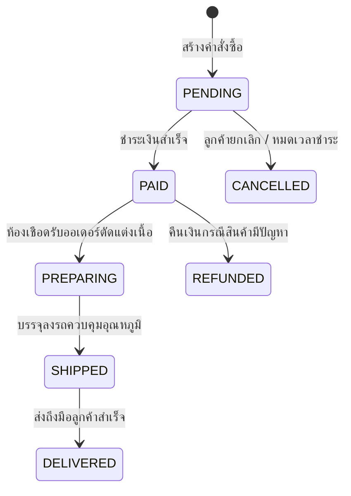

## 1. แนวคิด (Concept)
ในการออกแบบระบบอีคอมเมิร์ซและการเงินของ **Smart Butcher Marketplace** มีกติกาทองคำ 3 ข้อที่ห้ามละเมิดเด็ดขาด:
1. **ความแม่นยำของตัวเลขการเงิน (Exact Numeric Representation):** ห้ามใช้ชนิดข้อมูลทศนิยมแบบเลขลอยตัว (`FLOAT`, `REAL`, `DOUBLE PRECISION`) เก็บจำนวนเงินหรือน้ำหนักสินค้าเด็ดขาด เพราะคอมพิวเตอร์เก็บค่าแบบ Binary Floating-Point (IEEE 754) ซึ่งทำให้ `0.1 + 0.2` ได้ผลลัพธ์เป็น `0.30000000000000004` ต้องใช้ชนิดข้อมูล **`NUMERIC(precision, scale)`** (หรือ `DECIMAL`) หรือเก็บเป็นหน่วยย่อยสุดแบบจำนวนเต็ม `BIGINT` (เช่น สตางค์) เท่านั้น
2. **การทำ Snapshot ราคาและข้อมูลสินค้าในออเดอร์ (Historical Order Snapshot):** ราคาเนื้อวากิวในตาราง `products` วันนี้อาจอยู่ที่กิโลกรัมละ 4,500 บาท แต่วันพรุ่งนี้ร้านค้าอาจปรับราคาขึ้นเป็น 5,200 บาท หรือเปลี่ยนชื่อสินค้า หากตาราง `order_items` เก็บแค่ `product_id` แล้วไปดึงราคาจากตาราง `products` มาคำนวณย้อนหลัง ใบเสร็จของลูกค้าที่ซื้อไปเมื่อวานจะเปลี่ยนยอดเงินทันที! ดังนั้นต้องบันทึก **Snapshot** ของราคาต่อหน่วย (`unit_price`) และชื่อสินค้า ณ วินาทีที่สั่งซื้อลงในตาราง `order_items` เสมอ
3. **การควบคุมสถานะด้วย State Machine:** สถานะของคำสั่งซื้อ (`orders.status`) และการชำระเงิน (`payments.status`) ต้องมีทิศทางการเปลี่ยนสถานะที่ชัดเจนและจำกัด เช่น ออเดอร์ที่เป็น `CANCELLED` แล้ว ห้ามเปลี่ยนกลับเป็น `PAID` หรือ `SHIPPED` ได้อีก



## 2. หลักการเบื้องหลัง (Under the Hood)
ใน PostgreSQL 16 ชนิดข้อมูล `NUMERIC(p, s)` จะจัดเก็บตัวเลขในรูปแบบ Base-10000 (16-bit integers แทนตัวเลขฐานสิบ 4 หลักต่อกลุ่ม) แยกส่วนจำนวนเต็มและทศนิยมอย่างชัดเจน ทำให้การบวก ลบ และคูณตัวเลขทางการเงินมีความแม่นยำตรงตามหลักคณิตศาสตร์ 100% ไม่มีเศษทศนิยมเพี้ยนแม้แต่สตางค์เดียว

สำหรับการทำ **State Machine** ในระดับฐานข้อมูล นอกจากเราจะใช้ `CHECK` constraint เพื่อจำกัดว่าสถานะมีค่าใดได้บ้างแล้ว เรายังสามารถใช้ **BEFORE UPDATE Trigger** ใน PostgreSQL เพื่อตรวจสอบค่า `OLD.status` เทียบกับ `NEW.status` ได้โดยตรง หากมีโค้ดส่วนใดพยายามอัปเดตสถานะข้ามขั้นหรือย้อนกลับอย่างผิดกฎ ฐานข้อมูลจะโยน Exception และยกเลิกคำสั่งนั้นทันที

## 3. ตัวอย่างโค้ด (Smart Butcher Marketplace)

### ตัวอย่างที่ 1: การออกแบบตาราง `orders` และ `order_items` ที่เก็บ Snapshot ราคาและคำนวณเงินด้วย `NUMERIC`
แสดงการเก็บชื่อสินค้า รหัส SKU และราคาต่อหน่วย ณ เวลาที่สั่งซื้อไว้ใน `order_items` แยกขาดจากการเปลี่ยนแปลงในตาราง `products` ในอนาคต:

```sql filename="sql/09_financial_precision_and_snapshot.sql"
CREATE TABLE orders_financial (
    id UUID PRIMARY KEY DEFAULT gen_random_uuid(),
    user_id UUID NOT NULL REFERENCES users(id) ON DELETE RESTRICT,
    order_number VARCHAR(30) NOT NULL UNIQUE,
    status VARCHAR(30) NOT NULL DEFAULT 'PENDING'
        CHECK (status IN ('PENDING', 'PAID', 'PREPARING', 'SHIPPED', 'DELIVERED', 'CANCELLED', 'REFUNDED')),
    subtotal_amount NUMERIC(12, 2) NOT NULL DEFAULT 0.00 CHECK (subtotal_amount >= 0),
    discount_amount NUMERIC(12, 2) NOT NULL DEFAULT 0.00 CHECK (discount_amount >= 0),
    shipping_fee NUMERIC(10, 2) NOT NULL DEFAULT 0.00 CHECK (shipping_fee >= 0),
    total_amount NUMERIC(12, 2) NOT NULL DEFAULT 0.00 CHECK (total_amount >= 0),
    shipping_address_snapshot JSONB NOT NULL, -- เก็บที่อยู่จัดส่ง ณ วันที่สั่งซื้อ
    created_at TIMESTAMPTZ NOT NULL DEFAULT CURRENT_TIMESTAMP,
    -- กฎการเงิน: ยอดสุทธิต้องเท่ากับ ยอดรวมสินค้า - ส่วนลด + ค่าส่ง เสมอ
    CONSTRAINT chk_orders_total_calculation CHECK (
        total_amount = (subtotal_amount - discount_amount + shipping_fee)
        AND discount_amount <= subtotal_amount
    )
);

CREATE TABLE order_items_snapshot (
    id UUID PRIMARY KEY DEFAULT gen_random_uuid(),
    order_id UUID NOT NULL REFERENCES orders_financial(id) ON DELETE CASCADE,
    product_id UUID NOT NULL REFERENCES products(id) ON DELETE RESTRICT,
    -- Snapshot ข้อมูลสินค้า ณ เวลาที่ลูกค้ากดสั่งซื้อ
    product_name_snapshot VARCHAR(200) NOT NULL,
    product_sku_snapshot VARCHAR(50) NOT NULL,
    unit_price NUMERIC(10, 2) NOT NULL CHECK (unit_price > 0),
    quantity INTEGER NOT NULL CHECK (quantity > 0),
    line_total NUMERIC(12, 2) GENERATED ALWAYS AS (unit_price * quantity) STORED
);
```

### ตัวอย่างที่ 2: การบังคับกฎ State Machine ของสถานะคำสั่งซื้อในระดับ PostgreSQL Trigger
ป้องกันการเปลี่ยนสถานะคำสั่งซื้อที่ผิดลำดับธุรกิจ เช่น ห้ามเปลี่ยนจาก `CANCELLED` ไปเป็น `SHIPPED` หรือห้ามเปลี่ยนจาก `PENDING` ข้ามไปเป็น `DELIVERED` โดยยังไม่จ่ายเงิน:

```sql filename="sql/10_order_state_machine_trigger.sql"
CREATE OR REPLACE FUNCTION enforce_order_status_transition()
RETURNS TRIGGER AS $$
BEGIN
    -- หากสถานะไม่ได้เปลี่ยน ให้ผ่านได้เลย
    IF OLD.status = NEW.status THEN
        RETURN NEW;
    END IF;

    -- ตรวจสอบทิศทางการเปลี่ยนสถานะที่อนุญาตเท่านั้น (Valid State Transitions)
    IF (OLD.status = 'PENDING' AND NEW.status IN ('PAID', 'CANCELLED')) OR
       (OLD.status = 'PAID' AND NEW.status IN ('PREPARING', 'REFUNDED')) OR
       (OLD.status = 'PREPARING' AND NEW.status IN ('SHIPPED', 'REFUNDED')) OR
       (OLD.status = 'SHIPPED' AND NEW.status IN ('DELIVERED', 'REFUNDED')) THEN
        RETURN NEW;
    ELSE
        RAISE EXCEPTION 'Invalid order status transition from % to % for order %',
            OLD.status, NEW.status, OLD.id
            USING ERRCODE = 'check_violation';
    END IF;
END;
$$ LANGUAGE plpgsql;

CREATE TRIGGER trg_enforce_order_status
BEFORE UPDATE OF status ON orders_financial
FOR EACH ROW EXECUTE FUNCTION enforce_order_status_transition();
```

## 4. ผิด vs ถูก (Anti-pattern vs Best Practice)

| มิติการเปรียบเทียบ | ❌ ผิด (Anti-pattern) | ✅ ถูก (Best Practice) |
| :--- | :--- | :--- |
| **การเก็บราคาในใบสั่งซื้อ** | เก็บแค่ `product_id` และ `quantity` ใน `order_items` แล้วค่อย `JOIN` ไปดึงราคาปัจจุบันจากตาราง `products` | คัดลอก `unit_price`, `product_name_snapshot` ณ วินาทีที่สั่งซื้อลงในตาราง `order_items` เสมอ |
| **การเก็บที่อยู่จัดส่งในออเดอร์** | เก็บแค่ `address_id` ชี้ไปตารางที่อยู่ลูกค้า เมื่อลูกค้าแก้ที่อยู่ใหม่ ประวัติที่อยู่จัดส่งในใบเสร็จเก่าเปลี่ยนตามทันที | เก็บ Snapshot ของที่อยู่จัดส่งลงในตาราง `orders` ด้วย (เป็นคอลัมน์แยกหรือ `JSONB`) |
| **การใช้ `ENUM` Type กับสถานะที่เปลี่ยนบ่อย** | ใช้ `CREATE TYPE status AS ENUM (...)` กับสถานะที่มีโอกาสลบหรือเปลี่ยนชื่อบ่อย ซึ่ง PostgreSQL ไม่รองรับการลบค่าใน ENUM ได้โดยตรง | ใช้ `VARCHAR(30)` คู่กับ `CHECK (status IN (...))` หรือตาราง Lookup ซึ่งแก้ไขผ่าน Migration ได้ง่ายและไม่ล็อกระบบนาน |

## 5. ควรใช้เมื่อไหร่ และ ไม่ควรใช้เมื่อไหร่
- **ควรทำ Snapshot ข้อมูลลงในตารางธุรกรรมเมื่อ:** ข้อมูลต้นทางอาจมีการเปลี่ยนแปลงค่าได้ในอนาคต แต่เอกสารทางธุรกิจหรือกฎหมายบังคับให้ต้องแสดงค่าเดิม ณ เวลาที่ทำรายการ เช่น ราคาสินค้า อัตราภาษี ชื่อสินค้า และที่อยู่ในการออกใบกำกับภาษี
- **ไม่ควรใช้ `NUMERIC` เมื่อ:** เก็บข้อมูลทางสถิติหรือวิทยาศาสตร์ที่ไม่ต้องการความแม่นยำระดับทศนิยมตายตัวและเน้นความเร็วในการคำนวณเชิงเรขาคณิต เช่น พิกัด GPS ละติจูด/ลองจิจูด (ซึ่งเหมาะกับ `DOUBLE PRECISION` หรือ PostGIS มากกว่า)

## 6. คำถามสัมภาษณ์ (Interview Q&A)
- **Q1: ระหว่างการเก็บเงินด้วย `NUMERIC(12, 2)` (เช่น `1500.50` บาท) กับการเก็บเป็นหน่วยสตางค์ด้วย `BIGINT` (เช่น `150050` สตางค์) แบบไหนดีกว่ากันใน PostgreSQL?**
  - **แนวคำตอบ:** ทั้งสองวิธีป้องกันปัญหา Floating-point inaccuracy ได้ 100% เหมือนกัน การใช้ `BIGINT` เก็บเป็นสตางค์ (Cents/Satang) เป็นรูปแบบที่ระบบ Payment Gateway อย่าง Stripe นิยมใช้เพราะส่งค่าผ่าน JSON API เป็น Integer ได้โดยไม่ต้องกังวลเรื่องการแปลงทศนิยมในภาษาโปรแกรมฝั่ง Client อย่างไรก็ตาม ในระดับฐานข้อมูล PostgreSQL การใช้ `NUMERIC(12, 2)` มีข้อดีคืออ่านเข้าใจง่ายจากรายงาน SQL ทันที ไม่ต้องหาร 100 ทุกครั้งที่ทำรายงาน และรองรับการคำนวณภาษีหรือส่วนลดที่มีทศนิยมระหว่างทางได้โดยตรง
- **Q2: ทำไมใน PostgreSQL นักออกแบบฐานข้อมูลหลายคนจึงหลีกเลี่ยง `CREATE TYPE ... AS ENUM` สำหรับสถานะที่มีการปรับปรุงบ่อย แล้วหันมาใช้ `VARCHAR` คู่กับ `CHECK` constraint แทน?**
  - **แนวคำตอบ:** แม้ `ENUM` ใน PostgreSQL จะประหยัดพื้นที่ (ใช้เพียง 4 bytes) แต่มีข้อจำกัดในการทำ Schema Migration คือเราไม่สามารถสั่งลบค่าออกจาก `ENUM` ที่มีอยู่แล้วได้ (`ALTER TYPE ... DROP VALUE` ไม่มีอยู่จริง ต้องสร้าง Type ใหม่แล้วแปลงตารางทั้งหมด) ในขณะที่การใช้ `VARCHAR` คู่กับ `CHECK (status IN (...))` สามารถเพิ่ม ลบ หรือแก้ไขรายการสถานะได้ตลอดเวลาผ่านคำสั่ง `ALTER TABLE` มาตรฐาน

---
