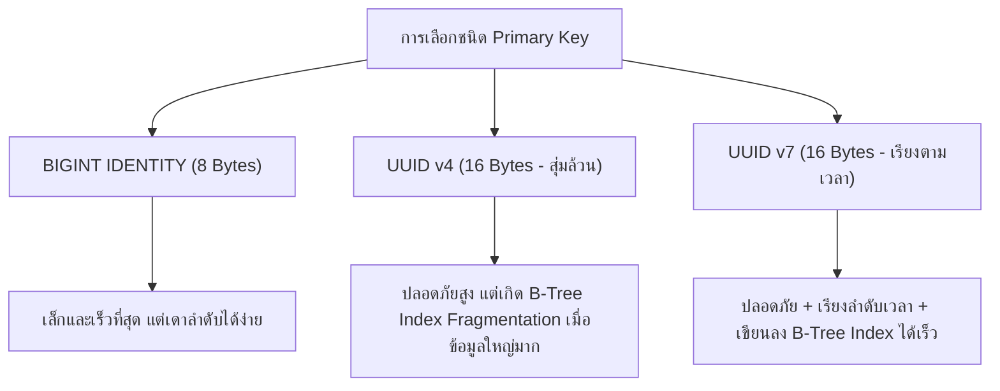

## 1. แนวคิด (Concept)
**Primary Key (PK)** คือตัวระบุความไม่ซ้ำกันของแต่ละแถวในตาราง การเลือกชนิดของ Primary Key ส่งผลกระทบโดยตรงต่อทั้งความปลอดภัยของ API, ขนาดของดัชนี (Index Size), และประสิทธิภาพการเขียนข้อมูลลงดิสก์ โดยตัวเลือกหลักในยุคปัจจุบันมี 3 รูปแบบ:
1. **BIGINT GENERATED ALWAYS AS IDENTITY (Auto-increment ยุคใหม่):** ตัวเลขเรียงลำดับ `1, 2, 3, ...` ขนาด 8 Bytes (มาตรฐาน SQL ที่เข้ามาแทนที่ `SERIAL` แบบเดิม)
2. **UUID v4 (`gen_random_uuid()`):** รหัสสุ่มขนาด 16 Bytes (128-bit) เช่น `f47ac10b-58cc-4372-a567-0e02b2c3d479` ที่คาดเดาไม่ได้และสร้างจากฝั่ง Application ได้เลยโดยไม่ชนกัน
3. **UUID v7 (Time-ordered UUID):** มาตรฐาน UUID ยุคใหม่ขนาด 16 Bytes ที่นำค่าเวลา **Unix Timestamp ระดับมิลลิวินาที (48 bits แรก)** มาไว้ข้างหน้า ตามด้วยค่าสุ่ม ทำให้ได้ทั้งความปลอดภัยแบบ UUID และการเรียงลำดับตามเวลาเหมือน Auto-increment



## 2. หลักการเบื้องหลัง (Under the Hood)
ทุกครั้งที่มีการสร้าง Primary Key ระบบ PostgreSQL จะสร้าง **B-Tree Index** ให้โดยอัตโนมัติเพื่อรักษาความไม่ซ้ำและใช้ค้นหาแถวอย่างรวดเร็ว:
- **กรณีใช้ `BIGINT IDENTITY` หรือ `UUID v7`:** เนื่องจากค่าคีย์ที่สร้างใหม่จะมีค่ามากกว่าคีย์เดิมเสมอ (Monotonically Increasing) PostgreSQL จึงนำค่าใหม่ไปต่อท้ายที่ใบขวาสุด (Right-most Leaf Page) ของโครงสร้าง B-Tree เสมอ ทำให้เขียนข้อมูลลงหน่วยความจำและดิสก์ได้เร็วมาก และบล็อกข้อมูลถูกใช้งานเต็มความจุ
- **กรณีใช้ `UUID v4` (แบบสุ่มล้วน):** เมื่อตารางมีขนาดใหญ่ระดับหลายล้านแถว ค่า UUID ใหม่ที่สุ่มขึ้นมาจะกระจายตัวไปแทรกตามจุดต่างๆ ทั่วทั้งต้นไม้ B-Tree ส่งผลให้ PostgreSQL ต้องดึง Index Pages จากดิสก์ขึ้นมาแก้ไขกระจายไปทั่ว (Random I/O) และเกิดปรากฏการณ์ **Page Splits** บ่อยครั้ง ทำให้ Index บวม (Index Bloat) และประสิทธิภาพการ `INSERT` ลดลงเมื่อตารางมีขนาดใหญ่มาก

### ตารางเปรียบเทียบชนิด Primary Key เชิงลึก

| คุณสมบัติ | `BIGINT IDENTITY` | `UUID v4` | `UUID v7` |
| :--- | :--- | :--- | :--- |
| **ขนาดพื้นที่จัดเก็บ** | 8 Bytes | 16 Bytes | 16 Bytes |
| **ความปลอดภัยเมื่อแสดงบน URL** | ต่ำ (เกิด Enumeration Attack เดาจำนวนออเดอร์คู่แข่งได้) | สูงมาก (สุ่มสมบูรณ์ เดาไม่ได้) | สูง (ส่วนท้ายเป็นค่าสุ่ม 74 bits เดาไม่ได้) |
| **ประสิทธิภาพการ INSERT (B-Tree)** | **เร็วที่สุด** (ต่อท้ายเสมอ) | ช้าลงเมื่อตารางใหญ่เกินหลายล้านแถว (Random Page Splits) | **เร็วมาก** (เรียงตามเวลา ต่อท้าย B-Tree เสมอ) |
| **การสร้าง ID จากฝั่ง App/ 분산** | ไม่ได้ (ต้องรอ Database แจกเลข) | ทำได้ทันที | ทำได้ทันที (ทั้งใน App หรือ DB Function) |

### มาตรฐานการตั้งชื่อ (PostgreSQL Naming Conventions)
1. **ใช้ `snake_case` ตัวพิมพ์เล็กทั้งหมด:** เช่น `order_items`, `price_per_kg` เพื่อหลีกเลี่ยงการต้องใส่เครื่องหมาย Double Quotes (`"OrderItems"`) เวลาเขียนคิวรีใน PostgreSQL
2. **ชื่อตารางใช้คำนามพหูพจน์ (Plural Nouns):** เช่น `users`, `products`, `categories`, `orders`, `order_items`, `payments`
3. **ชื่อคอลัมน์ Foreign Key:** ใช้ชื่อตารางแม่ในรูปเอกพจน์ตามด้วย `_id` เช่น `user_id`, `category_id`, `product_id`
4. **ชื่อคอลัมน์ Boolean:** ขึ้นต้นด้วยกริยาช่วย `is_`, `has_`, หรือ `can_` เช่น `is_active`, `is_verified`, `has_bone`
5. **ชื่อคอลัมน์วันเวลา:** ลงท้ายด้วย `_at` สำหรับ Timestamp (เช่น `created_at`, `paid_at`) และลงท้ายด้วย `_date` สำหรับ Date ล้วน

## 3. ตัวอย่างโค้ด (Smart Butcher Marketplace)

### ตัวอย่างที่ 1: การใช้ `GENERATED ALWAYS AS IDENTITY` และมาตรฐานการตั้งชื่อที่ถูกต้อง
สำหรับตารางอ้างอิงภายในหรือตารางลำดับคิวการตัดแต่งเนื้อที่ต้องการตัวเลขเรียงลำดับขนาดเล็ก:

```sql filename="sql/07_identity_and_naming_conventions.sql"
-- ใช้ GENERATED ALWAYS AS IDENTITY แทน SERIAL แบบเก่าตามมาตรฐาน SQL
CREATE TABLE butcher_stations (
    id BIGINT GENERATED ALWAYS AS IDENTITY PRIMARY KEY,
    station_code VARCHAR(20) NOT NULL UNIQUE,
    station_name VARCHAR(100) NOT NULL,
    max_daily_capacity_kg NUMERIC(8, 2) NOT NULL CHECK (max_daily_capacity_kg > 0),
    is_operational BOOLEAN NOT NULL DEFAULT TRUE,
    created_at TIMESTAMPTZ NOT NULL DEFAULT CURRENT_TIMESTAMP
);
```

### ตัวอย่างที่ 2: การสร้างฟังก์ชัน `uuid_generate_v7()` บน PostgreSQL 16 สำหรับตารางขนาดใหญ่
เพื่อให้ตารางธุรกรรมหลักอย่าง `orders` และ `order_items` ได้รับประโยชน์ทั้งความปลอดภัยของ UUID และความเร็วในการเรียงลำดับ B-Tree Index แบบ Time-ordered:

```sql filename="sql/08_uuid_v7_implementation.sql"
CREATE EXTENSION IF NOT EXISTS pgcrypto;

-- ฟังก์ชันสร้าง UUID v7 (Time-ordered UUID ตามมาตรฐาน RFC 9562) บน PostgreSQL 16
CREATE OR REPLACE FUNCTION uuid_generate_v7()
RETURNS UUID AS $$
DECLARE
    unix_ts_ms BYTEA;
    uuid_bytes BYTEA;
BEGIN
    -- ดึงเวลาปัจจุบันระดับมิลลิวินาที (48 bits / 6 bytes)
    unix_ts_ms := substring(int8send(floor(extract(epoch FROM clock_timestamp()) * 1000)::bigint) FROM 3 FOR 6);
    -- สร้าง bytes สุ่ม 10 bytes แล้วนำมารวมกับเวลา 6 bytes แรก
    uuid_bytes := unix_ts_ms || gen_random_bytes(10);
    -- ตั้งค่า Version 7 (0111) ที่ byte ลำดับที่ 6
    uuid_bytes := set_byte(uuid_bytes, 6, (b'0111' || get_byte(uuid_bytes, 6)::bit(4))::bit(8)::int);
    -- ตั้งค่า Variant (10) ที่ byte ลำดับที่ 8
    uuid_bytes := set_byte(uuid_bytes, 8, (b'10' || get_byte(uuid_bytes, 8)::bit(6))::bit(8)::int);

    RETURN encode(uuid_bytes, 'hex')::uuid;
END;
$$ LANGUAGE plpgsql VOLATILE;

-- นำ UUID v7 ไปใช้เป็นค่าเริ่มต้นของตารางคำสั่งซื้อ
CREATE TABLE high_volume_orders (
    id UUID PRIMARY KEY DEFAULT uuid_generate_v7(),
    user_id UUID NOT NULL REFERENCES users(id) ON DELETE RESTRICT,
    order_number VARCHAR(30) NOT NULL UNIQUE,
    total_amount NUMERIC(12, 2) NOT NULL CHECK (total_amount >= 0),
    created_at TIMESTAMPTZ NOT NULL DEFAULT CURRENT_TIMESTAMP
);
```

## 4. ผิด vs ถูก (Anti-pattern vs Best Practice)

| มิติการเปรียบเทียบ | ❌ ผิด (Anti-pattern) | ✅ ถูก (Best Practice) |
| :--- | :--- | :--- |
| **การตั้งชื่อตารางและคอลัมน์** | ใช้ `camelCase` หรือ `PascalCase` เช่น `"OrderItems"`, `"unitPrice"` ทำให้ต้องใส่ `""` ตลอดเวลาใน SQL | ใช้ `snake_case` ตัวพิมพ์เล็กทั้งหมด เช่น `order_items`, `unit_price` (ใน Prisma ค่อยใช้ `@map` และ `@@map` ช่วย) |
| **การเก็บค่า UUID** | เก็บ UUID ลงในคอลัมน์ `VARCHAR(36)` หรือ `TEXT` ซึ่งกินพื้นที่ถึง 37 Bytes และเปรียบเทียบช้า | ใช้ชนิดข้อมูล `UUID` แท้ของ PostgreSQL ซึ่งจัดเก็บเป็น Binary ขนาดเพียง 16 Bytes เสมอ |
| **การเปิดเผย Auto-increment ID** | นำ `id` ที่เป็นตัวเลขเรียง `1001, 1002` ไปแสดงบน URL สาธารณะ เช่น `/api/orders/1002` | ใช้ `UUID` (v4 หรือ v7) สำหรับทรัพยากรที่ต้องอ้างอิงผ่าน API สาธารณะควบคู่กับรหัสอ้างอิงธุรกิจเช่น `order_number` |

## 5. ควรใช้เมื่อไหร่ และ ไม่ควรใช้เมื่อไหร่
- **ควรใช้ `UUID v7` (หรือ `UUID v4` สำหรับตารางขนาดทั่วไป) เมื่อ:** ตารางนั้นเป็นทรัพยากรหลักที่ต้องส่ง ID ออกไปให้ Frontend/Mobile App ใช้งานผ่าน API หรือระบบมีสถาปัตยกรรมแบบกระจายตัว (Distributed Systems)
- **ควรใช้ `BIGINT GENERATED ALWAYS AS IDENTITY` เมื่อ:** เป็นตารางภายในที่ไม่เปิดเผย ID ออกสู่สาธารณะ หรือเป็นตารางเก็บข้อมูลปริมาณมหาศาลระดับร้อยล้านแถวขึ้นไป (เช่น ตาราง Audit Logs หรือ Sensor Logs ห้องเย็น) ที่ต้องการประหยัดพื้นที่ RAM และขนาดของ Index ให้เล็กที่สุด

## 6. คำถามสัมภาษณ์ (Interview Q&A)
- **Q1: ทำไมใน PostgreSQL ยุคใหม่จึงแนะนำให้ใช้ `GENERATED ALWAYS AS IDENTITY` แทนการใช้ `SERIAL` หรือ `BIGSERIAL`?**
  - **แนวคำตอบ:** คำสั่ง `SERIAL` เป็นคำสั่งเฉพาะของ PostgreSQL ยุคเก่าที่ไม่ใช่มาตรฐาน ANSI SQL และมีข้อเสียคือผู้ใช้สามารถเผลอ `INSERT` ตัวเลขระบุค่า `id` ทับเข้าไปตรงๆ ได้ ส่งผลให้ค่า Sequence ลำดับถัดไปชนกับค่าที่เพิ่งใส่เข้าไปและเกิด Error `duplicate key value violates unique constraint` ในภายหลัง ในขณะที่ `GENERATED ALWAYS AS IDENTITY` เป็นมาตรฐาน SQL ที่ป้องกันไม่ให้ใครระบุค่า `id` เองโดยพลการ และจัดการสิทธิ์ของ Sequence ผูกกับตารางให้อัตโนมัติ
- **Q2: UUID v7 แก้ปัญหาคอขวดของ UUID v4 ในฐานข้อมูลอย่างไร?**
  - **แนวคำตอบ:** UUID v4 เป็นค่าสุ่มทั้งหมด ทำให้เวลา `INSERT` แถวใหม่ลงใน B-Tree Index ข้อมูลจะกระจายไปแทรกตามบล็อกต่างๆ แบบสุ่ม (Random I/O) เกิดการแตกบล็อก (Page Splits) และทำให้ Buffer Cache ไม่สามารถเก็บหน้า Index ที่ใช้งานบ่อยไว้ใน RAM ได้อย่างคุ้มค่า ส่วน UUID v7 มีส่วนหัว 48 บิตแรกเป็น Timestamp เรียงตามเวลา ทำให้ค่าที่สร้างใหม่มีค่ามากกว่าค่าเก่าเสมอ การ `INSERT` จึงเป็นการต่อท้ายที่หน้าขวาสุดของ B-Tree เหมือนกับ Auto-increment ลด I/O ลงอย่างมหาศาล

---
