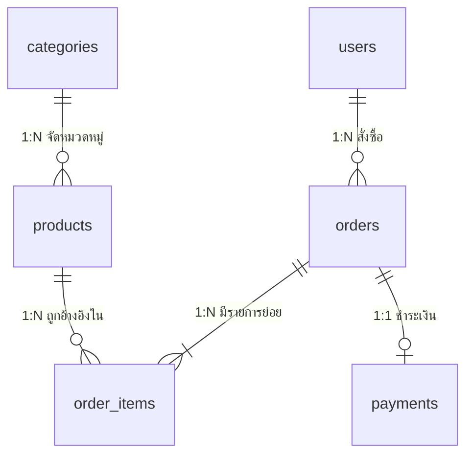

## 1. แนวคิด (Concept)
ในระบบฐานข้อมูลเชิงสัมพันธ์ ข้อมูลแต่ละตารางจะไม่ถูกเก็บแยกขาดจากกัน แต่จะเชื่อมโยงกันด้วยคีย์นอก (**Foreign Key**) โดยแบ่งรูปแบบความสัมพันธ์ออกเป็น 3 รูปแบบหลัก:
1. **One-to-One (1:1):** ข้อมูล 1 แถวในตารางแรก จับคู่กับข้อมูลได้ไม่เกิน 1 แถวในตารางที่สอง เช่น คำสั่งซื้อ 1 รายการ (`orders`) มีรายการชำระเงินหลักที่สำเร็จ (`payments`) เพียง 1 รายการ หรือผู้ใช้ 1 คนมีข้อมูลโปรไฟล์สมาชิก VIP 1 รายการ
2. **One-to-Many (1:N):** ความสัมพันธ์ที่ใช้บ่อยที่สุด ข้อมูล 1 แถวในตารางแม่ เชื่อมโยงกับข้อมูลได้หลายแถวในตารางลูก เช่น หมวดหมู่เนื้อ 1 หมวด (`categories`) มีสินค้าเนื้อ (`products`) ได้หลายชิ้น หรือลูกค้า 1 คน (`users`) สั่งซื้อสินค้า (`orders`) ได้หลายครั้ง
3. **Many-to-Many (M:N):** ข้อมูลหลายแถวในตารางแรก เชื่อมโยงกับข้อมูลหลายแถวในตารางที่สอง เช่น คำสั่งซื้อ 1 ใบ (`orders`) มีสินค้าหลายชิ้น (`products`) และสินค้าเนื้อชนิดเดียวกันก็ถูกสั่งอยู่ในคำสั่งซื้อหลายใบได้ ซึ่งในทางปฏิบัติเราไม่สามารถเชื่อม M:N ตรงๆ ได้ แต่ต้องสร้างตารางกลางที่เรียกว่า **Junction Table** (หรือ Associative Entity) เช่น ตาราง `order_items` มาคั่นกลางเพื่อแปลงเป็นความสัมพันธ์แบบ 1:N สองฝั่ง



## 2. หลักการเบื้องหลัง (Under the Hood)
เมื่อเรากำหนด `FOREIGN KEY` ใน PostgreSQL 16 ระบบจะสร้าง System Trigger ภายใน (Internal RI Triggers) เพื่อคอยตรวจสอบความถูกต้องของการอ้างอิง (Referential Integrity) ทุกครั้งที่มีการ `INSERT`, `UPDATE`, หรือ `DELETE` ทั้งในตารางแม่และตารางลูก

สิ่งสำคัญที่ต้องกำหนดเสมอคือ **Referential Actions (`ON DELETE` และ `ON UPDATE`)**:
- `RESTRICT` หรือ `NO ACTION`: ห้ามลบข้อมูลตารางแม่ หากยังมีข้อมูลในตารางลูกอ้างอิงอยู่ (เหมาะกับข้อมูลสำคัญ เช่น ห้ามลบสินค้าหากเคยถูกสั่งซื้อไปแล้วใน `order_items`)
- `CASCADE`: หากลบข้อมูลตารางแม่ ให้ลบข้อมูลในตารางลูกที่อ้างอิงอยู่ตามไปด้วยอัตโนมัติ (เหมาะกับข้อมูลที่เป็นส่วนประกอบย่อย เช่น ลบออเดอร์ร่างทิ้ง ให้ลบรายการย่อยในตะกร้าตามไปด้วย)
- `SET NULL`: หากลบข้อมูลตารางแม่ ให้เปลี่ยนค่า Foreign Key ในตารางลูกเป็น `NULL`

<Callout type="warning" title="PostgreSQL ไม่สร้าง Index บน Foreign Key ให้อัตโนมัติ">
ต่างจาก Primary Key และ Unique Constraint ที่ PostgreSQL จะสร้าง B-Tree Index ให้ทันที คอลัมน์ที่เป็น Foreign Key จะไม่มี Index สร้างให้อัตโนมัติ ดังนั้นนักพัฒนาต้องเขียนคำสั่งสร้าง Index บนคอลัมน์ Foreign Key เองเสมอ มิฉะนั้นเวลาค้นหาข้อมูลตารางลูกหรือเวลาลบข้อมูลตารางแม่ PostgreSQL จะต้องทำ Sequential Scan กวาดอ่านตารางลูกทั้งตารางจนระบบช้าลงอย่างรุนแรง
</Callout>

## 3. ตัวอย่างโค้ด (Smart Butcher Marketplace)

### ตัวอย่างที่ 1: การสร้างความสัมพันธ์แบบ 1:N และ 1:1 พร้อมกำหนด Referential Actions
แสดงการเชื่อมโยงระหว่างลูกค้า (`users`), คำสั่งซื้อ (`orders` แบบ 1:N), และการชำระเงิน (`payments` แบบ 1:1 โดยบังคับด้วย `UNIQUE` บนคอลัมน์ `order_id`):

```sql filename="sql/03_relationships_1_to_1_and_1_to_n.sql"
CREATE TABLE users (
    id UUID PRIMARY KEY DEFAULT gen_random_uuid(),
    email VARCHAR(255) NOT NULL UNIQUE,
    full_name VARCHAR(150) NOT NULL,
    phone VARCHAR(20) NOT NULL,
    created_at TIMESTAMPTZ NOT NULL DEFAULT CURRENT_TIMESTAMP
);

-- ความสัมพันธ์ 1:N (ผู้ใช้ 1 คน มีได้หลายออเดอร์)
CREATE TABLE orders (
    id UUID PRIMARY KEY DEFAULT gen_random_uuid(),
    user_id UUID NOT NULL REFERENCES users(id) ON DELETE RESTRICT,
    order_number VARCHAR(30) NOT NULL UNIQUE,
    status VARCHAR(30) NOT NULL DEFAULT 'PENDING',
    total_amount NUMERIC(12, 2) NOT NULL CHECK (total_amount >= 0),
    created_at TIMESTAMPTZ NOT NULL DEFAULT CURRENT_TIMESTAMP
);

-- สร้าง Index บน Foreign Key เสมอ
CREATE INDEX idx_orders_user_id ON orders(user_id);

-- ความสัมพันธ์ 1:1 (ออเดอร์ 1 ใบ มีรายการชำระเงินหลัก 1 รายการ บังคับด้วย UNIQUE ที่ order_id)
CREATE TABLE payments (
    id UUID PRIMARY KEY DEFAULT gen_random_uuid(),
    order_id UUID NOT NULL UNIQUE REFERENCES orders(id) ON DELETE RESTRICT,
    payment_method VARCHAR(50) NOT NULL,
    amount NUMERIC(12, 2) NOT NULL CHECK (amount > 0),
    status VARCHAR(30) NOT NULL DEFAULT 'UNPAID',
    paid_at TIMESTAMPTZ,
    created_at TIMESTAMPTZ NOT NULL DEFAULT CURRENT_TIMESTAMP
);
```

### ตัวอย่างที่ 2: การออกแบบ Junction Table (`order_items`) สำหรับความสัมพันธ์แบบ M:N
ตาราง `order_items` ทำหน้าที่เชื่อมระหว่าง `orders` และ `products` พร้อมทั้งเก็บ Payload ของความสัมพันธ์นั้น เช่น จำนวนชิ้นที่สั่ง ราคาต่อหน่วย ณ เวลาที่ซื้อ และป้องกันการใส่สินค้าชนิดเดียวกันซ้ำสองแถวในออเดอร์ใบเดิม:

```sql filename="sql/04_junction_table_many_to_many.sql"
CREATE TABLE order_items (
    id UUID PRIMARY KEY DEFAULT gen_random_uuid(),
    order_id UUID NOT NULL REFERENCES orders(id) ON DELETE CASCADE,
    product_id UUID NOT NULL REFERENCES products(id) ON DELETE RESTRICT,
    quantity INTEGER NOT NULL CHECK (quantity > 0),
    unit_price NUMERIC(10, 2) NOT NULL CHECK (unit_price >= 0),
    subtotal NUMERIC(12, 2) GENERATED ALWAYS AS (quantity * unit_price) STORED,
    created_at TIMESTAMPTZ NOT NULL DEFAULT CURRENT_TIMESTAMP,
    -- ป้องกันสินค้าตัวเดียวกันปรากฏซ้ำหลายแถวในออเดอร์เดียวกัน
    CONSTRAINT uq_order_items_order_product UNIQUE (order_id, product_id)
);

-- สร้าง Index สำหรับการ JOIN ย้อนกลับหาสินค้า
CREATE INDEX idx_order_items_product_id ON order_items(product_id);
```

## 4. ผิด vs ถูก (Anti-pattern vs Best Practice)

| มิติการเปรียบเทียบ | ❌ ผิด (Anti-pattern) | ✅ ถูก (Best Practice) |
| :--- | :--- | :--- |
| **การเก็บความสัมพันธ์ M:N** | เก็บรหัสสินค้าเป็น Array หรือ Comma-separated string เช่น `'prod1,prod2,prod3'` ในตาราง `orders` | สร้าง Junction Table (`order_items`) ที่มี Foreign Key ชี้ไปยังทั้งสองตารางอย่างถูกต้อง |
| **การตั้งค่า `ON DELETE`** | ใส่ `ON DELETE CASCADE` ทุกตารางโดยไม่คิด ทำให้เผลอลบหมวดหมู่แล้วประวัติออเดอร์ลูกค้าหายหมด | ใช้ `ON DELETE RESTRICT` กับข้อมูลประวัติธุรกรรมและการเงิน ใช้ `CASCADE` เฉพาะข้อมูลย่อยที่ขึ้นตรงต่อตารางแม่เท่านั้น |
| **การบังคับความสัมพันธ์ 1:1** | สร้างแค่ Foreign Key ปกติโดยไม่ใส่ `UNIQUE` ทำให้ข้อมูลกลายเป็น 1:N โดยไม่ตั้งใจ | กำหนด `UNIQUE` constraint บนคอลัมน์ Foreign Key ในตารางลูกเพื่อบังคับให้เป็น 1:1 แท้จริง |

## 5. ควรใช้เมื่อไหร่ และ ไม่ควรใช้เมื่อไหร่
- **ควรแยกตารางแบบ 1:1 เมื่อ:** ตารางหลักมีคอลัมน์จำนวนมากที่มีขนาดใหญ่ (เช่น ข้อมูลเอกสารรับรองฟาร์มเนื้อวัวแบบละเอียด) ที่ไม่ได้ถูกดึงมาใช้งานบ่อยๆ หรือต้องการแยกสิทธิ์ความปลอดภัย (Security Isolation) ออกจากตารางหลัก
- **ไม่ควรแยกตารางแบบ 1:1 เมื่อ:** ข้อมูลทั้งสองส่วนมีขนาดเล็กและต้องถูกดึงมาแสดงผลพร้อมกันเกือบทุกครั้ง การรวมไว้ในตารางเดียวกันจะช่วยลดภาระการทำ `JOIN` โดยไม่จำเป็น

## 6. คำถามสัมภาษณ์ (Interview Q&A)
- **Q1: ในตาราง Junction Table เช่น `order_items` เราควรใช้ Composite Primary Key `(order_id, product_id)` หรือสร้าง Surrogate Key `id` แยกต่างหาก?**
  - **แนวคำตอบ:** ทำได้ทั้งสองแบบขึ้นอยู่กับบริบทธุรกิจ หากเป็นตารางเชื่อมความสัมพันธ์ล้วนๆ (เช่น `product_tags`) การใช้ Composite PK `(product_id, tag_id)` จะประหยัดพื้นที่และไม่ต้องสร้าง Index ซ้ำซ้อน แต่หากเป็นตารางอย่าง `order_items` ที่ในอนาคตลูกค้าอาจสั่งเนื้อชนิดเดียวกันแต่เลือกความหนาของการหั่นต่างกันในออเดอร์เดียว หรือตารางอื่นต้องอ้างอิงมายังแถวรายการสินค้านี้ (เช่น ตารางเคลมสินค้า `refund_items`) การมี Surrogate Key `id UUID PRIMARY KEY` คู่กับ Unique Constraint ตามเงื่อนไขธุรกิจจะยืดหยุ่นต่อการขยายระบบและใช้งานร่วมกับ ORM เช่น Prisma ได้ง่ายกว่ามาก
- **Q2: เกิดอะไรขึ้นถ้าเราตั้ง `ON DELETE CASCADE` ที่คอลัมน์ `user_id` ในตาราง `orders`?**
  - **แนวคำตอบ:** หากแอดมินหรือระบบสั่งลบข้อมูลผู้ใช้จากตาราง `users` คำสั่งซื้อทั้งหมดในอดีตของผู้ใช้คนนั้นในตาราง `orders` จะถูกลบหายไปทันที ส่งผลให้ยอดขายรวมของบริษัทในรายงานการเงินและภาษีผิดเพี้ยนอย่างร้ายแรง ดังนั้นกับตารางธุรกรรมทางการเงินจึงต้องใช้ `ON DELETE RESTRICT` เสมอ

---
