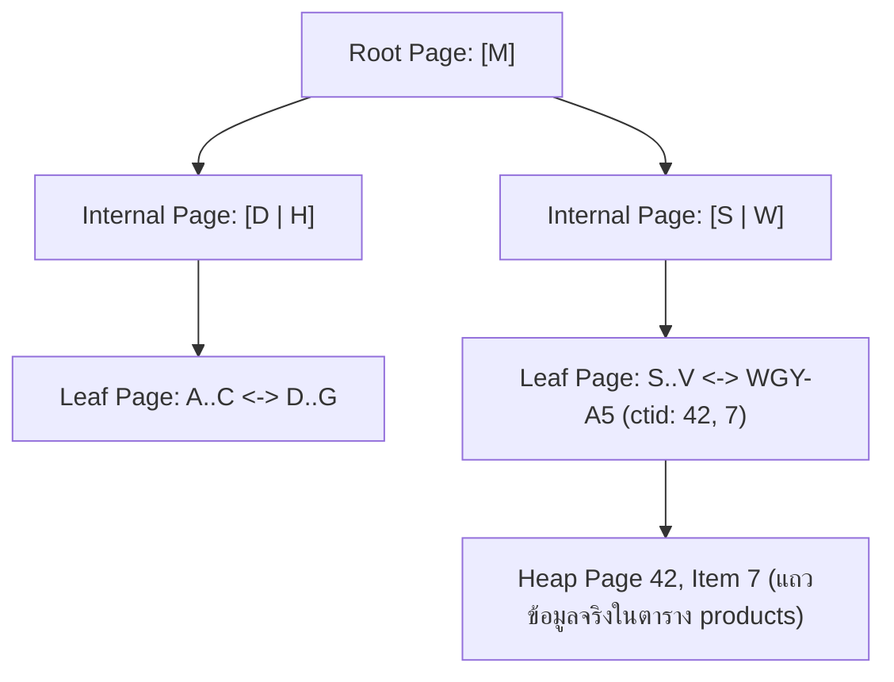
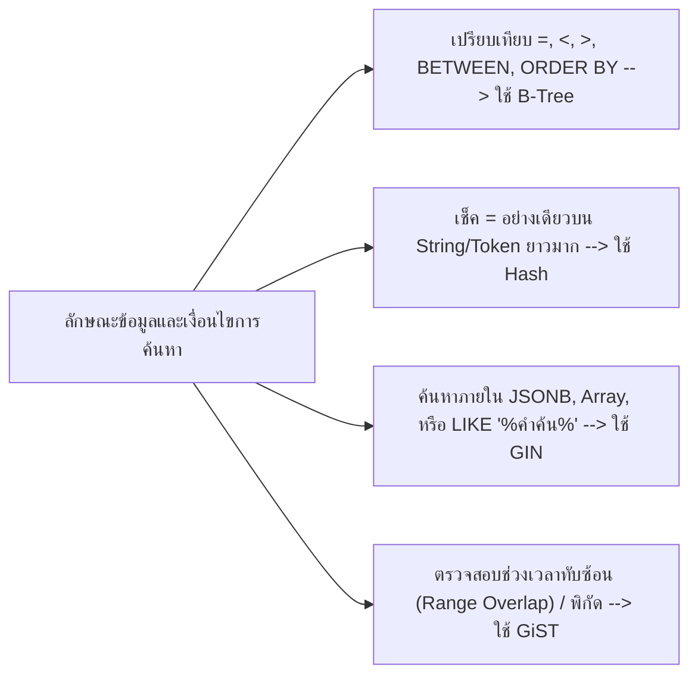
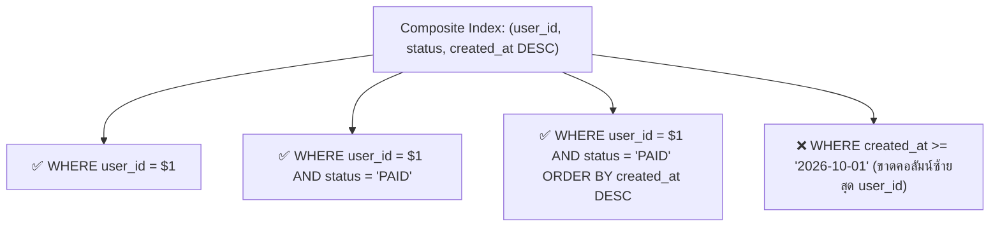
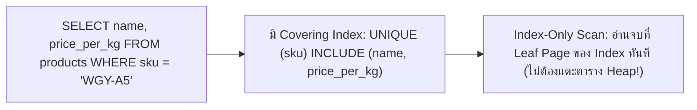
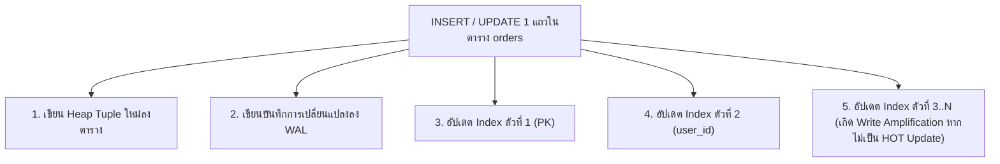

# Indexing

การสร้างดัชนี (Indexing) คือเครื่องมือที่มีอานุภาพสูงที่สุดในการเปลี่ยนคิวรีที่เคยทำงานช้าระดับหลายวินาทีให้เสร็จสิ้นภายในเสี้ยววินาที อย่างไรก็ตาม การสร้าง Index โดยไม่เข้าใจกลไกการทำงานภายในของ PostgreSQL 16 อาจกลายเป็นดาบสองคมที่ทำให้การเขียนข้อมูล (`INSERT`, `UPDATE`, `DELETE`) ช้าลงอย่างหนักและสิ้นเปลืองพื้นที่ดิสก์โดยเปล่าประโยชน์ เอกสารฉบับนี้จะเจาะลึกโครงสร้างข้อมูลของ Index แต่ละชนิด กฎการจัดเรียงคอลัมน์ และเทคนิคระดับ Production ผ่านระบบ **Smart Butcher Marketplace**

| หมวดหมู่เนื้อหา | หัวข้อหลักในหน้านี้ | เป้าหมายการเรียนรู้ |
| :--- | :--- | :--- |
| **1. โครงสร้างพื้นฐาน** | กลไกการทำงานของ B-Tree Index และเหตุผลที่ทำให้ค้นหาข้อมูลได้เร็ว | เข้าใจความต่างระหว่าง $O(N)$ กับ $O(\log N)$ และโครงสร้าง Lehman-Yao B-Tree |
| **2. ประเภทของดัชนี** | ชนิดของ Index ใน PostgreSQL 16 (B-Tree, Hash, GIN, GiST) | เลือกใช้ชนิด Index ให้ตรงกับรูปแบบข้อมูล (Text, JSONB, Trigram, Range) |
| **3. ดัชนีหลายคอลัมน์** | Composite Index และกฎลำดับคอลัมน์ (Leftmost Prefix Rule) | จัดลำดับคอลัมน์ใน Index ให้รองรับทั้งเงื่อนไข `WHERE` และการเรียง `ORDER BY` |
| **4. ดัชนีขั้นสูง** | Unique Index, Partial Index และ Covering Index (INCLUDE) | ลดขนาด Index ด้วยเงื่อนไข `WHERE` และทำ Index-Only Scan ด้วย `INCLUDE` |
| **5. ต้นทุนและการตัดสินใจ** | ต้นทุนของ Index ต่อการเขียนข้อมูล (Write Amplification) และเกณฑ์การเลือกสร้าง | วิเคราะห์ HOT Updates, Index Bloat และตรวจสอบ Index ที่ไม่ได้ใช้งาน |
| **6. การใช้งานร่วมกับ ORM** | การแมป Index กับ Prisma Schema (@unique, @@index) และกรณีศึกษาจริง | กำหนดโครงสร้าง Index ใน Prisma Schema และการสร้าง Index แบบ `CONCURRENTLY` |

<Callout type="tip" title="Index เปรียบเสมือนสารบัญท้ายเล่มของแค็ตตาล็อกเนื้อพรีเมียม">
หากไม่มี Index การค้นหาเนื้อวากิวรหัส `WGY-A5-001` จากตารางสินค้า 1 ล้านแถว เปรียบเสมือนการต้องเปิดหนังสือแค็ตตาล็อกอ่านทีละหน้าตั้งแต่หน้าแรกจนถึงหน้าสุดท้าย (Sequential Scan) แต่เมื่อมี B-Tree Index ระบบสามารถเปิดไปยังหน้าที่มีรหัสสินค้านั้นได้ทันทีภายใน 3-4 ก้าวเท่านั้น
</Callout>

---

## 1. กลไกการทำงานของ B-Tree Index และเหตุผลที่ทำให้ค้นหาข้อมูลได้เร็ว

### แนวคิด (Concept)
เมื่อตารางในฐานข้อมูลไม่มี Index การค้นหาข้อมูลด้วยเงื่อนไข `WHERE sku = 'WGY-MIYA-A5'` จะบังคับให้ PostgreSQL ต้องทำการกวาดอ่านข้อมูลทุกแถวตั้งแต่บล็อกแรกจนถึงบล็อกสุดท้ายของตาราง ซึ่งเรียกว่า **Sequential Scan (Full Table Scan)** โดยมีอัตราการเติบโตของเวลาตามจำนวนข้อมูลแบบเชิงเส้น หรือ $O(N)$ หากตารางมี 10 ล้านแถว ก็ต้องตรวจเช็คทั้ง 10 ล้านแถว

ในทางกลับกัน **B-Tree Index (Balanced Tree)** จะนำค่าของคอลัมน์ที่เราระบุมาจัดเรียงลำดับจากน้อยไปมากเก็บไว้ในโครงสร้างต้นไม้ที่สมดุลกันทุกกิ่ง ทำให้การค้นหาข้อมูลลดความซับซ้อนลงเหลือเพียง $O(\log N)$ เท่านั้น แม้ตาราง `orders` จะมีข้อมูลถึง 100 ล้านแถว การค้นหาผ่าน B-Tree Index ก็ใช้การกระโดดข้ามระดับของต้นไม้ (Tree Traversal) เพียงแค่ 4 ถึง 5 ครั้งก็พบตำแหน่งข้อมูลจริงบนดิสก์ทันที



### หลักการเบื้องหลัง (Under the Hood)
การใช้งาน B-Tree ใน PostgreSQL 16 อ้างอิงตามอัลกอริทึม **Lehman-Yao High-Concurrency B+-Tree** ซึ่งมีรายละเอียดเชิงลึกดังนี้:
1. **8KB Pages:** ทั้งตัวตารางหลัก (Heap) และตัว Index ถูกแบ่งเก็บเป็นบล็อกขนาด 8 กิโลไบต์ (8KB Pages) เท่ากัน
2. **Root, Internal, และ Leaf Pages:** โหนดชั้นบนสุดคือ Root Page และชั้นกลางคือ Internal Pages ซึ่งเก็บเฉพาะค่าคีย์และตัวชี้ไปยังหน้าถัดไป (Child Page Pointers) ส่วนข้อมูลตัวชี้ไปยังตารางจริงจะอยู่ที่ชั้นล่างสุดคือ **Leaf Pages** เท่านั้น
3. **Doubly-Linked Leaf Pages:** ในระดับ Leaf Pages แต่ละบล็อกจะมีตัวชี้เชื่อมต่อไปยังบล็อกข้างเคียงทั้งซ้ายและขวา ทำให้การค้นหาแบบช่วง (Range Scan เช่น `price_per_kg BETWEEN 2000 AND 5000`) หรือการเรียงลำดับ (`ORDER BY price_per_kg ASC/DESC`) ทำได้โดยการวิ่งไล่ตามลิงก์ในชั้น Leaf ได้เลยโดยไม่ต้องถอยกลับขึ้นไปที่ Root ใหม่
4. **TID (`ctid`):** ในแต่ละรายการของ Leaf Page จะเก็บค่าคีย์คู่กับ **Tuple Identifier (`ctid`)** ขนาด 6 Bytes ซึ่งระบุ `(หมายเลขหน้าบล็อกของตาราง, ลำดับช่องข้อมูลในบล็อกนั้น)` เช่น `(42, 7)` เพื่อให้ Engine กระโดดไปหยิบแถวข้อมูลจริงในตาราง (Heap Tuple) ได้ทันที
5. **B-Tree Deduplication:** ตั้งแต่ PostgreSQL 13 เป็นต้นมาจนถึง PostgreSQL 16 ระบบมีกลไกยุบรวมค่าคีย์ที่ซ้ำกันใน B-Tree (เช่น คอลัมน์ `status` หรือ `category_id`) ให้เก็บคีย์เพียงครั้งเดียวแล้วตามด้วยรายการของ `ctid` เรียงต่อกัน ช่วยลดขนาดของ B-Tree Index ลงได้ถึง 50-70%

### ตัวอย่างโค้ด (Smart Butcher Marketplace)

#### ตัวอย่างที่ 1: การสร้าง B-Tree Index พื้นฐานและตรวจสอบตำแหน่ง `ctid` ของแถวข้อมูล
แสดงการสร้าง B-Tree Index บนคอลัมน์รหัสสินค้าและหมายเลขโทรศัพท์ของลูกค้า พร้อมดูค่า `ctid` ที่ PostgreSQL ใช้ชี้ตำแหน่งข้อมูลจริง:

```sql filename="sql/01_btree_basics_and_ctid.sql"
-- สร้าง B-Tree Index (เป็นค่าเริ่มต้นของคำสั่ง CREATE INDEX ใน PostgreSQL)
CREATE INDEX idx_users_phone ON users (phone);

-- สร้าง B-Tree Index โดยระบุลำดับการเรียงจากมากไปน้อยสำหรับดึงออเดอร์ล่าสุด
CREATE INDEX idx_orders_created_at_desc ON orders (created_at DESC);

-- ตรวจสอบค่า ctid (Block Number, Tuple Index) ที่ B-Tree ใช้ชี้มายังแถวจริงในตาราง
SELECT ctid, id, sku, name, price_per_kg
FROM products
WHERE sku = 'WGY-MIYA-A5-STRIP';
```

#### ตัวอย่างที่ 2: การสร้าง Expression Index (Functional B-Tree Index) สำหรับค้นหาแบบไม่สนตัวพิมพ์เล็ก-ใหญ่
ในระบบ Smart Butcher หากลูกค้าค้นหาอีเมลด้วยคำสั่ง `WHERE LOWER(email) = 'customer@butcher.com'` ตัว B-Tree Index ปกติที่สร้างบนคอลัมน์ `(email)` เฉยๆ จะไม่ถูกนำมาใช้งาน! เราต้องสร้าง Index บนผลลัพธ์ของฟังก์ชัน `LOWER(email)` แทน:

```sql filename="sql/02_expression_btree_index.sql"
-- สร้าง Expression B-Tree Index บนค่าตัวพิมพ์เล็กของอีเมลและรหัสคูปอง
CREATE UNIQUE INDEX uq_users_email_lower
ON users (LOWER(email))
WHERE deleted_at IS NULL;

-- เมื่อคิวรีด้วยฟังก์ชันที่ตรงกับนิพจน์ของ Index ตัว Planner จะใช้ Index Scan ทันที
EXPLAIN ANALYZE
SELECT id, email, full_name
FROM users
WHERE LOWER(email) = LOWER('ChefSomchai@SmartButcher.com')
  AND deleted_at IS NULL;
```

### ผิด vs ถูก (Anti-pattern vs Best Practice)

| มิติการเปรียบเทียบ | ❌ ผิด (Anti-pattern) | ✅ ถูก (Best Practice) |
| :--- | :--- | :--- |
| **การใส่ฟังก์ชันครอบคอลัมน์ใน `WHERE`** | สร้าง Index บน `(created_at)` แต่เขียนคิวรี `WHERE EXTRACT(YEAR FROM created_at) = 2026` ทำให้ Index ไม่ถูกใช้ | เขียนเงื่อนไขแบบ Range แทน: `WHERE created_at >= '2026-01-01' AND created_at < '2027-01-01'` |
| **การสร้าง Index บนตารางเล็กจิ๋ว** | สร้าง Index 4-5 ตัวบนตาราง `categories` ที่มีข้อมูลแค่ 12 แถว | ตารางที่มีขนาดไม่กี่สิบแถวอยู่ใน 1 Page (8KB) อยู่แล้ว PostgreSQL จะอ่านด้วย Sequential Scan เร็วกว่าเปิด Index เสมอ |
| **การละเลยชนิดข้อมูลที่ตรงกัน** | คอลัมน์ `phone` เป็น `VARCHAR` แต่ส่งตัวเลขไปเทียบ `WHERE phone = 812345678` เกิด Implicit Type Cast จนไม่ใช้ Index | ส่งค่า Parameter ให้ตรงกับชนิดข้อมูลของคอลัมน์เสมอ เช่น `WHERE phone = '0812345678'` |

### ควรใช้เมื่อไหร่ และ ไม่ควรใช้เมื่อไหร่
- **ควรใช้ B-Tree Index เมื่อ:** คอลัมน์นั้นถูกใช้ในเงื่อนไขเปรียบเทียบความเท่ากัน (`=`), การเปรียบเทียบช่วง (`<`, `<=`, `>`, `>=`, `BETWEEN`), การเช็ค `IN (...)`, การค้นหาคำขึ้นต้น (`LIKE 'WGY%'`), หรือการจัดเรียงลำดับ (`ORDER BY`)
- **ไม่ควรใช้ B-Tree Index เมื่อ:** ต้องการค้นหาข้อความที่มีคำอยู่ตรงกลางประโยค (`LIKE '%Wagyu%'`) หรือต้องการค้นหาคีย์ย่อยหลายระดับภายในโครงสร้าง `JSONB` และ `ARRAY` (ซึ่งควรใช้ GIN Index แทน)

### คำถามสัมภาษณ์ (Interview Q&A)
- **Q1: ทำไมบางครั้งเราสร้าง B-Tree Index ไว้ถูกต้องทุกอย่างแล้ว แต่เมื่อรัน `EXPLAIN` พบว่า PostgreSQL ยังคงเลือกใช้ `Seq Scan` แทนที่จะใช้ `Index Scan`?**
  - **แนวคำตอบ:** เพราะ Cost-Based Optimizer ของ PostgreSQL ประเมินแล้วว่าการทำ `Seq Scan` มีต้นทุนต่ำกว่า ซึ่งมักเกิดจาก 2 สาเหตุหลัก คือ (1) ตารางยังมีจำนวนแถวน้อยมาก การอ่านรวดเดียวไม่กี่บล็อกจึงเร็วกว่าการต้องเปิดอ่านไฟล์ Index แล้วค่อยกระโดดมาอ่านไฟล์ตาราง หรือ (2) เงื่อนไขที่ค้นหาตรงกับข้อมูลสัดส่วนใหญ่มากของตาราง (Low Selectivity เช่น ค้นหา `WHERE status = 'DELIVERED'` ซึ่งมีอยู่ถึง 80% ของตาราง) การกระโดดอ่านทีละแถวผ่าน Index (Random I/O) จะช้ากว่าการกวาดอ่านตารางรวดเดียว (Sequential I/O)
- **Q2: `Index Scan` กับ `Bitmap Index Scan` ใน PostgreSQL ต่างกันอย่างไร?**
  - **แนวคำตอบ:** `Index Scan` จะอ่านตำแหน่ง `ctid` จาก Index แล้วกระโดดไปดึงข้อมูลในตารางทันทีทีละแถว เหมาะกับคิวรีที่ดึงข้อมูลจำนวนน้อยมาก (เพียงไม่กี่แถว) ส่วน `Bitmap Index Scan` จะใช้เมื่อคิวรีดึงข้อมูลจำนวนปานกลาง (หลายร้อยถึงหลายหมื่นแถว) หรือต้องรวมผลลัพธ์จากหลาย Index เข้าด้วยกัน (`BitmapAnd` / `BitmapOr`) โดยมันจะรวบรวมตำแหน่งหน้าบล็อกทั้งหมดจาก Index มาจัดเรียงลำดับหมายเลขหน้าบล็อกในหน่วยความจำก่อน แล้วค่อยไปเปิดอ่านตารางตามลำดับหน้าบล็อก เพื่อเปลี่ยน Random I/O ให้กลายเป็น Sequential I/O

---

## 2. ชนิดของ Index ใน PostgreSQL 16 (B-Tree, Hash, GIN, GiST)

### แนวคิด (Concept)
จุดแข็งที่ทำให้ PostgreSQL 16 เหนือกว่าฐานข้อมูลเชิงสัมพันธ์ทั่วไปคือสถาปัตยกรรมดัชนีที่ไม่ได้มีแค่ B-Tree ชนิดเดียว แต่มีชนิดของ Index เฉพาะทางให้เลือกใช้ตามลักษณะของข้อมูลและตัวดำเนินการ:
1. **B-Tree (Balanced Tree):** ดัชนีมาตรฐานสำหรับข้อมูลทั่วไปที่เรียงลำดับได้ (ตัวเลข, วันที่, ข้อความสั้น, UUID)
2. **Hash Index:** ดัชนีที่เก็บค่า Hash 32-bit ของข้อมูล รองรับเฉพาะตัวดำเนินการความเท่ากัน (`=`) เท่านั้น มีขนาดเล็กและเร็วมากสำหรับข้อมูลข้อความที่ยาวมากๆ (เช่น URL หรือ Token ยาวๆ)
3. **GIN (Generalized Inverted Index):** ดัชนีแบบกลับด้านที่ออกแบบมาสำหรับข้อมูลที่มีหลายค่าย่อยอยู่ในช่องเดียวกัน (Multi-value columns) เช่น **`JSONB`**, **`ARRAY`**, และการค้นหาข้อความแบบ **Full-Text Search / Trigram (`pg_trgm`)**
4. **GiST (Generalized Search Tree):** โครงสร้างต้นไม้เชิงนามธรรมสำหรับข้อมูลที่มีการซ้อนทับกันได้ เช่น **Range Types** (ช่วงเวลาจองห้องดรายเอจไม่ให้ทับซ้อนกัน), ข้อมูลพิกัดภูมิศาสตร์ (PostGIS), และการค้นหาระยะห่าง (Nearest-Neighbor Search)



### หลักการเบื้องหลัง (Under the Hood)
เพื่อให้เข้าใจว่าทำไม **GIN Index** จึงค้นหาข้อมูลใน `JSONB` หรือ `LIKE '%เนื้อวากิว%'` ได้เร็วมาก ให้พิจารณาโครงสร้างภายในของมัน:
- ใน B-Tree ปกติ 1 แถวของตารางจะเท่ากับ 1 Entry ใน Index
- แต่ใน **GIN Index** ระบบจะทำการแตกข้อมูลภายใน 1 แถวออกเป็นองค์ประกอบย่อยๆ (Keys/Elements) แล้วสร้างสารบัญว่าแต่ละองค์ประกอบย่อยปรากฏอยู่ในแถว (`ctid`) ใดบ้าง (เรียกว่า **Posting List** หรือ **Posting Tree**)
- ตัวอย่างเช่น เมื่อใช้ส่วนขยาย `pg_trgm` ร่วมกับ GIN Index บนชื่อสินค้า คำว่า `'Wagyu'` จะถูกหั่นเป็นกลุ่มตัวอักษร 3 ตัวเรียงกัน (Trigrams) ได้แก่ `'  w'`, `' wa'`, `'wag'`, `'agy'`, `'gyu'`, `'yu '` แล้วเก็บลง GIN Index เมื่อลูกค้าค้นหา `WHERE name ILIKE '%wagyu%'` PostgreSQL จึงไม่ต้องกวาดอ่านทั้งตาราง แต่ไปเปิดสารบัญ GIN ของ Trigrams เหล่านั้นแล้วนำรายการ `ctid` มาตัดกัน (Intersection) ได้ผลลัพธ์ในระดับมิลลิวินาที!

#### ตารางเปรียบเทียบชนิด Index ใน PostgreSQL 16

| ชนิด Index | ตัวดำเนินการที่รองรับ | กรณีใช้งานหลักใน Smart Butcher | ข้อจำกัดสำคัญ |
| :--- | :--- | :--- | :--- |
| **B-Tree** | `=`, `<`, `<=`, `>`, `>=`, `BETWEEN`, `IN`, `IS NULL` | ค้นหา `id`, `sku`, `price_per_kg`, `created_at` | ไม่รองรับ `LIKE '%คำกลาง%'` หรือการค้นคีย์ลึกๆ ใน `JSONB` |
| **Hash** | `=` เท่านั้น | ค้นหา `provider_tx_id` หรือ Webhook Signature ยาวๆ | ไม่รองรับ Range Scan, `ORDER BY`, หรือการทำ Unique Constraint |
| **GIN** | `@>`, `?`, `?&`, `?|`, `@@`, `ILIKE '%...%'` (คู่กับ `pg_trgm`) | ค้นหา `specifications` (`JSONB`), ค้นหาชื่อเนื้อแบบบางส่วน | ขนาด Index ใหญ่กว่าและใช้เวลาอัปเดตนานกว่า B-Tree (แก้ไขด้วย `fastupdate`) |
| **GiST** | `&&` (Overlap), `@>`, `<->` (Distance) | ป้องกันการจองตู้บ่มเนื้อ Dry-Aged ช่วงเวลาชนกัน (`EXCLUDE USING gist`) | ความเร็วในการค้นหาค่าซ้ำตรงๆ ช้ากว่า GIN |

### ตัวอย่างโค้ด (Smart Butcher Marketplace)

#### ตัวอย่างที่ 1: การสร้าง GIN Index สำหรับค้นหา `JSONB` และค้นหาชื่อสินค้าด้วย `pg_trgm`
ในตาราง `products` เรามีคอลัมน์ `specifications` (`JSONB`) ที่เก็บข้อมูลฟาร์มและใบรับรองฮาลาล และลูกค้ามักพิมพ์ค้นหาชื่อสินค้าบางส่วนด้วย `ILIKE`:

```sql filename="sql/03_gin_index_jsonb_and_trigram.sql"
-- เปิดใช้งาน Extension pg_trgm สำหรับการหั่นคำค้นหาแบบ Trigram
CREATE EXTENSION IF NOT EXISTS pg_trgm;

-- 1. สร้าง GIN Index แบบ jsonb_path_ops สำหรับค้นหาข้อมูลภายใน JSONB ด้วยตัวดำเนินการ @>
CREATE INDEX idx_products_specs_gin
ON products USING GIN (specifications jsonb_path_ops);

-- คิวรีค้นหาสินค้าเนื้อที่ได้รับรอง Halal และมาจากจังหวัด Miyazaki (ใช้ GIN Index เต็มรูปแบบ)
SELECT id, sku, name, price_per_kg
FROM products
WHERE specifications @> '{"halal": true, "origin": "Miyazaki"}'::jsonb;

-- 2. สร้าง GIN Trigram Index สำหรับเร่งความเร็วคำสั่ง ILIKE '%คำค้น%'
CREATE INDEX idx_products_name_trgm_gin
ON products USING GIN (name gin_trgm_ops);

-- คิวรีค้นหาชื่อสินค้าที่มีคำว่า 'ribeye' อยู่ตรงส่วนใดของชื่อก็ได้โดยไม่ต้องทำ Sequential Scan!
SELECT id, sku, name, price_per_kg
FROM products
WHERE name ILIKE '%ribeye%';
```

#### ตัวอย่างที่ 2: การใช้ GiST Index คู่กับ Exclusion Constraint ป้องกันการจองตู้บ่มเนื้อเวลาทับซ้อนกัน
ร้าน Smart Butcher มีบริการรับบ่มเนื้อ Dry-Aged ตามสั่งในตู้ควบคุมอุณหภูมิพิเศษ (`dry_aging_chambers`) โดยห้ามไม่ให้มีการจองตู้ใบเดียวกันในช่วงวันเวลาที่ทับซ้อนกันเด็ดขาด:

```sql filename="sql/04_gist_index_range_exclusion.sql"
-- เปิดใช้งาน btree_gist เพื่อให้ GiST Index ผสมคอลัมน์ UUID เข้ากับ Range Type ได้
CREATE EXTENSION IF NOT EXISTS btree_gist;

CREATE TABLE dry_aging_bookings (
    id UUID PRIMARY KEY DEFAULT gen_random_uuid(),
    chamber_number SMALLINT NOT NULL,
    order_id UUID NOT NULL REFERENCES orders(id) ON DELETE CASCADE,
    aging_period TSTZRANGE NOT NULL, -- ช่วงเวลาเริ่มต้นถึงสิ้นสุดการบ่มเนื้อ
    created_at TIMESTAMPTZ NOT NULL DEFAULT CURRENT_TIMESTAMP,
    -- ใช้ GiST Index บังคับว่าใน chamber_number เดียวกัน (=) ห้ามมี aging_period ทับซ้อนกัน (&&)
    CONSTRAINT excl_chamber_booking_overlap
        EXCLUDE USING GIST (chamber_number WITH =, aging_period WITH &&)
);
```

### ผิด vs ถูก (Anti-pattern vs Best Practice)

| มิติการเปรียบเทียบ | ❌ ผิด (Anti-pattern) | ✅ ถูก (Best Practice) |
| :--- | :--- | :--- |
| **การค้นหาด้วย `ILIKE '%...%'`** | ใช้ B-Tree Index ปกติแล้วเขียน `WHERE name ILIKE '%wagyu%'` ซึ่งทำให้เกิด Sequential Scan เต็มตารางเสมอ | เปิด `pg_trgm` แล้วสร้าง `GIN (name gin_trgm_ops)` เพื่อรองรับ `ILIKE` ที่มี `%` นำหน้า |
| **การเลือก Operator Class ของ GIN JSONB** | ใช้ `USING GIN (specifications)` แบบ Default ทั้งที่ใช้แค่ `@>` ทำให้ Index ใหญ่เกินจำเป็น | ระบุ `USING GIN (specifications jsonb_path_ops)` เมื่อค้นหาด้วย `@>` เพื่อลดขนาด Index ลงเกือบครึ่งหนึ่ง |
| **การป้องกันเวลาจองชนกัน** | เขียน `SELECT COUNT(*)` เช็คเวลาชนกันในโค้ด Node.js ซึ่งพังทันทีเมื่อมีคนกดจองพร้อมกัน 2 คน (Race Condition) | ใช้ `TSTZRANGE` คู่กับ `EXCLUDE USING GIST` ให้ฐานข้อมูลป้องกันการจองเวลาทับซ้อนกัน 100% |

### ควรใช้เมื่อไหร่ และ ไม่ควรใช้เมื่อไหร่
- **ควรใช้ GIN Index เมื่อ:** ต้องค้นหาค่าภายในคอลัมน์ `JSONB`, คอลัมน์ `ARRAY`, หรือค้นหาข้อความแบบ `LIKE` / `ILIKE` ที่ไม่ได้ระบุคำขึ้นต้นตายตัว
- **ไม่ควรใช้ GIN Index เมื่อ:** ตารางนั้นมีการ `UPDATE` คอลัมน์ดังกล่าวด้วยความถี่สูงมากระดับหลายพันครั้งต่อวินาที และต้องการความเร็วในการเขียนสูงสุด เพราะการแตกองค์ประกอบย่อยลงใน GIN Index มีต้นทุน CPU และ I/O สูงกว่า B-Tree

### คำถามสัมภาษณ์ (Interview Q&A)
- **Q1: ในการสร้าง GIN Index บนคอลัมน์ `JSONB` ระหว่าง Default Operator Class (`jsonb_ops`) กับ `jsonb_path_ops` ต่างกันอย่างไร และควรเลือกตัวไหน?**
  - **แนวคำตอบ:** `jsonb_ops` (ค่าเริ่มต้น) จะแยกเก็บทั้งชื่อ Key และค่า Value เป็นรายการแยกจากกัน ทำให้รองรับการเช็คว่ามีชื่อ Key นี้อยู่หรือไม่ (`?`, `?&`, `?|`) รวมถึง `@>` แต่ทำให้ขนาด Index ใหญ่มาก ส่วน `jsonb_path_ops` จะนำ Path ของ Key ไปรวมกับ Value แล้วแปลงเป็นค่า Hash เดียวกัน จึงรองรับเฉพาะการค้นหาด้วยตัวดำเนินการ `@>` (Containment) เท่านั้น แต่มีขนาดเล็กกว่ามากและค้นหา `@>` ได้เร็วกว่า จึงแนะนำให้ใช้ `jsonb_path_ops` เป็นหลักหากแอปพลิเคชันค้นหาด้วย `@>`
- **Q2: เมื่อใดที่การใช้ Hash Index ใน PostgreSQL 16 มีความได้เปรียบเหนือกว่า B-Tree Index?**
  - **แนวคำตอบ:** เมื่อเราต้องการค้นหาด้วยเงื่อนไขความเท่ากัน (`=`) เพียงอย่างเดียว บนคอลัมน์ที่มีขนาดข้อมูลต่อแถวยาวมากๆ เช่น รหัส Token ยาว 512 ตัวอักษร หรือ URL ยาวๆ เพราะ B-Tree ต้องคัดลอกข้อความยาวๆ ทั้งก้อนไปเก็บไว้ในโหนดของ Index ทำให้ Index มีขนาดใหญ่มาก ในขณะที่ Hash Index จะแปลงข้อความยาวๆ นั้นให้เหลือเพียงค่า Hash ขนาด 4 Bytes (32-bit) เท่านั้น ทำให้ขนาด Index เล็กกว่า B-Tree หลายเท่าและพักอยู่ใน RAM ได้ทั้งหมด

---

## 3. Composite Index และกฎลำดับคอลัมน์ (Leftmost Prefix Rule)

### แนวคิด (Concept)
**Composite Index (หรือ Multicolumn Index)** คือการสร้าง B-Tree Index ตัวเดียวที่ครอบคลุมมากกว่า 1 คอลัมน์ขึ้นไป เช่น `CREATE INDEX idx_orders_user_status ON orders (user_id, status);` เพื่อรองรับคิวรีที่มีการกรองหรือเรียงลำดับข้อมูลด้วยหลายคอลัมน์พร้อมกัน

หัวใจสำคัญที่สุดของการออกแบบ Composite Index คือ **กฎลำดับคอลัมน์ซ้ายสุด (Leftmost Prefix Rule)** และ **ลำดับ Equality ก่อน Range/Sort**:
- หากเรามี Index บนคอลัมน์ `(A, B, C)` ข้อมูลใน B-Tree จะถูกเรียงลำดับตามคอลัมน์ `A` ก่อน หากค่า `A` เท่ากันจึงเรียงตาม `B` และหาก `B` เท่ากันจึงเรียงตาม `C`
- เปรียบเสมือนสมุดโทรศัพท์ที่เรียงตาม **(จังหวัด, อำเภอ, นามสกุล)** เราสามารถใช้สมุดเล่มนี้ค้นหาคนใน *(จังหวัดเชียงใหม่)* หรือ *(จังหวัดเชียงใหม่ และ อำเภอเมือง)* ได้ทันที แต่ถ้าถามหาคนที่มี *(นามสกุล ใจดี)* โดยไม่บอกจังหวัด สมุดเรียงลำดับเล่มนี้จะช่วยอะไรไม่ได้เลย เพราะนามสกุลใจดีกระจายอยู่ทุกจังหวัด!



### หลักการเบื้องหลัง (Under the Hood)
ในการจัดลำดับคอลัมน์ภายใน Composite Index สำหรับคิวรีที่มีทั้งการเช็คความเท่ากัน (`=`), การเช็คช่วงข้อมูล (`>`, `<`, `BETWEEN`), และการจัดเรียง (`ORDER BY`) ให้ยึดหลักการ **ESR Rule (Equality -> Sort / Range)**:
1. **Equality Columns ไว้ซ้ายสุด:** นำคอลัมน์ที่ใช้เปรียบเทียบด้วยเครื่องหมาย `=` มาวางไว้ลำดับแรกสุดเสมอ เพื่อบีบขอบเขตของกิ่ง B-Tree ให้แคบลงเหลือเฉพาะกลุ่มที่ตรงเงื่อนไขทันที
2. **Sort หรือ Range Column ไว้ลำดับถัดมา:** ทันทีที่มีคอลัมน์ใดใช้เงื่อนไขแบบช่วง (Range เช่น `created_at > ...`) คอลัมน์ที่อยู่ถัดไปทางขวาใน Index จะไม่สามารถใช้ทำ Index Lookup แบบเรียงลำดับต่อเนื่องได้อีก ดังนั้นจึงควรวางคอลัมน์ที่ใช้ทำ `ORDER BY` หรือ Range ไว้ต่อท้ายกลุ่ม Equality เสมอ

### ตัวอย่างโค้ด (Smart Butcher Marketplace)

#### ตัวอย่างที่ 1: การออกแบบ Composite Index สำหรับหน้าประวัติคำสั่งซื้อของลูกค้า
ในหน้า "รายการคำสั่งซื้อของฉัน" แอปพลิเคชันต้องดึงออเดอร์ของลูกค้าคนนั้น กรองเฉพาะสถานะที่ต้องการ และเรียงลำดับจากออเดอร์ล่าสุดไปเก่าสุด:

```sql filename="sql/05_composite_index_esr_rule.sql"
-- สร้าง Composite Index ตามหลัก ESR:
-- 1. user_id (Equality: =)
-- 2. status (Equality: =)
-- 3. created_at DESC (Sort/Range: ORDER BY ... DESC)
CREATE INDEX idx_orders_user_status_created
ON orders (user_id, status, created_at DESC);

-- คิวรีนี้จะทำงานเร็วที่สุด: วิ่งเข้าเป้าด้วย Index และได้ข้อมูลที่เรียงลำดับพร้อมแล้วโดยไม่ต้อง Sort ใน RAM!
EXPLAIN ANALYZE
SELECT id, order_number, total_amount, created_at
FROM orders
WHERE user_id = 'a1111111-1111-1111-1111-111111111111'
  AND status = 'PAID'
ORDER BY created_at DESC
LIMIT 20;
```

#### ตัวอย่างที่ 2: การออกแบบ Composite Index สำหรับค้นหาสินค้าตามหมวดหมู่และช่วงราคา
ในหน้าแค็ตตาล็อกสินค้า ลูกค้าเลือกหมวดหมู่เนื้อ (`category_id = $1`) เฉพาะสินค้าที่เปิดขาย (`is_active = true`) และกรองช่วงราคา (`price_per_kg BETWEEN $2 AND $3`):

```sql filename="sql/06_composite_index_catalog_filter.sql"
-- วาง Equality columns (category_id, is_active) ไว้ข้างหน้า และวาง Range column (price_per_kg) ไว้ท้ายสุด
CREATE INDEX idx_products_cat_active_price
ON products (category_id, is_active, price_per_kg);

-- คิวรีที่ได้ประโยชน์สูงสุดจาก Composite Index ข้างต้น
SELECT id, sku, name, price_per_kg, marbling_score
FROM products
WHERE category_id = 'c1111111-1111-1111-1111-111111111111'
  AND is_active = TRUE
  AND price_per_kg BETWEEN 1500.00 AND 4500.00
ORDER BY price_per_kg ASC;
```

### ผิด vs ถูก (Anti-pattern vs Best Practice)

| มิติการเปรียบเทียบ | ❌ ผิด (Anti-pattern) | ✅ ถูก (Best Practice) |
| :--- | :--- | :--- |
| **การวางลำดับ Range ก่อน Equality** | สร้าง Index `(created_at, user_id)` สำหรับคิวรี `WHERE user_id = $1 ORDER BY created_at DESC` ทำให้ต้องกวาดเวลาทั้งหมดก่อน | สร้าง Index `(user_id, created_at DESC)` เพื่อให้กรองเฉพาะลูกค้าคนนั้นก่อน แล้วได้ข้อมูลเรียงตามเวลาทันที |
| **การสร้าง Index แยกเดี่ยวทุกคอลัมน์** | สร้าง Index แยก 3 ตัวบน `(user_id)`, `(status)`, และ `(created_at)` ทั้งที่คิวรีใช้ทั้ง 3 คอลัมน์ร่วมกันตลอด | สร้าง Composite Index ตัวเดียว `(user_id, status, created_at DESC)` ซึ่งมีประสิทธิภาพสูงกว่าการทำ BitmapAnd หลายเท่า |
| **การสร้าง Index ซ้ำซ้อนกับ Prefix** | มี Index `(user_id, status)` อยู่แล้ว แต่ไปสร้าง Index เดี่ยว `(user_id)` เพิ่มอีกตัว | ลบ Index เดี่ยว `(user_id)` ทิ้งได้เลย เพราะ Index `(user_id, status)` ใช้ค้นหาเฉพาะ `user_id` ได้เต็มประสิทธิภาพอยู่แล้ว |

### ควรใช้เมื่อไหร่ และ ไม่ควรใช้เมื่อไหร่
- **ควรใช้ Composite Index เมื่อ:** คิวรีหลักของระบบมีการกรองข้อมูลด้วย `WHERE` หลายคอลัมน์ร่วมกันเป็นประจำ หรือมีการใช้ `WHERE` คอลัมน์หนึ่งคู่กับการทำ `ORDER BY` อีกคอลัมน์หนึ่งเสมอ
- **ไม่ควรใส่คอลัมน์ลงใน Composite Index เกิน 3-4 คอลัมน์เมื่อ:** คอลัมน์หลังๆ แทบไม่ได้ช่วยคัดกรองจำนวนแถวให้ลดลงแล้ว เพราะจะทำให้ขนาดของ Index ใหญ่ขึ้นและเพิ่มภาระตอน `INSERT`/`UPDATE` โดยไม่จำเป็น

### คำถามสัมภาษณ์ (Interview Q&A)
- **Q1: หากเรามี Composite Index บนคอลัมน์ `(category_id, status, created_at)` คิวรีที่มีเงื่อนไข `WHERE category_id = $1 AND created_at > '2026-01-01'` (โดยไม่ได้ระบุ `status`) จะสามารถใช้ Index ตัวนี้ได้หรือไม่?**
  - **แนวคำตอบ:** ใช้ได้ **แต่ได้เพียงบางส่วนเท่านั้น!** PostgreSQL จะใช้ Index ในการกรองเฉพาะคอลัมน์ซ้ายสุดคือ `category_id = $1` ได้อย่างรวดเร็ว แต่เนื่องจากคิวรีข้ามคอลัมน์ลำดับที่สอง (`status`) ไป จึงไม่สามารถกระโดดไปยังตำแหน่ง `created_at` โดยตรงได้ ต้องทำการอ่าน Index Entries ทั้งหมดที่อยู่ใน `category_id` นั้นเพื่อเช็คค่า `created_at` เอง
- **Q2: ระหว่างคอลัมน์ที่มีค่าหลากหลายมาก (High Cardinality เช่น `user_id`) กับคอลัมน์ที่มีค่าซ้ำกันเยอะ (Low Cardinality เช่น `status`) ถ้าทั้งคู่ใช้เครื่องหมาย `=` เหมือนกัน ควรเอาตัวไหนไว้ซ้ายสุดใน Composite Index?**
  - **แนวคำตอบ:** หากคิวรีใช้เครื่องหมาย `=` ทั้งสองคอลัมน์เสมอ ในทางทฤษฎีของ B-Tree ความเร็วในการค้นหาทั้งคู่แทบไม่ต่างกัน แต่ในทางปฏิบัติ **ควรนำคอลัมน์ที่มี High Cardinality (`user_id`) และถูกใช้ค้นหาเดี่ยวๆ บ่อยกว่าไว้ซ้ายสุด** เพราะจะทำให้ Index ตัวเดียวกันนี้สามารถรองรับคิวรีที่ค้นหาด้วย `WHERE user_id = $1` เพียงอย่างเดียวได้ด้วย โดยไม่ต้องสร้าง Index เพิ่มอีกตัว

---

## 4. Unique Index, Partial Index และ Covering Index (INCLUDE)

### แนวคิด (Concept)
นอกจากการสร้าง B-Tree Index แบบมาตรฐานแล้ว PostgreSQL 16 ยังมีฟีเจอร์ดัชนีขั้นสูงอีก 3 รูปแบบที่ช่วยให้ระบบทำงานได้เร็วขึ้นและใช้พื้นที่หน่วยความจำน้อยลงอย่างมหาศาล:
1. **Unique Index:** ดัชนีที่รับประกันว่าค่าในคอลัมน์ (หรือกลุ่มคอลัมน์) จะไม่มีวันซ้ำกันในระดับ Database Engine และช่วยให้ Query Planner รู้ทันทีว่าผลลัพธ์ของการค้นหาด้วย `=` จะมีไม่เกิน 1 แถวเสมอ
2. **Partial Index (Filtered Index):** การสร้าง Index เฉพาะแถวที่ตรงตามเงื่อนไข `WHERE` ที่กำหนดเท่านั้น เช่น ตาราง `orders` มีข้อมูลสะสม 50 ล้านแถว แต่เป็นออเดอร์ที่ส่งสำเร็จไปแล้ว (`DELIVERED`) ถึง 99% ส่วนออเดอร์ที่กำลังรอจัดส่ง (`PENDING`, `PAID`, `PREPARING`) มีเพียง 1% เราสามารถสร้าง Partial Index เฉพาะออเดอร์ที่ยังไม่เสร็จสิ้นได้ ทำให้ขนาด Index เล็กลงถึง 100 เท่า!
3. **Covering Index (`INCLUDE` clause):** การแนบคอลัมน์เสริมที่ต้องการดึงไปแสดงผลใน `SELECT` เก็บไว้ที่ระดับ Leaf Page ของ Index ด้วยคำสั่ง `INCLUDE (...)` เพื่อให้ PostgreSQL ตอบคำถามคิวรีได้จบจากในตัว Index ทันทีโดยไม่ต้องเสียเวลากระโดดไปอ่านตารางหลัก (**Index-Only Scan**)



### หลักการเบื้องหลัง (Under the Hood)
การทำงานของ **Covering Index (`INCLUDE`)** และ **Index-Only Scan** ใน PostgreSQL 16 มีรายละเอียดสำคัญที่ต้องเข้าใจดังนี้:
- คอลัมน์ที่อยู่ในวงเล็บแรก `ON products (sku)` คือ **Key Columns** ซึ่งถูกนำไปจัดเรียงและเก็บไว้ในทุกระดับของต้นไม้ B-Tree (Root, Internal, และ Leaf)
- ส่วนคอลัมน์ที่อยู่ใน `INCLUDE (name, price_per_kg)` คือ **Non-Key Payload Columns** ซึ่งจะถูกเก็บไว้ที่ชั้นล่างสุด (**Leaf Pages**) เท่านั้น ไม่ถูกนำไปเก็บใน Root หรือ Internal Pages ทำให้ต้นไม้ชั้นบนยังคงมีขนาดเล็กและตื้น كماไม่ต้องเสียเวลาจัดเรียงคอลัมน์ใน `INCLUDE`
- **บทบาทของ Visibility Map (VM):** เนื่องจาก PostgreSQL เก็บข้อมูลการมองเห็นของ Transaction (MVCC `xmin`/`xmax`) ไว้ที่ตารางหลัก (Heap) ไม่ได้เก็บไว้ใน Index เมื่อทำ **Index-Only Scan** ตัว Engine จะเช็คไฟล์ขนาดเล็กที่เรียกว่า **Visibility Map (VM)** ก่อนว่าหน้าบล็อกนั้นถูก `VACUUM` ยืนยันว่าทุกแถวมองเห็นได้ทั้งหมด (All-Visible) แล้วหรือยัง หากเป็น All-Visible แล้วก็จะคืนค่าจาก Index ทันทีโดยเกิด `Heap Fetches: 0`!

### ตัวอย่างโค้ด (Smart Butcher Marketplace)

#### ตัวอย่างที่ 1: การสร้าง Partial Index สำหรับติดตามออเดอร์ที่กำลังดำเนินการและคิวงานห้องเชือด
ตาราง `orders` มีข้อมูลในอดีตที่ปิดงานไปแล้วจำนวนมหาศาล แต่ระบบหลังบ้านของพนักงานแล่เนื้อและระบบขนส่งต้องคิวรีหาออเดอร์ที่อยู่ในสถานะรอดำเนินการตลอดทุกวินาที:

```sql filename="sql/07_partial_index_active_orders.sql"
-- สร้าง Partial Index เก็บเฉพาะออเดอร์ที่ยังอยู่ในกระบวนการทำงานเท่านั้น (ขนาดเล็กกว่า Index เต็มตารางถึง 95%+)
CREATE INDEX idx_orders_active_processing
ON orders (status, created_at ASC)
WHERE status IN ('PENDING', 'PAID', 'PREPARING', 'SHIPPED');

-- คิวรีสำหรับหน้าจอมอนิเตอร์ของห้องแล่เนื้อ (จะใช้ idx_orders_active_processing ทันทีเพราะเงื่อนไข WHERE ตรงกัน)
EXPLAIN ANALYZE
SELECT id, order_number, status, created_at
FROM orders
WHERE status = 'PREPARING'
ORDER BY created_at ASC;
```

#### ตัวอย่างที่ 2: การสร้าง Covering Index (`INCLUDE`) เพื่อให้เกิด `Index Only Scan`
เมื่อระบบตะกร้าสินค้าต้องตรวจสอบราคาและสต็อกของสินค้าจากรหัส `sku` ด้วยความถี่สูงมาก เราสามารถสร้าง Unique Covering Index เพื่อให้อ่านข้อมูลจบใน Index ทันที:

```sql filename="sql/08_covering_index_include.sql"
-- สร้าง Unique Covering Index บนคอลัมน์ sku และแนบ name, price_per_kg, stock_qty ไว้ที่ Leaf Page
CREATE UNIQUE INDEX uq_products_sku_covering
ON products (sku)
INCLUDE (id, name, price_per_kg, stock_qty)
WHERE deleted_at IS NULL;

-- อัปเดต Visibility Map และสถิติของตารางเพื่อให้พร้อมทำ Index-Only Scan เต็มรูปแบบ
VACUUM ANALYZE products;

-- ทดสอบรันคิวรี จะเห็นแผนการทำงานเป็น "Index Only Scan using uq_products_sku_covering" และ Heap Fetches: 0
EXPLAIN (ANALYZE, BUFFERS)
SELECT id, name, price_per_kg, stock_qty
FROM products
WHERE sku = 'WGY-MIYA-A5-STRIP'
  AND deleted_at IS NULL;
```

### ผิด vs ถูก (Anti-pattern vs Best Practice)

| มิติการเปรียบเทียบ | ❌ ผิด (Anti-pattern) | ✅ ถูก (Best Practice) |
| :--- | :--- | :--- |
| **การบังคับ Unique แบบมีเงื่อนไข** | ใช้คอลัมน์ทั้งหมดใส่ใน Composite Unique `(sku, is_active)` ซึ่งทำให้มีสินค้าที่ `is_active = false` ซ้ำกันได้แค่ครั้งเดียว | ใช้ Partial Unique Index: `CREATE UNIQUE INDEX ... ON products(sku) WHERE deleted_at IS NULL;` |
| **การใส่คอลัมน์แสดงผลใน Key** | สร้าง Composite Index `(sku, name, price_per_kg, description)` ทำให้โหนดชั้นบนของ B-Tree บวมและเสียค่า Unique บน `sku` เดี่ยวๆ | ใช้ `UNIQUE (sku) INCLUDE (name, price_per_kg)` เพื่อคงความเป็น Unique ของ `sku` และเก็บข้อมูลเสริมเฉพาะที่ Leaf Page |
| **การใส่คอลัมน์ขนาดใหญ่ใน `INCLUDE`** | ยัดคอลัมน์ `description TEXT` หรือ `specifications JSONB` เข้าไปใน `INCLUDE` จน Leaf Page ของ Index บวมหนัก | ใส่เฉพาะคอลัมน์ขนาดเล็กที่ถูกดึงใน Hot Queries (เช่น `price_per_kg`, `stock_qty`, `status`) ใน `INCLUDE` |

### ควรใช้เมื่อไหร่ และ ไม่ควรใช้เมื่อไหร่
- **ควรใช้ Partial Index เมื่อ:** คิวรีของแอปพลิเคชันเจาะจงค้นหาเฉพาะกลุ่มย่อยของข้อมูลที่มีสัดส่วนน้อยเมื่อเทียบกับตารางทั้งหมดเป็นประจำ (เช่น ค้นหาเฉพาะ `WHERE is_active = true`, `WHERE deleted_at IS NULL`, หรือ `WHERE status = 'PENDING'`)
- **ควรใช้ Covering Index (`INCLUDE`) เมื่อ:** มีคิวรีความถี่สูง (Hot Path) ที่ดึงเฉพาะบางคอลัมน์ซ้ำๆ และต้องการขจัดภาระการอ่านตารางหลัก (Random Heap I/O) ออกไปให้เป็นศูนย์

### คำถามสัมภาษณ์ (Interview Q&A)
- **Q1: ความแตกต่างระหว่างการสร้าง Index แบบ `ON products (sku, price_per_kg)` กับ `ON products (sku) INCLUDE (price_per_kg)` คืออะไร?**
  - **แนวคำตอบ:** มีความต่างสำคัญ 3 ประการ คือ (1) ในแบบ `INCLUDE` คอลัมน์ `price_per_kg` จะถูกเก็บไว้เฉพาะในระดับ Leaf Pages เท่านั้น ไม่ถูกนำไปเก็บใน Internal/Root Pages ทำให้ต้นไม้ B-Tree มีขนาดเล็กกว่า (2) यदिสร้างเป็น `UNIQUE INDEX ON products (sku) INCLUDE (price_per_kg)` ระบบจะบังคับความไม่ซ้ำเฉพาะที่คอลัมน์ `sku` ตัวเดียว ในขณะที่ `UNIQUE (sku, price_per_kg)` จะยอมให้มี `sku` ซ้ำกันได้ถ้าราคาต่างกัน และ (3) คอลัมน์ใน `INCLUDE` ไม่สามารถใช้ช่วยเรียงลำดับ `ORDER BY price_per_kg` ได้แต่ใช้ดึงค่าไปแสดงใน `SELECT` เพื่อทำ Index-Only Scan ได้
- **Q2: ทำไมบางครั้งเราสร้าง Covering Index (`INCLUDE`) ครบทุกคอลัมน์ใน `SELECT` แล้ว แต่เมื่อดู `EXPLAIN (ANALYZE, BUFFERS)` ยังคงเห็น `Heap Fetches` มีค่ามากกว่าศูนย์?**
  - **แนวคำตอบ:** เพราะใน PostgreSQL ข้อมูล Transaction Visibility (`xmin`/`xmax`) ถูกเก็บอยู่ในตารางหลัก (Heap) ไม่ได้อยู่ใน Index หากหน้าบล็อกของตารางเพิ่งถูก `INSERT` หรือ `UPDATE` ไปเมื่อไม่นานมานี้และกระบวนการ `VACUUM` ยังไม่ได้เข้ามาทำเครื่องหมายใน **Visibility Map (VM)** ว่าหน้าบล็อกนั้นเป็น All-Visible ตัว Engine จึงจำใจต้องแวะไปเปิดตาราง Heap เพื่อตรวจเช็คว่าแถวนั้นยังมีชีวิตอยู่จริงหรือไม่ เมื่อ Autovacuum ทำงานเสร็จ ค่า `Heap Fetches` จึงจะลดลงเหลือ 0

---

## 5. ต้นทุนของ Index ต่อการเขียนข้อมูล (Write Amplification) และเกณฑ์การเลือกสร้าง

### แนวคิด (Concept)
ในขณะที่ Index ช่วยเร่งความเร็วในการอ่านข้อมูล (`SELECT`) อย่างก้าวกระโดด แต่ทุกๆ Index ที่สร้างเพิ่มขึ้นมาจะมี **ต้นทุนต่อการเขียนข้อมูล (`INSERT`, `UPDATE`, `DELETE`)** เสมอ ซึ่งปรากฏการณ์ที่การเขียนข้อมูล 1 แถวในตารางก่อให้เกิดการเขียนข้อมูลกระจายไปยังไฟล์ Index อีกหลายจุดบนดิสก์เรียกว่า **Write Amplification**

ลองจินตนาการว่าตาราง `orders` มี Index ทั้งหมด 12 ตัว เมื่อลูกค้ากดสั่งซื้อเนื้อ 1 รายการ (`INSERT 1 แถว`) แทนที่ PostgreSQL จะเขียนลงตารางหลักเพียงจุดเดียว มันจะต้องไปค้นหาตำแหน่งและแทรกข้อมูลลงใน Index ทั้ง 12 ตัว พร้อมทั้งเขียนบันทึกลง Write-Ahead Log (WAL) ทั้งหมด ส่งผลให้ประสิทธิภาพการรับคำสั่งซื้อพร้อมกันลดลงอย่างรุนแรง



### หลักการเบื้องหลัง (Under the Hood)
ในสถาปัตยกรรม MVCC ของ PostgreSQL 16 การสั่ง `UPDATE` ข้อมูล 1 แถว (เช่น `UPDATE products SET stock_qty = stock_qty - 1 WHERE id = ...`) แท้จริงแล้วคือการทำเครื่องหมายว่าแถวเดิมหมดอายุแล้วสร้างแถวเวอร์ชันใหม่ (New Heap Tuple) ที่มีค่า `ctid` ใหม่ขึ้นมา:
- **กรณีปกติ (Non-HOT Update):** หากคอลัมน์ที่ถูกแก้ไขมี Index ผูกอยู่ด้วย (เช่น มีใครไปสร้าง Index บนคอลัมน์ `stock_qty`) PostgreSQL จะต้องตามไปสร้าง Index Entry ชิ้นใหม่ใน **ทุกๆ Index ของตารางนั้นทั้งหมด** (แม้แต่ Index ของ `sku` หรือ `name` ที่ไม่ได้เปลี่ยนค่าเลยก็ตาม เพราะต้องชี้ไปยัง `ctid` ตัวใหม่!)
- **กลไก HOT Update (Heap-Only Tuple):** หากคอลัมน์ที่ถูก `UPDATE` **ไม่ได้อยู่ใน Index ตัวใดเลย** และในหน้าบล็อก 8KB เดิมยังมีพื้นที่ว่างเหลือพอให้วางแถวเวอร์ชันใหม่ PostgreSQL 16 จะทำ **HOT Update** คือเชื่อมโยงแถวเก่าไปยังแถวใหม่ภายในหน้าบล็อกเดียวกันโดย **ไม่ต้องแตะหรือแก้ไข Index ตัวใดเลยแม้แต่ตัวเดียว!**

นี่คือเหตุผลเชิงลึกว่าทำไมการไม่สร้าง Index บนคอลัมน์ที่ถูกอัปเดตบ่อยๆ (เช่น `stock_qty` หรือ `updated_at`) จึงช่วยให้ PostgreSQL 16 ทำ HOT Update ได้อย่างรวดเร็วและป้องกันปัญหา Index Bloat!

### ตัวอย่างโค้ด (Smart Butcher Marketplace)

#### ตัวอย่างที่ 1: การปรับตั้งค่า `fillfactor` เพื่อให้ตารางที่มีการอัปเดตสต็อกบ่อยทำ HOT Update ได้สูงสุด
ในตาราง `products` คอลัมน์ `stock_qty` จะถูกอัปเดตตลอดเวลาเมื่อมีการสั่งซื้อ เราต้องไม่สร้าง Index บน `stock_qty` และสามารถตั้งค่า `fillfactor = 80` เพื่อเว้นที่ว่างในแต่ละบล็อก 8KB ไว้ 20% สำหรับรองรับ HOT Updates:

```sql filename="sql/09_hot_update_optimization_fillfactor.sql"
-- กำหนด fillfactor = 80 บนตาราง products เพื่อให้แต่ละ 8KB Page เหลือพื้นที่ว่าง 20% สำหรับทำ HOT Update
ALTER TABLE products SET (fillfactor = 80);

-- ตรวจสอบสถิติการทำ HOT Update เทียบกับการ Update ทั้งหมดของตารางใน PostgreSQL 16
SELECT 
    relname AS table_name,
    n_tup_upd AS total_updates,
    n_tup_hot_upd AS hot_updates,
    ROUND((n_tup_hot_upd::numeric / NULLIF(n_tup_upd, 0)) * 100, 2) AS hot_update_ratio_percent
FROM pg_stat_user_tables
WHERE relname IN ('products', 'orders', 'payments');
```

#### ตัวอย่างที่ 2: คิวรีตรวจสอบหา Index ที่ไม่ได้ถูกใช้งานเลย (Unused Indexes) และขนาดพื้นที่ที่เสียไป
ในการดูแลระบบ Production เราต้องหมั่นตรวจสอบ System View `pg_stat_user_indexes` เพื่อหา Index ที่ถูกสร้างทิ้งไว้แต่ไม่เคยถูก Query Planner เรียกใช้งานเลย (`idx_scan = 0`):

```sql filename="sql/10_detect_unused_and_bloated_indexes.sql"
-- ค้นหา Index ที่ไม่เคยถูกใช้งานเลย (ยกเว้น Unique/Primary Key) เรียงตามขนาดพื้นที่จากมากไปน้อย
SELECT 
    s.schemaname,
    s.relname AS table_name,
    s.indexrelname AS index_name,
    s.idx_scan AS times_used,
    pg_size_pretty(pg_relation_size(s.indexrelid)) AS index_size,
    pg_size_pretty(pg_relation_size(s.relid)) AS table_size
FROM pg_stat_user_indexes s
JOIN pg_index i ON s.indexrelid = i.indexrelid
WHERE s.idx_scan = 0
  AND NOT i.indisunique
  AND NOT i.indisprimary
ORDER BY pg_relation_size(s.indexrelid) DESC;
```

### ผิด vs ถูก (Anti-pattern vs Best Practice)

| มิติการเปรียบเทียบ | ❌ ผิด (Anti-pattern) | ✅ ถูก (Best Practice) |
| :--- | :--- | :--- |
| **การสร้าง Index บนคอลัมน์ที่อัปเดตทุกวินาที** | สร้าง Index บนคอลัมน์ `stock_qty` หรือ `view_count` ทำให้เสียสิทธิ์การทำ HOT Update ทันที | หลีกเลี่ยงการสร้าง Index บนคอลัมน์ที่มีการเปลี่ยนแปลงค่าถี่ๆ เพื่อรักษาอัตราส่วน `n_tup_hot_upd` ให้สูง |
| **การสร้าง Index เผื่อไว้ทุกคอลัมน์** | สร้าง Index ดักไว้ทุกคอลัมน์ตั้งแต่วันแรกที่สร้างตารางโดยไม่ดูรูปแบบการคิวรีจริง | สร้างเฉพาะ PK, FK, Unique และ Index ของคิวรีหลักที่ชัดเจน แล้วใช้วิเคราะห์จาก `pg_stat_statements` เพิ่มเติม |
| **การปล่อย Unused Indexes ทิ้งไว้** | ไม่กล้าลบ Index ที่ไม่ได้ใช้ (`idx_scan = 0` นานหลายเดือน) เพราะกลัวกระทบระบบ | ตรวจสอบ `pg_stat_user_indexes` เป็นประจำและลบ Index ที่ไม่ถูกใช้งานเพื่อคืนพื้นที่ RAM และเร่งความเร็วการเขียน |

### ควรใช้เมื่อไหร่ และ ไม่ควรใช้เมื่อไหร่
- **ควรสร้าง Index เมื่อ:** คอลัมน์นั้นอยู่ในเงื่อนไข `JOIN` (Foreign Keys), เงื่อนไข `WHERE` ที่คัดกรองข้อมูลลงเหลือสัดส่วนน้อย (High Selectivity), หรือเงื่อนไข `ORDER BY` พร้อม `LIMIT` ใน API ที่ถูกเรียกใช้งานบ่อย
- **ไม่ควรสร้าง Index เมื่อ:** ตารางนั้นเป็นตารางรับข้อมูลเขียนความเร็วสูง (Write-heavy Logging/Queue) ที่แทบไม่มีการค้นหาแบบเจาะจง หรือคอลัมน์นั้นมีค่าซ้ำกันเกือบทั้งตาราง (เช่น `currency = 'THB'` ที่มีค่าเดียว 99.9% โดยไม่ได้ทำ Partial Index)

### คำถามสัมภาษณ์ (Interview Q&A)
- **Q1: อธิบายกลไก HOT (Heap-Only Tuple) Update ใน PostgreSQL ว่าคืออะไร และทำไมการเพิ่ม Index ที่ไม่จำเป็นเพียงตัวเดียวจึงทำลายประสิทธิภาพการ Update ทั้งตารางได้?**
  - **แนวคำตอบ:** ใน PostgreSQL การ `UPDATE` แถวคือการเขียนแถวเวอร์ชันใหม่ลงไป หากคอลัมน์ที่ถูกแก้ไขไม่มี Index ใดๆ อ้างอิงถึงเลย และในหน้าบล็อก 8KB เดิมยังมีที่ว่าง PostgreSQL จะทำ HOT Update คือสร้างแถวใหม่ในหน้าเดิมแล้วให้แถวเก่าชี้ต่อกันเป็นลูกโซ่ภายในหน้าบล็อกนั้น โดยไม่ต้องไปอัปเดตโครงสร้าง B-Tree Index ของตารางเลยแม้แต่ตัวเดียว แต่ถ้าเราเผลอสร้าง Index บนคอลัมน์ที่ถูกอัปเดตบ่อย (เช่น `updated_at` หรือ `stock_qty`) ทุกครั้งที่อัปเดตจะไม่เข้าเงื่อนไข HOT ส่งผลให้ PostgreSQL ต้องตามไปแทรกข้อมูลใหม่ในทุกๆ Index ของตารางนั้นทั้งหมด เกิด Write Amplification และ Index Bloat อย่างรุนแรง
- **Q2: หากพบว่า Index บนตาราง Production เกิดอาการบวม (Index Bloat) จากการลบและแก้ไขข้อมูลจำนวนมาก เราจะฟื้นฟู Index นั้นโดยไม่ให้ระบบหยุดชะงัก (Zero Downtime) ได้อย่างไรใน PostgreSQL 16?**
  - **แนวคำตอบ:** ใช้คำสั่ง `REINDEX INDEX CONCURRENTLY ชื่อ_index;` ใน PostgreSQL 16 คำสั่งนี้จะสร้างโครงสร้าง Index ชุดใหม่ที่สะอาดและเรียงตัวแน่นหนาอยู่เบื้องหลังโดยไม่บล็อกการอ่านหรือการเขียนข้อมูลของแอปพลิเคชัน เมื่อสร้างเสร็จสมบูรณ์จึงสลับมาใช้ตัวใหม่และลบตัวเก่าทิ้งโดยอัตโนมัติ

---

## 6. การแมป Index กับ Prisma Schema (@unique, @@index) และกรณีศึกษาจริง

### แนวคิด (Concept)
ในการพัฒนาแอปพลิเคชัน Fullstack ที่ใช้ **Prisma ORM** คู่กับ **PostgreSQL 16** เราต้องจัดการให้โครงสร้าง Index ที่ประกาศในไฟล์ `prisma/schema.prisma` ตรงกับโครงสร้างจริงในฐานข้อมูลเสมอ หากเราไปรันคำสั่ง `CREATE INDEX` ในฐานข้อมูลตรงๆ โดยไม่ประกาศไว้ใน Prisma Schema เมื่อรันคำสั่ง `prisma migrate dev` ในครั้งถัดไป Prisma จะมองว่า Index นั้นเป็นสิ่งแปลกปลอม (Schema Drift) และสร้างไฟล์ Migration สั่ง `DROP INDEX` ทิ้งทันที!

ดังนั้นเราต้องเข้าใจวิธีใช้ Attribute `@unique`, `@@unique`, และ `@@index` ใน Prisma Schema รวมถึงขั้นตอนการปรับแต่งไฟล์ SQL Migration สำหรับฟีเจอร์ขั้นสูงของ PostgreSQL 16

### หลักการเบื้องหลัง (Under the Hood)
Prisma รองรับการกำหนดคุณลักษณะของ Index สำหรับ PostgreSQL 16 ได้อย่างละเอียดผ่าน Schema:
1. **การระบุชื่อ Index (`map: "..."`):** ช่วยให้ชื่อ Index ในฐานข้อมูลเป็นไปตามมาตรฐาน `idx_<table_name>_<columns>` แทนชื่อที่สร้างอัตโนมัติ
2. **การกำหนดทิศทางการเรียง (`sort: Desc`):** รองรับการสร้าง Index แบบเรียงจากมากไปน้อย เช่น `@@index([status, createdAt(sort: Desc)])`
3. **การเลือกชนิดของ Index (`type: Gin | Gist | Hash | BTree`):** รองรับการสร้าง GIN, GiST หรือ Hash Index ได้จากใน `schema.prisma` โดยตรง
4. **การสร้าง Index บน Production ด้วย `CONCURRENTLY`:** โดยปกติคำสั่ง `CREATE INDEX` มาตรฐานจะล็อกตารางไม่ให้ใคร `INSERT`, `UPDATE`, `DELETE` ได้เลยจนกว่าจะสร้าง Index เสร็จ (ตารางล้านแถวอาจค้างนานหลายสิบวินาที) ในระบบ Production จึงต้องใช้คำสั่ง `CREATE INDEX CONCURRENTLY` ในไฟล์ Migration เสมอ

<Callout type="warning" title="ข้อควรระวังเมื่อใช้ CREATE INDEX CONCURRENTLY กับ Prisma Migrate">
ใน PostgreSQL คำสั่ง `CREATE INDEX CONCURRENTLY` ไม่สามารถรันอยู่ภายในบล็อก Transaction (`BEGIN ... COMMIT`) ได้ ในขณะที่ Prisma Migrate จะรันไฟล์ `.sql` ภายใน Transaction โดยปริยาย แต่ Prisma มีกลไกตรวจจับอัตโนมัติว่าหากไฟล์ `.sql` ของ Migration นั้นมีคำสั่ง `CREATE INDEX CONCURRENTLY` อยู่ Prisma จะรันไฟล์นั้นแยกออกมาโดยไม่ครอบด้วย Transaction ให้ทันที (จึงควรแยก Migration ที่ทำ `CONCURRENTLY` ออกเป็นไฟล์เดี่ยวๆ เสมอ)
</Callout>

### ตัวอย่างโค้ด (Smart Butcher Marketplace)

#### ตัวอย่างที่ 1: การประกาศ B-Tree, Composite, และ GIN Index ใน `prisma/schema.prisma`
แสดงการกำหนด Index ทั้งหมดบนโมเดล `Product` และ `Order` ของระบบ Smart Butcher Marketplace ใน Prisma Schema:

```prisma filename="prisma/schema.prisma"
model Product {
  id             String   @id @default(dbgenerated("gen_random_uuid()")) @db.Uuid
  categoryId     String   @map("category_id") @db.Uuid
  sku            String   @unique(map: "uq_products_sku") @db.VarChar(50)
  name           String   @db.VarChar(200)
  pricePerKg     Decimal  @map("price_per_kg") @db.Decimal(10, 2)
  stockQty       Int      @default(0) @map("stock_qty")
  specifications Json     @default("{}") @db.JsonB
  isActive       Boolean  @default(true) @map("is_active")
  createdAt      DateTime @default(now()) @map("created_at") @db.Timestamptz(6)

  category       Category @relation(fields: [categoryId], references: [id], onDelete: Restrict)

  // 1. B-Tree Index บน Foreign Key
  @@index([categoryId], map: "idx_products_category_id")
  // 2. Composite B-Tree Index ตามหลัก ESR (Equality + Range/Sort)
  @@index([categoryId, isActive, pricePerKg(sort: Asc)], map: "idx_products_cat_active_price")
  // 3. GIN Index บนคอลัมน์ JSONB
  @@index([specifications(ops: JsonbPathOps)], type: Gin, map: "idx_products_specs_gin")
  @@map("products")
}

model Order {
  id          String   @id @default(dbgenerated("gen_random_uuid()")) @db.Uuid
  userId      String   @map("user_id") @db.Uuid
  orderNumber String   @unique(map: "uq_orders_order_number") @map("order_number") @db.VarChar(30)
  status      String   @default("PENDING") @db.VarChar(30)
  totalAmount Decimal  @map("total_amount") @db.Decimal(12, 2)
  createdAt   DateTime @default(now()) @map("created_at") @db.Timestamptz(6)

  // Composite Index สำหรับดึงประวัติออเดอร์ของลูกค้าเรียงจากล่าสุดไปเก่าสุด
  @@index([userId, status, createdAt(sort: Desc)], map: "idx_orders_user_status_created")
  @@map("orders")
}
```

#### ตัวอย่างที่ 2: การสร้าง Migration แบบ `CONCURRENTLY`, Partial Index และ Covering Index สำหรับระบบจริง
เมื่อต้องการเพิ่ม Index บนตาราง `orders` ที่มีข้อมูลอยู่แล้วบน Production โดยไม่ให้ระบบหยุดชะงัก เราใช้คำสั่ง `npx prisma migrate dev --create-only --name add_orders_concurrent_index` แล้วปรับไฟล์ SQL ดังนี้:

```sql filename="prisma/migrations/20261017090000_add_orders_concurrent_index/migration.sql"
-- สร้าง Composite Index บนตารางขนาดใหญ่แบบไม่บล็อกการสั่งซื้อของลูกค้า (Zero-Downtime)
CREATE INDEX CONCURRENTLY IF NOT EXISTS idx_orders_user_status_created
ON orders (user_id, status, created_at DESC);
```

### ผิด vs ถูก (Anti-pattern vs Best Practice)

| มิติการเปรียบเทียบ | ❌ ผิด (Anti-pattern) | ✅ ถูก (Best Practice) |
| :--- | :--- | :--- |
| **การสร้าง Index บน Production** | รัน `CREATE INDEX` ปกติบนตารางที่มีข้อมูลหลายล้านแถวในเวลาทำการ ทำให้การ `INSERT`/`UPDATE` ค้างทั้งระบบ | ใช้ `CREATE INDEX CONCURRENTLY` เสมอเมื่อสร้าง Index ใหม่บนตารางที่มีผู้ใช้งานอยู่บน Production |
| **การจัดการ Index นอก Prisma** | แอบรันคำสั่ง SQL สร้าง Index เองในฐานข้อมูลโดยไม่อัปเดตไฟล์ `schema.prisma` | ประกาศ `@@index` ใน `schema.prisma` และจัดการผ่านระบบ Migration เพื่อให้ทีมและ CI/CD มีโครงสร้างตรงกันเสมอ |
| **การละเลย Foreign Key Index ใน Prisma** | คิดว่าเมื่อประกาศ `@relation(fields: [categoryId], ...)` แล้ว Prisma จะสร้าง Index ให้เอง | ใน PostgreSQL ต้องเขียน `@@index([categoryId])` ในโมเดลลูกด้วยตัวเองเสมอ |

### ควรใช้เมื่อไหร่ และ ไม่ควรใช้เมื่อไหร่
- **ควรใช้ `@@index` ใน Prisma Schema เมื่อ:** สร้าง B-Tree, Hash, GIN หรือ GiST Index มาตรฐานที่ Prisma รองรับไวยากรณ์อย่างสมบูรณ์
- **ควรใช้ Custom SQL Migration (`--create-only`) ควบคู่กันเมื่อ:** ต้องการสร้าง `CREATE INDEX CONCURRENTLY` บนตารางที่มีข้อมูลจำนวนมากอยู่แล้ว หรือต้องการใช้ฟีเจอร์เฉพาะของ PostgreSQL เช่น Partial Index (`WHERE ...`) และ Covering Index (`INCLUDE (...)`)

### คำถามสัมภาษณ์ (Interview Q&A)
- **Q1: เกิดอะไรขึ้นหากเรารันคำสั่ง `CREATE INDEX CONCURRENTLY` บน Production แล้วเกิดข้อผิดพลาดขึ้นกลางคัน (เช่น เซิร์ฟเวอร์ตัดการเชื่อมต่อหรือเจอข้อมูลซ้ำในกรณี `UNIQUE`) และเราต้องแก้ไขอย่างไร?**
  - **แนวคำตอบ:** เมื่อ `CREATE INDEX CONCURRENTLY` ล้มเหลวกลางคัน PostgreSQL จะทิ้งโครงสร้าง Index ที่สร้างไม่เสร็จไว้ในสถานะ **`INVALID`** (สามารถเห็นได้เมื่อรันคำสั่ง `\d ชื่อตาราง` ใน `psql` จะมีคำว่า `INVALID` ต่อท้าย) ซึ่ง Index ที่ Invalid นี้จะไม่ถูกนำไปใช้ในการค้นหา `SELECT` แต่ยังสร้างภาระให้ตารางตอน `INSERT`/`UPDATE` อยู่! วิธีแก้ไขคือต้องสั่งลบออกด้วย `DROP INDEX CONCURRENTLY ชื่อ_index;` (หรือสั่ง `REINDEX INDEX CONCURRENTLY ชื่อ_index;`) แล้วจึงแก้ไขสาเหตุและสร้างใหม่อีกครั้ง
- **Q2: เมื่อประกาศ `@relation` ใน Prisma Schema สำหรับ PostgreSQL ทำไม Prisma จึงไม่สร้าง Index บน Foreign Key ให้อัตโนมัติเหมือนตอนสร้าง `@id` หรือ `@unique`?**
  - **แนวคำตอบ:** เพราะใน PostgreSQL การประกาศ `PRIMARY KEY` หรือ `UNIQUE` constraint จะบังคับให้ตัว Database Engine สร้าง B-Tree Index ให้อัตโนมัติอยู่แล้วในระดับ SQL แต่สำหรับการประกาศ `FOREIGN KEY` constraint ตัว PostgreSQL ไม่ได้สร้าง Index ให้อัตโนมัติ ดังนั้นนักพัฒนาจึงต้องระบุ `@@index([foreignKeyField])` ลงในโมเดลของ Prisma อย่างชัดเจนเพื่อให้ Prisma สร้างคำสั่ง `CREATE INDEX` ในไฟล์ Migration

---

## ข้อผิดพลาดที่พบบ่อย (Anti-patterns)

1. **Over-Indexing (สร้าง Index มากเกินความจำเป็น):** การสร้าง Index 10-15 ตัวในตารางเดียวโดยหวังว่าจะทำให้ทุกคิวรีเร็วขึ้น แต่ผลลัพธ์จริงคือทำลายความเร็วในการ `INSERT`/`UPDATE` ขัดขวางการทำ HOT Update และแย่งพื้นที่หน่วยความจำ `shared_buffers` ไปจากตารางสำคัญ
2. **Wrapping Indexed Columns in Functions (ครอบฟังก์ชันทับคอลัมน์ใน `WHERE`):** การเขียน `WHERE DATE(created_at) = '2026-10-17'` หรือ `WHERE UPPER(sku) = 'WGY-01'` บนคอลัมน์ที่สร้าง B-Tree Index ปกติไว้ ทำให้ PostgreSQL ไม่สามารถใช้ Index ได้เลยและต้องถอยกลับไปทำ Sequential Scan เต็มตาราง
3. **Leading Wildcard on B-Tree (`LIKE '%keyword%'`):** การเข้าใจผิดคิดว่าการสร้าง B-Tree Index บนคอลัมน์ `name` จะช่วยให้คำสั่ง `WHERE name LIKE '%Wagyu%'` เร็วขึ้น ทั้งที่ B-Tree รองรับเฉพาะคำขึ้นต้น (`LIKE 'Wagyu%'`) เท่านั้น หากมี `%` อยู่ข้างหน้าต้องใช้ GIN Index คู่กับ `pg_trgm`
4. **Blocking Production with Standard `CREATE INDEX`:** การรัน Migration ที่มีคำสั่ง `CREATE INDEX` ปกติ (ไม่มี `CONCURRENTLY`) บนตารางที่มีธุรกรรมหนาแน่นในเวลางาน ส่งผลให้ตารางติด `SHARE` lock บล็อกคำสั่งเขียนข้อมูลทั้งหมดจน API Timeout ทั้งระบบ
5. **Misordered Composite Index:** การวางคอลัมน์ที่มีเงื่อนไขแบบช่วง (Range เช่น `created_at > ...`) ไว้หน้าคอลัมน์ที่เช็คความเท่ากัน (`=`) ใน Composite Index ทำให้คอลัมน์ด้านหลังไม่สามารถช่วยคัดกรองขอบเขตใน B-Tree ได้อย่างเต็มประสิทธิภาพ

---

## Checklist สรุป

- [ ] **Foreign Key Indexes:** คอลัมน์ Foreign Key ทุกตัวในตาราง `products`, `orders`, `order_items`, `payments` มี B-Tree Index รองรับครบถ้วนทั้งใน SQL และ `@@index` ของ Prisma
- [ ] **ESR Composite Ordering:** Composite Index ทุกตัวจัดลำดับคอลัมน์ตามกฎ Equality (`=`) ก่อน ตามด้วย Sort (`ORDER BY`) หรือ Range (`>`, `<`, `BETWEEN`) เสมอ
- [ ] **Right Index Type Selected:** ใช้ B-Tree สำหรับข้อมูลทั่วไป, ใช้ GIN (`jsonb_path_ops`) สำหรับคอลัมน์ `JSONB`, และใช้ GIN (`gin_trgm_ops`) สำหรับคิวรีที่มี `ILIKE '%...%'`
- [ ] **Partial Indexes for Skewed Data:** ใช้ Partial Index (`WHERE ...`) สำหรับการค้นหาข้อมูลกลุ่มย่อยที่มีสัดส่วนน้อย (เช่น ออเดอร์ที่อยู่ในสถานะรอดำเนินการ หรือแถวที่ `deleted_at IS NULL`)
- [ ] **Covering Indexes for Hot Paths:** พิจารณาใช้ `INCLUDE (...)` บนคิวรีความถี่สูงที่ต้องการทำ Index-Only Scan เพื่อลด Random I/O บนตารางหลัก
- [ ] **HOT Update Friendly:** ไม่มีการสร้าง Index บนคอลัมน์ที่ถูกอัปเดตค่าตลอดเวลาโดยไม่จำเป็นในการค้นหา (เช่น `stock_qty` หรือ `updated_at`)
- [ ] **Zero-Downtime Index Creation:** การเพิ่มหรือซ่อมแซม Index บนตารางที่มีข้อมูลจำนวนมากใน Production ใช้คำสั่ง `CREATE INDEX CONCURRENTLY` หรือ `REINDEX INDEX CONCURRENTLY` เสมอ
- [ ] **Unused Index Cleanup:** มีการตรวจสอบ `pg_stat_user_indexes` เพื่อลบ Index ที่ `idx_scan = 0` และซ้ำซ้อนออกเป็นระยะ

---

## ลำดับการเรียนที่แนะนำ และ ดูเพิ่มเติมที่

เมื่อคุณเข้าใจกลไกการสร้างและเลือกใช้ Index ทุกชนิดใน PostgreSQL 16 แล้ว ขั้นตอนต่อไปคือการนำเครื่องมือ `EXPLAIN ANALYZE` มาใช้วิเคราะห์แผนการประมวลผลจริงและปรับจูนคิวรีให้ทำงานได้เร็วที่สุด:

<Callout type="tip" title="ก้าวต่อไปสู่การทำ Query Optimization">
การสร้าง Index จะสมบูรณ์ก็ต่อเมื่อเรายืนยันได้ว่า Query Planner ของ PostgreSQL นำ Index นั้นไปใช้งานจริงตามที่ออกแบบไว้ ศึกษาวิธีการอ่าน Execution Plan และแก้ปัญหา Slow Queries ได้ในบทถัดไป
</Callout>

- **พื้นฐานการออกแบบและภาษา SQL:**
  - [Database Design](/docs/database/database-design)
  - [PostgreSQL 16](/docs/database/postgresql)
  - [SQL](/docs/database/sql)
- **การวิเคราะห์ประสิทธิภาพและการจัดการธุรกรรม (ลำดับถัดไปที่แนะนำ):**
  - [Query Performance](/docs/database/query-performance)
  - [Transactions](/docs/database/transactions)
  - [Concurrency](/docs/database/concurrency)
- **การจัดการโครงสร้างและการเชื่อมต่อฝั่ง Backend:**
  - [Database Migrations](/docs/database/migrations)
  - [Prisma ORM](/docs/backend/prisma-orm)
  - [NestJS](/docs/backend/nestjs)
