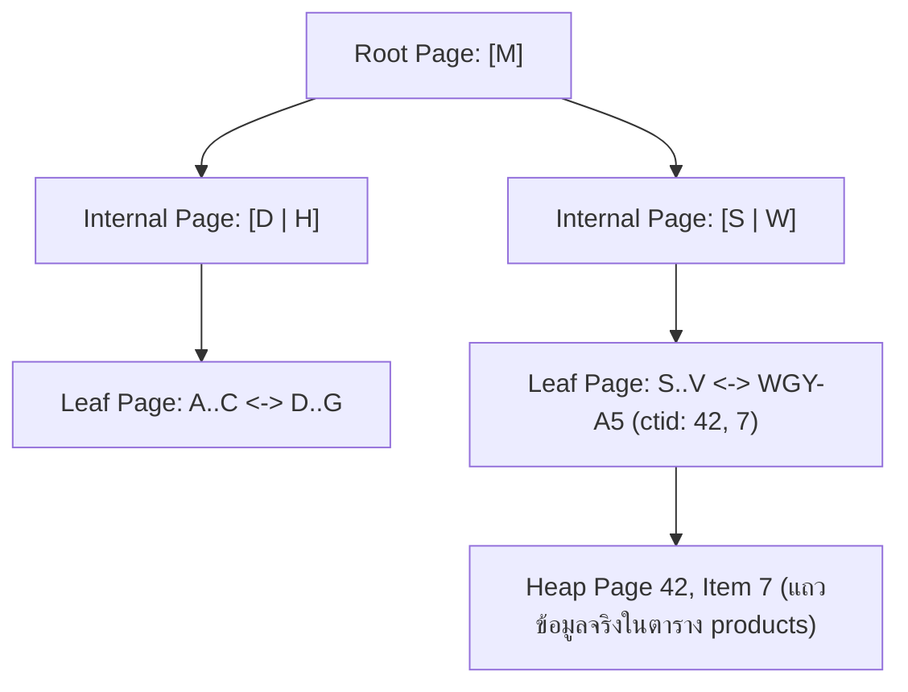

## 1. แนวคิด (Concept)
เมื่อตารางในฐานข้อมูลไม่มี Index การค้นหาข้อมูลด้วยเงื่อนไข `WHERE sku = 'WGY-MIYA-A5'` จะบังคับให้ PostgreSQL ต้องทำการกวาดอ่านข้อมูลทุกแถวตั้งแต่บล็อกแรกจนถึงบล็อกสุดท้ายของตาราง ซึ่งเรียกว่า **Sequential Scan (Full Table Scan)** โดยมีอัตราการเติบโตของเวลาตามจำนวนข้อมูลแบบเชิงเส้น หรือ $O(N)$ หากตารางมี 10 ล้านแถว ก็ต้องตรวจเช็คทั้ง 10 ล้านแถว

ในทางกลับกัน **B-Tree Index (Balanced Tree)** จะนำค่าของคอลัมน์ที่เราระบุมาจัดเรียงลำดับจากน้อยไปมากเก็บไว้ในโครงสร้างต้นไม้ที่สมดุลกันทุกกิ่ง ทำให้การค้นหาข้อมูลลดความซับซ้อนลงเหลือเพียง $O(\log N)$ เท่านั้น แม้ตาราง `orders` จะมีข้อมูลถึง 100 ล้านแถว การค้นหาผ่าน B-Tree Index ก็ใช้การกระโดดข้ามระดับของต้นไม้ (Tree Traversal) เพียงแค่ 4 ถึง 5 ครั้งก็พบตำแหน่งข้อมูลจริงบนดิสก์ทันที



## 2. หลักการเบื้องหลัง (Under the Hood)
การใช้งาน B-Tree ใน PostgreSQL 16 อ้างอิงตามอัลกอริทึม **Lehman-Yao High-Concurrency B+-Tree** ซึ่งมีรายละเอียดเชิงลึกดังนี้:
1. **8KB Pages:** ทั้งตัวตารางหลัก (Heap) และตัว Index ถูกแบ่งเก็บเป็นบล็อกขนาด 8 กิโลไบต์ (8KB Pages) เท่ากัน
2. **Root, Internal, และ Leaf Pages:** โหนดชั้นบนสุดคือ Root Page และชั้นกลางคือ Internal Pages ซึ่งเก็บเฉพาะค่าคีย์และตัวชี้ไปยังหน้าถัดไป (Child Page Pointers) ส่วนข้อมูลตัวชี้ไปยังตารางจริงจะอยู่ที่ชั้นล่างสุดคือ **Leaf Pages** เท่านั้น
3. **Doubly-Linked Leaf Pages:** ในระดับ Leaf Pages แต่ละบล็อกจะมีตัวชี้เชื่อมต่อไปยังบล็อกข้างเคียงทั้งซ้ายและขวา ทำให้การค้นหาแบบช่วง (Range Scan เช่น `price_per_kg BETWEEN 2000 AND 5000`) หรือการเรียงลำดับ (`ORDER BY price_per_kg ASC/DESC`) ทำได้โดยการวิ่งไล่ตามลิงก์ในชั้น Leaf ได้เลยโดยไม่ต้องถอยกลับขึ้นไปที่ Root ใหม่
4. **TID (`ctid`):** ในแต่ละรายการของ Leaf Page จะเก็บค่าคีย์คู่กับ **Tuple Identifier (`ctid`)** ขนาด 6 Bytes ซึ่งระบุ `(หมายเลขหน้าบล็อกของตาราง, ลำดับช่องข้อมูลในบล็อกนั้น)` เช่น `(42, 7)` เพื่อให้ Engine กระโดดไปหยิบแถวข้อมูลจริงในตาราง (Heap Tuple) ได้ทันที
5. **B-Tree Deduplication:** ตั้งแต่ PostgreSQL 13 เป็นต้นมาจนถึง PostgreSQL 16 ระบบมีกลไกยุบรวมค่าคีย์ที่ซ้ำกันใน B-Tree (เช่น คอลัมน์ `status` หรือ `category_id`) ให้เก็บคีย์เพียงครั้งเดียวแล้วตามด้วยรายการของ `ctid` เรียงต่อกัน ช่วยลดขนาดของ B-Tree Index ลงได้ถึง 50-70%

## 3. ตัวอย่างโค้ด (Smart Butcher Marketplace)

### ตัวอย่างที่ 1: การสร้าง B-Tree Index พื้นฐานและตรวจสอบตำแหน่ง `ctid` ของแถวข้อมูล
แสดงการสร้าง B-Tree Index บนคอลัมน์รหัสสินค้าและหมายเลขโทรศัพท์ของลูกค้า พร้อมดูค่า `ctid` ที่ PostgreSQL ใช้ชี้ตำแหน่งข้อมูลจริง:

```sql filename="sql/01_btree_basics_and_ctid.sql"
-- สร้าง B-Tree Index (เป็นค่าเริ่มต้นของคำสั่ง CREATE INDEX ใน PostgreSQL)
CREATE INDEX idx_users_phone ON users (phone);

-- สร้าง B-Tree Index โดยระบุลำดับการเรียงจากมากไปน้อยสำหรับดึงออเดอร์ล่าสุด
CREATE INDEX idx_orders_created_at_desc ON orders (created_at DESC);

-- ตรวจสอบค่า ctid (Block Number, Tuple Index) ที่ B-Tree ใช้ชี้มายังแถวจริงในตาราง
SELECT ctid, id, sku, name, price_per_kg
FROM products
WHERE sku = 'WGY-MIYA-A5-STRIP';
```

### ตัวอย่างที่ 2: การสร้าง Expression Index (Functional B-Tree Index) สำหรับค้นหาแบบไม่สนตัวพิมพ์เล็ก-ใหญ่
ในระบบ Smart Butcher หากลูกค้าค้นหาอีเมลด้วยคำสั่ง `WHERE LOWER(email) = 'customer@butcher.com'` ตัว B-Tree Index ปกติที่สร้างบนคอลัมน์ `(email)` เฉยๆ จะไม่ถูกนำมาใช้งาน! เราต้องสร้าง Index บนผลลัพธ์ของฟังก์ชัน `LOWER(email)` แทน:

```sql filename="sql/02_expression_btree_index.sql"
-- สร้าง Expression B-Tree Index บนค่าตัวพิมพ์เล็กของอีเมลและรหัสคูปอง
CREATE UNIQUE INDEX uq_users_email_lower
ON users (LOWER(email))
WHERE deleted_at IS NULL;

-- เมื่อคิวรีด้วยฟังก์ชันที่ตรงกับนิพจน์ของ Index ตัว Planner จะใช้ Index Scan ทันที
EXPLAIN ANALYZE
SELECT id, email, full_name
FROM users
WHERE LOWER(email) = LOWER('ChefSomchai@SmartButcher.com')
  AND deleted_at IS NULL;
```

## 4. ผิด vs ถูก (Anti-pattern vs Best Practice)

| มิติการเปรียบเทียบ | ❌ ผิด (Anti-pattern) | ✅ ถูก (Best Practice) |
| :--- | :--- | :--- |
| **การใส่ฟังก์ชันครอบคอลัมน์ใน `WHERE`** | สร้าง Index บน `(created_at)` แต่เขียนคิวรี `WHERE EXTRACT(YEAR FROM created_at) = 2026` ทำให้ Index ไม่ถูกใช้ | เขียนเงื่อนไขแบบ Range แทน: `WHERE created_at >= '2026-01-01' AND created_at < '2027-01-01'` |
| **การสร้าง Index บนตารางเล็กจิ๋ว** | สร้าง Index 4-5 ตัวบนตาราง `categories` ที่มีข้อมูลแค่ 12 แถว | ตารางที่มีขนาดไม่กี่สิบแถวอยู่ใน 1 Page (8KB) อยู่แล้ว PostgreSQL จะอ่านด้วย Sequential Scan เร็วกว่าเปิด Index เสมอ |
| **การละเลยชนิดข้อมูลที่ตรงกัน** | คอลัมน์ `phone` เป็น `VARCHAR` แต่ส่งตัวเลขไปเทียบ `WHERE phone = 812345678` เกิด Implicit Type Cast จนไม่ใช้ Index | ส่งค่า Parameter ให้ตรงกับชนิดข้อมูลของคอลัมน์เสมอ เช่น `WHERE phone = '0812345678'` |

## 5. ควรใช้เมื่อไหร่ และ ไม่ควรใช้เมื่อไหร่
- **ควรใช้ B-Tree Index เมื่อ:** คอลัมน์นั้นถูกใช้ในเงื่อนไขเปรียบเทียบความเท่ากัน (`=`), การเปรียบเทียบช่วง (`<`, `<=`, `>`, `>=`, `BETWEEN`), การเช็ค `IN (...)`, การค้นหาคำขึ้นต้น (`LIKE 'WGY%'`), หรือการจัดเรียงลำดับ (`ORDER BY`)
- **ไม่ควรใช้ B-Tree Index เมื่อ:** ต้องการค้นหาข้อความที่มีคำอยู่ตรงกลางประโยค (`LIKE '%Wagyu%'`) หรือต้องการค้นหาคีย์ย่อยหลายระดับภายในโครงสร้าง `JSONB` และ `ARRAY` (ซึ่งควรใช้ GIN Index แทน)

## 6. คำถามสัมภาษณ์ (Interview Q&A)
- **Q1: ทำไมบางครั้งเราสร้าง B-Tree Index ไว้ถูกต้องทุกอย่างแล้ว แต่เมื่อรัน `EXPLAIN` พบว่า PostgreSQL ยังคงเลือกใช้ `Seq Scan` แทนที่จะใช้ `Index Scan`?**
  - **แนวคำตอบ:** เพราะ Cost-Based Optimizer ของ PostgreSQL ประเมินแล้วว่าการทำ `Seq Scan` มีต้นทุนต่ำกว่า ซึ่งมักเกิดจาก 2 สาเหตุหลัก คือ (1) ตารางยังมีจำนวนแถวน้อยมาก การอ่านรวดเดียวไม่กี่บล็อกจึงเร็วกว่าการต้องเปิดอ่านไฟล์ Index แล้วค่อยกระโดดมาอ่านไฟล์ตาราง หรือ (2) เงื่อนไขที่ค้นหาตรงกับข้อมูลสัดส่วนใหญ่มากของตาราง (Low Selectivity เช่น ค้นหา `WHERE status = 'DELIVERED'` ซึ่งมีอยู่ถึง 80% ของตาราง) การกระโดดอ่านทีละแถวผ่าน Index (Random I/O) จะช้ากว่าการกวาดอ่านตารางรวดเดียว (Sequential I/O)
- **Q2: `Index Scan` กับ `Bitmap Index Scan` ใน PostgreSQL ต่างกันอย่างไร?**
  - **แนวคำตอบ:** `Index Scan` จะอ่านตำแหน่ง `ctid` จาก Index แล้วกระโดดไปดึงข้อมูลในตารางทันทีทีละแถว เหมาะกับคิวรีที่ดึงข้อมูลจำนวนน้อยมาก (เพียงไม่กี่แถว) ส่วน `Bitmap Index Scan` จะใช้เมื่อคิวรีดึงข้อมูลจำนวนปานกลาง (หลายร้อยถึงหลายหมื่นแถว) หรือต้องรวมผลลัพธ์จากหลาย Index เข้าด้วยกัน (`BitmapAnd` / `BitmapOr`) โดยมันจะรวบรวมตำแหน่งหน้าบล็อกทั้งหมดจาก Index มาจัดเรียงลำดับหมายเลขหน้าบล็อกในหน่วยความจำก่อน แล้วค่อยไปเปิดอ่านตารางตามลำดับหน้าบล็อก เพื่อเปลี่ยน Random I/O ให้กลายเป็น Sequential I/O

---
