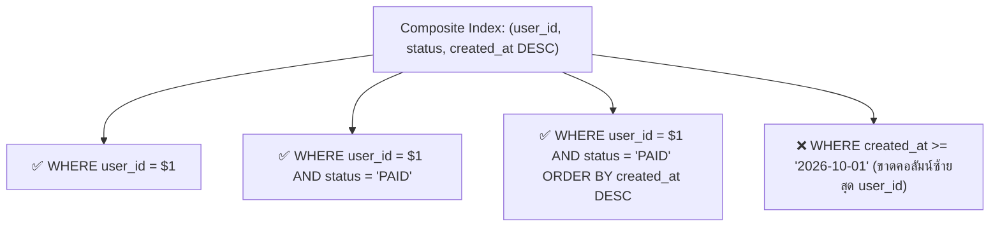

## 1. แนวคิด (Concept)
**Composite Index (หรือ Multicolumn Index)** คือการสร้าง B-Tree Index ตัวเดียวที่ครอบคลุมมากกว่า 1 คอลัมน์ขึ้นไป เช่น `CREATE INDEX idx_orders_user_status ON orders (user_id, status);` เพื่อรองรับคิวรีที่มีการกรองหรือเรียงลำดับข้อมูลด้วยหลายคอลัมน์พร้อมกัน

หัวใจสำคัญที่สุดของการออกแบบ Composite Index คือ **กฎลำดับคอลัมน์ซ้ายสุด (Leftmost Prefix Rule)** และ **ลำดับ Equality ก่อน Range/Sort**:
- หากเรามี Index บนคอลัมน์ `(A, B, C)` ข้อมูลใน B-Tree จะถูกเรียงลำดับตามคอลัมน์ `A` ก่อน หากค่า `A` เท่ากันจึงเรียงตาม `B` และหาก `B` เท่ากันจึงเรียงตาม `C`
- เปรียบเสมือนสมุดโทรศัพท์ที่เรียงตาม **(จังหวัด, อำเภอ, นามสกุล)** เราสามารถใช้สมุดเล่มนี้ค้นหาคนใน *(จังหวัดเชียงใหม่)* หรือ *(จังหวัดเชียงใหม่ และ อำเภอเมือง)* ได้ทันที แต่ถ้าถามหาคนที่มี *(นามสกุล ใจดี)* โดยไม่บอกจังหวัด สมุดเรียงลำดับเล่มนี้จะช่วยอะไรไม่ได้เลย เพราะนามสกุลใจดีกระจายอยู่ทุกจังหวัด!



## 2. หลักการเบื้องหลัง (Under the Hood)
ในการจัดลำดับคอลัมน์ภายใน Composite Index สำหรับคิวรีที่มีทั้งการเช็คความเท่ากัน (`=`), การเช็คช่วงข้อมูล (`>`, `<`, `BETWEEN`), และการจัดเรียง (`ORDER BY`) ให้ยึดหลักการ **ESR Rule (Equality -> Sort / Range)**:
1. **Equality Columns ไว้ซ้ายสุด:** นำคอลัมน์ที่ใช้เปรียบเทียบด้วยเครื่องหมาย `=` มาวางไว้ลำดับแรกสุดเสมอ เพื่อบีบขอบเขตของกิ่ง B-Tree ให้แคบลงเหลือเฉพาะกลุ่มที่ตรงเงื่อนไขทันที
2. **Sort หรือ Range Column ไว้ลำดับถัดมา:** ทันทีที่มีคอลัมน์ใดใช้เงื่อนไขแบบช่วง (Range เช่น `created_at > ...`) คอลัมน์ที่อยู่ถัดไปทางขวาใน Index จะไม่สามารถใช้ทำ Index Lookup แบบเรียงลำดับต่อเนื่องได้อีก ดังนั้นจึงควรวางคอลัมน์ที่ใช้ทำ `ORDER BY` หรือ Range ไว้ต่อท้ายกลุ่ม Equality เสมอ

## 3. ตัวอย่างโค้ด (Smart Butcher Marketplace)

### ตัวอย่างที่ 1: การออกแบบ Composite Index สำหรับหน้าประวัติคำสั่งซื้อของลูกค้า
ในหน้า "รายการคำสั่งซื้อของฉัน" แอปพลิเคชันต้องดึงออเดอร์ของลูกค้าคนนั้น กรองเฉพาะสถานะที่ต้องการ และเรียงลำดับจากออเดอร์ล่าสุดไปเก่าสุด:

```sql filename="sql/05_composite_index_esr_rule.sql"
-- สร้าง Composite Index ตามหลัก ESR:
-- 1. user_id (Equality: =)
-- 2. status (Equality: =)
-- 3. created_at DESC (Sort/Range: ORDER BY ... DESC)
CREATE INDEX idx_orders_user_status_created
ON orders (user_id, status, created_at DESC);

-- คิวรีนี้จะทำงานเร็วที่สุด: วิ่งเข้าเป้าด้วย Index และได้ข้อมูลที่เรียงลำดับพร้อมแล้วโดยไม่ต้อง Sort ใน RAM!
EXPLAIN ANALYZE
SELECT id, order_number, total_amount, created_at
FROM orders
WHERE user_id = 'a1111111-1111-1111-1111-111111111111'
  AND status = 'PAID'
ORDER BY created_at DESC
LIMIT 20;
```

### ตัวอย่างที่ 2: การออกแบบ Composite Index สำหรับค้นหาสินค้าตามหมวดหมู่และช่วงราคา
ในหน้าแค็ตตาล็อกสินค้า ลูกค้าเลือกหมวดหมู่เนื้อ (`category_id = $1`) เฉพาะสินค้าที่เปิดขาย (`is_active = true`) และกรองช่วงราคา (`price_per_kg BETWEEN $2 AND $3`):

```sql filename="sql/06_composite_index_catalog_filter.sql"
-- วาง Equality columns (category_id, is_active) ไว้ข้างหน้า และวาง Range column (price_per_kg) ไว้ท้ายสุด
CREATE INDEX idx_products_cat_active_price
ON products (category_id, is_active, price_per_kg);

-- คิวรีที่ได้ประโยชน์สูงสุดจาก Composite Index ข้างต้น
SELECT id, sku, name, price_per_kg, marbling_score
FROM products
WHERE category_id = 'c1111111-1111-1111-1111-111111111111'
  AND is_active = TRUE
  AND price_per_kg BETWEEN 1500.00 AND 4500.00
ORDER BY price_per_kg ASC;
```

## 4. ผิด vs ถูก (Anti-pattern vs Best Practice)

| มิติการเปรียบเทียบ | ❌ ผิด (Anti-pattern) | ✅ ถูก (Best Practice) |
| :--- | :--- | :--- |
| **การวางลำดับ Range ก่อน Equality** | สร้าง Index `(created_at, user_id)` สำหรับคิวรี `WHERE user_id = $1 ORDER BY created_at DESC` ทำให้ต้องกวาดเวลาทั้งหมดก่อน | สร้าง Index `(user_id, created_at DESC)` เพื่อให้กรองเฉพาะลูกค้าคนนั้นก่อน แล้วได้ข้อมูลเรียงตามเวลาทันที |
| **การสร้าง Index แยกเดี่ยวทุกคอลัมน์** | สร้าง Index แยก 3 ตัวบน `(user_id)`, `(status)`, และ `(created_at)` ทั้งที่คิวรีใช้ทั้ง 3 คอลัมน์ร่วมกันตลอด | สร้าง Composite Index ตัวเดียว `(user_id, status, created_at DESC)` ซึ่งมีประสิทธิภาพสูงกว่าการทำ BitmapAnd หลายเท่า |
| **การสร้าง Index ซ้ำซ้อนกับ Prefix** | มี Index `(user_id, status)` อยู่แล้ว แต่ไปสร้าง Index เดี่ยว `(user_id)` เพิ่มอีกตัว | ลบ Index เดี่ยว `(user_id)` ทิ้งได้เลย เพราะ Index `(user_id, status)` ใช้ค้นหาเฉพาะ `user_id` ได้เต็มประสิทธิภาพอยู่แล้ว |

## 5. ควรใช้เมื่อไหร่ และ ไม่ควรใช้เมื่อไหร่
- **ควรใช้ Composite Index เมื่อ:** คิวรีหลักของระบบมีการกรองข้อมูลด้วย `WHERE` หลายคอลัมน์ร่วมกันเป็นประจำ หรือมีการใช้ `WHERE` คอลัมน์หนึ่งคู่กับการทำ `ORDER BY` อีกคอลัมน์หนึ่งเสมอ
- **ไม่ควรใส่คอลัมน์ลงใน Composite Index เกิน 3-4 คอลัมน์เมื่อ:** คอลัมน์หลังๆ แทบไม่ได้ช่วยคัดกรองจำนวนแถวให้ลดลงแล้ว เพราะจะทำให้ขนาดของ Index ใหญ่ขึ้นและเพิ่มภาระตอน `INSERT`/`UPDATE` โดยไม่จำเป็น

## 6. คำถามสัมภาษณ์ (Interview Q&A)
- **Q1: หากเรามี Composite Index บนคอลัมน์ `(category_id, status, created_at)` คิวรีที่มีเงื่อนไข `WHERE category_id = $1 AND created_at > '2026-01-01'` (โดยไม่ได้ระบุ `status`) จะสามารถใช้ Index ตัวนี้ได้หรือไม่?**
  - **แนวคำตอบ:** ใช้ได้ **แต่ได้เพียงบางส่วนเท่านั้น!** PostgreSQL จะใช้ Index ในการกรองเฉพาะคอลัมน์ซ้ายสุดคือ `category_id = $1` ได้อย่างรวดเร็ว แต่เนื่องจากคิวรีข้ามคอลัมน์ลำดับที่สอง (`status`) ไป จึงไม่สามารถกระโดดไปยังตำแหน่ง `created_at` โดยตรงได้ ต้องทำการอ่าน Index Entries ทั้งหมดที่อยู่ใน `category_id` นั้นเพื่อเช็คค่า `created_at` เอง
- **Q2: ระหว่างคอลัมน์ที่มีค่าหลากหลายมาก (High Cardinality เช่น `user_id`) กับคอลัมน์ที่มีค่าซ้ำกันเยอะ (Low Cardinality เช่น `status`) ถ้าทั้งคู่ใช้เครื่องหมาย `=` เหมือนกัน ควรเอาตัวไหนไว้ซ้ายสุดใน Composite Index?**
  - **แนวคำตอบ:** หากคิวรีใช้เครื่องหมาย `=` ทั้งสองคอลัมน์เสมอ ในทางทฤษฎีของ B-Tree ความเร็วในการค้นหาทั้งคู่แทบไม่ต่างกัน แต่ในทางปฏิบัติ **ควรนำคอลัมน์ที่มี High Cardinality (`user_id`) และถูกใช้ค้นหาเดี่ยวๆ บ่อยกว่าไว้ซ้ายสุด** เพราะจะทำให้ Index ตัวเดียวกันนี้สามารถรองรับคิวรีที่ค้นหาด้วย `WHERE user_id = $1` เพียงอย่างเดียวได้ด้วย โดยไม่ต้องสร้าง Index เพิ่มอีกตัว

---
