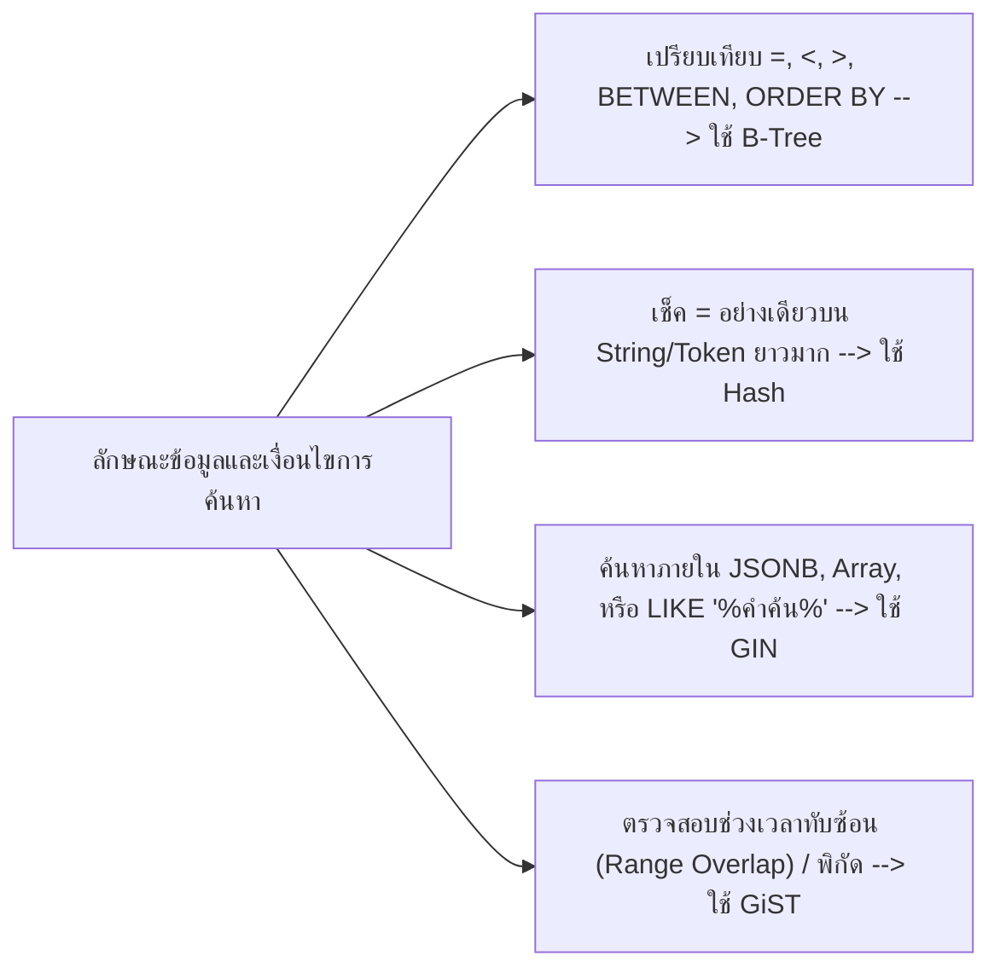

## 1. แนวคิด (Concept)
จุดแข็งที่ทำให้ PostgreSQL 16 เหนือกว่าฐานข้อมูลเชิงสัมพันธ์ทั่วไปคือสถาปัตยกรรมดัชนีที่ไม่ได้มีแค่ B-Tree ชนิดเดียว แต่มีชนิดของ Index เฉพาะทางให้เลือกใช้ตามลักษณะของข้อมูลและตัวดำเนินการ:
1. **B-Tree (Balanced Tree):** ดัชนีมาตรฐานสำหรับข้อมูลทั่วไปที่เรียงลำดับได้ (ตัวเลข, วันที่, ข้อความสั้น, UUID)
2. **Hash Index:** ดัชนีที่เก็บค่า Hash 32-bit ของข้อมูล รองรับเฉพาะตัวดำเนินการความเท่ากัน (`=`) เท่านั้น มีขนาดเล็กและเร็วมากสำหรับข้อมูลข้อความที่ยาวมากๆ (เช่น URL หรือ Token ยาวๆ)
3. **GIN (Generalized Inverted Index):** ดัชนีแบบกลับด้านที่ออกแบบมาสำหรับข้อมูลที่มีหลายค่าย่อยอยู่ในช่องเดียวกัน (Multi-value columns) เช่น **`JSONB`**, **`ARRAY`**, และการค้นหาข้อความแบบ **Full-Text Search / Trigram (`pg_trgm`)**
4. **GiST (Generalized Search Tree):** โครงสร้างต้นไม้เชิงนามธรรมสำหรับข้อมูลที่มีการซ้อนทับกันได้ เช่น **Range Types** (ช่วงเวลาจองห้องดรายเอจไม่ให้ทับซ้อนกัน), ข้อมูลพิกัดภูมิศาสตร์ (PostGIS), และการค้นหาระยะห่าง (Nearest-Neighbor Search)



## 2. หลักการเบื้องหลัง (Under the Hood)
เพื่อให้เข้าใจว่าทำไม **GIN Index** จึงค้นหาข้อมูลใน `JSONB` หรือ `LIKE '%เนื้อวากิว%'` ได้เร็วมาก ให้พิจารณาโครงสร้างภายในของมัน:
- ใน B-Tree ปกติ 1 แถวของตารางจะเท่ากับ 1 Entry ใน Index
- แต่ใน **GIN Index** ระบบจะทำการแตกข้อมูลภายใน 1 แถวออกเป็นองค์ประกอบย่อยๆ (Keys/Elements) แล้วสร้างสารบัญว่าแต่ละองค์ประกอบย่อยปรากฏอยู่ในแถว (`ctid`) ใดบ้าง (เรียกว่า **Posting List** หรือ **Posting Tree**)
- ตัวอย่างเช่น เมื่อใช้ส่วนขยาย `pg_trgm` ร่วมกับ GIN Index บนชื่อสินค้า คำว่า `'Wagyu'` จะถูกหั่นเป็นกลุ่มตัวอักษร 3 ตัวเรียงกัน (Trigrams) ได้แก่ `'  w'`, `' wa'`, `'wag'`, `'agy'`, `'gyu'`, `'yu '` แล้วเก็บลง GIN Index เมื่อลูกค้าค้นหา `WHERE name ILIKE '%wagyu%'` PostgreSQL จึงไม่ต้องกวาดอ่านทั้งตาราง แต่ไปเปิดสารบัญ GIN ของ Trigrams เหล่านั้นแล้วนำรายการ `ctid` มาตัดกัน (Intersection) ได้ผลลัพธ์ในระดับมิลลิวินาที!

### ตารางเปรียบเทียบชนิด Index ใน PostgreSQL 16

| ชนิด Index | ตัวดำเนินการที่รองรับ | กรณีใช้งานหลักใน Smart Butcher | ข้อจำกัดสำคัญ |
| :--- | :--- | :--- | :--- |
| **B-Tree** | `=`, `<`, `<=`, `>`, `>=`, `BETWEEN`, `IN`, `IS NULL` | ค้นหา `id`, `sku`, `price_per_kg`, `created_at` | ไม่รองรับ `LIKE '%คำกลาง%'` หรือการค้นคีย์ลึกๆ ใน `JSONB` |
| **Hash** | `=` เท่านั้น | ค้นหา `provider_tx_id` หรือ Webhook Signature ยาวๆ | ไม่รองรับ Range Scan, `ORDER BY`, หรือการทำ Unique Constraint |
| **GIN** | `@>`, `?`, `?&`, `?|`, `@@`, `ILIKE '%...%'` (คู่กับ `pg_trgm`) | ค้นหา `specifications` (`JSONB`), ค้นหาชื่อเนื้อแบบบางส่วน | ขนาด Index ใหญ่กว่าและใช้เวลาอัปเดตนานกว่า B-Tree (แก้ไขด้วย `fastupdate`) |
| **GiST** | `&&` (Overlap), `@>`, `<->` (Distance) | ป้องกันการจองตู้บ่มเนื้อ Dry-Aged ช่วงเวลาชนกัน (`EXCLUDE USING gist`) | ความเร็วในการค้นหาค่าซ้ำตรงๆ ช้ากว่า GIN |

## 3. ตัวอย่างโค้ด (Smart Butcher Marketplace)

### ตัวอย่างที่ 1: การสร้าง GIN Index สำหรับค้นหา `JSONB` และค้นหาชื่อสินค้าด้วย `pg_trgm`
ในตาราง `products` เรามีคอลัมน์ `specifications` (`JSONB`) ที่เก็บข้อมูลฟาร์มและใบรับรองฮาลาล และลูกค้ามักพิมพ์ค้นหาชื่อสินค้าบางส่วนด้วย `ILIKE`:

```sql filename="sql/03_gin_index_jsonb_and_trigram.sql"
-- เปิดใช้งาน Extension pg_trgm สำหรับการหั่นคำค้นหาแบบ Trigram
CREATE EXTENSION IF NOT EXISTS pg_trgm;

-- 1. สร้าง GIN Index แบบ jsonb_path_ops สำหรับค้นหาข้อมูลภายใน JSONB ด้วยตัวดำเนินการ @>
CREATE INDEX idx_products_specs_gin
ON products USING GIN (specifications jsonb_path_ops);

-- คิวรีค้นหาสินค้าเนื้อที่ได้รับรอง Halal และมาจากจังหวัด Miyazaki (ใช้ GIN Index เต็มรูปแบบ)
SELECT id, sku, name, price_per_kg
FROM products
WHERE specifications @> '{"halal": true, "origin": "Miyazaki"}'::jsonb;

-- 2. สร้าง GIN Trigram Index สำหรับเร่งความเร็วคำสั่ง ILIKE '%คำค้น%'
CREATE INDEX idx_products_name_trgm_gin
ON products USING GIN (name gin_trgm_ops);

-- คิวรีค้นหาชื่อสินค้าที่มีคำว่า 'ribeye' อยู่ตรงส่วนใดของชื่อก็ได้โดยไม่ต้องทำ Sequential Scan!
SELECT id, sku, name, price_per_kg
FROM products
WHERE name ILIKE '%ribeye%';
```

### ตัวอย่างที่ 2: การใช้ GiST Index คู่กับ Exclusion Constraint ป้องกันการจองตู้บ่มเนื้อเวลาทับซ้อนกัน
ร้าน Smart Butcher มีบริการรับบ่มเนื้อ Dry-Aged ตามสั่งในตู้ควบคุมอุณหภูมิพิเศษ (`dry_aging_chambers`) โดยห้ามไม่ให้มีการจองตู้ใบเดียวกันในช่วงวันเวลาที่ทับซ้อนกันเด็ดขาด:

```sql filename="sql/04_gist_index_range_exclusion.sql"
-- เปิดใช้งาน btree_gist เพื่อให้ GiST Index ผสมคอลัมน์ UUID เข้ากับ Range Type ได้
CREATE EXTENSION IF NOT EXISTS btree_gist;

CREATE TABLE dry_aging_bookings (
    id UUID PRIMARY KEY DEFAULT gen_random_uuid(),
    chamber_number SMALLINT NOT NULL,
    order_id UUID NOT NULL REFERENCES orders(id) ON DELETE CASCADE,
    aging_period TSTZRANGE NOT NULL, -- ช่วงเวลาเริ่มต้นถึงสิ้นสุดการบ่มเนื้อ
    created_at TIMESTAMPTZ NOT NULL DEFAULT CURRENT_TIMESTAMP,
    -- ใช้ GiST Index บังคับว่าใน chamber_number เดียวกัน (=) ห้ามมี aging_period ทับซ้อนกัน (&&)
    CONSTRAINT excl_chamber_booking_overlap
        EXCLUDE USING GIST (chamber_number WITH =, aging_period WITH &&)
);
```

## 4. ผิด vs ถูก (Anti-pattern vs Best Practice)

| มิติการเปรียบเทียบ | ❌ ผิด (Anti-pattern) | ✅ ถูก (Best Practice) |
| :--- | :--- | :--- |
| **การค้นหาด้วย `ILIKE '%...%'`** | ใช้ B-Tree Index ปกติแล้วเขียน `WHERE name ILIKE '%wagyu%'` ซึ่งทำให้เกิด Sequential Scan เต็มตารางเสมอ | เปิด `pg_trgm` แล้วสร้าง `GIN (name gin_trgm_ops)` เพื่อรองรับ `ILIKE` ที่มี `%` นำหน้า |
| **การเลือก Operator Class ของ GIN JSONB** | ใช้ `USING GIN (specifications)` แบบ Default ทั้งที่ใช้แค่ `@>` ทำให้ Index ใหญ่เกินจำเป็น | ระบุ `USING GIN (specifications jsonb_path_ops)` เมื่อค้นหาด้วย `@>` เพื่อลดขนาด Index ลงเกือบครึ่งหนึ่ง |
| **การป้องกันเวลาจองชนกัน** | เขียน `SELECT COUNT(*)` เช็คเวลาชนกันในโค้ด Node.js ซึ่งพังทันทีเมื่อมีคนกดจองพร้อมกัน 2 คน (Race Condition) | ใช้ `TSTZRANGE` คู่กับ `EXCLUDE USING GIST` ให้ฐานข้อมูลป้องกันการจองเวลาทับซ้อนกัน 100% |

## 5. ควรใช้เมื่อไหร่ และ ไม่ควรใช้เมื่อไหร่
- **ควรใช้ GIN Index เมื่อ:** ต้องค้นหาค่าภายในคอลัมน์ `JSONB`, คอลัมน์ `ARRAY`, หรือค้นหาข้อความแบบ `LIKE` / `ILIKE` ที่ไม่ได้ระบุคำขึ้นต้นตายตัว
- **ไม่ควรใช้ GIN Index เมื่อ:** ตารางนั้นมีการ `UPDATE` คอลัมน์ดังกล่าวด้วยความถี่สูงมากระดับหลายพันครั้งต่อวินาที และต้องการความเร็วในการเขียนสูงสุด เพราะการแตกองค์ประกอบย่อยลงใน GIN Index มีต้นทุน CPU และ I/O สูงกว่า B-Tree

## 6. คำถามสัมภาษณ์ (Interview Q&A)
- **Q1: ในการสร้าง GIN Index บนคอลัมน์ `JSONB` ระหว่าง Default Operator Class (`jsonb_ops`) กับ `jsonb_path_ops` ต่างกันอย่างไร และควรเลือกตัวไหน?**
  - **แนวคำตอบ:** `jsonb_ops` (ค่าเริ่มต้น) จะแยกเก็บทั้งชื่อ Key และค่า Value เป็นรายการแยกจากกัน ทำให้รองรับการเช็คว่ามีชื่อ Key นี้อยู่หรือไม่ (`?`, `?&`, `?|`) รวมถึง `@>` แต่ทำให้ขนาด Index ใหญ่มาก ส่วน `jsonb_path_ops` จะนำ Path ของ Key ไปรวมกับ Value แล้วแปลงเป็นค่า Hash เดียวกัน จึงรองรับเฉพาะการค้นหาด้วยตัวดำเนินการ `@>` (Containment) เท่านั้น แต่มีขนาดเล็กกว่ามากและค้นหา `@>` ได้เร็วกว่า จึงแนะนำให้ใช้ `jsonb_path_ops` เป็นหลักหากแอปพลิเคชันค้นหาด้วย `@>`
- **Q2: เมื่อใดที่การใช้ Hash Index ใน PostgreSQL 16 มีความได้เปรียบเหนือกว่า B-Tree Index?**
  - **แนวคำตอบ:** เมื่อเราต้องการค้นหาด้วยเงื่อนไขความเท่ากัน (`=`) เพียงอย่างเดียว บนคอลัมน์ที่มีขนาดข้อมูลต่อแถวยาวมากๆ เช่น รหัส Token ยาว 512 ตัวอักษร หรือ URL ยาวๆ เพราะ B-Tree ต้องคัดลอกข้อความยาวๆ ทั้งก้อนไปเก็บไว้ในโหนดของ Index ทำให้ Index มีขนาดใหญ่มาก ในขณะที่ Hash Index จะแปลงข้อความยาวๆ นั้นให้เหลือเพียงค่า Hash ขนาด 4 Bytes (32-bit) เท่านั้น ทำให้ขนาด Index เล็กกว่า B-Tree หลายเท่าและพักอยู่ใน RAM ได้ทั้งหมด

---
