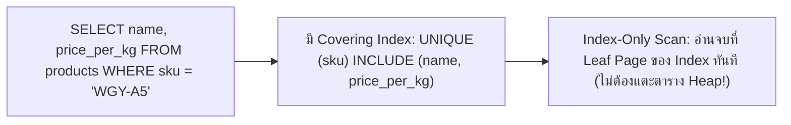

## 1. แนวคิด (Concept)
นอกจากการสร้าง B-Tree Index แบบมาตรฐานแล้ว PostgreSQL 16 ยังมีฟีเจอร์ดัชนีขั้นสูงอีก 3 รูปแบบที่ช่วยให้ระบบทำงานได้เร็วขึ้นและใช้พื้นที่หน่วยความจำน้อยลงอย่างมหาศาล:
1. **Unique Index:** ดัชนีที่รับประกันว่าค่าในคอลัมน์ (หรือกลุ่มคอลัมน์) จะไม่มีวันซ้ำกันในระดับ Database Engine และช่วยให้ Query Planner รู้ทันทีว่าผลลัพธ์ของการค้นหาด้วย `=` จะมีไม่เกิน 1 แถวเสมอ
2. **Partial Index (Filtered Index):** การสร้าง Index เฉพาะแถวที่ตรงตามเงื่อนไข `WHERE` ที่กำหนดเท่านั้น เช่น ตาราง `orders` มีข้อมูลสะสม 50 ล้านแถว แต่เป็นออเดอร์ที่ส่งสำเร็จไปแล้ว (`DELIVERED`) ถึง 99% ส่วนออเดอร์ที่กำลังรอจัดส่ง (`PENDING`, `PAID`, `PREPARING`) มีเพียง 1% เราสามารถสร้าง Partial Index เฉพาะออเดอร์ที่ยังไม่เสร็จสิ้นได้ ทำให้ขนาด Index เล็กลงถึง 100 เท่า!
3. **Covering Index (`INCLUDE` clause):** การแนบคอลัมน์เสริมที่ต้องการดึงไปแสดงผลใน `SELECT` เก็บไว้ที่ระดับ Leaf Page ของ Index ด้วยคำสั่ง `INCLUDE (...)` เพื่อให้ PostgreSQL ตอบคำถามคิวรีได้จบจากในตัว Index ทันทีโดยไม่ต้องเสียเวลากระโดดไปอ่านตารางหลัก (**Index-Only Scan**)



## 2. หลักการเบื้องหลัง (Under the Hood)
การทำงานของ **Covering Index (`INCLUDE`)** และ **Index-Only Scan** ใน PostgreSQL 16 มีรายละเอียดสำคัญที่ต้องเข้าใจดังนี้:
- คอลัมน์ที่อยู่ในวงเล็บแรก `ON products (sku)` คือ **Key Columns** ซึ่งถูกนำไปจัดเรียงและเก็บไว้ในทุกระดับของต้นไม้ B-Tree (Root, Internal, และ Leaf)
- ส่วนคอลัมน์ที่อยู่ใน `INCLUDE (name, price_per_kg)` คือ **Non-Key Payload Columns** ซึ่งจะถูกเก็บไว้ที่ชั้นล่างสุด (**Leaf Pages**) เท่านั้น ไม่ถูกนำไปเก็บใน Root หรือ Internal Pages ทำให้ต้นไม้ชั้นบนยังคงมีขนาดเล็กและตื้น كماไม่ต้องเสียเวลาจัดเรียงคอลัมน์ใน `INCLUDE`
- **บทบาทของ Visibility Map (VM):** เนื่องจาก PostgreSQL เก็บข้อมูลการมองเห็นของ Transaction (MVCC `xmin`/`xmax`) ไว้ที่ตารางหลัก (Heap) ไม่ได้เก็บไว้ใน Index เมื่อทำ **Index-Only Scan** ตัว Engine จะเช็คไฟล์ขนาดเล็กที่เรียกว่า **Visibility Map (VM)** ก่อนว่าหน้าบล็อกนั้นถูก `VACUUM` ยืนยันว่าทุกแถวมองเห็นได้ทั้งหมด (All-Visible) แล้วหรือยัง หากเป็น All-Visible แล้วก็จะคืนค่าจาก Index ทันทีโดยเกิด `Heap Fetches: 0`!

## 3. ตัวอย่างโค้ด (Smart Butcher Marketplace)

### ตัวอย่างที่ 1: การสร้าง Partial Index สำหรับติดตามออเดอร์ที่กำลังดำเนินการและคิวงานห้องเชือด
ตาราง `orders` มีข้อมูลในอดีตที่ปิดงานไปแล้วจำนวนมหาศาล แต่ระบบหลังบ้านของพนักงานแล่เนื้อและระบบขนส่งต้องคิวรีหาออเดอร์ที่อยู่ในสถานะรอดำเนินการตลอดทุกวินาที:

```sql filename="sql/07_partial_index_active_orders.sql"
-- สร้าง Partial Index เก็บเฉพาะออเดอร์ที่ยังอยู่ในกระบวนการทำงานเท่านั้น (ขนาดเล็กกว่า Index เต็มตารางถึง 95%+)
CREATE INDEX idx_orders_active_processing
ON orders (status, created_at ASC)
WHERE status IN ('PENDING', 'PAID', 'PREPARING', 'SHIPPED');

-- คิวรีสำหรับหน้าจอมอนิเตอร์ของห้องแล่เนื้อ (จะใช้ idx_orders_active_processing ทันทีเพราะเงื่อนไข WHERE ตรงกัน)
EXPLAIN ANALYZE
SELECT id, order_number, status, created_at
FROM orders
WHERE status = 'PREPARING'
ORDER BY created_at ASC;
```

### ตัวอย่างที่ 2: การสร้าง Covering Index (`INCLUDE`) เพื่อให้เกิด `Index Only Scan`
เมื่อระบบตะกร้าสินค้าต้องตรวจสอบราคาและสต็อกของสินค้าจากรหัส `sku` ด้วยความถี่สูงมาก เราสามารถสร้าง Unique Covering Index เพื่อให้อ่านข้อมูลจบใน Index ทันที:

```sql filename="sql/08_covering_index_include.sql"
-- สร้าง Unique Covering Index บนคอลัมน์ sku และแนบ name, price_per_kg, stock_qty ไว้ที่ Leaf Page
CREATE UNIQUE INDEX uq_products_sku_covering
ON products (sku)
INCLUDE (id, name, price_per_kg, stock_qty)
WHERE deleted_at IS NULL;

-- อัปเดต Visibility Map และสถิติของตารางเพื่อให้พร้อมทำ Index-Only Scan เต็มรูปแบบ
VACUUM ANALYZE products;

-- ทดสอบรันคิวรี จะเห็นแผนการทำงานเป็น "Index Only Scan using uq_products_sku_covering" และ Heap Fetches: 0
EXPLAIN (ANALYZE, BUFFERS)
SELECT id, name, price_per_kg, stock_qty
FROM products
WHERE sku = 'WGY-MIYA-A5-STRIP'
  AND deleted_at IS NULL;
```

## 4. ผิด vs ถูก (Anti-pattern vs Best Practice)

| มิติการเปรียบเทียบ | ❌ ผิด (Anti-pattern) | ✅ ถูก (Best Practice) |
| :--- | :--- | :--- |
| **การบังคับ Unique แบบมีเงื่อนไข** | ใช้คอลัมน์ทั้งหมดใส่ใน Composite Unique `(sku, is_active)` ซึ่งทำให้มีสินค้าที่ `is_active = false` ซ้ำกันได้แค่ครั้งเดียว | ใช้ Partial Unique Index: `CREATE UNIQUE INDEX ... ON products(sku) WHERE deleted_at IS NULL;` |
| **การใส่คอลัมน์แสดงผลใน Key** | สร้าง Composite Index `(sku, name, price_per_kg, description)` ทำให้โหนดชั้นบนของ B-Tree บวมและเสียค่า Unique บน `sku` เดี่ยวๆ | ใช้ `UNIQUE (sku) INCLUDE (name, price_per_kg)` เพื่อคงความเป็น Unique ของ `sku` และเก็บข้อมูลเสริมเฉพาะที่ Leaf Page |
| **การใส่คอลัมน์ขนาดใหญ่ใน `INCLUDE`** | ยัดคอลัมน์ `description TEXT` หรือ `specifications JSONB` เข้าไปใน `INCLUDE` จน Leaf Page ของ Index บวมหนัก | ใส่เฉพาะคอลัมน์ขนาดเล็กที่ถูกดึงใน Hot Queries (เช่น `price_per_kg`, `stock_qty`, `status`) ใน `INCLUDE` |

## 5. ควรใช้เมื่อไหร่ และ ไม่ควรใช้เมื่อไหร่
- **ควรใช้ Partial Index เมื่อ:** คิวรีของแอปพลิเคชันเจาะจงค้นหาเฉพาะกลุ่มย่อยของข้อมูลที่มีสัดส่วนน้อยเมื่อเทียบกับตารางทั้งหมดเป็นประจำ (เช่น ค้นหาเฉพาะ `WHERE is_active = true`, `WHERE deleted_at IS NULL`, หรือ `WHERE status = 'PENDING'`)
- **ควรใช้ Covering Index (`INCLUDE`) เมื่อ:** มีคิวรีความถี่สูง (Hot Path) ที่ดึงเฉพาะบางคอลัมน์ซ้ำๆ และต้องการขจัดภาระการอ่านตารางหลัก (Random Heap I/O) ออกไปให้เป็นศูนย์

## 6. คำถามสัมภาษณ์ (Interview Q&A)
- **Q1: ความแตกต่างระหว่างการสร้าง Index แบบ `ON products (sku, price_per_kg)` กับ `ON products (sku) INCLUDE (price_per_kg)` คืออะไร?**
  - **แนวคำตอบ:** มีความต่างสำคัญ 3 ประการ คือ (1) ในแบบ `INCLUDE` คอลัมน์ `price_per_kg` จะถูกเก็บไว้เฉพาะในระดับ Leaf Pages เท่านั้น ไม่ถูกนำไปเก็บใน Internal/Root Pages ทำให้ต้นไม้ B-Tree มีขนาดเล็กกว่า (2) यदिสร้างเป็น `UNIQUE INDEX ON products (sku) INCLUDE (price_per_kg)` ระบบจะบังคับความไม่ซ้ำเฉพาะที่คอลัมน์ `sku` ตัวเดียว ในขณะที่ `UNIQUE (sku, price_per_kg)` จะยอมให้มี `sku` ซ้ำกันได้ถ้าราคาต่างกัน และ (3) คอลัมน์ใน `INCLUDE` ไม่สามารถใช้ช่วยเรียงลำดับ `ORDER BY price_per_kg` ได้แต่ใช้ดึงค่าไปแสดงใน `SELECT` เพื่อทำ Index-Only Scan ได้
- **Q2: ทำไมบางครั้งเราสร้าง Covering Index (`INCLUDE`) ครบทุกคอลัมน์ใน `SELECT` แล้ว แต่เมื่อดู `EXPLAIN (ANALYZE, BUFFERS)` ยังคงเห็น `Heap Fetches` มีค่ามากกว่าศูนย์?**
  - **แนวคำตอบ:** เพราะใน PostgreSQL ข้อมูล Transaction Visibility (`xmin`/`xmax`) ถูกเก็บอยู่ในตารางหลัก (Heap) ไม่ได้อยู่ใน Index หากหน้าบล็อกของตารางเพิ่งถูก `INSERT` หรือ `UPDATE` ไปเมื่อไม่นานมานี้และกระบวนการ `VACUUM` ยังไม่ได้เข้ามาทำเครื่องหมายใน **Visibility Map (VM)** ว่าหน้าบล็อกนั้นเป็น All-Visible ตัว Engine จึงจำใจต้องแวะไปเปิดตาราง Heap เพื่อตรวจเช็คว่าแถวนั้นยังมีชีวิตอยู่จริงหรือไม่ เมื่อ Autovacuum ทำงานเสร็จ ค่า `Heap Fetches` จึงจะลดลงเหลือ 0

---
