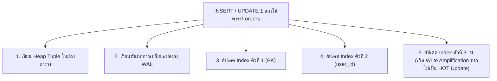

## 1. แนวคิด (Concept)
ในขณะที่ Index ช่วยเร่งความเร็วในการอ่านข้อมูล (`SELECT`) อย่างก้าวกระโดด แต่ทุกๆ Index ที่สร้างเพิ่มขึ้นมาจะมี **ต้นทุนต่อการเขียนข้อมูล (`INSERT`, `UPDATE`, `DELETE`)** เสมอ ซึ่งปรากฏการณ์ที่การเขียนข้อมูล 1 แถวในตารางก่อให้เกิดการเขียนข้อมูลกระจายไปยังไฟล์ Index อีกหลายจุดบนดิสก์เรียกว่า **Write Amplification**

ลองจินตนาการว่าตาราง `orders` มี Index ทั้งหมด 12 ตัว เมื่อลูกค้ากดสั่งซื้อเนื้อ 1 รายการ (`INSERT 1 แถว`) แทนที่ PostgreSQL จะเขียนลงตารางหลักเพียงจุดเดียว มันจะต้องไปค้นหาตำแหน่งและแทรกข้อมูลลงใน Index ทั้ง 12 ตัว พร้อมทั้งเขียนบันทึกลง Write-Ahead Log (WAL) ทั้งหมด ส่งผลให้ประสิทธิภาพการรับคำสั่งซื้อพร้อมกันลดลงอย่างรุนแรง



## 2. หลักการเบื้องหลัง (Under the Hood)
ในสถาปัตยกรรม MVCC ของ PostgreSQL 16 การสั่ง `UPDATE` ข้อมูล 1 แถว (เช่น `UPDATE products SET stock_qty = stock_qty - 1 WHERE id = ...`) แท้จริงแล้วคือการทำเครื่องหมายว่าแถวเดิมหมดอายุแล้วสร้างแถวเวอร์ชันใหม่ (New Heap Tuple) ที่มีค่า `ctid` ใหม่ขึ้นมา:
- **กรณีปกติ (Non-HOT Update):** หากคอลัมน์ที่ถูกแก้ไขมี Index ผูกอยู่ด้วย (เช่น มีใครไปสร้าง Index บนคอลัมน์ `stock_qty`) PostgreSQL จะต้องตามไปสร้าง Index Entry ชิ้นใหม่ใน **ทุกๆ Index ของตารางนั้นทั้งหมด** (แม้แต่ Index ของ `sku` หรือ `name` ที่ไม่ได้เปลี่ยนค่าเลยก็ตาม เพราะต้องชี้ไปยัง `ctid` ตัวใหม่!)
- **กลไก HOT Update (Heap-Only Tuple):** หากคอลัมน์ที่ถูก `UPDATE` **ไม่ได้อยู่ใน Index ตัวใดเลย** และในหน้าบล็อก 8KB เดิมยังมีพื้นที่ว่างเหลือพอให้วางแถวเวอร์ชันใหม่ PostgreSQL 16 จะทำ **HOT Update** คือเชื่อมโยงแถวเก่าไปยังแถวใหม่ภายในหน้าบล็อกเดียวกันโดย **ไม่ต้องแตะหรือแก้ไข Index ตัวใดเลยแม้แต่ตัวเดียว!**

นี่คือเหตุผลเชิงลึกว่าทำไมการไม่สร้าง Index บนคอลัมน์ที่ถูกอัปเดตบ่อยๆ (เช่น `stock_qty` หรือ `updated_at`) จึงช่วยให้ PostgreSQL 16 ทำ HOT Update ได้อย่างรวดเร็วและป้องกันปัญหา Index Bloat!

## 3. ตัวอย่างโค้ด (Smart Butcher Marketplace)

### ตัวอย่างที่ 1: การปรับตั้งค่า `fillfactor` เพื่อให้ตารางที่มีการอัปเดตสต็อกบ่อยทำ HOT Update ได้สูงสุด
ในตาราง `products` คอลัมน์ `stock_qty` จะถูกอัปเดตตลอดเวลาเมื่อมีการสั่งซื้อ เราต้องไม่สร้าง Index บน `stock_qty` และสามารถตั้งค่า `fillfactor = 80` เพื่อเว้นที่ว่างในแต่ละบล็อก 8KB ไว้ 20% สำหรับรองรับ HOT Updates:

```sql filename="sql/09_hot_update_optimization_fillfactor.sql"
-- กำหนด fillfactor = 80 บนตาราง products เพื่อให้แต่ละ 8KB Page เหลือพื้นที่ว่าง 20% สำหรับทำ HOT Update
ALTER TABLE products SET (fillfactor = 80);

-- ตรวจสอบสถิติการทำ HOT Update เทียบกับการ Update ทั้งหมดของตารางใน PostgreSQL 16
SELECT 
    relname AS table_name,
    n_tup_upd AS total_updates,
    n_tup_hot_upd AS hot_updates,
    ROUND((n_tup_hot_upd::numeric / NULLIF(n_tup_upd, 0)) * 100, 2) AS hot_update_ratio_percent
FROM pg_stat_user_tables
WHERE relname IN ('products', 'orders', 'payments');
```

### ตัวอย่างที่ 2: คิวรีตรวจสอบหา Index ที่ไม่ได้ถูกใช้งานเลย (Unused Indexes) และขนาดพื้นที่ที่เสียไป
ในการดูแลระบบ Production เราต้องหมั่นตรวจสอบ System View `pg_stat_user_indexes` เพื่อหา Index ที่ถูกสร้างทิ้งไว้แต่ไม่เคยถูก Query Planner เรียกใช้งานเลย (`idx_scan = 0`):

```sql filename="sql/10_detect_unused_and_bloated_indexes.sql"
-- ค้นหา Index ที่ไม่เคยถูกใช้งานเลย (ยกเว้น Unique/Primary Key) เรียงตามขนาดพื้นที่จากมากไปน้อย
SELECT 
    s.schemaname,
    s.relname AS table_name,
    s.indexrelname AS index_name,
    s.idx_scan AS times_used,
    pg_size_pretty(pg_relation_size(s.indexrelid)) AS index_size,
    pg_size_pretty(pg_relation_size(s.relid)) AS table_size
FROM pg_stat_user_indexes s
JOIN pg_index i ON s.indexrelid = i.indexrelid
WHERE s.idx_scan = 0
  AND NOT i.indisunique
  AND NOT i.indisprimary
ORDER BY pg_relation_size(s.indexrelid) DESC;
```

## 4. ผิด vs ถูก (Anti-pattern vs Best Practice)

| มิติการเปรียบเทียบ | ❌ ผิด (Anti-pattern) | ✅ ถูก (Best Practice) |
| :--- | :--- | :--- |
| **การสร้าง Index บนคอลัมน์ที่อัปเดตทุกวินาที** | สร้าง Index บนคอลัมน์ `stock_qty` หรือ `view_count` ทำให้เสียสิทธิ์การทำ HOT Update ทันที | หลีกเลี่ยงการสร้าง Index บนคอลัมน์ที่มีการเปลี่ยนแปลงค่าถี่ๆ เพื่อรักษาอัตราส่วน `n_tup_hot_upd` ให้สูง |
| **การสร้าง Index เผื่อไว้ทุกคอลัมน์** | สร้าง Index ดักไว้ทุกคอลัมน์ตั้งแต่วันแรกที่สร้างตารางโดยไม่ดูรูปแบบการคิวรีจริง | สร้างเฉพาะ PK, FK, Unique และ Index ของคิวรีหลักที่ชัดเจน แล้วใช้วิเคราะห์จาก `pg_stat_statements` เพิ่มเติม |
| **การปล่อย Unused Indexes ทิ้งไว้** | ไม่กล้าลบ Index ที่ไม่ได้ใช้ (`idx_scan = 0` นานหลายเดือน) เพราะกลัวกระทบระบบ | ตรวจสอบ `pg_stat_user_indexes` เป็นประจำและลบ Index ที่ไม่ถูกใช้งานเพื่อคืนพื้นที่ RAM และเร่งความเร็วการเขียน |

## 5. ควรใช้เมื่อไหร่ และ ไม่ควรใช้เมื่อไหร่
- **ควรสร้าง Index เมื่อ:** คอลัมน์นั้นอยู่ในเงื่อนไข `JOIN` (Foreign Keys), เงื่อนไข `WHERE` ที่คัดกรองข้อมูลลงเหลือสัดส่วนน้อย (High Selectivity), หรือเงื่อนไข `ORDER BY` พร้อม `LIMIT` ใน API ที่ถูกเรียกใช้งานบ่อย
- **ไม่ควรสร้าง Index เมื่อ:** ตารางนั้นเป็นตารางรับข้อมูลเขียนความเร็วสูง (Write-heavy Logging/Queue) ที่แทบไม่มีการค้นหาแบบเจาะจง หรือคอลัมน์นั้นมีค่าซ้ำกันเกือบทั้งตาราง (เช่น `currency = 'THB'` ที่มีค่าเดียว 99.9% โดยไม่ได้ทำ Partial Index)

## 6. คำถามสัมภาษณ์ (Interview Q&A)
- **Q1: อธิบายกลไก HOT (Heap-Only Tuple) Update ใน PostgreSQL ว่าคืออะไร และทำไมการเพิ่ม Index ที่ไม่จำเป็นเพียงตัวเดียวจึงทำลายประสิทธิภาพการ Update ทั้งตารางได้?**
  - **แนวคำตอบ:** ใน PostgreSQL การ `UPDATE` แถวคือการเขียนแถวเวอร์ชันใหม่ลงไป หากคอลัมน์ที่ถูกแก้ไขไม่มี Index ใดๆ อ้างอิงถึงเลย และในหน้าบล็อก 8KB เดิมยังมีที่ว่าง PostgreSQL จะทำ HOT Update คือสร้างแถวใหม่ในหน้าเดิมแล้วให้แถวเก่าชี้ต่อกันเป็นลูกโซ่ภายในหน้าบล็อกนั้น โดยไม่ต้องไปอัปเดตโครงสร้าง B-Tree Index ของตารางเลยแม้แต่ตัวเดียว แต่ถ้าเราเผลอสร้าง Index บนคอลัมน์ที่ถูกอัปเดตบ่อย (เช่น `updated_at` หรือ `stock_qty`) ทุกครั้งที่อัปเดตจะไม่เข้าเงื่อนไข HOT ส่งผลให้ PostgreSQL ต้องตามไปแทรกข้อมูลใหม่ในทุกๆ Index ของตารางนั้นทั้งหมด เกิด Write Amplification และ Index Bloat อย่างรุนแรง
- **Q2: หากพบว่า Index บนตาราง Production เกิดอาการบวม (Index Bloat) จากการลบและแก้ไขข้อมูลจำนวนมาก เราจะฟื้นฟู Index นั้นโดยไม่ให้ระบบหยุดชะงัก (Zero Downtime) ได้อย่างไรใน PostgreSQL 16?**
  - **แนวคำตอบ:** ใช้คำสั่ง `REINDEX INDEX CONCURRENTLY ชื่อ_index;` ใน PostgreSQL 16 คำสั่งนี้จะสร้างโครงสร้าง Index ชุดใหม่ที่สะอาดและเรียงตัวแน่นหนาอยู่เบื้องหลังโดยไม่บล็อกการอ่านหรือการเขียนข้อมูลของแอปพลิเคชัน เมื่อสร้างเสร็จสมบูรณ์จึงสลับมาใช้ตัวใหม่และลบตัวเก่าทิ้งโดยอัตโนมัติ

---
