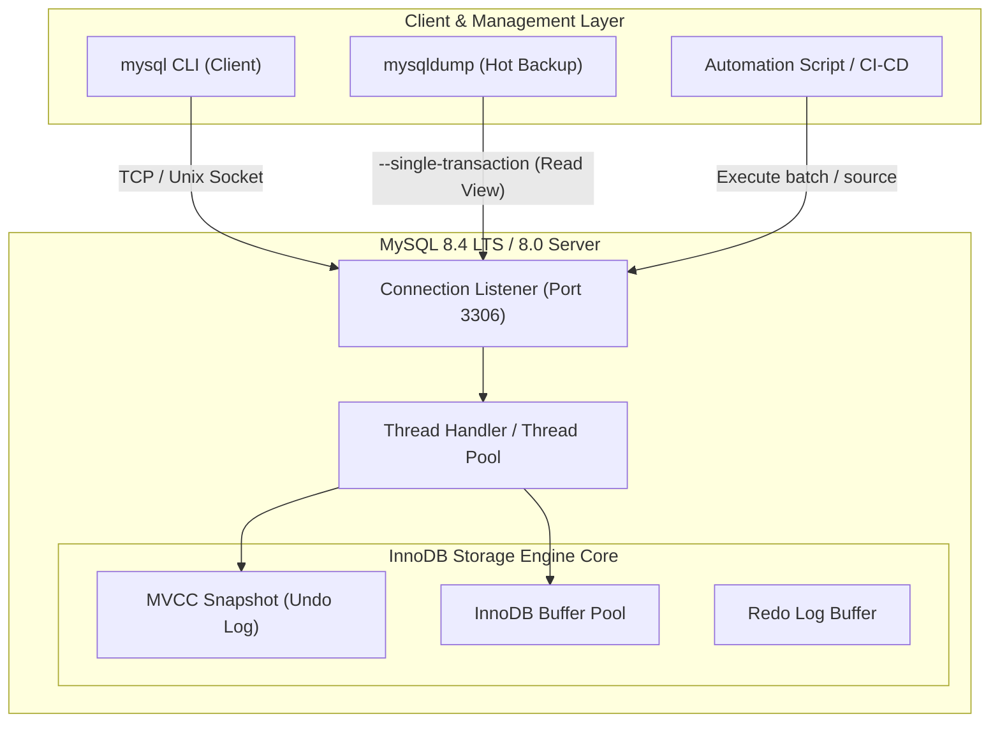

# mysql CLI Tools

ในการบริหารจัดการฐานข้อมูลระดับ Enterprise การพึ่งพาเฉพาะเครื่องมือแบบ GUI เช่น DBeaver หรือ MySQL Workbench ย่อมไม่เพียงพอต่อการรับมือกับเหตุฉุกเฉินในระบบ Production เครื่องมือ Command-Line Interface (CLI) ของ MySQL เช่น `mysql`, `mysqldump`, และ `mysqladmin` คืออุปกรณ์พื้นฐานที่วิศวกรฐานข้อมูลและนักพัฒนาจำเป็นต้องใช้งานอย่างคล่องแคล่ว ไม่ว่าจะเป็นการเข้าถึงผ่าน SSH บนโฮสต์ Linux, การเชื่อมต่อเข้าไปยัง Kubernetes Pod, หรือการเขียน Automation Pipeline สำหรับงาน CI/CD

---

## 1. แนวคิด (Concept)

MySQL CLI Tools เป็นเครื่องมือสื่อสารโดยตรงกับ MySQL Server ผ่าน MySQL Client/Server Protocol:

- **MySQL Client CLI (`mysql`):** หน้าต่าง Terminal สำหรับส่งคำสั่ง SQL, ควบคุมเซสชัน, ตรวจสอบสถานะของเอนจิน, และรันคำสั่งสคริปต์แบบ Non-interactive
- **Logical Backup CLI (`mysqldump`):** ยูทิลิตีสำหรับดึงโครงสร้าง (Schema DDL) และข้อมูล (Data DML) ออกมาในรูปแบบไฟล์ข้อความ SQL Script เพื่อนำไปใช้ย้ายฐานข้อมูล สำรองข้อมูลรายวัน หรือทดสอบระบบ Staging
- **กระบวนการ Monitor & Control (`SHOW PROCESSLIST` / `KILL`):** หน้าปัดตรวจสอบว่าเซิร์ฟเวอร์กำลังรันคำสั่งใดอยู่จากโฮสต์ไหน และเครื่องมือจัดการปลดล็อกคิวรีที่ค้าง (Stuck Queries) ก่อนที่ระบบจะเกิดปัญหาทราฟฟิกสะสมจนล่ม



---

## 2. หลักการเบื้องหลัง (Under the Hood)

### 2.1 กลไกการทำงานของ MySQL Client CLI
เมื่อเรียกใช้งาน `mysql -u ... -p`:
1. ไคลเอนต์จะเริ่มต้นกระบวนการ Handshake และเลือกการเชื่อมต่อ:
   - **Unix Domain Socket:** หากเชื่อมต่อกับ `localhost` บนเครื่อง Linux ระบบจะเลือกใช้ Local Socket (`/var/run/mysqld/mysqld.sock`) โดยอัตโนมัติ ซึ่งมี Throughput สูงกว่าระบบเครือข่าย
   - **TCP/IP:** หากระบุ IP Address หรือโฮสต์ผ่าน `-h 127.0.0.1 -P 3306` ระบบจะเชื่อมต่อผ่าน Network Socket Stack
2. **Interactive vs Batch Mode:**
   - ในโหมด Interactive ไคลเอนต์จะโหลดประวัติคำสั่งจากไฟล์ `~/.mysql_history`
   - ในโหมด Batch หรือการใช้ตัวเลือก `-e` (Execute) ไคลเอนต์จะส่งคำสั่งไปประมวลผลแล้วปิดเซสชันทันที โดยไม่เปิด Terminal โต้ตอบ

### 2.2 กลไก Online Non-blocking Backup ของ `mysqldump`
การสั่ง `mysqldump` บนฐานข้อมูลขนาดใหญ่ที่กำลังให้บริการลูกค้าอยู่ มักก่อให้เกิดปัญหาการล็อกตารางหากใช้คำสั่งไม่ถูกต้อง ตัวเลือกสำคัญที่ทำให้เกิดการสำรองข้อมูลแบบ Online Hot Backup บนเอนจิน **InnoDB** คือ:

- **`--single-transaction`:** คำสั่งนี้จะส่ง `START TRANSACTION WITH CONSISTENT SNAPSHOT` ไปยัง MySQL Server ในจุดเริ่มต้นของการดัมป์ ข้อมูลทั้งหมดที่ถูกอ่านหลังจากนี้จะอ่านผ่าน **MVCC (Multi-Version Concurrency Control)** และ Undo Log ทำให้แอปพลิเคชันยังคงสามารถสั่ง `INSERT`, `UPDATE`, และ `DELETE` ได้ตามปกติโดยไม่ติดล็อกแถวหรือตาราง!
- **`--quick` (`-q`):** สั่งให้ MySQL Client อ่านข้อมูลทีละแถวจาก Network Stream ผ่านฟังก์ชัน `mysql_use_result()` ของ C API แทนที่จะโหลดผลลัพธ์ทั้งตารางเข้ามาพักไว้ใน RAM ของเครื่อง Client (`mysql_store_result()`) ช่วยป้องกันปัญหา Out of Memory (OOM) เมื่อตารางมีขนาดหลายสิบกิกะไบต์
- **ข้อจำกัดของ Metadata Lock (MDL):** แม้ `--single-transaction` จะไม่ล็อกข้อมูลแถว แต่ MySQL ยังคงต้องถือ Metadata Lock แบบ Shared ในระดับตาราง หากมีคำสั่ง DDL (เช่น `ALTER TABLE` หรือ `TRUNCATE`) รันแทรกเข้ามาในช่วงที่ `mysqldump` กำลังทำงาน คำสั่ง DDL จะติดรอ MDL Exclusive Lock และส่งผลให้คิวรีอื่นๆ ที่ตามหลังมาติดค้างทั้งหมด

### 2.3 การวิเคราะห์ `SHOW FULL PROCESSLIST` และคำสั่ง `KILL`
MySQL จะจัดสรร Thread มารองรับแต่ละการเชื่อมต่อ (Client Connection) เมื่อเราสั่ง `SHOW FULL PROCESSLIST` (หรือคิวรีจากตาราง `information_schema.processlist` / `performance_schema.threads`):

| คอลัมน์สำคัญ | ความหมายทางเทคนิค |
| :--- | :--- |
| `Id` | ตัวระบุ Connection Thread ID สำหรับส่งคำสั่งควบคุม |
| `User` / `Host` | บัญชีผู้ใช้งานและ IP Address พร้อมพอร์ตต้นทางของไคลเอนต์ |
| `db` | ฐานข้อมูลเริ่มต้นของเซสชันนั้น |
| `Command` | สถานะของเซสชัน เช่น `Sleep` (รอคิวรีถัดไป), `Query` (กำลังประมวลผล), `Execute` |
| `Time` | ระยะเวลาที่อยู่ในสถานะปัจจุบัน (หน่วยเป็นวินาที) |
| `State` | รายละเอียดขั้นตอนภายใน เช่น `Sending data`, `Waiting for table metadata lock`, `Copying to tmp table` |
| `Info` | ข้อความคำสั่ง SQL ที่กำลังประมวลผลอยู่จริง (ตัดให้ยาวขึ้นด้วยคำสำคัญ `FULL`) |

#### ความแตกต่างระหว่าง `KILL QUERY` และ `KILL CONNECTION`:
- **`KILL QUERY <id>`:** ส่งสัญญาณขัดจังหวะ (Interrupt Flag) ไปยัง Thread เพื่อยกเลิกเฉพาะคำสั่ง SQL ที่กำลังรันอยู่ แต่ยังคงรักษา Connection และสถานะของทรานแซกชันไว้
- **`KILL [CONNECTION] <id>`:** สั่งตัดการเชื่อมต่อเครือข่ายของเซสชันนั้นทันที และบังคับให้ InnoDB เริ่มต้นกระบวนการ Rollback ทรานแซกชันที่ยังไม่ได้ Commit ทั้งหมด

<Callout type="warning" title="ข้อควรระวังในการสั่ง KILL ทรานแซกชันขนาดใหญ่">
หากสั่ง Kill ทรานแซกชันที่มีการแก้ไขข้อมูลไปแล้วหลายล้านแถว (เช่น การสั่ง Update ราคาเนื้อสัตว์ทั้งระบบโดยไม่มีเงื่อนไข) เอนจิน InnoDB จะต้องใช้เวลาในการอ่าน Undo Log เพื่อย้อนคืนข้อมูลทุกแถวกลับสู่สภาพเดิม ในช่วงเวลานี้ Thread จะเข้าสู่สถานะ `Killed` และอาจกิน Disk I/O มหาศาลจนกว่าการ Rollback จะเสร็จสิ้นสมบูรณ์ การสั่งปิดหรือรีสตาร์ตเซิร์ฟเวอร์แบบรุนแรงจะยิ่งทำให้เวลา Crash Recovery ตอนเปิดเครื่องยาวนานขึ้นไปอีก
</Callout>

### 2.4 Server Status Variables และ Health Telemetry
MySQL บันทึกสถิติการทำงานแบบสะสมไว้ในระบบ ซึ่งเรียกดูได้ผ่านคำสั่ง `SHOW GLOBAL STATUS`:
- **`Threads_connected`:** จำนวน Connection ที่เปิดค้างอยู่ ณ ปัจจุบัน
- **`Threads_running`:** จำนวน Thread ที่ไม่ได้อยู่ในสถานะ `Sleep` แต่กำลังประมวลผลคำสั่งจริงบน CPU (หากค่านี้สูงผิดปกติ แสดงว่าเซิร์ฟเวอร์เกิดปัญหาคอขวด)
- **`Innodb_buffer_pool_read_requests`:** จำนวนครั้งที่มีการร้องขออ่านข้อมูลจากหน่วยความจำ Buffer Pool
- **`Innodb_buffer_pool_reads`:** จำนวนครั้งที่ข้อมูลไม่อยู่ใน Buffer Pool จนต้องอ่านจาก Physical Disk (ใช้คำนวณ Buffer Pool Hit Ratio)
- **`Aborted_connects`:** จำนวนครั้งที่การพยายามเชื่อมต่อไปยังเซิร์ฟเวอร์ล้มเหลว (มักเกิดจาก Network Timeout หรือรหัสผ่านผิดพลาด)

---

## 3. ตัวอย่างโค้ด (Smart Butcher Marketplace)

### ตัวอย่างที่ 1: สคริปต์ Shell สำรองและกู้คืนข้อมูลแบบ Online Non-blocking Production

สคริปต์ Bash สำหรับการสำรองข้อมูลตารางร้านขายเนื้อพรีเมียม (`categories`, `products`, `meat_cuts`, `orders`, `order_items`, `payments`) โดยไม่กระทบต่อลูกค้าที่กำลังสั่งซื้อเนื้อวากิว:

```bash filename="05_smart_butcher_backup.sh"
#!/usr/bin/env bash
# ==============================================================================
# Smart Butcher Marketplace: Online Non-blocking Backup Script (MySQL 8.4 / 8.0)
# ==============================================================================
set -euo pipefail

DB_HOST="127.0.0.1"
DB_PORT="3306"
DB_USER="backup_agent"
DB_NAME="smart_butcher"
BACKUP_DIR="/var/backups/smart_butcher"
DATE_STR=$(date +%Y%m%d_%H%M%S)
BACKUP_FILE="${BACKUP_DIR}/${DB_NAME}_backup_${DATE_STR}.sql.gz"

mkdir -p "${BACKUP_DIR}"

echo "[$(date '+%Y-%m-%d %H:%M:%S')] Starting non-blocking backup for database: ${DB_NAME}..."

# ข้อกำหนด: ต้องสร้าง authentication login path ล่วงหน้าด้วย:
# mysql_config_editor set --login-path=butcher_backup --host=127.0.0.1 --user=backup_agent --password

mysqldump \
  --login-path=butcher_backup \
  --port="${DB_PORT}" \
  --single-transaction \
  --quick \
  --default-character-set=utf8mb4 \
  --triggers \
  --routines \
  --events \
  --hex-blob \
  --set-gtid-purged=OFF \
  --max-allowed-packet=128M \
  --databases "${DB_NAME}" \
  | gzip -9 > "${BACKUP_FILE}"

echo "[$(date '+%Y-%m-%d %H:%M:%S')] Backup successfully created at: ${BACKUP_FILE}"
echo "[$(date '+%Y-%m-%d %H:%M:%S')] File size: $(du -h "${BACKUP_FILE}" | cut -f1)"
```

คำสั่งการกู้คืนข้อมูล (Restore) ผ่าน Command Redirection:

```bash filename="05_smart_butcher_restore.sh"
#!/usr/bin/env bash
# ==============================================================================
# Smart Butcher Marketplace: Database Restoration Script
# ==============================================================================
set -euo pipefail

RESTORE_SRC="/var/backups/smart_butcher/smart_butcher_backup_20261021_030000.sql.gz"

echo "Verifying backup file integrity..."
gzip -t "${RESTORE_SRC}"

echo "Restoring database to MySQL instance..."
# คลายการบีบอัดและส่งเข้าสู่ mysql client ผ่าน Standard Input
gunzip < "${RESTORE_SRC}" | mysql \
  --login-path=butcher_backup \
  --host=127.0.0.1 \
  --port=3306 \
  --default-character-set=utf8mb4

echo "Restoration complete!"
```

---

### ตัวอย่างที่ 2: สคริปต์ SQL วินิจฉัยคิวรีค้าง จัดการ Deadlock และตรวจสอบความสมบูรณ์ของเซิร์ฟเวอร์

การใช้คำสั่งระดับสูงใน `mysql` Client เพื่อตรวจสอบคำสั่งซื้อเนื้อที่กำลังประมวลผลช้า การตรวจจับล็อก และการปลดล็อก:

```sql filename="05_cli_diagnostics_and_monitoring.sql"
-- 1. ตรวจสอบการเชื่อมต่อที่กำลังรันคำสั่งอยู่จริง (ไม่รวมเซสชันที่ Sleep)
SELECT 
    id AS thread_id,
    user,
    host,
    db,
    command,
    time AS elapsed_seconds,
    state,
    SUBSTRING(info, 1, 120) AS current_statement
FROM information_schema.processlist
WHERE command != 'Sleep'
ORDER BY time DESC;

-- 2. เจาะลึกหาคำสั่งที่กำลังถือล็อก หรือรอคอยล็อกในตารางคำสั่งซื้อและสต็อกเนื้อ
-- (ใช้งานได้ใน MySQL 8.0.1+)
SELECT 
    r.trx_id AS waiting_trx_id,
    r.trx_mysql_thread_id AS waiting_thread_id,
    r.trx_query AS waiting_query,
    b.trx_id AS blocking_trx_id,
    b.trx_mysql_thread_id AS blocking_thread_id,
    b.trx_query AS blocking_query,
    TIMESTAMPDIFF(SECOND, r.trx_wait_started, NOW()) AS wait_time_sec
FROM performance_schema.data_lock_waits w
JOIN information_schema.innodb_trx b 
    ON b.trx_id = w.blocking_engine_transaction_id
JOIN information_schema.innodb_trx r 
    ON r.trx_id = w.requesting_engine_transaction_id;

-- 3. หากพบว่า Thread ID 142 กำลังล็อกแถวสินค้า Wagyu A5 Striploin จนออเดอร์อื่นค้าง
-- สั่งยกเลิกเฉพาะคำสั่ง SQL ของ Thread ดังกล่าว เพื่อให้ปล่อยล็อก
KILL QUERY 142;

-- หรือสั่งตัดเซสชันและบังคับ Rollback ทันทีหากตัวแอปพลิเคชันค้าง
-- KILL CONNECTION 142;

-- 4. คำนวณอัตราส่วนการอ่านข้อมูลจาก RAM (Buffer Pool Hit Ratio)
-- ค่ามาตรฐานระดับ Production ควรสูงกว่า 99.0%
SELECT 
    (1.0 - (reads.variable_value / read_requests.variable_value)) * 100.0 AS buffer_pool_hit_ratio_percentage
FROM performance_schema.global_status reads
JOIN performance_schema.global_status read_requests 
    ON read_requests.variable_name = 'Innodb_buffer_pool_read_requests'
WHERE reads.variable_name = 'Innodb_buffer_pool_reads';

-- 5. ตรวจสอบปริมาณการเชื่อมต่อ (Connection Saturation)
SELECT 
    c.variable_value AS threads_connected,
    m.variable_value AS max_connections,
    ROUND((c.variable_value / m.variable_value) * 100, 2) AS connection_usage_pct
FROM performance_schema.global_status c
JOIN performance_schema.global_variables m 
    ON m.variable_name = 'max_connections'
WHERE c.variable_name = 'Threads_connected';
```

<Callout type="tip" title="การดูผลลัพธ์ในรูปแบบแนวตั้งด้วย \G">
เมื่อรันคำสั่งที่มีหลายคอลัมน์ใน MySQL Client เช่น `SHOW ENGINE INNODB STATUS\G` หรือ `SELECT * FROM orders\G` ให้ปิดท้ายด้วย `\G` แทนเครื่องหมายเซมิโคลอน (`;`) เพื่อให้ไคลเอนต์จัดรูปแบบผลลัพธ์แบบแนวตั้ง (Expanded View) ทำให้อ่านข้อมูลที่มีความยาวมากได้สะดวกยิ่งขึ้น
</Callout>

---

## 4. ข้อผิดพลาดที่พบบ่อย (Anti-pattern vs Best Practice)

| มิติการทำงาน | ❌ วิธีที่ผิด (Anti-pattern) | ✅ วิธีที่ถูกต้อง (Best Practice) |
| :--- | :--- | :--- |
| **การป้อนรหัสผ่านใน CLI** | พิมพ์รหัสผ่านต่อท้ายในคำสั่ง เช่น `mysqldump -u root -pSecretPass123` ทำให้รหัสผ่านปรากฏใน Process List (`ps aux`) และ Bash History | ใช้ยูทิลิตี `mysql_config_editor set --login-path=...` เพื่อเก็บ Credential ที่ถูกเข้ารหัสไว้ในไฟล์ `.mylogin.cnf` |
| **การดัมป์ข้อมูลระบบ Production** | รันคำสั่ง `mysqldump` โดยไม่ระบุแฟล็ก `--single-transaction` ทำให้ MySQL ล็อกตารางด้วย `LOCK TABLES` และระบบสั่งซื้อหยุดชะงัก | ระบุ `--single-transaction --quick` เสมอ เพื่อสร้าง MVCC Snapshot สำหรับตาราง InnoDB โดยไม่ต้องหยุดการทำงานของระบบ |
| **การนำเข้าไฟล์ SQL ขนาดใหญ่** | รันคำสั่ง `source large_dump.sql;` ในโหมดเปิดใช้งาน Foreign Key Checks และ Autocommit ปกติ | ปิดการตรวจ Foreign Key และ Secondary Index ชั่วคราวในระดับเซสชันก่อนนำเข้าข้อมูล: `SET foreign_key_checks=0; SET unique_checks=0;` |
| **การจัดการ Long-running Query** | ตัดสินใจรีสตาร์ตเซิร์ฟเวอร์ MySQL ทันทีเมื่อเห็นคำสั่งค้างหลายรายการ | ใช้ `SHOW FULL PROCESSLIST` ตรวจสอบสาเหตุ ค้นหา Blocking Transaction และสั่ง `KILL QUERY <id>` เฉพาะจุด |

---

## 5. ควรใช้เมื่อไหร่ และ ไม่ควรใช้เมื่อไหร่

### ควรใช้ MySQL CLI Tools เมื่อ:
- **สำรองข้อมูลขนาดเล็กถึงปานกลาง (ต่ำกว่า 50 - 100 GB):** `mysqldump` สะดวก พกพาง่าย สามารถย้ายข้ามสถาปัตยกรรม CPU หรือย้ายข้ามเวอร์ชันของ MySQL ได้
- **การวินิจฉัยและแก้ปัญหาเฉพาะหน้า (Triage & Incident Response):** ตรวจสอบสถานะ Thread, ค่า Status Variables, คิวรีที่ค้าง, และการทำงานของหน่วยความจำผ่าน Terminal โดยตรง
- **งาน Seeding และ Migration:** การรันไฟล์ SQL สคริปต์ขนาดใหญ่สำหรับติดตั้งระบบหรืออัปเดต Schema ใน Pipeline CI/CD

### ไม่ควรใช้ (หรือควรใช้เครื่องมือทางเลือก) เมื่อ:
- **ฐานข้อมูลระดับหลายร้อยกิกะไบต์หรือเทระไบต์:** การกู้คืนข้อมูลแบบ Logical จาก `mysqldump` จะใช้เวลานานมหาศาลเนื่องจากต้องสร้าง Index ใหม่ทีละแถว ควรเปลี่ยนไปใช้ **Physical Hot Backup Tools** เช่น **Percona XtraBackup** หรือ Volume Snapshot ระดับคลาวด์ (AWS RDS/Aurora Snapshots)
- **การวิเคราะห์ Execution Plan เชิงลึกแบบ Interactive:** สำหรับการเขียนและปรับแต่งคิวรีที่ซับซ้อนมาก การดูแบบ Graphical Visual Plan ใน GUI Tool อาจช่วยให้เห็นภาพรวมของ Cost Tree ได้รวดเร็วกว่าในขั้นตอนการพัฒนา

---

## 6. คำถามสัมภาษณ์งาน (Interview Q&A)

### Q1: อธิบายกลไกของแฟล็ก `--single-transaction` ใน `mysqldump` อย่างละเอียด ทำไมจึงสามารถสำรองข้อมูลตาราง InnoDB ได้อย่างสอดคล้อง (Consistent Snapshot) โดยไม่ต้องล็อกตาราง และมีข้อจำกัดอะไรบ้าง?
**แนวคำตอบ:**
แฟล็ก `--single-transaction` จะส่งคำสั่ง `START TRANSACTION WITH CONSISTENT SNAPSHOT` ไปยัง MySQL Server เมื่อเริ่มกระบวนการดัมป์ ซึ่งเป็นการสร้าง Consistent Read View ภายใต้ Isolation Level แบบ **REPEATABLE READ** ของสตอเรจเอนจิน InnoDB ข้อมูลที่ถูกอ่านออกไปตลอดช่วงเวลาที่ดัมป์จะเป็นภาพถ่าย ณ เวลาที่ Snapshot เริ่มต้นขึ้น หากมีทรานแซกชันอื่นของระบบสั่ง `UPDATE` หรือ `INSERT` ข้อมูลใหม่เข้ามา InnoDB จะอาศัย **Undo Log (MVCC)** ในการจำลองข้อมูลเวอร์ชันเดิมส่งกลับมาให้ `mysqldump` ดังนั้นระบบจึงสามารถอ่านข้อมูลได้อย่างสอดคล้อง 100% โดยที่คำสั่งเขียนอื่นๆ ไม่ถูกบล็อก

**ข้อจำกัดสำคัญ:**
1. ใช้ได้ผลเฉพาะกับตารางที่ใช้เอนจิน **InnoDB** เท่านั้น หากมีตารางเอนจิน MyISAM ปะปนอยู่ ตารางนั้นจะไม่รองรับทรานแซกชันและอาจได้ข้อมูลที่ไม่สอดคล้องกัน
2. หากมีการรันคำสั่ง **DDL** (เช่น `ALTER TABLE`, `DROP TABLE`) บนตารางที่กำลังถูกดัมป์ ตัว `mysqldump` จะส่งคำสั่ง `SELECT` ที่ต้องขอ Metadata Lock (MDL) ซึ่งจะเกิดปัญหา MDL Lock Contention จนส่งผลให้คิวรีอื่นๆ ของระบบหยุดชะงักตามไปด้วย

---

### Q2: ในการกู้วิกฤตฉุกเฉินของ MySQL มีความแตกต่างอย่างไรระหว่างคำสั่ง `KILL QUERY <id>` และ `KILL CONNECTION <id>` และเพราะเหตุใดการสั่ง Kill ทรานแซกชันขนาดใหญ่ที่รันมานานจึงไม่เสร็จสิ้นในทันที?
**แนวคำตอบ:**
- **`KILL QUERY <id>`:** เป็นการส่งสัญญาณ Interrupt ไปยัง Thread เพื่อหยุดการประมวลผลคำสั่ง SQL ปัจจุบันเท่านั้น แต่การเชื่อมต่อ TCP Socket และบริบทของทรานแซกชันยังคงเปิดอยู่ ไคลเอนต์จะได้รับข้อความแจ้งเตือนความผิดพลาด `Query execution was interrupted` แต่ยังสามารถส่งคำสั่งถัดไปหรือสั่ง Commit/Rollback ได้
- **`KILL [CONNECTION] <id>`:** เป็นการตัดการเชื่อมต่อเครือข่ายของเซสชันนั้นทิ้งทันที และบังคับให้ MySQL Server ดำเนินการย้อนคืนการทำงาน (Rollback) ของทรานแซกชันทั้งหมดที่ยังค้างอยู่

**สาเหตุที่การ Kill ทรานแซกชันขนาดใหญ่ไม่เสร็จทันที:**
เมื่อคำสั่งแก้ไขข้อมูลขนาดใหญ่ (เช่น การลบข้อมูลประวัติคำสั่งซื้อเก่า 10 ล้านแถว) ถูกสั่ง Kill ตัวเอนจิน InnoDB จะไม่สามารถทิ้งงานไว้ครึ่งๆ กลางๆ ได้ เพราะจะทำให้โครงสร้างข้อมูลและ B+Tree ผิดปกติ InnoDB จึงต้องเข้าสู่สถานะ **Rollback Processing** โดยอ่านข้อมูลจาก Undo Log Pages ย้อนกลับทีละแถวเพื่อใส่ข้อมูลเดิมกลับเข้าสู่ Clustered Index และ Secondary Indexes ทั้งหมด กระบวนการ Rollback นี้มักจะสร้าง Random Disk I/O ปริมาณมหาศาล และอาจใช้เวลาใกล้เคียงหรือนานกว่าเวลาที่คำสั่งนั้นรันมา จนกว่าสถานะจะเสร็จสิ้น Thread ดังกล่าวจะค้างอยู่ที่สถานะ `Killed`

---

## ดูเพิ่มเติมที่
- [MySQL 8.x](/docs/database/mysql) — กลับสู่หน้าสารบัญหลักของ MySQL 8.x
- [Transactions ACID](/docs/database/mysql/transactions-acid) — เจาะลึกกลไก Undo Log, Redo Log และ Isolation Levels
- [Locking Mechanics](/docs/database/mysql/locking-mechanics) — ระบบล็อกแถว Gap Lock และการวิเคราะห์ Deadlock
- [PostgreSQL 16 CLI Tools](/docs/database/postgresql/psql-cli-tools) — เปรียบเทียบการใช้งานเครื่องมือ CLI กับ PostgreSQL
