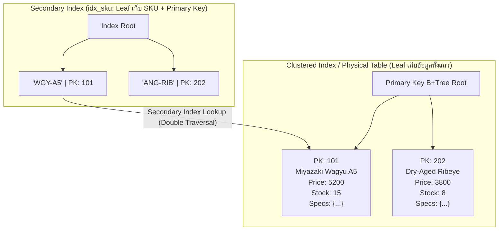
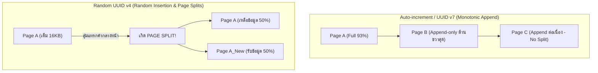

# InnoDB Indexes

สตอเรจเอนจิน **InnoDB** ใน **MySQL 8.4 LTS / 8.0** ใช้โครงสร้างการจัดเก็บข้อมูลแบบ **Index-Organized Table (IOT)** ซึ่งหมายความว่าตารางข้อมูลทั้งหมดไม่ได้ถูกเก็บแยกจากดัชนี แต่ตัวตารางเอง **คือตัวดัชนีแบบ Clustered Index** การทำความเข้าใจโครงสร้างกายภาพของ B+Tree ความสัมพันธ์ระหว่าง Clustered Index กับ Secondary Index และผลกระทบต่อการออกแบบ Primary Key ถือเป็นหัวใจสำคัญสูงสุดในการกำหนดประสิทธิภาพของระบบฐานข้อมูล

---

## 1. แนวคิด (Concept)

ลองเปรียบเทียบระบบคลังสินค้าเนื้อของ **Smart Butcher Marketplace**:

- **Clustered Index (ดัชนีหลัก):** เปรียบเสมือน "ตู้แช่เนื้อเย็นจัดขนาดใหญ่" ที่ชิ้นเนื้อวากิวและสเต๊กทั้งหมดถูกจัดวางเรียงตามลำดับรหัสสินค้าอย่างเป็นระเบียบทางกายภาพ ชิ้นเนื้อจริง (ข้อมูลทุกคอลัมน์) อยู่ในตู้แช่นี้โดยตรง หากคุณรู้รหัสสินค้า คุณสามารถเดินตรงไปหยิบเนื้อทั้งชิ้นออกมาได้ทันที
- **Secondary Index (ดัชนีรอง):** เปรียบเสมือน "สมุดสารบัญเล่มเล็กหน้าร้าน" ที่เรียงรายชื่อเนื้อตามเกรดลายหินอ่อน (Marbling Score BMS) หรือชื่อสายพันธุ์ (Miyazaki Wagyu, Australian Black Angus) ในสมุดเล่มนี้จะบอกเพียงแค่ว่าเนื้อชื่อนี้ มีรหัสสินค้า (Primary Key) เป็นเบอร์อะไร เพื่อให้คุณต้องเดินไปเปิดตู้แช่หลักหยิบเนื้ออีกรอบหนึ่ง
- **Covering Index (ดัชนีครอบคลุม):** เปรียบเสมือนสมุดสารบัญเล่มเล็กหน้าร้านที่นอกจากจะบอกชื่อเนื้อแล้ว ยังเขียนราคาต่อกิโลกรัมกำกับไว้ด้วย! หากลูกค้าแค่ต้องการเดินมาดูราคา พนักงานสามารถตอบคำถามได้ทันทีจากสมุดเล่มเล็ก โดยไม่ต้องเสียเวลาเดินเข้าไปเปิดตู้แช่หลักเลยแม้แต่ก้าวเดียว



---

## 2. หลักการเบื้องหลัง (Under the Hood)

### 2.1 สถาปัตยกรรม Clustered Index (Index-Organized Table)
ใน InnoDB ข้อมูลของตารางจะถูกจัดเก็บอยู่ในรูปโครงสร้าง **B+Tree** เสมอ โดยมีขนาดหน้าข้อมูลมาตรฐาน (Page Size) เท่ากับ **16 KB**:
- **Non-Leaf Nodes:** บรรจุเฉพาะค่าคีย์และตัวชี้ (Page Pointers) ไปยังหน้าระดับล่าง
- **Leaf Nodes:** บรรจุ **ข้อมูลทุกคอลัมน์ของแถวนั้นทั้งหมด** รวมถึงคอลัมน์ซ่อนของระบบ (`DB_TRX_ID`, `DB_ROLL_PTR`)
- **การคัดเลือก Clustered Index ของ InnoDB:**
  1. หากตารางมีการกำหนด `PRIMARY KEY` ระบบจะใช้ Primary Key นั้นเป็น Clustered Index เสมอ
  2. หากไม่มี Primary Key ระบบจะมองหาคอลัมน์แรกที่เป็น `UNIQUE` และระบุ `NOT NULL` ทั้งหมด
  3. **หายนะหากไม่มีทั้งสองอย่าง:** InnoDB จะสร้างดัชนีสังเคราะห์ชื่อ **`GENCLUST_INDEX`** โดยใช้ตัวนับแถวขนาด 6 ไบต์ที่เรียกว่า **Hidden Row ID**

<Callout type="warning" title="ภัยเงียบของตารางที่ไม่มี Primary Key (GENCLUST_INDEX Mutex Contention)">
เมื่อสร้างตารางโดยไม่มี Primary Key ตัวเอนจิน InnoDB จะใช้ตัวนับ Global Row ID ร่วมกันทั้ง Instance ผ่าน Mutex ส่วนกลาง `dict_sys->mutex` ส่งผลให้คำสั่ง `INSERT` ในทุกตารางที่ไม่มี Primary Key ต้องแย่งชิงล็อกตัวเดียวกัน ทำให้ประสิทธิภาพการเขียนของเซิร์ฟเวอร์พังทลายลงทันทีเมื่อมี Concurrency สูง
</Callout>

### 2.2 โครงสร้าง Secondary Index และกระบวนการ Secondary Index Lookup
Secondary Index ใน InnoDB มีคุณลักษณะทางกายภาพที่แตกต่างจากฐานข้อมูลอย่าง PostgreSQL หรือ Oracle:
- **Leaf Node ของ Secondary Index ไม่ได้เก็บ Physical Row Pointer (TID/CTID):** แต่จะเก็บ **ค่าของ Primary Key** ของแถวนั้นไว้เสมอ
- **Secondary Index Lookup (Bookmark Lookup / Double Traversal):**  
  เมื่อคำสั่ง SQL ค้นหาผ่าน Secondary Index เช่น `SELECT name, price_per_kg FROM products WHERE sku = 'WGY-MIYA-A5'`:
  1. เอนจินจะเดินทางค้นหาลงใน B+Tree ของ Secondary Index เพื่อค้นหา `sku`
  2. เมื่อพบ Leaf Node จะได้ค่า Primary Key ออกมา (สมมติ `id = 101`)
  3. เอนจินต้องนำ `id = 101` ไปกระโดดค้นหาลงใน B+Tree ของ Clustered Index อีกรอบหนึ่งเพื่อดึงคอลัมน์ `name` และ `price_per_kg` ที่ต้องการ
  4. กระบวนการกระโดดซ้ำสองชั้นนี้ทำให้เกิด **Random Disk I/O** เพิ่มขึ้นเป็นเท่าตัว หากข้อมูลไม่อยู่ใน Buffer Pool

### 2.3 เหตุผลทางสถาปัตยกรรม: ทำไมห้ามใช้ Random UUID v4 เป็น Primary Key ใน MySQL
การใช้ Random UUID v4 (เช่น `a8098c1a-f86e-11da-bd1a-00112444be1e`) เป็น Primary Key ถือเป็นหนึ่งใน Anti-pattern ที่สร้างความเสียหายรุนแรงที่สุดใน MySQL InnoDB ด้วยเหตุผล 4 ประการ:



1. **การเกิด B+Tree Page Splits มหาศาล:**  
   B+Tree ถูกออกแบบมาให้จัดเรียงข้อมูลตามลำดับคีย์ เมื่อใช้ Sequential Key (เช่น `AUTO_INCREMENT BIGINT` หรือ `UUID v7`) ข้อมูลใหม่จะถูกเขียนต่อท้ายที่หน้าขวาสุดเสมอ ทำให้หน้าเดิมถูกบรรจุได้แน่นถึง 93.75% (15/16ths) แต่เมื่อใช้ Random UUID ค่าที่สร้างขึ้นจะสุ่มกระจายไปทั่วทั้งพื้นที่ B+Tree เมื่อต้องแทรกแถวใหม่ลงไปในหน้าข้อมูลที่เต็มแล้ว InnoDB จะต้องทำการ **ผ่าครึ่งหน้า (Page Split)** โดยจัดสรรหน้าใหม่ขนาด 16 KB และย้ายข้อมูลครึ่งหนึ่ง (50%) ไปยังหน้าใหม่
2. **การบวมตัวของพื้นที่จัดเก็บ (Fragmentation & Storage Bloat):**  
   ผลจากการเกิด Page Split ตลอดเวลาทำให้ Leaf Pages มีข้อมูลบรรจุอยู่จริงเพียง 50% - 60% ของความจุ ส่งผลให้ขนาดไฟล์ `.ibd` และขนาดหน่วยความจำบวมขึ้น 2 ถึง 3 เท่าตัวโดยเปล่าประโยชน์
3. **การทำลายประสิทธิภาพของ Buffer Pool (Cache Thrashing):**  
   เนื่องจากจุดแทรกข้อมูลเกิดขึ้นแบบสุ่มกระจาย หน้าข้อมูลทุกหน้าในระบบจะถูกเรียกใช้งานแบบกระจัดกระจาย ทำให้หลักการ Locality of Reference ล้มเหลว Buffer Pool ไม่สามารถแคชหน้าข้อมูลที่ใช้งานบ่อยได้ เกิด Buffer Pool Misses พุ่งสูง และระบบต้องอ่านเขียนดิสก์แบบ Random I/O ตลอดเวลา
4. **Secondary Index ทุกตัวมีขนาดมหึมา:**  
   เพราะ Leaf Node ของ Secondary Index ทุกตัวต้องเก็บ Primary Key หาก Primary Key เป็นสตริง UUID ขนาด 36 ไบต์ (หรือ 16 ไบต์ในรูป Binary) ดัชนีรองทุกตัวในตารางจะแบกรับภาระขนาดนี้ในทุกๆ แถว เทียบกับ `BIGINT` ที่ใช้เพียง 8 ไบต์

### 2.4 ทางออกระดับวิศวกรรม: Auto-increment BIGINT และ UUID v7
- **แนวทางที่ 1: `BIGINT UNSIGNED AUTO_INCREMENT`:** ดีที่สุดสำหรับ Internal Clustered Index รองรับได้ถึง $18 \times 10^{18}$ แถว เขียนต่อท้ายแบบ Sequential I/O ได้ประสิทธิภาพสูงสุด
- **แนวทางที่ 2: UUID v7 (Time-Ordered 48-bit Timestamp):** หากจำเป็นต้องใช้ UUID เพื่อป้องกันการเดา ID ข้ามระบบ ให้เลือกใช้ **UUID v7** ซึ่งมี Timestamp ระดับมิลลิวินาทีนำหน้า 48 บิต ทำให้มีคุณสมบัติเรียงลำดับตามเวลา (Monotonically Increasing) ลด Page Split ได้เทียบเท่า Auto-increment โดยควรจัดเก็บในรูป `BINARY(16)` ควบคู่กับการใช้ฟังก์ชัน `UUID_TO_BIN(..., 1)` ใน MySQL 8.0

### 2.5 Covering Index: การตัดตอน Secondary Index Lookup
เมื่อ Secondary Index มีคอลัมน์ทั้งหมดที่คิวรีต้องการ (ทั้งในส่วน `WHERE`, `JOIN`, `ORDER BY` และ `SELECT`):
- MySQL สามารถอ่านข้อมูลที่ต้องการทั้งหมดได้โดยตรงจาก Leaf Node ของ Secondary Index
- ไม่ต้องเสียเวลาเดินทางข้ามไปยัง Clustered Index (ขจัด Double Traversal 100%)
- ในผลลัพธ์ของ `EXPLAIN FORMAT=TREE` จะแสดงคำว่า **`Using index`** ซึ่งแสดงถึงประสิทธิภาพในการเข้าถึงข้อมูลสูงสุด

---

## 3. ตัวอย่างโค้ด (Smart Butcher Marketplace)

### ตัวอย่างที่ 1: การออกแบบโครงสร้างตารางและ Primary Key ประสิทธิภาพสูง

เปรียบเทียบการสร้างตารางสินค้าเนื้อวากิวและประวัติคำสั่งซื้อ ระหว่างการออกแบบที่ผิดพลาดกับโครงสร้างระดับ Production ที่รองรับ UUID v7 และ Composite Covering Index:

```sql filename="08_innodb_indexes_schema_and_pk.sql"
-- =============================================================================
-- Smart Butcher Marketplace: Production Schema with Optimized Indexing
-- =============================================================================

-- 1. ตารางสินค้าเนื้อพรีเมียม (Master Catalog)
-- ใช้ BIGINT UNSIGNED สำหรับ Clustered Index เพื่อความเร็วสูงสุดในการสืบค้นภายใน
-- และใช้ UUID v4/v7 แบบ BINARY(16) เป็น Public Identifier สำหรับยิงผ่าน REST API
CREATE TABLE products (
    id BIGINT UNSIGNED NOT NULL AUTO_INCREMENT,
    public_id BINARY(16) NOT NULL,
    category_id INT UNSIGNED NOT NULL,
    sku VARCHAR(32) NOT NULL,
    name VARCHAR(150) NOT NULL,
    price_per_kg DECIMAL(10, 2) NOT NULL,
    stock_qty INT NOT NULL DEFAULT 0,
    is_active TINYINT(1) NOT NULL DEFAULT 1,
    created_at DATETIME NOT NULL DEFAULT CURRENT_TIMESTAMP,
    PRIMARY KEY (id),
    UNIQUE KEY uq_public_id (public_id),
    UNIQUE KEY uq_sku (sku),
    INDEX idx_category_active (category_id, is_active)
) ENGINE=InnoDB DEFAULT CHARSET=utf8mb4 COLLATE=utf8mb4_0900_ai_ci;

-- 2. ตารางรายการคำสั่งซื้อ (Order Items)
-- ตารางขนาดใหญ่ที่มีการเติบโตต่อเนื่อง ต้องออกแบบ Composite Covering Index
CREATE TABLE order_items (
    id BIGINT UNSIGNED NOT NULL AUTO_INCREMENT,
    order_id BIGINT UNSIGNED NOT NULL,
    product_id BIGINT UNSIGNED NOT NULL,
    cut_type VARCHAR(40) NOT NULL,
    quantity INT NOT NULL,
    unit_price DECIMAL(10, 2) NOT NULL,
    subtotal DECIMAL(10, 2) GENERATED ALWAYS AS (quantity * unit_price) STORED,
    created_at DATETIME NOT NULL DEFAULT CURRENT_TIMESTAMP,
    PRIMARY KEY (id),
    -- ดัชนี Composite สำหรับดึงรายการสินค้าของ Order พร้อมราคาโดยตรง (Covering Index)
    INDEX idx_order_product_covering (order_id, product_id, cut_type, quantity, unit_price)
) ENGINE=InnoDB DEFAULT CHARSET=utf8mb4 COLLATE=utf8mb4_0900_ai_ci;

-- 3. ฟังก์ชันตัวอย่างสำหรับการแปลง UUID v7 (Time-ordered) เป็น BINARY(16)
-- ใน MySQL 8.0 สามารถใช้ฟังก์ชัน UUID_TO_BIN(uuid_str, 1) เพื่อสลับ Time Bits มาไว้หน้าสุด
-- ตัวอย่างการ INSERT สินค้าใหม่ด้วย Public UUID แบบ Time-ordered:
INSERT INTO products (
    public_id, category_id, sku, name, price_per_kg, stock_qty, is_active
) VALUES (
    UUID_TO_BIN(UUID(), 1),
    1,
    'WGY-KAG-A5-RIB',
    'Kagoshima Wagyu A5 Ribeye',
    4800.00,
    25,
    1
);
```

---

### ตัวอย่างที่ 2: การพิสูจน์ Covering Index และการอ่านผล Execution Plan

ตัวอย่างการเขียนคำสั่ง SQL สำหรับดึงรายงานยอดขายเนื้อตามประเภทการตัดแต่ง พร้อมการใช้ `EXPLAIN FORMAT=TREE` เพื่อตรวจสอบว่าคิวรีทำงานผ่าน Covering Index โดยไม่ต้องทำ Secondary Index Lookup:

```sql filename="08_covering_index_and_explain.sql"
-- =============================================================================
-- กรณีที่ 1: ไม่ใช่ Covering Index (ต้องทำ Secondary Index Lookup ไปที่ Clustered Index)
-- ดึงคอลัมน์ subtotal และ created_at ซึ่งไม่อยู่ในดัชนี idx_order_product_covering
-- =============================================================================

EXPLAIN FORMAT=TREE
SELECT product_id, cut_type, subtotal 
FROM order_items
WHERE order_id = 5001;

-- ผลลัพธ์ Execution Plan (ย่อ):
-- -> Index lookup on order_items using idx_order_product_covering (order_id=5001)
--    (ต้องวิ่งกลับไปอ่าน Data Page บน Clustered Index เพื่อเอาคอลัมน์ subtotal)


-- =============================================================================
-- กรณีที่ 2: ทำงานเป็น Covering Index สมบูรณ์แบบ (Zero Clustered Lookup)
-- ดึงเฉพาะคอลัมน์ที่อยู่ในดัชนี: order_id, product_id, cut_type, quantity, unit_price
-- =============================================================================

EXPLAIN FORMAT=TREE
SELECT product_id, cut_type, quantity, unit_price
FROM order_items
WHERE order_id = 5001;

-- ผลลัพธ์ Execution Plan ใน MySQL 8.4 / 8.0:
-- -> Covering index lookup on order_items using idx_order_product_covering (order_id=5001)
--    (ขึ้นต้นด้วยคำว่า 'Covering index lookup' หรือ 'Using index' ไม่มีการแตะตารางหลัก)

-- คำนวณยอดเงินรวมได้ทันทีจากข้อมูลในหน่วยความจำของ Index Leaf Node
SELECT 
    cut_type,
    SUM(quantity) AS total_cuts_sold,
    SUM(quantity * unit_price) AS total_revenue
FROM order_items
WHERE order_id = 5001
GROUP BY cut_type;
```

<Callout type="tip" title="การสังเกต Covering Index ใน EXPLAIN ดั้งเดิม">
หากรันคำสั่ง `EXPLAIN SELECT ...` แบบตารางดั้งเดิม ให้สังเกตที่คอลัมน์ **`Extra`** หากปรากฏข้อความว่า **`Using index`** (โดยไม่มีคำว่า `Using where` เพียงอย่างเดียว) แสดงว่าคิวรีนั้นดึงข้อมูลจาก Secondary Index ได้ครบถ้วนโดยไม่ต้องทำ Secondary Index Lookup
</Callout>

---

## 4. ข้อผิดพลาดที่พบบ่อย (Anti-pattern vs Best Practice)

| มิติการทำงาน | ❌ วิธีที่ผิด (Anti-pattern) | ✅ วิธีที่ถูกต้อง (Best Practice) |
| :--- | :--- | :--- |
| **การใช้ Random UUID v4 เป็น PK** | กำหนด `id VARCHAR(36) PRIMARY KEY` หรือใช้ `gen_random_uuid()` ส่งผลให้เกิด Page Split และ Buffer Pool Misses ถล่มทลาย | ใช้ `BIGINT AUTO_INCREMENT` เป็น Clustered Key ภายใน หรือใช้ **UUID v7** ในรูปแบบ `BINARY(16)` พร้อม Time-ordering |
| **การสร้างตารางโดยไม่มี PK** | ละเลยการกำหนด Primary Key ทำให้ InnoDB สร้าง `GENCLUST_INDEX` และติดคอขวด Global Mutex Contention | กำหนด Primary Key แบบ Surrogate หรือ Natural Key สั้นๆ เสมอในทุกตาราง |
| **การใช้ `SELECT *` ในงาน High-traffic** | เขียนคิวรี `SELECT * FROM order_items WHERE order_id = ?` ทำลายโอกาสการทำ Covering Index ต้องทำ Clustered Lookup ทุกครั้ง | ระบุเฉพาะคอลัมน์ที่จำเป็น หรือออกแบบ Composite Covering Index รองรับ Access Pattern ที่ใช้งานบ่อย |
| **การสร้างดัชนีซ้ำซ้อน (Redundant Index)** | สร้างดัชนี `INDEX (category_id)` และมีดัชนี `INDEX (category_id, is_active)` อยู่แล้วในตารางเดียวกัน | ลบดัชนีเดี่ยวทิ้ง เพราะ B+Tree ของดัชนีผสมสามารถใช้ Leftmost Prefix ค้นหาคอลัมน์แรกได้อยู่แล้ว |

---

## 5. ควรใช้เมื่อไหร่ และ ไม่ควรใช้เมื่อไหร่

### ควรออกแบบและใช้งานดัชนีเมื่อ:
- **คอลัมน์ที่เป็น Foreign Key หรือเงื่อนไข JOIN บ่อยครั้ง:** ต้องสร้างดัชนีบน Foreign Key เสมอ เพื่อป้องกันปัญหา Table Lock ระหว่างตรวจ Integrity
- **คิวรีที่มี Cardinality สูง (ข้อมูลมีความหลากหลายมาก):** เช่น รหัส `sku`, หมายเลขคำสั่งซื้อ `order_number`, หรือ `email` ของลูกค้า
- **การทำ Covering Index บนจุดที่เป็นคอขวดของระบบ:** เช่น การดึงสรุปยอดตะกร้าสินค้า หรือการตรวจสอบสิทธิ์การใช้งาน

### ไม่ควรสร้างดัชนี (หรือควรหลีกเลี่ยง) เมื่อ:
- **คอลัมน์ที่มีค่าซ้ำกันสูงมาก (Low Cardinality):** เช่น คอลัมน์ `gender` (M/F) หรือ `is_deleted` (0/1) เพราะ MySQL Query Optimizer มักจะเลือกทำ Full Table Scan แทนการกระโดดหาดัชนี
- **ตารางขนาดเล็กมาก (ต่ำกว่าไม่กี่ร้อยแถว):** เช่น ตารางสถานะคำสั่งซื้อ `order_statuses` การสแกนข้อมูลทั้งตารางในหน่วยความจำมักจะเร็วกว่าการเดินทางผ่านโครงสร้าง B+Tree
- **ตารางที่มีอัตราการเขียนสูงมากแต่แทบไม่มีการอ่าน:** เช่น ตารางบันทึกดิบของอุปกรณ์ IoT หรือ Event Log สตรีมมิ่ง เพราะทุกดัชนีที่เพิ่มเข้ามาจะมีต้นทุนในการอัปเดต B+Tree ทุกครั้งที่มีการ `INSERT`

---

## 6. คำถามสัมภาษณ์งาน (Interview Q&A)

### Q1: อธิบายสถาปัตยกรรม Clustered Index เทียบกับ Secondary Index ใน InnoDB และเพราะเหตุใดกระบวนการ Secondary Index Lookup จึงเป็นปัจจัยหลักที่ส่งผลต่อประสิทธิภาพคิวรี?
**แนวคำตอบ:**
ใน InnoDB ตารางถูกจัดเก็บแบบ **Index-Organized Table**:
- **Clustered Index:** Leaf Node บรรจุข้อมูลจริงของแถวนั้นทุกคอลัมน์ จัดเรียงตามลำดับ Primary Key ทำให้การสืบค้นผ่าน Primary Key เป็นการเข้าถึงข้อมูลโดยตรงด้วยความเร็วสูงสุด (Single B+Tree Traversal)
- **Secondary Index:** โครงสร้าง B+Tree ที่สร้างขึ้นบนคอลัมน์อื่นๆ โดยที่ Leaf Node จะเก็บเฉพาะ "ค่าของคอลัมน์ที่ถูกทำดัชนี" ควบคู่กับ "ค่า Primary Key" ของแถวนั้นเท่านั้น

**ผลกระทบของ Secondary Index Lookup ต่อประสิทธิภาพ:**
เมื่อรันคิวรีที่ค้นหาด้วย Secondary Index แต่ต้องการดึงคอลัมน์ที่ไม่ได้อยู่ในดัชนีนั้น ตัวเอนจินจะต้องค้นหาใน Secondary Index จนได้ค่า Primary Key มาก่อน จากนั้นจึงนำ Primary Key นั้นไปเดินทางค้นหาลงใน B+Tree ของ Clustered Index อีกรอบหนึ่ง (กระบวนการ Double Traversal หรือ Bookmark Lookup) หากคำสั่งนั้นต้องดึงข้อมูล 10,000 แถว ระบบอาจต้องทำ Random Disk I/O ถึง 10,000 ครั้งเพื่อไปคุ้ยหาข้อมูลจาก Clustered Index ส่งผลให้คิวรีทำงานช้าลงอย่างมหาศาล เว้นแต่จะหลีกเลี่ยงด้วยเทคนิค **Covering Index**

---

### Q2: เหตุใดวิศวกรฐานข้อมูลระดับ Senior จึงห้ามใช้ Random UUID v4 เป็น Primary Key ใน MySQL InnoDB อย่างเด็ดขาด และกระบวนการ B+Tree Page Splits ส่งผลกระทบต่อ Buffer Pool และ Disk I/O อย่างไร?
**แนวคำตอบ:**
เนื่องจาก Clustered Index ของ InnoDB เรียงลำดับข้อมูลทางกายภาพบนดิสก์ตามค่าของ Primary Key:
1. **ปัญหา B+Tree Page Split:**  
   Random UUID v4 มีการกระจายตัวของบิตแบบสุ่มทั่วทั้งชุดข้อมูล เมื่อมีการ `INSERT` ข้อมูลใหม่ ค่าคีย์จะไม่วิ่งไปต่อท้ายที่หน้าสุดท้าย แต่จะสุ่มแทรกลงไปตรงกลางหน้าข้อมูลที่มีอยู่แล้ว หากหน้านั้น (ขนาด 16 KB) มีข้อมูลเต็มอยู่ InnoDB จะถูกบีบให้ต้องผ่าครึ่งหน้าออกเป็น 2 หน้า (Page Split) และย้ายข้อมูลครึ่งหนึ่งไปไว้หน้าใหม่ ทำให้เกิดความสิ้นเปลืองของพื้นที่ (Internal Fragmentation) โดยเฉลี่ยหน้าข้อมูลจะมีเนื้อที่ว่างเปล่าถึง 50% ทำให้ขนาดไฟล์ตารางและดัชนีบวมขึ้นเท่าตัว
2. **ผลกระทบต่อ Buffer Pool และ Disk I/O:**  
   เมื่อจุดที่เขียนข้อมูลสุ่มกระจายไปทั่วตาราง หน้าข้อมูลที่ต้องถูกแก้ไขจะไม่ซ้ำหน้าเดิม ทำให้หลักการ Locality of Reference เสียไป Buffer Pool จะไม่สามารถกักเก็บหน้าร้อน (Hot Pages) ได้อย่างมีประสิทธิภาพ เกิด Buffer Pool Misses ตลอดเวลา และกระตุ้นให้เกิด Random Disk I/O มหาศาลในการดึงหน้าเก่าจากดิสก์ขึ้นมาแก้ไขแล้ว Flush กลับลงไป ส่งผลให้ Throughput ของระบบดิ่งลงอย่างรวดเร็วเมื่อข้อมูลเริ่มโตเกินขนาด RAM ของเครื่อง

**ทางออกที่ถูกต้อง:** ควรใช้ `BIGINT UNSIGNED AUTO_INCREMENT` หรือใช้ **UUID v7** ซึ่งเป็น Time-ordered UUID ที่มี Timestamp เรียงลำดับจากน้อยไปมาก ช่วยรักษาคุณสมบัติการเขียนต่อท้าย (Append-only) ของ B+Tree เอาไว้ได้สมบูรณ์

---

## ดูเพิ่มเติมที่
- [MySQL 8.x](/docs/database/mysql) — หน้าสารบัญหลักของ MySQL 8.x
- [Indexing Concepts](/docs/database/indexing) — ภาพรวมและทฤษฎีระบบดัชนีในฐานข้อมูลเชิงสัมพันธ์
- [Transactions ACID](/docs/database/mysql/transactions-acid) — ศึกษาบทบาทของ Undo Log และ Redo Log ใน InnoDB
- [Locking Mechanics](/docs/database/mysql/locking-mechanics) — กลไก Record Lock และ Gap Lock บนระเบียนดัชนี
