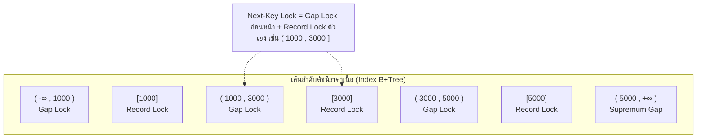
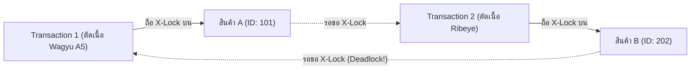

# Locking Mechanics

ในระบบฐานข้อมูลที่มีการใช้งานพร้อมกันสูง (High-Concurrency OLTP) เช่น **Smart Butcher Marketplace** ที่มีลูกค้าและเชฟภัตตาคารแย่งกันสั่งจองเนื้อวากิวเกรดพรีเมียม สตอเรจเอนจิน **InnoDB** ใน **MySQL 8.4 LTS / 8.0** ใช้ระบบล็อกที่มีความซับซ้อนสูงในระดับแถวและดัชนี (Row & Index-level Locking) เพื่อรักษาสมดุลระหว่างความถูกต้องของข้อมูล (Data Consistency) และขีดความสามารถในการรองรับโหลด (Throughput)

---

## 1. แนวคิด (Concept)

ระบบล็อกในฐานข้อมูลเปรียบเสมือน "กุญแจห้องเก็บเนื้อสเต๊กชิ้นพิเศษ":
- **การล็อกระดับตาราง (Table Lock):** เปรียบเสมือนการปิดประตูร้านทั้งร้านเพื่อให้ลูกค้าคนเดียวเข้าไปเลือกซื้อเนื้อ แม้ลูกค้าคนนั้นต้องการซื้อแค่เนื้อหมูบด แต่ลูกค้าคนอื่นที่ต้องการซื้อเนื้อวากิวก็ต้องยืนรอหน้าร้าน
- **การล็อกระดับแถวของ InnoDB (Row-level Lock):** เปรียบเสมือนการล็อกเฉพาะตู้โชว์เนื้อแต่ละชิ้น ลูกค้าคนที่ 1 สามารถเปิดตู้ดูเนื้อสันนอก Miyazaki A5 ได้ โดยที่ลูกค้าคนที่ 2 ยังสามารถหยิบเนื้อสันแหลม Dry-Aged Ribeye จากตู้อื่นที่อยู่ติดกันได้พร้อมกันทันที

อย่างไรก็ตาม ความพิเศษของ InnoDB อยู่ตรงที่ **ระบบล็อกทั้งหมดจะถูกผูกไว้กับดัชนี (Index Records) เสมอ** มิได้ล็อกที่ตัวข้อมูลทางกายภาพลอยๆ ซึ่งนำไปสู่กลไกที่เรียกว่า **Record Lock, Gap Lock และ Next-Key Lock**



---

## 2. หลักการเบื้องหลัง (Under the Hood)

### 2.1 ประเภทของล็อกในระดับแถวของ InnoDB

#### 1. Record Lock (ล็อกเฉพาะตัวระเบียนดัชนี)
- เป็นการล็อกเฉพาะ Record ดัชนีที่มีอยู่จริงใน B+Tree เช่น การล็อกแถวสินค้าที่มี `id = 101`
- ป้องกันไม่ให้ทรานแซกชันอื่นทำการ `UPDATE` หรือ `DELETE` ข้อมูลในแถวนั้น

#### 2. Gap Lock (ล็อกช่องว่างระหว่างระเบียน)
- เป็นการล็อก "ช่องว่าง" (Gap) ระหว่างค่าของ Index Records หรือช่องว่างก่อนหน้า Record แรกสุด และช่องว่างหลัง Record สุดท้าย (Supremum)
- **วัตถุประสงค์เดียวของ Gap Lock:** ป้องกันไม่ให้ทรานแซกชันอื่นทำการ `INSERT` ข้อมูลใหม่เข้ามาแทรกในช่องว่างนั้น
- Gap Lock เกิดขึ้นเพื่อหยุดยั้งปัญหา **Phantom Read** ในระดับ Isolation Level แบบ **REPEATABLE READ**
- จุดเด่นคือ Gap Locks จากหลายทรานแซกชันสามารถถือครองทับซ้อนกันได้ (Co-exist) โดยไม่ขัดแย้งกัน เพราะเป้าหมายมีไว้กันคำสั่ง `INSERT` เท่านั้น

#### 3. Next-Key Lock (Record Lock + Gap Lock)
- เป็นการผสมผสานระหว่าง Record Lock บนระเบียนดัชนี ควบคู่กับ Gap Lock ในช่องว่างก่อนหน้าระเบียนนั้น
- เขียนในรูปช่วงเปิด-ปิดทางคณิตศาสตร์: `(ค่าก่อนหน้า, ค่าปัจจุบัน]`
- เป็นอัลกอริทึมล็อกเริ่มต้นของ InnoDB ในโหมด `REPEATABLE READ`

### 2.2 กฎการ Downgrade ล็อก: Unique Index vs Non-unique Index
InnoDB มีการปรับแต่งประสิทธิภาพเพื่อลดปัญหา Lock Contention โดยอัตโนมัติ:
- **เมื่อค้นหาด้วย Primary Key หรือ Unique Index แบบ Exact Match (`WHERE id = 50`):**  
  InnoDB ทราบล่วงหน้าว่าค่า Unique ไม่มีทางมีแถวซ้ำซ้อนอย่างแน่นอน ดังนั้น InnoDB จะ **Downgrade จาก Next-Key Lock ให้เหลือเพียง Record Lock ธรรมดา** โดยไม่ล็อก Gap ด้านหน้าและด้านหลัง ทำให้ผู้ใช้อื่นยังสามารถแทรกข้อมูลข้างเคียงได้อิสระ
- **เมื่อค้นหาด้วย Non-unique Index หรือ Range Query (`WHERE category_id = 3` หรือ `WHERE price_per_kg >= 5000`):**  
  InnoDB จะบังคับใช้ **Next-Key Lock เต็มรูปแบบ** รวมทั้งล็อกช่องว่าง Gap ต่อท้ายไปจนถึงระเบียนถัดไป เพื่อรับประกันว่าจะไม่มีใครแอบแทรกสินค้าชิ้นใหม่เข้ามาในเงื่อนไขนี้ได้ในระหว่างทรานแซกชัน

<Callout type="note" title="คำเตือน: หาก Query ไม่มี Index InnoDB จะล็อกทั้งตาราง!">
หากคำสั่ง `UPDATE products SET stock_qty = 0 WHERE description LIKE '%halal%'` ทำงานบนคอลัมน์ที่ไม่มีดัชนีรองรับ ตัวเอนจิน InnoDB จะต้องทำ Full Table Scan ผ่าน Clustered Index ส่งผลให้เกิด Record Lock และ Gap Lock บน **ทุกแถวและทุกช่องว่างของตาราง** เสมือนเป็นการล็อกตารางทั้งหมด จนระบบไม่สามารถทำรายการอื่นได้เลย
</Callout>

### 2.3 การล็อกแบบ Shared (S) vs Exclusive (X)
- **Shared Lock (`S`):** ขออ่านข้อมูลโดยไม่อนุญาตให้ใครแก้ไข
  - ไวยากรณ์ใน MySQL 8.0: `SELECT ... FOR SHARE` (หรือไวยากรณ์เดิม `LOCK IN SHARE MODE`)
  - หลายทรานแซกชันสามารถถือ S-Lock บนแถวเดียวกันพร้อมกันได้
- **Exclusive Lock (`X`):** ขอยึดครองข้อมูลเพื่อแก้ไขหรือลบ
  - ไวยากรณ์: `SELECT ... FOR UPDATE` หรือคำสั่ง `UPDATE` / `DELETE`
  - ทรานแซกชันอื่นไม่สามารถขอ S-Lock หรือ X-Lock ซ้อนทับได้ ต้องรอจนกว่าจะ Commit หรือ Rollback

### 2.4 ฟีเจอร์ขั้นสูงใน MySQL 8.0: `NOWAIT` และ `SKIP LOCKED`
ตามปกติเมื่อแถวข้อมูลติด X-Lock คิวรีอื่นที่ขอล็อกจะต้องรอจนครบกำหนดเวลา `innodb_lock_wait_timeout` (ค่าเริ่มต้น 50 วินาที) ก่อนจะแจ้ง Timeout Error ใน MySQL 8.0 มีสองคำสั่งที่ช่วยแก้ปัญหานี้:
- **`NOWAIT`:** หากแถวที่ต้องการติดล็อกอยู่ ให้ล้มเหลวและแจ้ง Error ทันทีโดยไม่ต้องรอแม้แต่วินาทีเดียว:  
  `ERROR 3572 (HY000): Statement aborted because lock(s) could not be acquired immediately and NOWAIT is set.`
- **`SKIP LOCKED`:** ข้ามแถวที่ติดล็อกของทรานแซกชันอื่นไป และคืนค่าเฉพาะแถวที่ว่างอยู่ทันที มีประโยชน์มหาศาลในการสร้าง **Job Queue / Task Worker** สำหรับระบบกระจายงานตัดแต่งเนื้อ

### 2.5 ภาวะ Deadlock และการวิเคราะห์ `SHOW ENGINE INNODB STATUS`
**Deadlock (การล็อกตาย)** เกิดขึ้นเมื่อทรานแซกชัน 2 ตัวขึ้นไป ถือครองล็อกของทรัพยากรคนละชิ้น แล้วต่างฝ่ายต่างพยายามขอล็อกทรัพยากรที่อีกฝ่ายถืออยู่จนเกิดวงจรรอคอยแบบงูกินหาง (**Circular Wait**):



- **Deadlock Detection Engine:** เอนจินของ InnoDB จะตรวจสอบ Wait-For Graph อัตโนมัติ (`innodb_deadlock_detect = ON`)
- **การเลือกเหยื่อ (Victim Selection):** เมื่อตรวจพบ Deadlock ตัว MySQL จะเลือก Rollback ทรานแซกชันที่มี "น้ำหนักน้อยที่สุด" (คำนวณจากจำนวนแถวที่ถูก INSERT, UPDATE หรือ DELETE ไปแล้ว) เพื่อให้การคืนสภาพใช้เวลาน้อยที่สุด และปล่อยให้อีกทรานแซกชันทำงานต่อได้

---

## 3. ตัวอย่างโค้ด (Smart Butcher Marketplace)

### ตัวอย่างที่ 1: ระบบตัดคิวงานตัดแต่งเนื้อ (Meat Cutting Worker) ด้วย `FOR UPDATE SKIP LOCKED`

การออกแบบระบบจัดการคิวงานตัดเนื้อวากิวตามสั่ง เพื่อให้ช่างเนื้อ (Butcher Worker) หลายคนแย่งกันหยิบออเดอร์ไปทำพร้อมกันได้โดยไม่ชนกันและไม่ต้องรอล็อก:

```sql filename="07_locking_order_queue_skip_locked.sql"
-- =============================================================================
-- Smart Butcher Marketplace: High-throughput Meat Order Dispatch Queue
-- =============================================================================

-- โครงสร้างตารางคิวงานตัดเนื้อ
-- CREATE TABLE meat_cutting_jobs (
--     id BIGINT AUTO_INCREMENT PRIMARY KEY,
--     order_item_id BIGINT NOT NULL,
--     meat_cut VARCHAR(50) NOT NULL,
--     status ENUM('PENDING', 'PROCESSING', 'COMPLETED') NOT NULL DEFAULT 'PENDING',
--     assigned_butcher_id INT NULL,
--     created_at DATETIME NOT NULL DEFAULT CURRENT_TIMESTAMP,
--     INDEX idx_status_created (status, created_at)
-- ) ENGINE=InnoDB;

-- Butcher Worker ที่ 1 เข้ามารับงานตัดเนื้อที่ค้างอยู่ 1 ออเดอร์
START TRANSACTION;

-- ดึงงานสถานะ PENDING ขึ้นมา 1 งาน และล็อกแถวทันที
-- หาก Worker คนอื่นกำลังล็อกงานแถวแรกอยู่ SKIP LOCKED จะข้ามไปเอางานถัดไปทันที!
SELECT id, order_item_id, meat_cut 
FROM meat_cutting_jobs
WHERE status = 'PENDING'
ORDER BY created_at ASC
LIMIT 1
FOR UPDATE SKIP LOCKED;

-- สมมติได้งาน id = 1001 ให้ปรับสถานะเป็น PROCESSING และมอบหมายให้ Butcher ID: 7
UPDATE meat_cutting_jobs
SET status = 'PROCESSING',
    assigned_butcher_id = 7
WHERE id = 1001;

COMMIT;
```

---

### ตัวอย่างที่ 2: การจำลอง Deadlock และแนวทางแก้ไขด้วย Deterministic Lock Ordering

การสั่งซื้อเนื้อหลายชิ้นในออเดอร์เดียวกัน หากไม่เรียงลำดับการขอล็อก จะทำให้เกิด Deadlock:

```sql filename="07_deadlock_reproduction_and_defense.sql"
-- =============================================================================
-- ส่วนที่ 1: สถานการณ์จำลองที่ทำให้เกิด Deadlock (ห้ามทำใน Production)
-- =============================================================================

-- [Client 1] สั่งซื้อ Wagyu (101) และ Ribeye (202) -> เริ่มล็อก 101 ก่อน
-- START TRANSACTION;
-- UPDATE products SET stock_qty = stock_qty - 1 WHERE id = 101;

-- [Client 2] สั่งซื้อ Ribeye (202) และ Wagyu (101) -> เริ่มล็อก 202 ก่อน
-- START TRANSACTION;
-- UPDATE products SET stock_qty = stock_qty - 1 WHERE id = 202;

-- [Client 1] พยายามไปล็อก 202 -> ติด Lock Wait (รอ Client 2)
-- UPDATE products SET stock_qty = stock_qty - 1 WHERE id = 202;

-- [Client 2] พยายามไปล็อก 101 -> เกิด DEADLOCK ทันที!
-- UPDATE products SET stock_qty = stock_qty - 1 WHERE id = 101;
-- MySQL จะพ่นข้อความ: ERROR 1213 (40001): Deadlock found when trying to get lock; try restarting transaction


-- =============================================================================
-- ส่วนที่ 2: วิธีแก้ไขอย่างถาวรระดับ Senior Engineer (Deterministic Lock Ordering)
-- บังคับให้ Application เรียงลำดับ ID ของเนื้อจากน้อยไปมาก (ASC) เสมอ ก่อนสั่งล็อก
-- =============================================================================

START TRANSACTION;

-- ล็อกแถวสินค้าทั้งหมดในตะกร้าโดยเรียงตาม id เสมอ
SELECT id, sku, stock_qty 
FROM products 
WHERE id IN (101, 202)
ORDER BY id ASC
FOR UPDATE;

-- ทำการตัดสต็อกสินค้าทีละรายการตามลำดับที่แน่นอน
UPDATE products SET stock_qty = stock_qty - 1 WHERE id = 101;
UPDATE products SET stock_qty = stock_qty - 1 WHERE id = 202;

COMMIT;
```

---

### ตัวอย่างที่ 3: การแกะรอยและอ่านรายงาน LATEST DETECTED DEADLOCK

เมื่อสั่ง `SHOW ENGINE INNODB STATUS\G` ใน Terminal ให้เลื่อนหาหัวข้อ `LATEST DETECTED DEADLOCK`:

```text filename="07_innodb_deadlock_report.txt"
------------------------
LATEST DETECTED DEADLOCK
------------------------
2026-10-21 03:15:42 0x7f8a1c024700
*** (1) TRANSACTION:
TRANSACTION 482910, ACTIVE 2 sec starting index read
mysql tables in use 1, locked 1
LOCK WAIT 3 lock struct(s), heap size 1128, 2 row lock(s)
MySQL thread id 45, OS thread handle 140231, query id 8921 localhost butcher_app updating
UPDATE products SET stock_qty = stock_qty - 1 WHERE id = 202

*** (1) HOLDS THE LOCK(S):
RECORD LOCKS space id 12 page no 4 n bits 72 index PRIMARY of table `smart_butcher`.`products` trx id 482910 lock_mode X locks rec but not gap
Record lock, heap no 2 PHYSICAL RECORD: n_fields 5; compact format; info bits 0
 0: len 4; hex 80000065; asc    e;; (id = 101)

*** (1) WAITING FOR THIS LOCK TO BE GRANTED:
RECORD LOCKS space id 12 page no 4 n bits 72 index PRIMARY of table `smart_butcher`.`products` trx id 482910 lock_mode X locks rec but not gap waiting
Record lock, heap no 3 PHYSICAL RECORD: n_fields 5; compact format; info bits 0
 0: len 4; hex 800000ca; asc    Ê;; (id = 202)

*** (2) TRANSACTION:
TRANSACTION 482911, ACTIVE 1 sec starting index read
mysql tables in use 1, locked 1
3 lock struct(s), heap size 1128, 2 row lock(s)
MySQL thread id 46, OS thread handle 140232, query id 8925 localhost butcher_app updating
UPDATE products SET stock_qty = stock_qty - 1 WHERE id = 101

*** (2) HOLDS THE LOCK(S):
RECORD LOCKS space id 12 page no 4 n bits 72 index PRIMARY of table `smart_butcher`.`products` trx id 482911 lock_mode X locks rec but not gap
Record lock, heap no 3 PHYSICAL RECORD: n_fields 5; compact format; info bits 0
 0: len 4; hex 800000ca; asc    Ê;; (id = 202)

*** (2) WAITING FOR THIS LOCK TO BE GRANTED:
RECORD LOCKS space id 12 page no 4 n bits 72 index PRIMARY of table `smart_butcher`.`products` trx id 482911 lock_mode X locks rec but not gap waiting
Record lock, heap no 2 PHYSICAL RECORD: n_fields 5; compact format; info bits 0
 0: len 4; hex 80000065; asc    e;; (id = 101)

*** WE ROLL BACK TRANSACTION (2)
```

**วิธีอ่านรายงาน Deadlock เชิงลึก:**
1. **Transaction (1):** กำลังรันคำสั่ง `UPDATE products ... WHERE id = 202` โดยถือครอง X-Lock บน `id = 101` อยู่แล้ว (`HOLDS THE LOCK(S) ... id = 101`) และกำลังรอคอยล็อกบน `id = 202` (`WAITING FOR THIS LOCK ... id = 202`)
2. **Transaction (2):** กำลังรันคำสั่ง `UPDATE products ... WHERE id = 101` โดยถือครอง X-Lock บน `id = 202` อยู่แล้ว และกำลังรอคอยล็อกบน `id = 101`
3. **การตัดสินใจ (Decision):** บรรทัดสุดท้าย `WE ROLL BACK TRANSACTION (2)` ระบุว่า MySQL ตัดสินใจสั่ง Rollback ทรานแซกชันที่ 2 เพื่อปลดปล่อยทรัพยากรให้ทรานแซกชันที่ 1 ทำงานจนเสร็จ

---

## 4. ข้อผิดพลาดที่พบบ่อย (Anti-pattern vs Best Practice)

| มิติการทำงาน | ❌ วิธีที่ผิด (Anti-pattern) | ✅ วิธีที่ถูกต้อง (Best Practice) |
| :--- | :--- | :--- |
| **การอัปเดตข้อมูลโดยไม่มี Index** | รันคำสั่ง `UPDATE products SET is_featured = 1 WHERE note = 'wagyupromo'` โดยที่คอลัมน์ `note` ไม่มีดัชนี ทำให้เกิด Full Clustered Index Lock ทั้งตาราง | ตรวจสอบ Execution Plan เสมอและสร้างดัชนีบนเงื่อนไขการค้นหา เพื่อให้เกิด Record Lock เฉพาะแถวที่ตรงเงื่อนไข |
| **การล็อกข้อมูลข้ามตารางสลับลำดับ** | เซอร์วิสหนึ่งล็อก `orders -> payments` แต่อีกเซอร์วิสหนึ่งล็อก `payments -> orders` ทำให้เกิดวงจรล็อกตายแบบข้ามตาราง | ออกแบบ Global Locking Order ในทีมวิศวกรรม ให้ทุกลำดับการเขียนเรียงลำดับชื่อตารางและลำดับ Primary Key เหมือนกัน 100% |
| **การใช้ `SELECT ... FOR UPDATE` กับคิวงาน** | อ่านรายการงานค้างแล้วล็อกไว้ด้วย `FOR UPDATE` ธรรมดา ทำให้ Worker ตัวอื่นต้องหยุดรอคอยจนกว่างานแรกจะเสร็จสิ้น | ใช้ `SELECT ... FOR UPDATE SKIP LOCKED` เพื่อให้ Worker อื่นข้ามงานที่ติดล็อกไปหยิบงานถัดไปมาทำได้พร้อมกันทันที |
| **การละเลยการ Retry ในแอปพลิเคชัน** | ไม่เขียนโค้ดรองรับ Error Code `1213 (Deadlock)` ทำให้ลูกค้ารับข้อความ Error 500 หน้าจอพังทันที | สร้างกลไก Retry พร้อม Exponential Backoff และ Jitter ในระดับ Application เพื่อรันซ้ำโดยที่ผู้ใช้ปลายทางไม่รู้สึกสะดุด |

---

## 5. ควรใช้เมื่อไหร่ และ ไม่ควรใช้เมื่อไหร่

### ควรใช้การล็อกแบบชัดเจน (Pessimistic Locking / FOR UPDATE):
- **ระบบที่มีความขัดแย้งสูงและทรัพยากรจำกัดอย่างยิ่ง:** เช่น การตัดสต็อกเนื้อวากิวชิ้นสุดท้ายที่มีชิ้นเดียวในตู้, การตัดเงินจากวอลเล็ต, หรือการจองที่นั่งเครื่องบิน
- **การจัดการคิวงานด้วย `SKIP LOCKED`:** ระบบประมวลผลคำสั่งซื้อ, คิวสร้างใบเสร็จ, หรือคิวส่งอีเมลยืนยันคำสั่งซื้อ
- **การป้องกัน Race Condition ในขั้นตอนตรวจสอบยอดเงิน:** `SELECT balance FROM wallets WHERE user_id = ? FOR UPDATE;`

### ไม่ควรใช้ (ควรเลี่ยงไปใช้ Optimistic Locking หรือ MVCC):
- **ระบบที่มีการอ่านเป็นหลัก (Read-heavy Applications):** คิวรีการเปิดดูหน้าแคตตาล็อกเนื้อ หรือดูโปรโมชันสินค้า ควรใช้ Consistent Non-locking Read ปกติของ MVCC โดยไม่ต้องใส่ `FOR UPDATE` หรือ `FOR SHARE`
- **กรณีที่ทรานแซกชันต้องใช้เวลาในการประมวลผลนาน:** หากต้องรอคำตอบจากระบบภายนอก ควรใช้ **Optimistic Locking** ผ่านคอลัมน์ `version` แทนการถือ X-Lock ค้างไว้บนฐานข้อมูล

---

## 6. คำถามสัมภาษณ์งาน (Interview Q&A)

### Q1: อธิบายความแตกต่างระหว่าง Record Lock, Gap Lock และ Next-Key Lock ใน InnoDB พร้อมยกตัวอย่างว่าทำไมการค้นหาด้วย Non-unique Index จึงเกิด Gap Lock แต่ Unique Index ไม่เกิด?
**แนวคำตอบ:**
- **Record Lock:** ล็อกเฉพาะตัวระเบียนดัชนีที่มีอยู่จริงใน B+Tree เพื่อห้ามแก้ไขหรือลบ
- **Gap Lock:** ล็อกช่องว่างระหว่างระเบียนดัชนี เพื่อห้ามไม่ให้ใครแทรก (INSERT) ข้อมูลใหม่ลงในช่องว่างนั้น
- **Next-Key Lock:** เป็นการทำงานร่วมกันของ Gap Lock ช่องว่างด้านหน้า รวมกับ Record Lock บนระเบียนนั้น `(prev_val, curr_val]` ซึ่งเป็นพฤติกรรมเริ่มต้นของโหมด REPEATABLE READ เพื่อหยุดยั้งปัญหา Phantom Read

**สาเหตุที่เกิด Gap Lock ต่างกันระหว่าง Unique และ Non-unique Index:**
- ในกรณีของ **Unique Index / Primary Key** หากค้นหาด้วยเงื่อนไข Exact Match เช่น `WHERE id = 100` สตอเรจเอนจินรับรู้จากโครงสร้าง B+Tree ว่าจะมีระเบียนที่มีค่า 100 ได้ **สูงสุดเพียงแถวเดียวเท่านั้น** และไม่มีทางที่จะมีแถว 100 แทรกเข้ามาซ้ำได้อีก จึงไม่มีความเสี่ยงที่จะเกิด Phantom Row ตัวเอนจินจึงทำการ **Downgrade Next-Key Lock ให้เหลือเพียง Record Lock ธรรมดา** เพื่อเปิดช่องว่างให้คนอื่นสามารถ INSERT ค่า 99 หรือ 101 ได้โดยไม่ติดขัด
- ในทางกลับกัน สำหรับ **Non-unique Index** เช่น คอลัมน์ `category_id` หากค้นหา `WHERE category_id = 5` แม้ปัจจุบันจะมีข้อมูลอยู่แล้ว 2 แถว แต่ทรานแซกชันอื่นก็อาจจะสั่ง `INSERT` สินค้าใหม่ที่มี `category_id = 5` เพิ่มเข้ามาได้ตลอดเวลา InnoDB จึงต้องบังคับล็อกทั้งตัวระเบียนดัชนีและช่องว่าง Gap ด้านหน้าและด้านหลัง เพื่อให้แน่ใจว่าตลอดอายุของทรานแซกชันนี้ จะไม่มี Phantom Row หลุดเข้ามา

---

### Q2: ในการวิเคราะห์รายงาน `SHOW ENGINE INNODB STATUS` หัวข้อ LATEST DETECTED DEADLOCK คุณมีขั้นตอนการหาสาเหตุอย่างไร และ InnoDB ใช้เกณฑ์ใดในการตัดสินใจเลือก Transaction ที่จะถูก Rollback?
**แนวคำตอบ:**
**ขั้นตอนการวิเคราะห์รายงาน Deadlock:**
1. ดูส่วนหัวข้อ **`*** (1) TRANSACTION`** และ **`*** (2) TRANSACTION`** เพื่อดูคำสั่ง SQL ที่รัน (`query id`, `updating ...`) และ Thread ID
2. ตรวจสอบส่วน **`HOLDS THE LOCK(S)`**: สังเกตว่าแต่ละทรานแซกชันกำลังถือครองกุญแจล็อกประเภทใด (`lock_mode X` หรือ `lock_mode S`), ล็อกระดับใด (`locks rec but not gap` หรือ Next-Key Lock), และอยู่ที่ตารางหรือ Index ตัวใด พร้อมดูค่าทางกายภาพของคีย์ (`PHYSICAL RECORD: hex ...`)
3. ตรวจสอบส่วน **`WAITING FOR THIS LOCK TO BE GRANTED`**: ดูว่าแต่ละฝ่ายกำลังรอคอยทรัพยากรชิ้นไหน ซึ่งจะพบความสัมพันธ์แบบไขว้กัน (Circular Wait) เสมอ เช่น T1 ถือ A รอ B แต่ T2 ถือ B รอ A
4. วิเคราะห์ Application Layer: นำ SQL ทั้งสองจุดไปไล่ดูโค้ดต้นทาง เพื่อหาสาเหตุว่าทำไมถึงเข้าถึงทรัพยากรสลับลำดับกัน

**เกณฑ์การเลือก Victim ของ InnoDB:**
บรรทัดสุดท้ายที่ระบุว่า `WE ROLL BACK TRANSACTION (X)` ถูกตัดสินจาก **น้ำหนักของทรานแซกชัน (Transaction Weight)**:
InnoDB จะคำนวณจำนวนแถวที่มีการแก้ไข (`INSERT`, `UPDATE`, `DELETE`) ในแต่ละทรานแซกชัน ทรานแซกชันใดที่มีการแก้ไขข้อมูลน้อยกว่า (Cost ในการย้อน Undo Log ต่ำกว่า) จะถูกเลือกเป็นฝ่าย **Victim** เพื่อให้ถูกบังคับ Rollback ทันที ปล่อยให้อีกทรานแซกชันที่มีขนาดใหญ่กว่าทำงานต่อไปได้ ซึ่งช่วยลดการสูญเสียงานและลดภาระ Disk I/O ของระบบโดยรวม

---

## ดูเพิ่มเติมที่
- [MySQL 8.x](/docs/database/mysql) — กลับสู่หน้าสารบัญหลักของ MySQL 8.x
- [Transactions ACID](/docs/database/mysql/transactions-acid) — ศึกษาคุณสมบัติ ACID และกลไก Undo/Redo Log
- [InnoDB Indexes](/docs/database/mysql/innodb-indexes) — สถาปัตยกรรม Clustered Index และ B+Tree
- [Concurrency Control](/docs/database/concurrency) — ทฤษฎีการควบคุมการเข้าถึงข้อมูลพร้อมกันและ Deadlock Defense
