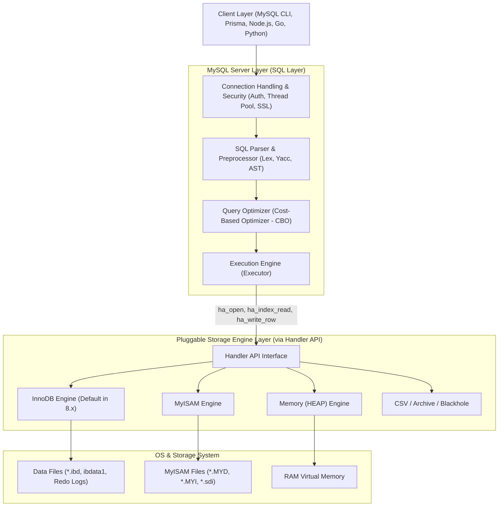

# Storage Engines

สถาปัตยกรรมของ MySQL มีจุดเด่นที่แตกต่างจากระบบจัดการฐานข้อมูลเชิงสัมพันธ์ (RDBMS) อื่นๆ อย่าง Oracle หรือ PostgreSQL คือการแยกชั้นการประมวลผลคำสั่ง SQL (SQL Layer) ออกจากชั้นการจัดเก็บข้อมูลจริงบนดิสก์อย่างเด็ดขาด ผ่านสถาปัตยกรรมที่เรียกว่า **Pluggable Storage Engine Architecture**

<Callout type="tip" title="ทำไม Storage Engine จึงเป็นตัวชี้วัดความอยู่รอดของระบบ">
ในระบบค้าปลีกเนื้อพรีเมียม **Smart Butcher Marketplace** คำสั่งซื้อเนื้อวากิว A5 และเนื้อดรายเอจ 45 วัน มีมูลค่าสูงมาก หากระบบใช้ Storage Engine ที่ไม่มี Transaction หรือเกิดการพังของข้อมูล (Data Corruption) เมื่อเซิร์ฟเวอร์ไฟดับ ข้อมูลสต็อกเนื้อและยอดเงินจะเสียหายอย่างไม่อาจกู้คืนได้ การเข้าใจกลไกภายในของ Storage Engine จึงเป็นหัวใจสำคัญของวิศวกรฐานข้อมูลระดับสูง
</Callout>

---

## 1. แนวคิด (Concept)

ลองจินตนาการถึง **Smart Butcher Marketplace** ในรูปแบบของภัตตาคารและร้านจำหน่ายเนื้อระดับไฮเอนด์:

```
[ ลูกค้า / แอปพลิเคชัน (Client) ]
               │
               ▼
┌─────────────────────────────────────────────────────────┐
│              MySQL Server Layer (ครัวและหน้าร้าน)           │
│  - Connection Handler : พนักงานต้อนรับ ตรวจบัตรสมาชิก      │
│  - Parser & Preprocessor : แคชเชียร์อ่านลายมือออเดอร์       │
│  - Query Optimizer : เชฟใหญ่คำนวณเส้นทางหยิบวัตถุดิบ        │
└────────────────────────────┬────────────────────────────┘
                             │ Handler API (คำสั่งมาตรฐาน)
                             ▼
┌─────────────────────────────────────────────────────────┐
│             Pluggable Storage Engines (ห้องเก็บเนื้อ)    │
│  ┌─────────────────┐ ┌────────────────┐ ┌─────────────┐ │
│  │     InnoDB      │ │     MyISAM     │ │   Memory    │ │
│  │ (ห้องนิรภัยแช่แข็ง │ │ (ชั้นวางธรรมดา │ │(เขียงหั่นสด │ │
│  │  มีบันทึกกล้องวงจร │ │ ล็อกทั้งห้อง │ │ ปิดร้านเนื้อ │ │
│  │  ปิด + กันไฟไหม้)│ │ ซ่อมแซมยาก)  │ │ หายหมด)     │ │
│  └─────────────────┘ └────────────────┘ └─────────────┘ │
└─────────────────────────────────────────────────────────┘
```

1. **Client & Connection Pool:** เปรียบเสมือนลูกค้าที่เดินเข้าร้านหรือโทรสั่งจองโต๊ะ
2. **MySQL Server Layer (No Engine Logic):** มีหน้าที่รับคำสั่ง ตรวจสอบสิทธิ์ (Authentication & Authorization), ตรวจสอบไวยากรณ์ (Syntax & Semantic Parsing), และวางแผนค้นหาข้อมูลที่เร็วที่สุด (Query Optimizer) โดยที่ชั้นนี้**ไม่รู้เลยว่าข้อมูลถูกเก็บไว้ในรูปแบบไบต์อย่างไรบนฮาร์ดดิสก์**
3. **Pluggable Storage Engine Layer:** คือตู้เก็บข้อมูลจริง ซึ่งเชื่อมต่อกับ Server Layer ผ่านอินเทอร์เฟซมาตรฐานที่เรียกว่า **Handler API** แต่ละตู้มีคุณสมบัติต่างกัน:
   - **InnoDB:** ห้องนิรภัยเก็บเนื้อวากิวราคาสูง มีระบบสำรองไฟ ตู้กันขโมย ล็อกเฉพาะแพ็กเนื้อที่กำลังหยิบ (Row-level Lock) และมีสมุดบันทึกย้อนหลังกู้ข้อมูลได้เสมอ (ACID Compliant)
   - **MyISAM:** ชั้นวางของแบบเปิด ล็อกทั้งร้านเมื่อมีคนหยิบของ (Table-level Lock) ไม่มีระบบกันไฟไหม้ หากตู้ล้มของพังทันที (ไม่มี Crash Recovery)
   - **Memory (HEAP):** โต๊ะเตรียมเนื้อสด ทำงานบนแรม 100% ไวที่สุดในโลก แต่เมื่อปิดสวิตช์ไฟร้าน ทุกอย่างที่วางอยู่บนโต๊ะจะระเหยหายไปทันที

---

## 2. หลักการเบื้องหลัง (Under the Hood)

### 2.1 สถาปัตยกรรม 3 ชั้นของ MySQL (Three-Tier Architecture)



#### ชั้นที่ 1: Connection Handling
- เมื่อ Client เชื่อมต่อเข้ามา MySQL จะผูก Client เข้ากับ **Thread** ประจำตัว (หรือดึงจาก Thread Cache / Thread Pool ในสถาปัตยกรรมระดับ Enterprise)
- ทำการตรวจสอบ Username, Password, Host, สิทธิ์ในระดับตาราง/คอลัมน์ และการเข้ารหัส SSL/TLS

#### ชั้นที่ 2: SQL Parser, Preprocessor & Optimizer
- **Parser:** ทำ Lexical Analysis และ Syntactic Analysis แปลงข้อความ SQL String ให้กลายเป็นโครงสร้างต้นไม้ที่เรียกว่า **Abstract Syntax Tree (AST)**
- **Preprocessor:** ตรวจสอบความถูกต้องของชื่อตารางและชื่อคอลัมน์ว่ามีอยู่จริงหรือไม่ และตรวจสอบสิทธิ์
- **Query Optimizer:** ส่วนที่ซับซ้อนที่สุดของ Server Layer ใช้ **Cost-Based Optimizer (CBO)** ประเมินทางเลือกในการดึงข้อมูล เช่น การเลือกว่าจะใช้ Index ตัวไหน, ลำดับการ Join ตาราง (Join Reordering), และการเลือกอัลกอริทึม Join (เช่น Block Nested-Loop หรือ Hash Join ใน MySQL 8)
- **Executor:** ส่งคำสั่งผ่านฟังก์ชัน C++ เสมือนของ **Handler API** เช่น `ha_index_read_idx_map()`, `ha_write_row()`, `ha_delete_row()` ไปยัง Storage Engine

#### ชั้นที่ 3: Pluggable Storage Engine
Storage Engine มีหน้าที่แปลงคำขอเชิงนามธรรมจาก Executor ให้เป็นการอ่าน/เขียน Blocks ข้อมูลบนดิสก์จริง จัดการโครงสร้างข้อมูล B+Tree, บันทึก Log, และบริหารหน่วยความจำแคช

---

### 2.2 ตารางเปรียบเทียบสเปกเชิงลึก: InnoDB vs MyISAM vs Memory

| คุณสมบัติ (Feature) | InnoDB (ค่าเริ่มต้นใน MySQL 8) | MyISAM (Legacy) | Memory (HEAP) |
| :--- | :--- | :--- | :--- |
| **การรองรับ Transactions (ACID)** | **รองรับสมบูรณ์ (Commit / Rollback)** | ไม่รองรับ (Auto-commit เสมอ) | ไม่รองรับ |
| **ระดับการล็อก (Locking Granularity)** | **Row-level Locking** (ร่วมกับ Gap Lock) | **Table-level Locking** (ล็อกทั้งตาราง) | Table-level Locking |
| **การกู้คืนเมื่อระบบล่ม (Crash Recovery)** | **อัตโนมัติ 100% (Redo Log + Undo Log)** | ไม่มี (เสี่ยงตารางพัง ต้องรัน REPAIR) | ข้อมูลหายทั้งหมดเมื่อ Restart |
| **โครงสร้างตาราง (Data Organization)** | **Clustered Index (B+Tree ตาม PK)** | Heap Organization (.MYD แยกกับ .MYI) | In-Memory Array / Hash / B-Tree |
| **หน่วยความจำแคช (Caching Engine)** | **Buffer Pool (แคชทั้ง Data และ Index)** | Key Buffer (แคชเฉพาะ Index เท่านั้น) | ข้อมูลทั้งหมดอยู่ใน RAM |
| **กลไกป้องกัน Page ขาด (Doublewrite)** | **มี (Doublewrite Buffer ป้องกัน Torn Page)** | ไม่มี | ไม่เกี่ยวข้อง (รันบน RAM) |
| **การรองรับ Foreign Keys** | **รองรับ (พร้อม CASCADE / RESTRICT)** | ไม่รองรับ (มองข้ามไวยากรณ์) | ไม่รองรับ |
| **MVCC (Multi-Version Concurrency)** | **รองรับ (อ่านไม่บล็อกเขียน เขียนไม่บล็อกอ่าน)**| ไม่รองรับ | ไม่รองรับ |

---

### 2.3 กลไกเชิงลึกของ InnoDB ที่วิศวกรต้องรู้

#### 1. InnoDB Buffer Pool
InnoDB ไม่ได้อ่านหรือเขียนข้อมูลลงดิสก์โดยตรงในทุกคำสั่ง แต่ทำงานผ่านพื้นที่หน่วยความจำขนาดใหญ่ที่เรียกว่า **Buffer Pool**
- แบ่งพื้นที่เป็นหน้าขนาด **16 KB (Page Size มาตรฐาน)**
- ใช้ขั้นตอนวิธี **Midpoint Insertion LRU (Least Recently Used)**: แบ่งลิสต์ของ Page ออกเป็น 2 ส่วน คือ 5/8 ด้านบนเป็น **Young Sublist** (ข้อมูลถูกเรียกซ้ำบ่อย) และ 3/8 ด้านล่างเป็น **Old Sublist** (ข้อมูลใหม่ที่เพิ่งอ่านเข้ามา)
- ป้องกันปัญหา **Buffer Pool Pollution**: เมื่อมีการรันคำสั่ง `SELECT *` ข้อมูลการสแกนแบบ Table Scan ขนาดมหึมาจะไม่สามารถดัน Hot Data ออกจาก Young Sublist ได้ทันที จนกว่าจะถูกเรียกซ้ำหลังจากผ่านเวลา `innodb_old_blocks_time` (ค่าเริ่มต้น 1000ms)

#### 2. Doublewrite Buffer (DWB) – หัวใจแห่ง Crash Resilience
ปัญหาที่ร้ายแรงที่สุดของดิสก์คือ **Partial Page Write (Torn Page)**:
- ระบบปฏิบัติการและฮาร์ดไดรฟ์ส่วนใหญ่เขียนข้อมูลลงบล็อกขนาด **4 KB**
- แต่ Page ของ InnoDB มีขนาด **16 KB**
- หากเซิร์ฟเวอร์เกิดไฟดับกระทันหันในขณะที่ระบบกำลังเขียน Page ที่ 2 (เขียนไปได้ 8 KB จาก 16 KB) หน้า Page นั้นจะกลายเป็น "ข้อมูลแหว่ง (Corrupted/Torn Page)"
- **ทำไม Redo Log ถึงช่วยไม่ได้ในกรณีนี้?** Redo Log ของ InnoDB บันทึกการเปลี่ยนแปลงแบบ Physical-to-Logical (เช่น "ที่ offset X ของ Page Y ให้เปลี่ยนค่าเป็น Z") หากตัว Page ดั้งเดิมพังและ Checksum ล้มเหลว InnoDB จะไม่สามารถคำนวณตำแหน่งและ Apply Redo Log ทับลงไปได้!
- **วิธีแก้ของ Doublewrite Buffer:** ก่อนที่ InnoDB จะเขียน Dirty Page ลงในไฟล์ข้อมูลจริง (`.ibd`) มันจะเขียน Page ขนาด 16 KB ทั้งหน้านั้นลงในพื้นที่ต่อเนื่องของ **Doublewrite Buffer** ในดิสก์ก่อน ( Sequential Write ซึ่งเร็วมาก) แล้วสั่ง Flush หนึ่งครั้ง จากนั้นจึงค่อยกระจายเขียนไปยัง `.ibd` ต่างๆ หากไฟดับระหว่างเขียน `.ibd` InnoDB จะสามารถหยิบสำเนาหน้า Page ที่สมบูรณ์ 100% จาก Doublewrite Buffer กลับมาทับ แล้วนำ Redo Log มา Replay ต่อได้อย่างไร้รอยต่อ

---

## 3. ตัวอย่างโค้ด (Smart Butcher Marketplace)

### ตัวอย่างที่ 1: การตรวจสอบ Storage Engines และการออกแบบตารางที่ใช้ Engine เหมาะสมกับงาน

```sql filename="01_storage_engines_inspection.sql"
-- 1. ตรวจสอบสถานะ Storage Engine ทั้งหมดที่ติดตั้งใน MySQL Instance
SHOW ENGINES;

/*
ผลลัพธ์ที่ได้จะแสดง Engine ต่างๆ เช่น:
+--------------------+---------+------------------------------------------------------------+--------------+------+------------+
| Engine             | Support | Comment                                                    | Transactions | XA   | Savepoints |
+--------------------+---------+------------------------------------------------------------+--------------+------+------------+
| InnoDB             | DEFAULT | Supports transactions, row-level locking, and foreign keys | YES          | YES  | YES        |
| MRG_MYISAM         | YES     | Collection of identical MyISAM tables                      | NO           | NO   | NO         |
| MEMORY             | YES     | Hash based, stored in memory, useful for temporary tables  | NO           | NO   | NO         |
| MyISAM             | YES     | MyISAM storage engine                                      | NO           | NO   | NO         |
| CSV                | YES     | Stores tables as comma-separated values                    | NO           | NO   | NO         |
| PERFORMANCE_SCHEMA | YES     | Performance Schema                                         | NO           | NO   | NO         |
+--------------------+---------+------------------------------------------------------------+--------------+------+------------+
*/

-- 2. สร้างตารางหลักของร้านขายเนื้อ: สินค้า หมวดหมู่ และคำสั่งซื้อ โดยใช้ InnoDB (Default)
CREATE TABLE categories (
    category_id INT UNSIGNED AUTO_INCREMENT PRIMARY KEY,
    name VARCHAR(100) NOT NULL,
    slug VARCHAR(100) NOT NULL UNIQUE,
    created_at DATETIME NOT NULL DEFAULT CURRENT_TIMESTAMP
) ENGINE=InnoDB ROW_FORMAT=DYNAMIC;

CREATE TABLE meat_cuts (
    cut_id INT UNSIGNED AUTO_INCREMENT PRIMARY KEY,
    category_id INT UNSIGNED NOT NULL,
    name VARCHAR(150) NOT NULL,
    cut_code VARCHAR(30) NOT NULL UNIQUE,
    price_per_kg DECIMAL(10, 2) NOT NULL,
    stock_kg DECIMAL(8, 2) NOT NULL DEFAULT 0.00,
    created_at DATETIME NOT NULL DEFAULT CURRENT_TIMESTAMP,
    CONSTRAINT fk_meat_cuts_category FOREIGN KEY (category_id) 
        REFERENCES categories(category_id) ON DELETE RESTRICT
) ENGINE=InnoDB ROW_FORMAT=DYNAMIC;

-- 3. สร้างตารางพักข้อมูลชั่วคราว: เซสชันการชั่งน้ำหนักเนื้อสดหน้าร้าน (Butcher Scale Session)
-- ใช้ MEMORY Engine เพื่อความเร็วสูงสุดในการสลับชั่งน้ำหนัก โดยข้อมูลนี้พร้อมสูญหายได้หากไฟดับ
CREATE TABLE butcher_active_scale_sessions (
    scale_id INT UNSIGNED NOT NULL,
    meat_cut_code VARCHAR(30) NOT NULL,
    current_weight_grams INT UNSIGNED NOT NULL,
    last_ping_time TIMESTAMP NOT NULL DEFAULT CURRENT_TIMESTAMP ON UPDATE CURRENT_TIMESTAMP,
    PRIMARY KEY (scale_id)
) ENGINE=MEMORY;

-- 4. ตรวจสอบคุณสมบัติระดับกายภาพของตารางที่สร้างขึ้น
SHOW TABLE STATUS WHERE Name IN ('meat_cuts', 'butcher_active_scale_sessions')\G
```

---

### ตัวอย่างที่ 2: การทดสอบ Concurrency และความแตกต่างระหว่าง Row Lock vs Table Lock

```sql filename="02_locking_and_acid_verification.sql"
-- ============================================================================
-- ส่วนที่ A: ทดสอบการทำงานของ Transaction และ Crash Safety ใน InnoDB
-- ============================================================================

-- เริ่มต้น Transaction ในการตัดสต็อกเนื้อสันนอกวากิว A5
START TRANSACTION;

-- ตรวจสอบและล็อกแถวข้อมูลเฉพาะชิ้นที่ต้องการขาย (Row-level Lock)
SELECT cut_id, name, stock_kg 
FROM meat_cuts 
WHERE cut_code = 'WAGYU-A5-STRIP' 
FOR UPDATE;

-- ทำการตัดสต็อก 2.50 กิโลกรัม
UPDATE meat_cuts 
SET stock_kg = stock_kg - 2.50 
WHERE cut_code = 'WAGYU-A5-STRIP';

-- จำลองสถานการณ์เกิดข้อผิดพลาดในการรับชำระเงินจาก Payment Gateway
-- InnoDB สามารถสั่ง ROLLBACK เพื่อคืนค่าสต็อกกลับมาทันทีเสมือนไม่เคยเกิดอะไรขึ้น
ROLLBACK;

-- ตรวจสอบสต็อก: ข้อมูลจะกลับมาเท่าเดิมก่อนตัดสต็อกอย่างถูกต้อง
SELECT cut_code, stock_kg FROM meat_cuts WHERE cut_code = 'WAGYU-A5-STRIP';

-- ============================================================================
-- ส่วนที่ B: ตรวจสอบสถานะการทำงานภายในของ InnoDB Buffer Pool และ Doublewrite
-- ============================================================================

-- ตรวจสอบสถานะ Buffer Pool, Dirty Pages และ Doublewrite Operations
SHOW GLOBAL STATUS LIKE 'Innodb_buffer_pool_pages_%';
/*
ผลลัพธ์:
Innodb_buffer_pool_pages_data   : จำนวน Page ที่มีข้อมูลจริง
Innodb_buffer_pool_pages_dirty  : จำนวน Page ที่ถูกแก้ไขใน RAM แต่ยังไม่ Flush ลงดิสก์
Innodb_buffer_pool_pages_free   : จำนวน Page ว่างที่พร้อมใช้งาน
*/

SHOW GLOBAL STATUS LIKE 'Innodb_dblwr_%';
/*
ผลลัพธ์:
Innodb_dblwr_pages_written      : จำนวน Pages ทั้งหมดที่เขียนผ่าน Doublewrite Buffer
Innodb_dblwr_writes             : จำนวนรอบ IO Operations ของ Doublewrite
*/
```

---

## 4. ข้อผิดพลาดที่พบบ่อย (Anti-pattern vs Best Practice)

### ❌ Anti-pattern 1: ยังคงใช้ MyISAM เพราะเชื่อความเชื่อโบราณว่า "MyISAM อ่านเร็วกว่า InnoDB"
ในอดีต (MySQL ยุค 3.x และ 4.x) มีความเชื่อแพร่หลายว่า MyISAM เหมาะกับงานที่เน้นอ่าน (Read-heavy) เพราะไม่มี Overhead ของ Transaction
- **ความเป็นจริงใน MySQL 8.x:** InnoDB มีสถาปัตยกรรม **Buffer Pool** ที่ก้าวหน้ากว่า และรองรับการทำ Concurrent Read ได้เหนือกว่าอย่างมหาศาล MyISAM เมื่อมีคำสั่ง `UPDATE` หรือ `INSERT` เพียงคำสั่งเดียว มันจะทำ **Table Lock** ส่งผลให้คำสั่ง `SELECT` นับร้อยที่รออยู่ต้องหยุดชะงัก (Stall) ทันที
- นอกจากนี้ ใน MySQL 8.0 ระบบ Data Dictionary ได้ถูกย้ายมาอยู่บน InnoDB ทั้งหมด และเลิกใช้งาน MyISAM สำหรับระบบภายในอย่างสิ้นเชิง

### ❌ Anti-pattern 2: การปิด Doublewrite Buffer (`innodb_doublewrite = 0`) เพื่อหวังผลด้าน IOPS
วิศวกรบางท่านตั้งค่าปิด `innodb_doublewrite` บนเซิร์ฟเวอร์ฐานข้อมูลที่รันบนระบบไฟล์ทั่วไป เช่น ext4, XFS หรือ NTFS เพื่อลดอัตราการเขียนดิสก์
- **ผลลัพธ์หายนะ:** หากระบบเกิดไฟฟ้าดับหรือเซิร์ฟเวอร์ Panic กลางคันขณะกำลัง Flush ข้อมูล จะเกิดสภาวะ **Torn Page** ทันที และเมื่อสตาร์ท MySQL ขึ้นมา กระบวนการ Crash Recovery จะล้มเหลว (InnoDB Assertion Failure / Page Checksum Mismatch) บังคับให้คุณต้องกู้คืนฐานข้อมูลจากไฟล์ Backup ล่าสุดเท่านั้น!

```sql filename="03_best_practice_config.sql"
-- ✅ Best Practice: ตรวจสอบให้แน่ใจว่า innodb_doublewrite เปิดใช้งานอยู่เสมอ
SHOW GLOBAL VARIABLES LIKE 'innodb_doublewrite';
-- ค่าที่ควรได้คือ ON (หรือ 1) ใน Production ทั่วไป
-- ข้อยกเว้นเดียวที่อนุญาตให้ปิดได้คือ เมื่อรันบน File System ที่รองรับ Atomic Writes ระดับฮาร์ดแวร์ เช่น ZFS หรือ Fusion-io
```

### ❌ Anti-pattern 3: การใช้ Memory Storage Engine แทน Redis หรือ Memcached สำหรับข้อมูลขนาดใหญ่
Memory Engine จัดเก็บข้อความแบบ Fixed-length Allocation (หากกำหนด `VARCHAR(255)` มันจะจอง 255 ไบต์เต็มใน RAM ทุกแถว) และล็อกตารางระดับ Table-level Lock อีกทั้งไม่รองรับคอลัมน์ชนิด `TEXT` หรือ `BLOB` หากต้องการ In-Memory Data Store ประสิทธิภาพสูง ควรใช้ Dedicated Cache อย่าง Redis ภายนอก หรือใช้ TempTable ภายในของ MySQL 8

---

## 5. ควรใช้เมื่อไหร่ และ ไม่ควรใช้เมื่อไหร่

### ควรใช้ InnoDB เมื่อไหร่:
1. **งาน Production เกือบ 100%:** ไม่ว่าจะเป็นระบบชำระเงิน, บันทึกคำสั่งซื้อ, สินค้าคงคลัง, ข้อมูลผู้ใช้งาน และประวัติการทำธุรกรรม
2. **ระบบที่ต้องการ High Concurrency:** มีการอ่านและเขียนพร้อมกันหลายพัน Transaction ต่อวินาที (Row-level Locking + MVCC ป้องกันการค้างของระบบ)
3. **ระบบที่ข้อมูลห้ามสูญหาย (Zero Data Loss Tolerance):** ต้องการคุณสมบัติ Crash Recovery และ ACID รับประกันว่าคำสั่ง `COMMIT` แล้ว ข้อมูลจะอยู่ถาวรแม้ไฟดับ

### เมื่อไหร่ที่อาจพิจารณา Memory Engine (อย่างระมัดระวัง):
1. **ข้อมูลขนาดเล็กที่ไม่สำคัญมาก (Ephemeral Lookups):** เช่น รหัส Mapping ชั่วคราว หรือ Session Counter ระดับวินาทีที่พร้อมสร้างใหม่ได้จาก Source of Truth เมื่อเซิร์ฟเวอร์ Restart
2. **การทดสอบ Unit Test อัตโนมัติ:** ในสภาพแวดล้อม CI/CD ชั่วคราวที่ต้องการความเร็วสูงสุดและทิ้ง Container หลังรันเสร็จ

### ไม่ควรใช้ MyISAM เด็ดขาด:
- ห้ามใช้ในโปรเจกต์ใหม่ทุกกรณี MyISAM ไม่รองรับ Transaction, ไม่มี Foreign Key, เกิด Table Lock ได้ง่าย, และเสี่ยงต่อ Data Corruption ขั้นรุนแรง

---

## 6. คำถามสัมภาษณ์งาน (Interview Q&A)

### Q1: อธิบายกลไก Doublewrite Buffer ใน InnoDB อย่างละเอียดว่าเหตุใด Redo Log เพียงอย่างเดียวจึงไม่เพียงพอในการกู้คืนข้อมูลเมื่อเกิดไฟดับระหว่างเขียน Page?
**แนวคำตอบเชิงลึก:**
"Redo Log ของ InnoDB ถูกออกแบบมาในลักษณะ **Physical-to-Logical Logging** หรือ Physiology Logging ซึ่งเก็บบันทึกการเปลี่ยนแปลงของข้อมูล เช่น *'ให้เปลี่ยนค่าตัวเลขที่ Offset X บน Page หมายเลข Y เป็นค่าใหม่'* 

หลักการนี้ตั้งอยู่บนสมมติฐานพื้นฐานข้อสำคัญคือ: **ตัว Page ต้นทาง (Base Page) บนฮาร์ดดิสก์จะต้องมีโครงสร้างไบนารีที่ถูกต้องสมบูรณ์ (Intact Page)**

หากเกิดเหตุการณ์ไฟดับในขณะที่ OS กำลังเขียน Page ขนาด 16 KB ของ InnoDB ลงดิสก์ ซึ่งดิสก์เขียนทีละ 4 KB แล้วไฟดับที่ 8 KB จะเกิดสภาวะ **Partial Page Write (Torn Page)** หน้า Page นั้นจะมี Checksum ผิดเพี้ยน และ Header/Footer ไม่สอดคล้องกัน เมื่อ InnoDB สตาร์ทขึ้นมาและพยายามจะกู้ข้อมูล มันจะไม่สามารถนำ Redo Log มา Replay ทับลงบนหน้าที่พังได้เลย เพราะ Offset เสียหายไปแล้ว

**Doublewrite Buffer (DWB)** เข้ามาแก้ปัญหานี้โดย: ก่อนจะเขียน Page ลงในไฟล์ Tablespace (`.ibd`) InnoDB จะก๊อปปี้หน้านั้นทั้ง 16 KB ไปเขียนรวมกันแบบ Sequential Write ลงในพื้นที่ Doublewrite Buffer ก่อน เมื่อเกิดไฟดับระหว่างเขียน `.ibd` InnoDB จะสามารถตรวจพบ Checksum ผิดพลาด แล้วไปดึงเอา Page ฉบับสมบูรณ์ 100% จาก Doublewrite Buffer มาเขียนทับ Page ที่พังให้กลับมาเป็นสภาพเดิมก่อน จากนั้นจึงเริ่มกระบวนการ Redo Log Replay ได้อย่างถูกต้องและปลอดภัยครับ"

---

### Q2: ในสถาปัตยกรรม MySQL เมื่อคำสั่ง `SELECT` เดินทางเข้ามา ทำไม Storage Engine จึงไม่จำเป็นต้องรู้เรื่องไวยากรณ์ SQL (SQL Syntax) และ Handler API มีบทบาทอย่างไร?
**แนวคำตอบเชิงลึก:**
"MySQL มีการแบ่งหน้าที่อย่างเด็ดขาดตามแนวคิด **Separation of Concerns**:
1. **SQL Layer (Server Core)** มีหน้าที่รับผิดชอบงานด้านภาษาศาสตร์ทั้งหมด ได้แก่ การแปลงข้อความ SQL ให้เป็น Abstract Syntax Tree (AST), ตรวจสอบ Data Types, สิทธิ์การเข้าถึง, และการใช้ **Cost-Based Optimizer (CBO)** ในการวางแผน Execution Plan (เช่น ตัดสินใจว่าจะสแกนแบบ Range Scan บน Index ใด หรือจะทำการ Join แบบ Nested-Loop หรือ Hash Join)
2. **Storage Engine Layer** มีหน้าที่รับผิดชอบเฉพาะการจัดเก็บและการดึงข้อมูลไบต์จากดิสก์หรือหน่วยความจำเท่านั้น

จุดเชื่อมต่อระหว่าง 2 ชั้นนี้คือ **Handler API** ซึ่งเป็นชุด Virtual Interface (C++ Abstract Class) เช่น เมธอด `ha_index_init()`, `ha_index_read_map()`, `ha_rnd_next()`, และ `ha_write_row()`

ดังนั้น เมื่อคำสั่ง `SELECT cut_name FROM meat_cuts WHERE price_per_kg > 500` เข้ามา ตัว Optimizer จะเป็นผู้ตัดสินใจว่าควรใช้ Index ตัวใด จากนั้น Executor ใน SQL Layer จะสั่งเรียก `ha_index_read()` ไปยัง InnoDB เพื่อขอข้อมูลแถวถัดไปที่ตรงกับเงื่อนไข ตัว Storage Engine ไม่จำเป็นต้องรู้เลยว่าคำสั่ง SQL ดั้งเดิมเขียนมาอย่างไร รู้เพียงแค่ส่ง Record ข้อมูลกลับไปให้ SQL Layer ตามที่ Handler API สั่งเท่านั้นครับ"

---

## ดูเพิ่มเติมที่
- [MySQL 8.x Overview](/docs/database/mysql) - สารบัญภาพรวมระบบฐานข้อมูล MySQL 8
- [PostgreSQL 16](/docs/database/postgresql) - เปรียบเทียบสถาปัตยกรรม Process-based และ Storage ของ PostgreSQL
- [SQL Mastery](/docs/database/sql) - พื้นฐานและการเขียน SQL เชิงสัมพันธ์
- [Database Design](/docs/database/database-design) - การออกแบบ Schema, Primary Keys และความสัมพันธ์
- [Database Indexing](/docs/database/indexing) - เจาะลึกกลไก B-Tree และการปรับแต่งประสิทธิภาพดัชนี
