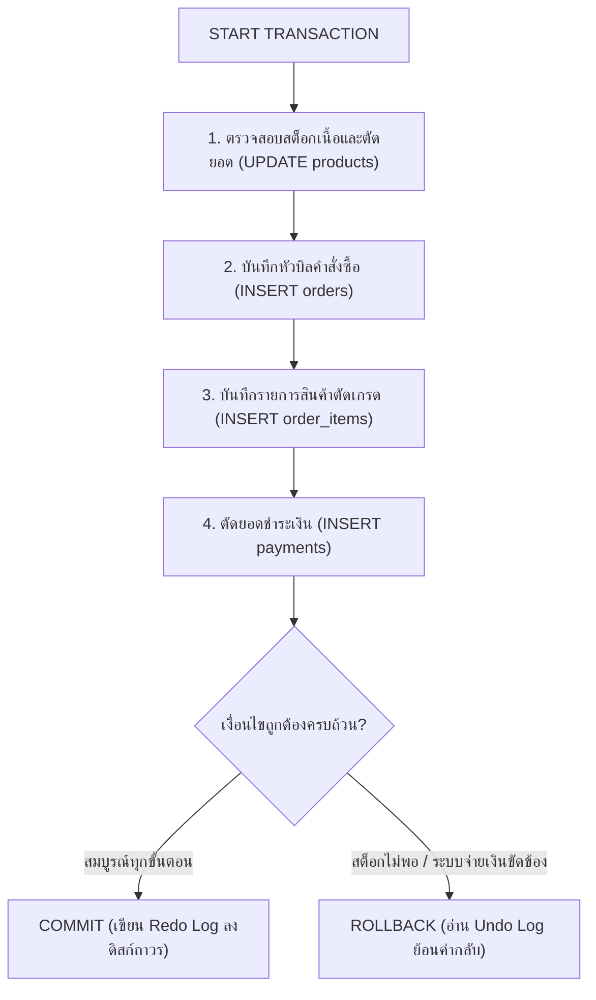
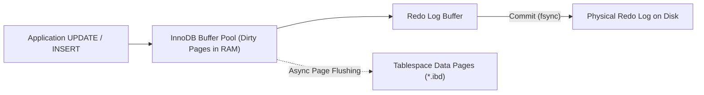

# Transactions ACID

ระบบฐานข้อมูลธุรกรรมระดับองค์กรอย่าง **MySQL 8.4 LTS / 8.0** ที่ขับเคลื่อนด้วยสตอเรจเอนจิน **InnoDB** ได้รับการออกแบบขึ้นโดยมีรากฐานความน่าเชื่อถืออยู่ที่คุณสมบัติ **ACID (Atomicity, Consistency, Isolation, Durability)** การทำความเข้าใจพฤติกรรมของทรานแซกชัน กลไกการบันทึกข้อมูลย้อนกลับ (Undo Log), บันทึกข้อมูลไปข้างหน้า (Redo Log) และระดับการแยกตัวของธุรกรรม (Isolation Levels) ถือเป็นองค์ความรู้ขั้นวิกฤตของ Database Engineer ในการป้องกันปัญหาข้อมูลไม่สอดคล้องกันและคอขวดด้านประสิทธิภาพ

---

## 1. แนวคิด (Concept)

ลองจินตนาการถึงแพลตฟอร์ม **Smart Butcher Marketplace** เมื่อลูกค้าสั่งซื้อเนื้อสเต๊ก Dry-Aged Ribeye และ Miyazaki Wagyu A5:



คุณสมบัติ ACID ทั้ง 4 ประการใน MySQL InnoDB ทำงานสอดประสานกันดังนี้:

1. **Atomicity (ความเป็นหนึ่งเดียว - All or Nothing):** ทุกลำดับขั้นตอนของการสั่งซื้อ ตั้งแต่ตัดสต็อกสินค้าใน `products`, ออกใบสั่งซื้อใน `orders`, เพิ่มรายการใน `order_items`, ไปจนถึงบันทึกการชำระเงินใน `payments` จะต้องสำเร็จครบทั้งหมด หากจุดใดจุดหนึ่งล้มเหลว ทุกอย่างที่ทำไปก่อนหน้าจะถูกกวาดลบทิ้งเสมือนไม่เคยเกิดขึ้น
2. **Consistency (ความถูกต้องตามกฎเกณฑ์):** สถานะของฐานข้อมูลต้องสอดคล้องกับข้อกำหนดความถูกต้องเสมอ เช่น กฎ `CHECK (stock_qty >= 0)`, ค่าความสัมพันธ์ Foreign Key ระหว่าง `order_items.order_id` กับ `orders.id`, และผลรวมราคาสินค้าต้องตรงกับยอดรวมสุทธิ
3. **Isolation (ความแยกตัวเป็นอิสระ):** ในขณะที่เชฟร้านอาหารกำลังสั่งจองเนื้อวากิวก้อนสุดท้าย ลูกค้าท่านอื่นที่กำลังเปิดดูหน้าเว็บในเสี้ยววินาทีเดียวกันจะไม่เห็นสถานะกึ่งกลางระหว่างรอตัดบัตรเครดิต
4. **Durability (ความคงทนถาวร):** เมื่อคำสั่ง `COMMIT` ส่งสัญญาณยืนยันกลับไปยังไคลเอนต์ ข้อมูลจะถูกบันทึกอย่างปลอดภัย แม้เกิดเหตุการณ์ไฟฟ้าดับหรือเซิร์ฟเวอร์ขัดข้องในมิลลิวินาทีถัดไป ข้อมูลดังกล่าวจะไม่สูญหายเมื่อเปิดเครื่องขึ้นมาใหม่

---

## 2. หลักการเบื้องหลัง (Under the Hood)

### 2.1 พฤติกรรมของ `autocommit = 1` และการจัดการทรานแซกชัน
โดยค่าเริ่มต้นใน MySQL ค่าตัวแปรระบบ `autocommit` จะถูกตั้งไว้ที่ `1` (เปิดใช้งาน):
- **เมื่อ `autocommit = 1`:** ทุกคำสั่ง DML เดี่ยวๆ (`INSERT`, `UPDATE`, `DELETE`) จะทำงานเป็น 1 ทรานแซกชันโดยอัตโนมัติ และจะทำการ `COMMIT` ลงดิสก์ทันทีหลังรันเสร็จ
- **การเริ่มทรานแซกชันแบบ Explicit:** สามารถใช้คำสั่ง `START TRANSACTION` หรือ `BEGIN` ซึ่งจะทำการระงับการ autocommit ชั่วคราวเฉพาะในขอบเขตของเซสชันนั้น จนกว่าจะมีการเรียกคำสั่ง `COMMIT` หรือ `ROLLBACK` อย่างชัดเจน
- **ตัวเลือกเสริมของ `START TRANSACTION`:**
  - `WITH CONSISTENT SNAPSHOT`: บังคับสร้าง Read View ของ MVCC ทันทีตั้งแต่เปิดทรานแซกชัน โดยไม่ต้องรอคำสั่ง `SELECT` แรก
  - `READ ONLY`: ประกาศให้ทรานแซกชันนี้อ่านได้อย่างเดียว ช่วยให้ InnoDB ปรับแต่งการจัดสรร Transaction ID และประหยัดทรัพยากร Lock Engine

### 2.2 กับดัก Implicit Commit จากคำสั่ง DDL
ใน MySQL คำสั่งบางประเภทจะก่อให้เกิด **Implicit Commit (การสั่งคอมมิตโดยปริยาย)** โดยอัตโนมัติ ซึ่ง **ไม่สามารถ ROLLBACK ได้**:
- **คำสั่ง DDL (Data Definition Language):** `ALTER TABLE`, `CREATE TABLE`, `DROP TABLE`, `TRUNCATE TABLE`, `RENAME TABLE`
- **คำสั่งจัดการโครงสร้างดัชนีและระบบสิทธิ์:** `CREATE INDEX`, `DROP INDEX`, `GRANT`, `REVOKE`
- **คำสั่งควบคุมตาราง:** `LOCK TABLES`, `UNLOCK TABLES`

<Callout type="warning" title="คำเตือน: ห้ามรันคำสั่ง DDL ภายใน Transaction เด็ดขาด">
หากแอปพลิเคชันเปิดทรานแซกชัน `START TRANSACTION`, แก้ไขข้อมูลสินค้าใน `products`, แล้วเผลอรันคำสั่ง DDL เช่น `CREATE TEMPORARY TABLE ...` ตัวเอนจิน MySQL จะสั่ง `COMMIT` ข้อมูลสินค้าทันทีโดยไม่แจ้งเตือน หากขั้นตอนถัดไปเกิด Error คำสั่ง `ROLLBACK` จะไม่สามารถย้อนคืนข้อมูลสินค้าที่เพิ่งอัปเดตไปได้อีกต่อไป!
</Callout>

### 2.3 กลไก Undo Log และ MVCC (Consistent Non-locking Reads)
InnoDB บรรลุการอ่านข้อมูลแบบไม่ติดล็อก (Non-locking Reads) และการย้อนคืนข้อมูล (Rollback) ผ่านสถาปัตยกรรม **MVCC (Multi-Version Concurrency Control)**:
- ทุกแถวของตารางใน Clustered Index จะมีคอลัมน์ซ่อน (Hidden System Columns) ที่ InnoDB สร้างขึ้นเสมอ:
  - **`DB_TRX_ID` (6 bytes):** Transaction ID ล่าสุดที่ทำการแทรก (INSERT) หรือแก้ไข (UPDATE) แถวนั้น
  - **`DB_ROLL_PTR` (7 bytes):** Roll Pointer ชี้ไปยังตำแหน่งของข้อมูลเวอร์ชันก่อนหน้าใน **Undo Log Segment**
  - **`DB_ROW_ID` (6 bytes):** ถูกสร้างขึ้นเฉพาะกรณีที่ตารางไม่มี Primary Key หรือ Unique Key
- **การอ่านข้อมูลแบบ Consistent Read:** เมื่อทรานแซกชันเริ่มอ่านข้อมูล ระบบจะสร้าง **Read View** ซึ่งบันทึกรายการ Transaction ID ที่กำลังทำงานอยู่ ณ เวลานั้น หากแถวข้อมูลถูกแก้ไขโดยทรานแซกชันที่มี `DB_TRX_ID` ใหม่กว่า Read View ตัว InnoDB จะเดินตาม `DB_ROLL_PTR` ไปดึงข้อมูลเวอร์ชันดั้งเดิมจาก Undo Log มารวมร่างส่งให้ผู้ใช้ โดยไม่ต้องรอบล็อกเกอร์ปล่อยล็อกแถว!
- **Purge Threads:** เธรดเบื้องหลังของ InnoDB มีหน้าที่คอยลบ Undo Log เก่าทิ้งเมื่อแน่ใจว่าไม่มี Active Transaction ใดต้องการใช้ Read View นั้นอีกต่อไป

### 2.4 กลไก Redo Log (WAL) และ Crash Recovery
ความคงทนถาวร (Durability) ของ InnoDB อาศัยหลักการ **Write-Ahead Logging (WAL)**:
- การเขียนข้อมูลลง Data Pages บนดิสก์จริงเป็นการทำ Random I/O ที่ใช้เวลานาน InnoDB จึงเลือกที่จะบันทึกการเปลี่ยนแปลงลงใน **Redo Log Buffer** ในหน่วยความจำ แล้วเขียนต่อท้ายลงไฟล์ **Redo Log (`#innodb_redo/` หรือ `ib_logfile`)** บนดิสก์แบบ Sequential I/O แทน
- **ตัวแปรชี้ชะตา `innodb_flush_log_at_trx_commit`:**
  - **`1` (ค่าเริ่มต้น - Full ACID):** บันทึก Redo Log ลงไฟล์และสั่ง `fsync()` เขียนลงดิสก์ทุกครั้งที่สั่ง `COMMIT` รับประกันว่าข้อมูลไม่สูญหายแน่นอน 100% แม้ไฟดับ
  - **`0`:** ข้อมูลจะค้างอยู่ใน Buffer และถูก flush ลงดิสก์วินาทีละ 1 ครั้ง หาก MySQL ล่มหรือไฟดับ ข้อมูลอาจสูญหายได้สูงสุด 1 วินาที
  - **`2`:** เขียนข้อมูลลง OS File Cache ทุกครั้งที่ commit แต่สั่ง `fsync()` ลงดิสก์จริงวินาทีละ 1 ครั้ง หากตัว MySQL ล่มข้อมูลไม่หาย แต่หากไฟดับหรือ OS ล่ม ข้อมูลจะหายได้สูงสุด 1 วินาที
- **Crash Recovery (ARIES Algorithm):** เมื่อเซิร์ฟเวอร์เปิดเครื่องใหม่หลังไฟดับ InnoDB จะตรวจสอบ **Checkpoint LSN (Log Sequence Number)** และทำการอ่าน Redo Log เพื่อนำข้อมูลกลับมาเขียนลง Data Pages (กระบวนการ Redo) จากนั้นจะอ่าน Undo Log เพื่อสั่ง Rollback ทรานแซกชันที่ยังค้างอยู่ก่อนเครื่องดับ (กระบวนการ Undo)



### 2.5 ระดับการแยกตัวของทรานแซกชัน (Isolation Levels)
มาตรฐาน ANSI/ISO SQL กำหนดปรากฏการณ์ความผิดปกติของข้อมูลไว้ 3 ประการ:
1. **Dirty Read:** การอ่านเห็นข้อมูลที่ทรานแซกชันอื่นแก้ไขแต่ยังไม่ได้ `COMMIT`
2. **Non-repeatable Read:** การที่คำสั่ง `SELECT` สองครั้งในทรานแซกชันเดียวกันได้ค่าของแถวข้อมูลเดิมไม่ตรงกัน เนื่องจากมีผู้อื่นมา `UPDATE` และ `COMMIT` คั่นกลาง
3. **Phantom Read:** การที่คำสั่ง `SELECT` ซ้ำด้วยเงื่อนไขเดิม แต่ได้จำนวนแถวเพิ่มขึ้นหรือลดลงเนื่องจากมีผู้อื่นมา `INSERT` หรือ `DELETE` คั่นกลาง

| ระดับ Isolation Level | Dirty Read | Non-repeatable Read | Phantom Read | กลไกภายในของ InnoDB |
| :--- | :---: | :---: | :---: | :--- |
| **READ UNCOMMITTED** | เกิดขึ้นได้ | เกิดขึ้นได้ | เกิดขึ้นได้ | อ่านข้อมูลโดยตรงจาก Buffer Pool โดยไม่สนใจ Undo Log |
| **READ COMMITTED** | ❌ ป้องกันได้ | เกิดขึ้นได้ | เกิดขึ้นได้ | ทุกคำสั่ง `SELECT` จะสร้าง **Read View ใหม่เสมอ** |
| **REPEATABLE READ** *(Default ใน MySQL)* | ❌ ป้องกันได้ | ❌ ป้องกันได้ | ❌ ป้องกันได้ | สร้าง **Read View ครั้งเดียว** ตั้งแต่คำสั่งแรก + ใช้ **Next-Key Locks** ป้องกัน Phantom Read ในคำสั่ง Locking Reads |
| **SERIALIZABLE** | ❌ ป้องกันได้ | ❌ ป้องกันได้ | ❌ ป้องกันได้ | ทุกคำสั่ง `SELECT` ธรรมดาจะถูกแปลงเป็น `SELECT ... FOR SHARE` อัตโนมัติ |

<Callout type="note" title="ความพิเศษของ REPEATABLE READ ใน MySQL">
ในตำราฐานข้อมูลทั่วไป Isolation Level แบบ REPEATABLE READ ยังคงเปิดโอกาสให้เกิด Phantom Read ได้ แต่สำหรับ MySQL InnoDB กลไก **Next-Key Lock** (การล็อกตัว Record ควบคู่กับ Gap ระหว่าง Index) สามารถป้องกัน Phantom Read ได้อย่างสมบูรณ์แบบทั้งในคำสั่ง Non-locking Read (ผ่าน MVCC) และ Locking Read (`SELECT ... FOR UPDATE`)
</Callout>

---

## 3. ตัวอย่างโค้ด (Smart Butcher Marketplace)

### ตัวอย่างที่ 1: ขั้นตอนการสั่งซื้อเนื้อพรีเมียมและตัดสต็อก พร้อมการใช้งาน SAVEPOINT และ ROLLBACK

ตัวอย่างนี้แสดงการสั่งซื้อเนื้อสเต๊ก Wagyu A5 Striploin พร้อมการตั้งจุดคืนสภาพ (Savepoint) เพื่อรองรับกรณีที่การเรียก Payment Gateway ล้มเหลว:

```sql filename="06_acid_checkout_rollback.sql"
-- =============================================================================
-- Smart Butcher Marketplace: Atomic Checkout with Savepoint Pattern
-- =============================================================================

-- ปิดใช้งานข้อผิดพลาดบางส่วนและเริ่ม Transaction แบบ Explicit
START TRANSACTION;

-- ขั้นตอนที่ 1: ตรวจสอบและลดจำนวนสต็อกเนื้อวากิว (ID: 101)
-- ใช้เงื่อนไข stock_qty >= 2 เพื่อป้องกันสต็อกติดลบ
UPDATE products 
SET stock_qty = stock_qty - 2,
    updated_at = NOW()
WHERE id = 101 
  AND stock_qty >= 2;

-- ตรวจสอบว่ามีแถวถูกอัปเดตจริงหรือไม่ผ่าน ROW_COUNT()
-- หากไม่มีแถวใดถูกอัปเดต (สต็อกไม่พอ) ให้ Rollback ทันที
-- (ในระดับ Application หรือ Stored Procedure)

-- ขั้นตอนที่ 2: สร้างข้อมูลหัวบิลคำสั่งซื้อ
INSERT INTO orders (
    id, user_id, order_number, status, total_amount, created_at
) VALUES (
    5001, 88, 'ORD-20261021-0001', 'PENDING', 10400.00, NOW()
);

-- ขั้นตอนที่ 3: บันทึกรายการสินค้าในคำสั่งซื้อ (Order Items)
INSERT INTO order_items (
    order_id, product_id, cut_type, quantity, unit_price
) VALUES (
    5001, 101, 'STEAK_1_INCH', 2, 5200.00
);

-- กำหนด SAVEPOINT ก่อนเรียกกระบวนการชำระเงินภายนอก
SAVEPOINT before_payment;

-- จำลองขั้นตอนที่ 4: บันทึกข้อมูลการตัดชำระเงิน
INSERT INTO payments (
    order_id, provider, amount, status, transaction_ref, created_at
) VALUES (
    5001, 'PROMPTPAY', 10400.00, 'FAILED', 'TXN-ERR-9999', NOW()
);

-- สมมติระบบพบว่าสถานะการชำระเงินล้มเหลว (Payment Failed)
-- เราต้องการยกเลิกเฉพาะบันทึกการชำระเงิน แต่เก็บ Order และสต็อกที่จองไว้เพื่อรอให้ลูกค้าลองจ่ายใหม่
ROLLBACK TO SAVEPOINT before_payment;

-- อัปเดตสถานะออเดอร์เป็น PAYMENT_PENDING เพื่อเปิดโอกาสให้ลูกค้าชำระเงินใหม่ภายใน 15 นาที
UPDATE orders 
SET status = 'PAYMENT_PENDING' 
WHERE id = 5001;

-- สั่งยืนยันการบันทึกข้อมูลส่วนที่เหลือลงดิสก์อย่างปลอดภัย
COMMIT;
```

---

### ตัวอย่างที่ 2: การจำลองความแตกต่างของ Isolation Levels และผลกระทบต่อ Read View

ตัวอย่างการทดสอบระหว่างสองเซสชัน เพื่อพิสูจน์พฤติกรรม Non-repeatable Read ใน `READ COMMITTED` เทียบกับ `REPEATABLE READ`:

```sql filename="06_isolation_levels_simulation.sql"
-- =============================================================================
-- Session A: ทดสอบการอ่านข้อมูลสต็อกเนื้อ Dry-Aged Ribeye (ID: 202)
-- =============================================================================

-- กรณีที่ 1: ตั้งค่าเป็น REPEATABLE READ (MySQL Default)
SET SESSION TRANSACTION ISOLATION LEVEL REPEATABLE READ;
START TRANSACTION;

-- Session A อ่านค่าครั้งแรก
SELECT id, name, stock_qty FROM products WHERE id = 202;
-- ผลลัพธ์: stock_qty = 10 (สร้าง Read View ณ จุดนี้)

-- -----------------------------------------------------------------------------
-- [สลับไปที่ Session B รันคำสั่งด้านล่างนี้แล้ว COMMIT]
-- START TRANSACTION;
-- UPDATE products SET stock_qty = 5 WHERE id = 202;
-- COMMIT;
-- -----------------------------------------------------------------------------

-- Session A อ่านค่าครั้งที่สอง (แม้ Session B จะ Commit ไปแล้ว)
SELECT id, name, stock_qty FROM products WHERE id = 202;
-- ผลลัพธ์: stock_qty ยังคงเป็น 10 เหมือนเดิม! (Consistent Snapshot จาก Undo Log)

COMMIT;


-- กรณีที่ 2: ตั้งค่าเป็น READ COMMITTED
SET SESSION TRANSACTION ISOLATION LEVEL READ COMMITTED;
START TRANSACTION;

-- Session A อ่านค่าครั้งแรก
SELECT id, name, stock_qty FROM products WHERE id = 202;
-- ผลลัพธ์: stock_qty = 5

-- -----------------------------------------------------------------------------
-- [สลับไปที่ Session B รันคำสั่งด้านล่างนี้แล้ว COMMIT]
-- START TRANSACTION;
-- UPDATE products SET stock_qty = 2 WHERE id = 202;
-- COMMIT;
-- -----------------------------------------------------------------------------

-- Session A อ่านค่าครั้งที่สอง
SELECT id, name, stock_qty FROM products WHERE id = 202;
-- ผลลัพธ์: stock_qty เปลี่ยนเป็น 2 ทันที! (เกิด Non-repeatable Read เนื่องจากสร้าง Read View ใหม่ทุก Statement)

COMMIT;
```

---

## 4. ข้อผิดพลาดที่พบบ่อย (Anti-pattern vs Best Practice)

| มิติการทำงาน | ❌ วิธีที่ผิด (Anti-pattern) | ✅ วิธีที่ถูกต้อง (Best Practice) |
| :--- | :--- | :--- |
| **การเปิดทรานแซกชันค้างไว้ข้ามเครือข่าย** | สั่ง `START TRANSACTION` แล้วทำการเรียก External API (เช่น Payment Gateway หรือ Line Notify) ภายในบล็อก | เตรียมข้อมูลและเรียก External API ให้เสร็จสิ้นล่วงหน้า แล้วเปิดทรานแซกชันสั้นที่สุด (Short Transaction) เฉพาะขั้นตอนเขียนฐานข้อมูล |
| **การรันคำสั่ง DDL ในทรานแซกชัน** | รันคำสั่ง `ALTER TABLE` หรือ `CREATE TABLE` หวังว่าจะ `ROLLBACK` ได้หากระบบมีปัญหา | แยกงาน Migration ออกจาก Business Transaction เสมอ เพราะ DDL จะสั่ง Implicit Commit ทันที |
| **การตั้งค่า `innodb_flush_log` ผิดวัตถุประสงค์** | ตั้งค่า `innodb_flush_log_at_trx_commit = 0` บนระบบบัญชีหรือการเงินเพื่อหวังผลการทดสอบ Benchmark | ใช้ค่า `1` เสมอใน Production สำหรับข้อมูลทางการเงิน เพื่อรับประกัน Durability 100% |
| **การปล่อยให้เกิด Long-running Transaction** | เปิดทรานแซกชันค้างไว้หลายชั่วโมงเพื่อประมวลผลรายงาน ทำให้ Undo Log สะสมมหาศาลและระบบ Purge ทำงานไม่ทัน (History List Length พุ่งสูง) | ใช้งาน Read-only Replica สำหรับคิวรีขนาดใหญ่ หรือแบ่งการทำงานเป็นชุดย่อยๆ (Batching) |

---

## 5. ควรใช้เมื่อไหร่ และ ไม่ควรใช้เมื่อไหร่

### ควรใช้ Explicit Transaction (`START TRANSACTION ... COMMIT`):
- **ขั้นตอนทางธุรกิจที่มีคำสั่งเขียนตั้งแต่ 2 คำสั่งขึ้นไป:** เช่น การตัดยอดเงินในกระเป๋าและเพิ่มยอดเงินเข้าบัญชีร้านค้า, การตัดสต็อกสินค้าและสร้างคำสั่งซื้อ
- **การอ่านเพื่อตรวจสอบก่อนแก้ไข (Read-Modify-Write):** เช่น การตรวจสอบโควตาคูปองส่วนลดก่อนตัดสิทธิ์ ต้องใช้ Transaction ควบคู่กับ Locking Read (`SELECT ... FOR UPDATE`)
- **เมื่อต้องการขอบเขตความปลอดภัยด้วย SAVEPOINT:** เพื่อย้อนคืนข้อผิดพลาดบางส่วนโดยไม่ต้องยกเลิกคำสั่งทั้งหมด

### ไม่จำเป็นต้องเปิด Explicit Transaction เมื่อ:
- **คำสั่ง `SELECT` ทั่วไปที่อ่านข้อมูลเพียงคำสั่งเดียว:** เพราะใน MySQL กลไก Consistent Read ทำงานเป็นอิสระอยู่แล้ว
- **คำสั่ง `INSERT` หรือ `UPDATE` เดี่ยวๆ เพียง 1 รายการ:** ค่า `autocommit = 1` จะจัดการความสมบูรณ์แบบ Atomic ในตัวเองได้สมบูรณ์และลดภาระการถือครองทรัพยากร
- **การประมวลผลข้อมูลมหาศาล (Massive Bulk Insert/Delete):** ไม่ควรรวมการลบข้อมูล 10 ล้านแถวไว้ในทรานแซกชันเดียว ควรแบ่งทำทีละ 10,000 แถวเพื่อป้องกัน Redo Log เต็มและ Undo Log บวม

---

## 6. คำถามสัมภาษณ์งาน (Interview Q&A)

### Q1: อธิบายการทำงานของ MVCC ใน InnoDB ผ่านฟิลด์ `DB_TRX_ID`, `DB_ROLL_PTR` และ Undo Log เมื่อเกิดเหตุการณ์ Consistent Read?
**แนวคำตอบ:**
InnoDB ใช้ระบบ Multi-Version Concurrency Control เพื่อให้การอ่านข้อมูลไม่ต้องรอล็อกจากการเขียน ในระดับกายภาพ แถวข้อมูลทุกแถวใน Clustered Index จะมีคอลัมน์ซ่อนอยู่ 2 ตัวหลัก:
1. `DB_TRX_ID`: เก็บ Transaction ID ของทรานแซกชันล่าสุดที่เข้ามาสร้างหรืออัปเดตแถวนั้น
2. `DB_ROLL_PTR`: เป็นตัวชี้ (Pointer) ไปยัง Undo Log Segment ที่บันทึกข้อมูลสถานะเดิมก่อนถูกแก้ไข

เมื่อทรานแซกชันหนึ่ง (ภายใต้โหมด REPEATABLE READ) ส่งคำสั่ง `SELECT`:
- MySQL จะสร้างโครงสร้างข้อมูลที่เรียกว่า **Read View** ซึ่งประกอบด้วย:
  - `m_low_limit_id`: Transaction ID ล่าสุดที่ยังไม่ถูกสร้าง
  - `m_up_limit_id`: Transaction ID ที่น้อยที่สุดที่ยังคง Active (ยังไม่ได้ Commit)
  - `m_ids`: รายชื่อ Transaction ID ทั้งหมดที่กำลัง Active อยู่ในระบบ ณ ขณะนั้น
- เมื่อตัวอ่านพบแถวข้อมูล มันจะตรวจสอบ `DB_TRX_ID` ของแถวนั้น:
  - หาก `DB_TRX_ID` น้อยกว่า `m_up_limit_id` แสดงว่าทรานแซกชันที่แก้ไขแถวนี้ได้ Commit ไปเรียบร้อยแล้วก่อนที่ Read View จะสร้างขึ้น -> สามารถอ่านข้อมูลแถวนั้นได้ทันที
  - หาก `DB_TRX_ID` มากกว่าหรือเท่ากับ `m_low_limit_id` หรืออยู่ในรายการ `m_ids` แสดงว่าแถวนั้นถูกแก้ไขโดยทรานแซกชันที่ยังไม่เสร็จสิ้น หรือเริ่มต้นหลัง Read View -> InnoDB จะใช้ `DB_ROLL_PTR` ไล่ย้อนประวัติไปยัง Undo Log ทีละขั้น เพื่อสร้างภาพจำลองของข้อมูลเวอร์ชันที่เก่าพอที่จะมองเห็นได้ส่งกลับมาให้คิวรี

---

### Q2: เหตุใด MySQL จึงเลือก REPEATABLE READ เป็น Default Isolation Level แตกต่างจาก PostgreSQL และ Oracle ที่เลือกใช้ READ COMMITTED และมีสถานการณ์ใดที่ Senior Database Engineer ควรพิจารณาเปลี่ยนเป็น READ COMMITTED?
**แนวคำตอบ:**
เหตุผลหลักในอดีตคือเรื่อง **Replication Consistency**:
ในยุค MySQL 5.1 และก่อนหน้า การจำลองข้อมูล (Replication) ทำงานบนรูปแบบ **Statement-Based Replication (SBR)** ซึ่งเซิร์ฟเวอร์จะส่งตัวคำสั่ง SQL ไปรันซ้ำบนเครื่อง Replica หากใช้ `READ COMMITTED` คำสั่งบน Replica อาจถูก Execute ในลำดับที่สลับกับ Transaction บน Primary ส่งผลให้ข้อมูลบน Replica แตกต่างไปจาก Primary MySQL จึงจำเป็นต้องใช้ `REPEATABLE READ` ควบคู่กับ **Gap Locking** เพื่อรักษากฎความถูกต้องของการเรียงลำดับคำสั่ง (Serializability)

**กรณีที่ควรพิจารณาเปลี่ยนเป็น `READ COMMITTED` ในระบบยุคปัจจุบัน:**
1. เมื่อระบบเปลี่ยนมาใช้ **Row-Based Replication (`binlog_format = ROW`)** ซึ่งเป็นค่าเริ่มต้นใน MySQL 8.0+ แล้ว ความจำเป็นในการพึ่งพา Gap Lock เพื่อความปลอดภัยของ Replication จะหมดไป
2. **การลดปัญหา Deadlock และ Lock Contention:** ในระดับ `READ COMMITTED` ตัว InnoDB จะ **ปิดการทำงานของ Gap Lock** ในการค้นหาและอัปเดตข้อมูลเกือบทั้งหมด (เหลือไว้เฉพาะการตรวจสอบ Foreign Key และ Unique Constraints) ทำให้คำสั่ง `UPDATE` และ `INSERT` ที่ทำงานพร้อมกันหลายๆ รายการเกิดการชนกันของล็อกน้อยลงอย่างมาก เหมาะสำหรับระบบ High-Concurrency OLTP ขนาดใหญ่

---

## ดูเพิ่มเติมที่
- [MySQL 8.x](/docs/database/mysql) — หน้าสารบัญหลักของ MySQL 8.x
- [Locking Mechanics](/docs/database/mysql/locking-mechanics) — เจาะลึก Record Lock, Gap Lock และ Next-Key Lock
- [InnoDB Indexes](/docs/database/mysql/innodb-indexes) — สถาปัตยกรรม Clustered Index และผลกระทบต่อประสิทธิภาพ
- [Transactions Overview](/docs/database/transactions) — ทบทวนทฤษฎี Transaction ในฐานข้อมูลเชิงสัมพันธ์
