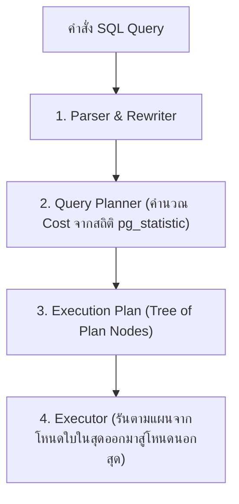
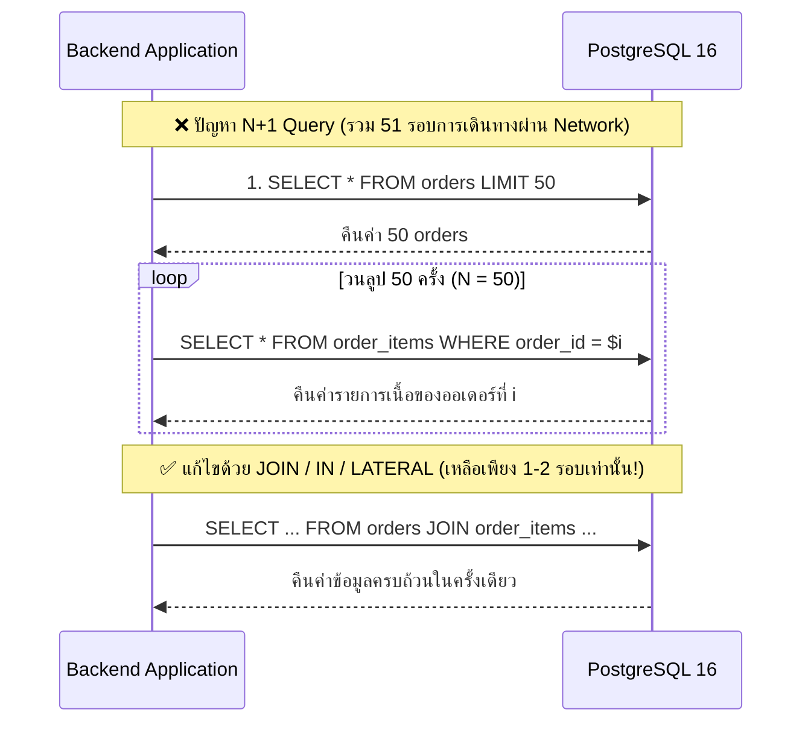
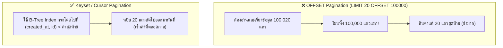
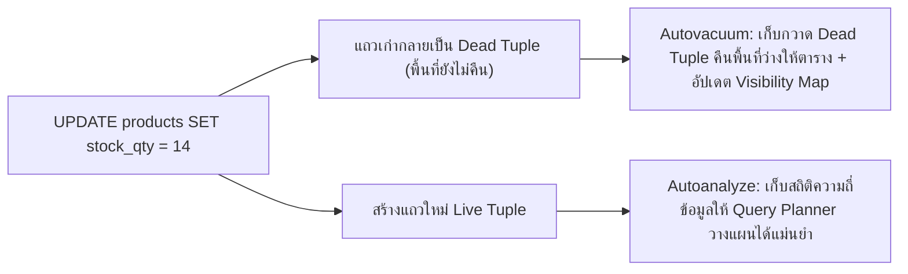

# Query Performance

การปรับจูนประสิทธิภาพคิวรี (Query Performance & Optimization) คือทักษะสำคัญที่แยกความแตกต่างระหว่างนักพัฒนาทั่วไปกับ Senior Fullstack/Database Engineer เมื่อระบบ **Smart Butcher Marketplace** เติบโตจนมีคำสั่งซื้อหลายล้านรายการ คิวรีที่เคยทำงานได้เร็วในเครื่องพัฒนาที่มีข้อมูลเพียงหลักร้อยแถวอาจกลายเป็นคอขวดที่ทำให้ CPU ของฐานข้อมูลพุ่งสูงถึง 100% เอกสารฉบับนี้จะเจาะลึกวิธีอ่านแผนการประมวลผล (`EXPLAIN ANALYZE`) การแก้ปัญหา N+1 และการทำ Pagination ประสิทธิภาพสูง ไปจนถึงการดูแลรักษาสุขภาพตารางด้วย `VACUUM` และ `ANALYZE` บน PostgreSQL 16

| หมวดหมู่เนื้อหา | หัวข้อหลักในหน้านี้ | เป้าหมายการเรียนรู้ |
| :--- | :--- | :--- |
| **1. การอ่านแผนประมวลผล** | การวิเคราะห์ Execution Plan ด้วย EXPLAIN และ EXPLAIN ANALYZE | อ่านค่า Cost, Actual Time, Rows, Loops และ Shared Buffers Hit/Read |
| **2. การลดจำนวนรอบคิวรี** | ปัญหา N+1 Query ในระดับ SQL และวิธีแก้ไขอย่างถูกจุด | เปลี่ยนการยิงคิวรีซ้ำในลูปให้เป็น `JOIN`, `IN`, หรือ `LATERAL` คิวรีเดียว |
| **3. การแบ่งหน้าข้อมูลขนาดใหญ่** | การทำ Pagination ประสิทธิภาพสูง (OFFSET vs Keyset/Cursor Pagination) | แก้ปัญหาหน้าลึกๆ ช้าด้วยเทคนิค Keyset Pagination ระดับ $O(\log N)$ |
| **4. การตรวจจับคิวรีเจ้าปัญหา** | การค้นหา Slow Queries ด้วย pg_stat_statements และ Log Configuration | ตั้งค่าตรวจจับและจัดอันดับคิวรีที่กินเวลาสะสมสูงสุดบน Production |
| **5. การดูแลสุขภาพตาราง** | กลไก VACUUM, ANALYZE และการทำงานของ Autovacuum ใน PostgreSQL 16 | เข้าใจ Dead Tuples, Table Bloat, Visibility Map และการตั้งค่า Autovacuum |
| **6. กรณีศึกษาปรับจูนจริง** | เทคนิคการปรับจูน Query ที่ช้าทีละขั้นพร้อมผลลัพธ์เปรียบเทียบก่อนและหลัง | ลงมือวิเคราะห์และลดเวลาคิวรีรายงานจากหลักวินาทีเหลือระดับมิลลิวินาที |

<Callout type="tip" title="กฎเหล็กของการทำ Query Optimization">
ห้ามเดาสาเหตุของความช้าด้วยความรู้สึกเด็ดขาด ทุกการปรับจูนต้องเริ่มต้นจากการวัดผลจริงด้วยคำสั่ง EXPLAIN (ANALYZE, BUFFERS) เพื่อดูว่าฐานข้อมูลเสียเวลาไปกับขั้นตอนใด (เช่น การกวาดอ่านดิสก์ การเรียงลำดับบนดิสก์ หรือการประเมินจำนวนแถวผิดพลาด) แล้วจึงแก้ให้ตรงจุด
</Callout>

---

## 1. การวิเคราะห์ Execution Plan ด้วย EXPLAIN และ EXPLAIN ANALYZE

### แนวคิด (Concept)
เวลาเราส่งคำสั่ง SQL ไปยัง PostgreSQL 16 คำสั่งนั้นจะไม่ได้ถูกรันทันที แต่จะถูกส่งให้ **Query Planner (Cost-Based Optimizer)** ประเมินหาเส้นทางการดึงข้อมูลที่มีต้นทุนต่ำที่สุดออกมาก่อน ซึ่งแผนการเดินทางนี้เรียกว่า **Execution Plan** โดยเราสามารถขอดูแผนนี้ได้ด้วย 2 คำสั่งหลัก:
1. **`EXPLAIN <query>`:** ขอให้ Planner แสดง **แผนการที่คาดการณ์ไว้ (Estimated Plan)** โดย **ไม่ได้รันคำสั่งนั้นจริง** ใช้ดูคร่าวๆ ว่า Planner ตั้งใจจะใช้ Index หรือไม่
2. **`EXPLAIN (ANALYZE, BUFFERS) <query>`:** สั่งให้ PostgreSQL **รันคำสั่งนั้นจริงๆ** แล้วนำผลลัพธ์เวลาที่ใช้จริง จำนวนแถวจริง และจำนวนบล็อกหน่วยความจำที่อ่านจริง มาเปรียบเทียบคู่กับค่าที่ Planner คาดการณ์ไว้



### หลักการเบื้องหลัง (Under the Hood)
ในการอ่านผลลัพธ์ของ `EXPLAIN (ANALYZE, BUFFERS)` ให้เข้าใจอย่างถ่องแท้ ต้องอ่านจาก **โหนดที่อยู่ลึกที่สุด (ย่อหน้าเข้าไปด้านในสุด) ย้อนออกมาหาโหนดบนสุด** โดยมีความหมายของตัวเลขสำคัญดังนี้:
- **`cost=0.42..8.44`:** ตัวเลขแรก (`0.42`) คือ Startup Cost (ต้นทุนก่อนจะได้แถวแรกออกมา) และตัวเลขหลัง (`8.44`) คือ Total Cost (ต้นทุนรวมทั้งหมดในหน่วย Arbitrary Cost Units เทียบเท่าการอ่านหน้าดิสก์แบบเรียงลำดับ = 1.0)
- **`rows=10` (ในบล็อกแรก) vs `rows=10` (ในบล็อก `actual`):** เปรียบเทียบจำนวนแถวที่ Planner คาดการณ์ไว้ กับจำนวนแถวที่ดึงออกมาได้จริง หากตัวเลขสองตัวนี้ต่างกันหลายสิบหรือหลายร้อยเท่า แปลว่าสถิติของตารางไม่อัปเดตและทำให้ Planner เลือกวิธี Join ผิด!
- **`loops=1`:** จำนวนรอบที่โหนดนั้นถูกสั่งรันซ้ำ **ข้อควรระวัง:** ค่า `actual time` ที่แสดงในโหนดนั้นคือเวลาเฉลี่ยต่อ 1 loop ดังนั้นเวลาจริงทั้งหมดของโหนดนั้นต้องนำ **`actual time * loops`** เสมอ!
- **`Buffers: shared hit=4 read=0`:**
  - `shared hit`: จำนวนบล็อก (บล็อกละ 8KB) ที่อ่านพบใน RAM (`shared_buffers`) ทันที (เร็วมาก)
  - `shared read`: จำนวนบล็อกที่ไม่มีใน RAM จนต้องไปขออ่านจาก OS Cache หรือ Disk I/O (ช้ากว่ามาก)

#### รูปแบบการ Scan และการ Join ที่พบบ่อยใน Execution Plan
- **Scan Nodes:** `Seq Scan` (กวาดทั้งตาราง), `Index Scan` (เปิด Index แล้วกระโดดไปหยิบแถวในตาราง), `Index Only Scan` (อ่านจบใน Index ไม่แตะตาราง), `Bitmap Heap Scan` (รวบรวมตำแหน่งหน้าบล็อกจาก `Bitmap Index Scan` มาเรียงลำดับก่อนเปิดอ่านตาราง)
- **Join Nodes:**
  - `Nested Loop`: วนลูปตารางนอกทีละแถวเพื่อไปค้นหาตารางใน (เร็วมากถ้าตารางนอกมีน้อยแถวและตารางในมี Index)
  - `Hash Join`: นำตารางที่เล็กกว่ามาสร้าง Hash Table ในหน่วยความจำ (`work_mem`) แล้วนำตารางใหญ่มาวิ่งเทียบ (เหมาะกับการ Join ข้อมูลจำนวนมากที่ไม่ได้เรียงลำดับไว้)
  - `Merge Join`: นำข้อมูลสองตารางที่เรียงลำดับตามคีย์ที่ใช้ Join มาแล้ว มาวิ่งประกบคู่กันรวดเดียว (เร็วมากสำหรับข้อมูลขนาดใหญ่ที่มี Index เรียงลำดับไว้แล้ว)

### ตัวอย่างโค้ด (Smart Butcher Marketplace)

#### ตัวอย่างที่ 1: การรันและอ่านผล `EXPLAIN (ANALYZE, BUFFERS)` ของคิวรีค้นหาออเดอร์
ตรวจสอบแผนการประมวลผลเมื่อดึงรายการคำสั่งซื้อของลูกค้าพร้อมรายการเนื้อย่อยในออเดอร์นั้น:

```sql filename="sql/01_explain_analyze_buffers_basics.sql"
-- ใช้ EXPLAIN (ANALYZE, BUFFERS) เพื่อดูทั้งเวลาจริงและจำนวนบล็อก 8KB ที่อ่านจาก RAM/Disk
EXPLAIN (ANALYZE, BUFFERS)
SELECT 
    o.id AS order_id,
    o.order_number,
    o.total_amount,
    oi.product_name_snapshot,
    oi.quantity,
    oi.unit_price
FROM orders o
JOIN order_items oi ON oi.order_id = o.id
WHERE o.user_id = 'a1111111-1111-1111-1111-111111111111'
  AND o.status = 'PAID'
ORDER BY o.created_at DESC
LIMIT 10;

/* ตัวอย่างผลลัพธ์ Execution Plan และการตีความ:
Limit  (cost=0.85..16.92 rows=10 width=118) (actual time=0.045..0.082 rows=10 loops=1)
  Buffers: shared hit=14
  ->  Nested Loop  (cost=0.85..32.99 rows=20 width=118) (actual time=0.044..0.079 rows=10 loops=1)
        Buffers: shared hit=14
        ->  Index Scan using idx_orders_user_status_created on orders o  (cost=0.42..8.45 rows=5 width=52) (actual time=0.025..0.031 rows=4 loops=1)
              Index Cond: ((user_id = 'a1111111-...'::uuid) AND ((status)::text = 'PAID'::text))
              Buffers: shared hit=4
        ->  Index Scan using uq_order_items_order_product on order_items oi  (cost=0.42..4.87 rows=4 width=82) (actual time=0.008..0.010 rows=2 loops=4)
              Index Cond: (order_id = o.id)
              Buffers: shared hit=10
Planning Time: 0.215 ms
Execution Time: 0.112 ms
*/
```

#### ตัวอย่างที่ 2: การใช้ `EXPLAIN` อย่างปลอดภัยกับคำสั่ง `UPDATE` หรือ `DELETE` โดยหุ้มด้วย `ROLLBACK`
เนื่องจาก `EXPLAIN ANALYZE` จะรันคำสั่ง SQL นั้นจริงๆ หากเราต้องการวัดประสิทธิภาพของคำสั่ง `UPDATE` หรือ `DELETE` โดยไม่ต้องการให้ข้อมูลในฐานข้อมูลเปลี่ยนไปจริงๆ ต้องหุ้มด้วย `BEGIN; ... ROLLBACK;` เสมอ:

```sql filename="sql/02_safe_explain_analyze_write_query.sql"
BEGIN;

-- ทดสอบวัดประสิทธิภาพการอัปเดตสถานะออเดอร์ที่หมดเวลาชำระเงิน
EXPLAIN (ANALYZE, BUFFERS)
UPDATE orders
SET status = 'CANCELLED', updated_at = CURRENT_TIMESTAMP
WHERE status = 'PENDING'
  AND created_at < CURRENT_TIMESTAMP - INTERVAL '24 hours';

-- ยกเลิกการเปลี่ยนแปลงทันทีหลังจากได้ผลลัพธ์ Execution Plan แล้ว
ROLLBACK;
```

### ผิด vs ถูก (Anti-pattern vs Best Practice)

| มิติการเปรียบเทียบ | ❌ ผิด (Anti-pattern) | ✅ ถูก (Best Practice) |
| :--- | :--- | :--- |
| **การรัน `EXPLAIN` ดูผล** | รันแค่ `EXPLAIN` เปล่าๆ แล้วเชื่อทันที หรือรัน `EXPLAIN ANALYZE` โดยไม่ใส่ `BUFFERS` | ใช้ `EXPLAIN (ANALYZE, BUFFERS)` เสมอเพื่อดูทั้งเวลาจริงและปริมาณ I/O (`shared hit` vs `shared read`) |
| **การรัน `EXPLAIN ANALYZE` กับ `DELETE`** | รัน `EXPLAIN ANALYZE DELETE FROM orders WHERE ...` ลอยๆ จนข้อมูลจริงถูกลบหายไปจากตาราง | หุ้มด้วย `BEGIN; EXPLAIN (ANALYZE, BUFFERS) DELETE ...; ROLLBACK;` เสมอ |
| **การดูแต่เวลา Execution Time** | ดูแค่ว่าเวลารวมน้อยกว่า 50ms บนเครื่อง Dev ที่มีข้อมูล 100 แถว แล้วสรุปว่าคิวรีเร็ว | ดูที่โครงสร้าง Plan Node ว่าใช้ Index ที่ถูกต้องหรือไม่ และดูจำนวน `Buffers` ที่ถูกอ่าน |

### ควรใช้เมื่อไหร่ และ ไม่ควรใช้เมื่อไหร่
- **ควรใช้ `EXPLAIN (ANALYZE, BUFFERS)` เมื่อ:** พัฒนาคิวรีใหม่ที่มีความซับซ้อน (มี `JOIN`, `GROUP BY`, Subqueries), เมื่อตรวจสอบพบ Slow Query, หรือหลังการสร้าง Index ใหม่เพื่อยืนยันว่า Planner เลือกใช้ Index นั้นจริง
- **ไม่ควรรัน `EXPLAIN ANALYZE` เปล่าๆ โดยไม่มี `BEGIN ... ROLLBACK` เมื่อ:** คิวรีนั้นเป็นคำสั่งแก้ไขข้อมูล (`INSERT`, `UPDATE`, `DELETE`) หรือการเรียกฟังก์ชันที่มีผลข้างเคียงต่อข้อมูล

### คำถามสัมภาษณ์ (Interview Q&A)
- **Q1: หากในผลลัพธ์ของ `EXPLAIN (ANALYZE, BUFFERS)` คุณเห็นบรรทัด `Sort Method: external merge Disk: 45200kB` มันหมายความว่าอะไร และคุณจะแก้ไขอย่างไร?**
  - **แนวคำตอบ:** หมายความว่าคิวรีนั้นต้องทำการจัดเรียงข้อมูล (`ORDER BY` หรือ `GROUP BY`) ขนาดประมาณ 45MB ซึ่งใหญ่เกินกว่าขนาดหน่วยความจำ `work_mem` ที่ตั้งไว้ (ค่าเริ่มต้นของ PostgreSQL คือ 4MB ต่อ Operation) ทำให้ PostgreSQL ต้องระบายข้อมูลลงไปเขียนและเรียงลำดับบนไฟล์ชั่วคราวในดิสก์ (Disk Spill) ซึ่งช้ากว่าการเรียงใน RAM หลายสิบเท่า วิธีแก้ไขคือ (1) สร้าง B-Tree Index ที่มีลำดับคอลัมน์ตรงกับ `ORDER BY` เพื่อไม่ต้อง Sort เลย หรือ (2) สั่งเพิ่ม `SET LOCAL work_mem = '64MB';` เฉพาะใน Transaction ของคิวรีรายงานตัวนั้น
- **Q2: ทำไมในโหนด `Nested Loop` เมื่อดูค่า `actual time=0.050..0.060 rows=1 loops=5000` โหนดนี้ถึงเป็นสาเหตุที่ทำให้คิวรีใช้เวลาถึง 300 มิลลิวินาที ทั้งที่ตัวเลขเขียนว่า `0.060`?**
  - **แนวคำตอบ:** เพราะค่า `actual time` ที่แสดงใน PostgreSQL Execution Plan คือค่าเฉลี่ยต่อการรัน 1 รอบ (`1 loop`) เมื่อโหนดนั้นมี `loops=5000` เวลาที่ใช้จริงทั้งหมดของโหนดนั้นจึงเท่ากับ `0.060 ms * 5000 loops = 300 ms`

---

## 2. ปัญหา N+1 Query ในระดับ SQL และวิธีแก้ไขอย่างถูกจุด

### แนวคิด (Concept)
**ปัญหา N+1 Query** คือหนึ่งในสาเหตุอันดับต้นๆ ที่ทำให้ระบบฐานข้อมูลล่มเมื่อมีผู้ใช้งานพร้อมกันจำนวนมาก โดยเกิดจากรูปแบบการเขียนโปรแกรมที่:
1. ยิงคิวรีแรก (**1 Query**) เพื่อดึงรายการข้อมูลหลักออกมาก่อนจำนวน $N$ แถว (เช่น ดึงรายการหมวดหมู่เนื้อ `categories` ออกมา 20 หมวดหมู่ หรือดึงออเดอร์ `orders` ออกมา 50 ใบ)
2. จากนั้นในโค้ดฝั่ง Application ใช้คำสั่งวนลูป (`for` หรือ `Promise.all`) ยิงคิวรีย่อยเข้าไปถามฐานข้อมูลอีก **$N$ Queries** เพื่อดึงข้อมูลลูกของแต่ละแถว (เช่น ดึง `order_items` ของออเดอร์ทีละใบ จำนวน 50 ครั้ง)

แม้คิวรีย่อยแต่ละครั้งจะใช้เวลาในฐานข้อมูลเพียง 1 มิลลิวินาที แต่การต้องเดินทางผ่านเครือข่ายไป-กลับ (Network Round-trip Latency) ถึง 51 ครั้ง จะทำให้ API ช้าลงหลายสิบเท่า และแย่ง Connection Pool จนหมดอย่างรวดเร็ว



### หลักการเบื้องหลัง (Under the Hood)
ทุกครั้งที่แอปพลิเคชันส่งคิวรี 1 ครั้งไปยัง PostgreSQL 16 จะเกิด Overhead ในแต่ละรอบดังนี้:
1. **Network Round-trip Time (RTT):** เวลาเดินทางของ TCP Packet ไปและกลับระหว่าง App Server กับ DB Server (เช่น 1-3 ms ต่อรอบ)
2. **Protocol Parsing & Binding:** กระบวนการอ่านข้อความโปรโตคอลของ Postgres Backend Process
3. **Planner & Executor Startup:** การเริ่มต้นโครงสร้างหน่วยความจำสำหรับรันคิวรีในแต่ละครั้ง

เมื่อเรายุบรวม $N+1$ คิวรี ให้กลายเป็นคิวรีเดียวด้วย `JOIN`, `WHERE order_id = ANY($1::uuid[])`, หรือ `LEFT JOIN LATERAL` ตัว PostgreSQL จะเสียเวลาผ่านเครือข่ายเพียงรอบเดียว และสามารถใช้ Hash Join หรือ Index Scan กวาดข้อมูลทั้งหมดในหน่วยความจำรวดเดียว

### ตัวอย่างโค้ด (Smart Butcher Marketplace)

#### ตัวอย่างที่ 1: การแก้ปัญหา N+1 เมื่อดึงข้อมูลออเดอร์พร้อมรายการสินค้าและผลรวมด้วย `JOIN` และ JSON Aggregation
แทนที่จะดึง `orders` มาวนลูปคิวรี `order_items` ทีละใบ เราสามารถดึงออเดอร์พร้อมรวมรายการสินค้าย่อยออกมาเป็น JSON Array จบในคิวรีเดียว:

```sql filename="sql/03_solve_n_plus_1_with_join_and_json_agg.sql"
-- ดึงรายการคำสั่งซื้อล่าสุด 20 ใบ พร้อมรายชื่อลูกค้า และรายการเนื้อย่อยทั้งหมดในคิวรีเดียว
SELECT 
    o.id,
    o.order_number,
    o.status,
    o.total_amount,
    o.created_at,
    u.full_name AS customer_name,
    COALESCE(
        jsonb_agg(
            jsonb_build_object(
                'item_id', oi.id,
                'product_id', oi.product_id,
                'product_name', oi.product_name_snapshot,
                'quantity', oi.quantity,
                'unit_price', oi.unit_price,
                'subtotal', oi.subtotal
            ) ORDER BY oi.created_at ASC
        ) FILTER (WHERE oi.id IS NOT NULL),
        '[]'::jsonb
    ) AS items
FROM orders o
JOIN users u ON u.id = o.user_id
LEFT JOIN order_items oi ON oi.order_id = o.id
WHERE o.user_id = 'a1111111-1111-1111-1111-111111111111'
GROUP BY o.id, u.full_name
ORDER BY o.created_at DESC
LIMIT 20;
```

#### ตัวอย่างที่ 2: การแก้ปัญหา N+1 แบบ "ดึงสินค้าขายดี 3 อันดับแรกของแต่ละหมวดหมู่" ด้วย `LEFT JOIN LATERAL`
โจทย์คลาสสิกที่นักพัฒนามักติดกับดัก N+1 คือ "ต้องการแสดงหมวดหมู่เนื้อทุกหมวด พร้อมสินค้าที่ราคาแพงที่สุดหรือขายดีที่สุดหมวดละ 3 ชิ้น" เพราะใช้ `LIMIT 3` ใน `JOIN` ปกติไม่ได้ แต่ใน PostgreSQL 16 เราสามารถใช้ **`LATERAL JOIN`** แก้ปัญหานี้ในคิวรีเดียวได้อย่างสมบูรณ์แบบ:

```sql filename="sql/04_solve_top_n_per_group_with_lateral_join.sql"
-- ดึงหมวดหมู่เนื้อที่เปิดขายทั้งหมด พร้อมสินค้าเนื้อเกรดพรีเมียมสูงสุด 3 อันดับแรกของแต่ละหมวดหมู่ในคิวรีเดียว!
SELECT 
    c.id AS category_id,
    c.name AS category_name,
    c.slug AS category_slug,
    top_p.id AS product_id,
    top_p.sku,
    top_p.name AS product_name,
    top_p.price_per_kg,
    top_p.marbling_score
FROM categories c
LEFT JOIN LATERAL (
    -- Subquery ด้านในของ LATERAL สามารถอ้างอิง c.id จากตารางด้านนอกได้โดยตรงและใช้ Index + LIMIT ได้ทันที!
    SELECT p.id, p.sku, p.name, p.price_per_kg, p.marbling_score
    FROM products p
    WHERE p.category_id = c.id
      AND p.is_active = TRUE
      AND p.deleted_at IS NULL
    ORDER BY p.price_per_kg DESC
    LIMIT 3
) top_p ON TRUE
WHERE c.is_active = TRUE
ORDER BY c.name ASC, top_p.price_per_kg DESC;
```

### ผิด vs ถูก (Anti-pattern vs Best Practice)

| มิติการเปรียบเทียบ | ❌ ผิด (Anti-pattern) | ✅ ถูก (Best Practice) |
| :--- | :--- | :--- |
| **การดึงข้อมูลลูกในลูป** | รัน `SELECT` ในลูป `for (const order of orders)` หรือใน `orders.map(async ...)` | ใช้ `JOIN`, `WHERE order_id = ANY($1::uuid[])`, หรือใช้ `include` (DataLoader/Batching) ใน Prisma |
| **การดึง Top-N ต่อกลุ่ม** | ดึง `categories` มา 15 หมวด แล้วยิงคิวรี `SELECT ... FROM products WHERE category_id = $1 LIMIT 3` อีก 15 ครั้ง | ใช้ `LEFT JOIN LATERAL (... LIMIT 3)` หรือ Window Function `ROW_NUMBER() OVER (PARTITION BY ...)` ในคิวรีเดียว |
| **การอัปเดตหลายแถวในลูป** | วนลูปยิง `UPDATE products SET ... WHERE id = $1` ทีละชิ้นจำนวน 100 ครั้ง | ใช้ `UPDATE ... FROM (VALUES ...) AS v(...)` เพื่ออัปเดตทั้งหมดภายในคิวรีเดียว |

### ควรใช้เมื่อไหร่ และ ไม่ควรใช้เมื่อไหร่
- **ควรใช้ `JOIN` หรือ `LATERAL JOIN` รวบเป็น 1 คิวรีเมื่อ:** ข้อมูลที่ดึงมีความสัมพันธ์กันชัดเจนและขนาดของข้อมูลที่ถูกทำซ้ำจากตารางแม่ไม่ใหญ่มาก
- **ควรใช้กลยุทธ์ 2 คิวรี (`SELECT ... FROM orders` ตามด้วย `SELECT ... FROM order_items WHERE order_id = ANY(...)` ซึ่งเป็นวิธีค่าเริ่มต้นของ Prisma `include`) เมื่อ:** ตารางแม่มีคอลัมน์ขนาดใหญ่จำนวนมาก และแต่ละแถวแม่มีแถวลูกหลายร้อยแถว การแยกเป็น 2 คิวรี (ไม่ใช่ N+1 แต่เป็น 1+1 = 2 คิวรีคงที่เสมอ) จะช่วยป้องกันไม่ให้ข้อมูลตารางแม่ถูกคัดลอกซ้ำซ้อนส่งผ่าน Network จำนวนมาก (Cartesian Product Duplication)

### คำถามสัมภาษณ์ (Interview Q&A)
- **Q1: การใช้ `Promise.all(orders.map(o => getOrderItems(o.id)))` ใน Node.js/TypeScript ช่วยแก้ปัญหา N+1 Query ได้หรือไม่ เพราะเหตุใด?**
  - **แนวคำตอบ:** **ไม่ได้แก้ปัญหา N+1 เลย และในทางกลับกันยังอันตรายกว่าเดิมด้วยซ้ำ!** เพราะฐานข้อมูลยังคงถูกยิงด้วยจำนวน $N+1$ คิวรีเท่าเดิม แต่การรันผ่าน `Promise.all()` จะสั่งยิงคิวรีทั้ง $N$ คำสั่งออกไปพร้อมกันในเสี้ยววินาทีเดียว หาก $N = 100$ และมีผู้ใช้กดหน้าเว็บนี้พร้อมกัน 5 คน จะเกิดคิวรีพุ่งเข้าแย่ง Connection Pool พร้อมกันถึง 500 คิวรีทันทีจนเกิด Connection Pool Exhaustion
- **Q2: อธิบายการทำงานของ `LATERAL JOIN` ใน PostgreSQL ว่าต่างจาก Subquery ปกติอย่างไร?**
  - **แนวคำตอบ:** ใน Subquery ปกติที่อยู่ใน `FROM` หรือ `JOIN` ด้านในของ Subquery จะไม่สามารถมองเห็นหรืออ้างอิงคอลัมน์ของตารางที่อยู่ข้างนอกในระดับเดียวกันได้ แต่เมื่อเติมคีย์เวิร์ด `LATERAL` จะอนุญาตให้ Subquery ด้านในอ้างอิงคอลัมน์จากตารางทางซ้ายมือได้โดยตรง เสมือนการวนลูป `forEach` แถวของตารางซ้ายมือแล้วรัน Subquery ที่ใช้ Index และ `LIMIT` ภายในตัว Database Engine เองโดยไม่ต้องส่งกลับไปกลับมาผ่าน Network

---

## 3. การทำ Pagination ประสิทธิภาพสูง (OFFSET vs Keyset/Cursor Pagination)

### แนวคิด (Concept)
เมื่อระบบมีรายการสินค้าหรือประวัติคำสั่งซื้อจำนวนมาก เราต้องแบ่งข้อมูลแสดงผลทีละหน้า (**Pagination**) โดยวิธีแบ่งหน้ามี 2 แนวทางหลักที่มีประสิทธิภาพต่างกันราวฟ้ากับเหวเมื่อข้อมูลมีขนาดใหญ่:
1. **OFFSET / LIMIT Pagination:** การระบุจำนวนแถวที่ต้องการข้ามไป เช่น `LIMIT 20 OFFSET 100000` (ขอดูหน้า 5,001 หน้าละ 20 แถว) วิธีนี้เขียนง่ายแต่มีข้อเสียร้ายแรงคือ **ยิ่งเปิดหน้าลึกเท่าไหร่ คิวรียิ่งช้าลงเรื่อยๆ แบบ $O(N)$!**
2. **Keyset / Cursor Pagination (Seek Method):** การใช้ค่าของคอลัมน์สุดท้ายจากหน้าก่อนหน้ามาเป็นจุดอ้างอิงในเงื่อนไข `WHERE` เช่น `WHERE (created_at, id) < ($last_created_at, $last_id) ORDER BY created_at DESC, id DESC LIMIT 20` วิธีนี้จะกระโดดเข้าสู่ตำแหน่งใน B-Tree Index ทันที ทำให้ **การเปิดหน้าที่ 1 หรือหน้าที่ 50,000 ใช้เวลาเร็วเท่ากันที่ระดับ < 1 มิลลิวินาที ($O(\log N)$)!**



### หลักการเบื้องหลัง (Under the Hood)
ทำไมคำสั่ง `OFFSET 100000` ใน PostgreSQL (และ RDBMS ทุกตัว) จึงช้ามาก?
- เพราะในโครงสร้าง B-Tree Index ไม่มีตัวนับลำดับแถวแบบตายตัวเก็บไว้ เนื่องจากกลไก MVCC ทำให้แต่ละ Transaction อาจมองเห็นจำนวนแถวที่มีชีวิตอยู่ไม่เท่ากัน
- ดังนั้น เมื่อสั่ง `LIMIT 20 OFFSET 100000` ตัว PostgreSQL **ไม่มีทางลัดที่จะกระโดดข้าม 100,000 แถวไปได้** มันจำเป็นต้องกวาดอ่านข้อมูลจริงผ่าน Index หรือตารางตั้งแต่แถวที่ 1, 2, 3 เรื่อยไปจนครบ 100,000 แถว เพื่อเช็ค Visibility ว่าแต่ละแถวยังมีชีวิตอยู่หรือไม่ แล้วจึงโยน 100,000 แถวนั้นทิ้งไป เพื่อหยิบแถวที่ 100,001 ถึง 100,020 มาส่งให้เรา!
- ในทางกลับกัน **Keyset Pagination** ใช้การเปรียบเทียบค่า Tuple `(created_at, id) < ('2026-10-17 08:00:00+07', 'uuid-สุดท้าย')` ซึ่งตรงกับโครงสร้างการจัดเรียงของ Composite B-Tree Index พอดี ตัว Engine จึงวิ่งจาก Root ลงมายัง Leaf Page ของตำแหน่งนั้นโดยตรงและอ่านเพียง 20 แถวเท่านั้น

<Callout type="note" title="ทำไม Keyset Pagination ต้องใช้คอลัมน์ Tie-breaker คู่กันเสมอ">
หากเราเรียงลำดับและแบ่งหน้าด้วยคอลัมน์ created_at เพียงตัวเดียว เช่น WHERE created_at &lt; $1 ORDER BY created_at DESC แล้วบังเอิญมีคำสั่งซื้อ 3 ใบถูกสร้างขึ้นในระดับมิลลิวินาทีเดียวกันเป๊ะ การแบ่งหน้าจะเกิดอาการข้อมูลตกหล่นหรือซ้ำได้ ดังนั้นต้องใช้คอลัมน์ที่ไม่ซ้ำกันแน่นอนอย่าง id เป็นตัวตัดสินลำดับรอง (Tie-breaker) คู่กันในรูปแบบ Row Value Comparison เสมอ เช่น (created_at, id) &lt; ($1, $2)
</Callout>

### ตัวอย่างโค้ด (Smart Butcher Marketplace)

#### ตัวอย่างที่ 1: เปรียบเทียบคิวรี `OFFSET` แบบเดิม กับการสร้าง Index รองรับ Keyset Pagination
สร้าง Composite Index บน `(created_at DESC, id DESC)` เพื่อให้การเรียงลำดับมีค่า 고유 (Deterministic Order) 100%:

```sql filename="sql/05_keyset_pagination_setup.sql"
-- สร้าง Composite Index ที่เรียงลำดับทั้งเวลาและ id ในทิศทางเดียวกัน (DESC ทั้งคู่)
CREATE INDEX idx_orders_created_id_desc
ON orders (created_at DESC, id DESC);

-- 1. การดึงหน้าแรก (Page 1) ไม่ต้องมีเงื่อนไข Cursor
SELECT id, order_number, status, total_amount, created_at
FROM orders
ORDER BY created_at DESC, id DESC
LIMIT 20;
```

#### ตัวอย่างที่ 2: การเขียนคิวรี Keyset Pagination ด้วย Row Constructor `(col1, col2) < ($1, $2)`
เมื่อผู้ใช้เลื่อนลงมาดูหน้าถัดไป (Infinite Scroll หรือปุ่ม Next Page) ให้นำค่า `created_at` และ `id` ของแถวที่ 20 จากหน้าก่อนหน้า มาส่งเป็นพารามิเตอร์:

```sql filename="sql/06_keyset_pagination_next_page.sql"
-- 2. การดึงหน้าถัดไปโดยใช้ค่าสุดท้ายของหน้าก่อนหน้า:
-- สมมติแถวที่ 20 ของหน้าก่อนมี created_at = '2026-10-17 10:30:00+07' และ id = '9b222222-2222-2222-2222-222222222222'
EXPLAIN (ANALYZE, BUFFERS)
SELECT id, order_number, status, total_amount, created_at
FROM orders
WHERE (created_at, id) < ('2026-10-17 10:30:00+07'::timestamptz, '9b222222-2222-2222-2222-222222222222'::uuid)
ORDER BY created_at DESC, id DESC
LIMIT 20;

-- ผลลัพธ์: ใช้ Index Scan Backward/Forward บน idx_orders_created_id_desc อ่านเพียง 20 แถวเป๊ะ ไม่ว่าจะอยู่ลึกแค่ไหน!
```

### ผิด vs ถูก (Anti-pattern vs Best Practice)

| มิติการเปรียบเทียบ | ❌ ผิด (Anti-pattern) | ✅ ถูก (Best Practice) |
| :--- | :--- | :--- |
| **การเปิดให้ใส่ `OFFSET` ไม่จำกัด** | เปิด API `/orders?page=50000&limit=20` โดยไม่มีเพดานกั้น ทำให้บอทหรือผู้ใช้ยิงคิวรี `OFFSET` ลึกๆ จน DB ค้าง | ใช้ Keyset/Cursor Pagination สำหรับหน้า Feed/ประวัติข้อมูล หรือจำกัดค่า `max_offset <= 1000` หากต้องใช้เลขหน้า |
| **การเรียงลำดับโดยไม่มี Tie-breaker** | เขียน `ORDER BY created_at DESC LIMIT 20` โดยไม่ใส่ `, id DESC` ต่อท้าย ทำให้ลำดับแถวที่มีเวลาเท่ากันสลับไปมา | ใส่คอลัมน์ Unique เช่น `id` เป็นตัวเรียงลำดับรองเสมอ: `ORDER BY created_at DESC, id DESC` |
| **การรัน `SELECT COUNT(*)` ทุกหน้า** | รัน `SELECT COUNT(*) FROM orders` ทุกครั้งที่เปลี่ยนหน้าบนตาราง 10 ล้านแถว (ซึ่ง `COUNT(*)` ต้องกวาดนับจริงใน MVCC) | ใช้การดึง `LIMIT 21` (ดึงเกินมา 1 แถวเพื่อเช็คว่า `hasNextPage` หรือไม่) โดยไม่ต้องรัน `COUNT(*)` ทั้งตาราง |

### ควรใช้เมื่อไหร่ และ ไม่ควรใช้เมื่อไหร่
- **ควรใช้ Keyset / Cursor Pagination เมื่อ:** ตารางมีปริมาณข้อมูลขนาดใหญ่ (หลักหมื่นถึงหลายล้านแถว), ระบบเป็นแบบ Infinite Scroll, ประวัติคำสั่งซื้อ, หรือ API สำหรับดึงข้อมูลเป็นชุด (Batch Export)
- **อนุโลมให้ใช้ `OFFSET` Pagination ได้เมื่อ:** ตารางมีขนาดเล็ก (ไม่เกินไม่กี่พันแถว) หรือเป็นหน้าจอ Backoffice ที่ผู้ใช้งานจำเป็นต้องคลิกกระโดดไปยังหมายเลขหน้าแบบสุ่ม (เช่น กระโดดจากหน้า 1 ไปหน้า 8) โดยต้องบังคับเพดานไม่ให้ `OFFSET` เกินกำหนด

### คำถามสัมภาษณ์ (Interview Q&A)
- **Q1: ใน PostgreSQL ทำไมคำสั่ง `SELECT COUNT(*) FROM orders;` บนตารางที่มี 20 ล้านแถวจึงทำงานช้ามาก ต่างจากฐานข้อมูลยุคเก่าบางตัวที่เก็บตัวเลขจำนวนแถวไว้ตายตัว?**
  - **แนวคำตอบ:** เพราะสถาปัตยกรรม **MVCC (Multi-Version Concurrency Control)** ของ PostgreSQL ยอมให้แต่ละ Transaction ที่รันอยู่พร้อมกันมองเห็นแถวข้อมูลในตารางไม่เท่ากัน (ขึ้นอยู่กับเวลาที่แต่ละ Transaction เริ่มต้น) ดังนั้นจึงไม่มีค่าจำนวนแถวเดียวที่ใช้ได้กับทุก Transaction ตัว PostgreSQL จึงต้องทำการกวาดอ่าน (Index-Only Scan หรือ Sequential Scan) เพื่อนับแถวที่มีชีวิตอยู่ในมุมมองของ Transaction นั้นจริงๆ หากต้องการแค่ตัวเลขประมาณการอย่างรวดเร็วสำหรับแสดงบน UI สามารถดึงจากสถิติตารางได้ด้วย `SELECT reltuples::bigint FROM pg_class WHERE relname = 'orders';`
- **Q2: นิพจน์ `WHERE (created_at, id) < ($1, $2)` ใน SQL มีความหมายเทียบเท่ากับการเขียนเงื่อนไข `AND` / `OR` แบบเต็มอย่างไร?**
  - **แนวคำตอบ:** นิพจน์ Row Value Comparison `(created_at, id) < ($1, $2)` มีความหมายทางตรรกศาสตร์เทียบเท่ากับ `WHERE created_at < $1 OR (created_at = $1 AND id < $2)` ทุกประการ แต่การเขียนในรูป `(created_at, id) < ($1, $2)` อ่านเข้าใจง่ายกว่ามากและช่วยให้ Query Planner ของ PostgreSQL จับคู่กับ Composite B-Tree Index `(created_at DESC, id DESC)` ได้โดยตรงอย่างแม่นยำ

---

## 4. การค้นหา Slow Queries ด้วย pg_stat_statements และ Log Configuration

### แนวคิด (Concept)
ในระบบ Production ที่มีคิวรีวิ่งเข้าออกหลายพันคำสั่งต่อวินาที เราไม่สามารถรู้ได้เลยว่าคิวรีตัวไหนเป็นต้นเหตุที่ทำให้ฐานข้อมูลทำงานหนัก หากไม่มีระบบเฝ้าติดตาม (Observability) โดยใน PostgreSQL 16 มี 2 กลไกหลักที่ต้องเปิดใช้งานคู่กันเสมอ:
1. **`pg_stat_statements` Extension:** ส่วนขยายมาตรฐานที่ฝังตัวอยู่ในหน่วยความจำเพื่อรวบรวมสถิติของทุกคิวรีที่รันในระบบ โดยจะทำการ Normalize คิวรี (แทนที่ค่าพารามิเตอร์ด้วย `$1, $2`) แล้วเก็บสถิติว่าแต่ละคิวรีถูกเรียกไปกี่ครั้ง (`calls`) ใช้เวลารวมทั้งหมดเท่าไหร่ (`total_exec_time`) เวลาเฉลี่ยเท่าไหร่ (`mean_exec_time`) และอ่านบล็อกข้อมูลไปเท่าไหร่
2. **Slow Query Logging (`log_min_duration_statement`):** การตั้งค่าให้ PostgreSQL บันทึกคิวรีที่ใช้เวลารันนานเกินเกณฑ์ที่กำหนด (เช่น เกิน 200ms หรือ 500ms) ลงในไฟล์ Log พร้อมค่าพารามิเตอร์จริง เพื่อให้นักพัฒนานำไปจำลองเหตุการณ์ซ้ำได้

### หลักการเบื้องหลัง (Under the Hood)
ทำไมเราต้องดูทั้ง **`total_exec_time` (เวลารวมสะสม)** และ **`mean_exec_time` (เวลาเฉลี่ยต่อครั้ง)** ใน `pg_stat_statements`?
- **กรณีที่ 1 (คิวรีช้าแต่รันนานๆ ครั้ง):** คิวรีรายงานประจำเดือนใช้เวลา `mean_exec_time = 5,000 ms` (5 วินาที) แต่ถูกรันแค่วันละ 1 ครั้ง (`calls = 1`) กินเวลา CPU รวมแค่วันละ 5 วินาที
- **กรณีที่ 2 (คิวรีระดับปานกลางแต่ถูกเรียกถี่มหาศาล - Death by a Thousand Cuts):** คิวรีเช็คสต็อกหน้าแรกใช้เวลา `mean_exec_time = 25 ms` (ดูเหมือนไม่ช้ามากจนไม่ติด Slow Query Log ที่ตั้งไว้ 200ms) แต่ถูกเรียกถึง 100,000 ครั้งต่อชั่วโมง! ส่งผลให้ `total_exec_time = 2,500,000 ms` ซึ่งเผาผลาญ CPU ของฐานข้อมูลไปมากกว่าคิวรีแรกถึง 500 เท่า!

`pg_stat_statements` ช่วยให้เราจับผู้ร้ายทั้งสองกลุ่มนี้ได้อย่างแม่นยำ

### ตัวอย่างโค้ด (Smart Butcher Marketplace)

#### ตัวอย่างที่ 1: การเปิดใช้งานและตั้งค่า Slow Query Log และ `pg_stat_statements`
การตั้งค่าระดับฐานข้อมูลหรือเซิร์ฟเวอร์เพื่อให้ PostgreSQL 16 เก็บสถิติและบันทึกคิวรีที่ช้าเกิน 250 มิลลิวินาที:

```sql filename="sql/07_configure_slow_query_logging.sql"
-- 1. สร้าง Extension pg_stat_statements ในฐานข้อมูล (ต้องมี shared_preload_libraries = 'pg_stat_statements' ใน postgresql.conf)
CREATE EXTENSION IF NOT EXISTS pg_stat_statements;

-- 2. ตั้งค่าให้ฐานข้อมูล smart_butcher_db บันทึกทุกคิวรีที่ใช้เวลานานเกิน 250 ms ลงใน Log
ALTER DATABASE smart_butcher_db SET log_min_duration_statement = '250ms';

-- 3. ตั้งค่าให้บันทึกการรอ Lock ที่นานเกิน 1 วินาที เพื่อตรวจจับปัญหาคอขวดจากการแย่งทรัพยากร
ALTER DATABASE smart_butcher_db SET log_lock_waits = 'on';
```

#### ตัวอย่างที่ 2: คิวรีวิเคราะห์หา Top 10 คิวรีที่กินเวลาสะสมและอ่านดิสก์สูงสุดจาก `pg_stat_statements`
สคริปต์สำหรับ Senior DBA / Fullstack Engineer ใช้รันตรวจสอบหาคิวรีที่เป็นคอขวดอันดับต้นๆ ของระบบ:

```sql filename="sql/08_analyze_top_slow_queries.sql"
-- ดึง 10 อันดับคิวรีที่ใช้เวลาประมวลผลรวม (total_exec_time) สูงที่สุดในระบบ พร้อมอัตราส่วน Cache Hit
SELECT 
    calls,
    ROUND(total_exec_time::numeric, 2) AS total_time_ms,
    ROUND(mean_exec_time::numeric, 2) AS avg_time_ms,
    ROUND(max_exec_time::numeric, 2) AS max_time_ms,
    rows AS total_rows_returned,
    ROUND(
        (shared_blks_hit::numeric / NULLIF(shared_blks_hit + shared_blks_read, 0)) * 100, 
        2
    ) AS cache_hit_ratio_pct,
    LEFT(query, 120) AS query_snippet
FROM pg_stat_statements
WHERE dbid = (SELECT oid FROM pg_database WHERE datname = current_database())
ORDER BY total_exec_time DESC
LIMIT 10;
```

### ผิด vs ถูก (Anti-pattern vs Best Practice)

| มิติการเปรียบเทียบ | ❌ ผิด (Anti-pattern) | ✅ ถูก (Best Practice) |
| :--- | :--- | :--- |
| **การตั้งค่า `log_statement = 'all'`** | เปิดบันทึกทุกคิวรี (`all`) บน Production ตลอดเวลา ทำให้ Disk I/O เต็มและฐานข้อมูลช้าลงจากภาระการเขียน Log | ใช้ `log_min_duration_statement = '250ms'` เพื่อบันทึกเฉพาะคิวรีที่ช้าผิดปกติเท่านั้น |
| **การดูแต่ `max_exec_time`** | สนใจแต่คิวรีที่เคยช้าสุดเพียงครั้งเดียว แต่ละเลยคิวรีที่ถูกเรียกนาทีละหมื่นครั้ง | จัดอันดับตาม `total_exec_time DESC` เพื่อหาคิวรีที่กินสัดส่วน CPU รวมของระบบมากที่สุดก่อน |
| **การไม่รีเซ็ตสถิติหลังปรับจูน** | ปรับจูน Index เสร็จแล้วแต่ยังดูตัวเลขสะสมเก่าใน `pg_stat_statements` จนแยกไม่ออกว่าดีขึ้นหรือไม่ | เรียก `SELECT pg_stat_statements_reset();` หลังการ Deploy การปรับจูนใหญ่เพื่อเริ่มเก็บสถิติรอบใหม่ |

### ควรใช้เมื่อไหร่ และ ไม่ควรใช้เมื่อไหร่
- **ควรเปิด `pg_stat_statements` เมื่อ:** รันระบบบน Staging และ Production ทุกสภาพแวดล้อม (มี Overhead ต่ำมากเพียง ~1-2% แต่ให้ข้อมูลที่มีคุณค่ามหาศาล)
- **ไม่ควรตั้ง `log_min_duration_statement = 0` บน Production เมื่อ:** ระบบมี Traffic สูง เพราะการเขียนไฟล์ Log ลงดิสก์ทุกคิวรีจะกลายเป็นคอขวด I/O เสียเอง

### คำถามสัมภาษณ์ (Interview Q&A)
- **Q1: หากคุณได้รับแจ้งเตือนว่า CPU ของเซิร์ฟเวอร์ PostgreSQL พุ่งขึ้นไปที่ 95% ในขณะนี้ คุณจะใช้คำสั่งหรือขั้นตอนใดเพื่อหาสาเหตุทันทีและในระยะยาว?**
  - **แนวคำตอบ:** 
    1. **แก้ปัญหาเฉพาะหน้าทันที (Real-time):** คิวรีตาราง `pg_stat_activity` เพื่อดูว่ามีคิวรีใดกำลังรันค้างอยู่ (`state = 'active'`) หรือติดรอ Lock (`wait_event_type = 'Lock'`) นานผิดปกติ หากพบคิวรีที่ค้างและทำให้ระบบล่ม สามารถสั่งยกเลิกคิวรีนั้นอย่างปลอดภัยด้วย `SELECT pg_cancel_backend(pid);`
    2. **วิเคราะห์หาต้นตอ (Root Cause):** คิวรีตาราง `pg_stat_statements` โดยเรียงตาม `total_exec_time DESC` และ `shared_blks_read DESC` เพื่อหาคิวรีที่เผาผลาญ CPU และ I/O สูงสุด แล้วนำคิวรีนั้นไปรัน `EXPLAIN (ANALYZE, BUFFERS)` เพื่อสร้าง Index หรือเขียนคิวรีใหม่
- **Q2: ความแตกต่างระหว่าง `pg_cancel_backend(pid)` กับ `pg_terminate_backend(pid)` คืออะไร?**
  - **แนวคำตอบ:** `pg_cancel_backend(pid)` จะส่งสัญญาณ `SIGINT` ไปยกเลิกเฉพาะ **คิวรีปัจจุบันที่กำลังรันอยู่** โดยที่ Connection ของแอปพลิเคชันยังคงไม่หลุด (ปลอดภัยกว่า ควรใช้เป็นอันดับแรก) ส่วน `pg_terminate_backend(pid)` จะส่ง `SIGTERM` เพื่อ **ตัดการเชื่อมต่อและฆ่า Process นั้นทิ้งทันที** ซึ่งจะทำการ Rollback ทั้ง Transaction ที่ค้างอยู่ (ใช้เมื่อ `pg_cancel_backend` ไม่สามารถหยุดการทำงานได้ หรือเมื่อ Process ค้างอยู่ในสถานะ `idle in transaction`)

---

## 5. กลไก VACUUM, ANALYZE และการทำงานของ Autovacuum ใน PostgreSQL 16

### แนวคิด (Concept)
ใน PostgreSQL 16 เมื่อเราสั่ง `DELETE` แถวข้อมูล หรือสั่ง `UPDATE` แถวข้อมูล (เช่น การตัดสต็อกเนื้อในตาราง `products` หรือการเปลี่ยนสถานะออเดอร์ในตาราง `orders`) ตัวฐานข้อมูล **ไม่ได้ลบข้อมูลเก่าออกจากไฟล์บนดิสก์ทันที** และไม่ได้เขียนทับลงไปที่จุดเดิม แต่จะทำเครื่องหมายว่าแถวเดิมนั้น "ตายแล้ว" (**Dead Tuple**) แล้วเขียนแถวเวอร์ชันใหม่เพิ่มเข้าไป เพื่อให้ Transaction อื่นที่กำลังอ่านข้อมูลอยู่พร้อมกันยังคงมองเห็นข้อมูลเวอร์ชันเก่าได้อย่างถูกต้องตามหลัก MVCC

หากปล่อยทิ้งไว้โดยไม่มีคนเก็บกวาด ตารางจะเต็มไปด้วยซากแถวที่ตายแล้ว (เรียกว่า **Table Bloat**) ทำให้ขนาดตารางบวมขึ้นเรื่อยๆ และการคิวรีช้าลง จึงต้องมี 2 กลไกสำคัญ:
1. **`VACUUM`:** กระบวนการเข้าไปเก็บกวาดพื้นที่ของ **Dead Tuples** ที่ไม่มี Transaction ใดใช้งานแล้ว ให้กลับมาเป็นพื้นที่ว่างที่พร้อมนำกลับมาใช้เขียนข้อมูลแถวใหม่ได้อีกครั้ง (พร้อมอัปเดต Visibility Map)
2. **`ANALYZE`:** กระบวนการสุ่มอ่านข้อมูลในตารางเพื่อคำนวณสถิติการกระจายตัวของข้อมูล (เช่น ค่าที่พบบ่อยที่สุด จำนวนค่าที่ไม่ซ้ำกัน) แล้วนำไปเก็บใน `pg_statistic` เพื่อให้ **Query Planner** ใช้ตัดสินใจเลือก Execution Plan ที่แม่นยำ



### หลักการเบื้องหลัง (Under the Hood)
โดยปกติ PostgreSQL 16 มี Background Process ที่ชื่อว่า **Autovacuum Daemon** คอยรันทั้ง `VACUUM` และ `ANALYZE` ให้อัตโนมัติเมื่อจำนวนแถวที่เปลี่ยนแปลงถึงเกณฑ์ที่กำหนดตามสูตร:
$$\text{Vacuum Threshold} = \text{vacuum\_threshold (50)} + \left(\text{vacuum\_scale\_factor (0.20)} \times \text{จำนวนแถวในตาราง}\right)$$

**จุดบอดของค่าเริ่มต้นบนตารางขนาดใหญ่:**
ค่าเริ่มต้นของ `autovacuum_vacuum_scale_factor` คือ `0.20` (หรือ 20% ของตาราง) สำหรับตารางเล็กๆ ค่านี้อาจทำงานได้ดี แต่ถ้าตาราง `orders` หรือ `products` มีข้อมูล **10 ล้านแถว** การที่ Autovacuum จะเริ่มทำงานได้ ต้องรอให้เกิด Dead Tuples สะสมถึง $50 + (0.20 \times 10,000,000) = 2,000,050$ แถวเสียก่อน! ส่งผลให้ตารางบวมหนักและเมื่อ Autovacuum เริ่มทำงานก็จะกิน I/O ครั้งใหญ่ ดังนั้นสำหรับตารางที่มีการอัปเดตสูงใน Production เราจึงต้องปรับลดค่า Scale Factor เฉพาะตารางนั้นลงให้ทำงานถี่ขึ้นและเบาลง!

### ตัวอย่างโค้ด (Smart Butcher Marketplace)

#### ตัวอย่างที่ 1: การตรวจสอบจำนวน Dead Tuples และเวลาที่ Autovacuum ทำงานล่าสุด
ตรวจสอบสุขภาพของตารางในระบบ Smart Butcher ว่ามีซากข้อมูลที่รอการเก็บกวาดสะสมอยู่มากน้อยเพียงใด:

```sql filename="sql/09_monitor_dead_tuples_and_vacuum.sql"
-- ตรวจสอบจำนวน Live Tuples เทียบกับ Dead Tuples และเวลาที่ Vacuum/Analyze ทำงานล่าสุด
SELECT 
    relname AS table_name,
    n_live_tup AS live_rows,
    n_dead_tup AS dead_rows,
    ROUND((n_dead_tup::numeric / NULLIF(n_live_tup + n_dead_tup, 0)) * 100, 2) AS dead_tuple_ratio_pct,
    last_autovacuum,
    last_autoanalyze
FROM pg_stat_user_tables
ORDER BY n_dead_tup DESC;
```

#### ตัวอย่างที่ 2: การปรับจูน Autovacuum เฉพาะตารางที่มีการอัปเดตความถี่สูง (`products` และ `orders`)
ปรับตั้งค่าระดับตารางให้ Autovacuum และ Autoanalyze เข้ามาทำงานทันทีที่มีการเปลี่ยนแปลงครบ 2% (แทนที่จะรอถึง 20%) หรือเมื่อมี Dead Tuples ครบจำนวนที่กำหนด:

```sql filename="sql/10_tune_table_autovacuum_settings.sql"
-- ปรับจูน Autovacuum สำหรับตาราง products ที่มีการตัดสต็อกตลอดเวลา:
-- ให้ทำงานเมื่อมีแถวเปลี่ยน 1% (0.01) เพื่อรักษา Visibility Map ให้พร้อมทำ Index-Only Scan เสมอ
ALTER TABLE products SET (
    autovacuum_vacuum_scale_factor = 0.01,
    autovacuum_vacuum_threshold = 100,
    autovacuum_analyze_scale_factor = 0.01,
    autovacuum_analyze_threshold = 100
);

-- ปรับจูน Autovacuum สำหรับตาราง orders ขนาดใหญ่:
ALTER TABLE orders SET (
    autovacuum_vacuum_scale_factor = 0.02,
    autovacuum_vacuum_threshold = 500,
    autovacuum_analyze_scale_factor = 0.01,
    autovacuum_analyze_threshold = 500
);

-- สั่งรัน VACUUM และ ANALYZE ด้วยตนเองพร้อมดูรายงานละเอียดเมื่อเพิ่งนำเข้าข้อมูลชุดใหญ่เสร็จ
VACUUM (VERBOSE, ANALYZE) products;
```

### ผิด vs ถูก (Anti-pattern vs Best Practice)

| มิติการเปรียบเทียบ | ❌ ผิด (Anti-pattern) | ✅ ถูก (Best Practice) |
| :--- | :--- | :--- |
| **การสั่ง `VACUUM FULL` บน Production** | รัน `VACUUM FULL orders;` ในเวลาทำการเพื่อหวังคืนพื้นที่ดิสก์ ทำให้ตารางติด `ACCESS EXCLUSIVE` lock ห้ามอ่านห้ามเขียนทั้งระบบ | ใช้ `VACUUM` ปกติและปรับจูน Autovacuum ให้ทำงานถี่ขึ้น (หากจำเป็นต้องบีบอัดตารางโดยไม่ล็อก ให้ใช้เครื่องมือ `pg_repack`) |
| **การปิด Autovacuum** | ปิด `autovacuum = off` เพราะคิดว่ามันแย่ง CPU ตอนกลางวัน | ห้ามปิด Autovacuum เด็ดขาด! เพราะจะทำให้ตารางบวมและเกิดวิกฤต Transaction ID Wraparound จนฐานข้อมูลหยุดทำงาน |
| **การไม่รัน `ANALYZE` หลัง Bulk Insert** | นำเข้าข้อมูลสินค้าใหม่ 500,000 แถวแล้วเปิดให้ผู้ใช้คิวรีทันทีโดยที่สถิติตารางยังคิดว่ามี 0 แถว | รัน `ANALYZE ชื่อตาราง;` ทันทีหลังจากการทำ Bulk Import หรือ Data Migration ขนาดใหญ่ |

### ควรใช้เมื่อไหร่ และ ไม่ควรใช้เมื่อไหร่
- **ควรปรับลด `autovacuum_vacuum_scale_factor` ลง (เช่น เหลือ `0.01` - `0.05`) เมื่อ:** ตารางนั้นมีขนาดใหญ่ (หลักแสนถึงหลักล้านแถว) หรือมีการ `UPDATE`/`DELETE` ข้อมูลด้วยความถี่สูงอย่างต่อเนื่อง
- **ไม่ควรรัน `VACUUM FULL` เมื่อ:** ระบบกำลังเปิดให้บริการผู้ใช้งานจริง เพราะ `VACUUM FULL` จะทำการสร้างไฟล์ตารางใหม่ทั้งก้อนและล็อกตารางไม่ให้แม้แต่คำสั่ง `SELECT` ทำงานได้จนกว่าจะเสร็จ

### คำถามสัมภาษณ์ (Interview Q&A)
- **Q1: ความแตกต่างระหว่างคำสั่ง `VACUUM` ปกติ กับ `VACUUM FULL` ใน PostgreSQL คืออะไร?**
  - **แนวคำตอบ:** `VACUUM` ปกติจะทำงานควบคู่ไปกับการอ่านและเขียนของแอปพลิเคชันได้โดยไม่บล็อกตาราง โดยมันจะทำเครื่องหมายพื้นที่ของ Dead Tuples ภายในไฟล์ตารางให้กลับมาว่างพร้อมให้แถวใหม่ของตารางนั้นเขียนทับลงไปได้ (แต่ไม่ได้ลดขนาดไฟล์บน OS ลง) ส่วน `VACUUM FULL` จะทำการคัดลอกเฉพาะแถวที่ยังมีชีวิตไปสร้างเป็นไฟล์ตารางใหม่เอี่ยมที่เรียงติดกันแน่นแล้วลบไฟล์เก่าทิ้งเพื่อคืนพื้นที่ให้ OS แต่ต้องแลกกับการล็อกตารางระดับสูงสุด (`ACCESS EXCLUSIVE` lock) ที่บล็อกทั้งการอ่านและการเขียนทั้งหมดตลอดการทำงาน
- **Q2: อะไรคือสาเหตุที่ทำให้ Autovacuum ทำงานแล้วแต่ระบุว่า `dead_tuples cannot be removed yet` (ไม่สามารถลบ Dead Tuples ออกได้)?**
  - **แนวคำตอบ:** เกิดจากมี **Long-running Transaction** (เช่น Transaction ที่เปิด `BEGIN` ค้างไว้แล้วกลายเป็น `idle in transaction`), คิวรีที่รันนานหลายชั่วโมง, หรือมี **Replication Slot / Prepared Transaction ที่ค้างและไม่ได้ใช้งาน** อยู่ในระบบ เพราะตราบใดที่ยังมี Transaction เก่าที่เริ่มต้นก่อนหน้าที่แถวนั้นจะถูกลบเปิดค้างอยู่ PostgreSQL จะต้องเก็บ Dead Tuples เหล่านั้นไว้เผื่อ Transaction เก่านั้นต้องการอ่าน

---

## 6. เทคนิคการปรับจูน Query ที่ช้าทีละขั้นพร้อมผลลัพธ์เปรียบเทียบก่อนและหลัง

### แนวคิด (Concept)
ในหัวข้อนี้ เราจะจำลองสถานการณ์จริงในฐานะ Senior Fullstack Developer ที่ได้รับแจ้งปัญหาว่า **"API ดึงรายงานสินค้าเนื้อพรีเมียมขายดีและค้นหารายการคำสั่งซื้อของผู้ใช้ ใช้เวลาถึง 1,850 มิลลิวินาที (1.85 วินาที)"** โดยเราจะใช้กระบวนการปรับจูนอย่างเป็นระบบ 4 ขั้นตอน:
1. **Examine:** รันคิวรีเดิมที่มีปัญหาร่วมกับ `EXPLAIN (ANALYZE, BUFFERS)` เพื่อระบุจุดคอขวด
2. **Rewrite SQL (Sargable Query):** แก้ไขโครงสร้าง SQL ที่ขัดขวางการใช้ Index (เช่น เอาฟังก์ชันออกจากคอลัมน์ใน `WHERE`, เปลี่ยน Correlated Subquery เป็น Join/Aggregate, เลิกใช้ `SELECT *`)
3. **Create Optimal Index:** สร้าง Composite หรือ Covering Index ที่สอดคล้องกับเงื่อนไขการกรองและการเรียงลำดับ
4. **Verify:** รัน `EXPLAIN (ANALYZE, BUFFERS)` ซ้ำอีกครั้งเพื่อพิสูจน์ผลลัพธ์ก่อนและหลังการปรับจูน

### หลักการเบื้องหลัง (Under the Hood)
แนวคิดสำคัญในการเขียน SQL ให้ใช้ Index ได้เต็มประสิทธิภาพเรียกว่าการเขียน **Sargable Query (Search Argument Able)**:
- **Non-Sargable (ใช้ Index ปกติไม่ได้):** `WHERE DATE_TRUNC('month', o.created_at) = '2026-10-01'` หรือ `WHERE o.total_amount / 100 > 50` เพราะ Engine ต้องดึงค่าทุกแถวมาคำนวณฟังก์ชันหรือสมการก่อนจึงจะเปรียบเทียบได้
- **Sargable (วิ่งเข้า B-Tree Index ทันที):** `WHERE o.created_at >= '2026-10-01' AND o.created_at < '2026-11-01'` และ `WHERE o.total_amount > 5000` เพราะคอลัมน์อยู่เดี่ยวๆ ด้านหนึ่งของตัวดำเนินการเปรียบเทียบ ทำให้กระโดดเข้าสู่ช่วงของ B-Tree Index ได้ทันที

### ตัวอย่างโค้ด (Smart Butcher Marketplace)

#### ตัวอย่างที่ 1: คิวรีก่อนการปรับจูน (Before Optimization - ช้า 1,850 ms)
คิวรีเจ้าปัญหาที่ต้องการดึงรายการออเดอร์ที่ชำระเงินแล้วในเดือนตุลาคม 2026 ของสินค้าในหมวดหมู่เนื้อวากิว พร้อมนับจำนวนชิ้นรวมในแต่ละออเดอร์:

```sql filename="sql/11_slow_query_before_tuning.sql"
-- ❌ คิวรีก่อนปรับจูน: มีปัญหา 4 จุดใหญ่
-- 1. ใช้ SELECT * ดึงคอลัมน์ JSONB ขนาดใหญ่มาโดยไม่ได้ใช้
-- 2. ใช้ฟังก์ชัน TO_CHAR(o.created_at, 'YYYY-MM') ทำให้ใช้ Index บน created_at ไม่ได้ (Non-Sargable)
-- 3. ใช้ Correlated Subquery นับจำนวนชิ้นทีละแถว
-- 4. ใช้ OFFSET ลึกในการแบ่งหน้า
EXPLAIN (ANALYZE, BUFFERS)
SELECT 
    o.*,
    u.full_name,
    (SELECT SUM(oi.quantity) FROM order_items oi WHERE oi.order_id = o.id) AS total_meat_packs
FROM orders o
JOIN users u ON u.id = o.user_id
WHERE LOWER(o.status) = 'paid'
  AND TO_CHAR(o.created_at, 'YYYY-MM') = '2026-10'
ORDER BY o.created_at DESC
LIMIT 20 OFFSET 5000;

/* ผลลัพธ์ก่อนปรับจูน:
   - เกิด Parallel Seq Scan บนตาราง orders กวาดอ่านทุกแถวเพราะติดฟังก์ชัน LOWER() และ TO_CHAR()
   - รัน Subquery ซ้ำหลายพันรอบ
   - Buffers: shared hit=12450 read=38200
   - Execution Time: 1852.430 ms
*/
```

#### ตัวอย่างที่ 2: คิวรีหลังการปรับจูน (After Optimization - เร็วขึ้นเหลือ 1.15 ms!)
ปรับปรุงทั้งการสร้าง Index และเขียนคิวรีใหม่ให้เป็น Sargable Query พร้อมใช้ Keyset Pagination และดึงเฉพาะคอลัมน์ที่ใช้จริง:

```sql filename="sql/12_fast_query_after_tuning.sql"
-- ขั้นที่ 1: สร้าง Composite Covering Index ที่ตรงกับรูปแบบการค้นหาและเรียงลำดับ
CREATE INDEX CONCURRENTLY IF NOT EXISTS idx_orders_status_created_id_desc
ON orders (status, created_at DESC, id DESC)
INCLUDE (user_id, order_number, total_amount);

-- ขั้นที่ 2: เขียนคิวรีใหม่ให้สะอาดและเป็น Sargable 100%
EXPLAIN (ANALYZE, BUFFERS)
SELECT 
    o.id,
    o.order_number,
    o.status,
    o.total_amount,
    o.created_at,
    u.full_name,
    COALESCE(SUM(oi.quantity), 0) AS total_meat_packs
FROM orders o
JOIN users u ON u.id = o.user_id
LEFT JOIN order_items oi ON oi.order_id = o.id
WHERE o.status = 'PAID'
  -- เปลี่ยนจาก TO_CHAR เป็น Range Condition ที่ใช้ B-Tree Index ได้ทันที
  AND o.created_at >= '2026-10-01 00:00:00+07'::timestamptz
  AND o.created_at <  '2026-11-01 00:00:00+07'::timestamptz
  -- เปลี่ยนจาก OFFSET 5000 เป็น Keyset Pagination
  AND (o.created_at, o.id) < ('2026-10-15 14:20:00+07'::timestamptz, '7c333333-3333-3333-3333-333333333333'::uuid)
GROUP BY o.id, o.order_number, o.status, o.total_amount, o.created_at, u.full_name
ORDER BY o.created_at DESC, o.id DESC
LIMIT 20;

/* ผลลัพธ์หลังปรับจูน:
   - ใช้ Index Only Scan บน idx_orders_status_created_id_desc อ่านเพียง 20 แถว
   - Buffers: shared hit=68 read=0 (ลดการอ่านบล็อกจาก 50,650 บล็อก เหลือเพียง 68 บล็อกใน RAM!)
   - Execution Time: 1.150 ms (เร็วขึ้นกว่า 1,600 เท่า!)
*/
```

### ผิด vs ถูก (Anti-pattern vs Best Practice)

#### ตารางสรุปเปรียบเทียบผลลัพธ์ก่อนและหลังการปรับจูน

| ตัวชี้วัดประสิทธิภาพ | ❌ ก่อนปรับจูน (Before) | ✅ หลังปรับจูน (After) | การเปลี่ยนแปลง |
| :--- | :--- | :--- | :--- |
| **แผนการสแกนตาราง `orders`** | `Parallel Seq Scan` (กวาดทั้งตาราง) | `Index Only Scan` (กระโดดเข้าเป้า) | ไม่ต้องแตะตาราง Heap เลย |
| **จำนวนบล็อก 8KB ที่ต้องอ่าน** | 50,650 บล็อก (~405 MB) | 68 บล็อก (~544 KB) | ลด I/O ลง **99.86%** |
| **วิธีการแบ่งหน้าข้อมูล** | `OFFSET 5000` (อ่านแล้วทิ้ง 5,000 แถว) | Keyset `(created_at, id) < (...)` | อ่านเฉพาะ 20 แถวที่ต้องการจริง |
| **เวลาประมวลผลรวม (Execution Time)** | **1,852.43 ms** | **1.15 ms** | เร็วขึ้น **1,610 เท่า** |

### ควรใช้เมื่อไหร่ และ ไม่ควรใช้เมื่อไหร่
- **ควรทำ Query Rewriting และสร้าง Covering Index เมื่อ:** คิวรีนั้นอยู่ในเส้นทางหลักที่ผู้ใช้งานเรียกบ่อย หรือเป็นคิวรีที่ติดอันดับต้นๆ ใน `pg_stat_statements`
- **ไม่ควรพยายามจูนคิวรีวิเคราะห์ข้อมูลขนาดยักษ์ (OLAP) ให้รันสดๆ บนฐานข้อมูลหลักเมื่อ:** คิวรีนั้นต้องกวาดคำนวณข้อมูลย้อนหลังหลายปีจำนวนหลายสิบล้านแถวเสมอ ซึ่งควรย้ายไปใช้ **Materialized View**, **Read Replica**, หรือระบบ Data Warehouse แยกต่างหาก

### คำถามสัมภาษณ์ (Interview Q&A)
- **Q1: คำว่า "Sargable Query" คืออะไร และจงยกตัวอย่างการแปลงคิวรีที่ไม่เป็น Sargable ให้เป็น Sargable มา 2 ตัวอย่าง?**
  - **แนวคำตอบ:** คำว่า Sargable ย่อมาจาก **S**earch **ARG**ument **ABLE** หมายถึงการเขียนเงื่อนไขใน `WHERE` ให้ Database Engine สามารถนำค่าไปค้นหาในโครงสร้าง B-Tree Index ได้โดยตรง ตัวอย่างการแปลงเช่น:
    1. เปลี่ยนจาก `WHERE EXTRACT(YEAR FROM created_at) = 2026` เป็น `WHERE created_at >= '2026-01-01' AND created_at < '2027-01-01'`
    2. เปลี่ยนจาก `WHERE SUBSTRING(sku, 1, 3) = 'WGY'` เป็น `WHERE sku LIKE 'WGY%'`
- **Q2: ทำไมการใช้ `SELECT *` จึงส่งผลเสียต่อประสิทธิภาพอย่างมากใน PostgreSQL แม้ว่าเราจะดึงข้อมูลมาเพียง 50 แถวก็ตาม?**
  - **แนวคำตอบ:** ประการแรก หากตารางมีคอลัมน์ขนาดใหญ่ เช่น `TEXT` หรือ `JSONB` ที่ถูกจัดเก็บไว้ในตารางแยก **TOAST** การสั่ง `SELECT *` จะบังคับให้ PostgreSQL ต้องตามไปเปิดอ่านและคลายการบีบอัดข้อมูลจาก TOAST ทุกแถวทั้งที่ไม่ได้ใช้งาน ประการที่สอง การดึงทุกคอลัมน์ทำให้หมดสิทธิ์ใช้ **Index-Only Scan** เพราะ Index ไม่ได้เก็บทุกคอลัมน์ของตารางไว้ และประการที่สาม เป็นการเพิ่มขนาดข้อมูลที่ต้องแปลงและส่งผ่านสาย Network ไปยัง Backend โดยไม่จำเป็น

---

## ข้อผิดพลาดที่พบบ่อย (Anti-patterns)

1. **Non-Sargable Predicates:** การนำคอลัมน์ไปใส่ไว้ในฟังก์ชันหรือสมการคณิตศาสตร์ใน `WHERE` เช่น `WHERE DATE(created_at) = CURRENT_DATE` ทำให้ B-Tree Index บน `created_at` ไร้ประโยชน์ทันที
2. **N+1 Queries inside Application Loops:** การดึงรายการหลักมาแล้ววนลูปยิงคิวรีดึงข้อมูลย่อยทีละรายการผ่าน ORM หรือ SQL ดิบ ทำให้เกิด Network Round-trip หลายร้อยรอบใน 1 API Request
3. **Deep OFFSET Pagination:** การใช้ `LIMIT 20 OFFSET 100000` บนตารางขนาดใหญ่ ซึ่งบังคับให้ฐานข้อมูลต้องอ่านและโยนทิ้ง 100,000 แถวแรกทุกครั้งที่เปิดหน้า
4. **Abusing `SELECT DISTINCT` to Hide Bad Joins:** การเขียน `JOIN` ผิดจนข้อมูลซ้ำแล้วแก้ปัญหาปลายเหตุด้วยการเติม `SELECT DISTINCT` ข้างหน้า ซึ่งบังคับให้ PostgreSQL ต้องนำข้อมูลทั้งหมดมา Sort หรือ Hash เพื่อตัดแถวซ้ำออก เสียทั้ง CPU และ `work_mem`
5. **Ignoring Stale Statistics & Autovacuum:** การปล่อยให้ตารางที่มีการอัปเดตบ่อยเกิด Dead Tuples สะสมโดยไม่ปรับจูน Autovacuum ทำให้ตารางบวมและ Query Planner ประเมินจำนวนแถวผิดพลาดจนเลือกแผนการทำงานที่ช้า

---

## Checklist สรุป

- [ ] **Measured with `EXPLAIN (ANALYZE, BUFFERS)`:** คิวรีสำคัญทุกตัวผ่านการตรวจสอบแผนการประมวลผลจริง ยืนยันว่าไม่มี `Seq Scan` บนตารางขนาดใหญ่ และมีอัตราส่วน `shared hit` สูง
- [ ] **Zero N+1 Queries:** ตรวจสอบการทำงานของ API ทุกจุดว่าไม่มีการยิง SQL ซ้ำในลูป โดยเปลี่ยนเป็น `JOIN`, `LATERAL JOIN`, หรือ Batch Query (`IN` / `ANY`) เรียบร้อยแล้ว
- [ ] **Sargable `WHERE` Clauses:** ไม่มีคอลัมน์ที่มี Index ตัวใดถูกครอบด้วยฟังก์ชันใน `WHERE` (หรือหากจำเป็นต้องใช้ เช่น `LOWER(email)` ได้มีการสร้าง Expression Index รองรับตรงกันแล้ว)
- [ ] **Explicit Column Selection:** เลิกใช้ `SELECT *` ในโค้ด Production โดยระบุเฉพาะคอลัมน์ที่ต้องใช้งานจริงเพื่อหลีกเลี่ยง TOAST overhead และเปิดทางให้ทำ Index-Only Scan
- [ ] **Keyset Pagination for Large Lists:** ระบบแสดงรายการข้อมูลขนาดใหญ่ใช้ Keyset/Cursor Pagination `(created_at, id) < ($1, $2)` แทนการใช้ `OFFSET` ลึกๆ
- [ ] **`pg_stat_statements` Enabled:** เปิดใช้งาน `pg_stat_statements` และ `log_min_duration_statement` เพื่อติดตามและจัดอันดับคิวรีที่กินเวลาสะสมสูงสุดอย่างต่อเนื่อง
- [ ] **Autovacuum Tuned for Hot Tables:** ปรับลดค่า `autovacuum_vacuum_scale_factor` และ `autovacuum_analyze_scale_factor` บนตารางที่มีการอัปเดตถี่ (`products`, `orders`) ให้ทำงานสม่ำเสมอ

---

## ลำดับการเรียนที่แนะนำ และ ดูเพิ่มเติมที่

เมื่อคุณสามารถวิเคราะห์และปรับจูนให้คิวรีทำงานได้อย่างรวดเร็วแล้ว ขั้นตอนต่อไปคือการควบคุมความถูกต้องของข้อมูลเมื่อมีการแก้ไขหลายตารางพร้อมกันด้วย Transactions และการรับมือกับภาวะที่ผู้ใช้หลายพันคนแย่งกันสั่งซื้อสินค้าชิ้นเดียวกันด้วย Concurrency Control:

<Callout type="tip" title="ก้าวต่อไปสู่ความถูกต้องของธุรกรรมและการทำงานพร้อมกัน">
ความเร็วของคิวรีต้องมาพร้อมกับความถูกต้องของข้อมูล 100% ศึกษาต่อในบท Transactions และ Concurrency เพื่อป้องกันปัญหาสต็อกติดลบหรือการตัดเงินซ้ำซ้อนในระบบจริง
</Callout>

- **พื้นฐานการออกแบบและดัชนี:**
  - [Database Design](/docs/database/database-design)
  - [Indexing](/docs/database/indexing)
  - [PostgreSQL 16](/docs/database/postgresql)
  - [SQL](/docs/database/sql)
- **การควบคุมความถูกต้องของข้อมูลและการทำงานพร้อมกัน (ลำดับถัดไปที่แนะนำ):**
  - [Transactions](/docs/database/transactions)
  - [Concurrency](/docs/database/concurrency)
- **การดูแลรักษาระบบและการเชื่อมต่อฝั่ง Backend:**
  - [Connection Pooling](/docs/database/connection-pooling)
  - [Backup & Recovery](/docs/database/backup)
  - [Prisma ORM](/docs/backend/prisma-orm)
  - [NestJS](/docs/backend/nestjs)
